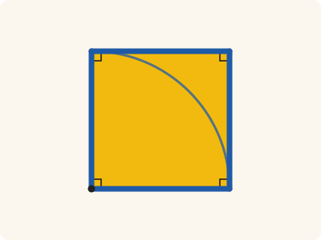
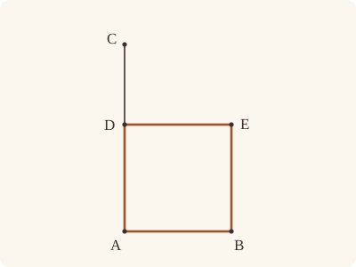

<!-- Generated by scripts/render.py. Do not edit by hand. -->

[Book I](index.md) · [← I.45](45.md) · [I.47 →](47.md)

# Book I, Proposition 46

*Describing a square*

> On a given straight line to describe a square.

<p align="center"></p>

<p align="center"><em>Stand an equal line upright at one end (the arc swings it round), then close the shape with parallels: four equal sides (blue) and four right angles.</em></p>

## Euclid's proof

<p align="center"></p>

Let AB be the given straight line; thus it is required to describe a square on the straight line AB.

Let AC be drawn at right angles to the straight line AB from the point A on it [I. 11], and let AD be made equal to AB; through the point D let DE be drawn parallel to AB, and through the point B let BE be drawn parallel to AD. [I. 31]

Therefore ADEB is a parallelogram; therefore AB is equal to DE, and AD to BE. [I. 34]

But AB is equal to AD; therefore the four straight lines BA, AD, DE, EB are equal to one another; therefore the parallelogram ADEB is equilateral.

I say next that it is also right-angled.

For, since the straight line AD falls upon the parallels AB, DE, the angles BAD, ADE are equal to two right angles. [I. 29]

But the angle BAD is right; therefore the angle ADE is also right.

And in parallelogrammic areas the opposite sides and angles are equal to one another; [I. 34] therefore each of the opposite angles ABE, BED is also right.

Therefore ADEB is right-angled.

And it was also proved equilateral.

Therefore it is a square; and it is described on the straight line AB.

Q. E. F.

## In Lean

✅ Proved

From [`Elements/BookI/Prop46.lean`](../../Elements/BookI/Prop46.lean). Euclid's sentences are the `--` comments; the lines under each one are the Lean that carries it out.

```lean
/-- On a given straight line to describe a square. -/
theorem Prop46 {A B P : Point} (hAB : A ≠ B) (hP : ¬ Collinear A B P) :
    ∃ D E : Point, Square A D E B ∧ SameSideOf D P A B ∧ SameSideOf E P A B := by
  -- Let AB be the given straight line; thus it is required to describe a square on the
  -- straight line AB.
  obtain ⟨AB, hA_AB, hB_AB⟩ := Postulate1 A B hAB
  -- Let AC be drawn at right angles to the straight line AB from the point A on it [I. 11],
  obtain ⟨C, hCP, hAC⟩ := Prop11 hAB ⟨AB, hA_AB, hB_AB, hA_AB⟩ hP
  have hBAC : ∠ B A C = ∟ := hAC B ⟨AB, hA_AB, hB_AB, hB_AB⟩ hAB.symm
  -- and let AD be made equal to AB; through the point D let DE be drawn parallel to AB, and
  -- through the point B let BE be drawn parallel to AD. [I. 31]
  /- A circle about A with distance AB gives D on the ray AC (Postulate 3).
     C need not lie beyond D. -/
  obtain ⟨D, hD, hAD⟩ := OnRay.exists_len_eq hAB hCP.triangle.ne₁₃
  have hDP : SameSideOf D P A B := SameSideOf.of_onRay hD hCP
  have hABD : Triangle A B D := hDP.triangle
  obtain ⟨DE, hD_DE, hDE_AB⟩ := Prop31.line (hABD.off_line hA_AB hB_AB)
  /- DE meets the parallel BE at E (`Prop31.parallelogram`, which cites I.30 for
     the meeting). -/
  obtain ⟨E, -, hDABE⟩ := Prop31.parallelogram hDE_AB hD_DE hA_AB hB_AB hAB
  -- Therefore ADEB is a parallelogram; therefore AB is equal to DE, and AD to BE. [I. 34]
  have hADEB : Parallelogram A D E B := hDABE.rotate.reverse
  have hDE : D ≠ E := hADEB.2.1
  have hEB : E ≠ B := hADEB.1.2.1
  obtain ⟨hAB_DE, hAD_BE, -, -, -⟩ := Prop34 hADEB
  -- But AB is equal to AD; therefore the four straight lines BA, AD, DE, EB are equal to one
  -- another; therefore the parallelogram ADEB is equilateral.
  have h₁ : ‖A D‖ = ‖D E‖ := hAD.trans hAB_DE
  have h₂ : ‖D E‖ = ‖E B‖ :=
    hAB_DE.symm.trans (hAD.symm.trans (hAD_BE.trans (len_symm B E)))
  have h₃ : ‖E B‖ = ‖B A‖ :=
    (len_symm E B).trans (hAD_BE.symm.trans (hAD.trans (len_symm A B)))
  -- I say next that it is also right-angled.
  have hright : ∠ B A D = ∟ ∧ ∠ A D E = ∟ ∧ ∠ D E B = ∟ ∧ ∠ E B A = ∟ := by
    -- For, since the straight line AD falls upon the parallels AB, DE, the angles BAD, ADE are
    -- equal to two right angles. [I. 29]
    have h29 : ∠ B A D + ∠ A D E = ∟ + ∟ :=
      Prop29.interior hADEB.2.symm.swap_left hADEB.sameSideOf.symm
    -- But the angle BAD is right; therefore the angle ADE is also right.
    have hBAD : ∠ B A D = ∟ := (angle_onRay_right hD hAB.symm).trans hBAC
    have hADE : ∠ A D E = ∟ := by
      rw [hBAD] at h29
      exact CommonNotion3 (c := ∟) (d := ∟) (by rw [add_comm]; exact h29) rfl
    -- And in parallelogrammic areas the opposite sides and angles are equal to one
    -- another; [I. 34] therefore each of the opposite angles ABE, BED is also right.
    obtain ⟨-, -, hBAD_DEB, hABE_ADE, -⟩ := Prop34 hADEB
    have hABE : ∠ A B E = ∟ := hABE_ADE.trans hADE
    have hBED : ∠ B E D = ∟ :=
      (angle_symm hEB.symm hDE).trans (hBAD_DEB.symm.trans hBAD)
    -- Therefore ADEB is right-angled.
    exact ⟨hBAD, hADE, (angle_symm hDE hEB.symm).trans hBED,
      (angle_symm hEB hAB).trans hABE⟩
  -- And it was also proved equilateral.
  have hequil : ‖A D‖ = ‖D E‖ ∧ ‖D E‖ = ‖E B‖ ∧ ‖E B‖ = ‖B A‖ := ⟨h₁, h₂, h₃⟩
  -- Therefore it is a square; and it is described on the straight line AB.
  have hsquare : Square A D E B := ⟨hequil.1, hequil.2.1, hequil.2.2, hright⟩
  have hEP : SameSideOf E P A B :=
    hADEB.rotate.rotate.rotate.sameSideOf.swap.symm.trans hDP
  exact ⟨D, E, hsquare, hDP, hEP⟩
  -- Q. E. F.

/-- Squares described on equal straight lines are equal. Euclid assumes this in
I.48 ("since DA is equal to AB, the square on DA is also equal to the square on
AB"). Heath reports, under I.46, that Proclus proves it, and remarks that it "is
immediately obvious if we divide the squares into two triangles by drawing a
diagonal in each" (vol. 1, p. 348). Each square is a parallelogram
(`Prop28.square`), so the diameter `AC` cuts it into the triangles `ABC` and `ACD`,
right-angled at `B` and `D`; and I.4 makes these equal to the triangles `A'B'C'`
and `A'C'D'`. Here a
square `ABCD` is "described on `AB`" when its far corners `C`, `D` lie on one side
of `AB`. [I. 4, I. 28] -/
theorem Prop46.square_eq {A B C D A' B' C' D' : Point} (h : Square A B C D)
    (hCD : SameSideOf C D A B) (h' : Square A' B' C' D') (hCD' : SameSideOf C' D' A' B')
    (hAB : ‖A B‖ = ‖A' B'‖) : quadArea A B C D = quadArea A' B' C' D' := by
  have hp := Prop28.square h hCD
  have hp' := Prop28.square h' hCD'
  obtain ⟨h₁, h₂, h₃, -, hB, -, hD⟩ := h
  obtain ⟨h₁', h₂', h₃', -, hB', -, hD'⟩ := h'
  /- All four sides of each square are equal to its side `AB`. -/
  have hBC : ‖B C‖ = ‖B' C'‖ := h₁.symm.trans (hAB.trans h₁')
  have hCD₁ : ‖D C‖ = ‖D' C'‖ := by
    rw [len_symm D C, len_symm D' C', ← h₂, ← h₂']
    exact hBC
  have hDA : ‖D A‖ = ‖D' A'‖ := by
    rw [← h₃, ← h₃']
    exact (len_symm D C).symm.trans (hCD₁.trans (len_symm D' C'))
  have t₁ : △ B A C = △ B' A' C' :=
    (Prop4 hp.triangle.bac hp'.triangle.bac
      ((len_symm B A).trans (hAB.trans (len_symm A' B'))) hBC (hB.trans hB'.symm)).2.1
  have t₂ : △ D C A = △ D' C' A' :=
    (Prop4 hp.rotate.rotate.triangle.bac hp'.rotate.rotate.triangle.bac hCD₁ hDA
      (hD.trans hD'.symm)).2.1
  unfold quadArea
  rw [area_bac A B C, t₁, area_cba A C D, t₂, ← area_bac A' B' C', ← area_cba A' C' D']

/-- Conversely, equal squares are described on equal straight lines. Euclid assumes
this too in I.48 ("therefore the square on DC is equal to the square on BC, so that
the side DC is also equal to BC"). Heath reports, under I.46, Proclus' proof, which
places the two squares side by side and then reasons through I.39, I.27, I.34
and I.26. We take another road, because a figure cannot be moved here (as
`Prop44.place` explains): one square has to be described afresh, and described
inside the other it is a part of it. Were `AB` less than `A'B'`, cut off from
`A'B'` a straight line `A'X` equal to `AB` [I. 3], and describe
on it a square `A'ZYX` on the side of `C'` [I. 46]. It is equal to the square `ABCD`
(`Prop46.square_eq`); `Z` falls on `A'D'`, short of `D'`; and each square is double
the triangle its diameter cuts off from `A'` [I. 34]. But the triangle `XA'Z` is a
part of the triangle `B'A'D'`, and so less. [I. 3, I. 4, I. 28, I. 34, I. 46] -/
theorem Prop46.side_eq {A B C D A' B' C' D' : Point} (h : Square A B C D)
    (hCD : SameSideOf C D A B) (h' : Square A' B' C' D') (hCD' : SameSideOf C' D' A' B')
    (hsq : quadArea A B C D = quadArea A' B' C' D') : ‖A B‖ = ‖A' B'‖ := by
  /- The square on the less straight line is the less. -/
  have less : ∀ {A B C D A' B' C' D' : Point}, Square A B C D → SameSideOf C D A B →
      Square A' B' C' D' → SameSideOf C' D' A' B' → ‖A B‖ < ‖A' B'‖ →
      quadArea A B C D < quadArea A' B' C' D' := by
    intro A B C D A' B' C' D' h hCD h' hCD' hlt
    have hp' : Parallelogram A' B' C' D' := Prop28.square h' hCD'
    have hA'B' : A' ≠ B' := hCD'.1
    obtain ⟨L, hA'_L, hB'_L⟩ := Postulate1 A' B' hA'B'
    /- Cut off `A'X` equal to `AB`, and describe the square `A'ZYX` on it. -/
    obtain ⟨X, hA'XB', hA'X⟩ := Prop3 hCD.1 hlt
    have hX_L : OnLine X L := on_line_of_between_ends hA'XB' hA'_L hB'_L
    have hA'X_ne : A' ≠ X := ne_of_between hA'XB'
    have hC'_L : ¬ OnLine C' L := not_on_line_of_same_side (hCD'.sameSide hA'_L hB'_L)
    obtain ⟨Z, Y, hsqZ, hZ, hY⟩ :=
      Prop46 hA'X_ne fun ⟨K, hA'_K, hX_K, hC'_K⟩ =>
        hC'_L ((line_unique hA'X_ne hA'_K hX_K hA'_L hX_L) ▸ hC'_K)
    have hZY : SameSideOf Z Y X A' := (hZ.trans hY.symm).swap
    have hsq' : Square X A' Z Y := hsqZ.rotate.rotate.rotate
    have hps : Parallelogram X A' Z Y := Prop28.square hsq' hZY
    have heq : quadArea A B C D = quadArea X A' Z Y :=
      Prop46.square_eq h hCD hsq' hZY (hA'X.symm.trans (len_symm A' X))
    /- `Z` falls on `A'D'`, short of `D'`. -/
    have hZD' : SameSideOf Z D' A' B' :=
      (SameSideOf.of_line hA'B' hA'_L hB'_L (hZ.sameSide hA'_L hX_L)).trans hCD'
    have hZray : OnRay Z A' D' := by
      refine onRay_of_angle_eq hZD' ?_
      rw [angle_onRay_left (OnRay.of_beyond hA'XB') hZD'.triangle.ne₁₃.symm, hsqZ.2.2.2.1,
        angle_symm hA'B'.symm hCD'.symm.triangle.ne₁₃.symm, h'.2.2.2.1]
    have hA'Z : ‖A' Z‖ < ‖A' D'‖ := by
      rw [hsqZ.1.trans (hsqZ.2.1.trans hsqZ.2.2.1), len_symm X A', hA'X, len_symm A' D',
        ← h'.2.2.1, ← h'.2.1, ← h'.1]
      exact hlt
    have hA'ZD' : Between A' Z D' :=
      hZray.between_of_len_lt (OnRay.self hCD'.symm.triangle.ne₁₃) hA'Z
    /- Each square is double the triangle its diameter cuts off from `A'`. -/
    have hbig : quadArea A' B' C' D' = △ B' A' D' + △ B' A' D' := by
      rw [← hp'.quadArea_rotate, ← quadArea_reverse B' C' D' A']
      exact Prop34.bisect hp'.reverse.rotate.rotate.rotate
    /- And the triangle `XA'Z` is a part of the triangle `B'A'D'`. -/
    have hpart : △ X A' Z < △ B' A' D' := by
      rw [area_cba X A' Z]
      refine lt_trans (area_lt_of_cut hZD'.triangle.cab hA'XB') ?_
      rw [area_cba Z A' B']
      exact area_lt_of_cut hCD'.symm.triangle.bac hA'ZD'
    rw [heq, Prop34.bisect hps, hbig]
    exact Magnitude.add_self_lt_add_self hpart
  rcases lt_trichotomy ‖A B‖ ‖A' B'‖ with hlt | heq | hgt
  · exact absurd hsq (Magnitude.ne_of_lt (less h hCD h' hCD' hlt))
  · exact heq
  · exact absurd hsq.symm (Magnitude.ne_of_lt (less h' hCD' h hCD hgt))
```

## What it rests on

| | |
|---|---|
| Euclid cites | [I.11](11.md), [I.29](29.md), [I.31](31.md), [I.34](34.md) |
| Lean cites | [I.11](11.md), [I.29](29.md), [I.30](30.md), [I.31](31.md), [I.34](34.md) |
| Postulates | 1, 2, 3, 4, 5 |
| Definitions | 15 |
| Common Notions | 3 |
| Tacit rules | 57 (listed below) |

Brought in by shared steps: [`Prop29.interior`](../../Elements/BookI/Prop29.lean#L152) (I.29); [`Prop31.parallelogram`](../../Elements/BookI/HelpersParallels.lean#L83) (I.30, I.31); [`Prop31.line`](../../Elements/BookI/Prop31.lean#L78) (I.31).

_Postulates, definitions and tacit rules include those of the propositions this proof cites. Common Notions are those named in this proof and its shared steps._

<details><summary>The 57 tacit rules beneath this proof, counting those of the propositions it cites</summary>

**Reading the figure**

- [`between_cases`](../../Elements/Foundations/Tacit/Diagram.lean#L74): Of three different points on a straight line, one is between the other two. (Between 6)
- [`between_of_between_left`](../../Elements/Foundations/Tacit/Diagram.lean#L66): If `B` is between `A` and `C`, and `D` is between `A` and `B`, then `D` is between `A` and `C`. (Between 4)
- [`between_of_between_right`](../../Elements/Foundations/Tacit/Diagram.lean#L70) (used here): If `B` is between `A` and `C`, and `C` is between `B` and `D`, then `B` is between `A` and `D`. (Between 5)
- [`between_symm`](../../Elements/Foundations/Tacit/Diagram.lean#L43) (used here): If `B` is between `A` and `C`, it is between `C` and `A`. (Between 1)
- [`centre_inside`](../../Elements/Foundations/Tacit/Diagram.lean#L35) (used here): The centre of a circle is inside it. (Generalities 3)
- [`circles_meet`](../../Elements/Foundations/Tacit/Diagram.lean#L201): If each circle passes through a point inside the other, the circles cut one another. This is the step Euclid takes for granted in I.1. (Intersection 5)
- [`circles_meet_of_on_inside_outside`](../../Elements/Foundations/Tacit/Diagram.lean#L195): Two circles cut one another if the first passes through a point `A` inside the second, and a point `B` outside the second is inside or on the first. (Intersection 4, in LeanEuclid's corrected form)
- [`circles_meet_same_side`](../../Elements/Foundations/Tacit/Constructions.lean#L81): Two circles that cut one another do so on each side of the straight line through their centres. (Intersections 8)
- [`exists_point`](../../Elements/Foundations/Tacit/Constructions.lean#L26) (used here): Let a point be taken. (Points 1)
- [`exists_point_between`](../../Elements/Foundations/Tacit/Constructions.lean#L38): Let a point be taken between `B` and `C`. (Points 3)
- [`exists_point_on_line`](../../Elements/Foundations/Tacit/Constructions.lean#L29) (used here): Let a point be taken on the straight line `L`. (Points 2)
- [`exists_point_on_line_off_line`](../../Elements/Foundations/Tacit/Constructions.lean#L34) (used here): Let a point be taken on `L`, not on the different straight line `M`. (Points 2, with "distinct from `M`")
- [`exists_point_opposite_side`](../../Elements/Foundations/Tacit/Constructions.lean#L46): Let a point be taken on the other side of `L` from `B`. (Points 6)
- [`inside_not_on`](../../Elements/Foundations/Tacit/Diagram.lean#L38): A point inside a circle is not on it. (Generalities 4)
- [`inside_of_between`](../../Elements/Foundations/Tacit/Diagram.lean#L161): A circle is "convex": between two points on or inside it, every point is inside. (Circle 2)
- [`line_circle_between`](../../Elements/Foundations/Tacit/Constructions.lean#L69): A straight line through a point `B` inside a circle, heading out to a point `C` outside it, cuts the circle between `B` and `C`. (Intersections 4)
- [`line_circle_beyond`](../../Elements/Foundations/Tacit/Constructions.lean#L75) (used here): A straight line through a point `B` inside a circle, produced beyond `B` away from `C`, cuts the circle there. (Intersections 5)
- [`line_unique`](../../Elements/Foundations/Tacit/Diagram.lean#L28) (used here): Two points determine a straight line. (Generalities 1)
- [`lines_meet_of_opposite_sides`](../../Elements/Foundations/Tacit/Diagram.lean#L179) (used here): A straight line joining points on opposite sides of `L` crosses `L`. (Intersection 1)
- [`ne_of_between`](../../Elements/Foundations/Tacit/Diagram.lean#L46) (used here): A point between two others differs from the first. (Between 1)
- [`ne_of_between_ends`](../../Elements/Foundations/Tacit/Diagram.lean#L49) (used here): The ends of a finite straight line differ. (Between 1)
- [`not_between_of_between`](../../Elements/Foundations/Tacit/Diagram.lean#L52): If `B` is between `A` and `C`, then `A` is not between `B` and `C`. (Between 1)
- [`not_between_of_between_between`](../../Elements/Foundations/Tacit/Diagram.lean#L79) (used here): If `B` is between `A` and `C`, and also between `A` and `D`, then `B` is not between `C` and `D`: `C` and `D` lie on the same side of `B`. (Between 7)
- [`not_on_line_of_same_side`](../../Elements/Foundations/Tacit/Diagram.lean#L92) (used here): Points on one side of a line are not on it. (Same side 3)
- [`on_line_of_between`](../../Elements/Foundations/Tacit/Diagram.lean#L56) (used here): A straight line through `A` and `B`, with `B` between `A` and `C`, passes through `C`. (Between 2)
- [`on_line_of_between_ends`](../../Elements/Foundations/Tacit/Diagram.lean#L61) (used here): A straight line through `A` and `C` passes through every point between them. (Between 3)
- [`pasch2`](../../Elements/Foundations/Tacit/Diagram.lean#L111): If `B` is between `A` and `C`, `A` is on `L` and `B` is off it, then `B` and `C` are on the same side of `L`: a straight line that leaves `L` at `A` does not cross it again. (Pasch 2)
- [`pasch3`](../../Elements/Foundations/Tacit/Diagram.lean#L114): A line through a point between `A` and `C` separates them. (Pasch 3)
- [`pasch4`](../../Elements/Foundations/Tacit/Diagram.lean#L119) (used here): If two different straight lines `L` and `M` meet at `B`, and `A` and `C` are points of `M`, different from each other and from `B`, that are not on the same side of `L`, then `B` is between `A` and `C`. (Pasch 4)
- [`same_side_or`](../../Elements/Foundations/Tacit/Diagram.lean#L99): A straight line has only two sides. (Same side 5)
- [`same_side_refl`](../../Elements/Foundations/Tacit/Diagram.lean#L85) (used here): A point off a straight line is on the same side of it as itself. (Same side 1)
- [`same_side_symm`](../../Elements/Foundations/Tacit/Diagram.lean#L89) (used here): If `A` is on the same side of a straight line as `B`, then `B` is on the same side as `A`. (Same side 2)
- [`same_side_trans`](../../Elements/Foundations/Tacit/Diagram.lean#L96) (used here): Two points on the same side of a straight line as a third point are on the same side as each other. (Same side 4)
- [`triple_incidence1`](../../Elements/Foundations/Tacit/Diagram.lean#L131): Take `B` on `L`, `C` on `M` and `D` on `N`, three straight lines through `A`. If `C` lies within the angle `BAD` (on `D`'s side of `L` and on `B`'s side of `N`), then `B` and `D` are not on the same side of `M`: the straight line `AC` separates them. (Triple incidence 1)
- [`triple_incidence2`](../../Elements/Foundations/Tacit/Diagram.lean#L139): Take `B` on `L`, `C` on `M` and `D` on `N`, three straight lines through `A`, with `B` other than `A` and `D` off `M`. If `C` and `D` are on the same side of `L`, and `B` and `D` are not on the same side of `M`, then `B` and `C` are on the same side of `N`: `C` lies within the angle `BAD`. (Triple incidence 2)

**Lengths, angles and areas**

- [`angle_add_of_inside`](../../Elements/Foundations/Tacit/Transfer.lean#L54): If `D` lies within the angle `BAC`, then `BAC` is made up of `BAD` and `DAC`. (Diagram-angle 2)
- [`angle_eq_of_same_rays`](../../Elements/Foundations/Tacit/Transfer.lean#L72) (used here): The angle doesn't change if its arms are traced through other points on the same rays. (Diagram-angle 4)
- [`angle_symm`](../../Elements/Foundations/Tacit/Metric.lean#L26) (used here): The angle `ABC` is the angle `CBA`. (Metric 4)
- [`area_congruent`](../../Elements/Foundations/Tacit/Metric.lean#L43): Triangles equal in all their sides and angles are equal in area. Euclid uses this without comment once he has shown two triangles congruent. (Metric 9)
- [`area_rotate`](../../Elements/Foundations/Tacit/Metric.lean#L35): The triangle `ABC` is the triangle `CAB`. (Metric 8)
- [`area_swap`](../../Elements/Foundations/Tacit/Metric.lean#L38): The triangle `ABC` is the triangle `ACB`. (Metric 8)
- [`eq_of_len_eq_zero`](../../Elements/Foundations/Tacit/Metric.lean#L17): A finite straight line with distinct ends has length. (Metric 1)
- [`inside_of_len_lt`](../../Elements/Foundations/Tacit/Transfer.lean#L33): A point nearer the centre than the circumference is inside. (Diagram-segment 4)
- [`len_add_of_between`](../../Elements/Foundations/Tacit/Transfer.lean#L21): If `B` is between `A` and `C`, then `AB` and `BC` together make up `AC`. (Diagram-segment 1)
- [`len_lt_of_inside`](../../Elements/Foundations/Tacit/Transfer.lean#L37): A point inside is nearer the centre than the circumference. (Diagram-segment 4)
- [`len_self`](../../Elements/Foundations/Tacit/Metric.lean#L20): The "line" from a point to itself has no length. (Metric 1)
- [`len_symm`](../../Elements/Foundations/Tacit/Metric.lean#L23) (used here): The line `AB` is the line `BA`. (Metric 3)
- [`same_ray_of_angle_eq_zero`](../../Elements/Foundations/Tacit/Transfer.lean#L49): If the angle `BAC` is nothing, `C` lies on the ray from `A` through `B`. (Diagram-angle 1)

**Superposition**

- [`superposition`](../../Elements/Foundations/Tacit/Superposition.lean#L30): **Superposition.** The triangle `ABC` can be applied to the straight line `L` with `A` on `D`, `B` on the ray from `D` through `G`, and `C` on the side of `L` where `H` is, without changing any side or angle.

**Laws of magnitude**

- [`add_assoc`](../../Elements/Foundations/Tacit/Magnitudes.lean#L22): Adding is associative. (System E §3.5)
- [`add_comm`](../../Elements/Foundations/Tacit/Magnitudes.lean#L25) (used here): Adding is commutative. (System E §3.5)
- [`add_lt_add_right`](../../Elements/Foundations/Tacit/Magnitudes.lean#L44): Adding the same thing to both sides keeps "less than". (System E §3.5)
- [`add_zero`](../../Elements/Foundations/Tacit/Magnitudes.lean#L28): Adding nothing changes nothing. (System E §3.5)
- [`lt_irrefl`](../../Elements/Foundations/Tacit/Magnitudes.lean#L31): No magnitude is less than itself. (System E §3.5)
- [`lt_trans`](../../Elements/Foundations/Tacit/Magnitudes.lean#L34): "Less than" is transitive. (System E §3.5)
- [`lt_trichotomy`](../../Elements/Foundations/Tacit/Magnitudes.lean#L38): Of two magnitudes, one is less, or they are equal, or the other is less. (System E §3.5)
- [`not_lt_zero`](../../Elements/Foundations/Tacit/Magnitudes.lean#L41): Nothing is less than zero. (System E §3.5)

</details>

## Mishnah

**From one side.** Proclus notes that Euclid constructs a triangle but describes a square on a straight line, and Heath puts the difference so: "The *triangle* (or *angle*) is, so to say, pieced together, while the describing of a square on a given straight line is the making of a figure 'from' *one* side, and corresponds to the multiplication of the number representing the side by itself" (vol. 1, p. 348). So Euclid builds ADEB from AB alone, then proves it equilateral and right-angled (Def. 22).

**Which side.** Our statement takes a point off AB, with no letter in Heath, to choose the square's side: I.48 needs its squares outward, as I.47 asks. I.11 draws AC on that side, and Book Zero's `OnRay.exists_len_eq` makes AD equal to AB with the circle of centre A and distance AB (Post. 3). Heath draws C beyond D; the proof leaves their order open. `SameSideOf.of_onRay` and `Parallelogram.sameSideOf` keep D and E on the chosen side.

**Where the parallels meet.** Euclid names E, where the parallels DE and BE meet, without asking whether they do. They do: DE meets AD at D, and a straight line meeting one of two parallels meets the other, from I.30 (`Prop30.meet`, within `Prop31.parallelogram`). That is the one citation beyond Euclid's brackets. Later Common Notion 3, which Euclid leaves unnamed, takes the right angle BAD from two right angles and leaves ADE right. Postulate 5 comes in through I.29, I.30 and I.34.

**Equal squares, equal sides.** Euclid takes for granted in I.48 that squares on equal straight lines are equal, and the converse. Heath reports Proclus proving both here (vol. 1, pp. 348–349): they are our `Prop46.square_eq` and `Prop46.side_eq`. The first cuts each square by a diameter into two triangles, equal by I.4 to the other square's. For the converse Proclus sets the squares side by side, but a figure cannot be moved here: so I.3 cuts off from the greater side a straight line equal to the less, I.46 describes a square on it inside the greater square, and by I.34 the half of the one is a part of the half of the other, and so less.

**The modern way.** In the complex plane, turning AB about A through a right angle gives AD: D = A + i(B − A), and E = B + i(B − A) completes the square ADEB. Multiplying by −i instead describes the square on the other side of AB, and the given point says which.

---

<sub>Euclid's text: T. L. Heath, The Thirteen Books of Euclid's Elements, vol. 1 (Cambridge, 1908), pp. 347–348; scan leaves n367–n368; figure on n367. Public domain.</sub>

<sub>The tacit rules follow the System E of Jeremy Avigad, Edward Dean and John Mumma, read alongside LeanEuclid (Logan Murphy, Kaiyu Yang, Jialiang Sun, Zhaoyu Li, Anima Anandkumar and Xujie Si).</sub>
