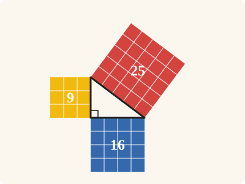
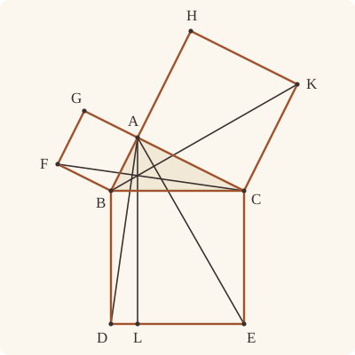
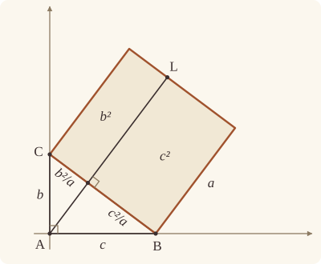

<!-- Generated by scripts/render.py. Do not edit by hand. -->

[Book I](index.md) · [← I.46](46.md) · [I.48 →](48.md)

# Book I, Proposition 47

*The square on the side subtending the right angle equals the other two*

[Euclid's proof](#euclids-proof) · [In Lean](#in-lean) · [What it rests on](#what-it-rests-on) · [Mishnah](#mishnah)

> In right-angled triangles the square on the side subtending the right angle is equal to the squares on the sides containing the right angle.

**In Lean:** ✅ proved, as Euclid states it · Euclid's argument

<p align="center"></p>

<p align="center"><em>Count the little squares: 9 (yellow) and 16 (blue) make 25 (red). Euclid proves it for every right-angled triangle, and never counts anything.</em></p>

## Euclid's proof

<p align="center"></p>

<p align="center"><em>Drawn for one case: the three squares standing outward from the right-angled triangle, as in the main theorem; its companion also covers squares on either side of each base.</em></p>

Let ABC be a right-angled triangle having the angle BAC right;

I say that the square on BC is equal to the squares on BA, AC.

For let there be described on BC the square BDEC, and on BA, AC the squares GB, HC; [I. 46] through A let AL be drawn parallel to either BD or CE, and let AD, FC be joined.

Then, since each of the angles BAC, BAG is right, it follows that with a straight line BA, and at the point A on it, the two straight lines AC, AG not lying on the same side make the adjacent angles equal to two right angles; therefore CA is in a straight line with AG. [I. 14]

For the same reason BA is also in a straight line with AH.

And, since the angle DBC is equal to the angle FBA: for each is right: let the angle ABC be added to each; therefore the whole angle DBA is equal to the whole angle FBC. [C.N. 2]

And, since DB is equal to BC, and FB to BA, the two sides AB, BD are equal to the two sides FB, BC respectively; and the angle ABD is equal to the angle FBC; therefore the base AD is equal to the base FC, and the triangle ABD is equal to the triangle FBC. [I. 4]

Now the parallelogram BL is double of the triangle ABD, for they have the same base BD and are in the same parallels BD, AL. [I. 41]

And the square GB is double of the triangle FBC, for they again have the same base FB and are in the same parallels FB, GC. [I. 41]

[But the doubles of equals are equal to one another.]

Therefore the parallelogram BL is also equal to the square GB.

Similarly, if AE, BK be joined, the parallelogram CL can also be proved equal to the square HC; therefore the whole square BDEC is equal to the two squares GB, HC. [C.N. 2]

And the square BDEC is described on BC, and the squares GB, HC on BA, AC.

Therefore the square on the side BC is equal to the squares on the sides BA, AC.

Therefore etc.

Q. E. D.

## In Lean

| | |
|---|---|
| Proof | ✅ Proved, and its companion `Prop47.general` ([I.47 general](47.md#general)) |
| Statement | The whole enunciation. `Prop47` keeps Euclid's outward squares; `Prop47.general` proves the same area identity for squares on either side of each base. |
| Argument | Euclid's. The main theorem follows Euclid's outward-square argument; `Prop47.general` transfers its result using equal squares on the same base. |
| Reviewed | The statement and every passage of the argument read against Heath's text, at commit [`bfc4faab3`](https://github.com/dodecaplex-co/stoicheia/commit/bfc4faab3) ([the record](../../review/I/47.toml)) |

From [`Elements/BookI/Prop47.lean`](../../Elements/BookI/Prop47.lean). Euclid's sentences are the `--` comments, and our own notes are in `/- … -/`; the lines under each sentence are the Lean that carries it out. The list below marks where a lemma does a step Euclid takes for granted, where several sentences share one step, where the statement already gives a step and where a step needs a word of its own; the `/- … -/` notes in the listing explain smaller adjustments.

**How the Lean follows the text**

- **Already given.** "For let there be described on BC the square BDEC…" The main theorem takes the three outward squares as given, so it does not call I.46; `Prop28.square` shows that each is a parallelogram. The companion constructs outward squares with I.46.
- **Done by `Prop30.meet`.** "through A let AL be drawn parallel…" Euclid draws AL through A, taking for granted that a parallel to BD is also parallel to CE, and reads its meetings with DE and BC from the figure. The Lean draws AL by I.31, proves it parallel to CE with `Prop30.parallel` (I.30, for which Heath gives no reference here), uses `Prop30.meet` for L and the unnamed foot, and names the two parallelograms.
- **Already given.** "and let AD, FC be joined." The triangles ABD and FBC, which I.4 takes below, are named by their corners, so the join needs no Lean here; `Prop47.within` draws AD and FC later, to place C and A within the angles at B.
- **Done by `Prop47.within`.** "let the angle ABC be added to each…" Euclid reads off his figure that C lies within the angle DBA and A within FBC; the Lean finds the reason in I.17 and I.13, with the squares standing outward. One case rules out AD crossing BC beyond B, which would make the angle ABD greater than two right angles; I.13 forbids it, through its bound for an angle of a triangle (`Prop13.angle_lt_two_right`).
- **Carried.** "therefore the base AD is equal to the base FC…" The Lean proves that the base AD equals FC here, as Euclid states it. Neither his proof nor ours uses it again: both go on by the equal triangles ABD and FBC.
- **Carried together.** "Similarly, if AE, BK be joined…" Euclid invokes the same argument for CL and the square HC. The Lean proves the half once over any letters and applies it at B and again at C.
- **Done by `quadArea_add_of_parallelograms`.** "therefore the whole square BDEC…" Euclid reads from the figure that BL and CL make up the square BDEC. The Lean uses I.17 and `Prop47.within` beneath the squares sentence to put A on C's side of BD and B's side of CE; with AL parallel to both, `Between.of_inside` places its foot between B and C and L between D and E, so `quadArea_add_of_parallelograms` joins the two parts.
- **Already given.** "And the square BDEC is described on BC…" The main theorem takes BDEC, GB and HC as the squares on BC, BA and AC; `Prop47.general` transfers the outward result to squares on either side of each base by `Prop46.square_eq`. Book II states I.47 again of the squares on straight lines, as `BookI.Prop47.sq`, the form in which II.9 to II.14, III.14, III.35 and III.36 cite it.

<details><summary>Before the theorem, one lemma: <code>Prop47.within</code> (80 lines)</summary>

```lean
/-- Where the squares fall. If the angle ABC is less than a right angle, and BD
stands at right angles to BC on the other side of it from A, then C lies within
the angle ABD: on A's side of BD, and on D's side of BA. Euclid reads this
off his figure when he adds the angle ABC to the right angles DBC, FBA, and
again when he takes the parallelograms BL, CL to make up the square BDEC.

The straight line AD crosses BC, since it joins points on either side of it. Not
at B, for then the angles ABC, CBD would make two right angles [I. 13], and
CBD alone is right. Not beyond B from C, for then the angle ABD would be
greater than two right angles: the angle on the far side of AB from C is
greater than right [I. 13], and to it is added the right angle on the far side of
BD. So it crosses on the ray from B through C, and C lies where the crossing
point does. [I. 13] -/
theorem Prop47.within {A B C D : Point} (hABC : Triangle A B C) (hD : OppositeSidesOf D A B C)
    (hCBD : ∠ C B D = ∟) (hacute : ∠ A B C < ∟) :
    SameSideOf C A B D ∧ SameSideOf C D B A := by
  obtain ⟨BC, hB_BC, hC_BC⟩ := Postulate1 B C hABC.ne₂₃
  have hop : OppositeSides A D BC := hD.symm.oppositeSides hB_BC hC_BC
  have hA_BC : ¬ OnLine A BC := hop.1
  have hD_BC : ¬ OnLine D BC := hop.2.1
  /- AD crosses BC at a point Y. -/
  obtain ⟨Y, hY_BC, hAYD⟩ := OppositeSides.exists_between hop
  obtain ⟨AD, hA_AD, hD_AD⟩ := Postulate1 A D (ne_of_between_ends hAYD)
  have hY_AD : OnLine Y AD := on_line_of_between_ends hAYD hA_AD hD_AD
  have hBD : B ≠ D := fun e => hD_BC (e ▸ hB_BC)
  have hBA : B ≠ A := fun e => hA_BC (e ▸ hB_BC)
  obtain ⟨BD, hB_BD, hD_BD⟩ := Postulate1 B D hBD
  obtain ⟨BA, hB_BA, hA_BA⟩ := Postulate1 B A hBA
  by_cases hYB : Y = B
  · /- It does not cross at B, for then the angles ABC, CBD would make two right
       angles. [I. 13] -/
    exfalso
    rw [hYB] at hAYD hY_AD
    have hC : ¬ Collinear A D C := fun ⟨K, hA_K, hD_K, hC_K⟩ => by
      have hK : K = AD := line_unique (ne_of_between_ends hAYD) hA_K hD_K hA_AD hD_AD
      rw [hK] at hC_K
      exact hA_BC ((line_unique hABC.ne₂₃ hY_AD hC_K hB_BC hC_BC) ▸ hA_AD)
    have h13 := Prop13 hAYD hC
    rw [hCBD] at h13
    exact Magnitude.ne_of_lt (add_lt_add_right ∟ hacute) h13
  · have hB_AD : ¬ OnLine B AD := fun hB =>
      hA_BC ((line_unique hYB hY_AD hB hY_BC hB_BC) ▸ hA_AD)
    have hY_BD : ¬ OnLine Y BD := fun hY =>
      hD_BC ((line_unique hYB hY hB_BD hY_BC hB_BC) ▸ hD_BD)
    have hY_BA : ¬ OnLine Y BA := fun hY =>
      hA_BC ((line_unique hYB hY hB_BA hY_BC hB_BC) ▸ hA_BA)
    by_cases hYBC : Between Y B C
    · /- Nor beyond B, for then the angle ABD would be greater than two right angles. -/
      exfalso
      have hADB : Triangle A D B := fun ⟨K, hA_K, hD_K, hB_K⟩ =>
        hB_AD ((line_unique (ne_of_between_ends hAYD) hA_K hD_K hA_AD hD_AD) ▸ hB_K)
      have hsum : ∠ A B D = ∠ A B Y + ∠ Y B D := angle_add_of_between hADB hAYD
      have hYCA : ¬ Collinear Y C A := fun ⟨K, hY_K, hC_K, hA_K⟩ =>
        hA_BC ((line_unique (ne_of_between_ends hYBC) hY_K hC_K hY_BC hC_BC) ▸ hA_K)
      have hYCD : ¬ Collinear Y C D := fun ⟨K, hY_K, hC_K, hD_K⟩ =>
        hD_BC ((line_unique (ne_of_between_ends hYBC) hY_K hC_K hY_BC hC_BC) ▸ hD_K)
      have h₁ : ∠ Y B A + ∠ A B C = ∟ + ∟ := Prop13 hYBC hYCA
      have h₂ : ∠ Y B D + ∠ D B C = ∟ + ∟ := Prop13 hYBC hYCD
      rw [(angle_symm hBD.symm hABC.ne₂₃.symm).trans hCBD] at h₂
      have hYBD : ∠ Y B D = ∟ := by
        rcases lt_trichotomy (∠ Y B D) ∟ with h | h | h
        · exact absurd h₂ (Magnitude.ne_of_lt (add_lt_add_right ∟ h))
        · exact h
        · exact absurd h₂.symm (Magnitude.ne_of_lt (add_lt_add_right ∟ h))
      have hgt : ∟ < ∠ A B Y := by
        have h₃ : ∠ A B C + ∠ Y B A < ∟ + ∠ Y B A := add_lt_add_right _ hacute
        rw [add_comm (∠ A B C), add_comm ∟, h₁] at h₃
        rw [angle_symm hBA.symm (ne_of_between hYBC)]
        exact Magnitude.lt_of_add_lt_add_right h₃
      have h₄ : ∟ + ∟ < ∠ A B D := by
        rw [hsum, hYBD]
        exact add_lt_add_right ∟ hgt
      exact lt_irrefl _ (lt_trans h₄ (Prop13.angle_lt_two_right hADB.acb))
    · /- So Y lies on the ray from B through C, and within the angle ABD. -/
      have hray : OnRay C B Y := OnRay.symm ⟨hABC.ne₂₃, hYB, ⟨BC, hB_BC, hC_BC, hY_BC⟩, hYBC⟩
      have h₁ : SameSideOf Y A B D :=
        SameSideOf.of_line hBD hB_BD hD_BD (pasch2 (between_symm hAYD) hD_BD hY_BD)
      have h₂ : SameSideOf Y D B A :=
        SameSideOf.of_line hBA hB_BA hA_BA (pasch2 hAYD hA_BA hY_BA)
      exact ⟨SameSideOf.of_onRay hray h₁, SameSideOf.of_onRay hray h₂⟩
```

</details>

```lean
/-- In right-angled triangles the square on the side subtending the right angle is equal to the
squares on the sides containing the right angle. -/
theorem Prop47 {A B C D E F G H K : Point} (hABC : Triangle A B C) (hright : ∠ B A C = ∟)
    (hBDEC : Square B D E C) (hD : OppositeSidesOf D A B C) (hE : OppositeSidesOf E A B C)
    (hABFG : Square A B F G) (hF : OppositeSidesOf F C A B) (hG : OppositeSidesOf G C A B)
    (hACKH : Square A C K H) (hK : OppositeSidesOf K B A C) (hH : OppositeSidesOf H B A C) :
    quadArea B D E C = quadArea A B F G + quadArea A C K H := by
  -- Let ABC be a right-angled triangle having the angle BAC right;
  -- I say that the square on BC is equal to the squares on BA, AC.
  -- For let there be described on BC the square BDEC, and on BA, AC the squares GB,
  -- HC; [I. 46]
  /- The three squares are given in the statement, so I.46 is not cited. Their
     opposite sides are parallel by `Prop28.square`. -/
  have hpsq : Parallelogram B D E C :=
    (Prop28.square hBDEC.rotate.rotate.rotate
      (OppositeSidesOf.sameSideOf hD.symm hE.symm).swap).rotate
  have hABFGpar : Parallelogram A B F G :=
    Prop28.square hABFG (OppositeSidesOf.sameSideOf hF.symm hG.symm)
  have hACKHpar : Parallelogram A C K H :=
    Prop28.square hACKH (OppositeSidesOf.sameSideOf hK.symm hH.symm)
  obtain ⟨hBD_DE, hDE_EC, hEC_CB, hCBD, -, -, hECB⟩ := id hBDEC
  have hBD_BC : ‖B D‖ = ‖B C‖ :=
    hBD_DE.trans (hDE_EC.trans (hEC_CB.trans (len_symm C B)))
  have hCE_CB : ‖C E‖ = ‖C B‖ := (len_symm C E).trans hEC_CB
  have hBCE : ∠ B C E = ∟ :=
    (angle_symm hABC.ne₂₃ hE.triangle.ne₂₃.symm).trans hECB
  have hright' : ∠ C A B = ∟ :=
    (angle_symm hABC.ne₁₃.symm hABC.ne₁₂.symm).trans hright
  /- I.17 makes the angles at B and C acute. With the outward squares,
     `Prop47.within` puts A between the straight lines BD and CE. -/
  have hacB : ∠ A B C < ∟ := by
    have h17 := (Prop17 hABC).2.2
    rw [hright'] at h17
    exact Magnitude.lt_of_add_lt_add_left h17
  have hacC : ∠ A C B < ∟ := by
    have h17 := (Prop17 hABC).2.1
    rw [hright] at h17
    exact Magnitude.lt_of_add_lt_add_left h17
  obtain ⟨hCA_BD, -⟩ := Prop47.within hABC hD hCBD hacB
  obtain ⟨hBA_CE, -⟩ := Prop47.within hABC.acb hE.swap hBCE hacC
  -- through A let AL be drawn parallel to either BD or CE,
  have hBD : B ≠ D := hCA_BD.1
  have hCE : C ≠ E := hBA_CE.1
  obtain ⟨BD, hB_BD, hD_BD⟩ := Postulate1 B D hBD
  obtain ⟨CE, hC_CE, hE_CE⟩ := Postulate1 C E hCE
  obtain ⟨BC, hB_BC, hC_BC⟩ := Postulate1 B C hABC.ne₂₃
  obtain ⟨DE, hD_DE, hE_DE⟩ := Postulate1 D E hpsq.2.1
  have hBD_CE : Parallel BD CE := hpsq.1.parallel hB_BD hD_BD hE_CE hC_CE
  have hDE_BC : Parallel DE BC := hpsq.2.parallel hD_DE hE_DE hC_BC hB_BC
  have hA_BD : ¬ OnLine A BD :=
    not_on_line_of_same_side (same_side_symm (hCA_BD.sameSide hB_BD hD_BD))
  obtain ⟨AL, hA_AL, hAL_BD⟩ := Prop31.line hA_BD
  have hA_CE : ¬ OnLine A CE :=
    not_on_line_of_same_side (same_side_symm (hBA_CE.sameSide hC_CE hE_CE))
  have hAL_CE : Parallel AL CE :=
    Prop30.parallel hAL_BD hBD_CE.symm (fun e => hA_CE (e ▸ hA_AL))
  /- The parallel meets DE at L and BC at its unlettered foot (`Prop30.meet`). -/
  have hDE_BD : DE ≠ BD := fun e => hDE_BC.not_onLine (e ▸ hB_BD) hB_BC
  obtain ⟨L, hL_DE, hL_AL⟩ := Prop30.meet hAL_BD hD_BD hD_DE hDE_BD
  have hBC_BD : BC ≠ BD := fun e => hD.triangle.off_line hB_BC hC_BC (e ▸ hD_BD)
  obtain ⟨X, hX_BC, hX_AL⟩ := Prop30.meet hAL_BD hB_BD hB_BC hBC_BD
  have hXL : X ≠ L := fun e => hDE_BC.not_onLine (e ▸ hL_DE) hX_BC
  have hDL : D ≠ L := fun e => hAL_BD.not_onLine (e ▸ hL_AL) hD_BD
  have hXB : X ≠ B := fun e => hAL_BD.not_onLine (e ▸ hX_AL) hB_BD
  have hLE : L ≠ E := fun e => hAL_CE.not_onLine hL_AL (e ▸ hE_CE)
  have hCX : C ≠ X := fun e => hAL_CE.not_onLine hX_AL (e ▸ hC_CE)
  have P₁ : Parallelogram B D L X :=
    ⟨AreParallel.of_parallel hBD hXL.symm hB_BD hD_BD hL_AL hX_AL hAL_BD.symm,
      AreParallel.of_parallel hDL hXB hD_DE hL_DE hX_BC hB_BC hDE_BC⟩
  have P₂ : Parallelogram X L E C :=
    ⟨AreParallel.of_parallel hXL hCE.symm hX_AL hL_AL hE_CE hC_CE hAL_CE,
      AreParallel.of_parallel hLE hCX hL_DE hE_DE hC_BC hX_BC hDE_BC⟩
  have hXLA : Collinear X L A := ⟨AL, hX_AL, hL_AL, hA_AL⟩
  -- and let AD, FC be joined.
  /- The joined straight lines are the sides of the triangles in I.4 below. -/
  -- Then, since each of the angles BAC, BAG is right, it follows that with a straight line BA,
  -- and at the point A on it, the two straight lines AC, AG not lying on the same side make
  -- the adjacent angles equal to two right angles; therefore CA is in a straight line with
  -- AG. [I. 14]
  have hCAG : Between C A G := Prop14 hG.symm.swap (by
    rw [hright, angle_symm hABC.ne₁₂.symm hG.triangle.ne₁₃.symm, hABFG.2.2.2.1])
  -- For the same reason BA is also in a straight line with AH.
  have hBAH : Between B A H := Prop14 hH.symm.swap (by
    rw [hright', angle_symm hABC.ne₁₃.symm hH.triangle.ne₁₃.symm, hACKH.2.2.2.1])
  /- Euclid proves one half and then says "similarly". We give these sentences
     once over any letters, using the straightness and acute angle already
     proved, and apply them at B and at C. -/
  have half : ∀ {A B C D F G X L : Point}, Triangle A B C →
      ‖B D‖ = ‖B C‖ → ∠ C B D = ∟ → OppositeSidesOf D A B C →
      Square A B F G → OppositeSidesOf F C A B → Parallelogram A B F G →
      Between C A G → ∠ A B C < ∟ → Parallelogram X B D L → Collinear X L A →
      quadArea X B D L = quadArea A B F G := by
    intro A B C D F G X L hABC hBD hCBD hD hsq hF hpsq hCAG hacute hp hX
    obtain ⟨hAB_BF, -, -, -, hABF, -, -⟩ := hsq
    -- And, since the angle DBC is equal to the angle FBA: for each is right: let the angle ABC
    -- be added to each; therefore the whole angle DBA is equal to the whole angle FBC. [C.N. 2]
    obtain ⟨hCA_BD, hCD_BA⟩ := Prop47.within hABC hD hCBD hacute
    obtain ⟨hAC_BF, hAF_BC⟩ := Prop47.within hABC.cba hF.swap hABF
      (by rw [angle_symm hABC.ne₂₃.symm hABC.ne₁₂]; exact hacute)
    have hDBA : ∠ D B A = ∠ D B C + ∠ C B A :=
      angle_add_of_within hCA_BD hCD_BA
    have hFBC : ∠ F B C = ∠ F B A + ∠ A B C :=
      angle_add_of_within hAC_BF hAF_BC
    have hBD_ne : B ≠ D := hCA_BD.1
    have hBF_ne : B ≠ F := hAC_BF.1
    have hrights : ∠ D B C = ∠ F B A := by
      rw [angle_symm hBD_ne.symm hABC.ne₂₃.symm, hCBD,
        angle_symm hBF_ne.symm hABC.ne₁₂, hABF]
    have hadd := CommonNotion2 hrights (Eq.refl (∠ A B C))
    have hang : ∠ D B A = ∠ F B C := by
      rw [hDBA, hFBC, angle_symm hABC.ne₂₃.symm hABC.ne₁₂]
      exact hadd
    -- And, since DB is equal to BC, and FB to BA, the two sides AB, BD are equal to the two
    -- sides FB, BC respectively; and the angle ABD is equal to the angle FBC; therefore the base
    -- AD is equal to the base FC, and the triangle ABD is equal to the triangle FBC. [I. 4]
    have hABD : ∠ A B D = ∠ F B C :=
      (angle_symm hABC.ne₁₂ hBD_ne.symm).trans hang
    obtain ⟨hAD_FC, h4, -, -⟩ :=
      Prop4 hCD_BA.symm.triangle hAC_BF.symm.triangle
        ((len_symm B A).trans hAB_BF) hBD hABD
    -- Now the parallelogram BL is double of the triangle ABD, for they have the same base BD and
    -- are in the same parallels BD, AL. [I. 41]
    have h41a : quadArea X B D L = △ B A D + △ B A D := Prop41 hp hX
    -- And the square GB is double of the triangle FBC, for they again have the same base FB and
    -- are in the same parallels FB, GC. [I. 41]
    obtain ⟨GC, hC_GC, hA_GC, hG_GC⟩ := collinear_of_between hCAG
    have h41b : quadArea G F B A = △ F C B + △ F C B :=
      Prop41 hpsq.rotate.rotate.rotate.reverse ⟨GC, hG_GC, hA_GC, hC_GC⟩
    -- [But the doubles of equals are equal to one another.]
    have hdouble := CommonNotion2 h4 h4
    -- Therefore the parallelogram BL is also equal to the square GB.
    calc
      quadArea X B D L = △ B A D + △ B A D := h41a
      _ = △ B F C + △ B F C := hdouble
      _ = △ F C B + △ F C B := by rw [area_bca B F C]
      _ = quadArea G F B A := h41b.symm
      _ = quadArea A B F G := by
        rw [quadArea_reverse, hpsq.rotate.rotate.rotate.quadArea_rotate]
  have h₁ : quadArea X B D L = quadArea A B F G :=
    half hABC hBD_BC hCBD hD hABFG hF hABFGpar hCAG hacB P₁.rotate.rotate.rotate hXLA
  -- Similarly, if AE, BK be joined, the parallelogram CL can also be proved equal to the
  -- square HC; therefore the whole square BDEC is equal to the two squares GB, HC. [C.N. 2]
  have h₂ : quadArea X C E L = quadArea A C K H :=
    half hABC.acb hCE_CB hBCE hE.swap hACKH hK hACKHpar hBAH hacC P₂.reverse hXLA
  /- The foot of AL lies between B and C, and L between D and E: A lies
     between BD and CE, and AL is parallel to both (`Between.of_inside`). -/
  have ss : ∀ {P Q R : Point} {N : Line},
      SameSide P Q N → SameSide Q R N → SameSide P R N :=
    fun h₁ h₂ => same_side_trans (same_side_symm h₁) h₂
  have hAC_BD : SameSide A C BD := same_side_symm (hCA_BD.sameSide hB_BD hD_BD)
  have hAB_CE : SameSide A B CE := same_side_symm (hBA_CE.sameSide hC_CE hE_CE)
  have hBXC : Between B X C :=
    Between.of_inside hB_BD hC_CE ⟨BC, hB_BC, hX_BC, hC_BC⟩
      (ss (hAL_BD.sameSide hX_AL hA_AL) hAC_BD)
      (ss (hAL_CE.sameSide hX_AL hA_AL) hAB_CE)
  have hCE_BD : SameSide C E BD :=
    same_side_symm (hpsq.sameSideOf.sameSide hB_BD hD_BD)
  have hBD_CE' : SameSide B D CE := hpsq.rotate.rotate.sameSideOf.sameSide hE_CE hC_CE
  have hDLE : Between D L E :=
    Between.of_inside hD_BD hE_CE ⟨DE, hD_DE, hL_DE, hE_DE⟩
      (ss (ss (hAL_BD.sameSide hL_AL hA_AL) hAC_BD) hCE_BD)
      (ss (ss (hAL_CE.sameSide hL_AL hA_AL) hAB_CE) hBD_CE')
  have hwhole : quadArea B D E C = quadArea X B D L + quadArea X C E L := by
    rw [quadArea_add_of_parallelograms P₁ P₂ hBXC hDLE,
      P₁.rotate.rotate.rotate.quadArea_rotate, quadArea_reverse X C E L]
  have hequal := hwhole.trans (CommonNotion2 h₁ h₂)
  -- And the square BDEC is described on BC, and the squares GB, HC on BA, AC.
  /- These are the three given squares. -/
  -- Therefore the square on the side BC is equal to the squares on the sides BA, AC.
  -- Therefore etc.
  -- Q. E. D.
  exact hequal
```

<a name="general"></a>

<details><summary>After the theorem, its companion, <code>Prop47.general</code> (42 lines)</summary>

```lean
/-- The area identity for squares on either side of each base. Each square's far
corners lie together on one side of its base, with no prescribed side relative to
the triangle or to the other squares.

We construct outward squares by I.46, apply `Prop47`, and transfer the result by
`Prop46.square_eq`, since squares on the same base have equal areas. Euclid's
angle-addition argument remains in the outward configuration. -/
theorem Prop47.general {A B C D E F G H K : Point}
    (hABC : Triangle A B C) (hright : ∠ B A C = ∟)
    (hBDEC : Square B D E C) (hDE : SameSideOf D E B C)
    (hABFG : Square A B F G) (hFG : SameSideOf F G A B)
    (hACKH : Square A C K H) (hKH : SameSideOf K H A C) :
    quadArea B D E C = quadArea A B F G + quadArea A C K H := by
  obtain ⟨X, hXA, _⟩ := exists_oppositeSidesOf hABC.bca []
  obtain ⟨D', E', hsBC, hD', hE'⟩ := Prop46 hABC.ne₂₃ hXA.triangle
  obtain ⟨Y, hYC, _⟩ := exists_oppositeSidesOf hABC.bac []
  obtain ⟨F', G', hsBA, hF', hG'⟩ := Prop46 hABC.ne₁₂.symm hYC.triangle
  obtain ⟨Z, hZB, _⟩ := exists_oppositeSidesOf hABC.cab []
  obtain ⟨K', H', hsCA, hK', hH'⟩ := Prop46 hABC.ne₁₃.symm hZB.triangle
  have hDE' : SameSideOf D' E' B C := hD'.trans hE'.symm
  have hBC : quadArea B D E C = quadArea B D' E' C := by
    /- BC is the closing side of BDEC. Rotate both squares to compare that
       side, then use the parallelograms to return to their original areas. -/
    have hp := Prop28.square hBDEC.rotate.rotate.rotate hDE.swap
    have hp' := Prop28.square hsBC.rotate.rotate.rotate hDE'.swap
    have heq := Prop46.square_eq hBDEC.rotate.rotate.rotate hDE.swap
      hsBC.rotate.rotate.rotate hDE'.swap rfl
    rw [hp.quadArea_rotate, hp'.quadArea_rotate]
    exact heq
  have hBA : quadArea A B F' G' = quadArea A B F G :=
    Prop46.square_eq hsBA.rotate.rotate.rotate (hF'.trans hG'.symm).swap
      hABFG hFG rfl
  have hCA : quadArea A C K' H' = quadArea A C K H :=
    Prop46.square_eq hsCA.rotate.rotate.rotate (hK'.trans hH'.symm).swap
      hACKH hKH rfl
  have h47 := Prop47 hABC hright hsBC
    (hD'.trans_opposite hXA) (hE'.trans_opposite hXA)
    hsBA.rotate.rotate.rotate
    (hF'.trans_opposite hYC).swap (hG'.trans_opposite hYC).swap
    hsCA.rotate.rotate.rotate
    (hK'.trans_opposite hZB).swap (hH'.trans_opposite hZB).swap
  exact hBC.trans (h47.trans (CommonNotion2 hBA hCA))
```

</details>

## What it rests on

| | Proposition | `Prop47.general` |
|---|---|---|
| Heath's references | [I.4](04.md), [I.14](14.md), [I.41](41.md), [I.46](46.md); C.N. 2 | none |
| Lean cites | [I.4](04.md), [I.13](13.md), [I.14](14.md), [I.17](17.md), [I.28](28.md), [I.30](30.md), [I.31](31.md), [I.41](41.md) | [I.4](04.md), [I.28](28.md), [I.46](46.md), [I.47](47.md) |
| Postulates | 1, 2, 3, 4, 5 | 1, 2, 3, 4, 5 |
| Definitions taken as axioms | Def. I.15 | Def. I.15 |
| Common Notions | 1, 2, 3, 4, 5 | 1, 2, 3, 4, 5 |
| Tacit rules | 37 (listed below) | 37 (listed below) |
| Its own Lean calls | Postulate 1; 12 tacit rules | none |
| Through lemmas | Postulates 2 and 3; Def. I.15; 22 tacit rules | Postulates 1, 2 and 3; Def. I.15; 33 tacit rules |

Some of these come in through lemmas [shared](../../CERTIFICATE.md#shared-steps) by many proofs: [`Prop46.square_eq`](../../Elements/BookI/Prop46.lean#L96) (I.4, I.28); [`Prop13.angle_lt_two_right`](../../Elements/BookI/Prop13.lean#L230) (I.13); [`Prop28.square`](../../Elements/BookI/HelpersParallels.lean#L133) (I.28); [`Prop30.meet`](../../Elements/BookI/HelpersParallels.lean#L41), [`Prop30.parallel`](../../Elements/BookI/HelpersParallels.lean#L62) (I.30); [`Prop31.line`](../../Elements/BookI/Prop31.lean#L79) (I.31).

_Postulates, definitions, Common Notions and tacit rules: all that each proof rests on, counting those of the propositions it cites. The last two rows say which of the postulates, definitions and tacit rules its own Lean calls, in the proof or a helper written for it, and which it does not call but reaches through lemmas, of Book Zero or shared (a proposition it cites may rest on these too); the rest come in only through the propositions it cites or the Common Notions._

<details><summary>The 37 tacit rules beneath this proof, counting those of the propositions it cites</summary>

_(used here) marks a rule this proof's own Lean calls, in the proof or a helper written for it; (through …) marks one its own Lean does not call but reaches through the lemmas named, of [Book Zero](../../Elements/Figure) or shared, though a proposition it cites may rest on it too; and a rule with no mark comes in only through a proposition it cites or a Common Notion. The names in brackets are System E's: an Intersection rule says when straight lines and circles must meet, and an Intersections rule takes a point where they do (see [Book I's introduction](index.md))._

**Reading the figure**

- [`between_cases`](../../Elements/Foundations/Tacit/Diagram.lean#L54) (through [`Between.of_inside`](../../Elements/Figure/Parallelograms.lean#L61), [`OppositeSides.exists_between`](../../Elements/Figure/Sides.lean#L119), [`OppositeSidesOf.sameSideOf`](../../Elements/Figure/Sides.lean#L129) and 5 other lemmas): Of three different points on a straight line, one is between the other two. (Between 6)
- [`between_symm`](../../Elements/Foundations/Tacit/Diagram.lean#L47) (used here): If B is between A and C, it is between C and A. (Between 1)
- [`circles_meet`](../../Elements/Foundations/Tacit/Diagram.lean#L91) (through [`Between.of_inside`](../../Elements/Figure/Parallelograms.lean#L61), [`OppositeSides.exists_between`](../../Elements/Figure/Sides.lean#L119), [`OppositeSidesOf.sameSideOf`](../../Elements/Figure/Sides.lean#L129) and 13 other lemmas): If each circle passes through a point inside the other, the circles cut one another. This is the step Euclid takes for granted in I.1. (Intersection 5)
- [`circles_meet_same_side`](../../Elements/Foundations/Tacit/Constructions.lean#L79) (through [`Between.of_inside`](../../Elements/Figure/Parallelograms.lean#L61), [`OppositeSides.exists_between`](../../Elements/Figure/Sides.lean#L119), [`OppositeSidesOf.sameSideOf`](../../Elements/Figure/Sides.lean#L129) and 13 other lemmas): Two circles that cut one another do so on each side of the straight line through their centres. (Intersections 8)
- [`exists_point`](../../Elements/Foundations/Tacit/Constructions.lean#L35) (through [`Parallelogram.quadArea_rotate`](../../Elements/Figure/Parallelograms.lean#L202), [`Prop13.angle_lt_two_right`](../../Elements/BookI/Prop13.lean#L230), [`Triangle.ne₁₂`](../../Elements/Figure/Triangles.lean#L22) and 4 other lemmas): Let a point be taken. (Points 1)
- [`exists_point_inside_circle`](../../Elements/Foundations/Tacit/Constructions.lean#L42) (through [`Between.of_inside`](../../Elements/Figure/Parallelograms.lean#L61), [`OppositeSides.exists_between`](../../Elements/Figure/Sides.lean#L119), [`OppositeSidesOf.sameSideOf`](../../Elements/Figure/Sides.lean#L129) and 13 other lemmas): Let a point be taken inside the circle α. (Points 8)
- [`exists_point_on_line`](../../Elements/Foundations/Tacit/Constructions.lean#L38) (through [`Between.of_inside`](../../Elements/Figure/Parallelograms.lean#L61), [`OppositeSides.exists_between`](../../Elements/Figure/Sides.lean#L119), [`OppositeSidesOf.sameSideOf`](../../Elements/Figure/Sides.lean#L129) and 15 other lemmas): Let a point be taken on the straight line L. (Points 2)
- [`line_circle_between`](../../Elements/Foundations/Tacit/Constructions.lean#L67) (through [`Between.of_inside`](../../Elements/Figure/Parallelograms.lean#L61), [`OppositeSides.exists_between`](../../Elements/Figure/Sides.lean#L119), [`OppositeSidesOf.sameSideOf`](../../Elements/Figure/Sides.lean#L129) and 13 other lemmas): A straight line through a point B inside a circle, heading out to a point C outside it, cuts the circle between B and C. (Intersections 4)
- [`line_circle_beyond`](../../Elements/Foundations/Tacit/Constructions.lean#L73) (through [`Between.of_inside`](../../Elements/Figure/Parallelograms.lean#L61), [`OppositeSides.exists_between`](../../Elements/Figure/Sides.lean#L119), [`OppositeSidesOf.sameSideOf`](../../Elements/Figure/Sides.lean#L129) and 13 other lemmas): A straight line through a point B inside a circle, produced beyond B away from C, cuts the circle there. (Intersections 5)
- [`line_unique`](../../Elements/Foundations/Tacit/Diagram.lean#L41) (used here): Two points determine a straight line. (Generalities 1)
- [`lines_meet_of_opposite_sides`](../../Elements/Foundations/Tacit/Diagram.lean#L86) (through [`OppositeSides.exists_between`](../../Elements/Figure/Sides.lean#L119), [`OppositeSidesOf.sameSideOf`](../../Elements/Figure/Sides.lean#L129), [`Parallel.sameSide`](../../Elements/Figure/Parallels.lean#L54) and 4 other lemmas): A straight line joining points on opposite sides of L crosses L. (Intersection 1)
- [`not_between_of_between`](../../Elements/Foundations/Tacit/Diagram.lean#L50) (through [`Between.of_inside`](../../Elements/Figure/Parallelograms.lean#L61), [`OppositeSides.exists_between`](../../Elements/Figure/Sides.lean#L119), [`OppositeSidesOf.sameSideOf`](../../Elements/Figure/Sides.lean#L129) and 16 other lemmas): If B is between A and C, then A is not between B and C. (Between 1)
- [`not_on_line_of_same_side`](../../Elements/Foundations/Tacit/Diagram.lean#L60) (used here): Points on one side of a straight line are not on it. (Same side 3)
- [`pasch2`](../../Elements/Foundations/Tacit/Diagram.lean#L71) (used here): If B is between A and C, A is on L and B is off it, then B and C are on the same side of L: a straight line that leaves L at A does not cross it again. (Pasch 2)
- [`same_side_trans`](../../Elements/Foundations/Tacit/Diagram.lean#L64) (used here): Two points on the same side of a straight line as a third point are on the same side as each other. (Same side 4)

**Lengths, angles and areas**

- [`angle_add_of_inside`](../../Elements/Foundations/Tacit/Transfer.lean#L47) (through [`Between.of_inside`](../../Elements/Figure/Parallelograms.lean#L61), [`OppositeSidesOf.sameSideOf`](../../Elements/Figure/Sides.lean#L129), [`Parallelogram.quadArea_rotate`](../../Elements/Figure/Parallelograms.lean#L202) and 3 other lemmas): If D lies within the angle BAC, then BAC is made up of BAD and DAC. (Diagram-angle 2)
- [`angle_eq_of_same_rays`](../../Elements/Foundations/Tacit/Transfer.lean#L54): The angle doesn't change if its arms are traced through other points on the same rays. (Diagram-angle 4)
- [`angle_symm`](../../Elements/Foundations/Tacit/Metric.lean#L30) (used here): The angle ABC is the angle CBA. (Metric 4)
- [`area_add_of_between`](../../Elements/Foundations/Tacit/Transfer.lean#L70) (through [`Parallelogram.quadArea_rotate`](../../Elements/Figure/Parallelograms.lean#L202), [`quadArea_add_of_parallelograms`](../../Elements/Figure/Parallelograms.lean#L215) and [`quadArea_reverse`](../../Elements/Figure/Areas.lean#L155)): Cutting a triangle in two from a vertex adds up. (Diagram-area 2)
- [`area_congruent`](../../Elements/Foundations/Tacit/Metric.lean#L44): Triangles equal in all their sides and angles are equal in area. Euclid uses this without comment once he has shown two triangles congruent. (Metric 9)
- [`area_degenerate`](../../Elements/Foundations/Tacit/Metric.lean#L36) (through [`Parallelogram.quadArea_rotate`](../../Elements/Figure/Parallelograms.lean#L202), [`quadArea_add_of_parallelograms`](../../Elements/Figure/Parallelograms.lean#L215) and [`quadArea_reverse`](../../Elements/Figure/Areas.lean#L155)): A "triangle" with a repeated corner has no area. (Metric 6)
- [`area_eq_zero_of_on_line`](../../Elements/Foundations/Tacit/Transfer.lean#L62) (through [`Parallelogram.quadArea_rotate`](../../Elements/Figure/Parallelograms.lean#L202), [`quadArea_add_of_parallelograms`](../../Elements/Figure/Parallelograms.lean#L215) and [`quadArea_reverse`](../../Elements/Figure/Areas.lean#L155)): A "triangle" whose corners lie on one straight line has no area. (Diagram-area 1)
- [`area_rotate`](../../Elements/Foundations/Tacit/Metric.lean#L39) (through [`Parallelogram.quadArea_rotate`](../../Elements/Figure/Parallelograms.lean#L202), [`area_bca`](../../Elements/Figure/Areas.lean#L64), [`quadArea_add_of_parallelograms`](../../Elements/Figure/Parallelograms.lean#L215) and 1 other lemma): The triangle ABC is the triangle CAB. (Metric 8)
- [`len_add_of_between`](../../Elements/Foundations/Tacit/Transfer.lean#L27) (through [`Between.of_inside`](../../Elements/Figure/Parallelograms.lean#L61), [`OppositeSides.exists_between`](../../Elements/Figure/Sides.lean#L119), [`OppositeSidesOf.sameSideOf`](../../Elements/Figure/Sides.lean#L129) and 15 other lemmas): If B is between A and C, then AB and BC together make up AC. (Diagram-segment 1)
- [`len_self`](../../Elements/Foundations/Tacit/Metric.lean#L24) (through [`Between.of_inside`](../../Elements/Figure/Parallelograms.lean#L61), [`OppositeSides.exists_between`](../../Elements/Figure/Sides.lean#L119), [`OppositeSidesOf.sameSideOf`](../../Elements/Figure/Sides.lean#L129) and 15 other lemmas): The "straight line" from a point to itself has no length. (Metric 1)
- [`len_symm`](../../Elements/Foundations/Tacit/Metric.lean#L27) (used here): The straight line AB is the straight line BA. (Metric 3)
- [`radius_ne_zero`](../../Elements/Foundations/Tacit/Metric.lean#L62) (through [`Between.of_inside`](../../Elements/Figure/Parallelograms.lean#L61), [`OppositeSides.exists_between`](../../Elements/Figure/Sides.lean#L119), [`OppositeSidesOf.sameSideOf`](../../Elements/Figure/Sides.lean#L129) and 15 other lemmas): A circle's radius is not nothing: the straight line from the centre to a point on the circle has some length. A rule of our own, not one of System E's: every circle is drawn with a centre and a distance (Postulate 3).
- [`same_ray_of_angle_eq_zero`](../../Elements/Foundations/Tacit/Transfer.lean#L42) (through [`Between.of_inside`](../../Elements/Figure/Parallelograms.lean#L61), [`OppositeSidesOf.sameSideOf`](../../Elements/Figure/Sides.lean#L129), [`Parallelogram.quadArea_rotate`](../../Elements/Figure/Parallelograms.lean#L202) and 2 other lemmas): If the angle BAC is nothing, C lies on the ray from A through B. (Diagram-angle 1)

**Superposition**

- [`superposition`](../../Elements/Foundations/Tacit/Superposition.lean#L52): **Superposition.** A hypothetical placement of a triangle on a given ray and side permits a restricted derivation of metric equalities about the figure already given. The derivation introduces no further objects, cites each geometric law it uses, and exports no symbol of the placement.

**Rules of magnitude**

- [`add_assoc`](../../Elements/Foundations/Tacit/Magnitudes.lean#L23) (through [`Parallelogram.quadArea_rotate`](../../Elements/Figure/Parallelograms.lean#L202), [`Prop28.square`](../../Elements/BookI/HelpersParallels.lean#L133), [`quadArea_add_of_parallelograms`](../../Elements/Figure/Parallelograms.lean#L215) and 1 other lemma): Adding three magnitudes in a row, it makes no difference whether the first two or the last two are added first. (System E §3.5)
- [`add_comm`](../../Elements/Foundations/Tacit/Magnitudes.lean#L26) (used here): The order of adding does not matter. (System E §3.5)
- [`add_lt_add_right`](../../Elements/Foundations/Tacit/Magnitudes.lean#L45) (used here): Adding the same thing to both sides keeps "less than". (System E §3.5)
- [`add_zero`](../../Elements/Foundations/Tacit/Magnitudes.lean#L29) (through [`Parallelogram.quadArea_rotate`](../../Elements/Figure/Parallelograms.lean#L202) and [`quadArea_add_of_parallelograms`](../../Elements/Figure/Parallelograms.lean#L215)): Adding nothing changes nothing. (System E §3.5)
- [`lt_irrefl`](../../Elements/Foundations/Tacit/Magnitudes.lean#L32) (used here): No magnitude is less than itself. (System E §3.5)
- [`lt_trans`](../../Elements/Foundations/Tacit/Magnitudes.lean#L35) (used here): What is less than the less is less still. (System E §3.5)
- [`lt_trichotomy`](../../Elements/Foundations/Tacit/Magnitudes.lean#L39) (used here): Of two magnitudes, one is less, or they are equal, or the other is less. (System E §3.5)
- [`not_lt_zero`](../../Elements/Foundations/Tacit/Magnitudes.lean#L42) (through [`Between.of_inside`](../../Elements/Figure/Parallelograms.lean#L61), [`OppositeSides.exists_between`](../../Elements/Figure/Sides.lean#L119), [`OppositeSidesOf.sameSideOf`](../../Elements/Figure/Sides.lean#L129) and 15 other lemmas): Nothing is less than zero. (System E §3.5)

</details>

## Mishnah

_Our commentary: why Euclid's proof, and ours, look as they do._

"If we listen," says Proclus, "to those who wish to recount ancient history, we may find some of them referring this theorem to Pythagoras and saying that he sacrificed an ox in honour of his discovery. But for my part, while I admire those who first observed the truth of this theorem, I marvel more at the writer of the Elements" (Heath, vol. 1, p. 350). His reason follows on the same page: in Book VI Euclid proves the theorem for any similar figures, similarly situated, on the three sides (VI.31).

Euclid describes a square on each side, the figure often called the windmill, and draws AL through A parallel to BD. It cuts the square on BC into two parallelograms, BL and CL. BL is double of the triangle ABD, and the square GB double of the triangle FBC, each pair on one base and in the same parallels (I.41); and I.4 makes those triangles equal. So BL is equal to the square on AB, CL likewise to the square on AC, and together they fill the square on BC.

"Let the angle ABC be added to each": the sum makes the angle DBA only if C lies within it, and the angle FBC only if A lies within that. Euclid reads both off his figure. We find the reason in I.17 and I.13: the angles at B and C are less than right, and our statement stands the squares outward (`Prop47.within`). The same step puts the foot of AL between B and C, a point Euclid never names, since he calls the pieces BL and CL by their opposite corners.

Turn the square on BC inward, over the triangle, and the angle ABC would have to be taken from the right angle DBC, not added to it. Euclid says only that the squares are "described on" the sides, but his next step puts AC and AG "not lying on the same side" of BA, and his figure stands all three squares outward. Our main theorem keeps them outward, and then, with the right angle at A, the figure falls as Euclid draws it, whatever the triangle: there is no other case. The companion `Prop47.general` lets each square stand on either side of the straight line it is described on. Squares on equal straight lines are equal (`Prop46.square_eq`), so it describes the three squares outward, runs Euclid's argument on them, and carries the result over to the squares it was given.

**"Which compels admiration."** Heath thinks a proof by proportions suggested Euclid's: the perpendicular from the right angle cuts the triangle into two similar to the whole, so each smaller square is equal to the rectangle contained by the base and the piece of it beside that square, "whence the result follows by addition" (vol. 1, p. 353). Proportions wait for Book VI, so Euclid recast the proof on Book I alone, and Heath calls the result "a veritable *tour de force* which compels admiration, notwithstanding the ignorant strictures of Schopenhauer" (vol. 1, p. 354). Arthur Schopenhauer had called it "a mouse-trap proof" (Heath, vol. 1, p. 354).

**The modern way.** Put $\mathrm{A} = (0, 0)$, $\mathrm{B} = (c, 0)$ and $\mathrm{C} = (0, b)$, and write $a$ for the length of BC, so that $a$, $b$, $c$ are the sides opposite A, B, C. The foot of AL divides BC into pieces of length $c^{2}/a$, next to B, and $b^{2}/a$, so the rectangles BL and CL, of height $a$, have areas $c^{2}$ and $b^{2}$, and together they make the square on BC: $b^{2} + c^{2} = a^{2}$.

<p align="center"></p>

## Further reading

- Eli Maor's [*The Pythagorean Theorem: A 4,000-Year History*](https://press.princeton.edu/books/paperback/9780691196886/the-pythagorean-theorem) (2019 paperback; first published 2007) follows the theorem's whole life, from Babylonian clay tablets to Einstein, with a chapter on Euclid's own proof.
- Elisha Scott Loomis' [*The Pythagorean Proposition*](https://files.eric.ed.gov/fulltext/ED037335.pdf) (1968 reissue of the 1940 second edition, free online) collects 370 proofs: dip in anywhere and set them beside Euclid's windmill.
- The ox, and the praise of Euclid that Heath quotes, can be read with Proclus' whole note on I.47 in Glenn R. Morrow's modern translation of [*A Commentary on the First Book of Euclid's Elements*](https://press.princeton.edu/books/paperback/9780691020907/proclus) (1992 paperback).

[Book I](index.md) · [← I.46](46.md) · [I.48 →](48.md)

---

<sub>Euclid's text: T. L. Heath, *The Thirteen Books of Euclid's Elements*, vol. 1 (Cambridge, 1908), pp. 349–350; [scan leaves n369–n370](https://archive.org/details/thirteenbookseu02heibgoog/page/n369); [figure on n369](https://archive.org/details/thirteenbookseu02heibgoog/page/n369). Public domain.</sub>

<sub>The tacit rules follow the System E of Jeremy Avigad, Edward Dean and John Mumma, read alongside LeanEuclid (Logan Murphy, Kaiyu Yang, Jialiang Sun, Zhaoyu Li, Anima Anandkumar and Xujie Si).</sub>
