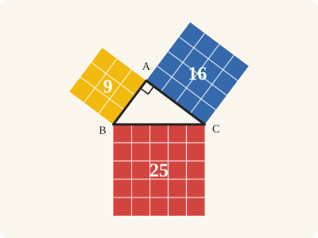
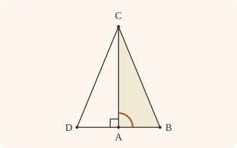

<!-- Generated by scripts/render.py. Do not edit by hand. -->

[Book I](index.md) · [← I.47](47.md) · [II.1 →](../II/01.md)

# Book I, Proposition 48

*If the square equals the other two, the angle is right*

[Euclid's proof](#euclids-proof) · [In Lean](#in-lean) · [What it rests on](#what-it-rests-on) · [Mishnah](#mishnah)

> If in a triangle the square on one of the sides be equal to the squares on the remaining two sides of the triangle, the angle contained by the remaining two sides of the triangle is right.

**In Lean:** ✅ proved, as Euclid states it · Euclid's argument

<p align="center"></p>

<p align="center"><em>Turn Pythagoras round: when the squares on BA, AC, 9 (yellow) and 16 (blue), together make the square on BC, 25 (red), the angle BAC is right.</em></p>

## Euclid's proof

<p align="center"></p>

For in the triangle ABC let the square on one side BC be equal to the squares on the sides BA, AC;

I say that the angle BAC is right.

For let AD be drawn from the point A at right angles to the straight line AC, let AD be made equal to BA, and let DC be joined.

Since DA is equal to AB, the square on DA is also equal to the square on AB.

Let the square on AC be added to each; therefore the squares on DA, AC are equal to the squares on BA, AC.

But the square on DC is equal to the squares on DA, AC, for the angle DAC is right; [I. 47] and the square on BC is equal to the squares on BA, AC, for this is the hypothesis; therefore the square on DC is equal to the square on BC, so that the side DC is also equal to BC.

And, since DA is equal to AB, and AC is common, the two sides DA, AC are equal to the two sides BA, AC; and the base DC is equal to the base BC; therefore the angle DAC is equal to the angle BAC. [I. 8]

But the angle DAC is right; therefore the angle BAC is also right.

Therefore etc.

Q. E. D.

## In Lean

| | |
|---|---|
| Proof | ✅ Proved |
| Statement | The whole enunciation. The three given squares may each stand on either side of its side. |
| Argument | Euclid's. |
| Reviewed | The statement and every passage of the argument read against Heath's text, at commit [`b7b41f51`](https://github.com/jackChallis/stoicheia/commit/b7b41f51) ([the record](../../review/I/48.toml)) |

From [`Elements/BookI/Prop48.lean`](../../Elements/BookI/Prop48.lean). Euclid's sentences are the `--` comments, and our own notes are in `/- … -/`; the lines under each sentence are the Lean that carries it out. The list below marks where a lemma does a step Euclid takes for granted; the `/- … -/` notes in the listing explain smaller adjustments.

**How the Lean follows the text**

- **Done by `Prop11`.** "For let AD be drawn from the point A at right angles…" Euclid draws AD perpendicular to AC, and Heath gives no reference here. The Lean draws AD by I.11 on the other side of AC from B, as in Heath's figure.
- **Done by `OnRay.exists_len_eq`.** "let AD be made equal to BA…" Euclid takes AD equal to BA on the perpendicular, taking enough room to cut it off by I.3 for granted; Heath gives no reference here. `OnRay.exists_len_eq` finds D on that ray by a circle about A with distance AB, using Postulate 3.
- **Done by `Prop46.square_eq`.** "Since DA is equal to AB, the square on DA…" Euclid assumes that squares on equal straight lines are equal; Heath reports that Proclus proves it under I.46, and the Lean proves it so, by I.4 on the halves.
- **Done by `Prop46.square_eq`.** "Let the square on AC be added to each…" Euclid adds the square on AC to the equal squares on DA and AB. The Lean describes the squares on DA and AC by I.46, beneath the preceding sentence and this one, on the sides away from the triangle DAC; `Prop46.square_eq` identifies the new square on AC with the given one before Common Notion 2 adds the areas.
- **Done by `Prop46`.** "But the square on DC is equal to the squares on DA, AC…" Euclid applies I.47 to the square on DC without describing it. The Lean describes it by I.46 on the side away from A, so that all three squares stand outward from DAC as I.47 asks, and then applies I.47.
- **Done by `Prop46.side_eq`.** "therefore the square on DC is equal to the square on BC…" Euclid assumes the converse too, that equal squares stand on equal straight lines; Heath reports Proclus' proof, while the Lean's `Prop46.side_eq` takes another road, the square on the less being the less. Before applying that lemma in I.48, the Lean uses `Prop28.square` (I.28) to make both squares parallelograms and `Parallelogram.quadArea_rotate` to read their unchanged areas from C, as squares on CD and CB.

```lean
/-- If in a triangle the square on one of the sides be equal to the squares on the remaining two
sides of the triangle, the angle contained by the remaining two sides of the triangle is right. -/
theorem Prop48 {A B C P Q R S T U : Point} (hABC : Triangle A B C)
    (hBC : Square B P Q C) (hPQ : SameSideOf P Q B C)
    (hBA : Square A B R S) (hRS : SameSideOf R S A B)
    (hAC : Square A C T U) (hTU : SameSideOf T U A C)
    (h : quadArea B P Q C = quadArea A B R S + quadArea A C T U) :
    ∠ B A C = ∟ := by
  -- For in the triangle ABC let the square on one side BC be equal to the squares on the sides
  -- BA, AC;
  obtain ⟨AC, hA_AC, hC_AC⟩ := Postulate1 A C hABC.ne₁₃
  -- I say that the angle BAC is right.
  -- For let AD be drawn from the point A at right angles to the straight line AC,
  /- On the other side of AC from B, as in Euclid's figure. I.11 gives a point
     D₀ on the perpendicular; D is then taken on the ray from A through D₀. -/
  obtain ⟨X, hXB, -⟩ := exists_oppositeSidesOf hABC.acb []
  obtain ⟨D₀, hD₀X, hright⟩ :=
    Prop11 hABC.ne₁₃ ⟨AC, hA_AC, hC_AC, hA_AC⟩ hXB.triangle
  -- let AD be made equal to BA,
  obtain ⟨D, hD, hAD⟩ := OnRay.exists_len_eq hABC.ne₁₂ hD₀X.triangle.ne₁₃
  -- and let DC be joined.
  have hDB : OppositeSidesOf D B A C := (SameSideOf.of_onRay hD hD₀X).trans_opposite hXB
  have hADC : Triangle A D C := hDB.triangle.acb
  have hDAC : ∠ D A C = ∟ := by
    rw [angle_symm hADC.ne₁₂.symm hADC.ne₁₃.symm, angle_onRay_right hD hABC.ne₁₃.symm]
    exact hright C ⟨AC, hA_AC, hC_AC, hC_AC⟩ hABC.ne₁₃.symm
  -- Since DA is equal to AB, the square on DA is also equal to the square on AB.
  /- Describe the square on DA away from C, so that I.47 will apply. -/
  obtain ⟨X₂, hX₂C, -⟩ := exists_oppositeSidesOf hADC.bac []
  obtain ⟨R', S', hsqDA, hR', hS'⟩ := Prop46 hADC.ne₁₂.symm hX₂C.triangle
  have hR'S' : SameSideOf R' S' A D := (hR'.trans hS'.symm).swap
  have hDA_AB : quadArea A D R' S' = quadArea A B R S :=
    Prop46.square_eq hsqDA.rotate.rotate.rotate hR'S' hBA hRS hAD
  -- Let the square on AC be added to each; therefore the squares on DA, AC are equal to the
  -- squares on BA, AC.
  /- The square on AC is described away from D. Its area is that of the given
     square on AC, whichever side that square occupies. -/
  obtain ⟨X₃, hX₃D, -⟩ := exists_oppositeSidesOf hADC.cab []
  obtain ⟨T', U', hsqAC, hT', hU'⟩ := Prop46 hADC.ne₁₃.symm hX₃D.triangle
  have hT'U' : SameSideOf T' U' A C := (hT'.trans hU'.symm).swap
  have hAC_AC : quadArea A C T' U' = quadArea A C T U :=
    Prop46.square_eq hsqAC.rotate.rotate.rotate hT'U' hAC hTU rfl
  have hsum : quadArea A D R' S' + quadArea A C T' U' =
      quadArea A B R S + quadArea A C T U := CommonNotion2 hDA_AB hAC_AC
  -- But the square on DC is equal to the squares on DA, AC, for the angle DAC is
  -- right; [I. 47] and the square on BC is equal to the squares on BA, AC, for this is the
  -- hypothesis; therefore the square on DC is equal to the square on BC, so that the side DC
  -- is also equal to BC.
  obtain ⟨X₁, hX₁A, -⟩ := exists_oppositeSidesOf hADC.bca []
  obtain ⟨P', Q', hsqDC, hP', hQ'⟩ := Prop46 hADC.ne₂₃ hX₁A.triangle
  have h47 : quadArea D P' Q' C = quadArea A D R' S' + quadArea A C T' U' :=
    Prop47 hADC hDAC hsqDC (hP'.trans_opposite hX₁A) (hQ'.trans_opposite hX₁A)
      hsqDA.rotate.rotate.rotate (hR'.trans_opposite hX₂C).swap (hS'.trans_opposite hX₂C).swap
      hsqAC.rotate.rotate.rotate (hT'.trans_opposite hX₃D).swap (hU'.trans_opposite hX₃D).swap
  have hBCsum : quadArea B P Q C = quadArea A B R S + quadArea A C T U := h
  have hDC_BC : quadArea D P' Q' C = quadArea B P Q C :=
    (h47.trans hsum).trans hBCsum.symm
  /- Read both squares from C to compare their sides CD and CB. I.28 makes
     them parallelograms, and a parallelogram has one area, whichever diameter
     measures it. -/
  have hP'Q' : SameSideOf P' Q' D C := hP'.trans hQ'.symm
  have hsq : quadArea C D P' Q' = quadArea C B P Q := by
    have hpDC : Parallelogram C D P' Q' :=
      Prop28.square hsqDC.rotate.rotate.rotate hP'Q'.swap
    have hpBC : Parallelogram C B P Q := Prop28.square hBC.rotate.rotate.rotate hPQ.swap
    rw [← hpDC.quadArea_rotate, ← hpBC.quadArea_rotate]
    exact hDC_BC
  have hDC : ‖C D‖ = ‖C B‖ :=
    Prop46.side_eq hsqDC.rotate.rotate.rotate hP'Q'.swap hBC.rotate.rotate.rotate hPQ.swap hsq
  -- And, since DA is equal to AB, and AC is common, the two sides DA, AC are equal to the two
  -- sides BA, AC; and the base DC is equal to the base BC; therefore the angle DAC is equal to
  -- the angle BAC. [I. 8]
  have h8 : ∠ D A C = ∠ B A C :=
    Prop8 hADC hABC hAD rfl (by rw [len_symm D C, hDC, len_symm C B])
  -- But the angle DAC is right; therefore the angle BAC is also right.
  have hBAC : ∠ B A C = ∟ := h8.symm.trans hDAC
  -- Therefore etc.
  exact hBAC
  -- Q. E. D.
```

## What it rests on

| | |
|---|---|
| Heath's references | [I.8](08.md), [I.47](47.md) |
| Lean cites | [I.3](03.md), [I.4](04.md), [I.8](08.md), [I.11](11.md), [I.28](28.md), [I.34](34.md), [I.46](46.md), [I.47](47.md) |
| Postulates | 1, 2, 3, 4, 5 |
| Definitions taken as axioms | Def. I.15 |
| Common Notions | 1, 2, 3, 4, 5 |
| Tacit rules | 39 (listed below) |
| Its own Lean calls | Postulate 1; 2 tacit rules |
| Through lemmas | Postulates 2 and 3; Def. I.15; 34 tacit rules |

Some of these come in through lemmas [shared](../../CERTIFICATE.md#shared-steps) by many proofs: [`Prop46.side_eq`](../../Elements/BookI/Prop46.lean#L132) (I.3, I.4, I.28, I.34, I.46); [`Prop46.square_eq`](../../Elements/BookI/Prop46.lean#L96) (I.4, I.28); [`Prop28.square`](../../Elements/BookI/HelpersParallels.lean#L133) (I.28).

_Postulates, definitions, Common Notions and tacit rules: all that this proof rests on, counting those of the propositions it cites. The last two rows say which of the postulates, definitions and tacit rules its own Lean calls, in the proof or a helper written for it, and which it does not call but reaches through lemmas, of Book Zero or shared (a proposition it cites may rest on these too); the rest come in only through the propositions it cites or the Common Notions._

<details><summary>The 39 tacit rules beneath this proof, counting those of the propositions it cites</summary>

_(used here) marks a rule this proof's own Lean calls, in the proof or a helper written for it; (through …) marks one its own Lean does not call but reaches through the lemmas named, of [Book Zero](../../Elements/Figure) or shared, though a proposition it cites may rest on it too; and a rule with no mark comes in only through a proposition it cites or a Common Notion. The names in brackets are System E's: an Intersection rule says when straight lines and circles must meet, and an Intersections rule takes a point where they do (see [Book I's introduction](index.md))._

**Reading the figure**

- [`between_cases`](../../Elements/Foundations/Tacit/Diagram.lean#L54) (through [`OnRay.exists_len_eq`](../../Elements/Figure/Rays.lean#L141), [`Parallelogram.quadArea_rotate`](../../Elements/Figure/Parallelograms.lean#L202), [`Prop28.square`](../../Elements/BookI/HelpersParallels.lean#L133) and 3 other lemmas): Of three different points on a straight line, one is between the other two. (Between 6)
- [`between_symm`](../../Elements/Foundations/Tacit/Diagram.lean#L47) (through [`OnRay.exists_len_eq`](../../Elements/Figure/Rays.lean#L141), [`Parallelogram.quadArea_rotate`](../../Elements/Figure/Parallelograms.lean#L202), [`Prop28.square`](../../Elements/BookI/HelpersParallels.lean#L133) and 5 other lemmas): If B is between A and C, it is between C and A. (Between 1)
- [`circles_meet`](../../Elements/Foundations/Tacit/Diagram.lean#L91) (through [`OnRay.exists_len_eq`](../../Elements/Figure/Rays.lean#L141), [`Parallelogram.quadArea_rotate`](../../Elements/Figure/Parallelograms.lean#L202), [`Prop28.square`](../../Elements/BookI/HelpersParallels.lean#L133) and 6 other lemmas): If each circle passes through a point inside the other, the circles cut one another. This is the step Euclid takes for granted in I.1. (Intersection 5)
- [`circles_meet_same_side`](../../Elements/Foundations/Tacit/Constructions.lean#L79) (through [`OnRay.exists_len_eq`](../../Elements/Figure/Rays.lean#L141), [`Parallelogram.quadArea_rotate`](../../Elements/Figure/Parallelograms.lean#L202), [`Prop28.square`](../../Elements/BookI/HelpersParallels.lean#L133) and 6 other lemmas): Two circles that cut one another do so on each side of the straight line through their centres. (Intersections 8)
- [`exists_point`](../../Elements/Foundations/Tacit/Constructions.lean#L35) (through [`Parallelogram.quadArea_rotate`](../../Elements/Figure/Parallelograms.lean#L202), [`Prop46.side_eq`](../../Elements/BookI/Prop46.lean#L132), [`Prop46.square_eq`](../../Elements/BookI/Prop46.lean#L96) and 4 other lemmas): Let a point be taken. (Points 1)
- [`exists_point_inside_circle`](../../Elements/Foundations/Tacit/Constructions.lean#L42) (through [`OnRay.exists_len_eq`](../../Elements/Figure/Rays.lean#L141), [`Parallelogram.quadArea_rotate`](../../Elements/Figure/Parallelograms.lean#L202), [`Prop28.square`](../../Elements/BookI/HelpersParallels.lean#L133) and 6 other lemmas): Let a point be taken inside the circle α. (Points 8)
- [`exists_point_on_line`](../../Elements/Foundations/Tacit/Constructions.lean#L38) (through [`OnRay.exists_len_eq`](../../Elements/Figure/Rays.lean#L141), [`Parallelogram.quadArea_rotate`](../../Elements/Figure/Parallelograms.lean#L202), [`Prop28.square`](../../Elements/BookI/HelpersParallels.lean#L133) and 6 other lemmas): Let a point be taken on the straight line L. (Points 2)
- [`line_circle_between`](../../Elements/Foundations/Tacit/Constructions.lean#L67) (through [`OnRay.exists_len_eq`](../../Elements/Figure/Rays.lean#L141), [`Parallelogram.quadArea_rotate`](../../Elements/Figure/Parallelograms.lean#L202), [`Prop28.square`](../../Elements/BookI/HelpersParallels.lean#L133) and 6 other lemmas): A straight line through a point B inside a circle, heading out to a point C outside it, cuts the circle between B and C. (Intersections 4)
- [`line_circle_beyond`](../../Elements/Foundations/Tacit/Constructions.lean#L73) (through [`OnRay.exists_len_eq`](../../Elements/Figure/Rays.lean#L141), [`Parallelogram.quadArea_rotate`](../../Elements/Figure/Parallelograms.lean#L202), [`Prop28.square`](../../Elements/BookI/HelpersParallels.lean#L133) and 6 other lemmas): A straight line through a point B inside a circle, produced beyond B away from C, cuts the circle there. (Intersections 5)
- [`line_unique`](../../Elements/Foundations/Tacit/Diagram.lean#L41) (through [`OnRay.exists_len_eq`](../../Elements/Figure/Rays.lean#L141), [`Parallelogram.quadArea_rotate`](../../Elements/Figure/Parallelograms.lean#L202), [`Prop28.square`](../../Elements/BookI/HelpersParallels.lean#L133) and 4 other lemmas): Two points determine a straight line. (Generalities 1)
- [`lines_meet_of_opposite_sides`](../../Elements/Foundations/Tacit/Diagram.lean#L86) (through [`Parallelogram.quadArea_rotate`](../../Elements/Figure/Parallelograms.lean#L202), [`Prop28.square`](../../Elements/BookI/HelpersParallels.lean#L133), [`Prop46.side_eq`](../../Elements/BookI/Prop46.lean#L132) and 1 other lemma): A straight line joining points on opposite sides of L crosses L. (Intersection 1)
- [`not_between_of_between`](../../Elements/Foundations/Tacit/Diagram.lean#L50) (through [`OnRay.exists_len_eq`](../../Elements/Figure/Rays.lean#L141), [`Parallelogram.quadArea_rotate`](../../Elements/Figure/Parallelograms.lean#L202), [`Prop28.square`](../../Elements/BookI/HelpersParallels.lean#L133) and 7 other lemmas): If B is between A and C, then A is not between B and C. (Between 1)
- [`not_on_line_of_same_side`](../../Elements/Foundations/Tacit/Diagram.lean#L60) (through [`OnRay.exists_len_eq`](../../Elements/Figure/Rays.lean#L141), [`Parallelogram.quadArea_rotate`](../../Elements/Figure/Parallelograms.lean#L202), [`Prop28.square`](../../Elements/BookI/HelpersParallels.lean#L133) and 8 other lemmas): Points on one side of a straight line are not on it. (Same side 3)
- [`pasch2`](../../Elements/Foundations/Tacit/Diagram.lean#L71) (through [`OnRay.exists_len_eq`](../../Elements/Figure/Rays.lean#L141), [`Parallelogram.quadArea_rotate`](../../Elements/Figure/Parallelograms.lean#L202), [`Prop28.square`](../../Elements/BookI/HelpersParallels.lean#L133) and 4 other lemmas): If B is between A and C, A is on L and B is off it, then B and C are on the same side of L: a straight line that leaves L at A does not cross it again. (Pasch 2)
- [`same_side_trans`](../../Elements/Foundations/Tacit/Diagram.lean#L64) (through [`OnRay.exists_len_eq`](../../Elements/Figure/Rays.lean#L141), [`Parallelogram.quadArea_rotate`](../../Elements/Figure/Parallelograms.lean#L202), [`Prop28.square`](../../Elements/BookI/HelpersParallels.lean#L133) and 7 other lemmas): Two points on the same side of a straight line as a third point are on the same side as each other. (Same side 4)

**Lengths, angles and areas**

- [`angle_add_of_inside`](../../Elements/Foundations/Tacit/Transfer.lean#L47) (through [`Parallelogram.quadArea_rotate`](../../Elements/Figure/Parallelograms.lean#L202), [`Prop46.side_eq`](../../Elements/BookI/Prop46.lean#L132) and [`exists_oppositeSidesOf`](../../Elements/Figure/Sides.lean#L179)): If D lies within the angle BAC, then BAC is made up of BAD and DAC. (Diagram-angle 2)
- [`angle_eq_of_same_rays`](../../Elements/Foundations/Tacit/Transfer.lean#L54) (through [`Prop46.side_eq`](../../Elements/BookI/Prop46.lean#L132) and [`angle_onRay_right`](../../Elements/Figure/Angles.lean#L49)): The angle doesn't change if its arms are traced through other points on the same rays. (Diagram-angle 4)
- [`angle_le_two_right`](../../Elements/Foundations/Tacit/Metric.lean#L33): No angle exceeds two right angles. (Metric 5)
- [`angle_symm`](../../Elements/Foundations/Tacit/Metric.lean#L30) (used here): The angle ABC is the angle CBA. (Metric 4)
- [`area_add_of_between`](../../Elements/Foundations/Tacit/Transfer.lean#L70) (through [`Parallelogram.quadArea_rotate`](../../Elements/Figure/Parallelograms.lean#L202), [`Prop46.side_eq`](../../Elements/BookI/Prop46.lean#L132) and [`Prop46.square_eq`](../../Elements/BookI/Prop46.lean#L96)): Cutting a triangle in two from a vertex adds up. (Diagram-area 2)
- [`area_congruent`](../../Elements/Foundations/Tacit/Metric.lean#L44): Triangles equal in all their sides and angles are equal in area. Euclid uses this without comment once he has shown two triangles congruent. (Metric 9)
- [`area_degenerate`](../../Elements/Foundations/Tacit/Metric.lean#L36) (through [`Parallelogram.quadArea_rotate`](../../Elements/Figure/Parallelograms.lean#L202), [`Prop46.side_eq`](../../Elements/BookI/Prop46.lean#L132) and [`Prop46.square_eq`](../../Elements/BookI/Prop46.lean#L96)): A "triangle" with a repeated corner has no area. (Metric 6)
- [`area_eq_zero_of_on_line`](../../Elements/Foundations/Tacit/Transfer.lean#L62) (through [`Parallelogram.quadArea_rotate`](../../Elements/Figure/Parallelograms.lean#L202), [`Prop46.side_eq`](../../Elements/BookI/Prop46.lean#L132) and [`Prop46.square_eq`](../../Elements/BookI/Prop46.lean#L96)): A "triangle" whose corners lie on one straight line has no area. (Diagram-area 1)
- [`area_rotate`](../../Elements/Foundations/Tacit/Metric.lean#L39) (through [`Parallelogram.quadArea_rotate`](../../Elements/Figure/Parallelograms.lean#L202), [`Prop46.side_eq`](../../Elements/BookI/Prop46.lean#L132) and [`Prop46.square_eq`](../../Elements/BookI/Prop46.lean#L96)): The triangle ABC is the triangle CAB. (Metric 8)
- [`len_add_of_between`](../../Elements/Foundations/Tacit/Transfer.lean#L27) (through [`OnRay.exists_len_eq`](../../Elements/Figure/Rays.lean#L141), [`Parallelogram.quadArea_rotate`](../../Elements/Figure/Parallelograms.lean#L202), [`Prop28.square`](../../Elements/BookI/HelpersParallels.lean#L133) and 7 other lemmas): If B is between A and C, then AB and BC together make up AC. (Diagram-segment 1)
- [`len_self`](../../Elements/Foundations/Tacit/Metric.lean#L24) (through [`OnRay.exists_len_eq`](../../Elements/Figure/Rays.lean#L141), [`Parallelogram.quadArea_rotate`](../../Elements/Figure/Parallelograms.lean#L202), [`Prop28.square`](../../Elements/BookI/HelpersParallels.lean#L133) and 7 other lemmas): The "straight line" from a point to itself has no length. (Metric 1)
- [`len_symm`](../../Elements/Foundations/Tacit/Metric.lean#L27) (used here): The straight line AB is the straight line BA. (Metric 3)
- [`on_line_of_area_eq_zero`](../../Elements/Foundations/Tacit/Transfer.lean#L66) (through [`Prop46.side_eq`](../../Elements/BookI/Prop46.lean#L132)): A triangle with no area has its corners on one straight line. (Diagram-area 1)
- [`radius_ne_zero`](../../Elements/Foundations/Tacit/Metric.lean#L62) (through [`OnRay.exists_len_eq`](../../Elements/Figure/Rays.lean#L141), [`Parallelogram.quadArea_rotate`](../../Elements/Figure/Parallelograms.lean#L202), [`Prop28.square`](../../Elements/BookI/HelpersParallels.lean#L133) and 7 other lemmas): A circle's radius is not nothing: the straight line from the centre to a point on the circle has some length. A rule of our own, not one of System E's: every circle is drawn with a centre and a distance (Postulate 3).
- [`same_ray_of_angle_eq_zero`](../../Elements/Foundations/Tacit/Transfer.lean#L42) (through [`Parallelogram.quadArea_rotate`](../../Elements/Figure/Parallelograms.lean#L202), [`Prop46.side_eq`](../../Elements/BookI/Prop46.lean#L132) and [`exists_oppositeSidesOf`](../../Elements/Figure/Sides.lean#L179)): If the angle BAC is nothing, C lies on the ray from A through B. (Diagram-angle 1)

**Superposition**

- [`superposition`](../../Elements/Foundations/Tacit/Superposition.lean#L48): **Superposition.** A hypothetical placement of a triangle on a given ray and side permits a restricted derivation of metric equalities about the figure already given. The derivation introduces no further objects, cites each geometric law it uses, and exports no symbol of the placement.

**Laws of magnitude**

- [`add_assoc`](../../Elements/Foundations/Tacit/Magnitudes.lean#L23) (through [`Parallelogram.quadArea_rotate`](../../Elements/Figure/Parallelograms.lean#L202), [`Prop28.square`](../../Elements/BookI/HelpersParallels.lean#L133), [`Prop46.side_eq`](../../Elements/BookI/Prop46.lean#L132) and 1 other lemma): Adding three magnitudes in a row, it makes no difference whether the first two or the last two are added first. (System E §3.5)
- [`add_comm`](../../Elements/Foundations/Tacit/Magnitudes.lean#L26) (through [`OnRay.exists_len_eq`](../../Elements/Figure/Rays.lean#L141), [`Parallelogram.quadArea_rotate`](../../Elements/Figure/Parallelograms.lean#L202), [`Prop28.square`](../../Elements/BookI/HelpersParallels.lean#L133) and 7 other lemmas): The order of adding does not matter. (System E §3.5)
- [`add_lt_add_right`](../../Elements/Foundations/Tacit/Magnitudes.lean#L45) (through [`OnRay.exists_len_eq`](../../Elements/Figure/Rays.lean#L141), [`Parallelogram.quadArea_rotate`](../../Elements/Figure/Parallelograms.lean#L202), [`Prop28.square`](../../Elements/BookI/HelpersParallels.lean#L133) and 2 other lemmas): Adding the same thing to both sides keeps "less than". (System E §3.5)
- [`add_zero`](../../Elements/Foundations/Tacit/Magnitudes.lean#L29) (through [`Parallelogram.quadArea_rotate`](../../Elements/Figure/Parallelograms.lean#L202) and [`Prop46.side_eq`](../../Elements/BookI/Prop46.lean#L132)): Adding nothing changes nothing. (System E §3.5)
- [`lt_irrefl`](../../Elements/Foundations/Tacit/Magnitudes.lean#L32) (through [`OnRay.exists_len_eq`](../../Elements/Figure/Rays.lean#L141), [`Parallelogram.quadArea_rotate`](../../Elements/Figure/Parallelograms.lean#L202), [`Prop28.square`](../../Elements/BookI/HelpersParallels.lean#L133) and 6 other lemmas): No magnitude is less than itself. (System E §3.5)
- [`lt_trans`](../../Elements/Foundations/Tacit/Magnitudes.lean#L35) (through [`OnRay.exists_len_eq`](../../Elements/Figure/Rays.lean#L141), [`Parallelogram.quadArea_rotate`](../../Elements/Figure/Parallelograms.lean#L202), [`Prop28.square`](../../Elements/BookI/HelpersParallels.lean#L133) and 6 other lemmas): What is less than the less is less still. (System E §3.5)
- [`lt_trichotomy`](../../Elements/Foundations/Tacit/Magnitudes.lean#L39) (through [`OnRay.exists_len_eq`](../../Elements/Figure/Rays.lean#L141), [`Parallelogram.quadArea_rotate`](../../Elements/Figure/Parallelograms.lean#L202), [`Prop28.square`](../../Elements/BookI/HelpersParallels.lean#L133) and 7 other lemmas): Of two magnitudes, one is less, or they are equal, or the other is less. (System E §3.5)
- [`not_lt_zero`](../../Elements/Foundations/Tacit/Magnitudes.lean#L42) (through [`OnRay.exists_len_eq`](../../Elements/Figure/Rays.lean#L141), [`Parallelogram.quadArea_rotate`](../../Elements/Figure/Parallelograms.lean#L202), [`Prop28.square`](../../Elements/BookI/HelpersParallels.lean#L133) and 7 other lemmas): Nothing is less than zero. (System E §3.5)

</details>

## Mishnah

_Our commentary: what Euclid assumes, what Lean made us say out loud, and how the result looks by modern means._

Book I ends with the converse of its great theorem, and Euclid proves it by building a right angle to compare with. He draws AD at right angles to AC (Heath gives no reference here: it is I.11), makes it equal to BA, and joins DC; I.47 and the hypothesis then make DC equal to BC, and I.8 makes the angle BAC equal to the right angle DAC.

Under I.47 Heath cites Vitruvius for Pythagoras' way of setting out a right angle with three lengths, of 3, 4 and 5, and the recipe rests on this proposition: 9 and 16 make 25, so the angle between the two shorter lengths is right, the converse the figure at the top shows.

Twice Euclid passes between equal sides and equal squares in a clause: from DA and AB to their squares at the start, and from the squares on DC and BC back to their sides in "so that the side DC is also equal to BC". Our proof cites each direction as a theorem of its own, both proved after I.46, where Heath reports Proclus proving them. Euclid also speaks of the squares on DA, AC and DC without describing them. Our proof describes all three by I.46, outward from the triangle DAC as I.47 asks, beside the three our statement gives, which may stand on either side of their sides.

**"An appearance of avoiding indirect demonstration."** Proclus gives another proof, the one an-Nairīzī attributes to Heron: draw the perpendicular on B's side of AC instead, and I.7 will not let it fall anywhere but on AB. Augustus De Morgan sees in Euclid's own proof "an appearance of avoiding indirect demonstration by drawing the triangles on different sides of the base and appealing to I. 8, because drawing them on the same side would make the appeal to I. 7 (on which, however, I. 8 is founded)" (Heath, vol. 1, p. 369). Our I.8 cites I.7 as well, so his parenthesis holds of our proofs too.

**The modern way.** Put $\mathbf{u} = \mathrm{B - A}$ and $\mathbf{v} = \mathrm{C - A}$. Since $|\mathbf{u} - \mathbf{v}|^{2} = |\mathbf{u}|^{2} + |\mathbf{v}|^{2} - 2\mathbf{u} \cdot \mathbf{v}$, the hypothesis says that $\mathbf{u} \cdot \mathbf{v} = 0$, so the angle BAC is $\pi/2$. That is not Euclid's route: he builds a right-angled triangle and compares the given one with it by I.8.

## Further reading

- In the modern way the hypothesis comes down to u · v = 0, and why a dot product of zero means a right angle is shown in ch. 9, "Dot products and duality", of Grant Sanderson's animated [*Essence of linear algebra*](https://www.3blue1brown.com/topics/linear-algebra) (2016, free online) (also on [I.2](02.md)).
- John Stillwell's [*Mathematics and Its History*](https://doi.org/10.1007/978-1-4419-6053-5) (2010), a grand tour through the subject's history, opens with "The Theorem of Pythagoras", which sets I.47 and I.48 in the long story of mathematics.

[Book I](index.md) · [← I.47](47.md) · [II.1 →](../II/01.md)

---

<sub>Euclid's text: T. L. Heath, *The Thirteen Books of Euclid's Elements*, vol. 1 (Cambridge, 1908), pp. 368–369; [scan leaves n388–n389](https://archive.org/details/thirteenbookseu02heibgoog/page/n388); [figure on n388](https://archive.org/details/thirteenbookseu02heibgoog/page/n388). Public domain.</sub>

<sub>The tacit rules follow the System E of Jeremy Avigad, Edward Dean and John Mumma, read alongside LeanEuclid (Logan Murphy, Kaiyu Yang, Jialiang Sun, Zhaoyu Li, Anima Anandkumar and Xujie Si).</sub>
