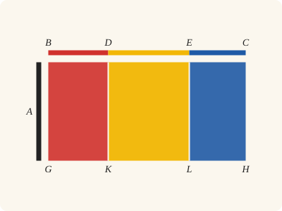
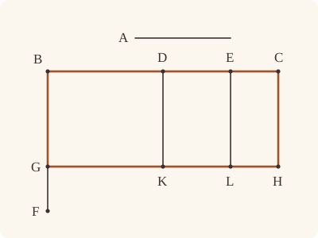

<!-- Generated by scripts/render.py. Do not edit by hand. -->

[Book II](index.md) · [← I.48](../I/48.md) · [II.2 →](02.md)

# Book II, Proposition 1

*The rectangle contained by two straight lines, one cut*

[Euclid's proof](#euclids-proof) · [In Lean](#in-lean) · [What it rests on](#what-it-rests-on) · [Mishnah](#mishnah)

> If there be two straight lines, and one of them be cut into any number of segments whatever, the rectangle contained by the two straight lines is equal to the rectangles contained by the uncut straight line and each of the segments.

**In Lean:** ✅ proved, as Euclid states it · Euclid's argument

<p align="center"></p>

<p align="center"><em>Cut BC at D and E (red, yellow, blue), and the rectangle contained by A (black) and BC splits into the rectangles contained by A and each segment.</em></p>

## Euclid's proof

<p align="center"></p>

<p align="center"><em>Drawn for one case: BC cut at two points, D and E, as in Heath's figure.</em></p>

Let A, BC be two straight lines, and let BC be cut at random at the points D, E;

I say that the rectangle contained by A, BC is equal to the rectangle contained by A, BD, that contained by A, DE and that contained by A, EC.

For let BF be drawn from B at right angles to BC; [I. 11]

let BG be made equal to A, [I. 3]

through G let GH be drawn parallel to BC, [I. 31]

and through D, E, C let DK, EL, CH be drawn parallel to BG.

Then BH is equal to BK, DL, EH.

Now BH is the rectangle A, BC, for it is contained by GB, BC, and BG is equal to A;

BK is the rectangle A, BD, for it is contained by GB, BD, and BG is equal to A;

and DL is the rectangle A, DE, for DK, that is BG [I. 34], is equal to A.

Similarly also EH is the rectangle A, EC.

Therefore the rectangle A, BC is equal to the rectangle A, BD, the rectangle A, DE and the rectangle A, EC.

Therefore etc.

Q. E. D.

## In Lean

| | |
|---|---|
| Proof | ✅ Proved, and its companions `Prop1.two` ([II.1 two](01.md#two)) and `Prop1.general` ([II.1 general](01.md#general)) |
| Statement | The whole enunciation. With its companions: `Prop1.general` cuts the straight line at any number of points in order, `Prop1.two` at one; `Prop1` keeps Euclid's two, D and E. |
| Argument | Euclid's. Euclid draws every parallel in one figure. The companions draw one at a time: `Prop1.two` is his construction for one point of section, and `Prop1.general` repeats it, cutting off one segment after another (`InOrder.between_end`). |
| Representation | The straight line A is named by its two ends, A₁ and A₂, and the main theorem asks them to differ. The companions do not: A₁A₂ may be nothing, and then every rectangle is nothing, so they claim a little more than Euclid's two straight lines. `Prop1.general` takes the straight line from B cut at points given in order along it (`InOrder`), and adds the rectangles on its segments as a sum over the list; with no point of section the one segment is the whole, and with no point at all the straight line is nothing, and so is each side of the equation. |
| Reviewed | The statement and every passage of the argument read against Heath's text, at commit [`ece9c2d71`](https://github.com/jackChallis/stoicheia/commit/ece9c2d71) ([the record](../../review/II/01.toml)) |

From [`Elements/BookII/Prop01.lean`](../../Elements/BookII/Prop01.lean). Euclid's sentences are the `--` comments, and our own notes are in `/- … -/`; the lines under each sentence are the Lean that carries it out. The list below marks where a lemma does a step Euclid takes for granted; the `/- … -/` notes in the listing explain smaller adjustments.

**How the Lean follows the text**

- **Done by `produce_longer`.** "let BG be made equal to A…" Euclid cuts off BG equal to A by I.3, taking enough room on BF for granted. The Lean first places A at B by I.2, then `produce_longer` extends the perpendicular far enough for I.3 to cut off BG.
- **Done by `BookI.Prop31.parallelogram`.** "and through D, E, C let DK, EL, CH be drawn parallel to BG." Euclid draws DK, EL and CH and reads their meetings with GH from the figure. `BookI.Prop31.parallelogram` draws each parallel by I.31 and finds K, L and H by `BookI.Prop30.meet`, using I.30.
- **Done by `quadArea_add_of_parallelograms`.** "Then BH is equal to BK, DL, EH." Euclid reads BH as BK, DL and EH together. The Lean proves the uprights parallel by `BookI.Prop30.parallel` (I.30), orders G, K, L and H by `Parallel.between`, and uses `quadArea_add_of_parallelograms` twice to join the three pieces.
- **Done by `Rectangle.of_right`.** "Now BH is the rectangle A, BC…" Euclid treats BH as a rectangle once its angle at B is right. `Rectangle.of_right` proves the other angles right by I.29, and `Rectangle.eq_rect` identifies its area from BG equal to A.
- **Done by `Rectangle.of_right`.** "BK is the rectangle A, BD…" Euclid likewise treats BK as a rectangle. The Lean transfers the right angle at B along BC to BD, uses `Rectangle.of_right` for the other angles, and identifies BK by `Rectangle.eq_rect`.
- **Done by `Rectangle.of_right`.** "and DL is the rectangle A, DE…" Euclid takes DL to be right-angled, with DK equal to A by I.34. The Lean gets its angle at D from the adjacent right angle of BK by `Tacit.adjacent_eq_of_right`, which I.13 and Common Notion 3 prove, then uses `Rectangle.of_right` and `Rectangle.eq_rect` to identify DL.
- **Done by `Rectangle.of_right`.** "Similarly also EH is the rectangle A, EC." Euclid gives EH the same justification as DL. The Lean repeats I.34 for EL equal to A, makes BL a rectangle by `Rectangle.of_right`, and uses `Tacit.adjacent_eq_of_right` again for the angle at E before `Rectangle.of_right` and `Rectangle.eq_rect` identify EH.

```lean
/-- If there be two straight lines, and one of them be cut into any number of segments whatever, the
rectangle contained by the two straight lines is equal to the rectangles contained by the uncut
straight line and each of the segments. -/
theorem Prop1 {A₁ A₂ B C D E : Point} (hA : A₁ ≠ A₂) (hBDE : Between B D E) (hDEC : Between D E C) :
    rect A₁ A₂ B C = rect A₁ A₂ B D + rect A₁ A₂ D E + rect A₁ A₂ E C := by
  -- Let A, BC be two straight lines, and let BC be cut at random at the points D, E;
  have hBDC : Between B D C := between_of_between_right hBDE hDEC
  have hBEC : Between B E C :=
    between_symm (between_of_between_right (between_symm hDEC) (between_symm hBDE))
  have hBC : B ≠ C := ne_of_between_ends hBDC
  obtain ⟨BC, hB_BC, hC_BC⟩ := Postulate1 B C hBC
  have hD_BC : OnLine D BC := on_line_of_between_ends hBDC hB_BC hC_BC
  have hE_BC : OnLine E BC := on_line_of_between_ends hBEC hB_BC hC_BC
  -- I say that the rectangle contained by A, BC is equal to the rectangle contained by A, BD,
  -- that contained by A, DE and that contained by A, EC.
  -- For let BF be drawn from B at right angles to BC; [I. 11]
  obtain ⟨Q, hQ, -⟩ := exists_off_line hBC []
  obtain ⟨F, hFQ, hright⟩ := BookI.Prop11 hBC ⟨BC, hB_BC, hC_BC, hB_BC⟩ hQ
  have hCBF : ∠ C B F = ∟ := hright C ⟨BC, hB_BC, hC_BC, hC_BC⟩ hBC.symm
  -- let BG be made equal to A, [I. 3]
  /- I.3 needs a greater straight line. Place A at B by I.2 and produce BF
     far enough along its ray before cutting off BG. -/
  obtain ⟨P, hP⟩ := BookI.Prop2 B A₁ A₂ hA
  have hBP : B ≠ P := ne_of_len_eq hP hA
  have hBF : B ≠ F := hFQ.triangle.ne₁₃
  obtain ⟨Y, hFBY⟩ := produce hBF.symm
  obtain ⟨X, hYBX, hlt⟩ := produce_longer (ne_of_between (between_symm hFBY)) hBP
  have hX : OnRay X B F := OnRay.of_between_between (between_symm hFBY) hYBX
  obtain ⟨G, hBGX, hBG⟩ := BookI.Prop3 hA (hP ▸ hlt)
  have hCBG : ∠ C B G = ∟ := by
    rw [angle_onRay_right (OnRay.of_between hBGX) hBC.symm, angle_onRay_right hX hBC.symm]
    exact hCBF
  have hGQ : SameSideOf G Q B C :=
    SameSideOf.of_onRay (OnRay.of_between hBGX) (SameSideOf.of_onRay hX hFQ)
  have hG_BC : ¬ OnLine G BC := not_on_line_of_same_side (hGQ.sameSide hB_BC hC_BC)
  -- through G let GH be drawn parallel to BC, [I. 31]
  obtain ⟨GH, hG_GH, hGH_BC⟩ := BookI.Prop31.line hG_BC
  -- and through D, E, C let DK, EL, CH be drawn parallel to BG.
  obtain ⟨K, hK_GH, hGBDK⟩ :=
    BookI.Prop31.parallelogram hGH_BC hG_GH hB_BC hD_BC (ne_of_between hBDC)
  obtain ⟨L, hL_GH, hGBEL⟩ :=
    BookI.Prop31.parallelogram hGH_BC hG_GH hB_BC hE_BC (ne_of_between hBEC)
  obtain ⟨H, hH_GH, hGBCH⟩ := BookI.Prop31.parallelogram hGH_BC hG_GH hB_BC hC_BC hBC
  obtain ⟨BG, hB_BG, hG_BG⟩ := Postulate1 B G (ne_of_between hBGX)
  obtain ⟨DK, hD_DK, hK_DK⟩ := Postulate1 D K hGBDK.1.2.1
  obtain ⟨EL, hE_EL, hL_EL⟩ := Postulate1 E L hGBEL.1.2.1
  obtain ⟨CH, hC_CH, hH_CH⟩ := Postulate1 C H hGBCH.1.2.1
  have hDK_BG : Parallel DK BG := (hGBDK.1.parallel hG_BG hB_BG hD_DK hK_DK).symm
  have hEL_BG : Parallel EL BG := (hGBEL.1.parallel hG_BG hB_BG hE_EL hL_EL).symm
  have hCH_BG : Parallel CH BG := (hGBCH.1.parallel hG_BG hB_BG hC_CH hH_CH).symm
  -- Then BH is equal to BK, DL, EH.
  have hDE : D ≠ E := ne_of_between hDEC
  have hDC : D ≠ C := (ne_of_between (between_symm hBDC)).symm
  have hEC : E ≠ C := (ne_of_between (between_symm hBEC)).symm
  /- Each upright meets BC at its own point alone, so these are distinct
     straight lines (`Parallel.off_transversal`). I.30 makes them parallel. -/
  have hE_DK : ¬ OnLine E DK :=
    hGH_BC.symm.off_transversal hD_BC hK_GH hD_DK hK_DK hE_BC hDE.symm
  have hC_DK : ¬ OnLine C DK :=
    hGH_BC.symm.off_transversal hD_BC hK_GH hD_DK hK_DK hC_BC hDC.symm
  have hC_EL : ¬ OnLine C EL :=
    hGH_BC.symm.off_transversal hE_BC hL_GH hE_EL hL_EL hC_BC hEC.symm
  have hDK_EL : Parallel DK EL :=
    BookI.Prop30.parallel hDK_BG hEL_BG (fun e => hE_DK (e.symm ▸ hE_EL))
  have hDK_CH : Parallel DK CH :=
    BookI.Prop30.parallel hDK_BG hCH_BG (fun e => hC_DK (e.symm ▸ hC_CH))
  have hEL_CH : Parallel EL CH :=
    BookI.Prop30.parallel hEL_BG hCH_BG (fun e => hC_EL (e.symm ▸ hC_CH))
  /- The parallels keep the order of B, D, E, C on GH. -/
  have hGKL : Between G K L := Parallel.between hDK_BG.symm hDK_EL.symm hB_BG hD_DK hE_EL
    hBDE hG_BG hK_DK hL_EL ⟨GH, hG_GH, hK_GH, hL_GH⟩
  have hKLH : Between K L H := Parallel.between hDK_EL hEL_CH.symm hD_DK hE_EL hC_CH
    hDEC hK_DK hL_EL hH_CH ⟨GH, hK_GH, hL_GH, hH_GH⟩
  have hGKH : Between G K H := between_of_between_right hGKL hKLH
  have hBGKD : Parallelogram B G K D := hGBDK.reverse.rotate.rotate.rotate
  have hBGLE : Parallelogram B G L E := hGBEL.reverse.rotate.rotate.rotate
  have hBGHC : Parallelogram B G H C := hGBCH.reverse.rotate.rotate.rotate
  have hDKHC : Parallelogram D K H C :=
    ⟨AreParallel.of_parallel hGBDK.1.2.1 hGBCH.1.2.1.symm hD_DK hK_DK hH_CH hC_CH hDK_CH,
      AreParallel.of_parallel (ne_of_between_ends hKLH) hDC.symm hK_GH hH_GH hC_BC hD_BC hGH_BC⟩
  have hDKLE : Parallelogram D K L E :=
    ⟨AreParallel.of_parallel hGBDK.1.2.1 hGBEL.1.2.1.symm hD_DK hK_DK hL_EL hE_EL hDK_EL,
      AreParallel.of_parallel (ne_of_between hKLH) hDE.symm hK_GH hL_GH hE_BC hD_BC hGH_BC⟩
  have hELHC : Parallelogram E L H C :=
    ⟨AreParallel.of_parallel hGBEL.1.2.1 hGBCH.1.2.1.symm hE_EL hL_EL hH_CH hC_CH hEL_CH,
      AreParallel.of_parallel (ne_of_between (between_symm hKLH)).symm hEC.symm hL_GH hH_GH
        hC_BC hE_BC hGH_BC⟩
  have h₁ : quadArea B G H C = quadArea B G K D + quadArea D K H C :=
    quadArea_add_of_parallelograms hBGKD hDKHC hBDC hGKH
  have h₂ : quadArea D K H C = quadArea D K L E + quadArea E L H C :=
    quadArea_add_of_parallelograms hDKLE hELHC hDEC hKLH
  -- Now BH is the rectangle A, BC, for it is contained by GB, BC, and BG is equal to A;
  have hBH : quadArea B G H C = rect A₁ A₂ B C :=
    (Rectangle.of_right hBGHC hCBG).eq_rect hBG rfl
  -- BK is the rectangle A, BD, for it is contained by GB, BD, and BG is equal to A;
  have hBK_rect : Rectangle B G K D := by
    refine Rectangle.of_right hBGKD ?_
    rw [angle_onRay_left (OnRay.of_between hBDC) (ne_of_between hBGX).symm]
    exact hCBG
  have hBK : quadArea B G K D = rect A₁ A₂ B D := hBK_rect.eq_rect hBG rfl
  -- and DL is the rectangle A, DE, for DK, that is BG [I. 34], is equal to A.
  have hDK : ‖D K‖ = ‖A₁ A₂‖ := by
    rw [len_symm D K, ← (BookI.Prop34 hGBDK).2.1, len_symm G B]; exact hBG
  have hK_BC : ¬ OnLine K BC := hGH_BC.not_onLine hK_GH
  have hEDK : ∠ E D K = ∟ := by
    have h := hBK_rect.2.2.2.2
    rw [angle_symm hGBDK.1.2.1.symm (ne_of_between hBDE)] at h
    rw [angle_symm hDE.symm hGBDK.1.2.1.symm, ← adjacent_eq_of_right hB_BC hE_BC hBDE hK_BC h]
    exact h
  have hDL : quadArea D K L E = rect A₁ A₂ D E :=
    (Rectangle.of_right hDKLE hEDK).eq_rect hDK rfl
  -- Similarly also EH is the rectangle A, EC.
  have hEL : ‖E L‖ = ‖A₁ A₂‖ := by
    rw [len_symm E L, ← (BookI.Prop34 hGBEL).2.1, len_symm G B]; exact hBG
  have hL_BC : ¬ OnLine L BC := hGH_BC.not_onLine hL_GH
  have hBGLE_rect : Rectangle B G L E := by
    refine Rectangle.of_right hBGLE ?_
    rw [angle_onRay_left (OnRay.of_between hBEC) (ne_of_between hBGX).symm]
    exact hCBG
  have hCEL : ∠ C E L = ∟ := by
    have h := hBGLE_rect.2.2.2.2
    rw [angle_symm hGBEL.1.2.1.symm (ne_of_between hBEC)] at h
    rw [angle_symm hEC.symm hGBEL.1.2.1.symm, ← adjacent_eq_of_right hB_BC hC_BC hBEC hL_BC h]
    exact h
  have hEH : quadArea E L H C = rect A₁ A₂ E C :=
    (Rectangle.of_right hELHC hCEL).eq_rect hEL rfl
  -- Therefore the rectangle A, BC is equal to the rectangle A, BD, the rectangle A, DE and the
  -- rectangle A, EC.
  have hequal : rect A₁ A₂ B C = rect A₁ A₂ B D + rect A₁ A₂ D E + rect A₁ A₂ E C := by
    rw [← hBH, h₁, h₂, hBK, hDL, hEH]
    ac_rfl
  -- Therefore etc.
  exact hequal
  -- Q. E. D.
```

<a name="two"></a><a name="general"></a>

<details><summary>After the theorem, its companions, <code>Prop1.two</code> and <code>Prop1.general</code> (126 lines)</summary>

```lean
/-- **II.1, one cut** (companion of II.1). If the straight line BC is cut at D, the
rectangle contained by A₁A₂ and BC is equal to the rectangles contained by A₁A₂ and each
of BD, DC. II.1's construction, with one parallel drawn through D. The uncut straight line
A₁A₂ may be nothing, and then every rectangle is nothing. -/
theorem Prop1.two {A₁ A₂ B C D : Point} (h : Between B D C) :
    rect A₁ A₂ B C = rect A₁ A₂ B D + rect A₁ A₂ D C := by
  /- If A₁A₂ is nothing, all three rectangles are nothing. -/
  by_cases hA : A₁ = A₂
  · subst A₂
    simp only [rect_self_left, add_zero]
  have hBC : B ≠ C := ne_of_between_ends h
  obtain ⟨BC, hB_BC, hC_BC⟩ := Postulate1 B C hBC
  have hD_BC : OnLine D BC := on_line_of_between_ends h hB_BC hC_BC
  /- Draw BF at right angles to BC by I.11. -/
  obtain ⟨Q, hQ, -⟩ := exists_off_line hBC []
  obtain ⟨F, hFQ, hright⟩ := BookI.Prop11 hBC ⟨BC, hB_BC, hC_BC, hB_BC⟩ hQ
  have hCBF : ∠ C B F = ∟ := hright C ⟨BC, hB_BC, hC_BC, hC_BC⟩ hBC.symm
  /- Place A₁A₂ at B by I.2 and produce BF far enough along its ray.
     I.3 then cuts off BG equal to A₁A₂. -/
  obtain ⟨P, hP⟩ := BookI.Prop2 B A₁ A₂ hA
  have hBP : B ≠ P := ne_of_len_eq hP hA
  have hBF : B ≠ F := hFQ.triangle.ne₁₃
  obtain ⟨Y, hFBY⟩ := produce hBF.symm
  obtain ⟨X, hYBX, hlt⟩ := produce_longer (ne_of_between (between_symm hFBY)) hBP
  have hX : OnRay X B F := OnRay.of_between_between (between_symm hFBY) hYBX
  obtain ⟨G, hBGX, hBG⟩ := BookI.Prop3 hA (hP ▸ hlt)
  have hCBG : ∠ C B G = ∟ := by
    rw [angle_onRay_right (OnRay.of_between hBGX) hBC.symm, angle_onRay_right hX hBC.symm]
    exact hCBF
  have hGQ : SameSideOf G Q B C :=
    SameSideOf.of_onRay (OnRay.of_between hBGX) (SameSideOf.of_onRay hX hFQ)
  have hG_BC : ¬ OnLine G BC := not_on_line_of_same_side (hGQ.sameSide hB_BC hC_BC)
  /- Draw GH parallel to BC, and DK and CH parallel to BG, by I.31. -/
  obtain ⟨GH, hG_GH, hGH_BC⟩ := BookI.Prop31.line hG_BC
  obtain ⟨K, hK_GH, hGBDK⟩ :=
    BookI.Prop31.parallelogram hGH_BC hG_GH hB_BC hD_BC (ne_of_between h)
  obtain ⟨H, hH_GH, hGBCH⟩ := BookI.Prop31.parallelogram hGH_BC hG_GH hB_BC hC_BC hBC
  obtain ⟨BG, hB_BG, hG_BG⟩ := Postulate1 B G (ne_of_between hBGX)
  obtain ⟨DK, hD_DK, hK_DK⟩ := Postulate1 D K hGBDK.1.2.1
  obtain ⟨CH, hC_CH, hH_CH⟩ := Postulate1 C H hGBCH.1.2.1
  have hDK_BG : Parallel DK BG := (hGBDK.1.parallel hG_BG hB_BG hD_DK hK_DK).symm
  have hCH_BG : Parallel CH BG := (hGBCH.1.parallel hG_BG hB_BG hC_CH hH_CH).symm
  have hDC : D ≠ C := (ne_of_between (between_symm h)).symm
  /- DK meets BC only at D. It is distinct from CH, and I.30 makes them parallel. -/
  have hC_DK : ¬ OnLine C DK :=
    hGH_BC.symm.off_transversal hD_BC hK_GH hD_DK hK_DK hC_BC hDC.symm
  have hDK_CH : Parallel DK CH :=
    BookI.Prop30.parallel hDK_BG hCH_BG (fun e => hC_DK (e.symm ▸ hC_CH))
  /- The parallels put K between G and H, so BH divides into BK and DH. -/
  have hGKH : Between G K H := Parallel.between hDK_BG.symm hDK_CH.symm hB_BG hD_DK hC_CH
    h hG_BG hK_DK hH_CH ⟨GH, hG_GH, hK_GH, hH_GH⟩
  have hBGKD : Parallelogram B G K D := hGBDK.reverse.rotate.rotate.rotate
  have hBGHC : Parallelogram B G H C := hGBCH.reverse.rotate.rotate.rotate
  have hDKHC : Parallelogram D K H C :=
    ⟨AreParallel.of_parallel hGBDK.1.2.1 hGBCH.1.2.1.symm hD_DK hK_DK hH_CH hC_CH hDK_CH,
      AreParallel.of_parallel (ne_of_between (between_symm hGKH)).symm hDC.symm
        hK_GH hH_GH hC_BC hD_BC hGH_BC⟩
  have hparts : quadArea B G H C = quadArea B G K D + quadArea D K H C :=
    quadArea_add_of_parallelograms hBGKD hDKHC h hGKH
  /- BH and BK are contained by BG with BC and BD, respectively. -/
  have hBH : quadArea B G H C = rect A₁ A₂ B C :=
    (Rectangle.of_right hBGHC hCBG).eq_rect hBG rfl
  have hBK_rect : Rectangle B G K D := by
    refine Rectangle.of_right hBGKD ?_
    rw [angle_onRay_left (OnRay.of_between h) (ne_of_between hBGX).symm]
    exact hCBG
  have hBK : quadArea B G K D = rect A₁ A₂ B D := hBK_rect.eq_rect hBG rfl
  /- By I.34, DK equals BG and hence A₁A₂. The adjacent angle CDK is right,
     so DH is the rectangle contained by A₁A₂ and DC. -/
  have hDK : ‖D K‖ = ‖A₁ A₂‖ := by
    rw [len_symm D K, ← (BookI.Prop34 hGBDK).2.1, len_symm G B]
    exact hBG
  have hK_BC : ¬ OnLine K BC := hGH_BC.not_onLine hK_GH
  have hCDK : ∠ C D K = ∟ := by
    have hBDK := hBK_rect.2.2.2.2
    rw [angle_symm hGBDK.1.2.1.symm (ne_of_between h)] at hBDK
    rw [angle_symm hDC.symm hGBDK.1.2.1.symm,
      ← adjacent_eq_of_right hB_BC hC_BC h hK_BC hBDK]
    exact hBDK
  have hDH : quadArea D K H C = rect A₁ A₂ D C :=
    (Rectangle.of_right hDKHC hCDK).eq_rect hDK rfl
  rw [← hBH, hparts, hBK, hDH]

/-- **II.1, any number of segments** (companion of II.1). If the straight line from B to its
end is cut at any number of points in order, the rectangle contained by A₁A₂ and the whole
is equal to the rectangles contained by A₁A₂ and each of the segments. The list `ps` is
the points of section followed by the end; with no points of section it is the whole
straight line alone, and with no points at all the straight line is nothing and so is each
side. -/
theorem Prop1.general {A₁ A₂ B : Point} {ps : List Point} (h : InOrder (B :: ps)) :
    rect A₁ A₂ B (endOf B ps) =
      Magnitude.sum ((segments (B :: ps)).map fun s => rect A₁ A₂ s.1 s.2) := by
  /- Repeat the one-cut construction, taking the first segment at each step. -/
  induction ps generalizing B with
  | nil =>
      /- With no end point, both the rectangle on BB and the sum are nothing. -/
      simp only [endOf, segments, List.map, Magnitude.sum, rect_self_right]
  | cons P ps ih =>
      cases ps with
      | nil =>
          /- With no cut, BP is the whole straight line and its only segment. -/
          simp only [endOf, segments, List.map, Magnitude.sum, add_zero]
      | cons Q rest =>
          /- Cut off BP, then apply the same argument to the remaining segments. -/
          have hBP : Between B P (endOf P (Q :: rest)) :=
            InOrder.between_end h (List.cons_ne_nil Q rest)
          have hrest := ih h.2.2
          calc
            rect A₁ A₂ B (endOf B (P :: Q :: rest)) =
                rect A₁ A₂ B P + rect A₁ A₂ P (endOf P (Q :: rest)) := Prop1.two hBP
            _ = rect A₁ A₂ B P +
                Magnitude.sum ((segments (P :: Q :: rest)).map fun s => rect A₁ A₂ s.1 s.2) := by
              rw [hrest]
            _ = Magnitude.sum
                ((segments (B :: P :: Q :: rest)).map fun s => rect A₁ A₂ s.1 s.2) := rfl

/-- The check: the statement of `Prop1`, BC cut at D and E, follows from `Prop1.general`
for the points `[D, E, C]` (checked by Lean). -/
example : type_of% @Elements.BookII.Prop1 := by
  intro A₁ A₂ B C D E _ hBDE hDEC
  have h : InOrder [B, D, E, C] :=
    ⟨ne_of_between hBDE, hBDE, ne_of_between hDEC, hDEC,
      (ne_of_between (between_symm hDEC)).symm⟩
  have hgen := Prop1.general (A₁ := A₁) (A₂ := A₂) h
  simp only [endOf, segments, List.map, Magnitude.sum, add_zero] at hgen
  rw [hgen, add_assoc]
```

</details>

## What it rests on

| | Proposition | `Prop1.general` | `Prop1.two` |
|---|---|---|---|
| Heath's references | [I.3](../I/03.md), [I.11](../I/11.md), [I.31](../I/31.md), [I.34](../I/34.md) | none | none |
| Lean cites | [I.2](../I/02.md), [I.3](../I/03.md), [I.4](../I/04.md), [I.11](../I/11.md), [I.13](../I/13.md), [I.29](../I/29.md), [I.30](../I/30.md), [I.31](../I/31.md), [I.34](../I/34.md) | [II.1 two](01.md#two) | [I.2](../I/02.md), [I.3](../I/03.md), [I.4](../I/04.md), [I.11](../I/11.md), [I.13](../I/13.md), [I.29](../I/29.md), [I.30](../I/30.md), [I.31](../I/31.md), [I.34](../I/34.md) |
| Postulates | 1, 2, 3, 4, 5 | 1, 2, 3, 4, 5 | 1, 2, 3, 4, 5 |
| Definitions taken as axioms | Def. I.15 | Def. I.15 | Def. I.15 |
| Common Notions | 1, 2, 3, 4, 5 | 1, 2, 3, 4, 5 | 1, 2, 3, 4, 5 |
| Tacit rules | 38 (listed below) | 38 (listed below) | 38 (listed below) |
| Its own Lean calls | Postulate 1; 4 tacit rules | 1 tacit rule | Postulate 1; 5 tacit rules |
| Through lemmas | Postulates 2 and 3; Def. I.15; 32 tacit rules | Postulates 1, 2 and 3; Def. I.15; 31 tacit rules | Postulates 2 and 3; Def. I.15; 31 tacit rules |

Some of these come in through lemmas [shared](../../CERTIFICATE.md#shared-steps) by many proofs: [`Rectangle.eq_rect`](../../Elements/BookII/Rectangles.lean#L102) (I.4, I.34); [`Tacit.adjacent_eq_of_right`](../../Elements/BookI/Prop13.lean#L188) (I.13); [`Rectangle.of_right`](../../Elements/BookII/Rectangles.lean#L53) (I.29); [`BookI.Prop30.parallel`](../../Elements/BookI/HelpersParallels.lean#L62) (I.30); [`BookI.Prop31.parallelogram`](../../Elements/BookI/HelpersParallels.lean#L83) (I.30, I.31); [`BookI.Prop31.line`](../../Elements/BookI/Prop31.lean#L79) (I.31).

_Postulates, definitions, Common Notions and tacit rules: all that each proof rests on, counting those of the propositions it cites. The last two rows say which of the postulates, definitions and tacit rules its own Lean calls, in the proof or a helper written for it, and which it does not call but reaches through lemmas, of Book Zero or shared (a proposition it cites may rest on these too); the rest come in only through the propositions it cites or the Common Notions._

<details><summary>The 38 tacit rules beneath this proof, counting those of the propositions it cites</summary>

_(used here) marks a rule this proof's own Lean calls, in the proof or a helper written for it; (through …) marks one its own Lean does not call but reaches through the lemmas named, of [Book Zero](../../Elements/Figure) or shared, though a proposition it cites may rest on it too; and a rule with no mark comes in only through a proposition it cites or a Common Notion. The names in brackets are System E's: an Intersection rule says when straight lines and circles must meet, and an Intersections rule takes a point where they do (see [Book I's introduction](../I/index.md))._

**Reading the figure**

- [`between_cases`](../../Elements/Foundations/Tacit/Diagram.lean#L54) (through [`OnRay.of_between_between`](../../Elements/Figure/Rays.lean#L88), [`Parallel.between`](../../Elements/Figure/Parallelograms.lean#L101), [`Rectangle.eq_rect`](../../Elements/BookII/Rectangles.lean#L102) and 6 other lemmas): Of three different points on a straight line, one is between the other two. (Between 6)
- [`between_of_inside_chord`](../../Elements/Foundations/Tacit/Diagram.lean#L81) (through [`BookI.Prop31.line`](../../Elements/BookI/Prop31.lean#L79), [`BookI.Prop31.parallelogram`](../../Elements/BookI/HelpersParallels.lean#L83), [`OnRay.of_between`](../../Elements/Figure/Rays.lean#L34) and 15 other lemmas): A straight line through a point inside a circle has that point between the points where it meets the circle. (Circle 1)
- [`between_symm`](../../Elements/Foundations/Tacit/Diagram.lean#L47) (used here): If B is between A and C, it is between C and A. (Between 1)
- [`circles_meet`](../../Elements/Foundations/Tacit/Diagram.lean#L94) (through [`BookI.Prop31.line`](../../Elements/BookI/Prop31.lean#L79), [`BookI.Prop31.parallelogram`](../../Elements/BookI/HelpersParallels.lean#L83), [`OnRay.of_between`](../../Elements/Figure/Rays.lean#L34) and 10 other lemmas): If each circle passes through a point inside the other, the circles cut one another. This is the step Euclid takes for granted in I.1. (Intersection 5)
- [`circles_meet_same_side`](../../Elements/Foundations/Tacit/Constructions.lean#L79) (through [`BookI.Prop31.line`](../../Elements/BookI/Prop31.lean#L79), [`BookI.Prop31.parallelogram`](../../Elements/BookI/HelpersParallels.lean#L83), [`OnRay.of_between`](../../Elements/Figure/Rays.lean#L34) and 10 other lemmas): Two circles that cut one another do so on each side of the straight line through their centres. (Intersections 8)
- [`exists_point`](../../Elements/Foundations/Tacit/Constructions.lean#L35) (through [`OnRay.of_between`](../../Elements/Figure/Rays.lean#L34), [`OnRay.of_between_between`](../../Elements/Figure/Rays.lean#L88), [`Rectangle.eq_rect`](../../Elements/BookII/Rectangles.lean#L102) and 11 other lemmas): Let a point be taken. (Points 1)
- [`exists_point_inside_circle`](../../Elements/Foundations/Tacit/Constructions.lean#L42) (through [`BookI.Prop31.line`](../../Elements/BookI/Prop31.lean#L79), [`BookI.Prop31.parallelogram`](../../Elements/BookI/HelpersParallels.lean#L83), [`OnRay.of_between`](../../Elements/Figure/Rays.lean#L34) and 15 other lemmas): Let a point be taken inside the circle α. (Points 8)
- [`exists_point_on_line`](../../Elements/Foundations/Tacit/Constructions.lean#L38) (through [`BookI.Prop30.parallel`](../../Elements/BookI/HelpersParallels.lean#L62), [`BookI.Prop31.line`](../../Elements/BookI/Prop31.lean#L79), [`BookI.Prop31.parallelogram`](../../Elements/BookI/HelpersParallels.lean#L83) and 11 other lemmas): Let a point be taken on the straight line L. (Points 2)
- [`line_circle_between`](../../Elements/Foundations/Tacit/Constructions.lean#L67) (through [`BookI.Prop31.line`](../../Elements/BookI/Prop31.lean#L79), [`BookI.Prop31.parallelogram`](../../Elements/BookI/HelpersParallels.lean#L83), [`OnRay.of_between`](../../Elements/Figure/Rays.lean#L34) and 15 other lemmas): A straight line through a point B inside a circle, heading out to a point C outside it, cuts the circle between B and C. (Intersections 4)
- [`line_circle_beyond`](../../Elements/Foundations/Tacit/Constructions.lean#L73) (through [`BookI.Prop31.line`](../../Elements/BookI/Prop31.lean#L79), [`BookI.Prop31.parallelogram`](../../Elements/BookI/HelpersParallels.lean#L83), [`OnRay.of_between`](../../Elements/Figure/Rays.lean#L34) and 15 other lemmas): A straight line through a point B inside a circle, produced beyond B away from C, cuts the circle there. (Intersections 5)
- [`line_unique`](../../Elements/Foundations/Tacit/Diagram.lean#L41) (through [`AreParallel.of_parallel`](../../Elements/Figure/Parallels.lean#L84), [`BookI.Prop30.parallel`](../../Elements/BookI/HelpersParallels.lean#L62), [`BookI.Prop31.line`](../../Elements/BookI/Prop31.lean#L79) and 12 other lemmas): Two points determine a straight line. (Generalities 1)
- [`lines_meet_of_opposite_sides`](../../Elements/Foundations/Tacit/Diagram.lean#L89) (through [`Parallel.between`](../../Elements/Figure/Parallelograms.lean#L101), [`Rectangle.eq_rect`](../../Elements/BookII/Rectangles.lean#L102), [`Rectangle.of_right`](../../Elements/BookII/Rectangles.lean#L53) and 1 other lemma): A straight line joining points on opposite sides of L crosses L. (Intersection 1)
- [`not_between_of_between`](../../Elements/Foundations/Tacit/Diagram.lean#L50) (through [`BookI.Prop31.line`](../../Elements/BookI/Prop31.lean#L79), [`BookI.Prop31.parallelogram`](../../Elements/BookI/HelpersParallels.lean#L83), [`OnRay.of_between`](../../Elements/Figure/Rays.lean#L34) and 16 other lemmas): If B is between A and C, then A is not between B and C. (Between 1)
- [`not_on_line_of_same_side`](../../Elements/Foundations/Tacit/Diagram.lean#L60) (used here): Points on one side of a straight line are not on it. (Same side 3)
- [`pasch2`](../../Elements/Foundations/Tacit/Diagram.lean#L71) (through [`BookI.Prop31.line`](../../Elements/BookI/Prop31.lean#L79), [`BookI.Prop31.parallelogram`](../../Elements/BookI/HelpersParallels.lean#L83), [`OnRay.of_between`](../../Elements/Figure/Rays.lean#L34) and 10 other lemmas): If B is between A and C, A is on L and B is off it, then B and C are on the same side of L: a straight line that leaves L at A does not cross it again. (Pasch 2)
- [`same_side_trans`](../../Elements/Foundations/Tacit/Diagram.lean#L64) (through [`BookI.Prop31.line`](../../Elements/BookI/Prop31.lean#L79), [`BookI.Prop31.parallelogram`](../../Elements/BookI/HelpersParallels.lean#L83), [`OnRay.of_between`](../../Elements/Figure/Rays.lean#L34) and 10 other lemmas): Two points on the same side of a straight line as a third point are on the same side as each other. (Same side 4)

**Lengths, angles and areas**

- [`angle_add_of_inside`](../../Elements/Foundations/Tacit/Transfer.lean#L47) (through [`Parallel.between`](../../Elements/Figure/Parallelograms.lean#L101), [`Rectangle.eq_rect`](../../Elements/BookII/Rectangles.lean#L102) and [`quadArea_add_of_parallelograms`](../../Elements/Figure/Parallelograms.lean#L215)): If D lies within the angle BAC, then BAC is made up of BAD and DAC. (Diagram-angle 2)
- [`angle_eq_of_same_rays`](../../Elements/Foundations/Tacit/Transfer.lean#L54) (through [`angle_onRay_left`](../../Elements/Figure/Angles.lean#L42) and [`angle_onRay_right`](../../Elements/Figure/Angles.lean#L49)): The angle doesn't change if its arms are traced through other points on the same rays. (Diagram-angle 4)
- [`angle_symm`](../../Elements/Foundations/Tacit/Metric.lean#L30) (used here): The angle ABC is the angle CBA. (Metric 4)
- [`area_add_of_between`](../../Elements/Foundations/Tacit/Transfer.lean#L70) (through [`Rectangle.eq_rect`](../../Elements/BookII/Rectangles.lean#L102) and [`quadArea_add_of_parallelograms`](../../Elements/Figure/Parallelograms.lean#L215)): Cutting a triangle in two from a vertex adds up. (Diagram-area 2)
- [`area_congruent`](../../Elements/Foundations/Tacit/Metric.lean#L44): Triangles equal in all their sides and angles are equal in area. Euclid uses this without comment once he has shown two triangles congruent. (Metric 9)
- [`area_degenerate`](../../Elements/Foundations/Tacit/Metric.lean#L36) (through [`Rectangle.eq_rect`](../../Elements/BookII/Rectangles.lean#L102) and [`quadArea_add_of_parallelograms`](../../Elements/Figure/Parallelograms.lean#L215)): A "triangle" with a repeated corner has no area. (Metric 6)
- [`area_eq_zero_of_on_line`](../../Elements/Foundations/Tacit/Transfer.lean#L62) (through [`Rectangle.eq_rect`](../../Elements/BookII/Rectangles.lean#L102) and [`quadArea_add_of_parallelograms`](../../Elements/Figure/Parallelograms.lean#L215)): A "triangle" whose corners lie on one straight line has no area. (Diagram-area 1)
- [`area_rotate`](../../Elements/Foundations/Tacit/Metric.lean#L39) (through [`Rectangle.eq_rect`](../../Elements/BookII/Rectangles.lean#L102) and [`quadArea_add_of_parallelograms`](../../Elements/Figure/Parallelograms.lean#L215)): The triangle ABC is the triangle CAB. (Metric 8)
- [`circle_eq`](../../Elements/Foundations/Tacit/Transfer.lean#L30) (through [`BookI.Prop31.line`](../../Elements/BookI/Prop31.lean#L79), [`BookI.Prop31.parallelogram`](../../Elements/BookI/HelpersParallels.lean#L83), [`OnRay.of_between`](../../Elements/Figure/Rays.lean#L34) and 15 other lemmas): A circle is fixed by its centre and its radius. (Diagram-segment 2)
- [`len_add_of_between`](../../Elements/Foundations/Tacit/Transfer.lean#L27) (through [`BookI.Prop31.line`](../../Elements/BookI/Prop31.lean#L79), [`BookI.Prop31.parallelogram`](../../Elements/BookI/HelpersParallels.lean#L83), [`OnRay.of_between`](../../Elements/Figure/Rays.lean#L34) and 15 other lemmas): If B is between A and C, then AB and BC together make up AC. (Diagram-segment 1)
- [`len_self`](../../Elements/Foundations/Tacit/Metric.lean#L24) (through [`BookI.Prop31.line`](../../Elements/BookI/Prop31.lean#L79), [`BookI.Prop31.parallelogram`](../../Elements/BookI/HelpersParallels.lean#L83), [`OnRay.of_between`](../../Elements/Figure/Rays.lean#L34) and 15 other lemmas): The "straight line" from a point to itself has no length. (Metric 1)
- [`len_symm`](../../Elements/Foundations/Tacit/Metric.lean#L27) (used here): The straight line AB is the straight line BA. (Metric 3)
- [`same_ray_of_angle_eq_zero`](../../Elements/Foundations/Tacit/Transfer.lean#L42) (through [`Parallel.between`](../../Elements/Figure/Parallelograms.lean#L101), [`Rectangle.eq_rect`](../../Elements/BookII/Rectangles.lean#L102) and [`quadArea_add_of_parallelograms`](../../Elements/Figure/Parallelograms.lean#L215)): If the angle BAC is nothing, C lies on the ray from A through B. (Diagram-angle 1)

**Superposition**

- [`superposition`](../../Elements/Foundations/Tacit/Superposition.lean#L48): **Superposition.** A hypothetical placement of a triangle on a given ray and side permits a restricted derivation of metric equalities about the figure already given. The derivation introduces no further objects, cites each geometric law it uses, and exports no symbol of the placement.

**Laws of magnitude**

- [`add_assoc`](../../Elements/Foundations/Tacit/Magnitudes.lean#L23) (through [`Magnitude.instAssociative`](../../Elements/Figure/Areas.lean#L36), [`Rectangle.eq_rect`](../../Elements/BookII/Rectangles.lean#L102), [`Rectangle.of_right`](../../Elements/BookII/Rectangles.lean#L53) and 3 other lemmas): Adding three magnitudes in a row, it makes no difference whether the first two or the last two are added first. (System E §3.5)
- [`add_comm`](../../Elements/Foundations/Tacit/Magnitudes.lean#L26) (through [`BookI.Prop31.line`](../../Elements/BookI/Prop31.lean#L79), [`BookI.Prop31.parallelogram`](../../Elements/BookI/HelpersParallels.lean#L83), [`Magnitude.instCommutative`](../../Elements/Figure/Areas.lean#L40) and 16 other lemmas): The order of adding does not matter. (System E §3.5)
- [`add_lt_add_right`](../../Elements/Foundations/Tacit/Magnitudes.lean#L45) (through [`OnRay.of_between_between`](../../Elements/Figure/Rays.lean#L88), [`Rectangle.eq_rect`](../../Elements/BookII/Rectangles.lean#L102), [`Rectangle.of_right`](../../Elements/BookII/Rectangles.lean#L53) and 3 other lemmas): Adding the same thing to both sides keeps "less than". (System E §3.5)
- [`add_zero`](../../Elements/Foundations/Tacit/Magnitudes.lean#L29) (through [`Rectangle.eq_rect`](../../Elements/BookII/Rectangles.lean#L102) and [`quadArea_add_of_parallelograms`](../../Elements/Figure/Parallelograms.lean#L215)): Adding nothing changes nothing. (System E §3.5)
- [`lt_irrefl`](../../Elements/Foundations/Tacit/Magnitudes.lean#L32) (through [`BookI.Prop31.line`](../../Elements/BookI/Prop31.lean#L79), [`BookI.Prop31.parallelogram`](../../Elements/BookI/HelpersParallels.lean#L83), [`OnRay.of_between`](../../Elements/Figure/Rays.lean#L34) and 15 other lemmas): No magnitude is less than itself. (System E §3.5)
- [`lt_trans`](../../Elements/Foundations/Tacit/Magnitudes.lean#L35) (through [`BookI.Prop31.line`](../../Elements/BookI/Prop31.lean#L79), [`BookI.Prop31.parallelogram`](../../Elements/BookI/HelpersParallels.lean#L83), [`OnRay.of_between`](../../Elements/Figure/Rays.lean#L34) and 15 other lemmas): What is less than the less is less still. (System E §3.5)
- [`lt_trichotomy`](../../Elements/Foundations/Tacit/Magnitudes.lean#L39) (through [`BookI.Prop31.line`](../../Elements/BookI/Prop31.lean#L79), [`BookI.Prop31.parallelogram`](../../Elements/BookI/HelpersParallels.lean#L83), [`OnRay.of_between`](../../Elements/Figure/Rays.lean#L34) and 15 other lemmas): Of two magnitudes, one is less, or they are equal, or the other is less. (System E §3.5)
- [`not_lt_zero`](../../Elements/Foundations/Tacit/Magnitudes.lean#L42) (through [`BookI.Prop31.line`](../../Elements/BookI/Prop31.lean#L79), [`BookI.Prop31.parallelogram`](../../Elements/BookI/HelpersParallels.lean#L83), [`OnRay.of_between`](../../Elements/Figure/Rays.lean#L34) and 15 other lemmas): Nothing is less than zero. (System E §3.5)

</details>

## Mishnah

_Our commentary: what Euclid assumes, what Lean made us say out loud, and how the result looks by modern means._

Book II multiplies with rectangles, and II.1 cuts one into strips. Euclid names a rectangle as he names an angle, by the two straight lines that contain it, and the Greek can shorten both names the same way: "In both cases the substantive and participle can be omitted because the feminine or neuter of the article enables us to distinguish whether an angle or a rectangle is meant" (Heath, vol. 1, p. 370). From here on, where Euclid leaves out "contained", Heath writes simply "the rectangle A, BC". Augustus De Morgan advised "the rectangle *under* two lines" (Heath, vol. 1, p. 376). Heath declines it, since it might suggest that the Greek word means "under", which it does not.

The enunciation cuts BC into "any number of segments whatever"; the setting-out cuts it at two points, D and E. Our main theorem keeps Euclid's two points, and names the ends of his straight line A as A₁ and A₂; its companion `Prop1.general` cuts BC at any number of points taken in order. A sum times a sum needs only a fuller figure, Heath adds, in which "a series of parallels to BC would have to be drawn as well as the series of parallels to BF" (vol. 1, p. 376). Euclid never uses II.1 again, as Heath remarks under II.2 (vol. 1, p. 377). Heron did: he proved the propositions after it as its consequences, and, according to an-Nairīzī, explained "that it is not possible to prove II. 1 without drawing a number of lines (i.e. without actually drawing the rectangles), but that the following propositions up to II. 10 inclusive can be proved by merely drawing one line" (Heath, vol. 1, p. 373).

"Now BH is the rectangle A, BC, for it is contained by GB, BC, and BG is equal to A." Here Euclid takes for granted that a rectangle drawn is the rectangle contained by its sides, or by straight lines equal to them. Our `rect` is the rectangle contained, an area defined from the two lengths, and `Rectangle.eq_rect` proves the step from I.4 and I.34. II.2 to II.8, II.11 and II.14 use it again, and [Book II's introduction](index.md#areas) tells how.

## Further reading

- Roger B. Nelsen's [*Proofs Without Words*](https://doi.org/10.1090/clrm/001) (1993) is a book of pictures that prove at a glance, and its section "Geometry & Algebra" draws products as rectangles, the way Euclid cuts the rectangle A, BC into strips here.
- Book II gets a chapter of its own, "Euclid Book II: The Geometry of Rectangles", in Benno Artmann's [*Euclid: The Creation of Mathematics*](https://doi.org/10.1007/978-1-4612-1412-0) (1999), a mathematician's walk through all thirteen books in today's language.

[Book II](index.md) · [← I.48](../I/48.md) · [II.2 →](02.md)

---

<sub>Euclid's text: T. L. Heath, *The Thirteen Books of Euclid's Elements*, vol. 1 (Cambridge, 1908), p. 375; [scan leaf n395](https://archive.org/details/thirteenbookseu02heibgoog/page/n395); [figure on n395](https://archive.org/details/thirteenbookseu02heibgoog/page/n395). Public domain.</sub>

<sub>The tacit rules follow the System E of Jeremy Avigad, Edward Dean and John Mumma, read alongside LeanEuclid (Logan Murphy, Kaiyu Yang, Jialiang Sun, Zhaoyu Li, Anima Anandkumar and Xujie Si).</sub>
