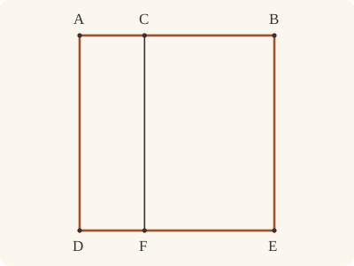

<!-- Generated by scripts/render.py. Do not edit by hand. -->

[Book II](index.md) · [← II.1](01.md) · [II.3 →](03.md)

# Book II, Proposition 2

*The rectangle contained by the whole and both segments*

[Euclid's proof](#euclids-proof) · [In Lean](#in-lean) · [What it rests on](#what-it-rests-on) · [Mishnah](#mishnah)

> If a straight line be cut at random, the rectangle contained by the whole and both of the segments is equal to the square on the whole.

**In Lean:** ✅ proved, as Euclid states it · Euclid's argument

<p align="center"></p>

<p align="center"><em>Cut AB anywhere, at C (red, blue), and the square on AB splits into the rectangles contained by AB (black) and each segment.</em></p>

## Euclid's proof

<p align="center"></p>

For let the straight line AB be cut at random at the point C;

I say that the rectangle contained by AB, BC together with the rectangle contained by BA, AC is equal to the square on AB.

For let the square ADEB be described on AB [I. 46], and let CF be drawn through C parallel to either AD or BE. [I. 31]

Then AE is equal to AF, CE.

Now AE is the square on AB;

AF is the rectangle contained by BA, AC, for it is contained by DA, AC, and AD is equal to AB;

and CE is the rectangle AB, BC, for BE is equal to AB.

Therefore the rectangle BA, AC together with the rectangle AB, BC is equal to the square on AB.

Therefore etc.

Q. E. D.

## In Lean

| | |
|---|---|
| Proof | ✅ Proved |
| Statement | The whole enunciation. |
| Argument | Euclid's. |
| Reviewed | The statement and every passage of the argument read against Heath's text, at commit [`cf05b375`](https://github.com/jackChallis/stoicheia/commit/cf05b375) ([the record](../../review/II/02.toml)) |

From [`Elements/BookII/Prop02.lean`](../../Elements/BookII/Prop02.lean). Euclid's sentences are the `--` comments, and our own notes are in `/- … -/`; the lines under each sentence are the Lean that carries it out. The list below marks where a lemma does a step Euclid takes for granted; the `/- … -/` notes in the listing explain smaller adjustments.

**How the Lean follows the text**

- **Done by `BookI.Prop31.parallelogram`.** "For let the square ADEB be described on AB…" Euclid draws the square and CF, taking its meeting with DE at F from the figure and taking for granted that a parallel to AD is also parallel to BE; Heath gives no reference for the latter step. The Lean uses I.46 with `Square.described` for the square; `BookI.Prop31.parallelogram` draws CF through C by I.31, finds F where CF meets DE by `BookI.Prop30.meet`, using I.30, and proves AF, that is ADFC, a parallelogram; `BookI.Prop30.parallel` (I.30) makes CF parallel to BE too.
- **Done by `quadArea_add_of_parallelograms`.** "Then AE is equal to AF, CE." Euclid reads AF and CE together as the square AE. `Parallel.between` places F between D and E, and `quadArea_add_of_parallelograms` proves that the two parallelograms make up the whole.
- **Done by `Rectangle.of_right`.** "AF is the rectangle contained by BA, AC…" Euclid treats AF as a rectangle because it has the square's right angle at A. `Rectangle.of_right` proves the other angles right by I.29, and `Rectangle.eq_rect` identifies its area from AD equal to AB.
- **Done by `Rectangle.of_right`.** "and CE is the rectangle AB, BC…" Euclid treats CE as a rectangle with BE equal to AB. The Lean reads CE from B as BCFE, keeping its area equal to that of CFEB by `Parallelogram.quadArea_rotate`, uses the square's right angle at B with `Rectangle.of_right`, and identifies the area as the rectangle AB, BC by `Rectangle.eq_rect` and `rect_comm`.

```lean
/-- If a straight line be cut at random, the rectangle contained by the whole and both of the
segments is equal to the square on the whole. -/
theorem Prop2 {A B C : Point} (hACB : Between A C B) :
    rect A B B C + rect B A A C = sq A B := by
  -- For let the straight line AB be cut at random at the point C;
  have hAB : A ≠ B := ne_of_between_ends hACB
  have hAC : A ≠ C := ne_of_between hACB
  have hCB : C ≠ B := (ne_of_between (between_symm hACB)).symm
  obtain ⟨AB, hA_AB, hB_AB⟩ := Postulate1 A B hAB
  have hC_AB : OnLine C AB := on_line_of_between_ends hACB hA_AB hB_AB
  -- I say that the rectangle contained by AB, BC together with the rectangle contained by BA,
  -- AC is equal to the square on AB.
  show rect A B B C + rect B A A C = sq A B
  -- For let the square ADEB be described on AB [I. 46], and let CF be drawn through C parallel
  -- to either AD or BE. [I. 31]
  obtain ⟨P, hP, -⟩ := exists_off_line hAB []
  obtain ⟨D, E, hsq, hD, hE⟩ := BookI.Prop46 hAB hP
  obtain ⟨hp, -⟩ := Square.described hsq hD hE
  obtain ⟨AD, hA_AD, hD_AD⟩ := Postulate1 A D hp.1.1
  obtain ⟨DE, hD_DE, hE_DE⟩ := Postulate1 D E hp.2.1
  obtain ⟨BE, hB_BE, hE_BE⟩ := Postulate1 B E hp.1.2.1.symm
  have hAD_BE : Parallel AD BE := hp.1.parallel hA_AD hD_AD hE_BE hB_BE
  have hDE_AB : Parallel DE AB := hp.2.parallel hD_DE hE_DE hB_AB hA_AB
  have hE_AB : ¬ OnLine E AB := not_on_line_of_same_side (hE.sameSide hA_AB hB_AB)
  have hC_BE : ¬ OnLine C BE := fun h =>
    hE_AB ((line_unique hCB h hB_BE hC_AB hB_AB) ▸ hE_BE)
  /- I.31 draws CF, and I.30 finds F where it meets DE
     (`BookI.Prop31.parallelogram`). -/
  obtain ⟨F, hF_DE, hDACF⟩ := BookI.Prop31.parallelogram hDE_AB hD_DE hA_AB hC_AB hAC
  have hADFC : Parallelogram A D F C := hDACF.reverse.rotate.rotate.rotate
  have hFC : F ≠ C := hADFC.1.2.1
  obtain ⟨CF, hC_CF, hF_CF⟩ := Postulate1 C F hFC.symm
  have hCF_AD : Parallel CF AD := (hADFC.1.parallel hA_AD hD_AD hF_CF hC_CF).symm
  have hCF_BE : Parallel CF BE :=
    BookI.Prop30.parallel hCF_AD hAD_BE.symm fun e => hC_BE (e ▸ hC_CF)
  -- Then AE is equal to AF, CE.
  /- F lies between D and E because the three parallels AD, CF, BE keep the
     order A, C, B. The two parallelograms therefore make up the whole square. -/
  have hDFE : Between D F E :=
    Parallel.between hCF_AD.symm hCF_BE.symm hA_AD hC_CF hB_BE hACB hD_AD hF_CF hE_BE
      ⟨DE, hD_DE, hF_DE, hE_DE⟩
  have hFE : F ≠ E := fun e => hCF_BE.not_onLine hF_CF (e ▸ hE_BE)
  have hCFEB : Parallelogram C F E B :=
    ⟨AreParallel.of_parallel hFC.symm hp.1.2.1 hC_CF hF_CF hE_BE hB_BE hCF_BE,
      AreParallel.of_parallel hFE hCB.symm hF_DE hE_DE hB_AB hC_AB hDE_AB⟩
  have hwhole : quadArea A D E B = quadArea A D F C + quadArea C F E B :=
    quadArea_add_of_parallelograms hADFC hCFEB hACB hDFE
  -- Now AE is the square on AB;
  have hAE : quadArea A D E B = sq A B := (Square.described hsq hD hE).2
  -- AF is the rectangle contained by BA, AC, for it is contained by DA, AC, and AD is equal to
  -- AB;
  have hAF : quadArea A D F C = rect B A A C := by
    refine (Rectangle.of_right hADFC ?_).eq_rect ?_ rfl
    · rw [angle_onRay_left (OnRay.of_between hACB) hp.1.1.symm]
      exact hsq.2.2.2.1
    · rw [len_symm B A]; exact hsq.len_eq.symm
  -- and CE is the rectangle AB, BC, for BE is equal to AB.
  have hCE : quadArea C F E B = rect A B B C := by
    have hBCFE : Parallelogram B C F E := hCFEB.rotate.rotate.rotate
    rw [hBCFE.quadArea_rotate, ← rect_comm B C A B]
    refine (Rectangle.of_right hBCFE ?_).eq_rect rfl ?_
    · rw [angle_onRay_right (OnRay.of_between (between_symm hACB)) hp.1.2.1]
      exact hsq.2.2.2.2.2.2
    · rw [len_symm B E, len_symm A B]; exact hsq.2.2.1
  -- Therefore the rectangle BA, AC together with the rectangle AB, BC is equal to the square
  -- on AB.
  have : rect B A A C + rect A B B C = sq A B := by
    rw [← hAE, hwhole, hAF, hCE]
  -- Therefore etc.
  exact (add_comm _ _).trans this
  -- Q. E. D.
```

## What it rests on

| | |
|---|---|
| Heath's references | [I.31](../I/31.md), [I.46](../I/46.md) |
| Lean cites | [I.4](../I/04.md), [I.28](../I/28.md), [I.29](../I/29.md), [I.30](../I/30.md), [I.31](../I/31.md), [I.34](../I/34.md), [I.46](../I/46.md) |
| Postulates | 1, 2, 3, 4, 5 |
| Definitions taken as axioms | Def. I.15 |
| Common Notions | 1, 2, 3, 4, 5 |
| Tacit rules | 38 (listed below) |
| Its own Lean calls | Postulate 1; 5 tacit rules |
| Through lemmas | Postulates 2 and 3; Def. I.15; 31 tacit rules |

Some of these come in through lemmas [shared](../../CERTIFICATE.md#shared-steps) by many proofs: [`Square.described`](../../Elements/BookII/Rectangles.lean#L149) (I.4, I.28, I.34); [`Rectangle.eq_rect`](../../Elements/BookII/Rectangles.lean#L102) (I.4, I.34); [`Rectangle.of_right`](../../Elements/BookII/Rectangles.lean#L53) (I.29); [`BookI.Prop30.parallel`](../../Elements/BookI/HelpersParallels.lean#L62) (I.30); [`BookI.Prop31.parallelogram`](../../Elements/BookI/HelpersParallels.lean#L83) (I.30, I.31).

_Postulates, definitions, Common Notions and tacit rules: all that this proof rests on, counting those of the propositions it cites. The last two rows say which of the postulates, definitions and tacit rules its own Lean calls, in the proof or a helper written for it, and which it does not call but reaches through lemmas, of Book Zero or shared (a proposition it cites may rest on these too); the rest come in only through the propositions it cites or the Common Notions._

<details><summary>The 38 tacit rules beneath this proof, counting those of the propositions it cites</summary>

_(used here) marks a rule this proof's own Lean calls, in the proof or a helper written for it; (through …) marks one its own Lean does not call but reaches through the lemmas named, of [Book Zero](../../Elements/Figure) or shared, though a proposition it cites may rest on it too; and a rule with no mark comes in only through a proposition it cites or a Common Notion. The names in brackets are System E's: an Intersection rule says when straight lines and circles must meet, and an Intersections rule takes a point where they do (see [Book I's introduction](../I/index.md))._

**Reading the figure**

- [`between_cases`](../../Elements/Foundations/Tacit/Diagram.lean#L54) (through [`Parallel.between`](../../Elements/Figure/Parallelograms.lean#L101), [`Parallelogram.quadArea_rotate`](../../Elements/Figure/Parallelograms.lean#L202), [`Rectangle.eq_rect`](../../Elements/BookII/Rectangles.lean#L102) and 5 other lemmas): Of three different points on a straight line, one is between the other two. (Between 6)
- [`between_of_inside_chord`](../../Elements/Foundations/Tacit/Diagram.lean#L81) (through [`BookI.Prop31.parallelogram`](../../Elements/BookI/HelpersParallels.lean#L83), [`OnRay.of_between`](../../Elements/Figure/Rays.lean#L34), [`Parallel.between`](../../Elements/Figure/Parallelograms.lean#L101) and 11 other lemmas): A straight line through a point inside a circle has that point between the points where it meets the circle. (Circle 1)
- [`between_symm`](../../Elements/Foundations/Tacit/Diagram.lean#L47) (used here): If B is between A and C, it is between C and A. (Between 1)
- [`circles_meet`](../../Elements/Foundations/Tacit/Diagram.lean#L94) (through [`BookI.Prop31.parallelogram`](../../Elements/BookI/HelpersParallels.lean#L83), [`OnRay.of_between`](../../Elements/Figure/Rays.lean#L34), [`Parallel.between`](../../Elements/Figure/Parallelograms.lean#L101) and 8 other lemmas): If each circle passes through a point inside the other, the circles cut one another. This is the step Euclid takes for granted in I.1. (Intersection 5)
- [`circles_meet_same_side`](../../Elements/Foundations/Tacit/Constructions.lean#L79) (through [`BookI.Prop31.parallelogram`](../../Elements/BookI/HelpersParallels.lean#L83), [`OnRay.of_between`](../../Elements/Figure/Rays.lean#L34), [`Parallel.between`](../../Elements/Figure/Parallelograms.lean#L101) and 8 other lemmas): Two circles that cut one another do so on each side of the straight line through their centres. (Intersections 8)
- [`exists_point`](../../Elements/Foundations/Tacit/Constructions.lean#L35) (through [`OnRay.of_between`](../../Elements/Figure/Rays.lean#L34), [`Parallelogram.quadArea_rotate`](../../Elements/Figure/Parallelograms.lean#L202), [`Rectangle.eq_rect`](../../Elements/BookII/Rectangles.lean#L102) and 8 other lemmas): Let a point be taken. (Points 1)
- [`exists_point_inside_circle`](../../Elements/Foundations/Tacit/Constructions.lean#L42) (through [`BookI.Prop31.parallelogram`](../../Elements/BookI/HelpersParallels.lean#L83), [`OnRay.of_between`](../../Elements/Figure/Rays.lean#L34), [`Parallel.between`](../../Elements/Figure/Parallelograms.lean#L101) and 11 other lemmas): Let a point be taken inside the circle α. (Points 8)
- [`exists_point_on_line`](../../Elements/Foundations/Tacit/Constructions.lean#L38) (through [`BookI.Prop30.parallel`](../../Elements/BookI/HelpersParallels.lean#L62), [`BookI.Prop31.parallelogram`](../../Elements/BookI/HelpersParallels.lean#L83), [`OnRay.of_between`](../../Elements/Figure/Rays.lean#L34) and 9 other lemmas): Let a point be taken on the straight line L. (Points 2)
- [`line_circle_between`](../../Elements/Foundations/Tacit/Constructions.lean#L67) (through [`BookI.Prop31.parallelogram`](../../Elements/BookI/HelpersParallels.lean#L83), [`OnRay.of_between`](../../Elements/Figure/Rays.lean#L34), [`Parallel.between`](../../Elements/Figure/Parallelograms.lean#L101) and 11 other lemmas): A straight line through a point B inside a circle, heading out to a point C outside it, cuts the circle between B and C. (Intersections 4)
- [`line_circle_beyond`](../../Elements/Foundations/Tacit/Constructions.lean#L73) (through [`BookI.Prop31.parallelogram`](../../Elements/BookI/HelpersParallels.lean#L83), [`OnRay.of_between`](../../Elements/Figure/Rays.lean#L34), [`Parallel.between`](../../Elements/Figure/Parallelograms.lean#L101) and 11 other lemmas): A straight line through a point B inside a circle, produced beyond B away from C, cuts the circle there. (Intersections 5)
- [`line_unique`](../../Elements/Foundations/Tacit/Diagram.lean#L41) (used here): Two points determine a straight line. (Generalities 1)
- [`lines_meet_of_opposite_sides`](../../Elements/Foundations/Tacit/Diagram.lean#L89) (through [`Parallel.between`](../../Elements/Figure/Parallelograms.lean#L101), [`Parallelogram.quadArea_rotate`](../../Elements/Figure/Parallelograms.lean#L202), [`Rectangle.eq_rect`](../../Elements/BookII/Rectangles.lean#L102) and 3 other lemmas): A straight line joining points on opposite sides of L crosses L. (Intersection 1)
- [`not_between_of_between`](../../Elements/Foundations/Tacit/Diagram.lean#L50) (through [`BookI.Prop31.parallelogram`](../../Elements/BookI/HelpersParallels.lean#L83), [`OnRay.of_between`](../../Elements/Figure/Rays.lean#L34), [`Parallel.between`](../../Elements/Figure/Parallelograms.lean#L101) and 12 other lemmas): If B is between A and C, then A is not between B and C. (Between 1)
- [`not_on_line_of_same_side`](../../Elements/Foundations/Tacit/Diagram.lean#L60) (used here): Points on one side of a straight line are not on it. (Same side 3)
- [`pasch2`](../../Elements/Foundations/Tacit/Diagram.lean#L71) (through [`BookI.Prop31.parallelogram`](../../Elements/BookI/HelpersParallels.lean#L83), [`OnRay.of_between`](../../Elements/Figure/Rays.lean#L34), [`Parallel.between`](../../Elements/Figure/Parallelograms.lean#L101) and 8 other lemmas): If B is between A and C, A is on L and B is off it, then B and C are on the same side of L: a straight line that leaves L at A does not cross it again. (Pasch 2)
- [`same_side_trans`](../../Elements/Foundations/Tacit/Diagram.lean#L64) (through [`BookI.Prop31.parallelogram`](../../Elements/BookI/HelpersParallels.lean#L83), [`OnRay.of_between`](../../Elements/Figure/Rays.lean#L34), [`Parallel.between`](../../Elements/Figure/Parallelograms.lean#L101) and 8 other lemmas): Two points on the same side of a straight line as a third point are on the same side as each other. (Same side 4)

**Lengths, angles and areas**

- [`angle_add_of_inside`](../../Elements/Foundations/Tacit/Transfer.lean#L47) (through [`Parallel.between`](../../Elements/Figure/Parallelograms.lean#L101), [`Parallelogram.quadArea_rotate`](../../Elements/Figure/Parallelograms.lean#L202), [`Rectangle.eq_rect`](../../Elements/BookII/Rectangles.lean#L102) and 2 other lemmas): If D lies within the angle BAC, then BAC is made up of BAD and DAC. (Diagram-angle 2)
- [`angle_eq_of_same_rays`](../../Elements/Foundations/Tacit/Transfer.lean#L54) (through [`angle_onRay_left`](../../Elements/Figure/Angles.lean#L42) and [`angle_onRay_right`](../../Elements/Figure/Angles.lean#L49)): The angle doesn't change if its arms are traced through other points on the same rays. (Diagram-angle 4)
- [`angle_symm`](../../Elements/Foundations/Tacit/Metric.lean#L30) (through [`rect_comm`](../../Elements/Figure/Rectangles.lean#L110)): The angle ABC is the angle CBA. (Metric 4)
- [`area_add_of_between`](../../Elements/Foundations/Tacit/Transfer.lean#L70) (through [`Parallelogram.quadArea_rotate`](../../Elements/Figure/Parallelograms.lean#L202), [`Rectangle.eq_rect`](../../Elements/BookII/Rectangles.lean#L102), [`Square.described`](../../Elements/BookII/Rectangles.lean#L149) and 2 other lemmas): Cutting a triangle in two from a vertex adds up. (Diagram-area 2)
- [`area_congruent`](../../Elements/Foundations/Tacit/Metric.lean#L44): Triangles equal in all their sides and angles are equal in area. Euclid uses this without comment once he has shown two triangles congruent. (Metric 9)
- [`area_degenerate`](../../Elements/Foundations/Tacit/Metric.lean#L36) (through [`Parallelogram.quadArea_rotate`](../../Elements/Figure/Parallelograms.lean#L202), [`Rectangle.eq_rect`](../../Elements/BookII/Rectangles.lean#L102), [`Square.described`](../../Elements/BookII/Rectangles.lean#L149) and 2 other lemmas): A "triangle" with a repeated corner has no area. (Metric 6)
- [`area_eq_zero_of_on_line`](../../Elements/Foundations/Tacit/Transfer.lean#L62) (through [`Parallelogram.quadArea_rotate`](../../Elements/Figure/Parallelograms.lean#L202), [`Rectangle.eq_rect`](../../Elements/BookII/Rectangles.lean#L102), [`Square.described`](../../Elements/BookII/Rectangles.lean#L149) and 2 other lemmas): A "triangle" whose corners lie on one straight line has no area. (Diagram-area 1)
- [`area_rotate`](../../Elements/Foundations/Tacit/Metric.lean#L39) (through [`Parallelogram.quadArea_rotate`](../../Elements/Figure/Parallelograms.lean#L202), [`Rectangle.eq_rect`](../../Elements/BookII/Rectangles.lean#L102), [`Square.described`](../../Elements/BookII/Rectangles.lean#L149) and 2 other lemmas): The triangle ABC is the triangle CAB. (Metric 8)
- [`circle_eq`](../../Elements/Foundations/Tacit/Transfer.lean#L30) (through [`BookI.Prop31.parallelogram`](../../Elements/BookI/HelpersParallels.lean#L83), [`OnRay.of_between`](../../Elements/Figure/Rays.lean#L34), [`Parallel.between`](../../Elements/Figure/Parallelograms.lean#L101) and 11 other lemmas): A circle is fixed by its centre and its radius. (Diagram-segment 2)
- [`len_add_of_between`](../../Elements/Foundations/Tacit/Transfer.lean#L27) (through [`BookI.Prop31.parallelogram`](../../Elements/BookI/HelpersParallels.lean#L83), [`OnRay.of_between`](../../Elements/Figure/Rays.lean#L34), [`Parallel.between`](../../Elements/Figure/Parallelograms.lean#L101) and 11 other lemmas): If B is between A and C, then AB and BC together make up AC. (Diagram-segment 1)
- [`len_self`](../../Elements/Foundations/Tacit/Metric.lean#L24) (through [`BookI.Prop31.parallelogram`](../../Elements/BookI/HelpersParallels.lean#L83), [`OnRay.of_between`](../../Elements/Figure/Rays.lean#L34), [`Parallel.between`](../../Elements/Figure/Parallelograms.lean#L101) and 11 other lemmas): The "straight line" from a point to itself has no length. (Metric 1)
- [`len_symm`](../../Elements/Foundations/Tacit/Metric.lean#L27) (used here): The straight line AB is the straight line BA. (Metric 3)
- [`same_ray_of_angle_eq_zero`](../../Elements/Foundations/Tacit/Transfer.lean#L42) (through [`Parallel.between`](../../Elements/Figure/Parallelograms.lean#L101), [`Parallelogram.quadArea_rotate`](../../Elements/Figure/Parallelograms.lean#L202), [`Rectangle.eq_rect`](../../Elements/BookII/Rectangles.lean#L102) and 2 other lemmas): If the angle BAC is nothing, C lies on the ray from A through B. (Diagram-angle 1)

**Superposition**

- [`superposition`](../../Elements/Foundations/Tacit/Superposition.lean#L48): **Superposition.** A hypothetical placement of a triangle on a given ray and side permits a restricted derivation of metric equalities about the figure already given. The derivation introduces no further objects, cites each geometric law it uses, and exports no symbol of the placement.

**Laws of magnitude**

- [`add_assoc`](../../Elements/Foundations/Tacit/Magnitudes.lean#L23) (through [`Parallelogram.quadArea_rotate`](../../Elements/Figure/Parallelograms.lean#L202), [`Rectangle.eq_rect`](../../Elements/BookII/Rectangles.lean#L102), [`Rectangle.of_right`](../../Elements/BookII/Rectangles.lean#L53) and 3 other lemmas): Adding three magnitudes in a row, it makes no difference whether the first two or the last two are added first. (System E §3.5)
- [`add_comm`](../../Elements/Foundations/Tacit/Magnitudes.lean#L26) (used here): The order of adding does not matter. (System E §3.5)
- [`add_lt_add_right`](../../Elements/Foundations/Tacit/Magnitudes.lean#L45) (through [`Parallelogram.quadArea_rotate`](../../Elements/Figure/Parallelograms.lean#L202), [`Rectangle.eq_rect`](../../Elements/BookII/Rectangles.lean#L102), [`Rectangle.of_right`](../../Elements/BookII/Rectangles.lean#L53) and 3 other lemmas): Adding the same thing to both sides keeps "less than". (System E §3.5)
- [`add_zero`](../../Elements/Foundations/Tacit/Magnitudes.lean#L29) (through [`Parallelogram.quadArea_rotate`](../../Elements/Figure/Parallelograms.lean#L202), [`Rectangle.eq_rect`](../../Elements/BookII/Rectangles.lean#L102), [`Square.described`](../../Elements/BookII/Rectangles.lean#L149) and 1 other lemma): Adding nothing changes nothing. (System E §3.5)
- [`lt_irrefl`](../../Elements/Foundations/Tacit/Magnitudes.lean#L32) (through [`BookI.Prop31.parallelogram`](../../Elements/BookI/HelpersParallels.lean#L83), [`OnRay.of_between`](../../Elements/Figure/Rays.lean#L34), [`Parallel.between`](../../Elements/Figure/Parallelograms.lean#L101) and 11 other lemmas): No magnitude is less than itself. (System E §3.5)
- [`lt_trans`](../../Elements/Foundations/Tacit/Magnitudes.lean#L35) (through [`BookI.Prop31.parallelogram`](../../Elements/BookI/HelpersParallels.lean#L83), [`OnRay.of_between`](../../Elements/Figure/Rays.lean#L34), [`Parallel.between`](../../Elements/Figure/Parallelograms.lean#L101) and 11 other lemmas): What is less than the less is less still. (System E §3.5)
- [`lt_trichotomy`](../../Elements/Foundations/Tacit/Magnitudes.lean#L39) (through [`BookI.Prop31.parallelogram`](../../Elements/BookI/HelpersParallels.lean#L83), [`OnRay.of_between`](../../Elements/Figure/Rays.lean#L34), [`Parallel.between`](../../Elements/Figure/Parallelograms.lean#L101) and 11 other lemmas): Of two magnitudes, one is less, or they are equal, or the other is less. (System E §3.5)
- [`not_lt_zero`](../../Elements/Foundations/Tacit/Magnitudes.lean#L42) (through [`BookI.Prop31.parallelogram`](../../Elements/BookI/HelpersParallels.lean#L83), [`OnRay.of_between`](../../Elements/Figure/Rays.lean#L34), [`Parallel.between`](../../Elements/Figure/Parallelograms.lean#L101) and 11 other lemmas): Nothing is less than zero. (System E §3.5)

</details>

## Mishnah

_Our commentary: what Euclid assumes, what Lean made us say out loud, and how the result looks by modern means._

Euclid has cut a square this way before. In I.47 the perpendicular from the right angle divides the square on the side subtending it into two rectangles, though that proof had no need to say that they are the rectangles contained by the side and each of its parts. II.2 says it, and Heath points back: "The *fact* asserted in the enunciation of this proposition has already been used in the proof of I. 47" (vol. 1, p. 377).

Why prove it at all, when it is II.1 with the uncut straight line taken equal to the whole? Heath has no doubt that Euclid stated II.2 and II.3 separately so that they could be quoted later, as II.2 is in XIII.10; and he thinks Euclid proved them, like all of the first ten, from figures of their own to show the method at work: "Surely the object was to show the power of the *method* of geometrical algebra as much as to arrive at results" (vol. 1, p. 377). Heath even counts the words. Euclid's proof has 126 in Heath's translation, 22 of them for the construction, and H. M. Taylor's 120, with 8 for its construction; so Euclid's proof proper is the shorter by 8, and his extra words of construction are "much more than atoned for by the advantage of picturing the result in the figure" (vol. 1, p. 378).

## Further reading

- To see how far the first ten proofs really stand apart, as Heath says they do, Ian Mueller's [*Philosophy of Mathematics and Deductive Structure in Euclid's Elements*](https://openlibrary.org/books/OL7640284M) (2006; first published 1981) charts, book by book, which propositions each proof rests on.
- Jens Høyrup's ["What is 'geometric algebra', and what has it been in historiography?"](https://doi.org/10.3934/Math.2017.1.128) (2017, free online) is a guided tour of fifty years of argument over the "geometrical algebra" Heath speaks of here.

[Book II](index.md) · [← II.1](01.md) · [II.3 →](03.md)

---

<sub>Euclid's text: T. L. Heath, *The Thirteen Books of Euclid's Elements*, vol. 1 (Cambridge, 1908), p. 376; [scan leaf n396](https://archive.org/details/thirteenbookseu02heibgoog/page/n396); [figure on n396](https://archive.org/details/thirteenbookseu02heibgoog/page/n396). Public domain.</sub>

<sub>The tacit rules follow the System E of Jeremy Avigad, Edward Dean and John Mumma, read alongside LeanEuclid (Logan Murphy, Kaiyu Yang, Jialiang Sun, Zhaoyu Li, Anima Anandkumar and Xujie Si).</sub>
