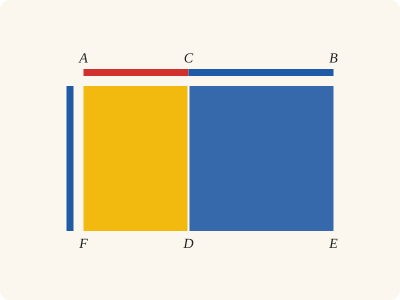
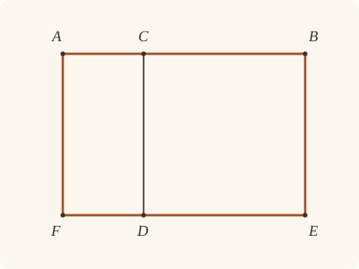

<!-- Generated by scripts/render.py. Do not edit by hand. -->

[Book II](index.md) · [← II.2](02.md) · [II.4 →](04.md)

# Book II, Proposition 3

*The rectangle contained by the whole and one segment*

> If a straight line be cut at random, the rectangle contained by the whole and one of the segments is equal to the rectangle contained by the segments and the square on the aforesaid segment.

<p align="center"></p>

<p align="center"><em>Cut a straight line anywhere (red, blue), and the rectangle contained by the whole and the blue piece splits into the rectangle contained by the two pieces (yellow) and the square on the blue piece (blue).</em></p>

## Euclid's proof

<p align="center"></p>

For let the straight line AB be cut at random at C;

I say that the rectangle contained by AB, BC is equal to the rectangle contained by AC, CB together with the square on BC.

For let the square CDEB be described on CB; [I. 46]

let ED be drawn through to F,

and through A let AF be drawn parallel to either CD or BE. [I. 31]

Then AE is equal to AD, CE.

Now AE is the rectangle contained by AB, BC, for it is contained by AB, BE, and BE is equal to BC;

AD is the rectangle AC, CB, for DC is equal to CB;

and DB is the square on CB.

Therefore the rectangle contained by AB, BC is equal to the rectangle contained by AC, CB together with the square on BC.

Therefore etc.

Q. E. D.

## In Lean

✅ Proved

From [`Elements/BookII/Prop03.lean`](../../Elements/BookII/Prop03.lean). Euclid's sentences are the `--` comments, and our own notes are in `/- … -/`; the lines under each sentence are the Lean that carries it out.

```lean
/-- If a straight line be cut at random, the rectangle contained by the whole and one of the
segments is equal to the rectangle contained by the segments and the square on the aforesaid
segment. -/
theorem Prop3 {A B C : Point} (hACB : Between A C B) :
    rect A B B C = rect A C C B + sq B C := by
  -- For let the straight line AB be cut at random at C;
  have hAB : A ≠ B := ne_of_between_ends hACB
  have hAC : A ≠ C := ne_of_between hACB
  have hCB : C ≠ B := (ne_of_between (between_symm hACB)).symm
  obtain ⟨AB, hA_AB, hB_AB⟩ := Postulate1 A B hAB
  have hC_AB : OnLine C AB := on_line_of_between_ends hACB hA_AB hB_AB
  -- I say that the rectangle contained by AB, BC is equal to the rectangle contained by AC, CB
  -- together with the square on BC.
  -- For let the square CDEB be described on CB; [I. 46]
  obtain ⟨P, hP, -⟩ := exists_off_line hCB []
  obtain ⟨D, E, hsq, hD, hE⟩ := BookI.Prop46 hCB hP
  obtain ⟨hp, hDB⟩ := Square.described hsq hD hE
  -- let ED be drawn through to F,
  /- DE names the whole straight line. The parallel through A will find F on it. -/
  obtain ⟨DE, hD_DE, hE_DE⟩ := Postulate1 D E hp.2.1
  have hDE_AB : Parallel DE AB := hp.2.parallel hD_DE hE_DE hB_AB hC_AB
  -- and through A let AF be drawn parallel to either CD or BE. [I. 31]
  /- I.31 draws AF parallel to CD; I.30 finds its meeting with DE and makes it
     parallel to BE as well. -/
  obtain ⟨CD, hC_CD, hD_CD⟩ := Postulate1 C D hp.1.1
  obtain ⟨BE, hB_BE, hE_BE⟩ := Postulate1 B E hp.1.2.1.symm
  have hCD_BE : Parallel CD BE := hp.1.parallel hC_CD hD_CD hE_BE hB_BE
  obtain ⟨F, hF_DE, hDCAF⟩ :=
    BookI.Prop31.parallelogram hDE_AB hD_DE hC_AB hA_AB hAC.symm
  have hAF : A ≠ F := hDCAF.1.2.1
  obtain ⟨AF, hA_AF, hF_AF⟩ := Postulate1 A F hAF
  have hAF_CD : Parallel AF CD := (hDCAF.1.parallel hD_CD hC_CD hA_AF hF_AF).symm
  have hA_BE : ¬ OnLine A BE := fun h =>
    hCD_BE.not_onLine hC_CD ((line_unique hAB hA_AB hB_AB h hB_BE) ▸ hC_AB)
  have hAF_BE : Parallel AF BE :=
    BookI.Prop30.parallel hAF_CD hCD_BE.symm fun e => hA_BE (e ▸ hA_AF)
  -- Then AE is equal to AD, CE.
  /- Parallels keep order: D lies between F and E, as C lies between A and B.
     Thus CD cuts the whole AFEB into AFDC and CDEB. -/
  have hFDE : Between F D E :=
    Parallel.between hAF_CD hCD_BE.symm hA_AF hC_CD hB_BE hACB hF_AF hD_CD hE_BE
      ⟨DE, hF_DE, hD_DE, hE_DE⟩
  have hAFDC : Parallelogram A F D C := hDCAF.rotate.rotate
  have hwhole : quadArea A F E B = quadArea A F D C + quadArea C D E B :=
    quadArea_add_of_parallelograms hAFDC hp hACB hFDE
  -- Now AE is the rectangle contained by AB, BC, for it is contained by AB, BE, and BE is
  -- equal to BC;
  have hFE : F ≠ E := ne_of_between_ends hFDE
  have hBAFE : Parallelogram B A F E :=
    ⟨AreParallel.of_parallel hAB.symm hFE hB_AB hA_AB hF_DE hE_DE hDE_AB.symm,
      AreParallel.of_parallel hAF hp.1.2.1 hA_AF hF_AF hE_BE hB_BE hAF_BE⟩
  have hAE : quadArea A F E B = rect A B B C := by
    rw [hBAFE.quadArea_rotate]
    refine (Rectangle.of_right hBAFE ?_).eq_rect (len_symm B A) ?_
    · rw [angle_onRay_right (OnRay.of_beyond (between_symm hACB)) hp.1.2.1]
      exact hsq.2.2.2.2.2.2
    · rw [len_symm B E]; exact hsq.2.2.1
  -- AD is the rectangle AC, CB, for DC is equal to CB;
  have hAD : quadArea A F D C = rect A C C B := by
    have hCAFD : Parallelogram C A F D := hDCAF.rotate
    rw [hCAFD.quadArea_rotate]
    have hD_AB : ¬ OnLine D AB := hDE_AB.not_onLine hD_DE
    /- The angle DCA adjacent to the square's right angle BCD is right
       (System E, Diagram-angle 3). -/
    have hright : ∠ D C A = ∟ := by
      have h := hsq.2.2.2.1
      rw [adjacent_eq_of_right hB_AB hA_AB (between_symm hACB) hD_AB h] at h
      exact h
    exact (Rectangle.of_right hCAFD hright).eq_rect (len_symm C A) hsq.len_eq.symm
  -- and DB is the square on CB.
  have hDB' : quadArea C D E B = sq B C := hDB.trans (sq_symm C B)
  -- Therefore the rectangle contained by AB, BC is equal to the rectangle contained by AC, CB
  -- together with the square on BC.
  rw [← hAE, hwhole, hAD, hDB']
  -- Therefore etc.
  -- Q. E. D.
```

## What it rests on

| | |
|---|---|
| Euclid cites | [I.31](../I/31.md), [I.46](../I/46.md) |
| Lean cites | [I.4](../I/04.md), [I.28](../I/28.md), [I.29](../I/29.md), [I.30](../I/30.md), [I.31](../I/31.md), [I.34](../I/34.md), [I.46](../I/46.md) |
| Postulates | 1, 2, 3, 4, 5 |
| Definitions | Def. I.15 |
| Common Notions | 1, 2, 3, 4, 5 |
| Tacit rules | 62 (listed below) |

Brought in by shared steps: [`Square.described`](../../Elements/BookII/Rectangles.lean#L113) (I.4, I.28, I.34); [`Rectangle.eq_rect`](../../Elements/BookII/Rectangles.lean#L98) (I.4, I.34); [`Rectangle.of_right`](../../Elements/BookII/Rectangles.lean#L49) (I.29); [`BookI.Prop30.parallel`](../../Elements/BookI/HelpersParallels.lean#L62) (I.30); [`BookI.Prop31.parallelogram`](../../Elements/BookI/HelpersParallels.lean#L83) (I.30, I.31).

_Postulates, definitions, Common Notions and tacit rules: all that this proof rests on, counting those of the propositions it cites._

<details><summary>The 62 tacit rules beneath this proof, counting those of the propositions it cites</summary>

**Reading the figure**

- [`between_cases`](../../Elements/Foundations/Tacit/Diagram.lean#L74) (used here): Of three different points on a straight line, one is between the other two. (Between 6)
- [`between_of_between_left`](../../Elements/Foundations/Tacit/Diagram.lean#L66): If `B` is between `A` and `C`, and `D` is between `A` and `B`, then `D` is between `A` and `C`. (Between 4)
- [`between_of_between_right`](../../Elements/Foundations/Tacit/Diagram.lean#L70) (used here): If `B` is between `A` and `C`, and `C` is between `B` and `D`, then `B` is between `A` and `D`. (Between 5)
- [`between_symm`](../../Elements/Foundations/Tacit/Diagram.lean#L43) (used here): If `B` is between `A` and `C`, it is between `C` and `A`. (Between 1)
- [`centre_inside`](../../Elements/Foundations/Tacit/Diagram.lean#L35) (used here): The centre of a circle is inside it. (Generalities 3)
- [`circles_meet`](../../Elements/Foundations/Tacit/Diagram.lean#L201) (used here): If each circle passes through a point inside the other, the circles cut one another. This is the step Euclid takes for granted in I.1. (Intersection 5)
- [`circles_meet_of_on_inside_outside`](../../Elements/Foundations/Tacit/Diagram.lean#L195): Two circles cut one another if the first passes through a point `A` inside the second, and a point `B` outside the second is inside or on the first. (Intersection 4, in LeanEuclid's corrected form)
- [`circles_meet_same_side`](../../Elements/Foundations/Tacit/Constructions.lean#L81): Two circles that cut one another do so on each side of the straight line through their centres. (Intersections 8)
- [`exists_point`](../../Elements/Foundations/Tacit/Constructions.lean#L26) (used here): Let a point be taken. (Points 1)
- [`exists_point_between`](../../Elements/Foundations/Tacit/Constructions.lean#L38): Let a point be taken between `B` and `C`. (Points 3)
- [`exists_point_on_line`](../../Elements/Foundations/Tacit/Constructions.lean#L29) (used here): Let a point be taken on the straight line `L`. (Points 2)
- [`exists_point_on_line_off_line`](../../Elements/Foundations/Tacit/Constructions.lean#L34) (used here): Let a point be taken on `L`, not on the different straight line `M`. (Points 2, with "distinct from `M`")
- [`exists_point_opposite_side`](../../Elements/Foundations/Tacit/Constructions.lean#L46): Let a point be taken on the other side of `L` from `B`. (Points 6)
- [`exists_point_same_side`](../../Elements/Foundations/Tacit/Constructions.lean#L42) (used here): Let a point be taken on the same side of `L` as `B`. (Points 5)
- [`inside_not_on`](../../Elements/Foundations/Tacit/Diagram.lean#L38) (used here): A point inside a circle is not on it. (Generalities 4)
- [`inside_of_between`](../../Elements/Foundations/Tacit/Diagram.lean#L161): A circle is "convex": between two points on or inside it, every point is inside. (Circle 2)
- [`line_circle_between`](../../Elements/Foundations/Tacit/Constructions.lean#L69): A straight line through a point `B` inside a circle, heading out to a point `C` outside it, cuts the circle between `B` and `C`. (Intersections 4)
- [`line_circle_beyond`](../../Elements/Foundations/Tacit/Constructions.lean#L75): A straight line through a point `B` inside a circle, produced beyond `B` away from `C`, cuts the circle there. (Intersections 5)
- [`line_unique`](../../Elements/Foundations/Tacit/Diagram.lean#L28) (used here): Two points determine a straight line. (Generalities 1)
- [`lines_meet_of_opposite_sides`](../../Elements/Foundations/Tacit/Diagram.lean#L179) (used here): A straight line joining points on opposite sides of `L` crosses `L`. (Intersection 1)
- [`ne_of_between`](../../Elements/Foundations/Tacit/Diagram.lean#L46) (used here): A point between two others differs from the first. (Between 1)
- [`ne_of_between_ends`](../../Elements/Foundations/Tacit/Diagram.lean#L49) (used here): The ends of a finite straight line differ. (Between 1)
- [`not_between_of_between`](../../Elements/Foundations/Tacit/Diagram.lean#L52) (used here): If `B` is between `A` and `C`, then `A` is not between `B` and `C`. (Between 1)
- [`not_between_of_between_between`](../../Elements/Foundations/Tacit/Diagram.lean#L79): If `B` is between `A` and `C`, and also between `A` and `D`, then `B` is not between `C` and `D`: `C` and `D` lie on the same side of `B`. (Between 7)
- [`not_on_line_of_same_side`](../../Elements/Foundations/Tacit/Diagram.lean#L92) (used here): Points on one side of a straight line are not on it. (Same side 3)
- [`on_line_of_between`](../../Elements/Foundations/Tacit/Diagram.lean#L56) (used here): A straight line through `A` and `B`, with `B` between `A` and `C`, passes through `C`. (Between 2)
- [`on_line_of_between_ends`](../../Elements/Foundations/Tacit/Diagram.lean#L61) (used here): A straight line through `A` and `C` passes through every point between them. (Between 3)
- [`pasch2`](../../Elements/Foundations/Tacit/Diagram.lean#L111) (used here): If `B` is between `A` and `C`, `A` is on `L` and `B` is off it, then `B` and `C` are on the same side of `L`: a straight line that leaves `L` at `A` does not cross it again. (Pasch 2)
- [`pasch3`](../../Elements/Foundations/Tacit/Diagram.lean#L114) (used here): A straight line through a point between `A` and `C` separates them. (Pasch 3)
- [`pasch4`](../../Elements/Foundations/Tacit/Diagram.lean#L119) (used here): If two different straight lines `L` and `M` meet at `B`, and `A` and `C` are points of `M`, different from each other and from `B`, that are not on the same side of `L`, then `B` is between `A` and `C`. (Pasch 4)
- [`same_side_or`](../../Elements/Foundations/Tacit/Diagram.lean#L99): A straight line has only two sides. (Same side 5)
- [`same_side_refl`](../../Elements/Foundations/Tacit/Diagram.lean#L85) (used here): A point off a straight line is on the same side of it as itself. (Same side 1)
- [`same_side_symm`](../../Elements/Foundations/Tacit/Diagram.lean#L89) (used here): If `A` is on the same side of a straight line as `B`, then `B` is on the same side as `A`. (Same side 2)
- [`same_side_trans`](../../Elements/Foundations/Tacit/Diagram.lean#L96) (used here): Two points on the same side of a straight line as a third point are on the same side as each other. (Same side 4)
- [`triple_incidence1`](../../Elements/Foundations/Tacit/Diagram.lean#L131) (used here): Take `B` on `L`, `C` on `M` and `D` on `N`, three straight lines through `A`. If `C` lies within the angle `BAD` (on `D`'s side of `L` and on `B`'s side of `N`), then `B` and `D` are not on the same side of `M`: the straight line `AC` separates them. (Triple incidence 1)
- [`triple_incidence2`](../../Elements/Foundations/Tacit/Diagram.lean#L139): Take `B` on `L`, `C` on `M` and `D` on `N`, three straight lines through `A`, with `B` other than `A` and `D` off `M`. If `C` and `D` are on the same side of `L`, and `B` and `D` are not on the same side of `M`, then `B` and `C` are on the same side of `N`: `C` lies within the angle `BAD`. (Triple incidence 2)

**Lengths, angles and areas**

- [`adjacent_eq_of_right`](../../Elements/Foundations/Tacit/Transfer.lean#L67) (used here): A right angle is equal to the angle adjacent to it. (Diagram-angle 3; the other half is Definition 10 together with Postulate 4)
- [`angle_add_of_inside`](../../Elements/Foundations/Tacit/Transfer.lean#L54): If `D` lies within the angle `BAC`, then `BAC` is made up of `BAD` and `DAC`. (Diagram-angle 2)
- [`angle_eq_of_same_rays`](../../Elements/Foundations/Tacit/Transfer.lean#L72) (used here): The angle doesn't change if its arms are traced through other points on the same rays. (Diagram-angle 4)
- [`angle_symm`](../../Elements/Foundations/Tacit/Metric.lean#L26): The angle `ABC` is the angle `CBA`. (Metric 4)
- [`area_add_of_between`](../../Elements/Foundations/Tacit/Transfer.lean#L88) (used here): Cutting a triangle in two from a vertex adds up. (Diagram-area 2)
- [`area_congruent`](../../Elements/Foundations/Tacit/Metric.lean#L43): Triangles equal in all their sides and angles are equal in area. Euclid uses this without comment once he has shown two triangles congruent. (Metric 9)
- [`area_degenerate`](../../Elements/Foundations/Tacit/Metric.lean#L32) (used here): A "triangle" with a repeated corner has no area. (Metric 6)
- [`area_eq_zero_of_on_line`](../../Elements/Foundations/Tacit/Transfer.lean#L80) (used here): A "triangle" whose corners lie on one straight line has no area. (Diagram-area 1)
- [`area_rotate`](../../Elements/Foundations/Tacit/Metric.lean#L35) (used here): The triangle `ABC` is the triangle `CAB`. (Metric 8)
- [`area_swap`](../../Elements/Foundations/Tacit/Metric.lean#L38) (used here): The triangle `ABC` is the triangle `ACB`. (Metric 8)
- [`eq_of_len_eq_zero`](../../Elements/Foundations/Tacit/Metric.lean#L17) (used here): A finite straight line with distinct ends has length. (Metric 1)
- [`inside_of_len_lt`](../../Elements/Foundations/Tacit/Transfer.lean#L33): A point nearer the centre than the circumference is inside. (Diagram-segment 4)
- [`len_add_of_between`](../../Elements/Foundations/Tacit/Transfer.lean#L21) (used here): If `B` is between `A` and `C`, then `AB` and `BC` together make up `AC`. (Diagram-segment 1)
- [`len_lt_of_inside`](../../Elements/Foundations/Tacit/Transfer.lean#L37): A point inside is nearer the centre than the circumference. (Diagram-segment 4)
- [`len_self`](../../Elements/Foundations/Tacit/Metric.lean#L20): The "straight line" from a point to itself has no length. (Metric 1)
- [`len_symm`](../../Elements/Foundations/Tacit/Metric.lean#L23) (used here): The straight line `AB` is the straight line `BA`. (Metric 3)
- [`same_ray_of_angle_eq_zero`](../../Elements/Foundations/Tacit/Transfer.lean#L49): If the angle `BAC` is nothing, `C` lies on the ray from `A` through `B`. (Diagram-angle 1)

**Superposition**

- [`superposition`](../../Elements/Foundations/Tacit/Superposition.lean#L30): **Superposition.** The triangle `ABC` can be applied to the straight line `L` with `A` on `D`, `B` on the ray from `D` through `G`, and `C` on the side of `L` where `H` is, without changing any side or angle.

**Laws of magnitude**

- [`add_assoc`](../../Elements/Foundations/Tacit/Magnitudes.lean#L23) (used here): Adding three magnitudes in a row, it makes no difference whether the first two or the last two are added first. (System E §3.5)
- [`add_comm`](../../Elements/Foundations/Tacit/Magnitudes.lean#L26) (used here): The order of adding does not matter. (System E §3.5)
- [`add_lt_add_right`](../../Elements/Foundations/Tacit/Magnitudes.lean#L45): Adding the same thing to both sides keeps "less than". (System E §3.5)
- [`add_zero`](../../Elements/Foundations/Tacit/Magnitudes.lean#L29) (used here): Adding nothing changes nothing. (System E §3.5)
- [`lt_irrefl`](../../Elements/Foundations/Tacit/Magnitudes.lean#L32) (used here): No magnitude is less than itself. (System E §3.5)
- [`lt_trans`](../../Elements/Foundations/Tacit/Magnitudes.lean#L35): What is less than the less is less still. (System E §3.5)
- [`lt_trichotomy`](../../Elements/Foundations/Tacit/Magnitudes.lean#L39) (used here): Of two magnitudes, one is less, or they are equal, or the other is less. (System E §3.5)
- [`not_lt_zero`](../../Elements/Foundations/Tacit/Magnitudes.lean#L42) (used here): Nothing is less than zero. (System E §3.5)

</details>

## Mishnah

**One square, two names.** Euclid describes the square CDEB on CB, draws ED through to F, and draws AF parallel to CD. He names each figure by two opposite corners: AE is AFEB, and AD is AFDC. The square is CE when it is added to AD, and DB when it is called the square on CB. We read it as one figure, CDEB.

**"Let ED be drawn through to F."** Euclid names F before he says where it is. A straight line in Lean is already the whole straight line, so when we name DE we draw it through, and the parallel through A meets it at F. As in II.2, Euclid's "either CD or BE" is I.30. The rectangle AD needs its right angle too: the angle DCA is right because it lies beside the square's right angle BCD.

**"Of great importance."** Heath writes that "this proposition and the preceding are, as already indicated, of great importance, and particularly so to the semi-algebraical method just described, which seems to have found its first exponents in Heron and Pappus" (vol. 1, p. 378). Euclid uses II.3 again in IX.15, and Pappus often quotes it by its book and number, as Heath notes under II.2.

**Three steps to a difference of squares.** Heath's example is Dionysius Lardner's proof, from II.1 to II.3, that "*the difference of the squares on two straight lines is equal to the rectangle contained by the sum and the difference of the straight lines*" (vol. 1, pp. 378–379). II.2 splits the square on AB into the rectangles AB, BC and AB, AC; II.3 takes the square on BC out of the first; and II.1 joins the two rectangles left over. It is the theorem usually read from II.5 and II.6, here reached with a single straight line for its figure.

**The modern way.** With CB = a and AC = b, II.3 is (a + b)a = ab + a², the third of the identities Heath lists for Book II. Euclid's figure draws it: the rectangle AE, cut along CD.

## Further reading

- For Heron and Pappus, whom Heath takes for the first exponents of this semi-algebraical method, Thomas L. Heath's [*A History of Greek Mathematics*, vol. 2](https://archive.org/details/cu31924008704227) (1921, free online), which gives each of them a chapter of his own.
- For the teachers and editors who reworked Euclid's proofs for centuries, as Dionysius Lardner does in Heath's note here, and Christopher Clavius in his note on II.4, Benjamin Wardhaugh's [*Encounters with Euclid*](https://press.princeton.edu/books/hardcover/9780691211695/encounters-with-euclid) (2021), the book met under I.5.

---

<sub>Euclid's text: T. L. Heath, *The Thirteen Books of Euclid's Elements*, vol. 1 (Cambridge, 1908), p. 378; scan leaf n398; figure on n398. Public domain.</sub>

<sub>The tacit rules follow the System E of Jeremy Avigad, Edward Dean and John Mumma, read alongside LeanEuclid (Logan Murphy, Kaiyu Yang, Jialiang Sun, Zhaoyu Li, Anima Anandkumar and Xujie Si).</sub>
