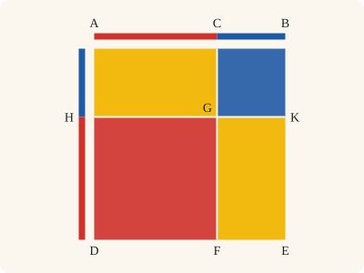
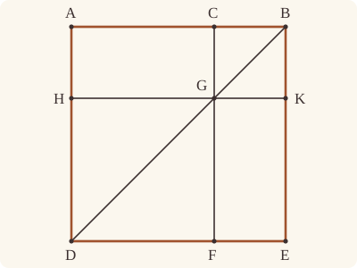
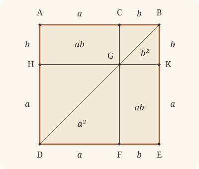

<!-- Generated by scripts/render.py. Do not edit by hand. -->

[Book II](index.md) · [← II.3](03.md) · [II.5 →](05.md)

# Book II, Proposition 4

*The squares on the whole and both segments*

[Euclid's proof](#euclids-proof) · [In Lean](#in-lean) · [What it rests on](#what-it-rests-on) · [Mishnah](#mishnah)

> If a straight line be cut at random, the square on the whole is equal to the squares on the segments and twice the rectangle contained by the segments.

**In Lean:** ✅ proved, as Euclid states it · Euclid's argument

<p align="center"></p>

<p align="center"><em>Cut AB anywhere, at C (red, blue), and the square on AB splits into the squares on AC, CB (red, blue) and two rectangles contained by AC, CB (yellow).</em></p>

## Euclid's proof

<p align="center"></p>

For let the straight line AB be cut at random at C;

I say that the square on AB is equal to the squares on AC, CB and twice the rectangle contained by AC, CB.

For let the square ADEB be described on AB, [I. 46]

let BD be joined;

through C let CF be drawn parallel to either AD or EB,

and through G let HK be drawn parallel to either AB or DE. [I. 31]

Then, since CF is parallel to AD,

and BD has fallen on them,

the exterior angle CGB is equal to the interior and opposite angle ADB. [I. 29]

But the angle ADB is equal to the angle ABD,

since the side BA is also equal to AD; [I. 5]

therefore the angle CGB is also equal to the angle GBC,

so that the side BC is also equal to the side CG. [I. 6]

But CB is equal to GK, and CG to KB; [I. 34]

therefore GK is also equal to KB;

therefore CGKB is equilateral.

I say next that it is also right-angled.

For, since CG is parallel to BK,

the angles KBC, GCB are equal to two right angles. [I. 29]

But the angle KBC is right;

therefore the angle BCG is also right,

so that the opposite angles CGK, GKB are also right. [I. 34]

Therefore CGKB is right-angled;

and it was also proved equilateral;

therefore it is a square;

and it is described on CB.

For the same reason

HF is also a square;

and it is described on HG, that is AC. [I. 34]

Therefore the squares HF, KC are the squares on AC, CB.

Now, since AG is equal to GE,

and AG is the rectangle AC, CB, for GC is equal to CB,

therefore GE is also equal to the rectangle AC, CB.

Therefore AG, GE are equal to twice the rectangle AC, CB.

But the squares HF, CK are also the squares on AC, CB;

therefore the four areas HF, CK, AG, GE are equal to the squares on AC, CB and twice the rectangle contained by AC, CB.

But HF, CK, AG, GE are the whole ADEB,

which is the square on AB.

Therefore the square on AB is equal to the squares on AC, CB and twice the rectangle contained by AC, CB.

Therefore etc.

Q. E. D.

## In Lean

| | |
|---|---|
| Proof | ✅ Proved |
| Statement | The whole enunciation. |
| Argument | Euclid's. |
| Reviewed | The statement and every passage of the argument read against Heath's text, at commit [`09b32b47`](https://github.com/jackChallis/stoicheia/commit/09b32b47) ([the record](../../review/II/04.toml)) |

From [`Elements/BookII/Prop04.lean`](../../Elements/BookII/Prop04.lean). Euclid's sentences are the `--` comments, and our own notes are in `/- … -/`; the lines under each sentence are the Lean that carries it out. The list below marks where a lemma does a step Euclid takes for granted and where several sentences share one step; the `/- … -/` notes in the listing explain smaller adjustments.

**How the Lean follows the text**

- **Carried together, by `Parallelogram.figure`.** "through C let CF be drawn parallel…" Euclid draws CF through C and HK through G, where CF meets BD. `Parallelogram.figure` carries the two constructions together: I.31 draws the parallels, `BookI.Prop30.meet` finds their meetings, `BookI.Prop30.parallel` proves the further parallels, and `Parallel.between` puts the points in order; the lemma then proves CK and HF to be parallelograms about BD.
- **Done by `Tacit.pasch2`.** "and BD has fallen on them…" Euclid takes C and A on the same side of BD when he identifies the exterior and opposite angles. The Lean places them there by `Tacit.pasch2`, the rule we assume as System E, Pasch 2, before applying I.29 in the next sentence.
- **Carried together, by `Square.about_diameter`.** "For the same reason…" Euclid's "for the same reason" is carried by one lemma, which gives his argument for CK over any letters: a parallelogram about the diameter of a square is a square.
- **Done by `Parallelogram.complements`.** "and it is described on HG, that is AC." Euclid takes AG as a parallelogram when he applies I.34 to identify HG with AC. `Parallelogram.complements` proves that shape using I.30; I.34 and `Square.eq_sq` then identify HF as the square on AC.
- **Done by `BookI.Prop43`.** "Now, since AG is equal to GE…" Euclid takes the complements AG and GE to be equal. The Lean applies I.43, for which Heath gives no reference here.
- **Done by `Rectangle.of_right`.** "and AG is the rectangle AC, CB…" Euclid treats AG as a rectangle, with GC equal to CB. The Lean gets the adjacent right angle at C from `Tacit.adjacent_eq_of_right` (I.13), then uses `Rectangle.of_right` (I.29) and `Rectangle.eq_rect` to identify AG.
- **Done by `Parallelogram.about_diameter`.** "But HF, CK, AG, GE are the whole ADEB…" Euclid takes the four areas as the whole square ADEB. `Parallelogram.about_diameter` proves the complements are parallelograms, uses I.30 and `Between.of_inside` to join and order the points on HK, then joins the pieces with `quadArea_add_of_parallelograms`.

```lean
/-- If a straight line be cut at random, the square on the whole is equal to the squares on the
segments and twice the rectangle contained by the segments. -/
theorem Prop4 {A B C : Point} (hACB : Between A C B) :
    sq A B = sq A C + sq C B + (rect A C C B + rect A C C B) := by
  -- For let the straight line AB be cut at random at C;
  have hAB : A ≠ B := ne_of_between_ends hACB
  have hBCA : Between B C A := between_symm hACB
  obtain ⟨AB, hA_AB, hB_AB⟩ := Postulate1 A B hAB
  have hC_AB : OnLine C AB := on_line_of_between_ends hACB hA_AB hB_AB
  -- I say that the square on AB is equal to the squares on AC, CB and twice the rectangle
  -- contained by AC, CB.
  -- For let the square ADEB be described on AB, [I. 46]
  obtain ⟨P, hP, -⟩ := exists_off_line hAB []
  obtain ⟨D, E, hsq, hD, hE⟩ := BookI.Prop46 hAB hP
  obtain ⟨hp, hADEB⟩ := Square.described hsq hD hE
  -- let BD be joined;
  have hBADE : Parallelogram B A D E := hp.rotate.rotate.rotate
  have hBD : B ≠ D := hBADE.triangle.ne₁₃
  obtain ⟨BD, hB_BD, hD_BD⟩ := Postulate1 B D hBD
  -- through C let CF be drawn parallel to either AD or EB,
  -- and through G let HK be drawn parallel to either AB or DE. [I. 31]
  /- G is where CF cuts BD; F, H, K are where the parallels meet the sides. -/
  obtain ⟨F, G, H, K, hBGD, hDFE, hAHD, hEKB, hCGF, -, hBCGK, hGHDF⟩ := hp.figure hACB
  -- Then, since CF is parallel to AD,
  obtain ⟨AD, hA_AD, hD_AD⟩ := Postulate1 A D hp.1.1
  obtain ⟨CF, hC_CF, hF_CF⟩ := Postulate1 C F (ne_of_between_ends hCGF)
  have hG_CF : OnLine G CF := on_line_of_between_ends hCGF hC_CF hF_CF
  have hH_AD : OnLine H AD := on_line_of_between_ends hAHD hA_AD hD_AD
  have hCF_AD : Parallel CF AD := (hGHDF.2.parallel hH_AD hD_AD hF_CF hG_CF).symm
  have hGC_DA : AreParallel G C D A :=
    AreParallel.of_parallel (ne_of_between hCGF).symm hp.1.1.symm hG_CF hC_CF hD_AD hA_AD hCF_AD
  -- and BD has fallen on them,
  have hG_BD : OnLine G BD := on_line_of_between_ends hBGD hB_BD hD_BD
  have hGD : G ≠ D := ne_of_between (between_symm hBGD) |>.symm
  have hC_BD : ¬ OnLine C BD := fun h =>
    hBADE.triangle.off_line hB_BD ((line_unique (ne_of_between hBCA) hB_AB hC_AB hB_BD h) ▸ hA_AB) hD_BD
  have hCA : SameSideOf C A G D :=
    SameSideOf.of_line hGD hG_BD hD_BD (pasch2 hBCA hB_BD hC_BD)
  -- the exterior angle CGB is equal to the interior and opposite angle ADB. [I. 29]
  have h29 : ∠ B G C = ∠ G D A := BookI.Prop29.exterior hGC_DA hCA hBGD
  have hGB : G ≠ B := (ne_of_between hBGD).symm
  have hCG : C ≠ G := ne_of_between hCGF
  have hCB : C ≠ B := (ne_of_between hBCA).symm
  have hAD : A ≠ D := hp.1.1
  have hCGB : ∠ C G B = ∠ A D B := by
    rw [angle_symm hCG hGB.symm, h29, angle_onRay_left (OnRay.of_between (between_symm hBGD)) hAD,
      angle_symm hBD hAD]
  -- But the angle ADB is equal to the angle ABD,
  -- since the side BA is also equal to AD; [I. 5]
  have h5 : ∠ A D B = ∠ A B D :=
    BookI.Prop5.base hBADE.triangle.bac.acb hsq.len_eq.symm
  -- therefore the angle CGB is also equal to the angle GBC,
  have hGBC : ∠ C G B = ∠ G B C := by
    rw [hCGB, h5, angle_eq_of_onRay (OnRay.of_between hBGD) (OnRay.of_between hBCA),
      angle_symm hAB hBD.symm]
  -- so that the side BC is also equal to the side CG. [I. 6]
  have hBC_CG : ‖C B‖ = ‖C G‖ := by
    have hCBG : Triangle C B G := hBCGK.triangle.bac
    exact BookI.Prop6 hCBG (by rw [angle_symm hCB hGB]; exact hGBC.symm)
  -- But CB is equal to GK, and CG to KB; [I. 34]
  obtain ⟨hCB_GK, hCG_BK, -, -, -⟩ :=
    BookI.Prop34 (A := C) (B := B) (C := G) (D := K) hBCGK.rotate
  -- therefore GK is also equal to KB;
  have hGK_KB : ‖G K‖ = ‖K B‖ := by
    rw [← hCB_GK, hBC_CG, hCG_BK, len_symm B K]
  -- therefore CGKB is equilateral.
  have hequil : ‖C G‖ = ‖G K‖ ∧ ‖G K‖ = ‖K B‖ ∧ ‖K B‖ = ‖B C‖ :=
    ⟨hBC_CG.symm.trans hCB_GK, hGK_KB,
      hGK_KB.symm.trans (hCB_GK.symm.trans (len_symm C B))⟩
  -- I say next that it is also right-angled.
  -- For, since CG is parallel to BK,
  -- the angles KBC, GCB are equal to two right angles. [I. 29]
  have h29' : ∠ K B C + ∠ B C G = ∟ + ∟ :=
    BookI.Prop29.interior hBCGK.2.symm.swap_left hBCGK.sameSideOf.symm
  -- But the angle KBC is right;
  have hKBC : ∠ K B C = ∟ := by
    rw [angle_eq_of_onRay (OnRay.of_between (between_symm hEKB)) (OnRay.of_between hBCA)]
    exact hsq.2.2.2.2.2.2
  -- therefore the angle BCG is also right,
  have hBCG : ∠ B C G = ∟ := by
    rw [hKBC, add_comm] at h29'
    exact CommonNotion3 h29' rfl
  -- so that the opposite angles CGK, GKB are also right. [I. 34]
  obtain ⟨-, -, hGCB_GKB, hCBK_CGK, -⟩ :=
    BookI.Prop34 (A := C) (B := B) (C := G) (D := K) hBCGK.rotate
  have hCGK : ∠ C G K = ∟ := by
    rw [← hCBK_CGK, angle_symm hCB (ne_of_between (between_symm hEKB)).symm]; exact hKBC
  have hGKB : ∠ G K B = ∟ := hGCB_GKB ▸ hBCG
  -- Therefore CGKB is right-angled;
  have hright : ∠ B C G = ∟ ∧ ∠ C G K = ∟ ∧ ∠ G K B = ∟ ∧ ∠ K B C = ∟ :=
    ⟨hBCG, hCGK, hGKB, hKBC⟩
  -- and it was also proved equilateral;
  -- therefore it is a square;
  have hCK : Square C G K B := ⟨hequil.1, hequil.2.1, hequil.2.2, hright⟩
  -- and it is described on CB.
  have hsq₁ : quadArea B C G K = sq C B := by
    rw [← hBCGK.quadArea_rotate, hCK.eq_sq hBCGK.rotate, sq_congr hBC_CG.symm]
  -- For the same reason
  -- HF is also a square;
  have hHF : Square D F G H :=
    hsq.rotate.about_diameter hp.rotate (between_symm hBGD) hDFE (between_symm hAHD)
      hGHDF.rotate.rotate
  -- and it is described on HG, that is AC. [I. 34]
  obtain ⟨hCAHG, -⟩ := hBADE.complements hBGD hBCA hAHD hDFE hEKB hBCGK hGHDF
  have hsq₂ : quadArea G H D F = sq A C := by
    rw [← quadArea_rotate₂ G H D F, hHF.eq_sq hGHDF.rotate.rotate]
    obtain ⟨-, hCA_GH, -, -, -⟩ := BookI.Prop34 (A := C) (B := G) (C := A) (D := H) hCAHG
    exact sq_congr ((hHF.1.trans hHF.2.1).trans (hCA_GH.symm.trans (len_symm C A)))
  -- Therefore the squares HF, KC are the squares on AC, CB.
  have hsquares : quadArea G H D F + quadArea B C G K = sq A C + sq C B := by
    rw [hsq₂, hsq₁]
  -- Now, since AG is equal to GE,
  have h43 : quadArea C A H G = quadArea K G F E :=
    BookI.Prop43 hBADE hBGD hBCA hAHD hDFE hEKB hBCGK hGHDF
  -- and AG is the rectangle AC, CB, for GC is equal to CB,
  have hAG : quadArea C A H G = rect A C C B := by
    have hG_AB : ¬ OnLine G AB := fun hG =>
      (hBCGK.triangle).off_line hB_AB hC_AB hG
    have hright : ∠ G C A = ∟ := by
      have h := hBCG
      rw [adjacent_eq_of_right hB_AB hA_AB hBCA hG_AB h] at h
      exact h
    exact (Rectangle.of_right hCAHG hright).eq_rect (len_symm C A) hBC_CG.symm
  -- therefore GE is also equal to the rectangle AC, CB.
  have hGE : quadArea K G F E = rect A C C B := h43 ▸ hAG
  -- Therefore AG, GE are equal to twice the rectangle AC, CB.
  have hrectangles : quadArea C A H G + quadArea K G F E = rect A C C B + rect A C C B := by
    rw [hAG, hGE]
  -- But the squares HF, CK are also the squares on AC, CB;
  -- therefore the four areas HF, CK, AG, GE are equal to the squares on AC, CB and twice the
  -- rectangle contained by AC, CB.
  have hfour : quadArea G H D F + quadArea B C G K +
      (quadArea C A H G + quadArea K G F E) =
      sq A C + sq C B + (rect A C C B + rect A C C B) := by
    rw [hsquares, hrectangles]
  -- But HF, CK, AG, GE are the whole ADEB,
  have hwhole := hBADE.about_diameter hBGD hBCA hAHD hDFE hEKB hBCGK hGHDF
  -- which is the square on AB.
  have hsqAB : quadArea B A D E = sq A B := hBADE.quadArea_rotate.symm.trans hADEB
  -- Therefore the square on AB is equal to the squares on AC, CB and twice the rectangle
  -- contained by AC, CB.
  calc
    sq A B = quadArea B A D E := hsqAB.symm
    _ = quadArea B C G K + quadArea C A H G + quadArea G H D F + quadArea K G F E := hwhole
    _ = quadArea G H D F + quadArea B C G K + (quadArea C A H G + quadArea K G F E) := by ac_rfl
    _ = sq A C + sq C B + (rect A C C B + rect A C C B) := hfour
  -- Therefore etc.
  -- Q. E. D.
```

## What it rests on

| | |
|---|---|
| Heath's references | [I.5](../I/05.md), [I.6](../I/06.md), [I.29](../I/29.md), [I.31](../I/31.md), [I.34](../I/34.md), [I.46](../I/46.md) |
| Lean cites | [I.4](../I/04.md), [I.5](../I/05.md), [I.6](../I/06.md), [I.13](../I/13.md), [I.28](../I/28.md), [I.29](../I/29.md), [I.30](../I/30.md), [I.31](../I/31.md), [I.34](../I/34.md), [I.43](../I/43.md), [I.46](../I/46.md) |
| Postulates | 1, 2, 3, 4, 5 |
| Definitions taken as axioms | Def. I.15 |
| Common Notions | 1, 2, 3, 4, 5 |
| Tacit rules | 39 (listed below) |
| Its own Lean calls | Postulate 1; 6 tacit rules |
| Through lemmas | Postulates 2 and 3; Def. I.15; 30 tacit rules |

Some of these come in through lemmas [shared](../../CERTIFICATE.md#shared-steps) by many proofs: [`Square.described`](../../Elements/BookII/Rectangles.lean#L149) (I.4, I.28, I.34); [`Rectangle.eq_rect`](../../Elements/BookII/Rectangles.lean#L102), [`Square.eq_sq`](../../Elements/BookII/Rectangles.lean#L142) (I.4, I.34); [`BookI.Prop5.base`](../../Elements/BookI/Helpers.lean#L27) (I.5); [`Square.about_diameter`](../../Elements/BookII/Rectangles.lean#L170) (I.5, I.6, I.29, I.34); [`Tacit.adjacent_eq_of_right`](../../Elements/BookI/Prop13.lean#L188) (I.13); [`BookI.Prop29.exterior`](../../Elements/BookI/Prop29.lean#L160), [`BookI.Prop29.interior`](../../Elements/BookI/Prop29.lean#L152), [`Rectangle.of_right`](../../Elements/BookII/Rectangles.lean#L53) (I.29); [`Parallelogram.about_diameter`](../../Elements/BookII/Rectangles.lean#L256), [`Parallelogram.complements`](../../Elements/BookII/Rectangles.lean#L207) (I.30); [`Parallelogram.figure`](../../Elements/BookII/Rectangles.lean#L330) (I.30, I.31).

_Postulates, definitions, Common Notions and tacit rules: all that this proof rests on, counting those of the propositions it cites. The last two rows say which of the postulates, definitions and tacit rules its own Lean calls, in the proof or a helper written for it, and which it does not call but reaches through lemmas, of Book Zero or shared (a proposition it cites may rest on these too); the rest come in only through the propositions it cites or the Common Notions._

<details><summary>The 39 tacit rules beneath this proof, counting those of the propositions it cites</summary>

_(used here) marks a rule this proof's own Lean calls, in the proof or a helper written for it; (through …) marks one its own Lean does not call but reaches through the lemmas named, of [Book Zero](../../Elements/Figure) or shared, though a proposition it cites may rest on it too; and a rule with no mark comes in only through a proposition it cites or a Common Notion. The names in brackets are System E's: an Intersection rule says when straight lines and circles must meet, and an Intersections rule takes a point where they do (see [Book I's introduction](../I/index.md))._

**Reading the figure**

- [`between_cases`](../../Elements/Foundations/Tacit/Diagram.lean#L54) (through [`BookI.Prop29.exterior`](../../Elements/BookI/Prop29.lean#L160), [`BookI.Prop29.interior`](../../Elements/BookI/Prop29.lean#L152), [`Parallelogram.about_diameter`](../../Elements/BookII/Rectangles.lean#L256) and 8 other lemmas): Of three different points on a straight line, one is between the other two. (Between 6)
- [`between_of_inside_chord`](../../Elements/Foundations/Tacit/Diagram.lean#L81) (through [`BookI.Prop29.exterior`](../../Elements/BookI/Prop29.lean#L160), [`BookI.Prop29.interior`](../../Elements/BookI/Prop29.lean#L152), [`OnRay.of_between`](../../Elements/Figure/Rays.lean#L34) and 15 other lemmas): A straight line through a point inside a circle has that point between the points where it meets the circle. (Circle 1)
- [`between_symm`](../../Elements/Foundations/Tacit/Diagram.lean#L47) (used here): If B is between A and C, it is between C and A. (Between 1)
- [`circles_meet`](../../Elements/Foundations/Tacit/Diagram.lean#L94) (through [`BookI.Prop29.exterior`](../../Elements/BookI/Prop29.lean#L160), [`BookI.Prop29.interior`](../../Elements/BookI/Prop29.lean#L152), [`OnRay.of_between`](../../Elements/Figure/Rays.lean#L34) and 12 other lemmas): If each circle passes through a point inside the other, the circles cut one another. This is the step Euclid takes for granted in I.1. (Intersection 5)
- [`circles_meet_same_side`](../../Elements/Foundations/Tacit/Constructions.lean#L79) (through [`BookI.Prop29.exterior`](../../Elements/BookI/Prop29.lean#L160), [`BookI.Prop29.interior`](../../Elements/BookI/Prop29.lean#L152), [`OnRay.of_between`](../../Elements/Figure/Rays.lean#L34) and 12 other lemmas): Two circles that cut one another do so on each side of the straight line through their centres. (Intersections 8)
- [`exists_point`](../../Elements/Foundations/Tacit/Constructions.lean#L35) (through [`BookI.Prop5.base`](../../Elements/BookI/Helpers.lean#L27), [`BookI.Prop29.exterior`](../../Elements/BookI/Prop29.lean#L160), [`BookI.Prop29.interior`](../../Elements/BookI/Prop29.lean#L152) and 15 other lemmas): Let a point be taken. (Points 1)
- [`exists_point_inside_circle`](../../Elements/Foundations/Tacit/Constructions.lean#L42) (through [`BookI.Prop29.exterior`](../../Elements/BookI/Prop29.lean#L160), [`BookI.Prop29.interior`](../../Elements/BookI/Prop29.lean#L152), [`OnRay.of_between`](../../Elements/Figure/Rays.lean#L34) and 15 other lemmas): Let a point be taken inside the circle α. (Points 8)
- [`exists_point_on_line`](../../Elements/Foundations/Tacit/Constructions.lean#L38) (through [`BookI.Prop29.exterior`](../../Elements/BookI/Prop29.lean#L160), [`BookI.Prop29.interior`](../../Elements/BookI/Prop29.lean#L152), [`OnRay.of_between`](../../Elements/Figure/Rays.lean#L34) and 12 other lemmas): Let a point be taken on the straight line L. (Points 2)
- [`line_circle_between`](../../Elements/Foundations/Tacit/Constructions.lean#L67) (through [`BookI.Prop29.exterior`](../../Elements/BookI/Prop29.lean#L160), [`BookI.Prop29.interior`](../../Elements/BookI/Prop29.lean#L152), [`OnRay.of_between`](../../Elements/Figure/Rays.lean#L34) and 15 other lemmas): A straight line through a point B inside a circle, heading out to a point C outside it, cuts the circle between B and C. (Intersections 4)
- [`line_circle_beyond`](../../Elements/Foundations/Tacit/Constructions.lean#L73) (through [`BookI.Prop29.exterior`](../../Elements/BookI/Prop29.lean#L160), [`BookI.Prop29.interior`](../../Elements/BookI/Prop29.lean#L152), [`OnRay.of_between`](../../Elements/Figure/Rays.lean#L34) and 15 other lemmas): A straight line through a point B inside a circle, produced beyond B away from C, cuts the circle there. (Intersections 5)
- [`line_unique`](../../Elements/Foundations/Tacit/Diagram.lean#L41) (used here): Two points determine a straight line. (Generalities 1)
- [`lines_meet_of_opposite_sides`](../../Elements/Foundations/Tacit/Diagram.lean#L89) (through [`Parallelogram.about_diameter`](../../Elements/BookII/Rectangles.lean#L256), [`Parallelogram.figure`](../../Elements/BookII/Rectangles.lean#L330), [`Parallelogram.quadArea_rotate`](../../Elements/Figure/Parallelograms.lean#L202) and 6 other lemmas): A straight line joining points on opposite sides of L crosses L. (Intersection 1)
- [`not_between_of_between`](../../Elements/Foundations/Tacit/Diagram.lean#L50) (through [`BookI.Prop29.exterior`](../../Elements/BookI/Prop29.lean#L160), [`BookI.Prop29.interior`](../../Elements/BookI/Prop29.lean#L152), [`OnRay.of_between`](../../Elements/Figure/Rays.lean#L34) and 16 other lemmas): If B is between A and C, then A is not between B and C. (Between 1)
- [`not_on_line_of_same_side`](../../Elements/Foundations/Tacit/Diagram.lean#L60) (through [`BookI.Prop29.exterior`](../../Elements/BookI/Prop29.lean#L160), [`BookI.Prop29.interior`](../../Elements/BookI/Prop29.lean#L152), [`OnRay.of_between`](../../Elements/Figure/Rays.lean#L34) and 12 other lemmas): Points on one side of a straight line are not on it. (Same side 3)
- [`pasch2`](../../Elements/Foundations/Tacit/Diagram.lean#L71) (used here): If B is between A and C, A is on L and B is off it, then B and C are on the same side of L: a straight line that leaves L at A does not cross it again. (Pasch 2)
- [`same_side_trans`](../../Elements/Foundations/Tacit/Diagram.lean#L64) (through [`BookI.Prop29.exterior`](../../Elements/BookI/Prop29.lean#L160), [`BookI.Prop29.interior`](../../Elements/BookI/Prop29.lean#L152), [`OnRay.of_between`](../../Elements/Figure/Rays.lean#L34) and 12 other lemmas): Two points on the same side of a straight line as a third point are on the same side as each other. (Same side 4)

**Lengths, angles and areas**

- [`angle_add_of_inside`](../../Elements/Foundations/Tacit/Transfer.lean#L47) (through [`Parallelogram.about_diameter`](../../Elements/BookII/Rectangles.lean#L256), [`Parallelogram.figure`](../../Elements/BookII/Rectangles.lean#L330), [`Parallelogram.quadArea_rotate`](../../Elements/Figure/Parallelograms.lean#L202) and 4 other lemmas): If D lies within the angle BAC, then BAC is made up of BAD and DAC. (Diagram-angle 2)
- [`angle_eq_of_same_rays`](../../Elements/Foundations/Tacit/Transfer.lean#L54) (through [`BookI.Prop29.exterior`](../../Elements/BookI/Prop29.lean#L160), [`Square.about_diameter`](../../Elements/BookII/Rectangles.lean#L170), [`angle_eq_of_onRay`](../../Elements/Figure/Angles.lean#L33) and 1 other lemma): The angle doesn't change if its arms are traced through other points on the same rays. (Diagram-angle 4)
- [`angle_symm`](../../Elements/Foundations/Tacit/Metric.lean#L30) (used here): The angle ABC is the angle CBA. (Metric 4)
- [`area_add_of_between`](../../Elements/Foundations/Tacit/Transfer.lean#L70) (through [`Parallelogram.about_diameter`](../../Elements/BookII/Rectangles.lean#L256), [`Parallelogram.quadArea_rotate`](../../Elements/Figure/Parallelograms.lean#L202), [`Rectangle.eq_rect`](../../Elements/BookII/Rectangles.lean#L102) and 2 other lemmas): Cutting a triangle in two from a vertex adds up. (Diagram-area 2)
- [`area_congruent`](../../Elements/Foundations/Tacit/Metric.lean#L44): Triangles equal in all their sides and angles are equal in area. Euclid uses this without comment once he has shown two triangles congruent. (Metric 9)
- [`area_degenerate`](../../Elements/Foundations/Tacit/Metric.lean#L36) (through [`Parallelogram.about_diameter`](../../Elements/BookII/Rectangles.lean#L256), [`Parallelogram.quadArea_rotate`](../../Elements/Figure/Parallelograms.lean#L202), [`Rectangle.eq_rect`](../../Elements/BookII/Rectangles.lean#L102) and 2 other lemmas): A "triangle" with a repeated corner has no area. (Metric 6)
- [`area_eq_zero_of_on_line`](../../Elements/Foundations/Tacit/Transfer.lean#L62) (through [`Parallelogram.about_diameter`](../../Elements/BookII/Rectangles.lean#L256), [`Parallelogram.quadArea_rotate`](../../Elements/Figure/Parallelograms.lean#L202), [`Rectangle.eq_rect`](../../Elements/BookII/Rectangles.lean#L102) and 2 other lemmas): A "triangle" whose corners lie on one straight line has no area. (Diagram-area 1)
- [`area_rotate`](../../Elements/Foundations/Tacit/Metric.lean#L39) (through [`Parallelogram.about_diameter`](../../Elements/BookII/Rectangles.lean#L256), [`Parallelogram.quadArea_rotate`](../../Elements/Figure/Parallelograms.lean#L202), [`Rectangle.eq_rect`](../../Elements/BookII/Rectangles.lean#L102) and 3 other lemmas): The triangle ABC is the triangle CAB. (Metric 8)
- [`circle_eq`](../../Elements/Foundations/Tacit/Transfer.lean#L30) (through [`BookI.Prop29.exterior`](../../Elements/BookI/Prop29.lean#L160), [`BookI.Prop29.interior`](../../Elements/BookI/Prop29.lean#L152), [`OnRay.of_between`](../../Elements/Figure/Rays.lean#L34) and 15 other lemmas): A circle is fixed by its centre and its radius. (Diagram-segment 2)
- [`len_add_of_between`](../../Elements/Foundations/Tacit/Transfer.lean#L27) (through [`BookI.Prop29.exterior`](../../Elements/BookI/Prop29.lean#L160), [`BookI.Prop29.interior`](../../Elements/BookI/Prop29.lean#L152), [`OnRay.of_between`](../../Elements/Figure/Rays.lean#L34) and 15 other lemmas): If B is between A and C, then AB and BC together make up AC. (Diagram-segment 1)
- [`len_self`](../../Elements/Foundations/Tacit/Metric.lean#L24) (through [`BookI.Prop29.exterior`](../../Elements/BookI/Prop29.lean#L160), [`BookI.Prop29.interior`](../../Elements/BookI/Prop29.lean#L152), [`OnRay.of_between`](../../Elements/Figure/Rays.lean#L34) and 15 other lemmas): The "straight line" from a point to itself has no length. (Metric 1)
- [`len_symm`](../../Elements/Foundations/Tacit/Metric.lean#L27) (used here): The straight line AB is the straight line BA. (Metric 3)
- [`on_line_of_area_eq_zero`](../../Elements/Foundations/Tacit/Transfer.lean#L66): A triangle with no area has its corners on one straight line. (Diagram-area 1)
- [`same_ray_of_angle_eq_zero`](../../Elements/Foundations/Tacit/Transfer.lean#L42) (through [`Parallelogram.about_diameter`](../../Elements/BookII/Rectangles.lean#L256), [`Parallelogram.figure`](../../Elements/BookII/Rectangles.lean#L330), [`Parallelogram.quadArea_rotate`](../../Elements/Figure/Parallelograms.lean#L202) and 4 other lemmas): If the angle BAC is nothing, C lies on the ray from A through B. (Diagram-angle 1)

**Superposition**

- [`superposition`](../../Elements/Foundations/Tacit/Superposition.lean#L52): **Superposition.** A hypothetical placement of a triangle on a given ray and side permits a restricted derivation of metric equalities about the figure already given. The derivation introduces no further objects, cites each geometric law it uses, and exports no symbol of the placement.

**Laws of magnitude**

- [`add_assoc`](../../Elements/Foundations/Tacit/Magnitudes.lean#L23) (through [`BookI.Prop29.exterior`](../../Elements/BookI/Prop29.lean#L160), [`BookI.Prop29.interior`](../../Elements/BookI/Prop29.lean#L152), [`Magnitude.instAssociative`](../../Elements/Figure/Areas.lean#L36) and 7 other lemmas): Adding three magnitudes in a row, it makes no difference whether the first two or the last two are added first. (System E §3.5)
- [`add_comm`](../../Elements/Foundations/Tacit/Magnitudes.lean#L26) (used here): The order of adding does not matter. (System E §3.5)
- [`add_lt_add_right`](../../Elements/Foundations/Tacit/Magnitudes.lean#L45) (through [`BookI.Prop29.exterior`](../../Elements/BookI/Prop29.lean#L160), [`BookI.Prop29.interior`](../../Elements/BookI/Prop29.lean#L152), [`Parallelogram.about_diameter`](../../Elements/BookII/Rectangles.lean#L256) and 6 other lemmas): Adding the same thing to both sides keeps "less than". (System E §3.5)
- [`add_zero`](../../Elements/Foundations/Tacit/Magnitudes.lean#L29) (through [`Parallelogram.about_diameter`](../../Elements/BookII/Rectangles.lean#L256), [`Parallelogram.quadArea_rotate`](../../Elements/Figure/Parallelograms.lean#L202), [`Rectangle.eq_rect`](../../Elements/BookII/Rectangles.lean#L102) and 2 other lemmas): Adding nothing changes nothing. (System E §3.5)
- [`lt_irrefl`](../../Elements/Foundations/Tacit/Magnitudes.lean#L32) (through [`BookI.Prop29.exterior`](../../Elements/BookI/Prop29.lean#L160), [`BookI.Prop29.interior`](../../Elements/BookI/Prop29.lean#L152), [`OnRay.of_between`](../../Elements/Figure/Rays.lean#L34) and 15 other lemmas): No magnitude is less than itself. (System E §3.5)
- [`lt_trans`](../../Elements/Foundations/Tacit/Magnitudes.lean#L35) (through [`BookI.Prop29.exterior`](../../Elements/BookI/Prop29.lean#L160), [`BookI.Prop29.interior`](../../Elements/BookI/Prop29.lean#L152), [`OnRay.of_between`](../../Elements/Figure/Rays.lean#L34) and 15 other lemmas): What is less than the less is less still. (System E §3.5)
- [`lt_trichotomy`](../../Elements/Foundations/Tacit/Magnitudes.lean#L39) (through [`BookI.Prop29.exterior`](../../Elements/BookI/Prop29.lean#L160), [`BookI.Prop29.interior`](../../Elements/BookI/Prop29.lean#L152), [`OnRay.of_between`](../../Elements/Figure/Rays.lean#L34) and 15 other lemmas): Of two magnitudes, one is less, or they are equal, or the other is less. (System E §3.5)
- [`not_lt_zero`](../../Elements/Foundations/Tacit/Magnitudes.lean#L42) (through [`BookI.Prop29.exterior`](../../Elements/BookI/Prop29.lean#L160), [`BookI.Prop29.interior`](../../Elements/BookI/Prop29.lean#L152), [`OnRay.of_between`](../../Elements/Figure/Rays.lean#L34) and 15 other lemmas): Nothing is less than zero. (System E §3.5)

</details>

## Mishnah

_Our commentary: what Euclid assumes, what Lean made us say out loud, and how the result looks by modern means._

**"Shown in the figures."** Euclid cuts the square on AB into four pieces with the diameter BD, his word for a diagonal, and the parallels CF and HK: two squares, and two complements equal to each other. Heath's note on geometrical algebra, before II.1, says what such a figure is for: "It is important however to bear in mind that the whole procedure of Book II. is *geometrical*; rectangles and squares are shown in the figures, and the equality of certain combinations to other combinations is proved by those figures" (vol. 1, p. 373). HK goes "through G", a point Euclid never introduces: it is where CF crosses BD, and we prove that they cross. [Book II's introduction](index.md#areas) reads our areas off this figure, piece by piece.

Euclid proves CGKB a square in full, down to every right angle, and our proof follows him. One step has no reason in his text: taking the right angle KBC from two right angles, to leave the angle BCG right, is Common Notion 3. The proof attributed to Theon stops at the right angle at B, "a legitimate abbreviation of the genuine proof", Heath says (vol. 1, p. 381), since I.46 has already shown that when one angle of such a figure is right, all are. Then "for the same reason" makes HF a square as well. The Greek text adds a Porism that says it of every square, "From this it is manifest that in square areas the parallelograms about the diameter are squares", which Heath calls "undoubtedly interpolated" (vol. 1, p. 381): J. L. Heiberg suspected Theon, and a papyrus fragment lacks it. Euclid's reason holds for any square, so we prove the general fact, `Square.about_diameter`, and use it here for HF and again in II.5 to II.8.

Heath gives no reference for "AG is equal to GE": it is I.43, on the complements. Each complement is the rectangle AC, CB, so together they are twice that rectangle, and "By a curious idiom this is in Greek 'the rectangle *twice contained* by the segments'" (Heath, vol. 1, p. 380). Heath finds the semi-algebraical proof, by II.2 and then II.3 twice, in Christopher Clavius and in most later editions (vol. 1, p. 381).

**The modern way.** In lengths, with $\mathrm{AC} = a$ and $\mathrm{CB} = b$, II.4 is $(a + b)^2 = a^2 + b^2 + 2ab$. Its vector form holds for any two vectors: $|\mathbf{u} + \mathbf{v}|^2 = |\mathbf{u}|^2 + |\mathbf{v}|^2 + 2\mathbf{u} \cdot \mathbf{v}$. With $\mathbf{u} = \overrightarrow{\mathrm{AC}}$ and $\mathbf{v} = \overrightarrow{\mathrm{CB}}$, which point the same way, $\mathbf{u} \cdot \mathbf{v} = ab$, and the vector form is II.4; when $\mathbf{u}$ and $\mathbf{v}$ make an angle, it is the law of cosines of II.12 and II.13.

<p align="center"></p>

## Further reading

- John Stillwell's [*The Four Pillars of Geometry*](https://doi.org/10.1007/0-387-29052-4) (2005) sees one plane through straightedge and compass, coordinates and vectors, projective geometry and transformations; the dot product of the modern way arrives in ch. 4, "Vectors and Euclidean spaces".
- David Fowler's [*The Mathematics of Plato's Academy*](https://academic.oup.com/book/52809) (1999) reads Book II in ch. 3, "Elements II: The Dimension of Squares", without our algebra, as squares and rectangles shown in the figures, which is what Heath reminds us it is.

[Book II](index.md) · [← II.3](03.md) · [II.5 →](05.md)

---

<sub>Euclid's text: T. L. Heath, *The Thirteen Books of Euclid's Elements*, vol. 1 (Cambridge, 1908), pp. 379–380; [scan leaves n399–n400](https://archive.org/details/thirteenbookseu02heibgoog/page/n399); [figure on n399](https://archive.org/details/thirteenbookseu02heibgoog/page/n399). Public domain.</sub>

<sub>The tacit rules follow the System E of Jeremy Avigad, Edward Dean and John Mumma, read alongside LeanEuclid (Logan Murphy, Kaiyu Yang, Jialiang Sun, Zhaoyu Li, Anima Anandkumar and Xujie Si).</sub>
