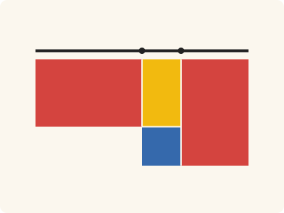
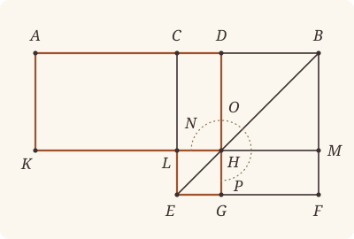

<!-- Generated by scripts/render.py. Do not edit by hand. -->

[Book II](index.md) · [← II.4](04.md) · [II.6 →](06.md)

# Book II, Proposition 5

*The rectangle contained by the unequal segments*

[Euclid's proof](#euclids-proof) · [In Lean](#in-lean) · [What it rests on](#what-it-rests-on) · [Mishnah](#mishnah)

> If a straight line be cut into equal and unequal segments, the rectangle contained by the unequal segments of the whole together with the square on the straight line between the points of section is equal to the square on the half.

**In Lean:** ✅ proved, as Euclid states it · Euclid's argument

<p align="center"></p>

<p align="center"><em>Cut AB in half at C, and unequally at D (black): the rectangle contained by AD, DB (red and yellow) and the square on CD (blue) make the square on CB, for the two reds are equal.</em></p>

## Euclid's proof

<p align="center"></p>

<p align="center"><em>Drawn for one case: D between C and B, as in Heath's figure.</em></p>

For let a straight line AB be cut into equal segments at C and into unequal segments at D;

I say that the rectangle contained by AD, DB together with the square on CD is equal to the square on CB.

For let the square CEFB be described on CB, [I. 46]

and let BE be joined;

through D let DG be drawn parallel to either CE or BF,

through H again let KM be drawn parallel to either AB or EF,

and again through A let AK be drawn parallel to either CL or BM. [I. 31]

Then, since the complement CH is equal to the complement HF, [I. 43]

let DM be added to each;

therefore the whole CM is equal to the whole DF.

But CM is equal to AL,

since AC is also equal to CB; [I. 36]

therefore AL is also equal to DF.

Let CH be added to each;

therefore the whole AH is equal to the gnomon NOP.

But AH is the rectangle AD, DB, for DH is equal to DB,

therefore the gnomon NOP is also equal to the rectangle AD, DB.

Let LG, which is equal to the square on CD, be added to each;

therefore the gnomon NOP and LG are equal to the rectangle contained by AD, DB and the square on CD.

But the gnomon NOP and LG are the whole square CEFB, which is described on CB;

therefore the rectangle contained by AD, DB together with the square on CD is equal to the square on CB.

Therefore etc.

Q. E. D.

## In Lean

| | |
|---|---|
| Proof | ✅ Proved |
| Statement | The whole enunciation. For D on either side of C: Euclid's figure puts D between C and B, and the other side follows by exchanging A and B. |
| Argument | Euclid's. |
| Reviewed | The statement and every passage of the argument read against Heath's text, at commit [`ab90f7e`](https://github.com/jackChallis/stoicheia/commit/ab90f7e) ([the record](../../review/II/05.toml)) |

From [`Elements/BookII/Prop05.lean`](../../Elements/BookII/Prop05.lean). Euclid's sentences are the `--` comments, and our own notes are in `/- … -/`; the lines under each sentence are the Lean that carries it out. The list below marks where a lemma does a step Euclid takes for granted, where several sentences share one step and where the Lean takes a case Euclid's figure leaves aside; the `/- … -/` notes in the listing explain smaller adjustments.

**How the Lean follows the text**

- **A further case.** "For let a straight line AB be cut into equal segments at C…" Euclid's figure puts D between C and B; D cannot be C, since the segments are unequal. The Lean proves Euclid's case once over any letters and covers D between A and C by exchanging A and B.
- **Carried together, by `Parallelogram.figure`.** "and let BE be joined…" Euclid joins BE and draws the parallels through D and H. `Parallelogram.figure` carries these three constructions together, finding the intersections and their order on the sides of the square.
- **Done by `Prop31.parallelogram`.** "and again through A let AK be drawn parallel…" Euclid draws AK parallel to CL and takes K on KM from the figure. `Prop31.parallelogram` draws the parallel, finds K and proves that LCAK is a parallelogram.
- **Done by `Parallelogram.complements`.** "Then, since the complement CH is equal to the complement HF…" Euclid treats CH and HF as parallelograms. I.43 gives their equal areas, and `Parallelogram.complements` proves that both are parallelograms, as the additions to DM that follow require.
- **Done by `quadArea_add_of_parallelograms`.** "therefore the whole CM is equal to the whole DF." Euclid identifies CM as CH and DM together, and DF as HF and DM together. `quadArea_add_of_parallelograms` proves both divisions, so adding DM to the equal complements gives equal wholes.
- **Done by `quadArea_add_of_parallelograms`.** "therefore the whole AH is equal to the gnomon NOP." Euclid takes AH as AL and CH together. `Parallel.between` places L between K and H, and `quadArea_add_of_parallelograms` identifies their sum with AH, giving the gnomon CH, DM and HF.
- **Done by `Square.about_diameter`.** "But AH is the rectangle AD, DB…" Euclid takes DH equal to DB from the square DM. `Square.about_diameter` proves that DM is a square; the Lean then proves that AH is a rectangle and identifies its area by `Rectangle.eq_rect`.
- **Done by `Square.about_diameter`.** "Let LG, which is equal to the square on CD…" Euclid takes LG to be the square on CD. `Square.about_diameter` makes LG a square, and I.34 with `Square.eq_sq` identifies its area as the square on CD; the next sentence adds it to both sides.
- **Done by `Parallelogram.about_diameter`.** "But the gnomon NOP and LG are the whole square CEFB…" Euclid takes the gnomon NOP and LG together as the whole square CEFB. `Parallelogram.about_diameter` proves that the four parallelograms make up the square.

```lean
/-- If a straight line be cut into equal and unequal segments, the rectangle contained by the
unequal segments of the whole together with the square on the straight line between the points
of section is equal to the square on the half. -/
theorem Prop5 {A B C D : Point} (hACB : Between A C B) (hAC : ‖A C‖ = ‖C B‖) (hADB : Between A D B)
    (hDC : D ≠ C) :
    rect A D D B + sq C D = sq C B := by
  -- For let a straight line AB be cut into equal segments at C and into unequal segments at D;
  -- I say that the rectangle contained by AD, DB together with the square on CD is equal to
  -- the square on CB.
  /- Euclid's figure puts D between C and B; the other side is the same with A
     and B exchanged. -/
  have euclid : ∀ {A B C D : Point}, Between A C B → ‖A C‖ = ‖C B‖ → Between C D B →
      rect A D D B + sq C D = sq C B := by
    intro A B C D hACB hAC hCDB
    have hCB : C ≠ B := ne_of_between_ends hCDB
    -- For let the square CEFB be described on CB, [I. 46]
    obtain ⟨X, hX, -⟩ := exists_off_line hCB []
    obtain ⟨E, F, hsq, hE, hF⟩ := BookI.Prop46 hCB hX
    obtain ⟨hp, hCEFB⟩ := Square.described hsq hE hF
    -- and let BE be joined;
    -- through D let DG be drawn parallel to either CE or BF,
    -- through H again let KM be drawn parallel to either AB or EF,
    obtain ⟨G, H, L, M, hBHE, hEGF, hCLE, hFMB, hDHG, hLHM, hBDHM, hHLEG⟩ := hp.figure hCDB
    -- and again through A let AK be drawn parallel to either CL or BM. [I. 31]
    obtain ⟨AB, hA_AB, hB_AB⟩ := Postulate1 A B (ne_of_between_ends hACB)
    have hC_AB : OnLine C AB := on_line_of_between_ends hACB hA_AB hB_AB
    have hD_AB : OnLine D AB := on_line_of_between_ends hCDB hC_AB hB_AB
    obtain ⟨KM, hL_KM, hM_KM⟩ := Postulate1 L M (ne_of_between_ends hLHM)
    have hH_KM : OnLine H KM := on_line_of_between_ends hLHM hL_KM hM_KM
    have hKM_AB : Parallel KM AB := (hBDHM.1.parallel hB_AB hD_AB hH_KM hM_KM).symm
    obtain ⟨K, hK_KM, hLCAK⟩ :=
      BookI.Prop31.parallelogram hKM_AB hL_KM hC_AB hA_AB (ne_of_between hACB).symm
    -- Then, since the complement CH is equal to the complement HF, [I. 43]
    have hBCEF : Parallelogram B C E F := hp.rotate.rotate.rotate
    have hBDC : Between B D C := between_symm hCDB
    have h43 : quadArea D C L H = quadArea M H G F :=
      BookI.Prop43 hBCEF hBHE hBDC hCLE hEGF hFMB hBDHM hHLEG
    obtain ⟨hDCLH, hMHGF⟩ := hBCEF.complements hBHE hBDC hCLE hEGF hFMB hBDHM hHLEG
    -- let DM be added to each;
    have hadd := CommonNotion2 h43 (rfl : quadArea B D H M = quadArea B D H M)
    -- therefore the whole CM is equal to the whole DF.
    have hCM : quadArea L C B M = quadArea L C D H + quadArea H D B M :=
      quadArea_add_of_parallelograms hDCLH.rotate.rotate.reverse hBDHM.rotate.rotate.reverse hLHM
        hCDB
    have hDF : quadArea D B F G = quadArea D B M H + quadArea H M F G :=
      quadArea_add_of_parallelograms hBDHM.rotate.reverse hMHGF.rotate.reverse hDHG
        (between_symm hFMB)
    have hCM_DF : quadArea L C B M = quadArea D B F G := by
      rw [hCM, hDF, quadArea_reverse L H D C, hDCLH.rotate.quadArea_rotate, hDCLH.quadArea_rotate,
        quadArea_reverse H M B D, hBDHM.rotate.quadArea_rotate, hBDHM.quadArea_rotate,
        quadArea_reverse D H M B, hBDHM.quadArea_rotate, quadArea_reverse H G F M,
        hMHGF.quadArea_rotate]
      exact hadd.trans (add_comm _ _)
    -- But CM is equal to AL,
    -- since AC is also equal to CB; [I. 36]
    obtain ⟨CE, hC_CE, hE_CE⟩ := Postulate1 C E hp.1.1
    obtain ⟨BF, hB_BF, hF_BF⟩ := Postulate1 B F hp.1.2.1.symm
    have hL_CE : OnLine L CE := on_line_of_between_ends hCLE hC_CE hE_CE
    have hM_BF : OnLine M BF := on_line_of_between_ends hFMB hF_BF hB_BF
    have hCE_BF : Parallel CE BF := hp.1.parallel hC_CE hE_CE hF_BF hB_BF
    have hLCBM : Parallelogram L C B M :=
      ⟨AreParallel.of_parallel (ne_of_between hCLE).symm (ne_of_between (between_symm hFMB))
          hL_CE hC_CE hB_BF hM_BF hCE_BF,
        AreParallel.of_parallel hCB (ne_of_between_ends hLHM).symm hC_AB hB_AB hM_KM hL_KM
          hKM_AB.symm⟩
    have h36 : quadArea L C B M = quadArea K A C L :=
      BookI.Prop36 hLCBM hLCAK.rotate.rotate.rotate.reverse hAC.symm
        ⟨KM, hL_KM, hM_KM, hK_KM, hL_KM⟩ ⟨AB, hC_AB, hB_AB, hA_AB, hC_AB⟩
    -- therefore AL is also equal to DF.
    have hAL_DF : quadArea K A C L = quadArea D B F G := CommonNotion1 h36.symm hCM_DF.symm
    -- Let CH be added to each;
    have hadd₂ := CommonNotion2 hAL_DF (rfl : quadArea D C L H = quadArea D C L H)
    -- therefore the whole AH is equal to the gnomon NOP.
    /- AH is AL and CH together: C lies between A and D, and L between K and H,
       the parallels AK, CL, DH keeping order. -/
    have hACD : Between A C D := between_cut hACB hCDB
    obtain ⟨AK, hA_AK, hK_AK⟩ := Postulate1 A K hLCAK.1.2.1
    obtain ⟨DG, hD_DG, hG_DG⟩ := Postulate1 D G (ne_of_between_ends hDHG)
    have hH_DG : OnLine H DG := on_line_of_between_ends hDHG hD_DG hG_DG
    have hAK_CE : Parallel AK CE := (hLCAK.1.parallel hL_CE hC_CE hA_AK hK_AK).symm
    have hDG_CE : Parallel DG CE := (hDCLH.2.parallel hC_CE hL_CE hH_DG hD_DG).symm
    have hKLH : Between K L H := Parallel.between hAK_CE hDG_CE hA_AK hC_CE hD_DG hACD hK_AK
      hL_CE hH_DG ⟨KM, hK_KM, hL_KM, hH_KM⟩
    have hAH : quadArea A K H D = quadArea A K L C + quadArea C L H D :=
      quadArea_add_of_parallelograms hLCAK.rotate.rotate hDCLH.rotate hACD hKLH
    have hgnomon : quadArea A K H D = quadArea D C L H + quadArea B D H M + quadArea M H G F := by
      calc
        quadArea A K H D = quadArea K A C L + quadArea D C L H := by
          rw [hAH, ← hLCAK.rotate.rotate.quadArea_rotate, quadArea_reverse K A C L,
            hDCLH.quadArea_rotate]
        _ = quadArea D B F G + quadArea D C L H := hadd₂
        _ = quadArea D C L H + quadArea B D H M + quadArea M H G F := by
          rw [hDF, quadArea_reverse D H M B, hBDHM.quadArea_rotate,
            quadArea_reverse H G F M, hMHGF.quadArea_rotate]
          ac_rfl
    -- But AH is the rectangle AD, DB, for DH is equal to DB,
    have hDM : Square B D H M :=
      hsq.rotate.rotate.rotate.about_diameter hBCEF hBHE hBDC (between_symm hFMB) hBDHM
    have hDH_DB : ‖D H‖ = ‖D B‖ := hDM.1.symm.trans (len_symm B D)
    have hAD : A ≠ D := ne_of_between_ends hACD
    have hAK_DG : Parallel AK DG := BookI.Prop30.parallel hAK_CE hDG_CE fun e => by
      have hAB_DG : AB = DG := line_unique hAD hA_AB hD_AB (e ▸ hA_AK) hD_DG
      exact hKM_AB.not_onLine hH_KM (hAB_DG ▸ hH_DG)
    have hDAKH : Parallelogram D A K H :=
      ⟨AreParallel.of_parallel hAD.symm (ne_of_between_ends hKLH) hD_AB hA_AB hK_KM hH_KM
          hKM_AB.symm,
        AreParallel.of_parallel hLCAK.1.2.1 (ne_of_between hDHG).symm hA_AK hK_AK hH_DG hD_DG
          hAK_DG⟩
    have hH_AB : ¬ OnLine H AB := fun h => hKM_AB.not_onLine hH_KM h
    have hright : ∠ H D A = ∟ := by
      have h := hDM.2.2.2.2.1
      rw [adjacent_eq_of_right hB_AB hA_AB (between_of_between_left (between_symm hACB) hBDC)
        hH_AB h] at h
      exact h
    have hAHrect : quadArea D A K H = rect A D D B :=
      (Rectangle.of_right hDAKH hright).eq_rect (len_symm D A) hDH_DB
    -- therefore the gnomon NOP is also equal to the rectangle AD, DB.
    have hNOP : quadArea D C L H + quadArea B D H M + quadArea M H G F = rect A D D B :=
      (hgnomon.symm.trans hDAKH.quadArea_rotate).trans hAHrect
    -- Let LG, which is equal to the square on CD, be added to each;
    have hLG : Square E G H L :=
      hsq.rotate.about_diameter hp.rotate (between_symm hBHE) hEGF (between_symm hCLE)
        hHLEG.rotate.rotate
    obtain ⟨-, hDC_HL, -, -, -⟩ := BookI.Prop34 (A := D) (B := H) (C := C) (D := L) hDCLH
    have hLGsq : quadArea H L E G = sq C D := by
      rw [quadArea_rotate₂ E G H L, hLG.eq_sq hHLEG.rotate.rotate]
      exact sq_congr ((hLG.1.trans hLG.2.1).trans (hDC_HL.symm.trans (len_symm D C)))
    -- therefore the gnomon NOP and LG are equal to the rectangle contained by AD, DB and the
    -- square on CD.
    have hadd₃ := CommonNotion2 hNOP hLGsq
    -- But the gnomon NOP and LG are the whole square CEFB, which is described on CB;
    have hwhole := hBCEF.about_diameter hBHE hBDC hCLE hEGF hFMB hBDHM hHLEG
    -- therefore the rectangle contained by AD, DB together with the square on CD is equal to the
    -- square on CB.
    rw [← hadd₃, ← hCEFB, hBCEF.quadArea_rotate, hwhole]
    ac_rfl
  /- D falls between A and C, or between C and B, for it cannot be C itself, the
     segments being unequal. The second is Euclid's case; for the first we exchange
     A and B. -/
  have hCray : OnRay C A B := OnRay.of_between hACB
  have hDray : OnRay D A B := OnRay.of_between hADB
  rcases lt_trichotomy ‖A D‖ ‖A C‖ with h | h | h
  · have hADC : Between A D C := hDray.between_of_len_lt hCray h
    have := euclid (between_symm hACB) (by rw [len_symm B C, len_symm C A]; exact hAC.symm)
      (between_symm hADC)
    rw [rect_comm, rect_congr (len_symm D A) (len_symm B D),
      sq_congr ((len_symm C A).trans hAC)] at this
    exact this
  · obtain ⟨AB, hA, hB⟩ := Postulate1 A B (ne_of_between_ends hACB)
    have hDray' : OnRay D A C := ⟨ne_of_between hACB, (ne_of_between hADB).symm,
      ⟨AB, hA, on_line_of_between_ends hACB hA hB, on_line_of_between_ends hADB hA hB⟩,
      hDray.not_between hCray⟩
    exact absurd (hDray'.eq_of_len_eq h) hDC
  · exact euclid hACB hAC (between_inner (hCray.between_of_len_lt hDray h) hADB)
  -- Therefore etc.
  -- Q. E. D.
```

## What it rests on

| | |
|---|---|
| Heath's references | [I.31](../I/31.md), [I.36](../I/36.md), [I.43](../I/43.md), [I.46](../I/46.md) |
| Lean cites | [I.4](../I/04.md), [I.5](../I/05.md), [I.6](../I/06.md), [I.28](../I/28.md), [I.29](../I/29.md), [I.30](../I/30.md), [I.31](../I/31.md), [I.34](../I/34.md), [I.36](../I/36.md), [I.43](../I/43.md), [I.46](../I/46.md) |
| Postulates | 1, 2, 3, 4, 5 |
| Definitions taken as axioms | Def. I.15 |
| Common Notions | 1, 2, 3, 4, 5 |
| Tacit rules | 63 (listed below) |
| Its own Lean calls | Postulate 1; 10 tacit rules |
| Through lemmas | Postulates 2 and 3; Def. I.15; 36 tacit rules |

Some of these come in through lemmas [shared](../../CERTIFICATE.md#shared-steps) by many proofs: [`Square.described`](../../Elements/BookII/Rectangles.lean#L113) (I.4, I.28, I.34); [`Rectangle.eq_rect`](../../Elements/BookII/Rectangles.lean#L98), [`Square.eq_sq`](../../Elements/BookII/Rectangles.lean#L106) (I.4, I.34); [`Square.about_diameter`](../../Elements/BookII/Rectangles.lean#L134) (I.5, I.6, I.29, I.34); [`Rectangle.of_right`](../../Elements/BookII/Rectangles.lean#L49) (I.29); [`BookI.Prop30.parallel`](../../Elements/BookI/HelpersParallels.lean#L62), [`Parallelogram.about_diameter`](../../Elements/BookII/Rectangles.lean#L225), [`Parallelogram.complements`](../../Elements/BookII/Rectangles.lean#L174) (I.30); [`BookI.Prop31.parallelogram`](../../Elements/BookI/HelpersParallels.lean#L83), [`Parallelogram.figure`](../../Elements/BookII/Rectangles.lean#L299) (I.30, I.31).

_Postulates, definitions, Common Notions and tacit rules: all that this proof rests on, counting those of the propositions it cites. The last two rows say which of the postulates, definitions and tacit rules its own Lean calls, in the proof or a helper written for it, and which it does not call but reaches through lemmas, of Book Zero or shared (a proposition it cites may rest on these too); the rest come in only through the propositions it cites or the Common Notions._

<details><summary>The 63 tacit rules beneath this proof, counting those of the propositions it cites</summary>

_(used here) marks a rule this proof's own Lean calls, in the proof or a helper written for it; (through …) marks one its own Lean does not call but reaches through the lemmas named, of [Book Zero](../../Elements/Figure) or shared, though a proposition it cites may rest on it too; and a rule with no mark comes in only through a proposition it cites or a Common Notion. The names in brackets are System E's: an Intersection rule says when straight lines and circles must meet, and an Intersections rule takes a point where they do (see [Book I's introduction](../I/index.md))._

**Reading the figure**

- [`between_cases`](../../Elements/Foundations/Tacit/Diagram.lean#L74) (through [`OnRay.between_of_len_lt`](../../Elements/Figure/Rays.lean#L121), [`OnRay.eq_of_len_eq`](../../Elements/Figure/Rays.lean#L159), [`OnRay.not_between`](../../Elements/Figure/Rays.lean#L102) and 9 other lemmas): Of three different points on a straight line, one is between the other two. (Between 6)
- [`between_of_between_left`](../../Elements/Foundations/Tacit/Diagram.lean#L66) (used here): If B is between A and C, and D is between A and B, then D is between A and C. (Between 4)
- [`between_of_between_right`](../../Elements/Foundations/Tacit/Diagram.lean#L70) (through [`OnRay.between_of_len_lt`](../../Elements/Figure/Rays.lean#L121), [`OnRay.not_between`](../../Elements/Figure/Rays.lean#L102), [`Rectangle.of_right`](../../Elements/BookII/Rectangles.lean#L49) and 2 other lemmas): If B is between A and C, and C is between B and D, then B is between A and D. (Between 5)
- [`between_symm`](../../Elements/Foundations/Tacit/Diagram.lean#L43) (used here): If B is between A and C, it is between C and A. (Between 1)
- [`centre_inside`](../../Elements/Foundations/Tacit/Diagram.lean#L35) (through [`exists_off_line`](../../Elements/Figure/Rectangles.lean#L39)): The centre of a circle is inside it. (Generalities 3)
- [`circles_meet`](../../Elements/Foundations/Tacit/Diagram.lean#L201) (through [`exists_off_line`](../../Elements/Figure/Rectangles.lean#L39)): If each circle passes through a point inside the other, the circles cut one another. This is the step Euclid takes for granted in I.1. (Intersection 5)
- [`circles_meet_of_on_inside_outside`](../../Elements/Foundations/Tacit/Diagram.lean#L195): Two circles cut one another if the first passes through a point A inside the second, and a point B outside the second is inside or on the first. (Intersection 4, in LeanEuclid's corrected form)
- [`circles_meet_same_side`](../../Elements/Foundations/Tacit/Constructions.lean#L81): Two circles that cut one another do so on each side of the straight line through their centres. (Intersections 8)
- [`exists_point`](../../Elements/Foundations/Tacit/Constructions.lean#L26) (through [`Parallelogram.about_diameter`](../../Elements/BookII/Rectangles.lean#L225), [`Parallelogram.figure`](../../Elements/BookII/Rectangles.lean#L299), [`Parallelogram.quadArea_rotate`](../../Elements/Figure/Parallelograms.lean#L200) and 5 other lemmas): Let a point be taken. (Points 1)
- [`exists_point_between`](../../Elements/Foundations/Tacit/Constructions.lean#L38): Let a point be taken between B and C. (Points 3)
- [`exists_point_on_line`](../../Elements/Foundations/Tacit/Constructions.lean#L29) (through [`BookI.Prop30.parallel`](../../Elements/BookI/HelpersParallels.lean#L62), [`BookI.Prop31.parallelogram`](../../Elements/BookI/HelpersParallels.lean#L83), [`Parallelogram.about_diameter`](../../Elements/BookII/Rectangles.lean#L225) and 2 other lemmas): Let a point be taken on the straight line L. (Points 2)
- [`exists_point_on_line_off_line`](../../Elements/Foundations/Tacit/Constructions.lean#L34) (through [`BookI.Prop30.parallel`](../../Elements/BookI/HelpersParallels.lean#L62), [`BookI.Prop31.parallelogram`](../../Elements/BookI/HelpersParallels.lean#L83), [`Parallelogram.about_diameter`](../../Elements/BookII/Rectangles.lean#L225) and 2 other lemmas): Let a point be taken on L, not on the different straight line M. (Points 2, with "distinct from M")
- [`exists_point_opposite_side`](../../Elements/Foundations/Tacit/Constructions.lean#L46): Let a point be taken on the other side of L from B. (Points 6)
- [`exists_point_same_side`](../../Elements/Foundations/Tacit/Constructions.lean#L42) (through [`exists_off_line`](../../Elements/Figure/Rectangles.lean#L39)): Let a point be taken on the same side of L as B. (Points 5)
- [`inside_not_on`](../../Elements/Foundations/Tacit/Diagram.lean#L38) (through [`exists_off_line`](../../Elements/Figure/Rectangles.lean#L39)): A point inside a circle is not on it. (Generalities 4)
- [`line_circle_between`](../../Elements/Foundations/Tacit/Constructions.lean#L69): A straight line through a point B inside a circle, heading out to a point C outside it, cuts the circle between B and C. (Intersections 4)
- [`line_circle_beyond`](../../Elements/Foundations/Tacit/Constructions.lean#L75): A straight line through a point B inside a circle, produced beyond B away from C, cuts the circle there. (Intersections 5)
- [`line_unique`](../../Elements/Foundations/Tacit/Diagram.lean#L28) (used here): Two points determine a straight line. (Generalities 1)
- [`lines_meet_of_opposite_sides`](../../Elements/Foundations/Tacit/Diagram.lean#L179) (through [`Parallel.between`](../../Elements/Figure/Parallelograms.lean#L99), [`Parallelogram.about_diameter`](../../Elements/BookII/Rectangles.lean#L225), [`Parallelogram.figure`](../../Elements/BookII/Rectangles.lean#L299) and 7 other lemmas): A straight line joining points on opposite sides of L crosses L. (Intersection 1)
- [`ne_of_between`](../../Elements/Foundations/Tacit/Diagram.lean#L46) (used here): A point between two others differs from the first. (Between 1)
- [`ne_of_between_ends`](../../Elements/Foundations/Tacit/Diagram.lean#L49) (used here): The ends of a finite straight line differ. (Between 1)
- [`not_between_of_between`](../../Elements/Foundations/Tacit/Diagram.lean#L52) (through [`OnRay.between_of_len_lt`](../../Elements/Figure/Rays.lean#L121), [`OnRay.not_between`](../../Elements/Figure/Rays.lean#L102), [`OnRay.of_between`](../../Elements/Figure/Rays.lean#L32) and 3 other lemmas): If B is between A and C, then A is not between B and C. (Between 1)
- [`not_between_of_between_between`](../../Elements/Foundations/Tacit/Diagram.lean#L79) (through [`OnRay.between_of_len_lt`](../../Elements/Figure/Rays.lean#L121), [`OnRay.not_between`](../../Elements/Figure/Rays.lean#L102), [`between_cut`](../../Elements/Figure/Lines.lean#L63) and 1 other lemma): If B is between A and C, and also between A and D, then B is not between C and D: C and D lie on the same side of B. (Between 7)
- [`not_on_line_of_same_side`](../../Elements/Foundations/Tacit/Diagram.lean#L92) (through [`Parallel.between`](../../Elements/Figure/Parallelograms.lean#L99), [`Parallelogram.about_diameter`](../../Elements/BookII/Rectangles.lean#L225), [`Parallelogram.figure`](../../Elements/BookII/Rectangles.lean#L299) and 7 other lemmas): Points on one side of a straight line are not on it. (Same side 3)
- [`on_line_of_between`](../../Elements/Foundations/Tacit/Diagram.lean#L56) (through [`OnRay.between_of_len_lt`](../../Elements/Figure/Rays.lean#L121), [`OnRay.not_between`](../../Elements/Figure/Rays.lean#L102), [`Parallelogram.about_diameter`](../../Elements/BookII/Rectangles.lean#L225) and 11 other lemmas): A straight line through A and B, with B between A and C, passes through C. (Between 2)
- [`on_line_of_between_ends`](../../Elements/Foundations/Tacit/Diagram.lean#L61) (used here): A straight line through A and C passes through every point between them. (Between 3)
- [`pasch1`](../../Elements/Foundations/Tacit/Diagram.lean#L106): If A and C are on the same side of L, so is any point between them: if B is between A and C, then A and B are on the same side of L. (Pasch 1)
- [`pasch2`](../../Elements/Foundations/Tacit/Diagram.lean#L111) (through [`Parallelogram.about_diameter`](../../Elements/BookII/Rectangles.lean#L225), [`Parallelogram.quadArea_rotate`](../../Elements/Figure/Parallelograms.lean#L200), [`Rectangle.eq_rect`](../../Elements/BookII/Rectangles.lean#L98) and 4 other lemmas): If B is between A and C, A is on L and B is off it, then B and C are on the same side of L: a straight line that leaves L at A does not cross it again. (Pasch 2)
- [`pasch3`](../../Elements/Foundations/Tacit/Diagram.lean#L114) (through [`Parallel.between`](../../Elements/Figure/Parallelograms.lean#L99), [`Parallelogram.about_diameter`](../../Elements/BookII/Rectangles.lean#L225), [`Parallelogram.figure`](../../Elements/BookII/Rectangles.lean#L299) and 6 other lemmas): A straight line through a point between A and C separates them. (Pasch 3)
- [`pasch4`](../../Elements/Foundations/Tacit/Diagram.lean#L119) (through [`Parallel.between`](../../Elements/Figure/Parallelograms.lean#L99), [`Parallelogram.about_diameter`](../../Elements/BookII/Rectangles.lean#L225), [`Parallelogram.figure`](../../Elements/BookII/Rectangles.lean#L299) and 6 other lemmas): If two different straight lines L and M meet at B, and A and C are points of M, different from each other and from B, that are not on the same side of L, then B is between A and C. (Pasch 4)
- [`same_side_or`](../../Elements/Foundations/Tacit/Diagram.lean#L99) (through [`Square.about_diameter`](../../Elements/BookII/Rectangles.lean#L134)): A straight line has only two sides. (Same side 5)
- [`same_side_refl`](../../Elements/Foundations/Tacit/Diagram.lean#L85) (through [`Parallel.between`](../../Elements/Figure/Parallelograms.lean#L99), [`Parallelogram.about_diameter`](../../Elements/BookII/Rectangles.lean#L225), [`Parallelogram.figure`](../../Elements/BookII/Rectangles.lean#L299) and 5 other lemmas): A point off a straight line is on the same side of it as itself. (Same side 1)
- [`same_side_symm`](../../Elements/Foundations/Tacit/Diagram.lean#L89) (through [`Parallel.between`](../../Elements/Figure/Parallelograms.lean#L99), [`Parallelogram.about_diameter`](../../Elements/BookII/Rectangles.lean#L225), [`Parallelogram.figure`](../../Elements/BookII/Rectangles.lean#L299) and 7 other lemmas): If A is on the same side of a straight line as B, then B is on the same side as A. (Same side 2)
- [`same_side_trans`](../../Elements/Foundations/Tacit/Diagram.lean#L96) (through [`Parallel.between`](../../Elements/Figure/Parallelograms.lean#L99), [`Parallelogram.about_diameter`](../../Elements/BookII/Rectangles.lean#L225), [`Parallelogram.figure`](../../Elements/BookII/Rectangles.lean#L299) and 6 other lemmas): Two points on the same side of a straight line as a third point are on the same side as each other. (Same side 4)
- [`triple_incidence1`](../../Elements/Foundations/Tacit/Diagram.lean#L131) (through [`Parallelogram.about_diameter`](../../Elements/BookII/Rectangles.lean#L225), [`Parallelogram.quadArea_rotate`](../../Elements/Figure/Parallelograms.lean#L200), [`Rectangle.eq_rect`](../../Elements/BookII/Rectangles.lean#L98) and 4 other lemmas): Take B on L, C on M and D on N, three straight lines through A. If C lies within the angle BAD (on D's side of L and on B's side of N), then B and D are not on the same side of M: the straight line AC separates them. (Triple incidence 1)
- [`triple_incidence2`](../../Elements/Foundations/Tacit/Diagram.lean#L139): Take B on L, C on M and D on N, three straight lines through A, with B other than A and D off M. If C and D are on the same side of L, and B and D are not on the same side of M, then B and C are on the same side of N: C lies within the angle BAD. (Triple incidence 2)

**Lengths, angles and areas**

- [`adjacent_eq_of_right`](../../Elements/Foundations/Tacit/Transfer.lean#L67) (used here): A right angle is equal to the angle adjacent to it. (Diagram-angle 3; the other half is Definition 10 together with Postulate 4)
- [`angle_add_of_inside`](../../Elements/Foundations/Tacit/Transfer.lean#L54): If D lies within the angle BAC, then BAC is made up of BAD and DAC. (Diagram-angle 2)
- [`angle_eq_of_same_rays`](../../Elements/Foundations/Tacit/Transfer.lean#L72) (through [`Square.about_diameter`](../../Elements/BookII/Rectangles.lean#L134)): The angle doesn't change if its arms are traced through other points on the same rays. (Diagram-angle 4)
- [`angle_symm`](../../Elements/Foundations/Tacit/Metric.lean#L26) (through [`rect_comm`](../../Elements/Figure/Rectangles.lean#L109)): The angle ABC is the angle CBA. (Metric 4)
- [`area_add_of_between`](../../Elements/Foundations/Tacit/Transfer.lean#L88) (through [`Parallelogram.about_diameter`](../../Elements/BookII/Rectangles.lean#L225), [`Parallelogram.quadArea_rotate`](../../Elements/Figure/Parallelograms.lean#L200), [`Rectangle.eq_rect`](../../Elements/BookII/Rectangles.lean#L98) and 3 other lemmas): Cutting a triangle in two from a vertex adds up. (Diagram-area 2)
- [`area_congruent`](../../Elements/Foundations/Tacit/Metric.lean#L43): Triangles equal in all their sides and angles are equal in area. Euclid uses this without comment once he has shown two triangles congruent. (Metric 9)
- [`area_degenerate`](../../Elements/Foundations/Tacit/Metric.lean#L32) (through [`Parallelogram.about_diameter`](../../Elements/BookII/Rectangles.lean#L225), [`Parallelogram.quadArea_rotate`](../../Elements/Figure/Parallelograms.lean#L200), [`Rectangle.eq_rect`](../../Elements/BookII/Rectangles.lean#L98) and 3 other lemmas): A "triangle" with a repeated corner has no area. (Metric 6)
- [`area_eq_zero_of_on_line`](../../Elements/Foundations/Tacit/Transfer.lean#L80) (through [`Parallelogram.about_diameter`](../../Elements/BookII/Rectangles.lean#L225), [`Parallelogram.quadArea_rotate`](../../Elements/Figure/Parallelograms.lean#L200), [`Rectangle.eq_rect`](../../Elements/BookII/Rectangles.lean#L98) and 3 other lemmas): A "triangle" whose corners lie on one straight line has no area. (Diagram-area 1)
- [`area_rotate`](../../Elements/Foundations/Tacit/Metric.lean#L35) (through [`Parallelogram.about_diameter`](../../Elements/BookII/Rectangles.lean#L225), [`Parallelogram.quadArea_rotate`](../../Elements/Figure/Parallelograms.lean#L200), [`Rectangle.eq_rect`](../../Elements/BookII/Rectangles.lean#L98) and 4 other lemmas): The triangle ABC is the triangle CAB. (Metric 8)
- [`area_swap`](../../Elements/Foundations/Tacit/Metric.lean#L38) (through [`Parallelogram.about_diameter`](../../Elements/BookII/Rectangles.lean#L225), [`Parallelogram.quadArea_rotate`](../../Elements/Figure/Parallelograms.lean#L200), [`Rectangle.eq_rect`](../../Elements/BookII/Rectangles.lean#L98) and 5 other lemmas): The triangle ABC is the triangle ACB. (Metric 8)
- [`eq_of_len_eq_zero`](../../Elements/Foundations/Tacit/Metric.lean#L17) (through [`OnRay.between_of_len_lt`](../../Elements/Figure/Rays.lean#L121), [`OnRay.eq_of_len_eq`](../../Elements/Figure/Rays.lean#L159), [`Rectangle.eq_rect`](../../Elements/BookII/Rectangles.lean#L98) and 3 other lemmas): A finite straight line with distinct ends has length. (Metric 1)
- [`inside_of_len_lt`](../../Elements/Foundations/Tacit/Transfer.lean#L33): A point nearer the centre than the circumference is inside. (Diagram-segment 4)
- [`len_add_of_between`](../../Elements/Foundations/Tacit/Transfer.lean#L21) (through [`OnRay.between_of_len_lt`](../../Elements/Figure/Rays.lean#L121), [`OnRay.eq_of_len_eq`](../../Elements/Figure/Rays.lean#L159) and [`exists_off_line`](../../Elements/Figure/Rectangles.lean#L39)): If B is between A and C, then AB and BC together make up AC. (Diagram-segment 1)
- [`len_lt_of_inside`](../../Elements/Foundations/Tacit/Transfer.lean#L37): A point inside is nearer the centre than the circumference. (Diagram-segment 4)
- [`len_self`](../../Elements/Foundations/Tacit/Metric.lean#L20): The "straight line" from a point to itself has no length. (Metric 1)
- [`len_symm`](../../Elements/Foundations/Tacit/Metric.lean#L23) (used here): The straight line AB is the straight line BA. (Metric 3)
- [`on_line_of_area_eq_zero`](../../Elements/Foundations/Tacit/Transfer.lean#L84): A triangle with no area has its corners on one straight line. (Diagram-area 1)
- [`same_ray_of_angle_eq_zero`](../../Elements/Foundations/Tacit/Transfer.lean#L49): If the angle BAC is nothing, C lies on the ray from A through B. (Diagram-angle 1)

**Superposition**

- [`superposition`](../../Elements/Foundations/Tacit/Superposition.lean#L30): **Superposition.** The triangle ABC can be applied to the straight line L with A on D, B on the ray from D through G, and C on the side of L where H is, without changing any side or angle.

**Laws of magnitude**

- [`add_assoc`](../../Elements/Foundations/Tacit/Magnitudes.lean#L23) (through [`Magnitude.instAssociative`](../../Elements/Figure/Areas.lean#L33), [`Parallelogram.about_diameter`](../../Elements/BookII/Rectangles.lean#L225), [`Parallelogram.quadArea_rotate`](../../Elements/Figure/Parallelograms.lean#L200) and 4 other lemmas): Adding three magnitudes in a row, it makes no difference whether the first two or the last two are added first. (System E §3.5)
- [`add_comm`](../../Elements/Foundations/Tacit/Magnitudes.lean#L26) (used here): The order of adding does not matter. (System E §3.5)
- [`add_lt_add_right`](../../Elements/Foundations/Tacit/Magnitudes.lean#L45): Adding the same thing to both sides keeps "less than". (System E §3.5)
- [`add_zero`](../../Elements/Foundations/Tacit/Magnitudes.lean#L29) (through [`Parallelogram.about_diameter`](../../Elements/BookII/Rectangles.lean#L225), [`Parallelogram.quadArea_rotate`](../../Elements/Figure/Parallelograms.lean#L200), [`Rectangle.eq_rect`](../../Elements/BookII/Rectangles.lean#L98) and 3 other lemmas): Adding nothing changes nothing. (System E §3.5)
- [`lt_irrefl`](../../Elements/Foundations/Tacit/Magnitudes.lean#L32) (through [`OnRay.between_of_len_lt`](../../Elements/Figure/Rays.lean#L121), [`OnRay.eq_of_len_eq`](../../Elements/Figure/Rays.lean#L159) and [`exists_off_line`](../../Elements/Figure/Rectangles.lean#L39)): No magnitude is less than itself. (System E §3.5)
- [`lt_trans`](../../Elements/Foundations/Tacit/Magnitudes.lean#L35) (through [`OnRay.between_of_len_lt`](../../Elements/Figure/Rays.lean#L121)): What is less than the less is less still. (System E §3.5)
- [`lt_trichotomy`](../../Elements/Foundations/Tacit/Magnitudes.lean#L39) (used here): Of two magnitudes, one is less, or they are equal, or the other is less. (System E §3.5)
- [`not_lt_zero`](../../Elements/Foundations/Tacit/Magnitudes.lean#L42) (through [`OnRay.between_of_len_lt`](../../Elements/Figure/Rays.lean#L121), [`OnRay.eq_of_len_eq`](../../Elements/Figure/Rays.lean#L159) and [`exists_off_line`](../../Elements/Figure/Rectangles.lean#L39)): Nothing is less than zero. (System E §3.5)

</details>

## Mishnah

_Our commentary: what Euclid assumes, what Lean made us say out loud, and how the result looks by modern means._

**"From it the whole is known."** The gnomon of Definition II.2 enters Euclid's proofs here, and stays for four propositions. In a square it is what is left when a smaller square is cut from one corner: a carpenter's square. A scholium explains the name: "from it the whole is known, whether of the whole area or of the remainder, when it is either placed round or taken away" (Heath, vol. 1, p. 371).

**What is NOP?** Here the gnomon NOP is CH, DM and HF together, and Heath remarks, "It will be observed that the gnomon is indicated in the figure by three separate letters and a dotted curve" (vol. 1, p. 383); the curve runs round H. Heath relettered the manuscripts' figure, which had two M's, and we keep his letters. They name an area, not points, so our Lean writes the sum of three parallelograms, each named by its corners, as [Book II's introduction](index.md#areas) explains.

**"Their exceeding and their falling-short."** Heath recalls here Proclus' words on the application of areas, met under I.44 (vol. 1, p. 384), and II.5 is its falling-short. AH is the rectangle AD, DB, for DM is a square, as in II.4; applied to AB, it falls short by the square DM. Heath reads II.5 as the problem this suggests, to apply to a given straight line a rectangle equal to a given square and falling short by a square figure: the equation ax − x² = b² (vol. 1, p. 383).

**"One only of the two solutions."** That equation has two roots, which put the point of section on either side of C. "Euclid's figure corresponds to one only of the two solutions," Heath writes (vol. 1, p. 384), though he has no doubt that Euclid knew both. Euclid's setting-out names no side, so our statement lets D fall on either: we prove Euclid's case, D between C and B, and get the other by exchanging A and B.

**The modern way.** Put C at 0, A at −h, B at h and D at d, with 0 < |d| < h: then (h + d)(h − d) + d² = h², or h² − d² = (h + d)(h − d), the difference of two squares that Heath finds in II.5 and II.6 alike (vol. 1, p. 383).

## Further reading

- For a scrap of papyrus from around AD 100 that carries this very proposition and its figure, Bill Casselman's ["The oldest diagram from Euclid"](https://personal.math.ubc.ca/~cass/Euclid/papyrus/) (free online), a lovely page on Papyrus Oxyrhynchus I 29.
- For quadratic problems solved by cutting and pasting squares and rectangles in Babylon, more than a thousand years before Euclid, Jens Høyrup's [*Algebra in Cuneiform*](https://www.mprl-series.mpg.de/textbooks/2/) (2017, free online), ch. 3, "The Fundamental Techniques for the Second Degree" (also on [I.44](../I/44.md)).

[Book II](index.md) · [← II.4](04.md) · [II.6 →](06.md)

---

<sub>Euclid's text: T. L. Heath, *The Thirteen Books of Euclid's Elements*, vol. 1 (Cambridge, 1908), pp. 382–383; [scan leaves n402–n403](https://archive.org/details/thirteenbookseu02heibgoog/page/n402); [figure on n402](https://archive.org/details/thirteenbookseu02heibgoog/page/n402). Public domain.</sub>

<sub>The tacit rules follow the System E of Jeremy Avigad, Edward Dean and John Mumma, read alongside LeanEuclid (Logan Murphy, Kaiyu Yang, Jialiang Sun, Zhaoyu Li, Anima Anandkumar and Xujie Si).</sub>
