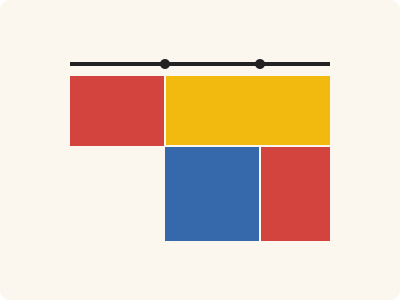
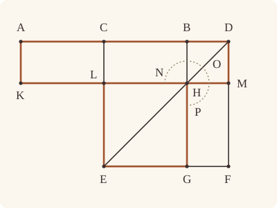

<!-- Generated by scripts/render.py. Do not edit by hand. -->

[Book II](index.md) · [← II.5](05.md) · [II.7 →](07.md)

# Book II, Proposition 6

*The rectangle contained by the whole and the added straight line*

[Euclid's proof](#euclids-proof) · [In Lean](#in-lean) · [What it rests on](#what-it-rests-on) · [Mishnah](#mishnah)

> If a straight line be bisected and a straight line be added to it in a straight line, the rectangle contained by the whole with the added straight line and the added straight line together with the square on the half is equal to the square on the straight line made up of the half and the added straight line.

**In Lean:** ✅ proved, as Euclid states it · Euclid's argument

<p align="center"></p>

<p align="center"><em>Halve AB at C and add BD (black): the rectangle contained by AD, DB (red and yellow) and the square on CB (blue) make the square on CD, for the two reds are equal.</em></p>

## Euclid's proof

<p align="center"></p>

For let a straight line AB be bisected at the point C, and let a straight line BD be added to it in a straight line;

I say that the rectangle contained by AD, DB together with the square on CB is equal to the square on CD.

For let the square CEFD be described on CD, [I. 46]

and let DE be joined;

through the point B let BG be drawn parallel to either EC or DF,

through the point H let KM be drawn parallel to either AB or EF,

and further through A let AK be drawn parallel to either CL or DM. [I. 31]

Then, since AC is equal to CB,

AL is also equal to CH. [I. 36]

But CH is equal to HF. [I. 43]

Therefore AL is also equal to HF.

Let CM be added to each;

therefore the whole AM is equal to the gnomon NOP.

But AM is the rectangle AD, DB,

for DM is equal to DB;

therefore the gnomon NOP is also equal to the rectangle AD, DB.

Let LG, which is equal to the square on BC, be added to each;

therefore the rectangle contained by AD, DB together with the square on CB is equal to the gnomon NOP and LG.

But the gnomon NOP and LG are the whole square CEFD, which is described on CD;

therefore the rectangle contained by AD, DB together with the square on CB is equal to the square on CD.

Therefore etc.

Q. E. D.

## In Lean

| | |
|---|---|
| Proof | ✅ Proved |
| Statement | The whole enunciation. D lies beyond B, as Euclid's setting-out puts it; a straight line added beyond A is the same case with A and B exchanged. |
| Argument | Euclid's. |
| Reviewed | The statement and every passage of the argument read against Heath's text, at commit [`dd9307b3c`](https://github.com/jackChallis/stoicheia/commit/dd9307b3c) ([the record](../../review/II/06.toml)) |

From [`Elements/BookII/Prop06.lean`](../../Elements/BookII/Prop06.lean). Euclid's sentences are the `--` comments, and our own notes are in `/- … -/`; the lines under each sentence are the Lean that carries it out. The list below marks where a lemma does a step Euclid takes for granted and where several sentences share one step; the `/- … -/` notes in the listing explain smaller adjustments.

**How the Lean follows the text**

- **Carried together, by `Parallelogram.figure`.** "and let DE be joined…" Euclid joins DE and draws the parallels through B and H; `between_inner`, beneath the setting-out, puts B between C and D. `Parallelogram.figure` carries the three constructions together, drawing the parallels by I.31, finding their meetings by `BookI.Prop30.meet`, proving the further parallels by I.30 and ordering their points by `Parallel.between`.
- **Done by `BookI.Prop31.parallelogram`.** "and further through A let AK be drawn parallel…" Euclid draws AK parallel to CL and takes K on KM from the figure; `BookI.Prop31.parallelogram` draws the parallel by I.31, finds K by `BookI.Prop30.meet` and proves that LCAK is a parallelogram. `Parallelogram.complements` uses I.30 to prove CH and HF are parallelograms; CH is then used by I.36, in the division of CM, and by I.34 to identify the side HL of LG with BC.
- **Done by `quadArea_add_of_parallelograms`.** "Let CM be added to each…" Euclid adds CM, treating it as CH and BM together. The Lean proves CM a parallelogram and `quadArea_add_of_parallelograms` proves that division; the addition is carried out in the next sentence.
- **Done by `quadArea_add_of_parallelograms`.** "therefore the whole AM is equal to the gnomon NOP." Euclid takes AM as AL and CM together. The Lean uses the order A, C, D proved beneath the setting-out, places L between K and M by `Parallel.between`, and joins the two areas by `quadArea_add_of_parallelograms`, giving the gnomon CH, BM and HF. Definition II.2's gnomon has no Lean definition of its own: here and in the three later sentences that name it, the Lean carries the gnomon NOP as the sum of the areas of its three parallelograms, CH, BM and HF.
- **Done by `Square.about_diameter`.** "But AM is the rectangle AD, DB…" Euclid takes DM equal to DB from the square BM and treats AM as a rectangle. `Square.about_diameter` proves BM a square, `BookI.Prop30.parallel` (I.30, for which Heath gives no reference here) makes AK parallel to DM, and `Rectangle.of_right` (I.29) and `Rectangle.eq_rect` identify AM.
- **Done by `Square.about_diameter`.** "Let LG, which is equal to the square on BC…" Euclid takes LG to be the square on BC. `Square.about_diameter` proves LG a square, and I.34 with `Square.eq_sq` identifies its area as the square on BC; the next sentence adds it to both sides.
- **Done by `Parallelogram.about_diameter`.** "But the gnomon NOP and LG are the whole square CEFD…" Euclid takes the gnomon NOP and LG together as the whole square CEFD. `Parallelogram.about_diameter` proves the complements are parallelograms, uses I.30 and `Between.of_inside` to join and order L, H and M, then joins the four pieces with `quadArea_add_of_parallelograms`.

```lean
/-- If a straight line be bisected and a straight line be added to it in a straight line, the
rectangle contained by the whole with the added straight line and the added straight line
together with the square on the half is equal to the square on the straight line made up of the
half and the added straight line. -/
theorem Prop6 {A B C D : Point} (hACB : Between A C B) (hAC : ‖A C‖ = ‖C B‖)
    (hABD : Between A B D) :
    rect A D D B + sq C B = sq C D := by
  -- For let a straight line AB be bisected at the point C, and let a straight line BD be added
  -- to it in a straight line;
  have hCBD : Between C B D := between_inner hACB hABD
  have hACD : Between A C D := between_of_between_right hACB hCBD
  have hCD : C ≠ D := ne_of_between_ends hCBD
  -- I say that the rectangle contained by AD, DB together with the square on CB is equal to
  -- the square on CD.
  -- For let the square CEFD be described on CD, [I. 46]
  obtain ⟨X, hX, -⟩ := exists_off_line hCD []
  obtain ⟨E, F, hsq, hE, hF⟩ := BookI.Prop46 hCD hX
  obtain ⟨hp, hCEFD⟩ := Square.described hsq hE hF
  -- and let DE be joined;
  -- through the point B let BG be drawn parallel to either EC or DF,
  -- through the point H let KM be drawn parallel to either AB or EF,
  obtain ⟨G, H, L, M, hDHE, hEGF, hCLE, hFMD, -, hLHM, hDBHM, hHLEG⟩ := hp.figure hCBD
  -- and further through A let AK be drawn parallel to either CL or DM. [I. 31]
  obtain ⟨AB, hA_AB, hB_AB⟩ := Postulate1 A B (ne_of_between_ends hACB)
  have hC_AB : OnLine C AB := on_line_of_between_ends hACB hA_AB hB_AB
  have hD_AB : OnLine D AB := on_line_of_between hABD hA_AB hB_AB
  obtain ⟨KM, hL_KM, hM_KM⟩ := Postulate1 L M (ne_of_between_ends hLHM)
  have hH_KM : OnLine H KM := on_line_of_between_ends hLHM hL_KM hM_KM
  have hKM_AB : Parallel KM AB := (hDBHM.1.parallel hD_AB hB_AB hH_KM hM_KM).symm
  obtain ⟨K, hK_KM, hLCAK⟩ :=
    BookI.Prop31.parallelogram hKM_AB hL_KM hC_AB hA_AB (ne_of_between hACB).symm
  have hDCEF : Parallelogram D C E F := hp.rotate.rotate.rotate
  have hDBC : Between D B C := between_symm hCBD
  obtain ⟨hBCLH, -⟩ := hDCEF.complements hDHE hDBC hCLE hEGF hFMD hDBHM hHLEG
  -- Then, since AC is equal to CB,
  -- AL is also equal to CH. [I. 36]
  have h36 : quadArea K A C L = quadArea L C B H :=
    BookI.Prop36 hLCAK.rotate.rotate.rotate.reverse hBCLH.rotate.rotate.reverse hAC
      ⟨KM, hK_KM, hL_KM, hL_KM, hH_KM⟩ ⟨AB, hA_AB, hC_AB, hC_AB, hB_AB⟩
  -- But CH is equal to HF. [I. 43]
  have h43 : quadArea B C L H = quadArea M H G F :=
    BookI.Prop43 hDCEF hDHE hDBC hCLE hEGF hFMD hDBHM hHLEG
  -- Therefore AL is also equal to HF.
  have hAL_HF : quadArea K A C L = quadArea M H G F := by
    rw [h36, quadArea_reverse L H B C, hBCLH.rotate.quadArea_rotate, hBCLH.quadArea_rotate]
    exact h43
  -- Let CM be added to each;
  obtain ⟨CE, hC_CE, hE_CE⟩ := Postulate1 C E hp.1.1
  obtain ⟨DF, hD_DF, hF_DF⟩ := Postulate1 D F hp.1.2.1.symm
  have hL_CE : OnLine L CE := on_line_of_between_ends hCLE hC_CE hE_CE
  have hM_DF : OnLine M DF := on_line_of_between_ends hFMD hF_DF hD_DF
  have hCE_DF : Parallel CE DF := hp.1.parallel hC_CE hE_CE hF_DF hD_DF
  have hLCDM : Parallelogram L C D M :=
    ⟨AreParallel.of_parallel (ne_of_between hCLE).symm (ne_of_between (between_symm hFMD))
        hL_CE hC_CE hD_DF hM_DF hCE_DF,
      AreParallel.of_parallel hCD (ne_of_between_ends hLHM).symm hC_AB hD_AB hM_KM hL_KM
        hKM_AB.symm⟩
  have hCM : quadArea L C D M = quadArea L C B H + quadArea H B D M :=
    quadArea_add_of_parallelograms hBCLH.rotate.rotate.reverse hDBHM.rotate.rotate.reverse hLHM
      hCBD
  -- therefore the whole AM is equal to the gnomon NOP.
  obtain ⟨AK, hA_AK, hK_AK⟩ := Postulate1 A K hLCAK.1.2.1
  have hAK_CE : Parallel AK CE := (hLCAK.1.parallel hL_CE hC_CE hA_AK hK_AK).symm
  have hDF_CE : Parallel DF CE := hCE_DF.symm
  have hKLM : Between K L M := Parallel.between hAK_CE hDF_CE hA_AK hC_CE hD_DF hACD hK_AK
    hL_CE hM_DF ⟨KM, hK_KM, hL_KM, hM_KM⟩
  have hAM : quadArea K A D M = quadArea K A C L + quadArea L C D M :=
    quadArea_add_of_parallelograms hLCAK.rotate.rotate.rotate.reverse hLCDM hKLM hACD
  /- NOP names CH, BM and HF together; its letters are not points. -/
  have hgnomon : quadArea K A D M = quadArea B C L H + quadArea D B H M + quadArea M H G F := by
    rw [hAM, hAL_HF, hCM, quadArea_reverse L H B C, hBCLH.rotate.quadArea_rotate,
      hBCLH.quadArea_rotate, quadArea_reverse H M D B, hDBHM.rotate.quadArea_rotate,
      hDBHM.quadArea_rotate]
    ac_rfl
  -- But AM is the rectangle AD, DB,
  have hDBHMsq : Square D B H M :=
    hsq.rotate.rotate.rotate.about_diameter hDCEF hDHE hDBC (between_symm hFMD) hDBHM
  have hAD : A ≠ D := ne_of_between_ends hACD
  have hAK_DF : Parallel AK DF := BookI.Prop30.parallel hAK_CE hDF_CE fun e => by
    have hAB_DF : AB = DF := line_unique hAD hA_AB hD_AB (e ▸ hA_AK) hD_DF
    exact hKM_AB.not_onLine hM_KM (hAB_DF ▸ hM_DF)
  have hDAKM : Parallelogram D A K M :=
    ⟨AreParallel.of_parallel hAD.symm (ne_of_between_ends hKLM) hD_AB hA_AB hK_KM hM_KM
        hKM_AB.symm,
      AreParallel.of_parallel hLCAK.1.2.1 (ne_of_between (between_symm hFMD)).symm
        hA_AK hK_AK hM_DF hD_DF hAK_DF⟩
  have hright : ∠ M D A = ∟ := by
    rw [angle_onRay_right (OnRay.of_beyond (between_symm hABD))
      (ne_of_between (between_symm hFMD)).symm]
    exact hDBHMsq.2.2.2.1
  -- for DM is equal to DB;
  have hAMrect : quadArea D A K M = rect A D D B :=
    (Rectangle.of_right hDAKM hright).eq_rect (len_symm D A) hDBHMsq.len_eq
  -- therefore the gnomon NOP is also equal to the rectangle AD, DB.
  have hNOP : quadArea B C L H + quadArea D B H M + quadArea M H G F = rect A D D B :=
    hgnomon.symm.trans ((quadArea_reverse K M D A).trans
      (hDAKM.rotate.quadArea_rotate.trans (hDAKM.quadArea_rotate.trans hAMrect)))
  -- Let LG, which is equal to the square on BC, be added to each;
  have hLG : Square E G H L :=
    hsq.rotate.about_diameter hp.rotate (between_symm hDHE) hEGF (between_symm hCLE)
      hHLEG.rotate.rotate
  obtain ⟨-, hBC_HL, -, -, -⟩ := BookI.Prop34 (A := B) (B := H) (C := C) (D := L) hBCLH
  have hLGsq : quadArea H L E G = sq B C := by
    rw [quadArea_rotate₂ E G H L, hLG.eq_sq hHLEG.rotate.rotate]
    exact sq_congr ((hLG.1.trans hLG.2.1).trans hBC_HL.symm)
  -- therefore the rectangle contained by AD, DB together with the square on CB is equal to the
  -- gnomon NOP and LG.
  have hadd := CommonNotion2 hNOP.symm ((sq_symm C B).trans hLGsq.symm)
  -- But the gnomon NOP and LG are the whole square CEFD, which is described on CD;
  have hwhole := hDCEF.about_diameter hDHE hDBC hCLE hEGF hFMD hDBHM hHLEG
  -- therefore the rectangle contained by AD, DB together with the square on CB is equal to the
  -- square on CD.
  rw [hadd, ← hCEFD, hDCEF.quadArea_rotate, hwhole]
  ac_rfl
  -- Therefore etc.
  -- Q. E. D.
```

## What it rests on

| | |
|---|---|
| Heath's references | [I.31](../I/31.md), [I.36](../I/36.md), [I.43](../I/43.md), [I.46](../I/46.md) |
| Lean cites | [I.4](../I/04.md), [I.5](../I/05.md), [I.6](../I/06.md), [I.28](../I/28.md), [I.29](../I/29.md), [I.30](../I/30.md), [I.31](../I/31.md), [I.34](../I/34.md), [I.36](../I/36.md), [I.43](../I/43.md), [I.46](../I/46.md) |
| Postulates | 1, 2, 3, 4, 5 |
| Definitions taken as axioms | Def. I.15 |
| Common Notions | 1, 2, 3, 4, 5 |
| Tacit rules | 38 (listed below) |
| Its own Lean calls | Postulate 1; 3 tacit rules |
| Through lemmas | Postulates 2 and 3; Def. I.15; 31 tacit rules |

Some of these come in through lemmas [shared](../../CERTIFICATE.md#shared-steps) by many proofs: [`Square.described`](../../Elements/BookII/Rectangles.lean#L149) (I.4, I.28, I.34); [`Rectangle.eq_rect`](../../Elements/BookII/Rectangles.lean#L102), [`Square.eq_sq`](../../Elements/BookII/Rectangles.lean#L142) (I.4, I.34); [`Square.about_diameter`](../../Elements/BookII/Rectangles.lean#L170) (I.5, I.6, I.29, I.34); [`Rectangle.of_right`](../../Elements/BookII/Rectangles.lean#L53) (I.29); [`BookI.Prop30.parallel`](../../Elements/BookI/HelpersParallels.lean#L62), [`Parallelogram.about_diameter`](../../Elements/BookII/Rectangles.lean#L256), [`Parallelogram.complements`](../../Elements/BookII/Rectangles.lean#L207) (I.30); [`BookI.Prop31.parallelogram`](../../Elements/BookI/HelpersParallels.lean#L83), [`Parallelogram.figure`](../../Elements/BookII/Rectangles.lean#L330) (I.30, I.31).

_Postulates, definitions, Common Notions and tacit rules: all that this proof rests on, counting those of the propositions it cites. The last two rows say which of the postulates, definitions and tacit rules its own Lean calls, in the proof or a helper written for it, and which it does not call but reaches through lemmas, of Book Zero or shared (a proposition it cites may rest on these too); the rest come in only through the propositions it cites or the Common Notions._

<details><summary>The 38 tacit rules beneath this proof, counting those of the propositions it cites</summary>

_(used here) marks a rule this proof's own Lean calls, in the proof or a helper written for it; (through …) marks one its own Lean does not call but reaches through the lemmas named, of [Book Zero](../../Elements/Figure) or shared, though a proposition it cites may rest on it too; and a rule with no mark comes in only through a proposition it cites or a Common Notion. The names in brackets are System E's: an Intersection rule says when straight lines and circles must meet, and an Intersections rule takes a point where they do (see [Book I's introduction](../I/index.md))._

**Reading the figure**

- [`between_cases`](../../Elements/Foundations/Tacit/Diagram.lean#L54) (through [`Parallel.between`](../../Elements/Figure/Parallelograms.lean#L101), [`Parallelogram.about_diameter`](../../Elements/BookII/Rectangles.lean#L256), [`Parallelogram.figure`](../../Elements/BookII/Rectangles.lean#L330) and 11 other lemmas): Of three different points on a straight line, one is between the other two. (Between 6)
- [`between_symm`](../../Elements/Foundations/Tacit/Diagram.lean#L47) (used here): If B is between A and C, it is between C and A. (Between 1)
- [`circles_meet`](../../Elements/Foundations/Tacit/Diagram.lean#L91) (through [`BookI.Prop31.parallelogram`](../../Elements/BookI/HelpersParallels.lean#L83), [`OnRay.of_beyond`](../../Elements/Figure/Rays.lean#L41), [`Parallel.between`](../../Elements/Figure/Parallelograms.lean#L101) and 16 other lemmas): If each circle passes through a point inside the other, the circles cut one another. This is the step Euclid takes for granted in I.1. (Intersection 5)
- [`circles_meet_same_side`](../../Elements/Foundations/Tacit/Constructions.lean#L79) (through [`BookI.Prop31.parallelogram`](../../Elements/BookI/HelpersParallels.lean#L83), [`OnRay.of_beyond`](../../Elements/Figure/Rays.lean#L41), [`Parallel.between`](../../Elements/Figure/Parallelograms.lean#L101) and 16 other lemmas): Two circles that cut one another do so on each side of the straight line through their centres. (Intersections 8)
- [`exists_point`](../../Elements/Foundations/Tacit/Constructions.lean#L35) (through [`Parallelogram.about_diameter`](../../Elements/BookII/Rectangles.lean#L256), [`Parallelogram.figure`](../../Elements/BookII/Rectangles.lean#L330), [`Parallelogram.quadArea_rotate`](../../Elements/Figure/Parallelograms.lean#L202) and 6 other lemmas): Let a point be taken. (Points 1)
- [`exists_point_inside_circle`](../../Elements/Foundations/Tacit/Constructions.lean#L42) (through [`BookI.Prop31.parallelogram`](../../Elements/BookI/HelpersParallels.lean#L83), [`OnRay.of_beyond`](../../Elements/Figure/Rays.lean#L41), [`Parallel.between`](../../Elements/Figure/Parallelograms.lean#L101) and 16 other lemmas): Let a point be taken inside the circle α. (Points 8)
- [`exists_point_on_line`](../../Elements/Foundations/Tacit/Constructions.lean#L38) (through [`BookI.Prop30.parallel`](../../Elements/BookI/HelpersParallels.lean#L62), [`BookI.Prop31.parallelogram`](../../Elements/BookI/HelpersParallels.lean#L83), [`OnRay.of_beyond`](../../Elements/Figure/Rays.lean#L41) and 17 other lemmas): Let a point be taken on the straight line L. (Points 2)
- [`line_circle_between`](../../Elements/Foundations/Tacit/Constructions.lean#L67) (through [`BookI.Prop31.parallelogram`](../../Elements/BookI/HelpersParallels.lean#L83), [`OnRay.of_beyond`](../../Elements/Figure/Rays.lean#L41), [`Parallel.between`](../../Elements/Figure/Parallelograms.lean#L101) and 16 other lemmas): A straight line through a point B inside a circle, heading out to a point C outside it, cuts the circle between B and C. (Intersections 4)
- [`line_circle_beyond`](../../Elements/Foundations/Tacit/Constructions.lean#L73) (through [`BookI.Prop31.parallelogram`](../../Elements/BookI/HelpersParallels.lean#L83), [`OnRay.of_beyond`](../../Elements/Figure/Rays.lean#L41), [`Parallel.between`](../../Elements/Figure/Parallelograms.lean#L101) and 16 other lemmas): A straight line through a point B inside a circle, produced beyond B away from C, cuts the circle there. (Intersections 5)
- [`line_unique`](../../Elements/Foundations/Tacit/Diagram.lean#L41) (used here): Two points determine a straight line. (Generalities 1)
- [`lines_meet_of_opposite_sides`](../../Elements/Foundations/Tacit/Diagram.lean#L86) (through [`Parallel.between`](../../Elements/Figure/Parallelograms.lean#L101), [`Parallelogram.about_diameter`](../../Elements/BookII/Rectangles.lean#L256), [`Parallelogram.figure`](../../Elements/BookII/Rectangles.lean#L330) and 7 other lemmas): A straight line joining points on opposite sides of L crosses L. (Intersection 1)
- [`not_between_of_between`](../../Elements/Foundations/Tacit/Diagram.lean#L50) (through [`BookI.Prop31.parallelogram`](../../Elements/BookI/HelpersParallels.lean#L83), [`OnRay.of_beyond`](../../Elements/Figure/Rays.lean#L41), [`Parallel.between`](../../Elements/Figure/Parallelograms.lean#L101) and 19 other lemmas): If B is between A and C, then A is not between B and C. (Between 1)
- [`not_on_line_of_same_side`](../../Elements/Foundations/Tacit/Diagram.lean#L60) (through [`BookI.Prop31.parallelogram`](../../Elements/BookI/HelpersParallels.lean#L83), [`OnRay.of_beyond`](../../Elements/Figure/Rays.lean#L41), [`Parallel.between`](../../Elements/Figure/Parallelograms.lean#L101) and 16 other lemmas): Points on one side of a straight line are not on it. (Same side 3)
- [`pasch2`](../../Elements/Foundations/Tacit/Diagram.lean#L71) (through [`BookI.Prop31.parallelogram`](../../Elements/BookI/HelpersParallels.lean#L83), [`OnRay.of_beyond`](../../Elements/Figure/Rays.lean#L41), [`Parallel.between`](../../Elements/Figure/Parallelograms.lean#L101) and 16 other lemmas): If B is between A and C, A is on L and B is off it, then B and C are on the same side of L: a straight line that leaves L at A does not cross it again. (Pasch 2)
- [`same_side_trans`](../../Elements/Foundations/Tacit/Diagram.lean#L64) (through [`BookI.Prop31.parallelogram`](../../Elements/BookI/HelpersParallels.lean#L83), [`OnRay.of_beyond`](../../Elements/Figure/Rays.lean#L41), [`Parallel.between`](../../Elements/Figure/Parallelograms.lean#L101) and 16 other lemmas): Two points on the same side of a straight line as a third point are on the same side as each other. (Same side 4)

**Lengths, angles and areas**

- [`angle_add_of_inside`](../../Elements/Foundations/Tacit/Transfer.lean#L47) (through [`Parallel.between`](../../Elements/Figure/Parallelograms.lean#L101), [`Parallelogram.about_diameter`](../../Elements/BookII/Rectangles.lean#L256), [`Parallelogram.figure`](../../Elements/BookII/Rectangles.lean#L330) and 6 other lemmas): If D lies within the angle BAC, then BAC is made up of BAD and DAC. (Diagram-angle 2)
- [`angle_eq_of_same_rays`](../../Elements/Foundations/Tacit/Transfer.lean#L54) (through [`Square.about_diameter`](../../Elements/BookII/Rectangles.lean#L170) and [`angle_onRay_right`](../../Elements/Figure/Angles.lean#L49)): The angle doesn't change if its arms are traced through other points on the same rays. (Diagram-angle 4)
- [`angle_symm`](../../Elements/Foundations/Tacit/Metric.lean#L30): The angle ABC is the angle CBA. (Metric 4)
- [`area_add_of_between`](../../Elements/Foundations/Tacit/Transfer.lean#L70) (through [`Parallelogram.about_diameter`](../../Elements/BookII/Rectangles.lean#L256), [`Parallelogram.quadArea_rotate`](../../Elements/Figure/Parallelograms.lean#L202), [`Rectangle.eq_rect`](../../Elements/BookII/Rectangles.lean#L102) and 4 other lemmas): Cutting a triangle in two from a vertex adds up. (Diagram-area 2)
- [`area_congruent`](../../Elements/Foundations/Tacit/Metric.lean#L44): Triangles equal in all their sides and angles are equal in area. Euclid uses this without comment once he has shown two triangles congruent. (Metric 9)
- [`area_degenerate`](../../Elements/Foundations/Tacit/Metric.lean#L36) (through [`Parallelogram.about_diameter`](../../Elements/BookII/Rectangles.lean#L256), [`Parallelogram.quadArea_rotate`](../../Elements/Figure/Parallelograms.lean#L202), [`Rectangle.eq_rect`](../../Elements/BookII/Rectangles.lean#L102) and 4 other lemmas): A "triangle" with a repeated corner has no area. (Metric 6)
- [`area_eq_zero_of_on_line`](../../Elements/Foundations/Tacit/Transfer.lean#L62) (through [`Parallelogram.about_diameter`](../../Elements/BookII/Rectangles.lean#L256), [`Parallelogram.quadArea_rotate`](../../Elements/Figure/Parallelograms.lean#L202), [`Rectangle.eq_rect`](../../Elements/BookII/Rectangles.lean#L102) and 4 other lemmas): A "triangle" whose corners lie on one straight line has no area. (Diagram-area 1)
- [`area_rotate`](../../Elements/Foundations/Tacit/Metric.lean#L39) (through [`Parallelogram.about_diameter`](../../Elements/BookII/Rectangles.lean#L256), [`Parallelogram.quadArea_rotate`](../../Elements/Figure/Parallelograms.lean#L202), [`Rectangle.eq_rect`](../../Elements/BookII/Rectangles.lean#L102) and 5 other lemmas): The triangle ABC is the triangle CAB. (Metric 8)
- [`len_add_of_between`](../../Elements/Foundations/Tacit/Transfer.lean#L27) (through [`BookI.Prop31.parallelogram`](../../Elements/BookI/HelpersParallels.lean#L83), [`OnRay.of_beyond`](../../Elements/Figure/Rays.lean#L41), [`Parallel.between`](../../Elements/Figure/Parallelograms.lean#L101) and 18 other lemmas): If B is between A and C, then AB and BC together make up AC. (Diagram-segment 1)
- [`len_self`](../../Elements/Foundations/Tacit/Metric.lean#L24) (through [`BookI.Prop31.parallelogram`](../../Elements/BookI/HelpersParallels.lean#L83), [`OnRay.of_beyond`](../../Elements/Figure/Rays.lean#L41), [`Parallel.between`](../../Elements/Figure/Parallelograms.lean#L101) and 18 other lemmas): The "straight line" from a point to itself has no length. (Metric 1)
- [`len_symm`](../../Elements/Foundations/Tacit/Metric.lean#L27) (used here): The straight line AB is the straight line BA. (Metric 3)
- [`on_line_of_area_eq_zero`](../../Elements/Foundations/Tacit/Transfer.lean#L66): A triangle with no area has its corners on one straight line. (Diagram-area 1)
- [`radius_ne_zero`](../../Elements/Foundations/Tacit/Metric.lean#L62) (through [`BookI.Prop31.parallelogram`](../../Elements/BookI/HelpersParallels.lean#L83), [`OnRay.of_beyond`](../../Elements/Figure/Rays.lean#L41), [`Parallel.between`](../../Elements/Figure/Parallelograms.lean#L101) and 18 other lemmas): A circle's radius is not nothing: the straight line from the centre to a point on the circle has some length. A rule of our own, not one of System E's: every circle is drawn with a centre and a distance (Postulate 3).
- [`same_ray_of_angle_eq_zero`](../../Elements/Foundations/Tacit/Transfer.lean#L42) (through [`Parallel.between`](../../Elements/Figure/Parallelograms.lean#L101), [`Parallelogram.about_diameter`](../../Elements/BookII/Rectangles.lean#L256), [`Parallelogram.figure`](../../Elements/BookII/Rectangles.lean#L330) and 6 other lemmas): If the angle BAC is nothing, C lies on the ray from A through B. (Diagram-angle 1)

**Superposition**

- [`superposition`](../../Elements/Foundations/Tacit/Superposition.lean#L52): **Superposition.** A hypothetical placement of a triangle on a given ray and side permits a restricted derivation of metric equalities about the figure already given. The derivation introduces no further objects, cites each geometric law it uses, and exports no symbol of the placement.

**Rules of magnitude**

- [`add_assoc`](../../Elements/Foundations/Tacit/Magnitudes.lean#L23) (through [`Magnitude.instAssociative`](../../Elements/Figure/Areas.lean#L36), [`Parallelogram.about_diameter`](../../Elements/BookII/Rectangles.lean#L256), [`Parallelogram.quadArea_rotate`](../../Elements/Figure/Parallelograms.lean#L202) and 9 other lemmas): Adding three magnitudes in a row, it makes no difference whether the first two or the last two are added first. (System E §3.5)
- [`add_comm`](../../Elements/Foundations/Tacit/Magnitudes.lean#L26) (through [`BookI.Prop31.parallelogram`](../../Elements/BookI/HelpersParallels.lean#L83), [`Magnitude.instCommutative`](../../Elements/Figure/Areas.lean#L40), [`OnRay.of_beyond`](../../Elements/Figure/Rays.lean#L41) and 20 other lemmas): The order of adding does not matter. (System E §3.5)
- [`add_lt_add_right`](../../Elements/Foundations/Tacit/Magnitudes.lean#L45) (through [`Parallelogram.about_diameter`](../../Elements/BookII/Rectangles.lean#L256), [`Parallelogram.quadArea_rotate`](../../Elements/Figure/Parallelograms.lean#L202), [`Rectangle.eq_rect`](../../Elements/BookII/Rectangles.lean#L102) and 8 other lemmas): Adding the same thing to both sides keeps "less than". (System E §3.5)
- [`add_zero`](../../Elements/Foundations/Tacit/Magnitudes.lean#L29) (through [`Parallelogram.about_diameter`](../../Elements/BookII/Rectangles.lean#L256), [`Parallelogram.quadArea_rotate`](../../Elements/Figure/Parallelograms.lean#L202), [`Rectangle.eq_rect`](../../Elements/BookII/Rectangles.lean#L102) and 3 other lemmas): Adding nothing changes nothing. (System E §3.5)
- [`lt_irrefl`](../../Elements/Foundations/Tacit/Magnitudes.lean#L32) (through [`BookI.Prop31.parallelogram`](../../Elements/BookI/HelpersParallels.lean#L83), [`OnRay.of_beyond`](../../Elements/Figure/Rays.lean#L41), [`Parallel.between`](../../Elements/Figure/Parallelograms.lean#L101) and 16 other lemmas): No magnitude is less than itself. (System E §3.5)
- [`lt_trans`](../../Elements/Foundations/Tacit/Magnitudes.lean#L35) (through [`BookI.Prop31.parallelogram`](../../Elements/BookI/HelpersParallels.lean#L83), [`OnRay.of_beyond`](../../Elements/Figure/Rays.lean#L41), [`Parallel.between`](../../Elements/Figure/Parallelograms.lean#L101) and 16 other lemmas): What is less than the less is less still. (System E §3.5)
- [`lt_trichotomy`](../../Elements/Foundations/Tacit/Magnitudes.lean#L39) (through [`BookI.Prop31.parallelogram`](../../Elements/BookI/HelpersParallels.lean#L83), [`OnRay.of_beyond`](../../Elements/Figure/Rays.lean#L41), [`Parallel.between`](../../Elements/Figure/Parallelograms.lean#L101) and 18 other lemmas): Of two magnitudes, one is less, or they are equal, or the other is less. (System E §3.5)
- [`not_lt_zero`](../../Elements/Foundations/Tacit/Magnitudes.lean#L42) (through [`BookI.Prop31.parallelogram`](../../Elements/BookI/HelpersParallels.lean#L83), [`OnRay.of_beyond`](../../Elements/Figure/Rays.lean#L41), [`Parallel.between`](../../Elements/Figure/Parallelograms.lean#L101) and 18 other lemmas): Nothing is less than zero. (System E §3.5)

</details>

## Mishnah

_Our commentary: why Euclid's proof, and ours, look as they do._

The straight line BD, added in a straight line, carries II.5's figure past the end of AB, and the rectangle AD, DB now overshoots. In Heath's words it is "a rectangle applied to a given straight line (AB) but *exceeding* by a square (the side of which is equal to BD)" (vol. 1, p. 386): II.5 fell short, II.6 exceeds. The proof keeps step with II.5's, and its gnomon NOP is again three parallelograms, here CH, BM and HF. As in II.5, our Lean writes NOP as the sum of their areas. Our statement, like Euclid's setting-out, puts D beyond B, so his one figure is all we need; a straight line added beyond A is the same case with A and B exchanged.

Heath reads this too as a problem, to apply to a given straight line a rectangle equal to a given square and exceeding by a square figure, and finds one of the kind already presupposed in Hippocrates' *Quadrature of lunes*, from the fifth century B.C. (vol. 1, pp. 386–387): a straight line of given length must be placed between a straight line and a circumference so that, produced, it passes through a given point. Hippocrates could have solved it by Robert Simson's construction, Heath says, though H. G. Zeuthen thinks it probable that here he simply moved the line about until it did (vol. 1, p. 387). In that construction II.6 and I.47 work together. At B draw a straight line at right angles to AB, equal to the side of the given square, and with centre C describe the circle through its far end, cutting AB produced at D. By II.6 the rectangle AD, DB with the square on CB is the square on the radius CD, which by I.47 is the squares on CB and on the given side; take away the square on CB, and the rectangle AD, DB is the given square. "From Euclid's point of view there would only be one solution in this case" (Heath, vol. 1, p. 388).

**The modern way.** II.6 is II.5's identity with CB and CD exchanged, as Heath shows under II.5: with $\mathrm{AB} = a$ and $\mathrm{BD} = x$, it reads $(a + x)x + (a/2)^2 = (a/2 + x)^2$. Heath's problem, for a given square $b^2$, is $ax + x^2 = b^2$ (vol. 1, p. 386). Simson's circle has radius $\sqrt{a^2/4 + b^2}$, so BD is the positive root, $x = \sqrt{a^2/4 + b^2} - a/2$; the other root is negative.

## Further reading

- Hippocrates of Chios and his lunes, where Heath's note finds a problem like this one already presupposed, have their place in Thomas L. Heath's own history, [*A History of Greek Mathematics*, vol. 1](https://archive.org/details/cu31924008704219) (1921, free online).
- Viktor Blåsjö's ["In Defence of Geometrical Algebra"](https://doi.org/10.1007/s00407-015-0169-5) (2016) argues that Greek geometers really were solving equations, as Heath reads this proposition, and gives a fair map of the arguments on both sides; it is free in the [Utrecht University Repository](https://hdl.handle.net/1874/339381).

[Book II](index.md) · [← II.5](05.md) · [II.7 →](07.md)

---

<sub>Euclid's text: T. L. Heath, *The Thirteen Books of Euclid's Elements*, vol. 1 (Cambridge, 1908), pp. 385–386; [scan leaves n405–n406](https://archive.org/details/thirteenbookseu02heibgoog/page/n405); [figure on n406](https://archive.org/details/thirteenbookseu02heibgoog/page/n406). Public domain.</sub>

<sub>The tacit rules follow the System E of Jeremy Avigad, Edward Dean and John Mumma, read alongside LeanEuclid (Logan Murphy, Kaiyu Yang, Jialiang Sun, Zhaoyu Li, Anima Anandkumar and Xujie Si).</sub>
