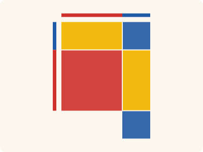
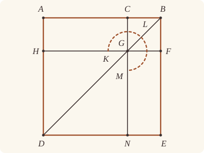
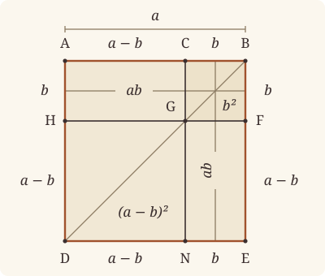

<!-- Generated by scripts/render.py. Do not edit by hand. -->

[Book II](index.md) · [← II.6](06.md) · [II.8 →](08.md)

# Book II, Proposition 7

*The squares on the whole and one segment*

[Euclid's proof](#euclids-proof) · [In Lean](#in-lean) · [What it rests on](#what-it-rests-on) · [Mishnah](#mishnah)

> If a straight line be cut at random, the square on the whole and that on one of the segments both together are equal to twice the rectangle contained by the whole and the said segment and the square on the remaining segment.

**In Lean:** ✅ proved, as Euclid states it · Euclid's argument

<p align="center"></p>

<p align="center"><em>Cut AB anywhere, at C (red, blue): the squares on AB, BC make two rectangles contained by AB, BC (yellow with blue, across the top and down the side) and the square on CA (red).</em></p>

## Euclid's proof

<p align="center"></p>

For let a straight line AB be cut at random at the point C;

I say that the squares on AB, BC are equal to twice the rectangle contained by AB, BC and the square on CA.

For let the square ADEB be described on AB, [I. 46]

and let the figure be drawn.

Then, since AG is equal to GE, [I. 43]

let CF be added to each;

therefore the whole AF is equal to the whole CE.

Therefore AF, CE are double of AF.

But AF, CE are the gnomon KLM and the square CF;

therefore the gnomon KLM and the square CF are double of AF.

But twice the rectangle AB, BC is also double of AF; for BF is equal to BC;

therefore the gnomon KLM and the square CF are equal to twice the rectangle AB, BC.

Let DG, which is the square on AC, be added to each;

therefore the gnomon KLM and the squares BG, GD are equal to twice the rectangle contained by AB, BC and the square on AC.

But the gnomon KLM and the squares BG, GD are the whole ADEB and CF,

which are squares described on AB, BC;

therefore the squares on AB, BC are equal to twice the rectangle contained by AB, BC together with the square on AC.

Therefore etc.

Q. E. D.

## In Lean

| | |
|---|---|
| Proof | ✅ Proved |
| Statement | The whole enunciation. |
| Argument | Euclid's. |
| Reviewed | The statement and every passage of the argument read against Heath's text, at commit [`dd9307b3c`](https://github.com/jackChallis/stoicheia/commit/dd9307b3c) ([the record](../../review/II/07.toml)) |

From [`Elements/BookII/Prop07.lean`](../../Elements/BookII/Prop07.lean). Euclid's sentences are the `--` comments, and our own notes are in `/- … -/`; the lines under each sentence are the Lean that carries it out. The list below marks where a lemma does a step Euclid takes for granted; the `/- … -/` notes in the listing explain smaller adjustments.

**How the Lean follows the text**

- **Done by `Parallelogram.figure`.** "and let the figure be drawn." Euclid leaves the diameter and two parallels to the familiar figure: the diameter BD, CN through C parallel to AD, and HF through G, where CN meets BD, parallel to AB. `Parallelogram.figure` draws them by Postulate 1 and I.31, finds their meetings by `BookI.Prop30.meet`, proves the further parallels by I.30 and orders the points by `Parallel.between`. `Parallelogram.complements` uses I.30 to prove AG and GE are parallelograms; the divisions of AF and CE use them, and I.34 uses AG to identify HG with AC for the square DG.
- **Done by `quadArea_add_of_parallelograms`.** "therefore the whole AF is equal to the whole CE." Euclid takes AF as AG and CF together, and CE as CF and GE together. `quadArea_add_of_parallelograms` proves both divisions, so adding CF to the equal complements gives equal wholes.
- **Done by `quadArea_add_of_parallelograms`.** "But AF, CE are the gnomon KLM and the square CF…" Euclid takes AF and CE together as the gnomon KLM and CF, and the divisions of AF and CE proved above by `quadArea_add_of_parallelograms` show it. Definition II.2's gnomon has no Lean definition of its own: here and in the four later sentences that name it, the Lean carries the gnomon KLM as the sum of the areas of its three parallelograms, AG, CF and GE.
- **Done by `Square.about_diameter`.** "But twice the rectangle AB, BC is also double of AF…" Euclid takes BF equal to BC from the square CF and treats AF as a rectangle. `Square.about_diameter` proves CF a square; the Lean proves BAHF a parallelogram and uses `Rectangle.of_right` (I.29) and `Rectangle.eq_rect` to identify AF as the rectangle AB, BC.
- **Done by `Square.about_diameter`.** "Let DG, which is the square on AC…" Euclid takes DG to be the square on AC. `Square.about_diameter` proves DG a square, and I.34 with `Square.eq_sq` identifies its area as the square on AC before Common Notion 2 adds it to both sides.
- **Done by `Parallelogram.about_diameter`.** "But the gnomon KLM and the squares BG, GD are the whole ADEB and CF…" Euclid takes the gnomon and GD as the whole square ADEB and counts CF a second time as BG, the same square named by its other two corners. `Parallelogram.about_diameter` proves the complements are parallelograms, uses I.30 and `Between.of_inside` to join and order H, G and F, then joins the four pieces with `quadArea_add_of_parallelograms`.

```lean
/-- If a straight line be cut at random, the square on the whole and that on one of the segments
both together are equal to twice the rectangle contained by the whole and the said segment and
the square on the remaining segment. -/
theorem Prop7 {A B C : Point} (hACB : Between A C B) :
    sq A B + sq B C = rect A B B C + rect A B B C + sq C A := by
  -- For let a straight line AB be cut at random at the point C;
  have hAB : A ≠ B := ne_of_between_ends hACB
  -- I say that the squares on AB, BC are equal to twice the rectangle contained by AB, BC and
  -- the square on CA.
  -- For let the square ADEB be described on AB, [I. 46]
  obtain ⟨P, hP, -⟩ := exists_off_line hAB []
  obtain ⟨D, E, hsq, hD, hE⟩ := BookI.Prop46 hAB hP
  obtain ⟨hp, hADEB⟩ := Square.described hsq hD hE
  -- and let the figure be drawn.
  obtain ⟨N, G, H, F, hBGD, hDNE, hAHD, hEFB, hCGN, hHGF, hBCGF, hGHDN⟩ := hp.figure hACB
  have hBADE : Parallelogram B A D E := hp.rotate.rotate.rotate
  obtain ⟨hCAHG, hFGNE⟩ :=
    hBADE.complements hBGD (between_symm hACB) hAHD hDNE hEFB hBCGF hGHDN
  -- Then, since AG is equal to GE, [I. 43]
  have h43 : quadArea C A H G = quadArea F G N E :=
    BookI.Prop43 hBADE hBGD (between_symm hACB) hAHD hDNE hEFB hBCGF hGHDN
  -- let CF be added to each;
  have hadd : quadArea C A H G + quadArea B C G F =
      quadArea F G N E + quadArea B C G F := CommonNotion2 h43 rfl
  -- therefore the whole AF is equal to the whole CE.
  have hAFparts : quadArea A H F B = quadArea C A H G + quadArea B C G F := by
    rw [quadArea_add_of_parallelograms hCAHG.rotate hBCGF.rotate hACB hHGF,
      hCAHG.quadArea_rotate, hBCGF.quadArea_rotate]
  have hCEparts : quadArea B C N E = quadArea B C G F + quadArea F G N E :=
    quadArea_add_of_parallelograms hBCGF hFGNE (between_symm hEFB) hCGN
  have hAFCE : quadArea A H F B = quadArea B C N E := by
    rw [hAFparts, hadd, hCEparts]
    ac_rfl
  -- Therefore AF, CE are double of AF.
  have hdouble : quadArea A H F B + quadArea B C N E =
      quadArea A H F B + quadArea A H F B := by rw [← hAFCE]
  -- But AF, CE are the gnomon KLM and the square CF;
  let gnomon : Area := quadArea C A H G + quadArea B C G F + quadArea F G N E
  have hpieces : quadArea A H F B + quadArea B C N E = gnomon + quadArea B C G F := by
    rw [hAFparts, hCEparts]
    dsimp [gnomon]
    ac_rfl
  -- therefore the gnomon KLM and the square CF are double of AF.
  have hgnomonDouble : gnomon + quadArea B C G F =
      quadArea A H F B + quadArea A H F B := hpieces.symm.trans hdouble
  -- But twice the rectangle AB, BC is also double of AF; for BF is equal to BC;
  have hCF : Square B C G F :=
    hsq.rotate.rotate.rotate.about_diameter hBADE hBGD (between_symm hACB)
      (between_symm hEFB) hBCGF
  have hBF : ‖B F‖ = ‖B C‖ := hCF.len_eq
  /- AF is a parallelogram, its sides lying along those of CF and of ADEB, and its angle
     at B is the square's right angle. -/
  have hBAHF : Parallelogram B A H F := by
    constructor
    · refine ⟨hAB.symm, ne_of_between_ends hHGF, ?_⟩
      intro L M hB hA hH hF
      exact hBCGF.1.2.2 L M hB (on_line_of_between_ends hACB hA hB)
        (on_line_of_between_ends hHGF hH hF) hF
    · refine ⟨ne_of_between hAHD, (ne_of_between (between_symm hEFB)).symm, ?_⟩
      intro L M hA hH hF hB
      exact hp.1.2.2 L M hA (on_line_of_between hAHD hA hH)
        (on_line_of_between (between_symm hEFB) hB hF) hB
  have hAF : quadArea A H F B = rect A B B C := by
    rw [hBAHF.quadArea_rotate]
    refine (Rectangle.of_right hBAHF ?_).eq_rect (len_symm B A) hBF
    rw [angle_onRay_left (OnRay.of_between (between_symm hEFB)) hAB]
    exact hsq.2.2.2.2.2.2
  have hrectDouble : rect A B B C + rect A B B C =
      quadArea A H F B + quadArea A H F B := by rw [hAF]
  -- therefore the gnomon KLM and the square CF are equal to twice the rectangle AB, BC.
  have hgnomon : gnomon + quadArea B C G F = rect A B B C + rect A B B C :=
    hgnomonDouble.trans hrectDouble.symm
  -- Let DG, which is the square on AC, be added to each;
  have hDG : Square D N G H :=
    hsq.rotate.about_diameter hp.rotate (between_symm hBGD) hDNE (between_symm hAHD)
      hGHDN.rotate.rotate
  have hDGsq : quadArea G H D N = sq A C := by
    rw [← quadArea_rotate₂ G H D N, hDG.eq_sq hGHDN.rotate.rotate]
    obtain ⟨-, hCA_GH, -, -, -⟩ :=
      BookI.Prop34 (A := C) (B := G) (C := A) (D := H) hCAHG
    exact sq_congr ((hDG.1.trans hDG.2.1).trans (hCA_GH.symm.trans (len_symm C A)))
  have hadded := CommonNotion2 hgnomon hDGsq
  -- therefore the gnomon KLM and the squares BG, GD are equal to twice the rectangle contained
  -- by AB, BC and the square on AC.
  have hsum : gnomon + (quadArea B C G F + quadArea G H D N) =
      rect A B B C + rect A B B C + sq A C := by
    rw [← add_assoc]
    exact hadded
  -- But the gnomon KLM and the squares BG, GD are the whole ADEB and CF,
  have hwhole := hBADE.about_diameter hBGD (between_symm hACB) hAHD hDNE hEFB hBCGF hGHDN
  have hreassemble : gnomon + (quadArea B C G F + quadArea G H D N) =
      quadArea A D E B + quadArea B C G F := by
    rw [hBADE.quadArea_rotate, hwhole]
    dsimp [gnomon]
    ac_rfl
  -- which are squares described on AB, BC;
  have hCFsq : quadArea B C G F = sq B C := hCF.eq_sq hBCGF
  -- therefore the squares on AB, BC are equal to twice the rectangle contained by AB, BC
  -- together with the square on AC.
  have hresult : sq A B + sq B C = rect A B B C + rect A B B C + sq A C := by
    rw [← hADEB, ← hCFsq, ← hreassemble]
    exact hsum
  -- Therefore etc.
  exact hresult.trans (by rw [sq_symm A C])
  -- Q. E. D.
```

## What it rests on

| | |
|---|---|
| Heath's references | [I.43](../I/43.md), [I.46](../I/46.md) |
| Lean cites | [I.4](../I/04.md), [I.5](../I/05.md), [I.6](../I/06.md), [I.28](../I/28.md), [I.29](../I/29.md), [I.30](../I/30.md), [I.31](../I/31.md), [I.34](../I/34.md), [I.43](../I/43.md), [I.46](../I/46.md) |
| Postulates | 1, 2, 3, 4, 5 |
| Definitions taken as axioms | Def. I.15 |
| Common Notions | 1, 2, 3, 4, 5 |
| Tacit rules | 38 (listed below) |
| Its own Lean calls | 3 tacit rules |
| Through lemmas | Postulates 1, 2 and 3; Def. I.15; 31 tacit rules |

Some of these come in through lemmas [shared](../../CERTIFICATE.md#shared-steps) by many proofs: [`Square.described`](../../Elements/BookII/Rectangles.lean#L149) (I.4, I.28, I.34); [`Rectangle.eq_rect`](../../Elements/BookII/Rectangles.lean#L102), [`Square.eq_sq`](../../Elements/BookII/Rectangles.lean#L142) (I.4, I.34); [`Square.about_diameter`](../../Elements/BookII/Rectangles.lean#L170) (I.5, I.6, I.29, I.34); [`Rectangle.of_right`](../../Elements/BookII/Rectangles.lean#L53) (I.29); [`Parallelogram.about_diameter`](../../Elements/BookII/Rectangles.lean#L256), [`Parallelogram.complements`](../../Elements/BookII/Rectangles.lean#L207) (I.30); [`Parallelogram.figure`](../../Elements/BookII/Rectangles.lean#L330) (I.30, I.31).

_Postulates, definitions, Common Notions and tacit rules: all that this proof rests on, counting those of the propositions it cites. The last two rows say which of the postulates, definitions and tacit rules its own Lean calls, in the proof or a helper written for it, and which it does not call but reaches through lemmas, of Book Zero or shared (a proposition it cites may rest on these too); the rest come in only through the propositions it cites or the Common Notions._

<details><summary>The 38 tacit rules beneath this proof, counting those of the propositions it cites</summary>

_(used here) marks a rule this proof's own Lean calls, in the proof or a helper written for it; (through …) marks one its own Lean does not call but reaches through the lemmas named, of [Book Zero](../../Elements/Figure) or shared, though a proposition it cites may rest on it too; and a rule with no mark comes in only through a proposition it cites or a Common Notion. The names in brackets are System E's: an Intersection rule says when straight lines and circles must meet, and an Intersections rule takes a point where they do (see [Book I's introduction](../I/index.md))._

**Reading the figure**

- [`between_cases`](../../Elements/Foundations/Tacit/Diagram.lean#L54) (through [`Parallelogram.about_diameter`](../../Elements/BookII/Rectangles.lean#L256), [`Parallelogram.figure`](../../Elements/BookII/Rectangles.lean#L330), [`Parallelogram.quadArea_rotate`](../../Elements/Figure/Parallelograms.lean#L202) and 7 other lemmas): Of three different points on a straight line, one is between the other two. (Between 6)
- [`between_symm`](../../Elements/Foundations/Tacit/Diagram.lean#L47) (used here): If B is between A and C, it is between C and A. (Between 1)
- [`circles_meet`](../../Elements/Foundations/Tacit/Diagram.lean#L91) (through [`OnRay.of_between`](../../Elements/Figure/Rays.lean#L34), [`Parallelogram.about_diameter`](../../Elements/BookII/Rectangles.lean#L256), [`Parallelogram.complements`](../../Elements/BookII/Rectangles.lean#L207) and 11 other lemmas): If each circle passes through a point inside the other, the circles cut one another. This is the step Euclid takes for granted in I.1. (Intersection 5)
- [`circles_meet_same_side`](../../Elements/Foundations/Tacit/Constructions.lean#L79) (through [`OnRay.of_between`](../../Elements/Figure/Rays.lean#L34), [`Parallelogram.about_diameter`](../../Elements/BookII/Rectangles.lean#L256), [`Parallelogram.complements`](../../Elements/BookII/Rectangles.lean#L207) and 11 other lemmas): Two circles that cut one another do so on each side of the straight line through their centres. (Intersections 8)
- [`exists_point`](../../Elements/Foundations/Tacit/Constructions.lean#L35) (through [`Parallelogram.about_diameter`](../../Elements/BookII/Rectangles.lean#L256), [`Parallelogram.figure`](../../Elements/BookII/Rectangles.lean#L330), [`Parallelogram.quadArea_rotate`](../../Elements/Figure/Parallelograms.lean#L202) and 5 other lemmas): Let a point be taken. (Points 1)
- [`exists_point_inside_circle`](../../Elements/Foundations/Tacit/Constructions.lean#L42) (through [`OnRay.of_between`](../../Elements/Figure/Rays.lean#L34), [`Parallelogram.about_diameter`](../../Elements/BookII/Rectangles.lean#L256), [`Parallelogram.complements`](../../Elements/BookII/Rectangles.lean#L207) and 11 other lemmas): Let a point be taken inside the circle α. (Points 8)
- [`exists_point_on_line`](../../Elements/Foundations/Tacit/Constructions.lean#L38) (through [`OnRay.of_between`](../../Elements/Figure/Rays.lean#L34), [`Parallelogram.about_diameter`](../../Elements/BookII/Rectangles.lean#L256), [`Parallelogram.complements`](../../Elements/BookII/Rectangles.lean#L207) and 11 other lemmas): Let a point be taken on the straight line L. (Points 2)
- [`line_circle_between`](../../Elements/Foundations/Tacit/Constructions.lean#L67) (through [`OnRay.of_between`](../../Elements/Figure/Rays.lean#L34), [`Parallelogram.about_diameter`](../../Elements/BookII/Rectangles.lean#L256), [`Parallelogram.complements`](../../Elements/BookII/Rectangles.lean#L207) and 11 other lemmas): A straight line through a point B inside a circle, heading out to a point C outside it, cuts the circle between B and C. (Intersections 4)
- [`line_circle_beyond`](../../Elements/Foundations/Tacit/Constructions.lean#L73) (through [`OnRay.of_between`](../../Elements/Figure/Rays.lean#L34), [`Parallelogram.about_diameter`](../../Elements/BookII/Rectangles.lean#L256), [`Parallelogram.complements`](../../Elements/BookII/Rectangles.lean#L207) and 11 other lemmas): A straight line through a point B inside a circle, produced beyond B away from C, cuts the circle there. (Intersections 5)
- [`line_unique`](../../Elements/Foundations/Tacit/Diagram.lean#L41) (through [`Parallelogram.about_diameter`](../../Elements/BookII/Rectangles.lean#L256), [`Parallelogram.complements`](../../Elements/BookII/Rectangles.lean#L207), [`Parallelogram.figure`](../../Elements/BookII/Rectangles.lean#L330) and 9 other lemmas): Two points determine a straight line. (Generalities 1)
- [`lines_meet_of_opposite_sides`](../../Elements/Foundations/Tacit/Diagram.lean#L86) (through [`Parallelogram.about_diameter`](../../Elements/BookII/Rectangles.lean#L256), [`Parallelogram.figure`](../../Elements/BookII/Rectangles.lean#L330), [`Parallelogram.quadArea_rotate`](../../Elements/Figure/Parallelograms.lean#L202) and 6 other lemmas): A straight line joining points on opposite sides of L crosses L. (Intersection 1)
- [`not_between_of_between`](../../Elements/Foundations/Tacit/Diagram.lean#L50) (through [`OnRay.of_between`](../../Elements/Figure/Rays.lean#L34), [`Parallelogram.about_diameter`](../../Elements/BookII/Rectangles.lean#L256), [`Parallelogram.complements`](../../Elements/BookII/Rectangles.lean#L207) and 14 other lemmas): If B is between A and C, then A is not between B and C. (Between 1)
- [`not_on_line_of_same_side`](../../Elements/Foundations/Tacit/Diagram.lean#L60) (through [`OnRay.of_between`](../../Elements/Figure/Rays.lean#L34), [`Parallelogram.about_diameter`](../../Elements/BookII/Rectangles.lean#L256), [`Parallelogram.complements`](../../Elements/BookII/Rectangles.lean#L207) and 11 other lemmas): Points on one side of a straight line are not on it. (Same side 3)
- [`pasch2`](../../Elements/Foundations/Tacit/Diagram.lean#L71) (through [`OnRay.of_between`](../../Elements/Figure/Rays.lean#L34), [`Parallelogram.about_diameter`](../../Elements/BookII/Rectangles.lean#L256), [`Parallelogram.complements`](../../Elements/BookII/Rectangles.lean#L207) and 11 other lemmas): If B is between A and C, A is on L and B is off it, then B and C are on the same side of L: a straight line that leaves L at A does not cross it again. (Pasch 2)
- [`same_side_trans`](../../Elements/Foundations/Tacit/Diagram.lean#L64) (through [`OnRay.of_between`](../../Elements/Figure/Rays.lean#L34), [`Parallelogram.about_diameter`](../../Elements/BookII/Rectangles.lean#L256), [`Parallelogram.complements`](../../Elements/BookII/Rectangles.lean#L207) and 11 other lemmas): Two points on the same side of a straight line as a third point are on the same side as each other. (Same side 4)

**Lengths, angles and areas**

- [`angle_add_of_inside`](../../Elements/Foundations/Tacit/Transfer.lean#L47) (through [`Parallelogram.about_diameter`](../../Elements/BookII/Rectangles.lean#L256), [`Parallelogram.figure`](../../Elements/BookII/Rectangles.lean#L330), [`Parallelogram.quadArea_rotate`](../../Elements/Figure/Parallelograms.lean#L202) and 5 other lemmas): If D lies within the angle BAC, then BAC is made up of BAD and DAC. (Diagram-angle 2)
- [`angle_eq_of_same_rays`](../../Elements/Foundations/Tacit/Transfer.lean#L54) (through [`Square.about_diameter`](../../Elements/BookII/Rectangles.lean#L170) and [`angle_onRay_left`](../../Elements/Figure/Angles.lean#L42)): The angle doesn't change if its arms are traced through other points on the same rays. (Diagram-angle 4)
- [`angle_symm`](../../Elements/Foundations/Tacit/Metric.lean#L30): The angle ABC is the angle CBA. (Metric 4)
- [`area_add_of_between`](../../Elements/Foundations/Tacit/Transfer.lean#L70) (through [`Parallelogram.about_diameter`](../../Elements/BookII/Rectangles.lean#L256), [`Parallelogram.quadArea_rotate`](../../Elements/Figure/Parallelograms.lean#L202), [`Rectangle.eq_rect`](../../Elements/BookII/Rectangles.lean#L102) and 3 other lemmas): Cutting a triangle in two from a vertex adds up. (Diagram-area 2)
- [`area_congruent`](../../Elements/Foundations/Tacit/Metric.lean#L44): Triangles equal in all their sides and angles are equal in area. Euclid uses this without comment once he has shown two triangles congruent. (Metric 9)
- [`area_degenerate`](../../Elements/Foundations/Tacit/Metric.lean#L36) (through [`Parallelogram.about_diameter`](../../Elements/BookII/Rectangles.lean#L256), [`Parallelogram.quadArea_rotate`](../../Elements/Figure/Parallelograms.lean#L202), [`Rectangle.eq_rect`](../../Elements/BookII/Rectangles.lean#L102) and 3 other lemmas): A "triangle" with a repeated corner has no area. (Metric 6)
- [`area_eq_zero_of_on_line`](../../Elements/Foundations/Tacit/Transfer.lean#L62) (through [`Parallelogram.about_diameter`](../../Elements/BookII/Rectangles.lean#L256), [`Parallelogram.quadArea_rotate`](../../Elements/Figure/Parallelograms.lean#L202), [`Rectangle.eq_rect`](../../Elements/BookII/Rectangles.lean#L102) and 3 other lemmas): A "triangle" whose corners lie on one straight line has no area. (Diagram-area 1)
- [`area_rotate`](../../Elements/Foundations/Tacit/Metric.lean#L39) (through [`Parallelogram.about_diameter`](../../Elements/BookII/Rectangles.lean#L256), [`Parallelogram.quadArea_rotate`](../../Elements/Figure/Parallelograms.lean#L202), [`Rectangle.eq_rect`](../../Elements/BookII/Rectangles.lean#L102) and 4 other lemmas): The triangle ABC is the triangle CAB. (Metric 8)
- [`len_add_of_between`](../../Elements/Foundations/Tacit/Transfer.lean#L27) (through [`OnRay.of_between`](../../Elements/Figure/Rays.lean#L34), [`Parallelogram.about_diameter`](../../Elements/BookII/Rectangles.lean#L256), [`Parallelogram.complements`](../../Elements/BookII/Rectangles.lean#L207) and 13 other lemmas): If B is between A and C, then AB and BC together make up AC. (Diagram-segment 1)
- [`len_self`](../../Elements/Foundations/Tacit/Metric.lean#L24) (through [`OnRay.of_between`](../../Elements/Figure/Rays.lean#L34), [`Parallelogram.about_diameter`](../../Elements/BookII/Rectangles.lean#L256), [`Parallelogram.complements`](../../Elements/BookII/Rectangles.lean#L207) and 13 other lemmas): The "straight line" from a point to itself has no length. (Metric 1)
- [`len_symm`](../../Elements/Foundations/Tacit/Metric.lean#L27) (used here): The straight line AB is the straight line BA. (Metric 3)
- [`on_line_of_area_eq_zero`](../../Elements/Foundations/Tacit/Transfer.lean#L66): A triangle with no area has its corners on one straight line. (Diagram-area 1)
- [`radius_ne_zero`](../../Elements/Foundations/Tacit/Metric.lean#L62) (through [`OnRay.of_between`](../../Elements/Figure/Rays.lean#L34), [`Parallelogram.about_diameter`](../../Elements/BookII/Rectangles.lean#L256), [`Parallelogram.complements`](../../Elements/BookII/Rectangles.lean#L207) and 13 other lemmas): A circle's radius is not nothing: the straight line from the centre to a point on the circle has some length. A rule of our own, not one of System E's: every circle is drawn with a centre and a distance (Postulate 3).
- [`same_ray_of_angle_eq_zero`](../../Elements/Foundations/Tacit/Transfer.lean#L42) (through [`Parallelogram.about_diameter`](../../Elements/BookII/Rectangles.lean#L256), [`Parallelogram.figure`](../../Elements/BookII/Rectangles.lean#L330), [`Parallelogram.quadArea_rotate`](../../Elements/Figure/Parallelograms.lean#L202) and 5 other lemmas): If the angle BAC is nothing, C lies on the ray from A through B. (Diagram-angle 1)

**Superposition**

- [`superposition`](../../Elements/Foundations/Tacit/Superposition.lean#L52): **Superposition.** A hypothetical placement of a triangle on a given ray and side permits a restricted derivation of metric equalities about the figure already given. The derivation introduces no further objects, cites each geometric law it uses, and exports no symbol of the placement.

**Rules of magnitude**

- [`add_assoc`](../../Elements/Foundations/Tacit/Magnitudes.lean#L23) (used here): Adding three magnitudes in a row, it makes no difference whether the first two or the last two are added first. (System E §3.5)
- [`add_comm`](../../Elements/Foundations/Tacit/Magnitudes.lean#L26) (through [`Magnitude.instCommutative`](../../Elements/Figure/Areas.lean#L40), [`OnRay.of_between`](../../Elements/Figure/Rays.lean#L34), [`Parallelogram.about_diameter`](../../Elements/BookII/Rectangles.lean#L256) and 15 other lemmas): The order of adding does not matter. (System E §3.5)
- [`add_lt_add_right`](../../Elements/Foundations/Tacit/Magnitudes.lean#L45) (through [`Parallelogram.about_diameter`](../../Elements/BookII/Rectangles.lean#L256), [`Parallelogram.quadArea_rotate`](../../Elements/Figure/Parallelograms.lean#L202), [`Rectangle.eq_rect`](../../Elements/BookII/Rectangles.lean#L102) and 5 other lemmas): Adding the same thing to both sides keeps "less than". (System E §3.5)
- [`add_zero`](../../Elements/Foundations/Tacit/Magnitudes.lean#L29) (through [`Parallelogram.about_diameter`](../../Elements/BookII/Rectangles.lean#L256), [`Parallelogram.quadArea_rotate`](../../Elements/Figure/Parallelograms.lean#L202), [`Rectangle.eq_rect`](../../Elements/BookII/Rectangles.lean#L102) and 3 other lemmas): Adding nothing changes nothing. (System E §3.5)
- [`lt_irrefl`](../../Elements/Foundations/Tacit/Magnitudes.lean#L32) (through [`OnRay.of_between`](../../Elements/Figure/Rays.lean#L34), [`Parallelogram.about_diameter`](../../Elements/BookII/Rectangles.lean#L256), [`Parallelogram.complements`](../../Elements/BookII/Rectangles.lean#L207) and 11 other lemmas): No magnitude is less than itself. (System E §3.5)
- [`lt_trans`](../../Elements/Foundations/Tacit/Magnitudes.lean#L35) (through [`OnRay.of_between`](../../Elements/Figure/Rays.lean#L34), [`Parallelogram.about_diameter`](../../Elements/BookII/Rectangles.lean#L256), [`Parallelogram.complements`](../../Elements/BookII/Rectangles.lean#L207) and 11 other lemmas): What is less than the less is less still. (System E §3.5)
- [`lt_trichotomy`](../../Elements/Foundations/Tacit/Magnitudes.lean#L39) (through [`OnRay.of_between`](../../Elements/Figure/Rays.lean#L34), [`Parallelogram.about_diameter`](../../Elements/BookII/Rectangles.lean#L256), [`Parallelogram.complements`](../../Elements/BookII/Rectangles.lean#L207) and 13 other lemmas): Of two magnitudes, one is less, or they are equal, or the other is less. (System E §3.5)
- [`not_lt_zero`](../../Elements/Foundations/Tacit/Magnitudes.lean#L42) (through [`OnRay.of_between`](../../Elements/Figure/Rays.lean#L34), [`Parallelogram.about_diameter`](../../Elements/BookII/Rectangles.lean#L256), [`Parallelogram.complements`](../../Elements/BookII/Rectangles.lean#L207) and 13 other lemmas): Nothing is less than zero. (System E §3.5)

</details>

## Mishnah

_Our commentary: why Euclid's proof, and ours, look as they do._

"Let the figure be drawn": after the square ADEB, Euclid leaves the drawing to the reader for the first time. These five words stand for the diameter BD, the parallel through C, the parallel through G where it crosses BD, and the points where they meet: II.4's figure, taken as known. Our Lean carries those five words in `Parallelogram.figure`, which hands back every point at once, H and N included, though Euclid's text never names those two.

The square CF is counted twice. Euclid adds it to each of the equal complements AG and GE, and the two sums, AF and CE, overlap in CF: together they make the gnomon KLM and CF once more, which is twice the rectangle AB, BC. Add DG, the square on AC, and the gnomon fills out the square ADEB with CF still beside it, which is why the enunciation speaks of the square on the whole "and that on one of the segments both together". Our Lean, as in II.5, writes the gnomon as the sum of its pieces, AG, CF and GE. Euclid uses II.7 himself in II.13, for the pieces a perpendicular cuts from a triangle's side.

**The modern way.** With $\mathrm{AB} = a$ and $\mathrm{BC} = b$, so that $\mathrm{AC} = a - b$, II.7 says $a^2 + b^2 = 2ab + (a - b)^2$. Heath reads it as the square on a difference, "*the square on the difference of two straight lines is equal to the sum of the squares on the straight lines diminished by twice the rectangle contained by them*" (vol. 1, p. 389), that is, $(a - b)^2 = a^2 + b^2 - 2ab$, beside II.4's square on a sum. Added and subtracted, the two identities give II.9 and II.10, and II.8: "a suggestion of alternative methods of proving those propositions" (vol. 1, p. 389).

<p align="center"></p>

## Further reading

- Sabetai Unguru's ["On the Need to Rewrite the History of Greek Mathematics"](https://doi.org/10.1007/BF00327233) (1975) is the paper that started the quarrel, against reading Book II as algebra at all, Heath's reading of this proposition included.
- B. L. van der Waerden's reply and André Weil's three-page letter stand beside Unguru's paper in Jean Christianidis' collection [*Classics in the History of Greek Mathematics*](https://doi.org/10.1007/978-1-4020-2640-9) (2004), each part with an introduction that sets the scene.

[Book II](index.md) · [← II.6](06.md) · [II.8 →](08.md)

---

<sub>Euclid's text: T. L. Heath, *The Thirteen Books of Euclid's Elements*, vol. 1 (Cambridge, 1908), pp. 388–389; [scan leaves n408–n409](https://archive.org/details/thirteenbookseu02heibgoog/page/n408); [figure on n408](https://archive.org/details/thirteenbookseu02heibgoog/page/n408). Public domain.</sub>

<sub>The tacit rules follow the System E of Jeremy Avigad, Edward Dean and John Mumma, read alongside LeanEuclid (Logan Murphy, Kaiyu Yang, Jialiang Sun, Zhaoyu Li, Anima Anandkumar and Xujie Si).</sub>
