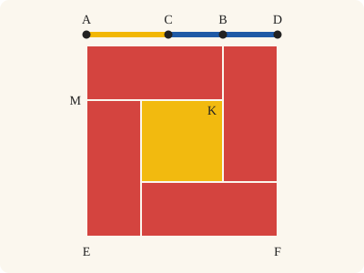
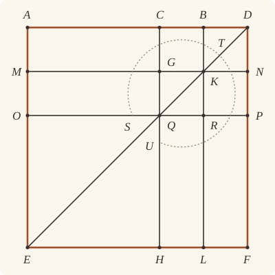

<!-- Generated by scripts/render.py. Do not edit by hand. -->

[Book II](index.md) · [← II.7](07.md) · [II.9 →](09.md)

# Book II, Proposition 8

*Four times the rectangle contained by the whole and one segment*

[Euclid's proof](#euclids-proof) · [In Lean](#in-lean) · [What it rests on](#what-it-rests-on) · [Mishnah](#mishnah)

> If a straight line be cut at random, four times the rectangle contained by the whole and one of the segments together with the square on the remaining segment is equal to the square described on the whole and the aforesaid segment as on one straight line.

**In Lean:** ✅ proved, as Euclid states it · Euclid's argument

<p align="center"></p>

<p align="center"><em>Cut AB anywhere, at C, and add BD equal to CB (blue): four rectangles contained by AB, BC (red), set round the square on AC (yellow), fill the square on AD, as in Heath's second alternative proof, not Euclid's nine cells.</em></p>

## Euclid's proof

<p align="center"></p>

For let a straight line AB be cut at random at the point C;

I say that four times the rectangle contained by AB, BC together with the square on AC is equal to the square described on AB, BC as on one straight line.

For let [the straight line] BD be produced in a straight line [with AB], and let BD be made equal to CB;

let the square AEFD be described on AD, and let the figure be drawn double.

Then, since CB is equal to BD,

while CB is equal to GK, and BD to KN,

therefore GK is also equal to KN.

For the same reason

QR is also equal to RP.

And, since BC is equal to BD, and GK to KN,

therefore CK is also equal to KD, and GR to RN. [I. 36]

But CK is equal to RN, for they are complements of the parallelogram CP; [I. 43]

therefore KD is also equal to GR;

therefore the four areas DK, CK, GR, RN are equal to one another.

Therefore the four are quadruple of CK.

Again, since CB is equal to BD,

while BD is equal to BK, that is CG,

and CB is equal to GK, that is GQ,

therefore CG is also equal to GQ.

And, since CG is equal to GQ, and QR to RP,

AG is also equal to MQ, and QL to RF. [I. 36]

But MQ is equal to QL, for they are complements of the parallelogram ML; [I. 43]

therefore AG is also equal to RF;

therefore the four areas AG, MQ, QL, RF are equal to one another.

Therefore the four are quadruple of AG.

But the four areas CK, KD, GR, RN were proved to be quadruple of CK;

therefore the eight areas, which contain the gnomon STU, are quadruple of AK.

Now, since AK is the rectangle AB, BD, for BK is equal to BD,

therefore four times the rectangle AB, BD is quadruple of AK.

But the gnomon STU was also proved to be quadruple of AK;

therefore four times the rectangle AB, BD is equal to the gnomon STU.

Let OH, which is equal to the square on AC, be added to each;

therefore four times the rectangle AB, BD together with the square on AC is equal to the gnomon STU and OH.

But the gnomon STU and OH are the whole square AEFD,

which is described on AD;

therefore four times the rectangle AB, BD together with the square on AC is equal to the square on AD.

But BD is equal to BC;

therefore four times the rectangle contained by AB, BC together with the square on AC is equal to the square on AD, that is to the square described on AB and BC as on one straight line.

Therefore etc.

Q. E. D.

## In Lean

| | |
|---|---|
| Proof | ✅ Proved |
| Statement | The whole enunciation. The square on AB, BC "as on one straight line" is the square on AD, for every D beyond B with BD equal to CB. |
| Argument | Euclid's. |
| Reviewed | The statement and every passage of the argument read against Heath's text, at commit [`7103f442a`](https://github.com/jackChallis/stoicheia/commit/7103f442a) ([the record](../../review/II/08.toml)) |

From [`Elements/BookII/Prop08.lean`](../../Elements/BookII/Prop08.lean). Euclid's sentences are the `--` comments, and our own notes are in `/- … -/`; the lines under each sentence are the Lean that carries it out. The list below marks where a lemma does a step Euclid takes for granted and where the statement already gives a step; the `/- … -/` notes in the listing explain smaller adjustments.

**How the Lean follows the text**

- **Already given.** "For let [the straight line] BD be produced…" Euclid produces AB to D with BD equal to CB. The statement takes every D with these properties, so the Lean introduces D and its two hypotheses here.
- **Done by `Prop8.cell`.** "let the square AEFD be described on AD…" Euclid reads each cell of the figure drawn double as a parallelogram; the Lean proves it once, for the corners where two pairs of parallels meet. The Lean draws the square by I.46 and the two figures by `Parallelogram.figure`, each about the diameter DE: through B, BL parallel to AE, cutting DE at K, and MN through K parallel to AD; through C, CH parallel to AE, cutting DE at Q, and OP through Q parallel to AD. It obtains their complements by `Parallelogram.complements`, proves CH parallel to BL and MN parallel to OP with `BookI.Prop30.parallel` (I.30, for which Heath gives no reference here) to form the cells and order points across three parallels, finds G and R with `BookI.Prop30.meet`, and establishes the order of their points with `Parallel.between`.
- **Done by `BookI.Prop34`.** "while CB is equal to GK, and BD to KN…" Euclid takes CB equal to GK and BD to KN from the opposite sides of the two parallelograms. The Lean applies I.34 to each, although Heath gives no reference here.
- **Done by `Square.about_diameter`.** "Again, since CB is equal to BD…" Euclid takes BD equal to BK from the square DK. `Square.about_diameter` proves that DK is a square, and I.34 gives BK equal to CG in the parallelogram CK.
- **Done by `Square.about_diameter`.** "and CB is equal to GK, that is GQ…" Euclid takes GK equal to GQ from the square GR. The Lean applies `Square.about_diameter` first to CP and then to GR within it, and combines this equality with CB equal to GK.
- **Done by `quadArea_add_of_parallelograms`.** "therefore the eight areas, which contain the gnomon STU…" Euclid reads the gnomon STU as eight cells and AK as AG and CK together. `Parallelogram.about_diameter` divides CP into four cells, and `quadArea_add_of_parallelograms` divides AQ, QF and AK into two each, so the two groups of four equal areas give four times AK.
- **Done by `Rectangle.of_right`.** "Now, since AK is the rectangle AB, BD…" Euclid treats AK as a rectangle and identifies it by BK equal to BD. The Lean takes AMKB from `Parallelogram.complements` beneath the double figure and the side equality from the square DK beneath "Again, since CB is equal to BD", transfers AEFD's right angle at A to BAM, proves the other angles right by `Rectangle.of_right`, and identifies its area by `Rectangle.eq_rect`.
- **Done by `Square.about_diameter`.** "Let OH, which is equal to the square on AC…" Euclid takes OH to be the square on AC. `Square.about_diameter` makes OH a square, and I.34 with `Square.eq_sq` identifies its area as the square on AC; the next sentence adds it to both sides.
- **Done by `Parallelogram.about_diameter`.** "But the gnomon STU and OH are the whole square AEFD…" Euclid takes the gnomon STU and OH together as the whole square AEFD. `Parallelogram.about_diameter` proves that CP, its two complements and OH make up the square.

<details><summary>Before the theorem, one lemma: <code>Prop8.cell</code> (13 lines)</summary>

```lean
/-- The four corners where two pairs of parallels meet form a parallelogram.
Euclid reads each cell of the figure drawn double in this way. -/
theorem Prop8.cell {X Y Z W : Point} {h h' v v' : Line}
    (hh : Parallel h h') (hv : Parallel v v')
    (hX : OnLine X h) (hY : OnLine Y h) (hZ : OnLine Z h') (hW : OnLine W h')
    (vX : OnLine X v) (vW : OnLine W v) (vY : OnLine Y v') (vZ : OnLine Z v') :
    Parallelogram X Y Z W := by
  have hXY : X ≠ Y := fun e => hv.not_onLine vX (e ▸ vY)
  have hZW : Z ≠ W := fun e => hv.not_onLine vW (e ▸ vZ)
  have hYZ : Y ≠ Z := fun e => hh.not_onLine hY (e ▸ hZ)
  have hWX : W ≠ X := fun e => hh.not_onLine hX (e ▸ hW)
  exact ⟨AreParallel.of_parallel hXY hZW hX hY hZ hW hh,
    AreParallel.of_parallel hYZ hWX vY vZ vW vX hv.symm⟩
```

</details>

```lean
/-- If a straight line be cut at random, four times the rectangle contained by the whole and one of
the segments together with the square on the remaining segment is equal to the square described
on the whole and the aforesaid segment as on one straight line. -/
theorem Prop8 {A B C : Point} (hACB : Between A C B) :
    ∀ D : Point, Between A B D → ‖B D‖ = ‖C B‖ →
      rect A B B C + rect A B B C + rect A B B C + rect A B B C + sq A C = sq A D := by
  -- For let a straight line AB be cut at random at the point C;
  -- I say that four times the rectangle contained by AB, BC together with the square on AC is
  -- equal to the square described on AB, BC as on one straight line.
  -- For let [the straight line] BD be produced in a straight line [with AB], and let BD be
  -- made equal to CB;
  intro D hABD hBD
  have hAD : A ≠ D := ne_of_between_ends hABD
  have hACD : Between A C D := between_of_between_left hABD hACB
  have hCBD : Between C B D := between_inner hACB hABD
  -- let the square AEFD be described on AD, and let the figure be drawn double.
  /- I.46 describes the square on the side of a point off AD, and `Square.described`
     says it is the square on AD. "The figure drawn double" is I.43's figure, drawn
     twice in the square with its diameter DE (`Parallelogram.figure`): through B, BL
     parallel to AE, cutting DE at K, and MN through K parallel to AD; through C, CH,
     cutting DE at Q, and OP through Q. Each figure's complements are parallelograms
     (`Parallelogram.complements`). -/
  obtain ⟨X, hX, -⟩ := exists_off_line hAD []
  obtain ⟨E, F, hsq, hE, hF⟩ := BookI.Prop46 hAD hX
  obtain ⟨hp, hAEFD⟩ := Square.described hsq hE hF
  obtain ⟨L, K, M, N, hDKE, hELF, hAME, hFND, hBKL, hMKN, hDBKN, hKMEL⟩ :=
    hp.figure hABD
  obtain ⟨H, Q, O, P, hDQE, hEHF, hAOE, hFPD, hCQH, hOQP, hDCQP, hQOEH⟩ :=
    hp.figure hACD
  have hDAEF := hp.rotate.rotate.rotate
  obtain ⟨hBAMK, -⟩ := hDAEF.complements hDKE (between_symm hABD)
    hAME hELF hFND hDBKN hKMEL
  obtain ⟨hCAOQ, hPQHF⟩ := hDAEF.complements hDQE (between_symm hACD)
    hAOE hEHF hFPD hDCQP hQOEH
  /- We name the straight lines of the two figures. -/
  obtain ⟨AD, hA_AD, hD_AD⟩ := Postulate1 A D hAD
  obtain ⟨EF, hE_EF, hF_EF⟩ := Postulate1 E F hp.2.1
  obtain ⟨AE, hA_AE, hE_AE⟩ := Postulate1 A E hp.1.1
  obtain ⟨DF, hD_DF, hF_DF⟩ := Postulate1 D F hp.1.2.1.symm
  obtain ⟨DE, hD_DE, hE_DE⟩ := Postulate1 D E (ne_of_between_ends hDKE)
  obtain ⟨MN, hM_MN, hN_MN⟩ := Postulate1 M N (ne_of_between_ends hMKN)
  obtain ⟨OP, hO_OP, hP_OP⟩ := Postulate1 O P (ne_of_between_ends hOQP)
  obtain ⟨CH, hC_CH, hH_CH⟩ := Postulate1 C H (ne_of_between_ends hCQH)
  obtain ⟨BL, hB_BL, hL_BL⟩ := Postulate1 B L (ne_of_between_ends hBKL)
  have hB_AD := on_line_of_between_ends hABD hA_AD hD_AD
  have hC_AD := on_line_of_between_ends hACD hA_AD hD_AD
  have hL_EF := on_line_of_between_ends hELF hE_EF hF_EF
  have hH_EF := on_line_of_between_ends hEHF hE_EF hF_EF
  have hM_AE := on_line_of_between_ends hAME hA_AE hE_AE
  have hO_AE := on_line_of_between_ends hAOE hA_AE hE_AE
  have hN_DF := on_line_of_between_ends hFND hF_DF hD_DF
  have hP_DF := on_line_of_between_ends hFPD hF_DF hD_DF
  have hK_DE := on_line_of_between_ends hDKE hD_DE hE_DE
  have hQ_DE := on_line_of_between_ends hDQE hD_DE hE_DE
  have hK_MN := on_line_of_between_ends hMKN hM_MN hN_MN
  have hQ_OP := on_line_of_between_ends hOQP hO_OP hP_OP
  have hK_BL := on_line_of_between_ends hBKL hB_BL hL_BL
  have hQ_CH := on_line_of_between_ends hCQH hC_CH hH_CH
  have hCH_DF : Parallel CH DF := hDCQP.2.parallel hC_CH hQ_CH hP_DF hD_DF
  have hBL_DF : Parallel BL DF := hDBKN.2.parallel hB_BL hK_BL hN_DF hD_DF
  have hAE_CH : Parallel AE CH := hCAOQ.2.parallel hA_AE hO_AE hQ_CH hC_CH
  have hMN_AD : Parallel MN AD := hDBKN.1.symm.parallel hK_MN hN_MN hD_AD hB_AD
  have hOP_AD : Parallel OP AD := hDCQP.1.symm.parallel hQ_OP hP_OP hD_AD hC_AD
  have hOP_EF : Parallel OP EF := hQOEH.1.parallel hQ_OP hO_OP hE_EF hH_EF
  have hCH_BL : Parallel CH BL := BookI.Prop30.parallel hCH_DF hBL_DF (by
    intro e
    exact hBL_DF.not_onLine (on_line_of_between hCBD (e ▸ hC_CH) hB_BL) hD_DF)
  have hDKQ : Between D K Q := Parallel.between hBL_DF.symm hCH_BL
    hD_DF hB_BL hC_CH (between_symm hCBD) hD_DF hK_BL hQ_CH
    ⟨DE, hD_DE, hK_DE, hQ_DE⟩
  have hMN_OP : Parallel MN OP := BookI.Prop30.parallel hMN_AD hOP_AD (by
    intro e
    have hDE_OP : DE = OP := line_unique (ne_of_between (between_symm hDKQ)).symm
      hK_DE hQ_DE (e ▸ hK_MN) hQ_OP
    exact hOP_AD.not_onLine (hDE_OP ▸ hD_DE) hD_AD)
  /- Each meeting follows from I.30. -/
  obtain ⟨G, hG_MN, hG_CH⟩ := BookI.Prop30.meet hCH_DF hN_DF hN_MN (by
    intro e
    exact hMN_AD.not_onLine (e ▸ hD_DF) hD_AD)
  obtain ⟨R, hR_OP, hR_BL⟩ := BookI.Prop30.meet hBL_DF hP_DF hP_OP (by
    intro e
    exact hOP_AD.not_onLine (e ▸ hD_DF) hD_AD)
  /- The two figures cross and cut the square into nine cells, and where they cross,
     G and R, Euclid reads off his figure. The order follows from Book Zero: points on
     three parallels keep their order on every straight line crossing them
     (`Parallel.between`). So M, G, K lie on MN as A, C, B lie on AD, and K, R, L lie on
     BL as K, Q, E lie on the diameter, and so for every row and column. -/
  have hMGK : Between M G K := Parallel.between hAE_CH hCH_BL.symm
    hA_AE hC_CH hB_BL hACB hM_AE hG_CH hK_BL ⟨MN, hM_MN, hG_MN, hK_MN⟩
  have hCGQ : Between C G Q := Parallel.between hMN_AD.symm hMN_OP.symm
    hD_AD hK_MN hQ_OP hDKQ hC_AD hG_MN hQ_OP ⟨CH, hC_CH, hG_CH, hQ_CH⟩
  have hAMO : Between A M O := Parallel.between hMN_AD.symm hMN_OP.symm
    hD_AD hK_MN hQ_OP hDKQ hA_AD hM_MN hO_OP ⟨AE, hA_AE, hM_AE, hO_AE⟩
  have hDNP : Between D N P := Parallel.between hMN_AD.symm hMN_OP.symm
    hD_AD hK_MN hQ_OP hDKQ hD_AD hN_MN hP_OP ⟨DF, hD_DF, hN_DF, hP_DF⟩
  have hQRP : Between Q R P := Parallel.between hCH_BL hBL_DF.symm
    hC_CH hB_BL hD_DF hCBD hQ_CH hR_BL hP_DF ⟨OP, hQ_OP, hR_OP, hP_OP⟩
  have hHLF : Between H L F := Parallel.between hCH_BL hBL_DF.symm
    hC_CH hB_BL hD_DF hCBD hH_CH hL_BL hF_DF ⟨EF, hH_EF, hL_EF, hF_EF⟩
  have hKQE : Between K Q E := between_inner hDKQ hDQE
  have hKRL : Between K R L := Parallel.between hMN_OP hOP_EF.symm
    hK_MN hQ_OP hE_EF hKQE hK_MN hR_OP hL_EF ⟨BL, hK_BL, hR_BL, hL_BL⟩
  have hMOE : Between M O E := between_inner hAMO hAOE
  have hEHL : Between E H L := between_inner (between_symm hHLF) (between_symm hEHF)
    |> between_symm
  /- The cells of the figure are parallelograms, named as the proof reads them; OH is
     the second figure's. -/
  have hCBKG : Parallelogram C B K G := Prop8.cell hMN_AD.symm hCH_BL
    hC_AD hB_AD hK_MN hG_MN hC_CH hG_CH hB_BL hK_BL
  have hBDNK : Parallelogram B D N K := hDBKN.reverse.rotate.rotate.rotate
  have hGKRQ : Parallelogram G K R Q := Prop8.cell hMN_OP hCH_BL
    hG_MN hK_MN hR_OP hQ_OP hG_CH hQ_CH hK_BL hR_BL
  have hKNPR : Parallelogram K N P R := Prop8.cell hMN_OP hBL_DF
    hK_MN hN_MN hP_OP hR_OP hK_BL hR_BL hN_DF hP_DF
  have hAMGC : Parallelogram A M G C := Prop8.cell hAE_CH hMN_AD.symm
    hA_AE hM_AE hG_CH hC_CH hA_AD hC_AD hM_MN hG_MN
  have hMOQG : Parallelogram M O Q G := Prop8.cell hAE_CH hMN_OP
    hM_AE hO_AE hQ_CH hG_CH hM_MN hG_MN hO_OP hQ_OP
  have hHLRQ : Parallelogram H L R Q := Prop8.cell hOP_EF.symm hCH_BL
    hH_EF hL_EF hR_OP hQ_OP hH_CH hQ_CH hL_BL hR_BL
  have hLFPR : Parallelogram L F P R := Prop8.cell hOP_EF.symm hBL_DF
    hL_EF hF_EF hP_OP hR_OP hL_BL hR_BL hF_DF hP_DF
  have hKGQR : Parallelogram K G Q R := hGKRQ.reverse.rotate.rotate.rotate
  -- Then, since CB is equal to BD,
  have hCB_BD : ‖C B‖ = ‖B D‖ := hBD.symm
  -- while CB is equal to GK, and BD to KN,
  have hCB_GK : ‖C B‖ = ‖G K‖ := (BookI.Prop34 hCBKG).2.1
  have hBD_KN : ‖B D‖ = ‖K N‖ := (BookI.Prop34 hBDNK).2.1
  -- therefore GK is also equal to KN.
  have hGK_KN : ‖G K‖ = ‖K N‖ := hCB_GK.symm.trans (hCB_BD.trans hBD_KN)
  -- For the same reason
  have hGK_QR : ‖G K‖ = ‖Q R‖ := (BookI.Prop34 hGKRQ).2.1
  have hKN_RP : ‖K N‖ = ‖R P‖ := (BookI.Prop34 hKNPR).2.1
  -- QR is also equal to RP.
  have hQR_RP : ‖Q R‖ = ‖R P‖ := hGK_QR.symm.trans (hGK_KN.trans hKN_RP)
  -- And, since BC is equal to BD, and GK to KN,
  let CK := quadArea B C G K
  let KD := quadArea D B K N
  let GR := quadArea K G Q R
  let RN := quadArea N K R P
  -- therefore CK is also equal to KD, and GR to RN. [I. 36]
  have hCK_KD : CK = KD := by
    have h := BookI.Prop36 hCBKG.rotate.rotate.rotate hBDNK.rotate.rotate.rotate hCB_BD
      ⟨MN, hG_MN, hK_MN, hK_MN, hN_MN⟩ ⟨AD, hC_AD, hB_AD, hB_AD, hD_AD⟩
    rw [quadArea_rotate₂ B K G C, quadArea_reverse B C G K,
      quadArea_rotate₂ D N K B, quadArea_reverse D B K N] at h
    exact h
  have hGR_RN : GR = RN := by
    have h := BookI.Prop36 hGKRQ.rotate.rotate.rotate hKNPR.rotate.rotate.rotate hGK_KN
      ⟨OP, hQ_OP, hR_OP, hR_OP, hP_OP⟩ ⟨MN, hG_MN, hK_MN, hK_MN, hN_MN⟩
    rw [quadArea_rotate₂ K R Q G, quadArea_reverse K G Q R,
      quadArea_rotate₂ N P R K, quadArea_reverse N K R P] at h
    exact h
  -- But CK is equal to RN, for they are complements of the parallelogram CP; [I. 43]
  have hCK_RN : CK = RN := BookI.Prop43 hDCQP hDKQ (between_symm hCBD)
    hCGQ hQRP (between_symm hDNP) hDBKN hKGQR
  -- therefore KD is also equal to GR;
  have hKD_GR : KD = GR := hCK_KD.symm.trans (hCK_RN.trans hGR_RN.symm)
  -- therefore the four areas DK, CK, GR, RN are equal to one another.
  have hGR_CK : GR = CK := hKD_GR.symm.trans hCK_KD.symm
  have hRN_CK : RN = CK := hCK_RN.symm
  -- Therefore the four are quadruple of CK.
  have hfourCK : KD + CK + GR + RN = CK + CK + CK + CK := by
    rw [← hCK_KD, hGR_CK, hRN_CK]
  -- Again, since CB is equal to BD,
  -- while BD is equal to BK, that is CG,
  have hKDsq : Square D B K N := hsq.rotate.rotate.rotate.about_diameter hDAEF
    hDKE (between_symm hABD) (between_symm hFND) hDBKN
  have hBD_BK : ‖B D‖ = ‖B K‖ := (len_symm B D).trans hKDsq.1
  have hBK_CG : ‖B K‖ = ‖C G‖ := (BookI.Prop34 hCBKG).1.symm
  have hBD_CG : ‖B D‖ = ‖C G‖ := hBD_BK.trans hBK_CG
  -- and CB is equal to GK, that is GQ,
  have hCPsq : Square D C Q P := hsq.rotate.rotate.rotate.about_diameter hDAEF
    hDQE (between_symm hACD) (between_symm hFPD) hDCQP
  have hGRsq : Square Q R K G := hCPsq.rotate.rotate.about_diameter hDCQP.rotate.rotate
    (between_symm hDKQ) hQRP (between_symm hCGQ) hKGQR.rotate.rotate
  have hGK_GQ : ‖G K‖ = ‖G Q‖ := (len_symm G K).trans hGRsq.2.2.1
  have hCB_GQ : ‖C B‖ = ‖G Q‖ := hCB_GK.trans hGK_GQ
  -- therefore CG is also equal to GQ.
  have hCG_GQ : ‖C G‖ = ‖G Q‖ := hBD_CG.symm.trans (hCB_BD.symm.trans hCB_GQ)
  -- And, since CG is equal to GQ, and QR to RP,
  let AG := quadArea C A M G
  let MQ := quadArea G M O Q
  let QL := quadArea R Q H L
  let RF := quadArea P R L F
  -- AG is also equal to MQ, and QL to RF. [I. 36]
  have hAG_MQ : AG = MQ := by
    have h := BookI.Prop36 hAMGC.reverse hMOQG.reverse hCG_GQ
      ⟨AE, hA_AE, hM_AE, hM_AE, hO_AE⟩ ⟨CH, hC_CH, hG_CH, hG_CH, hQ_CH⟩
    rw [quadArea_reverse A M G C, quadArea_reverse M O Q G,
      hAMGC.rotate.rotate.rotate.quadArea_rotate,
      hMOQG.rotate.rotate.rotate.quadArea_rotate] at h
    exact h
  have hQL_RF : QL = RF := by
    have h := BookI.Prop36 hHLRQ.reverse hLFPR.reverse hQR_RP
      ⟨EF, hH_EF, hL_EF, hL_EF, hF_EF⟩ ⟨OP, hQ_OP, hR_OP, hR_OP, hP_OP⟩
    rw [quadArea_rotate₂ R L H Q, quadArea_reverse R Q H L,
      quadArea_rotate₂ P F L R, quadArea_reverse P R L F] at h
    exact h
  -- But MQ is equal to QL, for they are complements of the parallelogram ML; [I. 43]
  have hMQ_QL : MQ = QL := BookI.Prop43 hKMEL hKQE (between_symm hMGK)
    hMOE hEHL (between_symm hKRL) hKGQR hQOEH
  -- therefore AG is also equal to RF;
  have hAG_RF : AG = RF := hAG_MQ.trans (hMQ_QL.trans hQL_RF)
  -- therefore the four areas AG, MQ, QL, RF are equal to one another.
  have hMQ_AG : MQ = AG := hAG_MQ.symm
  have hQL_AG : QL = AG := hMQ_QL.symm.trans hMQ_AG
  -- Therefore the four are quadruple of AG.
  have hfourAG : AG + MQ + QL + RF = AG + AG + AG + AG := by
    rw [hMQ_AG, hQL_AG, ← hAG_RF]
  -- But the four areas CK, KD, GR, RN were proved to be quadruple of CK;
  have hfourCK' : CK + KD + GR + RN = CK + CK + CK + CK := by
    calc
      CK + KD + GR + RN = KD + CK + GR + RN := by ac_rfl
      _ = CK + CK + CK + CK := hfourCK
  -- therefore the eight areas, which contain the gnomon STU, are quadruple of AK.
  /- The gnomon STU is the parallelogram CP about the diameter with its two complements,
     AQ and QF (Definition II.2). We cut CP into its four cells KD, CK, GR, RN
     (`Parallelogram.about_diameter`), and AQ and QF into two each
     (`quadArea_add_of_parallelograms`): the eight areas. -/
  let AK := quadArea B A M K
  let STU := quadArea D C Q P + quadArea C A O Q + quadArea P Q H F
  have hCPsplit : quadArea D C Q P = KD + CK + GR + RN :=
    hDCQP.about_diameter hDKQ (between_symm hCBD) hCGQ hQRP
      (between_symm hDNP) hDBKN hKGQR
  have hAQsplit : quadArea C A O Q = AG + MQ :=
    quadArea_add_of_parallelograms hAMGC.rotate.rotate.rotate hMOQG.rotate.rotate.rotate
      hCGQ hAMO
  have hQFsplit : quadArea P Q H F = RF + QL := by
    rw [← hPQHF.quadArea_rotate,
      quadArea_add_of_parallelograms hHLRQ.rotate.rotate.rotate hLFPR.rotate.rotate.rotate
        hQRP hHLF,
      hHLRQ.rotate.rotate.quadArea_rotate, hLFPR.rotate.rotate.quadArea_rotate]
    change QL + RF = RF + QL
    ac_rfl
  have hAKsplit : AK = AG + CK := by
    have h := quadArea_add_of_parallelograms hAMGC hCBKG.reverse hACB hMGK
    rw [hBAMK.quadArea_rotate, hAMGC.rotate.rotate.rotate.quadArea_rotate,
      hCBKG.reverse.rotate.rotate.rotate.quadArea_rotate] at h
    exact h
  have hSTUfour : STU = AK + AK + AK + AK := by
    calc
      STU = (CK + KD + GR + RN) + (AG + MQ + QL + RF) := by
        dsimp [STU]
        rw [hCPsplit, hAQsplit, hQFsplit]
        ac_rfl
      _ = (CK + CK + CK + CK) + (AG + AG + AG + AG) := by rw [hfourCK', hfourAG]
      _ = AK + AK + AK + AK := by rw [hAKsplit]; ac_rfl
  -- Now, since AK is the rectangle AB, BD, for BK is equal to BD,
  have hAKrect : Rectangle A M K B := Rectangle.of_right hBAMK.rotate
    ((angle_eq_of_onRay (OnRay.of_between hABD) (OnRay.of_between hAME)).trans hsq.2.2.2.1)
  have hAKnamed : AK = rect A B B D :=
    hAKrect.rotate.rotate.rotate.eq_rect (len_symm B A) hBD_BK.symm
  -- therefore four times the rectangle AB, BD is quadruple of AK.
  have hfourRect : rect A B B D + rect A B B D + rect A B B D + rect A B B D =
      AK + AK + AK + AK := by rw [hAKnamed]
  -- But the gnomon STU was also proved to be quadruple of AK;
  have hgnomon : AK + AK + AK + AK = STU := hSTUfour.symm
  -- therefore four times the rectangle AB, BD is equal to the gnomon STU.
  have hrect_STU : rect A B B D + rect A B B D + rect A B B D + rect A B B D = STU :=
    hfourRect.trans hgnomon
  -- Let OH, which is equal to the square on AC, be added to each;
  have hOHsq : Square E H Q O := hsq.rotate.about_diameter hp.rotate
    (between_symm hDQE) hEHF (between_symm hAOE) hQOEH.rotate.rotate
  have hCA_QO : ‖C A‖ = ‖Q O‖ := (BookI.Prop34 hCAOQ).2.1
  have hOH : quadArea Q O E H = sq A C :=
    (hOHsq.rotate.rotate.eq_sq hQOEH).trans ((sq_congr hCA_QO.symm).trans (sq_symm C A))
  -- therefore four times the rectangle AB, BD together with the square on AC is equal to the
  -- gnomon STU and OH.
  have hadded : rect A B B D + rect A B B D + rect A B B D + rect A B B D + sq A C =
      STU + quadArea Q O E H := CommonNotion2 hrect_STU hOH.symm
  -- But the gnomon STU and OH are the whole square AEFD,
  have hwhole : STU + quadArea Q O E H = quadArea A E F D := by
    have h := hDAEF.about_diameter hDQE (between_symm hACD) hAOE hEHF hFPD hDCQP hQOEH
    rw [hDAEF.quadArea_rotate, h]
    dsimp [STU]
    ac_rfl
  -- which is described on AD;
  have hwhole_sq : quadArea A E F D = sq A D := hAEFD
  -- therefore four times the rectangle AB, BD together with the square on AC is equal to the
  -- square on AD.
  have hADsq : rect A B B D + rect A B B D + rect A B B D + rect A B B D + sq A C =
      sq A D := hadded.trans (hwhole.trans hwhole_sq)
  -- But BD is equal to BC;
  have hBD_BC : ‖B D‖ = ‖B C‖ := hBD.trans (len_symm C B)
  -- therefore four times the rectangle contained by AB, BC together with the square on AC is
  -- equal to the square on AD, that is to the square described on AB and BC as on one straight
  -- line.
  have hrect : rect A B B D = rect A B B C := rect_congr rfl hBD_BC
  rw [hrect] at hADsq
  -- Therefore etc.
  exact hADsq
  -- Q. E. D.
```

## What it rests on

| | |
|---|---|
| Heath's references | [I.36](../I/36.md), [I.43](../I/43.md) |
| Lean cites | [I.4](../I/04.md), [I.5](../I/05.md), [I.6](../I/06.md), [I.28](../I/28.md), [I.29](../I/29.md), [I.30](../I/30.md), [I.31](../I/31.md), [I.34](../I/34.md), [I.36](../I/36.md), [I.43](../I/43.md), [I.46](../I/46.md) |
| Postulates | 1, 2, 3, 4, 5 |
| Definitions taken as axioms | Def. I.15 |
| Common Notions | 1, 2, 3, 4, 5 |
| Tacit rules | 39 (listed below) |
| Its own Lean calls | Postulate 1; 3 tacit rules |
| Through lemmas | Postulates 2 and 3; Def. I.15; 32 tacit rules |

Some of these come in through lemmas [shared](../../CERTIFICATE.md#shared-steps) by many proofs: [`Square.described`](../../Elements/BookII/Rectangles.lean#L149) (I.4, I.28, I.34); [`Rectangle.eq_rect`](../../Elements/BookII/Rectangles.lean#L102), [`Square.eq_sq`](../../Elements/BookII/Rectangles.lean#L142) (I.4, I.34); [`Square.about_diameter`](../../Elements/BookII/Rectangles.lean#L170) (I.5, I.6, I.29, I.34); [`Rectangle.of_right`](../../Elements/BookII/Rectangles.lean#L53) (I.29); [`BookI.Prop30.meet`](../../Elements/BookI/HelpersParallels.lean#L41), [`BookI.Prop30.parallel`](../../Elements/BookI/HelpersParallels.lean#L62), [`Parallelogram.about_diameter`](../../Elements/BookII/Rectangles.lean#L256), [`Parallelogram.complements`](../../Elements/BookII/Rectangles.lean#L207) (I.30); [`Parallelogram.figure`](../../Elements/BookII/Rectangles.lean#L330) (I.30, I.31).

_Postulates, definitions, Common Notions and tacit rules: all that this proof rests on, counting those of the propositions it cites. The last two rows say which of the postulates, definitions and tacit rules its own Lean calls, in the proof or a helper written for it, and which it does not call but reaches through lemmas, of Book Zero or shared (a proposition it cites may rest on these too); the rest come in only through the propositions it cites or the Common Notions._

<details><summary>The 39 tacit rules beneath this proof, counting those of the propositions it cites</summary>

_(used here) marks a rule this proof's own Lean calls, in the proof or a helper written for it; (through …) marks one its own Lean does not call but reaches through the lemmas named, of [Book Zero](../../Elements/Figure) or shared, though a proposition it cites may rest on it too; and a rule with no mark comes in only through a proposition it cites or a Common Notion. The names in brackets are System E's: an Intersection rule says when straight lines and circles must meet, and an Intersections rule takes a point where they do (see [Book I's introduction](../I/index.md))._

**Reading the figure**

- [`between_cases`](../../Elements/Foundations/Tacit/Diagram.lean#L54) (through [`Parallel.between`](../../Elements/Figure/Parallelograms.lean#L101), [`Parallelogram.about_diameter`](../../Elements/BookII/Rectangles.lean#L256), [`Parallelogram.figure`](../../Elements/BookII/Rectangles.lean#L330) and 11 other lemmas): Of three different points on a straight line, one is between the other two. (Between 6)
- [`between_of_inside_chord`](../../Elements/Foundations/Tacit/Diagram.lean#L81) (through [`OnRay.of_between`](../../Elements/Figure/Rays.lean#L34), [`Parallel.between`](../../Elements/Figure/Parallelograms.lean#L101), [`Parallelogram.about_diameter`](../../Elements/BookII/Rectangles.lean#L256) and 16 other lemmas): A straight line through a point inside a circle has that point between the points where it meets the circle. (Circle 1)
- [`between_symm`](../../Elements/Foundations/Tacit/Diagram.lean#L47) (used here): If B is between A and C, it is between C and A. (Between 1)
- [`circles_meet`](../../Elements/Foundations/Tacit/Diagram.lean#L94) (through [`OnRay.of_between`](../../Elements/Figure/Rays.lean#L34), [`Parallel.between`](../../Elements/Figure/Parallelograms.lean#L101), [`Parallelogram.about_diameter`](../../Elements/BookII/Rectangles.lean#L256) and 15 other lemmas): If each circle passes through a point inside the other, the circles cut one another. This is the step Euclid takes for granted in I.1. (Intersection 5)
- [`circles_meet_same_side`](../../Elements/Foundations/Tacit/Constructions.lean#L79) (through [`OnRay.of_between`](../../Elements/Figure/Rays.lean#L34), [`Parallel.between`](../../Elements/Figure/Parallelograms.lean#L101), [`Parallelogram.about_diameter`](../../Elements/BookII/Rectangles.lean#L256) and 15 other lemmas): Two circles that cut one another do so on each side of the straight line through their centres. (Intersections 8)
- [`exists_point`](../../Elements/Foundations/Tacit/Constructions.lean#L35) (through [`OnRay.of_between`](../../Elements/Figure/Rays.lean#L34), [`Parallelogram.about_diameter`](../../Elements/BookII/Rectangles.lean#L256), [`Parallelogram.complements`](../../Elements/BookII/Rectangles.lean#L207) and 14 other lemmas): Let a point be taken. (Points 1)
- [`exists_point_inside_circle`](../../Elements/Foundations/Tacit/Constructions.lean#L42) (through [`OnRay.of_between`](../../Elements/Figure/Rays.lean#L34), [`Parallel.between`](../../Elements/Figure/Parallelograms.lean#L101), [`Parallelogram.about_diameter`](../../Elements/BookII/Rectangles.lean#L256) and 16 other lemmas): Let a point be taken inside the circle α. (Points 8)
- [`exists_point_on_line`](../../Elements/Foundations/Tacit/Constructions.lean#L38) (through [`BookI.Prop30.meet`](../../Elements/BookI/HelpersParallels.lean#L41), [`BookI.Prop30.parallel`](../../Elements/BookI/HelpersParallels.lean#L62), [`OnRay.of_between`](../../Elements/Figure/Rays.lean#L34) and 17 other lemmas): Let a point be taken on the straight line L. (Points 2)
- [`line_circle_between`](../../Elements/Foundations/Tacit/Constructions.lean#L67) (through [`OnRay.of_between`](../../Elements/Figure/Rays.lean#L34), [`Parallel.between`](../../Elements/Figure/Parallelograms.lean#L101), [`Parallelogram.about_diameter`](../../Elements/BookII/Rectangles.lean#L256) and 16 other lemmas): A straight line through a point B inside a circle, heading out to a point C outside it, cuts the circle between B and C. (Intersections 4)
- [`line_circle_beyond`](../../Elements/Foundations/Tacit/Constructions.lean#L73) (through [`OnRay.of_between`](../../Elements/Figure/Rays.lean#L34), [`Parallel.between`](../../Elements/Figure/Parallelograms.lean#L101), [`Parallelogram.about_diameter`](../../Elements/BookII/Rectangles.lean#L256) and 16 other lemmas): A straight line through a point B inside a circle, produced beyond B away from C, cuts the circle there. (Intersections 5)
- [`line_unique`](../../Elements/Foundations/Tacit/Diagram.lean#L41) (used here): Two points determine a straight line. (Generalities 1)
- [`lines_meet_of_opposite_sides`](../../Elements/Foundations/Tacit/Diagram.lean#L89) (through [`Parallel.between`](../../Elements/Figure/Parallelograms.lean#L101), [`Parallelogram.about_diameter`](../../Elements/BookII/Rectangles.lean#L256), [`Parallelogram.figure`](../../Elements/BookII/Rectangles.lean#L330) and 7 other lemmas): A straight line joining points on opposite sides of L crosses L. (Intersection 1)
- [`not_between_of_between`](../../Elements/Foundations/Tacit/Diagram.lean#L50) (through [`OnRay.of_between`](../../Elements/Figure/Rays.lean#L34), [`Parallel.between`](../../Elements/Figure/Parallelograms.lean#L101), [`Parallelogram.about_diameter`](../../Elements/BookII/Rectangles.lean#L256) and 17 other lemmas): If B is between A and C, then A is not between B and C. (Between 1)
- [`not_on_line_of_same_side`](../../Elements/Foundations/Tacit/Diagram.lean#L60) (through [`OnRay.of_between`](../../Elements/Figure/Rays.lean#L34), [`Parallel.between`](../../Elements/Figure/Parallelograms.lean#L101), [`Parallelogram.about_diameter`](../../Elements/BookII/Rectangles.lean#L256) and 15 other lemmas): Points on one side of a straight line are not on it. (Same side 3)
- [`pasch2`](../../Elements/Foundations/Tacit/Diagram.lean#L71) (through [`OnRay.of_between`](../../Elements/Figure/Rays.lean#L34), [`Parallel.between`](../../Elements/Figure/Parallelograms.lean#L101), [`Parallelogram.about_diameter`](../../Elements/BookII/Rectangles.lean#L256) and 15 other lemmas): If B is between A and C, A is on L and B is off it, then B and C are on the same side of L: a straight line that leaves L at A does not cross it again. (Pasch 2)
- [`same_side_trans`](../../Elements/Foundations/Tacit/Diagram.lean#L64) (through [`OnRay.of_between`](../../Elements/Figure/Rays.lean#L34), [`Parallel.between`](../../Elements/Figure/Parallelograms.lean#L101), [`Parallelogram.about_diameter`](../../Elements/BookII/Rectangles.lean#L256) and 15 other lemmas): Two points on the same side of a straight line as a third point are on the same side as each other. (Same side 4)

**Lengths, angles and areas**

- [`angle_add_of_inside`](../../Elements/Foundations/Tacit/Transfer.lean#L47) (through [`Parallel.between`](../../Elements/Figure/Parallelograms.lean#L101), [`Parallelogram.about_diameter`](../../Elements/BookII/Rectangles.lean#L256), [`Parallelogram.figure`](../../Elements/BookII/Rectangles.lean#L330) and 6 other lemmas): If D lies within the angle BAC, then BAC is made up of BAD and DAC. (Diagram-angle 2)
- [`angle_eq_of_same_rays`](../../Elements/Foundations/Tacit/Transfer.lean#L54) (through [`Square.about_diameter`](../../Elements/BookII/Rectangles.lean#L170) and [`angle_eq_of_onRay`](../../Elements/Figure/Angles.lean#L33)): The angle doesn't change if its arms are traced through other points on the same rays. (Diagram-angle 4)
- [`angle_symm`](../../Elements/Foundations/Tacit/Metric.lean#L27): The angle ABC is the angle CBA. (Metric 4)
- [`area_add_of_between`](../../Elements/Foundations/Tacit/Transfer.lean#L70) (through [`Parallelogram.about_diameter`](../../Elements/BookII/Rectangles.lean#L256), [`Parallelogram.quadArea_rotate`](../../Elements/Figure/Parallelograms.lean#L202), [`Rectangle.eq_rect`](../../Elements/BookII/Rectangles.lean#L102) and 4 other lemmas): Cutting a triangle in two from a vertex adds up. (Diagram-area 2)
- [`area_congruent`](../../Elements/Foundations/Tacit/Metric.lean#L41): Triangles equal in all their sides and angles are equal in area. Euclid uses this without comment once he has shown two triangles congruent. (Metric 9)
- [`area_degenerate`](../../Elements/Foundations/Tacit/Metric.lean#L33) (through [`Parallelogram.about_diameter`](../../Elements/BookII/Rectangles.lean#L256), [`Parallelogram.quadArea_rotate`](../../Elements/Figure/Parallelograms.lean#L202), [`Rectangle.eq_rect`](../../Elements/BookII/Rectangles.lean#L102) and 4 other lemmas): A "triangle" with a repeated corner has no area. (Metric 6)
- [`area_eq_zero_of_on_line`](../../Elements/Foundations/Tacit/Transfer.lean#L62) (through [`Parallelogram.about_diameter`](../../Elements/BookII/Rectangles.lean#L256), [`Parallelogram.quadArea_rotate`](../../Elements/Figure/Parallelograms.lean#L202), [`Rectangle.eq_rect`](../../Elements/BookII/Rectangles.lean#L102) and 4 other lemmas): A "triangle" whose corners lie on one straight line has no area. (Diagram-area 1)
- [`area_rotate`](../../Elements/Foundations/Tacit/Metric.lean#L36) (through [`Parallelogram.about_diameter`](../../Elements/BookII/Rectangles.lean#L256), [`Parallelogram.quadArea_rotate`](../../Elements/Figure/Parallelograms.lean#L202), [`Rectangle.eq_rect`](../../Elements/BookII/Rectangles.lean#L102) and 5 other lemmas): The triangle ABC is the triangle CAB. (Metric 8)
- [`circle_eq`](../../Elements/Foundations/Tacit/Transfer.lean#L30) (through [`OnRay.of_between`](../../Elements/Figure/Rays.lean#L34), [`Parallel.between`](../../Elements/Figure/Parallelograms.lean#L101), [`Parallelogram.about_diameter`](../../Elements/BookII/Rectangles.lean#L256) and 16 other lemmas): A circle is fixed by its centre and its radius. (Diagram-segment 2)
- [`len_add_of_between`](../../Elements/Foundations/Tacit/Transfer.lean#L27) (through [`OnRay.of_between`](../../Elements/Figure/Rays.lean#L34), [`Parallel.between`](../../Elements/Figure/Parallelograms.lean#L101), [`Parallelogram.about_diameter`](../../Elements/BookII/Rectangles.lean#L256) and 16 other lemmas): If B is between A and C, then AB and BC together make up AC. (Diagram-segment 1)
- [`len_self`](../../Elements/Foundations/Tacit/Metric.lean#L21) (through [`OnRay.of_between`](../../Elements/Figure/Rays.lean#L34), [`Parallel.between`](../../Elements/Figure/Parallelograms.lean#L101), [`Parallelogram.about_diameter`](../../Elements/BookII/Rectangles.lean#L256) and 16 other lemmas): The "straight line" from a point to itself has no length. (Metric 1)
- [`len_symm`](../../Elements/Foundations/Tacit/Metric.lean#L24) (used here): The straight line AB is the straight line BA. (Metric 3)
- [`on_line_of_area_eq_zero`](../../Elements/Foundations/Tacit/Transfer.lean#L66): A triangle with no area has its corners on one straight line. (Diagram-area 1)
- [`same_ray_of_angle_eq_zero`](../../Elements/Foundations/Tacit/Transfer.lean#L42) (through [`Parallel.between`](../../Elements/Figure/Parallelograms.lean#L101), [`Parallelogram.about_diameter`](../../Elements/BookII/Rectangles.lean#L256), [`Parallelogram.figure`](../../Elements/BookII/Rectangles.lean#L330) and 6 other lemmas): If the angle BAC is nothing, C lies on the ray from A through B. (Diagram-angle 1)

**Superposition**

- [`superposition`](../../Elements/Foundations/Tacit/Superposition.lean#L48): **Superposition.** A hypothetical placement of a triangle on a given ray and side permits a restricted derivation of metric equalities about the figure already given. The derivation introduces no further objects, cites each geometric law it uses, and exports no symbol of the placement.

**Rules of magnitude**

- [`add_assoc`](../../Elements/Foundations/Tacit/Magnitudes.lean#L23) (through [`Magnitude.instAssociative`](../../Elements/Figure/Areas.lean#L36), [`Parallelogram.about_diameter`](../../Elements/BookII/Rectangles.lean#L256), [`Parallelogram.quadArea_rotate`](../../Elements/Figure/Parallelograms.lean#L202) and 9 other lemmas): Adding three magnitudes in a row, it makes no difference whether the first two or the last two are added first. (System E §3.5)
- [`add_comm`](../../Elements/Foundations/Tacit/Magnitudes.lean#L26) (through [`Magnitude.instCommutative`](../../Elements/Figure/Areas.lean#L40), [`OnRay.of_between`](../../Elements/Figure/Rays.lean#L34), [`Parallel.between`](../../Elements/Figure/Parallelograms.lean#L101) and 18 other lemmas): The order of adding does not matter. (System E §3.5)
- [`add_lt_add_right`](../../Elements/Foundations/Tacit/Magnitudes.lean#L45) (through [`Parallelogram.about_diameter`](../../Elements/BookII/Rectangles.lean#L256), [`Parallelogram.quadArea_rotate`](../../Elements/Figure/Parallelograms.lean#L202), [`Rectangle.eq_rect`](../../Elements/BookII/Rectangles.lean#L102) and 7 other lemmas): Adding the same thing to both sides keeps "less than". (System E §3.5)
- [`add_zero`](../../Elements/Foundations/Tacit/Magnitudes.lean#L29) (through [`Parallelogram.about_diameter`](../../Elements/BookII/Rectangles.lean#L256), [`Parallelogram.quadArea_rotate`](../../Elements/Figure/Parallelograms.lean#L202), [`Rectangle.eq_rect`](../../Elements/BookII/Rectangles.lean#L102) and 3 other lemmas): Adding nothing changes nothing. (System E §3.5)
- [`lt_irrefl`](../../Elements/Foundations/Tacit/Magnitudes.lean#L32) (through [`OnRay.of_between`](../../Elements/Figure/Rays.lean#L34), [`Parallel.between`](../../Elements/Figure/Parallelograms.lean#L101), [`Parallelogram.about_diameter`](../../Elements/BookII/Rectangles.lean#L256) and 16 other lemmas): No magnitude is less than itself. (System E §3.5)
- [`lt_trans`](../../Elements/Foundations/Tacit/Magnitudes.lean#L35) (through [`OnRay.of_between`](../../Elements/Figure/Rays.lean#L34), [`Parallel.between`](../../Elements/Figure/Parallelograms.lean#L101), [`Parallelogram.about_diameter`](../../Elements/BookII/Rectangles.lean#L256) and 16 other lemmas): What is less than the less is less still. (System E §3.5)
- [`lt_trichotomy`](../../Elements/Foundations/Tacit/Magnitudes.lean#L39) (through [`OnRay.of_between`](../../Elements/Figure/Rays.lean#L34), [`Parallel.between`](../../Elements/Figure/Parallelograms.lean#L101), [`Parallelogram.about_diameter`](../../Elements/BookII/Rectangles.lean#L256) and 16 other lemmas): Of two magnitudes, one is less, or they are equal, or the other is less. (System E §3.5)
- [`not_lt_zero`](../../Elements/Foundations/Tacit/Magnitudes.lean#L42) (through [`OnRay.of_between`](../../Elements/Figure/Rays.lean#L34), [`Parallel.between`](../../Elements/Figure/Parallelograms.lean#L101), [`Parallelogram.about_diameter`](../../Elements/BookII/Rectangles.lean#L256) and 16 other lemmas): Nothing is less than zero. (System E §3.5)

</details>

## Mishnah

_Our commentary: why Euclid's proof, and ours, look as they do._

Euclid's enunciation ends on "the square described on the whole and the aforesaid segment as on one straight line": the whole and the segment laid end to end. So he produces AB to D, with BD equal to CB, and describes the square AEFD on AD; our statement says so for every D so placed. Then "let the figure be drawn double": II.7's figure twice, through B and through C, which cuts the square into nine pieces. Euclid's argument is a count of them, four equal to CK and four equal to AG, the eight making up the gnomon STU, four times AK, the rectangle AB, BD; and OH, equal to the square on AC, in the ninth place. Each drawing brings its own points, but G and R, where a parallel of one crosses a parallel of the other, belong to neither, so we prove that those parallels meet; `Prop8.cell`, made for this figure, then says how Euclid reads its cells: where two pairs of parallels meet, the four corners make a parallelogram.

We also put every point of the double figure in order on its straight line: M, G, K on MN as A, C, B lie on AD, and so for each row and column. These facts let I.36 compare two cells on equal bases, and I.43 two complements about one diameter. Euclid spends one sentence on all this, the one that draws the figure double. Once it is drawn, its nine cells lie in order, ready to be named; our proof has to show that they do.

Heath notes that Pappus quotes the proposition and that Euclid uses it himself in the *Data*, Prop. 86. He gives two more proofs: one, given by Christopher Clavius and others, puts II.4 and II.7 together, as his note on II.7 suggests; the other is "after the manner of Euclid but with a difference", four equal rectangles set round a square (Heath, vol. 1, pp. 391–392).

**The modern way.** Take II.7's identity from II.4's and II.8 is left: with $\mathrm{AB} = a$ and $\mathrm{BC} = b$, so that $\mathrm{AC} = a - b$ and $\mathrm{AD} = a + b$, it says $4ab + (a - b)^2 = (a + b)^2$. Heath calls it "of decided use in proving the fundamental property of a parabola" (vol. 1, p. 391), and it proves that property at once. Put the focus on the axis at distance $b$ from the vertex; a point at distance $a$ along the axis from the vertex and $y$ from the axis is as far from the focus as from the directrix when $(a - b)^2 + y^2 = (a + b)^2$, that is, when $y^2 = 4ab$.

## Further reading

- II.8 is an equality, and an inequality follows from it: take away the square on AC, and four times the rectangle AB, BC is less than the square on AD, or 4ab < (a + b)² in the letters of the modern way. That is the inequality of the arithmetic and geometric means, the subject of ch. 2, "The AM-GM Inequality", of J. Michael Steele's [*The Cauchy-Schwarz Master Class*](https://doi.org/10.1017/CBO9780511817106) (2004), a course in inequalities that starts from the Cauchy–Schwarz inequality.
- More pictures that prove inequalities at a glance, in the spirit of Heath's four equal rectangles set round a square, fill the section "Inequalities" of Roger B. Nelsen's [*Proofs Without Words*](https://doi.org/10.1090/clrm/001) (1993) (also on [II.1](01.md)).

[Book II](index.md) · [← II.7](07.md) · [II.9 →](09.md)

---

<sub>Euclid's text: T. L. Heath, *The Thirteen Books of Euclid's Elements*, vol. 1 (Cambridge, 1908), pp. 389–391; [scan leaves n409–n411](https://archive.org/details/thirteenbookseu02heibgoog/page/n409); [figure on n410](https://archive.org/details/thirteenbookseu02heibgoog/page/n410). Public domain.</sub>

<sub>The tacit rules follow the System E of Jeremy Avigad, Edward Dean and John Mumma, read alongside LeanEuclid (Logan Murphy, Kaiyu Yang, Jialiang Sun, Zhaoyu Li, Anima Anandkumar and Xujie Si).</sub>
