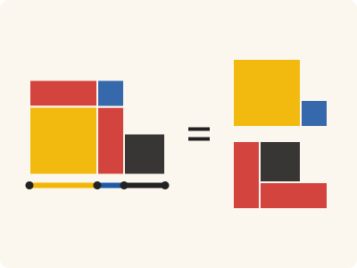
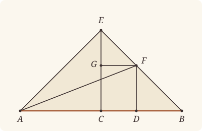

<!-- Generated by scripts/render.py. Do not edit by hand. -->

[Book II](index.md) · [← II.8](08.md) · [II.10 →](10.md)

# Book II, Proposition 9

*The squares on the unequal segments*

> If a straight line be cut into equal and unequal segments, the squares on the unequal segments of the whole are double of the square on the half and of the square on the straight line between the points of section.

<p align="center"></p>

<p align="center"><em>Cut a straight line in half, and again unequally: the squares on the unequal pieces (left) are twice the squares on the half (yellow) and on the piece between the cuts (blue), for the red and black pieces make a second yellow and blue.</em></p>

## Euclid's proof

<p align="center"></p>

For let a straight line AB be cut into equal segments at C, and into unequal segments at D;

I say that the squares on AD, DB are double of the squares on AC, CD.

For let CE be drawn from C at right angles to AB, and let it be made equal to either AC or CB;

let EA, EB be joined,

let DF be drawn through D parallel to EC,

and FG through F parallel to AB,

and let AF be joined.

Then, since AC is equal to CE,

the angle EAC is also equal to the angle AEC.

And, since the angle at C is right,

the remaining angles EAC, AEC are equal to one right angle. [I. 32]

And they are equal;

therefore each of the angles CEA, CAE is half a right angle.

For the same reason

each of the angles CEB, EBC is also half a right angle;

therefore the whole angle AEB is right.

And, since the angle GEF is half a right angle,

and the angle EGF is right, for it is equal to the interior and opposite angle ECB, [I. 29]

the remaining angle EFG is half a right angle; [I. 32]

therefore the angle GEF is equal to the angle EFG,

so that the side EG is also equal to GF. [I. 6]

Again, since the angle at B is half a right angle,

and the angle FDB is right, for it is again equal to the interior and opposite angle ECB, [I. 29]

the remaining angle BFD is half a right angle; [I. 32]

therefore the angle at B is equal to the angle DFB,

so that the side FD is also equal to the side DB. [I. 6]

Now, since AC is equal to CE,

the square on AC is also equal to the square on CE;

therefore the squares on AC, CE are double of the square on AC.

But the square on EA is equal to the squares on AC, CE, for the angle ACE is right; [I. 47]

therefore the square on EA is double of the square on AC.

Again, since EG is equal to GF,

the square on EG is also equal to the square on GF;

therefore the squares on EG, GF are double of the square on GF.

But the square on EF is equal to the squares on EG, GF;

therefore the square on EF is double of the square on GF.

But GF is equal to CD; [I. 34]

therefore the square on EF is double of the square on CD.

But the square on EA is also double of the square on AC;

therefore the squares on AE, EF are double of the squares on AC, CD.

And the square on AF is equal to the squares on AE, EF, for the angle AEF is right; [I. 47]

therefore the square on AF is double of the squares on AC, CD.

But the squares on AD, DF are equal to the square on AF, for the angle at D is right; [I. 47]

therefore the squares on AD, DF are double of the squares on AC, CD.

And DF is equal to DB;

therefore the squares on AD, DB are double of the squares on AC, CD.

Therefore etc.

Q. E. D.

## In Lean

✅ Proved

From [`Elements/BookII/Prop09.lean`](../../Elements/BookII/Prop09.lean). Euclid's sentences are the `--` comments, and our own notes are in `/- … -/`; the lines under each sentence are the Lean that carries it out.

```lean
/-- If a straight line be cut into equal and unequal segments, the squares on the unequal segments
of the whole are double of the square on the half and of the square on the straight line between
the points of section. -/
theorem Prop9 {A B C D : Point} (hACB : Between A C B) (hAC : ‖A C‖ = ‖C B‖) (hADB : Between A D B)
    (hDC : D ≠ C) :
    sq A D + sq D B = sq A C + sq C D + (sq A C + sq C D) := by
  -- For let a straight line AB be cut into equal segments at C, and into unequal segments at
  -- D;
  -- I say that the squares on AD, DB are double of the squares on AC, CD.
  /- As in II.5, D may fall on either side of C. Euclid's figure puts it between C
     and B, and we prove that case for any letters; the other is the same with A and B
     exchanged. Half a right angle is an angle that, added to itself, makes a right
     angle, and two such halves are equal (`Magnitude.eq_of_add_self_eq`). -/
  have euclid : ∀ {A B C D : Point}, Between A C B → ‖A C‖ = ‖C B‖ → Between C D B →
      sq A D + sq D B = sq A C + sq C D + (sq A C + sq C D) := by
    intro A B C D hACB hAC hCDB
    have hAB : A ≠ B := ne_of_between_ends hACB
    have hAC' : A ≠ C := ne_of_between hACB
    have hCB : C ≠ B := ne_of_between_ends hCDB
    have hCD : C ≠ D := ne_of_between hCDB
    have hDB : D ≠ B := ne_of_between (between_symm hCDB) |>.symm
    have hADB : Between A D B :=
      between_symm (between_of_between_left (between_symm hACB) (between_symm hCDB))
    obtain ⟨AB, hA_AB, hB_AB⟩ := Postulate1 A B hAB
    have hC_AB : OnLine C AB := on_line_of_between_ends hACB hA_AB hB_AB
    have hD_AB : OnLine D AB := on_line_of_between_ends hADB hA_AB hB_AB
    have col : ∀ {P : Point}, OnLine P AB → Collinear A B P := fun h => ⟨AB, hA_AB, hB_AB, h⟩
    -- For let CE be drawn from C at right angles to AB, and let it be made equal to either AC or
    -- CB;
    obtain ⟨Q, hQ, -⟩ := exists_off_line hAB []
    obtain ⟨X, hXQ, hright⟩ := BookI.Prop11 hAB (col hC_AB) hQ
    have hX_AB : ¬ OnLine X AB := not_on_line_of_same_side (hXQ.sameSide hA_AB hB_AB)
    have hCX : C ≠ X := fun e => hX_AB (e ▸ hC_AB)
    obtain ⟨E, hE, hCE⟩ := OnRay.exists_len_eq hAC'.symm hCX
    have hE_AB : ¬ OnLine E AB := fun h => by
      obtain ⟨-, hEC, ⟨M, hC_M, hX_M, hE_M⟩, -⟩ := hE
      exact hX_AB ((line_unique hEC.symm hC_M hE_M hC_AB h) ▸ hX_M)
    have hCE' : C ≠ E := fun e => hE_AB (e ▸ hC_AB)
    have rightAt : ∀ {P : Point}, OnLine P AB → P ≠ C → ∠ P C E = ∟ := fun hP hPC => by
      rw [angle_onRay_right hE hPC]; exact hright _ (col hP) hPC
    obtain ⟨CE, hC_CE, hE_CE⟩ := Postulate1 C E hCE'
    -- let EA, EB be joined,
    have hCAE : Triangle C A E := Triangle.of_line hC_AB hA_AB hAC'.symm hE_AB
    have hCBE : Triangle C B E := Triangle.of_line hC_AB hB_AB hCB hE_AB
    obtain ⟨EB, hE_EB, hB_EB⟩ := Postulate1 E B (fun e => hE_AB (e ▸ hB_AB))
    -- let DF be drawn through D parallel to EC,
    have hD_CE : ¬ OnLine D CE := fun h =>
      hE_AB ((line_unique hCD hC_CE h hC_AB hD_AB) ▸ hE_CE)
    obtain ⟨DF, hD_DF, hDF_CE⟩ := BookI.Prop31.line hD_CE
    have hEB_CE : EB ≠ CE := fun e =>
      hE_AB ((line_unique hCB hC_CE (e ▸ hB_EB) hC_AB hB_AB) ▸ hE_CE)
    obtain ⟨F, hF_EB, hF_DF⟩ := BookI.Prop30.meet hDF_CE hE_CE hE_EB hEB_CE
    have hB_DF : ¬ OnLine B DF := fun h =>
      hDF_CE.not_onLine ((line_unique hDB hD_AB hB_AB hD_DF h).symm ▸ hC_AB) hC_CE
    have hEFB : Between E F B :=
      Between.of_sameSide hCDB hD_DF (hDF_CE.symm.sameSide hE_CE hC_CE) (same_side_refl hB_DF)
        hF_DF ⟨EB, hE_EB, hF_EB, hB_EB⟩
    have hD_EB : ¬ OnLine D EB := fun h =>
      hE_AB ((line_unique hDB h hB_EB hD_AB hB_AB) ▸ hE_EB)
    have hDF : D ≠ F := fun e => hD_EB (e ▸ hF_EB)
    -- and FG through F parallel to AB,
    obtain ⟨G, hG_CE, hpG⟩ := BookI.Prop31.parallelogram hDF_CE.symm hC_CE hD_DF hF_DF hDF
    obtain ⟨FG, hF_FG, hG_FG⟩ := Postulate1 F G hpG.1.2.1
    have hFG_AB : Parallel AB FG := hpG.1.parallel hC_AB hD_AB hF_FG hG_FG
    have hE_FG : ¬ OnLine E FG := fun h =>
      hFG_AB.not_onLine hB_AB (on_line_of_between hEFB h hF_FG)
    have hEGC : Between E G C :=
      Between.of_sameSide hEFB hF_FG (same_side_refl hE_FG) (hFG_AB.sameSide hC_AB hB_AB)
        hG_FG ⟨CE, hE_CE, hG_CE, hC_CE⟩
    -- and let AF be joined.
    have hF_AB : ¬ OnLine F AB := fun h =>
      hE_AB (on_line_of_between (between_symm hEFB) hB_AB h)
    have hDA : D ≠ A := (ne_of_between hADB).symm
    have hDAF : Triangle D A F := Triangle.of_line hD_AB hA_AB hDA hF_AB
    -- Then, since AC is equal to CE,
    have hAC_CE : ‖A C‖ = ‖C E‖ := by rw [hCE, len_symm]
    -- the angle EAC is also equal to the angle AEC.
    have h5a : ∠ C A E = ∠ C E A :=
      BookI.Prop5.base hCAE ((len_symm C A).trans hAC_CE)
    -- And, since the angle at C is right,
    have hACE : ∠ A C E = ∟ := rightAt hA_AB hAC'
    -- the remaining angles EAC, AEC are equal to one right angle. [I. 32]
    have h32a := (BookI.Prop32 hCAE.cba hACB).2
    rw [hACE] at h32a
    have hrem_a : ∠ E A C + ∠ C E A = ∟ :=
      CommonNotion3 (c := ∟) (d := ∟) (by rw [← h32a]; ac_rfl) rfl
    -- And they are equal;
    have hEA : E ≠ A := hCAE.ne₂₃.symm
    have hEAC_CEA : ∠ E A C = ∠ C E A :=
      (angle_symm hEA hAC'.symm).trans h5a
    -- therefore each of the angles CEA, CAE is half a right angle.
    have hhalf_CEA : ∠ C E A + ∠ C E A = ∟ := by
      rw [hEAC_CEA] at hrem_a; exact hrem_a
    have hhalf_CAE : ∠ C A E + ∠ C A E = ∟ := by
      rw [h5a]; exact hhalf_CEA
    -- For the same reason
    -- each of the angles CEB, EBC is also half a right angle;
    have h5b : ∠ C B E = ∠ C E B := BookI.Prop5.base hCBE (by rw [hCE, len_symm C A, hAC])
    have hBCE : ∠ B C E = ∟ := rightAt hB_AB hCB.symm
    have h32b := (BookI.Prop32 hCBE.cba (between_symm hACB)).2
    rw [hBCE] at h32b
    have hEB : E ≠ B := fun e => hE_AB (e ▸ hB_AB)
    have hrem_b : ∠ E B C + ∠ C E B = ∟ :=
      CommonNotion3 (c := ∟) (d := ∟) (by rw [← h32b]; ac_rfl) rfl
    have hhalf_CEB : ∠ C E B + ∠ C E B = ∟ := by
      rw [← hrem_b, angle_symm hEB hCB, h5b]
    have hhalf_EBC : ∠ E B C + ∠ E B C = ∟ := by
      rw [angle_symm hEB hCB, h5b]; exact hhalf_CEB
    -- therefore the whole angle AEB is right.
    have hAEB : ∠ A E B = ∟ := by
      have hsplit := angle_add_of_between (Triangle.of_line hA_AB hB_AB hAB hE_AB) hACB
      have heq : ∠ C E A = ∠ C E B :=
        Magnitude.eq_of_add_self_eq (hhalf_CEA.trans hhalf_CEB.symm)
      rw [hsplit, angle_symm hEA.symm hCE', heq]; exact hhalf_CEB
    -- And, since the angle GEF is half a right angle,
    have hGEF : ∠ G E F = ∠ C E B :=
      angle_eq_of_onRay (OnRay.of_between hEGC) (OnRay.of_between hEFB)
    have hhalf_GEF : ∠ G E F + ∠ G E F = ∟ := by
      rw [hGEF]; exact hhalf_CEB
    -- and the angle EGF is right, for it is equal to the interior and opposite angle
    -- ECB, [I. 29]
    have hEGF : ∠ E G F = ∟ := by
      have h29 := BookI.Prop29.exterior hpG.1.symm.swap_left
        hpG.rotate.rotate.rotate.sameSideOf.symm hEGC
      rw [h29, angle_onRay_left (OnRay.of_between (between_symm hEGC)) hCD.symm,
        angle_onRay_right (OnRay.of_between hCDB) hCE'.symm, angle_symm hCE'.symm hCB.symm]
      exact hBCE
    -- the remaining angle EFG is half a right angle; [I. 32]
    have hFEG : Triangle F E G := by
      refine Triangle.of_line hF_EB hE_EB (ne_of_between hEFB).symm fun h => ?_
      exact hE_AB ((line_unique hCB hC_CE ((line_unique (ne_of_between hEGC) hE_CE
        (on_line_of_between_ends hEGC hE_CE hC_CE) hE_EB h) ▸ hB_EB) hC_AB hB_AB) ▸ hE_CE)
    have h32c := (BookI.Prop32 hFEG hEGC).2
    rw [hEGF] at h32c
    have hFE : F ≠ E := (ne_of_between hEFB).symm
    have hGE : G ≠ E := (ne_of_between hEGC).symm
    have hGF : G ≠ F := fun e => hDF_CE.not_onLine hF_DF (e ▸ hG_CE)
    have hhalf_EFG : ∠ E F G + ∠ E F G = ∟ := by
      rw [angle_symm hFE hGE, angle_symm hGF hFE.symm] at h32c
      have hsum : ∠ G E F + ∠ E F G = ∟ :=
        CommonNotion3 (c := ∟) (d := ∟) (by rw [← h32c]; ac_rfl) rfl
      have := hsum.trans hhalf_GEF.symm
      have heq : ∠ E F G = ∠ G E F :=
        CommonNotion3 (by rw [add_comm]; exact this) rfl
      rw [heq]; exact hhalf_GEF
    -- therefore the angle GEF is equal to the angle EFG,
    have hEFG : ∠ E F G = ∠ G E F :=
      Magnitude.eq_of_add_self_eq (hhalf_EFG.trans hhalf_GEF.symm)
    -- so that the side EG is also equal to GF. [I. 6]
    have hEG_GF : ‖G E‖ = ‖G F‖ := by
      refine BookI.Prop6 hFEG.cba ?_
      rw [angle_symm hGF hFE.symm, hEFG]
    -- Again, since the angle at B is half a right angle,
    have hFBD : ∠ F B D = ∠ E B C :=
      angle_eq_of_onRay (OnRay.of_between (between_symm hEFB))
        (OnRay.of_between (between_symm hCDB))
    have hhalf_FBD : ∠ F B D + ∠ F B D = ∟ := by
      rw [hFBD]; exact hhalf_EBC
    -- and the angle FDB is right, for it is again equal to the interior and opposite angle
    -- ECB, [I. 29]
    have hFDB : ∠ F D B = ∟ := by
      have h29 := BookI.Prop29.exterior hpG.2.swap_right hpG.sameSideOf.swap (between_symm hCDB)
      rw [angle_symm hDF.symm hDB.symm, h29,
        angle_onRay_right (OnRay.of_between (between_symm hEGC)) hCD.symm,
        angle_onRay_left (OnRay.of_between hCDB) hCE'.symm]
      exact hBCE
    have hBDF : ∠ B D F = ∟ := (angle_symm hDB.symm hDF.symm).trans hFDB
    -- the remaining angle BFD is half a right angle; [I. 32]
    have hFB : F ≠ B := ne_of_between (between_symm hEFB) |>.symm
    have hFBDt : Triangle F B D := Triangle.of_line hF_EB hB_EB hFB hD_EB
    have h32d := (BookI.Prop32 hFBDt (between_symm hCDB)).2
    rw [hBDF] at h32d
    have hhalf_DFB : ∠ D F B + ∠ D F B = ∟ := by
      have hsum : ∠ F B D + ∠ D F B = ∟ :=
        CommonNotion3 (c := ∟) (d := ∟) (by rw [← h32d]; ac_rfl) rfl
      have := hsum.trans hhalf_FBD.symm
      have heq : ∠ D F B = ∠ F B D :=
        CommonNotion3 (by rw [add_comm]; exact this) rfl
      rw [heq]; exact hhalf_FBD
    -- therefore the angle at B is equal to the angle DFB,
    have hDFB : ∠ D F B = ∠ F B D :=
      Magnitude.eq_of_add_self_eq (hhalf_DFB.trans hhalf_FBD.symm)
    -- so that the side FD is also equal to the side DB. [I. 6]
    have hDB_DF : ‖D B‖ = ‖D F‖ := by
      refine BookI.Prop6 hFBDt.cba ?_
      rw [angle_symm hDB hFB, hDFB]
    -- Now, since AC is equal to CE,
    -- the square on AC is also equal to the square on CE;
    have hsqAC : sq A C = sq C E := sq_congr hAC_CE
    -- therefore the squares on AC, CE are double of the square on AC.
    have h1 : sq A C + sq C E = sq A C + sq A C := by rw [hsqAC]
    -- But the square on EA is equal to the squares on AC, CE, for the angle ACE is
    -- right; [I. 47]
    have h47a : sq A E = sq A C + sq C E := BookI.Prop47.sq hCAE hACE
    -- therefore the square on EA is double of the square on AC.
    have h2 : sq E A = sq A C + sq A C := (sq_symm E A).trans (h47a.trans h1)
    -- Again, since EG is equal to GF,
    -- the square on EG is also equal to the square on GF;
    have hsqEG : sq E G = sq G F := sq_congr (by rw [len_symm]; exact hEG_GF)
    -- therefore the squares on EG, GF are double of the square on GF.
    have h3 : sq E G + sq G F = sq G F + sq G F := by rw [hsqEG]
    -- But the square on EF is equal to the squares on EG, GF;
    have h47b : sq E F = sq E G + sq G F := BookI.Prop47.sq hFEG.cba hEGF
    -- therefore the square on EF is double of the square on GF.
    have hEFdouble : sq E F = sq G F + sq G F := h47b.trans h3
    -- But GF is equal to CD; [I. 34]
    have hGF_CD : ‖G F‖ = ‖C D‖ := (BookI.Prop34 hpG.rotate.rotate.rotate).1
    -- therefore the square on EF is double of the square on CD.
    have h4 : sq E F = sq C D + sq C D := by rw [hEFdouble, sq_congr hGF_CD]
    -- But the square on EA is also double of the square on AC;
    -- therefore the squares on AE, EF are double of the squares on AC, CD.
    have h5 : sq A E + sq E F = sq A C + sq C D + (sq A C + sq C D) := by
      rw [sq_symm A E, h2, h4]; ac_rfl
    -- And the square on AF is equal to the squares on AE, EF, for the angle AEF is
    -- right; [I. 47]
    have hAEF : ∠ A E F = ∟ := by
      rw [angle_onRay_right (OnRay.of_between hEFB) hEA.symm]; exact hAEB
    have hA_EB : ¬ OnLine A EB := fun h =>
      hE_AB ((line_unique hAB h hB_EB hA_AB hB_AB) ▸ hE_EB)
    have h47c : sq A F = sq A E + sq E F :=
      BookI.Prop47.sq (Triangle.of_line hE_EB hF_EB hFE.symm hA_EB).acb hAEF
    -- therefore the square on AF is double of the squares on AC, CD.
    have hAFdouble : sq A F = sq A C + sq C D + (sq A C + sq C D) := h47c.trans h5
    -- But the squares on AD, DF are equal to the square on AF, for the angle at D is
    -- right; [I. 47]
    /- "The angle at D" is two angles: FDB, which I.29 makes right, and ADF beside
       it, which I.47 needs here; an angle beside a right angle is right. -/
    have hADF : ∠ A D F = ∟ := by
      have := adjacent_eq_of_right hB_AB hA_AB (between_symm hADB) hF_AB hBDF
      rw [angle_symm hDA.symm hDF.symm, ← this, hBDF]
    have h47d : sq A F = sq A D + sq D F :=
      BookI.Prop47.sq hDAF hADF
    -- therefore the squares on AD, DF are double of the squares on AC, CD.
    have hADDF : sq A D + sq D F = sq A C + sq C D + (sq A C + sq C D) :=
      h47d.symm.trans hAFdouble
    -- And DF is equal to DB;
    have hDF_DB : ‖D F‖ = ‖D B‖ := hDB_DF.symm
    -- therefore the squares on AD, DB are double of the squares on AC, CD.
    rw [← sq_congr hDF_DB]; exact hADDF
  -- Therefore etc.
  /- Otherwise D lies between A and C, and we exchange A and B. -/
  have hCray : OnRay C A B := OnRay.of_between hACB
  have hDray : OnRay D A B := OnRay.of_between hADB
  rcases lt_trichotomy ‖A D‖ ‖A C‖ with h | h | h
  · have hADC : Between A D C := hDray.between_of_len_lt hCray h
    have := euclid (between_symm hACB) (by rw [len_symm B C, len_symm C A]; exact hAC.symm)
      (between_symm hADC)
    rw [sq_symm B D, sq_symm D A, sq_congr (len_symm B C ▸ hAC.symm : ‖B C‖ = ‖A C‖),
      add_comm (sq D B)] at this
    exact this
  · obtain ⟨L, hA, hB⟩ := Postulate1 A B (ne_of_between_ends hACB)
    have hDray' : OnRay D A C := ⟨ne_of_between hACB, (ne_of_between hADB).symm,
      ⟨L, hA, on_line_of_between_ends hACB hA hB, on_line_of_between_ends hADB hA hB⟩,
      hDray.not_between hCray⟩
    exact absurd (hDray'.eq_of_len_eq h) hDC
  · exact euclid hACB hAC (between_inner (hCray.between_of_len_lt hDray h) hADB)
  -- Q. E. D.
```

## What it rests on

| | |
|---|---|
| Euclid cites | [I.6](../I/06.md), [I.29](../I/29.md), [I.32](../I/32.md), [I.34](../I/34.md), [I.47](../I/47.md) |
| Lean cites | [I.4](../I/04.md), [I.5](../I/05.md), [I.6](../I/06.md), [I.11](../I/11.md), [I.28](../I/28.md), [I.29](../I/29.md), [I.30](../I/30.md), [I.31](../I/31.md), [I.32](../I/32.md), [I.34](../I/34.md), [I.46](../I/46.md), [I.47](../I/47.md) |
| Postulates | 1, 2, 3, 4, 5 |
| Definitions | Def. I.15 |
| Common Notions | 1, 2, 3, 4, 5 |
| Tacit rules | 64 (listed below) |

Brought in by shared steps: [`BookI.Prop47.sq`](../../Elements/BookII/Rectangles.lean#L380) (I.4, I.28, I.34, I.46, I.47); [`BookI.Prop5.base`](../../Elements/BookI/Helpers.lean#L27) (I.5); [`BookI.Prop29.exterior`](../../Elements/BookI/Prop29.lean#L160) (I.29); [`BookI.Prop30.meet`](../../Elements/BookI/HelpersParallels.lean#L41) (I.30); [`BookI.Prop31.parallelogram`](../../Elements/BookI/HelpersParallels.lean#L83) (I.30, I.31); [`BookI.Prop31.line`](../../Elements/BookI/Prop31.lean#L79) (I.31).

_Postulates, definitions, Common Notions and tacit rules: all that this proof rests on, counting those of the propositions it cites._

<details><summary>The 64 tacit rules beneath this proof, counting those of the propositions it cites</summary>

**Reading the figure**

- [`between_cases`](../../Elements/Foundations/Tacit/Diagram.lean#L74) (used here): Of three different points on a straight line, one is between the other two. (Between 6)
- [`between_of_between_left`](../../Elements/Foundations/Tacit/Diagram.lean#L66) (used here): If B is between A and C, and D is between A and B, then D is between A and C. (Between 4)
- [`between_of_between_right`](../../Elements/Foundations/Tacit/Diagram.lean#L70) (used here): If B is between A and C, and C is between B and D, then B is between A and D. (Between 5)
- [`between_symm`](../../Elements/Foundations/Tacit/Diagram.lean#L43) (used here): If B is between A and C, it is between C and A. (Between 1)
- [`centre_inside`](../../Elements/Foundations/Tacit/Diagram.lean#L35) (used here): The centre of a circle is inside it. (Generalities 3)
- [`circles_meet`](../../Elements/Foundations/Tacit/Diagram.lean#L201) (used here): If each circle passes through a point inside the other, the circles cut one another. This is the step Euclid takes for granted in I.1. (Intersection 5)
- [`circles_meet_of_on_inside_outside`](../../Elements/Foundations/Tacit/Diagram.lean#L195): Two circles cut one another if the first passes through a point A inside the second, and a point B outside the second is inside or on the first. (Intersection 4, in LeanEuclid's corrected form)
- [`circles_meet_same_side`](../../Elements/Foundations/Tacit/Constructions.lean#L81): Two circles that cut one another do so on each side of the straight line through their centres. (Intersections 8)
- [`exists_point`](../../Elements/Foundations/Tacit/Constructions.lean#L26) (used here): Let a point be taken. (Points 1)
- [`exists_point_between`](../../Elements/Foundations/Tacit/Constructions.lean#L38): Let a point be taken between B and C. (Points 3)
- [`exists_point_on_line`](../../Elements/Foundations/Tacit/Constructions.lean#L29) (used here): Let a point be taken on the straight line L. (Points 2)
- [`exists_point_on_line_off_line`](../../Elements/Foundations/Tacit/Constructions.lean#L34) (used here): Let a point be taken on L, not on the different straight line M. (Points 2, with "distinct from M")
- [`exists_point_opposite_side`](../../Elements/Foundations/Tacit/Constructions.lean#L46) (used here): Let a point be taken on the other side of L from B. (Points 6)
- [`exists_point_same_side`](../../Elements/Foundations/Tacit/Constructions.lean#L42) (used here): Let a point be taken on the same side of L as B. (Points 5)
- [`inside_not_on`](../../Elements/Foundations/Tacit/Diagram.lean#L38) (used here): A point inside a circle is not on it. (Generalities 4)
- [`inside_of_between`](../../Elements/Foundations/Tacit/Diagram.lean#L161): A circle is "convex": between two points on or inside it, every point is inside. (Circle 2)
- [`line_circle_between`](../../Elements/Foundations/Tacit/Constructions.lean#L69): A straight line through a point B inside a circle, heading out to a point C outside it, cuts the circle between B and C. (Intersections 4)
- [`line_circle_beyond`](../../Elements/Foundations/Tacit/Constructions.lean#L75) (used here): A straight line through a point B inside a circle, produced beyond B away from C, cuts the circle there. (Intersections 5)
- [`line_unique`](../../Elements/Foundations/Tacit/Diagram.lean#L28) (used here): Two points determine a straight line. (Generalities 1)
- [`lines_meet_of_opposite_sides`](../../Elements/Foundations/Tacit/Diagram.lean#L179) (used here): A straight line joining points on opposite sides of L crosses L. (Intersection 1)
- [`ne_of_between`](../../Elements/Foundations/Tacit/Diagram.lean#L46) (used here): A point between two others differs from the first. (Between 1)
- [`ne_of_between_ends`](../../Elements/Foundations/Tacit/Diagram.lean#L49) (used here): The ends of a finite straight line differ. (Between 1)
- [`not_between_of_between`](../../Elements/Foundations/Tacit/Diagram.lean#L52) (used here): If B is between A and C, then A is not between B and C. (Between 1)
- [`not_between_of_between_between`](../../Elements/Foundations/Tacit/Diagram.lean#L79) (used here): If B is between A and C, and also between A and D, then B is not between C and D: C and D lie on the same side of B. (Between 7)
- [`not_on_line_of_same_side`](../../Elements/Foundations/Tacit/Diagram.lean#L92) (used here): Points on one side of a straight line are not on it. (Same side 3)
- [`on_line_of_between`](../../Elements/Foundations/Tacit/Diagram.lean#L56) (used here): A straight line through A and B, with B between A and C, passes through C. (Between 2)
- [`on_line_of_between_ends`](../../Elements/Foundations/Tacit/Diagram.lean#L61) (used here): A straight line through A and C passes through every point between them. (Between 3)
- [`pasch2`](../../Elements/Foundations/Tacit/Diagram.lean#L111) (used here): If B is between A and C, A is on L and B is off it, then B and C are on the same side of L: a straight line that leaves L at A does not cross it again. (Pasch 2)
- [`pasch3`](../../Elements/Foundations/Tacit/Diagram.lean#L114) (used here): A straight line through a point between A and C separates them. (Pasch 3)
- [`pasch4`](../../Elements/Foundations/Tacit/Diagram.lean#L119) (used here): If two different straight lines L and M meet at B, and A and C are points of M, different from each other and from B, that are not on the same side of L, then B is between A and C. (Pasch 4)
- [`same_side_or`](../../Elements/Foundations/Tacit/Diagram.lean#L99): A straight line has only two sides. (Same side 5)
- [`same_side_refl`](../../Elements/Foundations/Tacit/Diagram.lean#L85) (used here): A point off a straight line is on the same side of it as itself. (Same side 1)
- [`same_side_symm`](../../Elements/Foundations/Tacit/Diagram.lean#L89) (used here): If A is on the same side of a straight line as B, then B is on the same side as A. (Same side 2)
- [`same_side_trans`](../../Elements/Foundations/Tacit/Diagram.lean#L96) (used here): Two points on the same side of a straight line as a third point are on the same side as each other. (Same side 4)
- [`triple_incidence1`](../../Elements/Foundations/Tacit/Diagram.lean#L131) (used here): Take B on L, C on M and D on N, three straight lines through A. If C lies within the angle BAD (on D's side of L and on B's side of N), then B and D are not on the same side of M: the straight line AC separates them. (Triple incidence 1)
- [`triple_incidence2`](../../Elements/Foundations/Tacit/Diagram.lean#L139): Take B on L, C on M and D on N, three straight lines through A, with B other than A and D off M. If C and D are on the same side of L, and B and D are not on the same side of M, then B and C are on the same side of N: C lies within the angle BAD. (Triple incidence 2)

**Lengths, angles and areas**

- [`adjacent_eq_of_right`](../../Elements/Foundations/Tacit/Transfer.lean#L67) (used here): A right angle is equal to the angle adjacent to it. (Diagram-angle 3; the other half is Definition 10 together with Postulate 4)
- [`angle_add_of_inside`](../../Elements/Foundations/Tacit/Transfer.lean#L54) (used here): If D lies within the angle BAC, then BAC is made up of BAD and DAC. (Diagram-angle 2)
- [`angle_eq_of_same_rays`](../../Elements/Foundations/Tacit/Transfer.lean#L72) (used here): The angle doesn't change if its arms are traced through other points on the same rays. (Diagram-angle 4)
- [`angle_le_two_right`](../../Elements/Foundations/Tacit/Metric.lean#L29): No angle exceeds two right angles. (Metric 5)
- [`angle_symm`](../../Elements/Foundations/Tacit/Metric.lean#L26) (used here): The angle ABC is the angle CBA. (Metric 4)
- [`area_add_of_between`](../../Elements/Foundations/Tacit/Transfer.lean#L88) (used here): Cutting a triangle in two from a vertex adds up. (Diagram-area 2)
- [`area_congruent`](../../Elements/Foundations/Tacit/Metric.lean#L43): Triangles equal in all their sides and angles are equal in area. Euclid uses this without comment once he has shown two triangles congruent. (Metric 9)
- [`area_degenerate`](../../Elements/Foundations/Tacit/Metric.lean#L32) (used here): A "triangle" with a repeated corner has no area. (Metric 6)
- [`area_eq_zero_of_on_line`](../../Elements/Foundations/Tacit/Transfer.lean#L80) (used here): A "triangle" whose corners lie on one straight line has no area. (Diagram-area 1)
- [`area_rotate`](../../Elements/Foundations/Tacit/Metric.lean#L35) (used here): The triangle ABC is the triangle CAB. (Metric 8)
- [`area_swap`](../../Elements/Foundations/Tacit/Metric.lean#L38) (used here): The triangle ABC is the triangle ACB. (Metric 8)
- [`eq_of_len_eq_zero`](../../Elements/Foundations/Tacit/Metric.lean#L17) (used here): A finite straight line with distinct ends has length. (Metric 1)
- [`inside_of_len_lt`](../../Elements/Foundations/Tacit/Transfer.lean#L33): A point nearer the centre than the circumference is inside. (Diagram-segment 4)
- [`len_add_of_between`](../../Elements/Foundations/Tacit/Transfer.lean#L21) (used here): If B is between A and C, then AB and BC together make up AC. (Diagram-segment 1)
- [`len_lt_of_inside`](../../Elements/Foundations/Tacit/Transfer.lean#L37): A point inside is nearer the centre than the circumference. (Diagram-segment 4)
- [`len_self`](../../Elements/Foundations/Tacit/Metric.lean#L20): The "straight line" from a point to itself has no length. (Metric 1)
- [`len_symm`](../../Elements/Foundations/Tacit/Metric.lean#L23) (used here): The straight line AB is the straight line BA. (Metric 3)
- [`on_line_of_area_eq_zero`](../../Elements/Foundations/Tacit/Transfer.lean#L84): A triangle with no area has its corners on one straight line. (Diagram-area 1)
- [`same_ray_of_angle_eq_zero`](../../Elements/Foundations/Tacit/Transfer.lean#L49): If the angle BAC is nothing, C lies on the ray from A through B. (Diagram-angle 1)

**Superposition**

- [`superposition`](../../Elements/Foundations/Tacit/Superposition.lean#L30): **Superposition.** The triangle ABC can be applied to the straight line L with A on D, B on the ray from D through G, and C on the side of L where H is, without changing any side or angle.

**Laws of magnitude**

- [`add_assoc`](../../Elements/Foundations/Tacit/Magnitudes.lean#L23) (used here): Adding three magnitudes in a row, it makes no difference whether the first two or the last two are added first. (System E §3.5)
- [`add_comm`](../../Elements/Foundations/Tacit/Magnitudes.lean#L26) (used here): The order of adding does not matter. (System E §3.5)
- [`add_lt_add_right`](../../Elements/Foundations/Tacit/Magnitudes.lean#L45) (used here): Adding the same thing to both sides keeps "less than". (System E §3.5)
- [`add_zero`](../../Elements/Foundations/Tacit/Magnitudes.lean#L29) (used here): Adding nothing changes nothing. (System E §3.5)
- [`lt_irrefl`](../../Elements/Foundations/Tacit/Magnitudes.lean#L32) (used here): No magnitude is less than itself. (System E §3.5)
- [`lt_trans`](../../Elements/Foundations/Tacit/Magnitudes.lean#L35) (used here): What is less than the less is less still. (System E §3.5)
- [`lt_trichotomy`](../../Elements/Foundations/Tacit/Magnitudes.lean#L39) (used here): Of two magnitudes, one is less, or they are equal, or the other is less. (System E §3.5)
- [`not_lt_zero`](../../Elements/Foundations/Tacit/Magnitudes.lean#L42) (used here): Nothing is less than zero. (System E §3.5)

</details>

## Mishnah

**"Here abandoned."** Euclid proves II.9 without drawing a single square. Heath sees two new departures. From II.9 on, every proposition of Book II is proved by means of I.47; and "the method of demonstration by showing in the figures the various rectangles and squares to which the theorems relate is here abandoned" (Heath, vol. 1, p. 394). Four right-angled triangles do the work instead, in our proof as in his. In ACE and EGF the sides about the right angle are equal, so each gives a double; AEF adds the two, and ADF turns the sum into the squares on AD and DF, where DF is equal to DB.

**"The sum and difference."** Heath pairs II.9 with II.10 as he paired II.5 with II.6: "they really prove the same result which can, as in the earlier case, be comprised in a single enunciation thus: *The sum of the squares on the sum and difference of two given straight lines is equal to twice the sum of the squares on the lines*" (vol. 1, p. 394). Heath gives two more proofs (vol. 1, pp. 394–395), and we keep Euclid's. One works from II.4 and II.7 on a single straight line with its points marked, the way Heron worked.

**"Still effective."** Heath's other proof draws the squares after all, on AD and on DB, and cuts them by parallels into the square on AC, two squares on CD and rectangles that pair off. He gives it to show that the method of geometrical algebra of II.1 to II.8 "is still effective for the purpose of proving II. 9, 10" (vol. 1, p. 394). Euclid's own proof is sparing in another way: it cites nothing for drawing CE at right angles, for the equal angles at A and E, for the parallels or for the square on EF, though II.10, its twin, cites every one.

**The modern way.** Let AC = CB = a and CD = b, with 0 < b < a. Then AD and DB are a + b and a − b, in one order or the other, and the identity is (a + b)² + (a − b)² = 2a² + 2b².

## Further reading

- For the theorem that carries the rest of Book II, Eli Maor's [*The Pythagorean Theorem: A 4,000-Year History*](https://press.princeton.edu/books/paperback/9780691196886/the-pythagorean-theorem) (2007), the biography met under I.47.
- For why Lean must prove where F and G fall when Euclid reads them off his figure, Felix Klein's [*Elementary Mathematics from a Higher Standpoint, Volume II: Geometry*](https://doi.org/10.1007/978-3-662-49445-5) (2016), the book met under I.10.

---

<sub>Euclid's text: T. L. Heath, *The Thirteen Books of Euclid's Elements*, vol. 1 (Cambridge, 1908), pp. 392–394; scan leaves n412–n414; figure on n412. Public domain.</sub>

<sub>The tacit rules follow the System E of Jeremy Avigad, Edward Dean and John Mumma, read alongside LeanEuclid (Logan Murphy, Kaiyu Yang, Jialiang Sun, Zhaoyu Li, Anima Anandkumar and Xujie Si).</sub>
