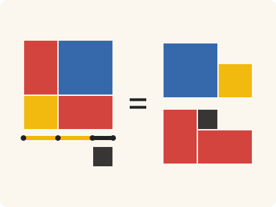
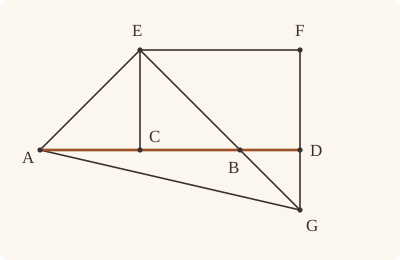
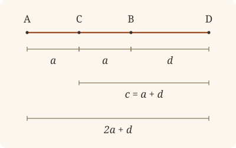

<!-- Generated by scripts/render.py. Do not edit by hand. -->

[Book II](index.md) · [← II.9](09.md) · [II.11 →](11.md)

# Book II, Proposition 10

*The squares on the whole and the added straight line*

[Euclid's proof](#euclids-proof) · [In Lean](#in-lean) · [What it rests on](#what-it-rests-on) · [Mishnah](#mishnah)

> If a straight line be bisected, and a straight line be added to it in a straight line, the square on the whole with the added straight line and the square on the added straight line both together are double of the square on the half and of the square described on the straight line made up of the half and the added straight line as on one straight line.

**In Lean:** ✅ proved, as Euclid states it · Euclid's argument

<p align="center"></p>

<p align="center"><em>Halve AB at C and add BD: the squares on AD, DB (left) are twice the squares on AC (yellow) and CD (blue), for the red and black make a second blue and yellow.</em></p>

## Euclid's proof

<p align="center"></p>

For let a straight line AB be bisected at C, and let a straight line BD be added to it in a straight line;

I say that the squares on AD, DB are double of the squares on AC, CD.

For let CE be drawn from the point C at right angles to AB [I. 11], and let it be made equal to either AC or CB [I. 3];

let EA, EB be joined;

through E let EF be drawn parallel to AD,

and through D let FD be drawn parallel to CE. [I. 31]

Then, since a straight line EF falls on the parallel straight lines EC, FD,

the angles CEF, EFD are equal to two right angles; [I. 29]

therefore the angles FEB, EFD are less than two right angles.

But straight lines produced from angles less than two right angles meet; [I. Post. 5]

therefore EB, FD, if produced in the direction B, D, will meet.

Let them be produced and meet at G,

and let AG be joined.

Then, since AC is equal to CE,

the angle EAC is also equal to the angle AEC; [I. 5]

and the angle at C is right;

therefore each of the angles EAC, AEC is half a right angle. [I. 32]

For the same reason

each of the angles CEB, EBC is also half a right angle;

therefore the angle AEB is right.

And, since the angle EBC is half a right angle,

the angle DBG is also half a right angle. [I. 15]

But the angle BDG is also right,

for it is equal to the angle DCE, they being alternate; [I. 29]

therefore the remaining angle DGB is half a right angle; [I. 32]

therefore the angle DGB is equal to the angle DBG,

so that the side BD is also equal to the side GD. [I. 6]

Again, since the angle EGF is half a right angle,

and the angle at F is right, for it is equal to the opposite angle, the angle at C, [I. 34]

the remaining angle FEG is half a right angle; [I. 32]

therefore the angle EGF is equal to the angle FEG,

so that the side GF is also equal to the side EF. [I. 6]

Now, since the square on EC is equal to the square on CA,

the squares on EC, CA are double of the square on CA.

But the square on EA is equal to the squares on EC, CA; [I. 47]

therefore the square on EA is double of the square on AC. [C.N. 1]

Again, since FG is equal to EF,

the square on FG is also equal to the square on FE;

therefore the squares on GF, FE are double of the square on EF.

But the square on EG is equal to the squares on GF, FE; [I. 47]

therefore the square on EG is double of the square on EF.

And EF is equal to CD; [I. 34]

therefore the square on EG is double of the square on CD.

But the square on EA was also proved double of the square on AC;

therefore the squares on AE, EG are double of the squares on AC, CD.

And the square on AG is equal to the squares on AE, EG; [I. 47]

therefore the square on AG is double of the squares on AC, CD.

But the squares on AD, DG are equal to the square on AG; [I. 47]

therefore the squares on AD, DG are double of the squares on AC, CD.

And DG is equal to DB;

therefore the squares on AD, DB are double of the squares on AC, CD.

Therefore etc.

Q. E. D.

## In Lean

| | |
|---|---|
| Proof | ✅ Proved |
| Statement | The whole enunciation. |
| Argument | Euclid's. |
| Reviewed | The statement and every passage of the argument read against Heath's text, at commit [`ece9c2d71`](https://github.com/jackChallis/stoicheia/commit/ece9c2d71) ([the record](../../review/II/10.toml)) |

From [`Elements/BookII/Prop10.lean`](../../Elements/BookII/Prop10.lean). Euclid's sentences are the `--` comments, and our own notes are in `/- … -/`; the lines under each sentence are the Lean that carries it out. The list below marks where a lemma does a step Euclid takes for granted, where several sentences share one step, where the statement already gives a step and where a step needs a word of its own; the `/- … -/` notes in the listing explain smaller adjustments.

**How the Lean follows the text**

- **Done by `produce_longer`.** "For let CE be drawn from the point C at right angles to AB…" Euclid cuts CE equal to AC on the perpendicular, taking enough room for I.3 for granted. The Lean draws the perpendicular by I.11, uses `produce_longer` to find a length greater than AC along it, cuts off CE by I.3, and uses `OnRay.of_between_between` to put E on the original ray and carry its right angle to CE.
- **Done by `BookI.Prop31.parallelogram`.** "and through D let FD be drawn parallel to CE." Euclid draws the parallel through D and takes its meeting F with EF from the figure. `BookI.Prop31.parallelogram` carries I.31's construction together with that meeting, using I.30, and proves that ECDF is a parallelogram.
- **Done by `angle_add_of_within`.** "therefore the angles FEB, EFD are less than two right angles." Euclid takes EB to fall within CEF, so FEB is less than CEF. The Lean proves that B lies on the required sides of EC and EF, splits CEF with `angle_add_of_within`, and uses the positive angle CEB and Common Notion 5 to make the sum less than two right angles.
- **Carried together, by `Postulate5`.** "therefore EB, FD, if produced in the direction B, D, will meet." One application of Postulate 5, under the sentence before, carries both that sentence and this conclusion; the Lean then takes the meeting point G. Our foundations state Euclid's own Postulate 5 as `Postulate5`, in System E's form (System E §3.6, diagram-angle transfer rule 5).
- **Done by `Between.of_inside`.** "Let them be produced and meet at G…" Euclid puts G beyond B on EB and beyond D on FD. After taking the meeting supplied by Postulate 5, the Lean proves that B lies between E and G with `Between.of_inside`, and that D lies between F and G with `Between.of_sameSide`.
- **Already given.** "and let AG be joined." Our triangles AEG and ADG are named by their corners, so no straight line AG is drawn; it is their common side.
- **Carried.** "therefore each of the angles EAC, AEC is half a right angle." The Lean proves that each of the angles EAC and AEC is half a right angle, as Euclid states; the later steps use only the half at E, and the angle EAC is not used again.
- **Done by `angle_add_of_between`.** "therefore the angle AEB is right." Euclid adds the two half-right angles at E to obtain AEB. `angle_add_of_between` shows that EC divides AEB because C lies between A and B; the Lean proves CEA and CEB equal with `Magnitude.eq_of_add_self_eq`, then adds the equal halves.
- **Done by `Tacit.pasch3`.** "for it is equal to the angle DCE, they being alternate…" Euclid reads E and G on opposite sides of AB from his figure when he takes BDG and DCE as alternate angles. From B between E and G, proved beneath "Let them be produced and meet at G", the Lean places them on opposite sides by `Tacit.pasch3` (System E, Pasch 3), which Book Zero proves from Pasch 2 and Triple incidence 1, and applies I.29 to the parallels CE and DG to carry the right angle DCE to BDG.
- **Done by `Magnitude.eq_of_add_self_eq`.** "therefore the angle DGB is equal to the angle DBG…" Euclid takes the angles DGB and DBG to be equal because each is half a right angle. The Lean applies `Magnitude.eq_of_add_self_eq` to their equal doubles.
- **Done by `Magnitude.eq_of_add_self_eq`.** "therefore the angle EGF is equal to the angle FEG…" Euclid takes the angles EGF and FEG to be equal because each is half a right angle. The Lean applies `Magnitude.eq_of_add_self_eq` to their equal doubles.

```lean
/-- If a straight line be bisected, and a straight line be added to it in a straight line, the
square on the whole with the added straight line and the square on the added straight line both
together are double of the square on the half and of the square described on the straight line
made up of the half and the added straight line as on one straight line. -/
theorem Prop10 {A B C D : Point} (hACB : Between A C B) (hAC : ‖A C‖ = ‖C B‖)
    (hABD : Between A B D) :
    sq A D + sq D B = sq A C + sq C D + (sq A C + sq C D) := by
  -- For let a straight line AB be bisected at C, and let a straight line BD be added to it in
  -- a straight line;
  have hCBD : Between C B D := between_inner hACB hABD
  have hAB : A ≠ B := ne_of_between_ends hACB
  have hAC' : A ≠ C := ne_of_between hACB
  have hCB : C ≠ B := ne_of_between hCBD
  have hCD : C ≠ D := ne_of_between_ends hCBD
  have hBD : B ≠ D := ne_of_between (between_symm hCBD) |>.symm
  obtain ⟨AB, hA_AB, hB_AB⟩ := Postulate1 A B hAB
  have hC_AB : OnLine C AB := on_line_of_between_ends hACB hA_AB hB_AB
  have hD_AB : OnLine D AB := on_line_of_between hABD hA_AB hB_AB
  have col : ∀ {P : Point}, OnLine P AB → Collinear A B P := fun h => ⟨AB, hA_AB, hB_AB, h⟩
  -- I say that the squares on AD, DB are double of the squares on AC, CD.
  -- For let CE be drawn from the point C at right angles to AB [I. 11], and let it be made
  -- equal to either AC or CB [I. 3];
  obtain ⟨Q, hQ, -⟩ := exists_off_line hAB []
  obtain ⟨X, hXQ, hright⟩ := BookI.Prop11 hAB (col hC_AB) hQ
  have hX_AB : ¬ OnLine X AB := not_on_line_of_same_side (hXQ.sameSide hA_AB hB_AB)
  have hCX : C ≠ X := fun e => hX_AB (e ▸ hC_AB)
  obtain ⟨Z, hXCZ⟩ := produce hCX.symm
  obtain ⟨Y, hZCY, hCA_CY⟩ := produce_longer (ne_of_between (between_symm hXCZ)) hAC'.symm
  obtain ⟨E, hCEY, hCE⟩ := BookI.Prop3 hAC'.symm hCA_CY
  have hE : OnRay E C X :=
    OnRay.of_between_between (between_symm hXCZ) (between_cut hZCY hCEY)
  have hE_AB : ¬ OnLine E AB := fun h => by
    obtain ⟨-, hEC, ⟨M, hC_M, hX_M, hE_M⟩, -⟩ := hE
    exact hX_AB ((line_unique hEC.symm hC_M hE_M hC_AB h) ▸ hX_M)
  have hCE' : C ≠ E := fun e => hE_AB (e ▸ hC_AB)
  have rightAt : ∀ {P : Point}, OnLine P AB → P ≠ C → ∠ P C E = ∟ := fun hP hPC => by
    rw [angle_onRay_right hE hPC]; exact hright _ (col hP) hPC
  -- let EA, EB be joined;
  have hEB : E ≠ B := fun e => hE_AB (e ▸ hB_AB)
  have hEA : E ≠ A := fun e => hE_AB (e ▸ hA_AB)
  obtain ⟨EB, hE_EB, hB_EB⟩ := Postulate1 E B hEB
  -- through E let EF be drawn parallel to AD,
  obtain ⟨EF, hE_EF, hEF_AB⟩ := BookI.Prop31.line hE_AB
  -- and through D let FD be drawn parallel to CE. [I. 31]
  obtain ⟨F, hF_EF, hpF⟩ := BookI.Prop31.parallelogram hEF_AB hE_EF hC_AB hD_AB hCD
  have hEF : E ≠ F := hpF.2.2.1.symm
  have hDF : D ≠ F := hpF.1.2.1
  obtain ⟨FD, hF_FD, hD_FD⟩ := Postulate1 F D hDF.symm
  obtain ⟨CE, hC_CE, hE_CE⟩ := Postulate1 C E hCE'
  have hCE_FD : Parallel CE FD := hpF.1.parallel hE_CE hC_CE hD_FD hF_FD
  -- Then, since a straight line EF falls on the parallel straight lines EC, FD,
  -- the angles CEF, EFD are equal to two right angles; [I. 29]
  have h29a : ∠ C E F + ∠ E F D = ∟ + ∟ :=
    BookI.Prop29.interior hpF.1.swap_right hpF.rotate.rotate.rotate.sameSideOf.swap
  -- therefore the angles FEB, EFD are less than two right angles.
  have hB_CE : ¬ OnLine B CE := fun h =>
    hE_AB ((line_unique hCB hC_CE h hC_AB hB_AB) ▸ hE_CE)
  have hBF : SameSideOf B F E C :=
    SameSideOf.of_line hCE'.symm hE_CE hC_CE
      (same_side_trans (same_side_symm (pasch2 hCBD hC_CE hB_CE))
        (hpF.1.symm.sameSideOf.sameSide hE_CE hC_CE))
  have hBC : SameSideOf B C E F :=
    SameSideOf.of_line hEF hE_EF hF_EF (hEF_AB.symm.sameSide hB_AB hC_AB)
  have hless : ∠ F E B + ∠ E F D < ∟ + ∟ := by
    have hsplit : ∠ C E F = ∠ C E B + ∠ B E F := angle_add_of_within hBF hBC
    have hpos : 0 < ∠ C E B := (Triangle.of_line hC_AB hB_AB hCB hE_AB).acb.angle_pos
    have hlt : ∠ F E B < ∠ C E F := by
      rw [hsplit, angle_symm hEF.symm hEB.symm, add_comm]
      exact CommonNotion5 hpos
    rw [← h29a]
    exact add_lt_add_right _ hlt
  -- But straight lines produced from angles less than two right angles meet; [I. Post. 5]
  have hBD_EF : SameSide B D EF := hEF_AB.symm.sameSide hB_AB hD_AB
  have hmeet := Postulate5 hB_EB hE_EB hE_EF hF_EF hF_FD hD_FD
    hEF hBD_EF (by rw [angle_symm hEB.symm hEF.symm]; exact hless)
  -- therefore EB, FD, if produced in the direction B, D, will meet.
  /- The meeting lies on B's side of EF; the order on each straight line follows. -/
  -- Let them be produced and meet at G,
  obtain ⟨G, hG_EB, hG_FD, hGB⟩ := hmeet
  have hB_FD : ¬ OnLine B FD := fun h =>
    hCE_FD.not_onLine hC_CE ((line_unique hBD hB_AB hD_AB h hD_FD) ▸ hC_AB)
  have hEBG : Between E B G :=
    Between.of_inside hE_EF hG_FD ⟨EB, hE_EB, hB_EB, hG_EB⟩ (same_side_symm hGB)
      (same_side_trans (same_side_symm (pasch2 (between_symm hCBD) hD_FD hB_FD))
        (hCE_FD.sameSide hC_CE hE_CE))
  have hG_AB : ¬ OnLine G AB := fun h =>
    hE_AB (on_line_of_between (between_symm hEBG) h hB_AB)
  have hFDG : Between F D G :=
    Between.of_sameSide hEBG hB_AB (hEF_AB.sameSide hF_EF hE_EF) (same_side_refl hG_AB)
      hD_AB ⟨FD, hF_FD, hD_FD, hG_FD⟩
  -- and let AG be joined.
  /- AG is the common side of the triangles AEG and ADG below. -/
  -- Then, since AC is equal to CE,
  have hCAE : Triangle C A E := Triangle.of_line hC_AB hA_AB hAC'.symm hE_AB
  have hCBE : Triangle C B E := Triangle.of_line hC_AB hB_AB hCB hE_AB
  -- the angle EAC is also equal to the angle AEC; [I. 5]
  have h5a : ∠ C A E = ∠ C E A := BookI.Prop5.base hCAE (by rw [hCE, len_symm])
  -- and the angle at C is right;
  have hACE : ∠ A C E = ∟ := rightAt hA_AB hAC'
  -- therefore each of the angles EAC, AEC is half a right angle. [I. 32]
  have h32a := (BookI.Prop32 hCAE.cba hACB).2
  rw [hACE] at h32a
  have hrem_a : ∠ E A C + ∠ C E A = ∟ :=
    CommonNotion3 (c := ∟) (d := ∟) (by rw [← h32a]; ac_rfl) rfl
  have hhalf_CEA : ∠ C E A + ∠ C E A = ∟ := by
    rw [← hrem_a, angle_symm hEA hAC'.symm, h5a]
  have hhalf_EAC : ∠ E A C + ∠ E A C = ∟ := by
    rw [angle_symm hEA hAC'.symm, h5a]; exact hhalf_CEA
  -- For the same reason
  -- each of the angles CEB, EBC is also half a right angle;
  have h5b : ∠ C B E = ∠ C E B := BookI.Prop5.base hCBE (by rw [hCE, len_symm C A, hAC])
  have hBCE : ∠ B C E = ∟ := rightAt hB_AB hCB.symm
  have h32b := (BookI.Prop32 hCBE.cba (between_symm hACB)).2
  rw [hBCE] at h32b
  have hrem_b : ∠ E B C + ∠ C E B = ∟ :=
    CommonNotion3 (c := ∟) (d := ∟) (by rw [← h32b]; ac_rfl) rfl
  have hhalf_CEB : ∠ C E B + ∠ C E B = ∟ := by
    rw [← hrem_b, angle_symm hEB hCB, h5b]
  have hhalf_EBC : ∠ E B C + ∠ E B C = ∟ := by
    rw [angle_symm hEB hCB, h5b]; exact hhalf_CEB
  -- therefore the angle AEB is right.
  have hAEB : ∠ A E B = ∟ := by
    have hsplit := angle_add_of_between (Triangle.of_line hA_AB hB_AB hAB hE_AB) hACB
    have heq : ∠ C E A = ∠ C E B :=
      Magnitude.eq_of_add_self_eq (hhalf_CEA.trans hhalf_CEB.symm)
    rw [hsplit, angle_symm hEA.symm hCE', heq]; exact hhalf_CEB
  -- And, since the angle EBC is half a right angle,
  -- the angle DBG is also half a right angle. [I. 15]
  have hG_CE : ¬ OnLine G CE := fun h => hCE_FD.not_onLine h hG_FD
  have hEGC : ¬ Collinear E G C := fun ⟨M, hE_M, hG_M, hC_M⟩ =>
    hG_CE ((line_unique hCE' hC_M hE_M hC_CE hE_CE) ▸ hG_M)
  have h15 := (BookI.Prop15 hEBG hCBD hEGC).1
  have hhalf_DBG : ∠ D B G + ∠ D B G = ∟ := by rw [← h15]; exact hhalf_EBC
  -- But the angle BDG is also right,
  -- for it is equal to the angle DCE, they being alternate; [I. 29]
  have hDG : D ≠ G := fun e => hG_AB (e ▸ hD_AB)
  have hBDG : ∠ B D G = ∟ := by
    have hpar : AreParallel E C D G :=
      AreParallel.of_parallel hCE'.symm hDG hE_CE hC_CE (on_line_of_between_ends hFDG hF_FD hG_FD)
        hG_FD hCE_FD
    have h29 := BookI.Prop29.alternate hpar
      (OppositeSidesOf.of_line hCD hC_AB hD_AB ⟨hE_AB, hG_AB, pasch3 hEBG hB_AB⟩)
    rw [angle_onRay_left (OnRay.of_between (between_symm hCBD)) hDG.symm, ← h29,
      angle_symm hCE'.symm hCD.symm]
    exact rightAt hD_AB hCD.symm
  -- therefore the remaining angle DGB is half a right angle; [I. 32]
  have hGB : G ≠ B := ne_of_between (between_symm hEBG)
  have hDGB : Triangle D G B := Triangle.of_line hD_FD hG_FD hDG hB_FD
  have h32c := (BookI.Prop32 hDGB (between_symm hEBG)).2
  have hhalf_DGB : ∠ D G B + ∠ D G B = ∟ := by
    rw [angle_symm hGB hBD.symm, hBDG] at h32c
    have hsum : ∠ D G B + ∠ D B G = ∟ := CommonNotion3 h32c rfl
    have heq : ∠ D G B = ∠ D B G := CommonNotion3 (hsum.trans hhalf_DBG.symm) rfl
    rw [heq]; exact hhalf_DBG
  -- therefore the angle DGB is equal to the angle DBG,
  have hDGB_DBG : ∠ D G B = ∠ D B G :=
    Magnitude.eq_of_add_self_eq (hhalf_DGB.trans hhalf_DBG.symm)
  -- so that the side BD is also equal to the side GD. [I. 6]
  have hDB_DG : ‖D B‖ = ‖D G‖ := BookI.Prop6 hDGB.acb hDGB_DBG.symm
  -- Again, since the angle EGF is half a right angle,
  have hFG : F ≠ G := ne_of_between_ends hFDG
  have hEGF : ∠ E G F = ∠ D G B := by
    rw [← angle_eq_of_onRay (OnRay.of_between (between_symm hEBG))
      (OnRay.of_between (between_symm hFDG)), angle_symm hGB.symm hDG]
  have hhalf_EGF : ∠ E G F + ∠ E G F = ∟ := by rw [hEGF]; exact hhalf_DGB
  -- and the angle at F is right, for it is equal to the opposite angle, the angle at
  -- C, [I. 34]
  have h34 := BookI.Prop34 hpF
  have hEFG : ∠ E F G = ∟ := by
    rw [angle_onRay_right (OnRay.of_beyond hFDG) hEF, h34.2.2.2.1,
      angle_symm hCE'.symm hCD.symm]
    exact rightAt hD_AB hCD.symm
  -- the remaining angle FEG is half a right angle; [I. 32]
  obtain ⟨P, hFGP⟩ := produce hFG
  have hE_FD : ¬ OnLine E FD := fun h => hCE_FD.not_onLine hE_CE h
  have hEFGt : Triangle E F G := (Triangle.of_line hF_FD hG_FD hFG hE_FD).cab
  have h32d := (BookI.Prop32 hEFGt hFGP).2
  rw [hEFG] at h32d
  have hGE : G ≠ E := (ne_of_between_ends hEBG).symm
  have hhalf_FEG : ∠ F E G + ∠ F E G = ∟ := by
    rw [angle_symm hFG hGE.symm, angle_symm hGE hEF.symm] at h32d
    have hsum : ∠ E G F + ∠ F E G = ∟ :=
      CommonNotion3 (c := ∟) (d := ∟) (by rw [← h32d]; ac_rfl) rfl
    have heq : ∠ F E G = ∠ E G F :=
      CommonNotion3 (by rw [add_comm]; exact hsum.trans hhalf_EGF.symm) rfl
    rw [heq]; exact hhalf_EGF
  -- therefore the angle EGF is equal to the angle FEG,
  have hFEG : ∠ F E G = ∠ E G F :=
    Magnitude.eq_of_add_self_eq (hhalf_FEG.trans hhalf_EGF.symm)
  -- so that the side GF is also equal to the side EF. [I. 6]
  have hFG_FE : ‖F G‖ = ‖F E‖ := by
    refine BookI.Prop6 hEFGt.bca ?_
    rw [angle_symm hFG hGE.symm, hFEG]
  -- Now, since the square on EC is equal to the square on CA,
  have hsqEC : sq E C = sq C A := sq_congr (by rw [len_symm, hCE])
  -- the squares on EC, CA are double of the square on CA.
  have h1 : sq E C + sq C A = sq C A + sq C A := by rw [hsqEC]
  -- But the square on EA is equal to the squares on EC, CA; [I. 47]
  have hECA : ∠ E C A = ∟ := (angle_symm hCE'.symm hAC').trans hACE
  have h47a : sq E A = sq E C + sq C A := BookI.Prop47.sq hCAE.acb hECA
  -- therefore the square on EA is double of the square on AC. [C.N. 1]
  have h2 : sq E A = sq A C + sq A C :=
    CommonNotion1 (h47a.trans h1) (by rw [sq_symm A C])
  -- Again, since FG is equal to EF,
  -- the square on FG is also equal to the square on FE;
  have hsqFG : sq F G = sq F E := sq_congr hFG_FE
  -- therefore the squares on GF, FE are double of the square on EF.
  have h3 : sq G F + sq F E = sq E F + sq E F := by
    rw [sq_symm G F, hsqFG, sq_symm F E]
  -- But the square on EG is equal to the squares on GF, FE; [I. 47]
  have hGFE : ∠ G F E = ∟ := (angle_symm hFG.symm hEF).trans hEFG
  have h47b : sq G E = sq G F + sq F E := BookI.Prop47.sq hEFGt.bca hGFE
  -- therefore the square on EG is double of the square on EF.
  have h4 : sq E G = sq E F + sq E F := by rw [sq_symm E G, h47b, h3]
  -- And EF is equal to CD; [I. 34]
  have hEF_CD : ‖E F‖ = ‖C D‖ := h34.1
  -- therefore the square on EG is double of the square on CD.
  have h5 : sq E G = sq C D + sq C D := by rw [h4, sq_congr hEF_CD]
  -- But the square on EA was also proved double of the square on AC;
  -- therefore the squares on AE, EG are double of the squares on AC, CD.
  have h6 : sq A E + sq E G = sq A C + sq C D + (sq A C + sq C D) := by
    rw [sq_symm A E, h2, h5]; ac_rfl
  -- And the square on AG is equal to the squares on AE, EG; [I. 47]
  have hAEG : ∠ A E G = ∟ := by
    rw [angle_onRay_right (OnRay.of_beyond hEBG) hEA.symm]; exact hAEB
  have hA_EB : ¬ OnLine A EB := fun h =>
    hE_AB ((line_unique hAB h hB_EB hA_AB hB_AB) ▸ hE_EB)
  have h47c : sq A G = sq A E + sq E G :=
    BookI.Prop47.sq (Triangle.of_line hE_EB hG_EB hGE.symm hA_EB).acb hAEG
  -- therefore the square on AG is double of the squares on AC, CD.
  have h7 : sq A G = sq A C + sq C D + (sq A C + sq C D) := h47c.trans h6
  -- But the squares on AD, DG are equal to the square on AG; [I. 47]
  have hADG : ∠ A D G = ∟ := by
    rw [angle_onRay_left (OnRay.of_beyond (between_symm hABD)) hDG.symm]; exact hBDG
  have h47d : sq A G = sq A D + sq D G :=
    BookI.Prop47.sq (Triangle.of_line hD_AB hA_AB (ne_of_between_ends hABD).symm hG_AB) hADG
  -- therefore the squares on AD, DG are double of the squares on AC, CD.
  have h8 : sq A D + sq D G = sq A C + sq C D + (sq A C + sq C D) := h47d.symm.trans h7
  -- And DG is equal to DB;
  have hDG_DB : ‖D G‖ = ‖D B‖ := hDB_DG.symm
  -- therefore the squares on AD, DB are double of the squares on AC, CD.
  rw [sq_congr hDG_DB] at h8
  exact h8
  -- Therefore etc.
  -- Q. E. D.
```

## What it rests on

| | |
|---|---|
| Heath's references | [I.3](../I/03.md), [I.5](../I/05.md), [I.6](../I/06.md), [I.11](../I/11.md), [I.15](../I/15.md), [I.29](../I/29.md), [I.31](../I/31.md), [I.32](../I/32.md), [I.34](../I/34.md), [I.47](../I/47.md); Post. 5; C.N. 1 |
| Lean cites | [I.3](../I/03.md), [I.4](../I/04.md), [I.5](../I/05.md), [I.6](../I/06.md), [I.11](../I/11.md), [I.15](../I/15.md), [I.28](../I/28.md), [I.29](../I/29.md), [I.30](../I/30.md), [I.31](../I/31.md), [I.32](../I/32.md), [I.34](../I/34.md), [I.46](../I/46.md), [I.47](../I/47.md) |
| Postulates | 1, 2, 3, 4, 5 |
| Definitions taken as axioms | Def. I.15 |
| Common Notions | 1, 2, 3, 4, 5 |
| Tacit rules | 39 (listed below) |
| Its own Lean calls | Postulates 1 and 5; 9 tacit rules |
| Through lemmas | Postulates 2 and 3; Def. I.15; 26 tacit rules |

Some of these come in through lemmas [shared](../../CERTIFICATE.md#shared-steps) by many proofs: [`BookI.Prop47.sq`](../../Elements/BookII/Rectangles.lean#L411) (I.4, I.28, I.34, I.46, I.47); [`BookI.Prop5.base`](../../Elements/BookI/Helpers.lean#L27) (I.5); [`BookI.Prop29.alternate`](../../Elements/BookI/Prop29.lean#L144), [`BookI.Prop29.interior`](../../Elements/BookI/Prop29.lean#L152) (I.29); [`BookI.Prop31.parallelogram`](../../Elements/BookI/HelpersParallels.lean#L83) (I.30, I.31); [`BookI.Prop31.line`](../../Elements/BookI/Prop31.lean#L79) (I.31).

_Postulates, definitions, Common Notions and tacit rules: all that this proof rests on, counting those of the propositions it cites. The last two rows say which of the postulates, definitions and tacit rules its own Lean calls, in the proof or a helper written for it, and which it does not call but reaches through lemmas, of Book Zero or shared (a proposition it cites may rest on these too); the rest come in only through the propositions it cites or the Common Notions._

<details><summary>The 39 tacit rules beneath this proof, counting those of the propositions it cites</summary>

_(used here) marks a rule this proof's own Lean calls, in the proof or a helper written for it; (through …) marks one its own Lean does not call but reaches through the lemmas named, of [Book Zero](../../Elements/Figure) or shared, though a proposition it cites may rest on it too; and a rule with no mark comes in only through a proposition it cites or a Common Notion. The names in brackets are System E's: an Intersection rule says when straight lines and circles must meet, and an Intersections rule takes a point where they do (see [Book I's introduction](../I/index.md))._

**Reading the figure**

- [`between_cases`](../../Elements/Foundations/Tacit/Diagram.lean#L54) (through [`Between.of_inside`](../../Elements/Figure/Parallelograms.lean#L61), [`Between.of_sameSide`](../../Elements/Figure/Parallelograms.lean#L80), [`BookI.Prop29.alternate`](../../Elements/BookI/Prop29.lean#L144) and 7 other lemmas): Of three different points on a straight line, one is between the other two. (Between 6)
- [`between_symm`](../../Elements/Foundations/Tacit/Diagram.lean#L47) (used here): If B is between A and C, it is between C and A. (Between 1)
- [`circles_meet`](../../Elements/Foundations/Tacit/Diagram.lean#L91) (through [`Between.of_inside`](../../Elements/Figure/Parallelograms.lean#L61), [`Between.of_sameSide`](../../Elements/Figure/Parallelograms.lean#L80), [`BookI.Prop29.alternate`](../../Elements/BookI/Prop29.lean#L144) and 18 other lemmas): If each circle passes through a point inside the other, the circles cut one another. This is the step Euclid takes for granted in I.1. (Intersection 5)
- [`circles_meet_same_side`](../../Elements/Foundations/Tacit/Constructions.lean#L79) (through [`Between.of_inside`](../../Elements/Figure/Parallelograms.lean#L61), [`Between.of_sameSide`](../../Elements/Figure/Parallelograms.lean#L80), [`BookI.Prop29.alternate`](../../Elements/BookI/Prop29.lean#L144) and 18 other lemmas): Two circles that cut one another do so on each side of the straight line through their centres. (Intersections 8)
- [`exists_point`](../../Elements/Foundations/Tacit/Constructions.lean#L35) (through [`BookI.Prop5.base`](../../Elements/BookI/Helpers.lean#L27), [`BookI.Prop29.alternate`](../../Elements/BookI/Prop29.lean#L144), [`BookI.Prop47.sq`](../../Elements/BookII/Rectangles.lean#L411) and 1 other lemma): Let a point be taken. (Points 1)
- [`exists_point_inside_circle`](../../Elements/Foundations/Tacit/Constructions.lean#L42) (through [`Between.of_inside`](../../Elements/Figure/Parallelograms.lean#L61), [`Between.of_sameSide`](../../Elements/Figure/Parallelograms.lean#L80), [`BookI.Prop29.alternate`](../../Elements/BookI/Prop29.lean#L144) and 18 other lemmas): Let a point be taken inside the circle α. (Points 8)
- [`exists_point_on_line`](../../Elements/Foundations/Tacit/Constructions.lean#L38) (through [`Between.of_inside`](../../Elements/Figure/Parallelograms.lean#L61), [`Between.of_sameSide`](../../Elements/Figure/Parallelograms.lean#L80), [`BookI.Prop29.alternate`](../../Elements/BookI/Prop29.lean#L144) and 18 other lemmas): Let a point be taken on the straight line L. (Points 2)
- [`line_circle_between`](../../Elements/Foundations/Tacit/Constructions.lean#L67) (through [`Between.of_inside`](../../Elements/Figure/Parallelograms.lean#L61), [`Between.of_sameSide`](../../Elements/Figure/Parallelograms.lean#L80), [`BookI.Prop29.alternate`](../../Elements/BookI/Prop29.lean#L144) and 18 other lemmas): A straight line through a point B inside a circle, heading out to a point C outside it, cuts the circle between B and C. (Intersections 4)
- [`line_circle_beyond`](../../Elements/Foundations/Tacit/Constructions.lean#L73) (through [`Between.of_inside`](../../Elements/Figure/Parallelograms.lean#L61), [`Between.of_sameSide`](../../Elements/Figure/Parallelograms.lean#L80), [`BookI.Prop29.alternate`](../../Elements/BookI/Prop29.lean#L144) and 18 other lemmas): A straight line through a point B inside a circle, produced beyond B away from C, cuts the circle there. (Intersections 5)
- [`line_unique`](../../Elements/Foundations/Tacit/Diagram.lean#L41) (used here): Two points determine a straight line. (Generalities 1)
- [`lines_meet_of_opposite_sides`](../../Elements/Foundations/Tacit/Diagram.lean#L86) (through [`AreParallel.sameSideOf`](../../Elements/Figure/Parallels.lean#L121), [`BookI.Prop29.alternate`](../../Elements/BookI/Prop29.lean#L144), [`BookI.Prop47.sq`](../../Elements/BookII/Rectangles.lean#L411) and 2 other lemmas): A straight line joining points on opposite sides of L crosses L. (Intersection 1)
- [`not_between_of_between`](../../Elements/Foundations/Tacit/Diagram.lean#L50) (through [`Between.of_inside`](../../Elements/Figure/Parallelograms.lean#L61), [`Between.of_sameSide`](../../Elements/Figure/Parallelograms.lean#L80), [`BookI.Prop29.alternate`](../../Elements/BookI/Prop29.lean#L144) and 22 other lemmas): If B is between A and C, then A is not between B and C. (Between 1)
- [`not_on_line_of_same_side`](../../Elements/Foundations/Tacit/Diagram.lean#L60) (used here): Points on one side of a straight line are not on it. (Same side 3)
- [`pasch2`](../../Elements/Foundations/Tacit/Diagram.lean#L71) (used here): If B is between A and C, A is on L and B is off it, then B and C are on the same side of L: a straight line that leaves L at A does not cross it again. (Pasch 2)
- [`same_side_trans`](../../Elements/Foundations/Tacit/Diagram.lean#L64) (used here): Two points on the same side of a straight line as a third point are on the same side as each other. (Same side 4)

**Lengths, angles and areas**

- [`angle_add_of_inside`](../../Elements/Foundations/Tacit/Transfer.lean#L47) (through [`Between.of_inside`](../../Elements/Figure/Parallelograms.lean#L61), [`Between.of_sameSide`](../../Elements/Figure/Parallelograms.lean#L80), [`BookI.Prop29.alternate`](../../Elements/BookI/Prop29.lean#L144) and 4 other lemmas): If D lies within the angle BAC, then BAC is made up of BAD and DAC. (Diagram-angle 2)
- [`angle_eq_of_same_rays`](../../Elements/Foundations/Tacit/Transfer.lean#L54) (through [`angle_eq_of_onRay`](../../Elements/Figure/Angles.lean#L33), [`angle_onRay_left`](../../Elements/Figure/Angles.lean#L42) and [`angle_onRay_right`](../../Elements/Figure/Angles.lean#L49)): The angle doesn't change if its arms are traced through other points on the same rays. (Diagram-angle 4)
- [`angle_le_two_right`](../../Elements/Foundations/Tacit/Metric.lean#L33): No angle exceeds two right angles. (Metric 5)
- [`angle_symm`](../../Elements/Foundations/Tacit/Metric.lean#L30) (used here): The angle ABC is the angle CBA. (Metric 4)
- [`area_add_of_between`](../../Elements/Foundations/Tacit/Transfer.lean#L70) (through [`BookI.Prop47.sq`](../../Elements/BookII/Rectangles.lean#L411)): Cutting a triangle in two from a vertex adds up. (Diagram-area 2)
- [`area_congruent`](../../Elements/Foundations/Tacit/Metric.lean#L44): Triangles equal in all their sides and angles are equal in area. Euclid uses this without comment once he has shown two triangles congruent. (Metric 9)
- [`area_degenerate`](../../Elements/Foundations/Tacit/Metric.lean#L36) (through [`BookI.Prop47.sq`](../../Elements/BookII/Rectangles.lean#L411)): A "triangle" with a repeated corner has no area. (Metric 6)
- [`area_eq_zero_of_on_line`](../../Elements/Foundations/Tacit/Transfer.lean#L62) (through [`BookI.Prop47.sq`](../../Elements/BookII/Rectangles.lean#L411)): A "triangle" whose corners lie on one straight line has no area. (Diagram-area 1)
- [`area_rotate`](../../Elements/Foundations/Tacit/Metric.lean#L39) (through [`BookI.Prop47.sq`](../../Elements/BookII/Rectangles.lean#L411)): The triangle ABC is the triangle CAB. (Metric 8)
- [`len_add_of_between`](../../Elements/Foundations/Tacit/Transfer.lean#L27) (through [`Between.of_inside`](../../Elements/Figure/Parallelograms.lean#L61), [`Between.of_sameSide`](../../Elements/Figure/Parallelograms.lean#L80), [`BookI.Prop29.alternate`](../../Elements/BookI/Prop29.lean#L144) and 21 other lemmas): If B is between A and C, then AB and BC together make up AC. (Diagram-segment 1)
- [`len_self`](../../Elements/Foundations/Tacit/Metric.lean#L24) (through [`Between.of_inside`](../../Elements/Figure/Parallelograms.lean#L61), [`Between.of_sameSide`](../../Elements/Figure/Parallelograms.lean#L80), [`BookI.Prop29.alternate`](../../Elements/BookI/Prop29.lean#L144) and 21 other lemmas): The "straight line" from a point to itself has no length. (Metric 1)
- [`len_symm`](../../Elements/Foundations/Tacit/Metric.lean#L27) (used here): The straight line AB is the straight line BA. (Metric 3)
- [`on_line_of_area_eq_zero`](../../Elements/Foundations/Tacit/Transfer.lean#L66): A triangle with no area has its corners on one straight line. (Diagram-area 1)
- [`radius_ne_zero`](../../Elements/Foundations/Tacit/Metric.lean#L62) (through [`Between.of_inside`](../../Elements/Figure/Parallelograms.lean#L61), [`Between.of_sameSide`](../../Elements/Figure/Parallelograms.lean#L80), [`BookI.Prop29.alternate`](../../Elements/BookI/Prop29.lean#L144) and 21 other lemmas): A circle's radius is not nothing: the straight line from the centre to a point on the circle has some length. A rule of our own, not one of System E's: every circle is drawn with a centre and a distance (Postulate 3).
- [`same_ray_of_angle_eq_zero`](../../Elements/Foundations/Tacit/Transfer.lean#L42) (through [`Between.of_inside`](../../Elements/Figure/Parallelograms.lean#L61), [`Between.of_sameSide`](../../Elements/Figure/Parallelograms.lean#L80), [`BookI.Prop29.alternate`](../../Elements/BookI/Prop29.lean#L144) and 3 other lemmas): If the angle BAC is nothing, C lies on the ray from A through B. (Diagram-angle 1)

**Superposition**

- [`superposition`](../../Elements/Foundations/Tacit/Superposition.lean#L52): **Superposition.** A hypothetical placement of a triangle on a given ray and side permits a restricted derivation of metric equalities about the figure already given. The derivation introduces no further objects, cites each geometric law it uses, and exports no symbol of the placement.

**Rules of magnitude**

- [`add_assoc`](../../Elements/Foundations/Tacit/Magnitudes.lean#L23) (through [`BookI.Prop29.alternate`](../../Elements/BookI/Prop29.lean#L144), [`BookI.Prop29.interior`](../../Elements/BookI/Prop29.lean#L152), [`BookI.Prop47.sq`](../../Elements/BookII/Rectangles.lean#L411) and 4 other lemmas): Adding three magnitudes in a row, it makes no difference whether the first two or the last two are added first. (System E §3.5)
- [`add_comm`](../../Elements/Foundations/Tacit/Magnitudes.lean#L26) (used here): The order of adding does not matter. (System E §3.5)
- [`add_lt_add_right`](../../Elements/Foundations/Tacit/Magnitudes.lean#L45) (used here): Adding the same thing to both sides keeps "less than". (System E §3.5)
- [`add_zero`](../../Elements/Foundations/Tacit/Magnitudes.lean#L29) (through [`BookI.Prop47.sq`](../../Elements/BookII/Rectangles.lean#L411)): Adding nothing changes nothing. (System E §3.5)
- [`lt_irrefl`](../../Elements/Foundations/Tacit/Magnitudes.lean#L32) (through [`Between.of_inside`](../../Elements/Figure/Parallelograms.lean#L61), [`Between.of_sameSide`](../../Elements/Figure/Parallelograms.lean#L80), [`BookI.Prop29.alternate`](../../Elements/BookI/Prop29.lean#L144) and 19 other lemmas): No magnitude is less than itself. (System E §3.5)
- [`lt_trans`](../../Elements/Foundations/Tacit/Magnitudes.lean#L35) (through [`Between.of_inside`](../../Elements/Figure/Parallelograms.lean#L61), [`Between.of_sameSide`](../../Elements/Figure/Parallelograms.lean#L80), [`BookI.Prop29.alternate`](../../Elements/BookI/Prop29.lean#L144) and 19 other lemmas): What is less than the less is less still. (System E §3.5)
- [`lt_trichotomy`](../../Elements/Foundations/Tacit/Magnitudes.lean#L39) (through [`Between.of_inside`](../../Elements/Figure/Parallelograms.lean#L61), [`Between.of_sameSide`](../../Elements/Figure/Parallelograms.lean#L80), [`BookI.Prop29.alternate`](../../Elements/BookI/Prop29.lean#L144) and 23 other lemmas): Of two magnitudes, one is less, or they are equal, or the other is less. (System E §3.5)
- [`not_lt_zero`](../../Elements/Foundations/Tacit/Magnitudes.lean#L42) (through [`Between.of_inside`](../../Elements/Figure/Parallelograms.lean#L61), [`Between.of_sameSide`](../../Elements/Figure/Parallelograms.lean#L80), [`BookI.Prop29.alternate`](../../Elements/BookI/Prop29.lean#L144) and 22 other lemmas): Nothing is less than zero. (System E §3.5)

</details>

## Mishnah

_Our commentary: why Euclid's proof, and ours, look as they do._

To find G, Euclid calls on Postulate 5 itself, and Heath's reference names it with its book, "[I. Post. 5]", the only postulate his references name in Book II. It is the third time the text has called on it, after I.29 and I.44. One step before it goes unsaid. EB falls within the angle CEF, so FEB is less than CEF, the part less than the whole (Common Notion 5), and with EFD it makes less than the two right angles of I.29. The postulate then promises a meeting on that side, and we prove what this means here: B lies between E and G, and D between F and G, as "if produced in the direction B, D" says. After that the proof runs as in II.9, with no square drawn and the same halves of right angles. I.32 speaks of a side produced, so in the triangle EFG we produce FG beyond G, to a point Heath's figure does not draw.

**A ladder to the square root of two.** H. G. Zeuthen saw in II.9 and II.10 a proof of the Greek rule for side and diagonal numbers. Heath tells it from Theon of Smyrna: "The unit, being the beginning of all things, must be potentially both a *side* and a *diameter*" (vol. 1, p. 398), a diameter being a diagonal. From a side and its diagonal come a new side, their sum, and a new diagonal, twice the side added to the diagonal: 1 and 1 give 2 and 3, then 5 and 7, then 12 and 17. Each diagonal's square is one more or one less than twice its side's, so the ratios 3/2, 7/5, 17/12 come ever nearer to the square root of two. Plato's "rational diameter" of five is 7, whose square falls one short of twice 25 (Heath, vol. 1, p. 399).

In passages of his commentary on Plato's *Republic*, first printed in 1901, Proclus says that the property of these numbers "is proved graphically … in the second book of the Elements by '*him*'", and shows how II.10 proves it (Heath, vol. 1, pp. 399–400). He does not mean that it was first proved there, Heath says: the Pythagoreans had proved it, and this confirms "that the whole of the substance of that Book was Pythagorean" (vol. 1, p. 400), as the part the gnomon and I.47 play in Book II had suggested.

**The modern way.** Write $a$ for AC and CB, and $d$ for BD: II.10 says $(2a + d)^2 + d^2 = 2a^2 + 2(a + d)^2$, that is, $(2a + d)^2 - 2(a + d)^2 = -(d^2 - 2a^2)$. So if AC and BD are a side number and its diagonal number, with $d^2 - 2a^2 = \pm 1$, then CD and AD are the next pair, with the other sign. Put $c$ for CD, which is $a + d$, and the identity is II.9's, $(c + a)^2 + (c - a)^2 = 2a^2 + 2c^2$: the two propositions prove one result, as Heath says.

<p align="center"></p>

## Further reading

- For side and diagonal numbers and the equation behind them, now named after Pell, turn to John Stillwell's [*Mathematics and Its History*](https://doi.org/10.1007/978-1-4419-6053-5) (2010) and its chapter "Greek Number Theory", with a section on Pell's equation.
- The "take the smaller from the larger" process behind 3/2, 7/5, 17/12 and their ever closer approach to the square root of two, which we now call continued fractions, is ch. 9, "Continued Fractions", of David Fowler's [*The Mathematics of Plato's Academy*](https://academic.oup.com/book/52809) (1999) (also on [II.4](04.md)).
- Which proof assistants have checked that the square root of two is irrational is listed under no. 1, "The Irrationality of the Square Root of 2", of Freek Wiedijk's ["Formalizing 100 Theorems"](https://www.cs.ru.nl/~freek/100/) (free online), a running scoreboard of famous theorems.

[Book II](index.md) · [← II.9](09.md) · [II.11 →](11.md)

---

<sub>Euclid's text: T. L. Heath, *The Thirteen Books of Euclid's Elements*, vol. 1 (Cambridge, 1908), pp. 395–397; [scan leaves n415–n417](https://archive.org/details/thirteenbookseu02heibgoog/page/n415); [figure on n415](https://archive.org/details/thirteenbookseu02heibgoog/page/n415). Public domain.</sub>

<sub>The tacit rules follow the System E of Jeremy Avigad, Edward Dean and John Mumma, read alongside LeanEuclid (Logan Murphy, Kaiyu Yang, Jialiang Sun, Zhaoyu Li, Anima Anandkumar and Xujie Si).</sub>
