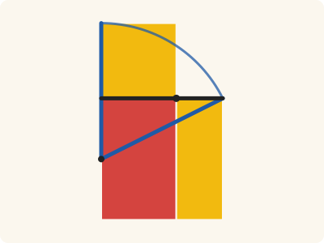
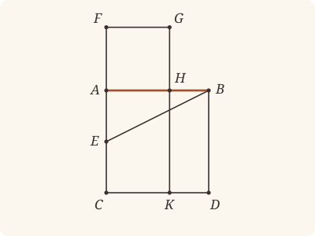
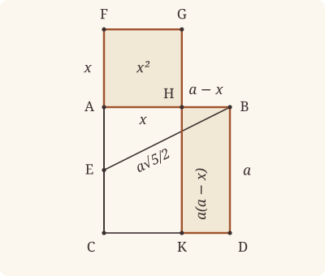

<!-- Generated by scripts/render.py. Do not edit by hand. -->

[Book II](index.md) · [← II.10](10.md) · [II.12 →](12.md)

# Book II, Proposition 11

*A straight line cut so that the rectangle equals the square*

[Euclid's proof](#euclids-proof) · [In Lean](#in-lean) · [What it rests on](#what-it-rests-on) · [Mishnah](#mishnah)

> To cut a given straight line so that the rectangle contained by the whole and one of the segments is equal to the square on the remaining segment.

**In Lean:** ✅ proved, as Euclid states it · Euclid's argument

<p align="center"></p>

<p align="center"><em>Halve AC at E, swing EB to EF (blue): the rectangle AB, BH equals the square on AH (both yellow), for each, with AK (red), equals the square on the black AB. (Drawn with AH to AB as 89 to 144: no whole numbers fit exactly.)</em></p>

## Euclid's proof

<p align="center"></p>

Let AB be the given straight line;

thus it is required to cut AB so that the rectangle contained by the whole and one of the segments is equal to the square on the remaining segment.

For let the square ABDC be described on AB; [I. 46]

let AC be bisected at the point E, and let BE be joined;

let CA be drawn through to F, and let EF be made equal to BE;

let the square FH be described on AF, and let GH be drawn through to K.

I say that AB has been cut at H so as to make the rectangle contained by AB, BH equal to the square on AH.

For, since the straight line AC has been bisected at E, and FA is added to it,

the rectangle contained by CF, FA together with the square on AE is equal to the square on EF. [II. 6]

But EF is equal to EB;

therefore the rectangle CF, FA together with the square on AE is equal to the square on EB.

But the squares on BA, AE are equal to the square on EB, for the angle at A is right; [I. 47]

therefore the rectangle CF, FA together with the square on AE is equal to the squares on BA, AE.

Let the square on AE be subtracted from each;

therefore the rectangle CF, FA which remains is equal to the square on AB.

Now the rectangle CF, FA is FK, for AF is equal to FG;

and the square on AB is AD;

therefore FK is equal to AD.

Let AK be subtracted from each;

therefore FH which remains is equal to HD.

And HD is the rectangle AB, BH, for AB is equal to BD;

and FH is the square on AH;

therefore the rectangle contained by AB, BH is equal to the square on HA.

therefore the given straight line AB has been cut at H so as to make the rectangle contained by AB, BH equal to the square on HA.

Q. E. F.

## In Lean

| | |
|---|---|
| Proof | ✅ Proved |
| Statement | The whole enunciation. |
| Argument | Euclid's. |
| Reviewed | The statement and every passage of the argument read against Heath's text, at commit [`cf05b375`](https://github.com/jackChallis/stoicheia/commit/cf05b375) ([the record](../../review/II/11.toml)) |

From [`Elements/BookII/Prop11.lean`](../../Elements/BookII/Prop11.lean). Euclid's sentences are the `--` comments, and our own notes are in `/- … -/`; the lines under each sentence are the Lean that carries it out. The list below marks where a lemma does a step Euclid takes for granted; the `/- … -/` notes in the listing explain smaller adjustments.

**How the Lean follows the text**

- **Done by `BookI.Prop10`.** "let AC be bisected at the point E…" Euclid bisects AC at E; Heath gives no reference here. The Lean uses I.10, then names the triangle AEB by its corners.
- **Done by `OnRay.exists_len_eq`.** "let CA be drawn through to F…" Euclid puts F beyond A with EF equal to EB. The Lean proves EB greater than EA by I.17 and I.19, sets off EB on the ray EA with `OnRay.exists_len_eq`, and uses `OnRay.between_of_len_lt` to place F beyond A.
- **Done by `BookI.Prop20`.** "let the square FH be described on AF…" Euclid draws the square FH and produces GH to K, taking H within AB and K on CD from the figure. The Lean draws the square by I.46, places H on the ray AB with `onRay_of_angle_eq` after using `Tacit.adjacent_eq_of_right` (I.13), uses I.20 and `OnRay.between_of_len_lt` to put H within AB, finds K with `BookI.Prop30.meet`, and uses `BookI.Prop30.parallel` (I.30, for which Heath gives no reference here) and `Parallel.between` to establish the parallels and point order that bound the rectangles.
- **Done by `Rectangle.of_right`.** "Now the rectangle CF, FA is FK…" Euclid treats FK as a rectangle and identifies it by AF equal to FG. The Lean uses FGKC, built beneath the construction of FH, carries FH's right angle at F along FC, proves the other angles right by `Rectangle.of_right`, and identifies its area by `Rectangle.eq_rect` with that equality of sides.
- **Done by `quadArea_add_of_parallelograms`.** "Let AK be subtracted from each…" Euclid takes AK as the common part of FK and AD, leaving FH and HD. `quadArea_add_of_parallelograms` proves both divisions using the point order established beneath the construction of FH; the next sentence cancels AK by Common Notion 3.
- **Done by `Rectangle.of_right`.** "And HD is the rectangle AB, BH…" Euclid treats HD as a rectangle and identifies it by AB equal to BD. The Lean uses HKDB, built beneath the construction of FH, carries ABDC's right angle at B along BH, proves the other angles right by `Rectangle.of_right`, and identifies its area by `Rectangle.eq_rect` with that equality of sides.

```lean
/-- To cut a given straight line so that the rectangle contained by the whole and one of the
segments is equal to the square on the remaining segment. -/
theorem Prop11 {A B : Point} (hAB : A ≠ B) :
    ∃ H : Point, Between A H B ∧ rect A B B H = sq A H := by
  -- Let AB be the given straight line;
  obtain ⟨AB, hA_AB, hB_AB⟩ := Postulate1 A B hAB
  -- thus it is required to cut AB so that the rectangle contained by the whole and one of the
  -- segments is equal to the square on the remaining segment.
  -- For let the square ABDC be described on AB; [I. 46]
  obtain ⟨P, hP, -⟩ := exists_off_line hAB []
  obtain ⟨C, D, hsq, hC, hD⟩ := BookI.Prop46 hAB hP
  obtain ⟨hp, hAD⟩ := Square.described hsq hC hD
  have hAC : A ≠ C := hp.1.1
  obtain ⟨AC, hA_AC, hC_AC⟩ := Postulate1 A C hAC
  obtain ⟨BD, hB_BD, hD_BD⟩ := Postulate1 B D hp.1.2.1.symm
  obtain ⟨CD, hC_CD, hD_CD⟩ := Postulate1 C D hp.2.1
  have hAC_BD : Parallel AC BD := hp.1.parallel hA_AC hC_AC hD_BD hB_BD
  have hCD_AB : Parallel CD AB := hp.2.parallel hC_CD hD_CD hB_AB hA_AB
  have hB_AC : ¬ OnLine B AC := fun h => hAC_BD.not_onLine h hB_BD
  -- let AC be bisected at the point E, and let BE be joined;
  obtain ⟨E, hAEC, hAE⟩ := BookI.Prop10 hAC
  have hE_AC : OnLine E AC := on_line_of_between_ends hAEC hA_AC hC_AC
  have hAE' : A ≠ E := ne_of_between hAEC
  have hEB : E ≠ B := fun e => hB_AC (e ▸ hE_AC)
  have hAEB : Triangle A E B := Triangle.of_line hA_AC hE_AC hAE' hB_AC
  /- The angle at A is right. -/
  have hBAE : ∠ B A E = ∟ := by
    rw [angle_onRay_right (OnRay.of_between hAEC) hAB.symm]; exact hsq.2.2.2.1
  -- let CA be drawn through to F, and let EF be made equal to BE;
  /- EB is greater than EA: the angle ABE is less than a right angle [I. 17],
     and the greater angle is subtended by the greater side [I. 19]. -/
  have hABE : ∠ A B E < ∟ := by
    have h17 := (BookI.Prop17 hAEB.acb).2.2
    rw [angle_symm hAE'.symm hAB.symm, hBAE] at h17
    exact Magnitude.lt_of_add_lt_add_left h17
  have hEA_EB : ‖E A‖ < ‖E B‖ :=
    BookI.Prop19 hAEB.bac (by rw [angle_symm hAE'.symm hAB.symm, hBAE]; exact hABE)
  obtain ⟨F, hF, hEF⟩ := OnRay.exists_len_eq hEB hAE'.symm
  have hEAF : Between E A F :=
    OnRay.between_of_len_lt (OnRay.self hAE'.symm) hF (hEF ▸ hEA_EB)
  have hCAF : Between C A F :=
    between_symm (between_of_between_right (between_symm hEAF) hAEC)
  have hAF : A ≠ F := (ne_of_between (between_symm hCAF)).symm
  have hF_AC : OnLine F AC := on_line_of_between hCAF hC_AC hA_AC
  -- let the square FH be described on AF, and let GH be drawn through to K.
  obtain ⟨H, G, hsqF, hH, hG⟩ := BookI.Prop46 hAF (Triangle.of_line hA_AC hF_AC hAF hB_AC)
  obtain ⟨hpF, -⟩ := Square.described hsqF hH hG
  /- AH lies along AB: the angles FAH, FAB are right. -/
  have hFAB : ∠ F A B = ∟ := by
    have h := adjacent_eq_of_right hC_AC hF_AC hCAF hB_AC
      ((angle_symm hAC.symm hAB.symm).trans hsq.2.2.2.1)
    rw [angle_symm hAB.symm hAF.symm] at h
    exact h.symm.trans ((angle_symm hAC.symm hAB.symm).trans hsq.2.2.2.1)
  have hHray : OnRay H A B := onRay_of_angle_eq hH (hsqF.2.2.2.1.trans hFAB.symm)
  /- AF is less than AB [I. 20]. -/
  have hAF_AB : ‖A F‖ < ‖A B‖ := by
    have h20 := (BookI.Prop20 hAEB).1
    rw [← hEF, ← len_add_of_between hEAF] at h20
    exact Magnitude.lt_of_add_lt_add_left h20
  have hAHB : Between A H B :=
    OnRay.between_of_len_lt hHray (OnRay.self hAB) (hsqF.len_eq ▸ hAF_AB)
  have hH_AB : OnLine H AB := hHray.onLine hA_AB hB_AB
  obtain ⟨HG, hH_HG, hG_HG⟩ := Postulate1 H G hpF.2.1
  obtain ⟨GF, hG_GF, hF_GF⟩ := Postulate1 G F hpF.1.2.1
  have hHG_AC : Parallel HG AC := hpF.2.parallel hH_HG hG_HG hF_AC hA_AC
  have hAB_GF : Parallel AB GF := hpF.1.parallel hA_AB hH_AB hG_GF hF_GF
  have hHG_AB : HG ≠ AB := fun e => hAB_GF.not_onLine (e ▸ hG_HG) hG_GF
  obtain ⟨K, hK_HG, hK_CD⟩ := BookI.Prop30.meet hCD_AB hH_AB hH_HG hHG_AB
  have hCF : C ≠ F := ne_of_between_ends hCAF
  have hGF_CD : Parallel GF CD := BookI.Prop30.parallel hAB_GF.symm hCD_AB fun e =>
    hCD_AB.not_onLine ((line_unique hCF hC_AC hF_AC hC_CD (e ▸ hF_GF)) ▸ hA_AC) hA_AB
  have hGHK : Between G H K := Parallel.between hAB_GF.symm hCD_AB hF_GF hA_AB hC_CD
    (between_symm hCAF) hG_GF hH_AB hK_CD ⟨HG, hG_HG, hH_HG, hK_HG⟩
  have hHB : H ≠ B := (ne_of_between (between_symm hAHB)).symm
  have hBD_HG : Parallel BD HG := BookI.Prop30.parallel hAC_BD.symm hHG_AC fun e =>
    hAC_BD.not_onLine hA_AC ((line_unique hHB hH_AB hB_AB (e ▸ hH_HG) hB_BD) ▸ hA_AB)
  have hCKD : Between C K D := Parallel.between hHG_AC.symm hBD_HG hA_AC hH_HG hB_BD
    hAHB hC_AC hK_HG hD_BD ⟨CD, hC_CD, hK_CD, hD_CD⟩
  have hAH : A ≠ H := ne_of_between hAHB
  have hHK : H ≠ K := (ne_of_between (between_symm hGHK)).symm
  have hKC : K ≠ C := (ne_of_between hCKD).symm
  have hKD : K ≠ D := (ne_of_between (between_symm hCKD)).symm
  have hGK : G ≠ K := ne_of_between_ends hGHK
  have hFG : F ≠ G := hpF.1.2.1.symm
  /- The squares and the parallels bound the rectangles used below. -/
  have hFGHA : Parallelogram F G H A := hpF.reverse.rotate
  have hAHKC : Parallelogram A H K C :=
    ⟨AreParallel.of_parallel hAH hKC hA_AB hH_AB hK_CD hC_CD hCD_AB.symm,
      AreParallel.of_parallel hHK hAC.symm hH_HG hK_HG hC_AC hA_AC hHG_AC⟩
  have hFGKC : Parallelogram F G K C :=
    ⟨AreParallel.of_parallel hFG hKC hF_GF hG_GF hK_CD hC_CD hGF_CD,
      AreParallel.of_parallel hGK hCF hG_HG hK_HG hC_AC hF_AC hHG_AC⟩
  have hACKH : Parallelogram A C K H := hAHKC.reverse
  have hHKDB : Parallelogram H K D B :=
    ⟨AreParallel.of_parallel hHK hp.1.2.1 hH_HG hK_HG hD_BD hB_BD hBD_HG.symm,
      AreParallel.of_parallel hKD hHB.symm hK_CD hD_CD hB_AB hH_AB hCD_AB⟩
  -- I say that AB has been cut at H so as to make the rectangle contained by AB, BH equal to
  -- the square on AH.
  refine ⟨H, hAHB, ?_⟩
  -- For, since the straight line AC has been bisected at E, and FA is added to it,
  -- the rectangle contained by CF, FA together with the square on AE is equal to the square on
  -- EF. [II. 6]
  have h6 : rect C F F A + sq A E = sq E F := by
    rw [← sq_symm E A]
    exact Prop6 (between_symm hAEC) (by rw [len_symm C E, len_symm E A]; exact hAE.symm) hCAF
  -- But EF is equal to EB;
  have hEFsq : sq E F = sq E B := sq_congr hEF
  -- therefore the rectangle CF, FA together with the square on AE is equal to the square on
  -- EB.
  rw [hEFsq] at h6
  -- But the squares on BA, AE are equal to the square on EB, for the angle at A is
  -- right; [I. 47]
  have h47 : sq E B = sq B A + sq A E := (sq_symm E B).trans (BookI.Prop47.sq hAEB.acb hBAE)
  -- therefore the rectangle CF, FA together with the square on AE is equal to the squares on
  -- BA, AE.
  rw [h47] at h6
  -- Let the square on AE be subtracted from each;
  have hremBA : rect C F F A = sq B A := CommonNotion3 h6 rfl
  -- therefore the rectangle CF, FA which remains is equal to the square on AB.
  have hrem : rect C F F A = sq A B := hremBA.trans (sq_symm B A)
  -- Now the rectangle CF, FA is FK, for AF is equal to FG;
  have hFK : quadArea F G K C = rect C F F A := by
    rw [← quadArea_reverse F G K C]
    refine (Rectangle.of_right hFGKC.reverse ?_).eq_rect (len_symm F C) ?_
    · rw [← angle_onRay_right (OnRay.of_between (between_symm hCAF)) hFG.symm]
      exact hsqF.2.2.2.2.2.2
    · rw [len_symm F G]; exact hsqF.2.2.1
  -- and the square on AB is AD;
  have hsqAB : sq A B = quadArea A C D B := hAD.symm
  -- therefore FK is equal to AD.
  have hFK_AD : quadArea F G K C = quadArea A C D B := (hFK.trans hrem).trans hsqAB
  -- Let AK be subtracted from each;
  have hcut₁ := quadArea_add_of_parallelograms hFGHA hAHKC (between_symm hCAF) hGHK
  have hcut₂ := quadArea_add_of_parallelograms hACKH hHKDB hAHB hCKD
  rw [quadArea_reverse A H K C] at hcut₂
  -- therefore FH which remains is equal to HD.
  have hFH_HD : quadArea F G H A = quadArea H K D B := by
    rw [hcut₁, hcut₂, add_comm (quadArea A H K C)] at hFK_AD
    exact CommonNotion3 hFK_AD rfl
  -- And HD is the rectangle AB, BH, for AB is equal to BD;
  have hHD : quadArea H K D B = rect A B B H := by
    rw [← hHKDB.quadArea_rotate, ← quadArea_rotate₂ K D B H, ← quadArea_reverse B H K D]
    refine (Rectangle.of_right hHKDB.rotate.rotate.rotate.reverse ?_).eq_rect ?_ rfl
    · rw [angle_onRay_left (OnRay.of_between (between_symm hAHB)) hp.1.2.1]
      rw [angle_symm hAB hp.1.2.1]; exact hsq.2.2.2.2.2.2
    · rw [len_symm B D, len_symm A B]; exact hsq.2.2.1
  -- and FH is the square on AH;
  have hFH : quadArea F G H A = sq A H := by
    rw [hpF.reverse.quadArea_rotate, quadArea_reverse A H G F]
    exact Square.eq_sq hsqF hpF
  -- therefore the rectangle contained by AB, BH is equal to the square on HA.
  have hresult : rect A B B H = sq H A := by
    rw [← hHD, ← hFH_HD, hFH, sq_symm A H]
  -- therefore the given straight line AB has been cut at H so as to make the rectangle
  -- contained by AB, BH equal to the square on HA.
  exact hresult.trans (sq_symm H A)
  -- Q. E. F.
```

## What it rests on

| | |
|---|---|
| Heath's references | [I.46](../I/46.md), [I.47](../I/47.md), [II.6](06.md) |
| Lean cites | [I.4](../I/04.md), [I.10](../I/10.md), [I.13](../I/13.md), [I.17](../I/17.md), [I.19](../I/19.md), [I.20](../I/20.md), [I.28](../I/28.md), [I.29](../I/29.md), [I.30](../I/30.md), [I.34](../I/34.md), [I.46](../I/46.md), [I.47](../I/47.md), [II.6](06.md) |
| Postulates | 1, 2, 3, 4, 5 |
| Definitions taken as axioms | Def. I.15 |
| Common Notions | 1, 2, 3, 4, 5 |
| Tacit rules | 40 (listed below) |
| Its own Lean calls | Postulate 1; 6 tacit rules |
| Through lemmas | Postulates 2 and 3; Def. I.15; 30 tacit rules |

Some of these come in through lemmas [shared](../../CERTIFICATE.md#shared-steps) by many proofs: [`Square.described`](../../Elements/BookII/Rectangles.lean#L149) (I.4, I.28, I.34); [`BookI.Prop47.sq`](../../Elements/BookII/Rectangles.lean#L411) (I.4, I.28, I.34, I.46, I.47); [`Rectangle.eq_rect`](../../Elements/BookII/Rectangles.lean#L102), [`Square.eq_sq`](../../Elements/BookII/Rectangles.lean#L142) (I.4, I.34); [`Tacit.adjacent_eq_of_right`](../../Elements/BookI/Prop13.lean#L188) (I.13); [`Rectangle.of_right`](../../Elements/BookII/Rectangles.lean#L53) (I.29); [`BookI.Prop30.meet`](../../Elements/BookI/HelpersParallels.lean#L41), [`BookI.Prop30.parallel`](../../Elements/BookI/HelpersParallels.lean#L62) (I.30).

_Postulates, definitions, Common Notions and tacit rules: all that this proof rests on, counting those of the propositions it cites. The last two rows say which of the postulates, definitions and tacit rules its own Lean calls, in the proof or a helper written for it, and which it does not call but reaches through lemmas, of Book Zero or shared (a proposition it cites may rest on these too); the rest come in only through the propositions it cites or the Common Notions._

<details><summary>The 40 tacit rules beneath this proof, counting those of the propositions it cites</summary>

_(used here) marks a rule this proof's own Lean calls, in the proof or a helper written for it; (through …) marks one its own Lean does not call but reaches through the lemmas named, of [Book Zero](../../Elements/Figure) or shared, though a proposition it cites may rest on it too; and a rule with no mark comes in only through a proposition it cites or a Common Notion. The names in brackets are System E's: an Intersection rule says when straight lines and circles must meet, and an Intersections rule takes a point where they do (see [Book I's introduction](../I/index.md))._

**Reading the figure**

- [`between_cases`](../../Elements/Foundations/Tacit/Diagram.lean#L54) (through [`BookI.Prop47.sq`](../../Elements/BookII/Rectangles.lean#L411), [`OnRay.between_of_len_lt`](../../Elements/Figure/Rays.lean#L123), [`OnRay.exists_len_eq`](../../Elements/Figure/Rays.lean#L141) and 11 other lemmas): Of three different points on a straight line, one is between the other two. (Between 6)
- [`between_of_inside_chord`](../../Elements/Foundations/Tacit/Diagram.lean#L81) (through [`BookI.Prop47.sq`](../../Elements/BookII/Rectangles.lean#L411), [`OnRay.between_of_len_lt`](../../Elements/Figure/Rays.lean#L123), [`OnRay.exists_len_eq`](../../Elements/Figure/Rays.lean#L141) and 19 other lemmas): A straight line through a point inside a circle has that point between the points where it meets the circle. (Circle 1)
- [`between_symm`](../../Elements/Foundations/Tacit/Diagram.lean#L47) (used here): If B is between A and C, it is between C and A. (Between 1)
- [`circles_meet`](../../Elements/Foundations/Tacit/Diagram.lean#L94) (through [`BookI.Prop47.sq`](../../Elements/BookII/Rectangles.lean#L411), [`OnRay.between_of_len_lt`](../../Elements/Figure/Rays.lean#L123), [`OnRay.exists_len_eq`](../../Elements/Figure/Rays.lean#L141) and 14 other lemmas): If each circle passes through a point inside the other, the circles cut one another. This is the step Euclid takes for granted in I.1. (Intersection 5)
- [`circles_meet_same_side`](../../Elements/Foundations/Tacit/Constructions.lean#L79) (through [`BookI.Prop47.sq`](../../Elements/BookII/Rectangles.lean#L411), [`OnRay.between_of_len_lt`](../../Elements/Figure/Rays.lean#L123), [`OnRay.exists_len_eq`](../../Elements/Figure/Rays.lean#L141) and 14 other lemmas): Two circles that cut one another do so on each side of the straight line through their centres. (Intersections 8)
- [`exists_point`](../../Elements/Foundations/Tacit/Constructions.lean#L35) (through [`BookI.Prop47.sq`](../../Elements/BookII/Rectangles.lean#L411), [`OnRay.between_of_len_lt`](../../Elements/Figure/Rays.lean#L123), [`OnRay.exists_len_eq`](../../Elements/Figure/Rays.lean#L141) and 17 other lemmas): Let a point be taken. (Points 1)
- [`exists_point_inside_circle`](../../Elements/Foundations/Tacit/Constructions.lean#L42) (through [`BookI.Prop47.sq`](../../Elements/BookII/Rectangles.lean#L411), [`OnRay.between_of_len_lt`](../../Elements/Figure/Rays.lean#L123), [`OnRay.exists_len_eq`](../../Elements/Figure/Rays.lean#L141) and 19 other lemmas): Let a point be taken inside the circle α. (Points 8)
- [`exists_point_on_line`](../../Elements/Foundations/Tacit/Constructions.lean#L38) (through [`BookI.Prop30.meet`](../../Elements/BookI/HelpersParallels.lean#L41), [`BookI.Prop30.parallel`](../../Elements/BookI/HelpersParallels.lean#L62), [`BookI.Prop47.sq`](../../Elements/BookII/Rectangles.lean#L411) and 16 other lemmas): Let a point be taken on the straight line L. (Points 2)
- [`line_circle_between`](../../Elements/Foundations/Tacit/Constructions.lean#L67) (through [`BookI.Prop47.sq`](../../Elements/BookII/Rectangles.lean#L411), [`OnRay.between_of_len_lt`](../../Elements/Figure/Rays.lean#L123), [`OnRay.exists_len_eq`](../../Elements/Figure/Rays.lean#L141) and 19 other lemmas): A straight line through a point B inside a circle, heading out to a point C outside it, cuts the circle between B and C. (Intersections 4)
- [`line_circle_beyond`](../../Elements/Foundations/Tacit/Constructions.lean#L73) (through [`BookI.Prop47.sq`](../../Elements/BookII/Rectangles.lean#L411), [`OnRay.between_of_len_lt`](../../Elements/Figure/Rays.lean#L123), [`OnRay.exists_len_eq`](../../Elements/Figure/Rays.lean#L141) and 19 other lemmas): A straight line through a point B inside a circle, produced beyond B away from C, cuts the circle there. (Intersections 5)
- [`line_unique`](../../Elements/Foundations/Tacit/Diagram.lean#L41) (used here): Two points determine a straight line. (Generalities 1)
- [`lines_meet_of_opposite_sides`](../../Elements/Foundations/Tacit/Diagram.lean#L89) (through [`BookI.Prop47.sq`](../../Elements/BookII/Rectangles.lean#L411), [`Parallel.between`](../../Elements/Figure/Parallelograms.lean#L101), [`Parallelogram.quadArea_rotate`](../../Elements/Figure/Parallelograms.lean#L202) and 6 other lemmas): A straight line joining points on opposite sides of L crosses L. (Intersection 1)
- [`not_between_of_between`](../../Elements/Foundations/Tacit/Diagram.lean#L50) (through [`BookI.Prop47.sq`](../../Elements/BookII/Rectangles.lean#L411), [`OnRay.between_of_len_lt`](../../Elements/Figure/Rays.lean#L123), [`OnRay.exists_len_eq`](../../Elements/Figure/Rays.lean#L141) and 20 other lemmas): If B is between A and C, then A is not between B and C. (Between 1)
- [`not_on_line_of_same_side`](../../Elements/Foundations/Tacit/Diagram.lean#L60) (through [`BookI.Prop47.sq`](../../Elements/BookII/Rectangles.lean#L411), [`OnRay.between_of_len_lt`](../../Elements/Figure/Rays.lean#L123), [`OnRay.exists_len_eq`](../../Elements/Figure/Rays.lean#L141) and 14 other lemmas): Points on one side of a straight line are not on it. (Same side 3)
- [`pasch2`](../../Elements/Foundations/Tacit/Diagram.lean#L71) (through [`BookI.Prop47.sq`](../../Elements/BookII/Rectangles.lean#L411), [`OnRay.between_of_len_lt`](../../Elements/Figure/Rays.lean#L123), [`OnRay.exists_len_eq`](../../Elements/Figure/Rays.lean#L141) and 14 other lemmas): If B is between A and C, A is on L and B is off it, then B and C are on the same side of L: a straight line that leaves L at A does not cross it again. (Pasch 2)
- [`same_side_trans`](../../Elements/Foundations/Tacit/Diagram.lean#L64) (through [`BookI.Prop47.sq`](../../Elements/BookII/Rectangles.lean#L411), [`OnRay.between_of_len_lt`](../../Elements/Figure/Rays.lean#L123), [`OnRay.exists_len_eq`](../../Elements/Figure/Rays.lean#L141) and 14 other lemmas): Two points on the same side of a straight line as a third point are on the same side as each other. (Same side 4)

**Lengths, angles and areas**

- [`angle_add_of_inside`](../../Elements/Foundations/Tacit/Transfer.lean#L47) (through [`BookI.Prop47.sq`](../../Elements/BookII/Rectangles.lean#L411), [`Parallel.between`](../../Elements/Figure/Parallelograms.lean#L101), [`Parallelogram.quadArea_rotate`](../../Elements/Figure/Parallelograms.lean#L202) and 5 other lemmas): If D lies within the angle BAC, then BAC is made up of BAD and DAC. (Diagram-angle 2)
- [`angle_eq_of_same_rays`](../../Elements/Foundations/Tacit/Transfer.lean#L54) (through [`angle_onRay_left`](../../Elements/Figure/Angles.lean#L42) and [`angle_onRay_right`](../../Elements/Figure/Angles.lean#L49)): The angle doesn't change if its arms are traced through other points on the same rays. (Diagram-angle 4)
- [`angle_le_two_right`](../../Elements/Foundations/Tacit/Metric.lean#L30): No angle exceeds two right angles. (Metric 5)
- [`angle_symm`](../../Elements/Foundations/Tacit/Metric.lean#L27) (used here): The angle ABC is the angle CBA. (Metric 4)
- [`area_add_of_between`](../../Elements/Foundations/Tacit/Transfer.lean#L70) (through [`BookI.Prop47.sq`](../../Elements/BookII/Rectangles.lean#L411), [`Parallelogram.quadArea_rotate`](../../Elements/Figure/Parallelograms.lean#L202), [`Rectangle.eq_rect`](../../Elements/BookII/Rectangles.lean#L102) and 4 other lemmas): Cutting a triangle in two from a vertex adds up. (Diagram-area 2)
- [`area_congruent`](../../Elements/Foundations/Tacit/Metric.lean#L41): Triangles equal in all their sides and angles are equal in area. Euclid uses this without comment once he has shown two triangles congruent. (Metric 9)
- [`area_degenerate`](../../Elements/Foundations/Tacit/Metric.lean#L33) (through [`BookI.Prop47.sq`](../../Elements/BookII/Rectangles.lean#L411), [`Parallelogram.quadArea_rotate`](../../Elements/Figure/Parallelograms.lean#L202), [`Rectangle.eq_rect`](../../Elements/BookII/Rectangles.lean#L102) and 4 other lemmas): A "triangle" with a repeated corner has no area. (Metric 6)
- [`area_eq_zero_of_on_line`](../../Elements/Foundations/Tacit/Transfer.lean#L62) (through [`BookI.Prop47.sq`](../../Elements/BookII/Rectangles.lean#L411), [`Parallelogram.quadArea_rotate`](../../Elements/Figure/Parallelograms.lean#L202), [`Rectangle.eq_rect`](../../Elements/BookII/Rectangles.lean#L102) and 4 other lemmas): A "triangle" whose corners lie on one straight line has no area. (Diagram-area 1)
- [`area_rotate`](../../Elements/Foundations/Tacit/Metric.lean#L36) (through [`BookI.Prop47.sq`](../../Elements/BookII/Rectangles.lean#L411), [`Parallelogram.quadArea_rotate`](../../Elements/Figure/Parallelograms.lean#L202), [`Rectangle.eq_rect`](../../Elements/BookII/Rectangles.lean#L102) and 5 other lemmas): The triangle ABC is the triangle CAB. (Metric 8)
- [`circle_eq`](../../Elements/Foundations/Tacit/Transfer.lean#L30) (through [`BookI.Prop47.sq`](../../Elements/BookII/Rectangles.lean#L411), [`OnRay.between_of_len_lt`](../../Elements/Figure/Rays.lean#L123), [`OnRay.exists_len_eq`](../../Elements/Figure/Rays.lean#L141) and 19 other lemmas): A circle is fixed by its centre and its radius. (Diagram-segment 2)
- [`len_add_of_between`](../../Elements/Foundations/Tacit/Transfer.lean#L27) (used here): If B is between A and C, then AB and BC together make up AC. (Diagram-segment 1)
- [`len_self`](../../Elements/Foundations/Tacit/Metric.lean#L21) (through [`BookI.Prop47.sq`](../../Elements/BookII/Rectangles.lean#L411), [`OnRay.between_of_len_lt`](../../Elements/Figure/Rays.lean#L123), [`OnRay.exists_len_eq`](../../Elements/Figure/Rays.lean#L141) and 19 other lemmas): The "straight line" from a point to itself has no length. (Metric 1)
- [`len_symm`](../../Elements/Foundations/Tacit/Metric.lean#L24) (used here): The straight line AB is the straight line BA. (Metric 3)
- [`on_line_of_area_eq_zero`](../../Elements/Foundations/Tacit/Transfer.lean#L66): A triangle with no area has its corners on one straight line. (Diagram-area 1)
- [`same_ray_of_angle_eq_zero`](../../Elements/Foundations/Tacit/Transfer.lean#L42) (through [`BookI.Prop47.sq`](../../Elements/BookII/Rectangles.lean#L411), [`Parallel.between`](../../Elements/Figure/Parallelograms.lean#L101), [`Parallelogram.quadArea_rotate`](../../Elements/Figure/Parallelograms.lean#L202) and 5 other lemmas): If the angle BAC is nothing, C lies on the ray from A through B. (Diagram-angle 1)

**Superposition**

- [`superposition`](../../Elements/Foundations/Tacit/Superposition.lean#L52): **Superposition.** A hypothetical placement of a triangle on a given ray and side permits a restricted derivation of metric equalities about the figure already given. The derivation introduces no further objects, cites each geometric law it uses, and exports no symbol of the placement.

**Laws of magnitude**

- [`add_assoc`](../../Elements/Foundations/Tacit/Magnitudes.lean#L23) (through [`BookI.Prop47.sq`](../../Elements/BookII/Rectangles.lean#L411), [`OnRay.between_of_len_lt`](../../Elements/Figure/Rays.lean#L123), [`Parallelogram.quadArea_rotate`](../../Elements/Figure/Parallelograms.lean#L202) and 7 other lemmas): Adding three magnitudes in a row, it makes no difference whether the first two or the last two are added first. (System E §3.5)
- [`add_comm`](../../Elements/Foundations/Tacit/Magnitudes.lean#L26) (used here): The order of adding does not matter. (System E §3.5)
- [`add_lt_add_right`](../../Elements/Foundations/Tacit/Magnitudes.lean#L45) (through [`BookI.Prop47.sq`](../../Elements/BookII/Rectangles.lean#L411), [`Magnitude.lt_of_add_lt_add_left`](../../Elements/Figure/Lengths.lean#L61), [`OnRay.between_of_len_lt`](../../Elements/Figure/Rays.lean#L123) and 10 other lemmas): Adding the same thing to both sides keeps "less than". (System E §3.5)
- [`add_zero`](../../Elements/Foundations/Tacit/Magnitudes.lean#L29) (through [`BookI.Prop47.sq`](../../Elements/BookII/Rectangles.lean#L411), [`Parallelogram.quadArea_rotate`](../../Elements/Figure/Parallelograms.lean#L202), [`Rectangle.eq_rect`](../../Elements/BookII/Rectangles.lean#L102) and 3 other lemmas): Adding nothing changes nothing. (System E §3.5)
- [`lt_irrefl`](../../Elements/Foundations/Tacit/Magnitudes.lean#L32) (through [`BookI.Prop47.sq`](../../Elements/BookII/Rectangles.lean#L411), [`Magnitude.lt_of_add_lt_add_left`](../../Elements/Figure/Lengths.lean#L61), [`OnRay.between_of_len_lt`](../../Elements/Figure/Rays.lean#L123) and 20 other lemmas): No magnitude is less than itself. (System E §3.5)
- [`lt_trans`](../../Elements/Foundations/Tacit/Magnitudes.lean#L35) (through [`BookI.Prop47.sq`](../../Elements/BookII/Rectangles.lean#L411), [`Magnitude.lt_of_add_lt_add_left`](../../Elements/Figure/Lengths.lean#L61), [`OnRay.between_of_len_lt`](../../Elements/Figure/Rays.lean#L123) and 20 other lemmas): What is less than the less is less still. (System E §3.5)
- [`lt_trichotomy`](../../Elements/Foundations/Tacit/Magnitudes.lean#L39) (through [`BookI.Prop47.sq`](../../Elements/BookII/Rectangles.lean#L411), [`Magnitude.lt_of_add_lt_add_left`](../../Elements/Figure/Lengths.lean#L61), [`OnRay.between_of_len_lt`](../../Elements/Figure/Rays.lean#L123) and 20 other lemmas): Of two magnitudes, one is less, or they are equal, or the other is less. (System E §3.5)
- [`not_lt_zero`](../../Elements/Foundations/Tacit/Magnitudes.lean#L42) (through [`BookI.Prop47.sq`](../../Elements/BookII/Rectangles.lean#L411), [`OnRay.between_of_len_lt`](../../Elements/Figure/Rays.lean#L123), [`OnRay.exists_len_eq`](../../Elements/Figure/Rays.lean#L141) and 19 other lemmas): Nothing is less than zero. (System E §3.5)

</details>

## Mishnah

_Our commentary: what Euclid assumes, what Lean made us say out loud, and how the result looks by modern means._

Euclid makes this cut for Book IV, and Heath reads history in it: "As the solution of this problem is necessary to that of inscribing a regular pentagon in a circle (Eucl. IV. 10, 11), we must necessarily conclude that it was solved by the Pythagoreans, or, in other words, that they discovered the geometrical solution of the quadratic equation" (vol. 1, p. 403). Even Heron, who proved II.2 to II.10 with a single straight line ([II.1](01.md)), needed a figure here: a problem, he says, requires an operation (Heath, vol. 1, p. 373).

Book VI names the cut: a straight line is cut in extreme and mean ratio when the whole is to the greater segment as the greater is to the less (Def. VI.3). Book II, with no ratios yet, says the same with areas. Heath sees the construction cut two straight lines so, CF at A as well as AB at H, since the rectangle CF, FA is equal to the square on CA; and he ends his note: "The problem in II. 11 reappears in VI. 30 in the form of *cutting a given straight line in extreme and mean ratio*" (vol. 1, p. 403).

**A circle in hiding.** "Let EF be made equal to BE" is a circle about E, and our proof draws it: Postulate 3 describes the circle, and Definition I.15 makes EF equal to its radius EB (`OnRay.exists_len_eq`). Euclid's figure has no circle, but Heath finds one in the solution Robert Simson based on [II.6](06.md), which applied here "describes a circle with EB as radius cutting EA produced in F" (vol. 1, p. 403). The figure puts F beyond A and H within AB, and our proof gives each its reason from Book I. The angle at B is less than the right angle at A, so EB is greater than EA, and F, with EF equal to EB, falls beyond A. The angle FAB, beside the right angle CAB, is right too, so the side AH of the square FH lies along AB; and EB is less than EA and AB together, so AF is less than AB, and H lies within it.

**The modern way.** The cut is Heath's quadratic: with $\mathrm{AB} = a$ and $\mathrm{AH} = x$, $a(a - x) = x^2$, or $x^2 + ax = a^2$. Since $\mathrm{EB} = a\sqrt{5}/2$, $\mathrm{AH} = \mathrm{AF} = \mathrm{EF} - \mathrm{EA} = a(\sqrt{5} - 1)/2$, the positive root; and AB is to AH as AH is to HB, the golden section.

<p align="center"></p>

## Further reading

- Roger Herz-Fischler's [*A Mathematical History of the Golden Number*](https://openlibrary.org/books/OL703522M) (1998) starts from Euclid's own text rather than from legends about pyramids and paintings, and follows the "extreme and mean ratio" on from there.
- George Markowsky's ["Misconceptions about the Golden Ratio"](https://www.jstor.org/stable/2686193) (1992) takes the golden-ratio folklore apart, so that you can enjoy II.11 without the myths.
- How far ruler and compass can reach, from the regular pentagon that Book IV draws with this proposition's help to Carl Friedrich Gauss's 17-gon, is the subject of Felix Klein's [*Famous Problems of Elementary Geometry*](https://archive.org/details/famousproblemsof00kleiiala) (1897, free online), a slim book that also proves the angle cannot in general be trisected, nor the cube doubled, nor the circle squared.

[Book II](index.md) · [← II.10](10.md) · [II.12 →](12.md)

---

<sub>Euclid's text: T. L. Heath, *The Thirteen Books of Euclid's Elements*, vol. 1 (Cambridge, 1908), pp. 402–403; [scan leaves n422–n423](https://archive.org/details/thirteenbookseu02heibgoog/page/n422); [figure on n422](https://archive.org/details/thirteenbookseu02heibgoog/page/n422). Public domain.</sub>

<sub>The tacit rules follow the System E of Jeremy Avigad, Edward Dean and John Mumma, read alongside LeanEuclid (Logan Murphy, Kaiyu Yang, Jialiang Sun, Zhaoyu Li, Anima Anandkumar and Xujie Si).</sub>
