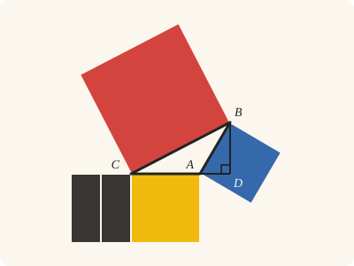
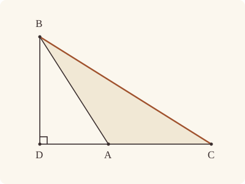
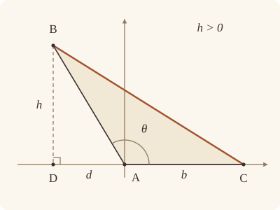

<!-- Generated by scripts/render.py. Do not edit by hand. -->

[Book II](index.md) · [← II.11](11.md) · [II.13 →](13.md)

# Book II, Proposition 12

*The square on the side subtending the obtuse angle*

[Euclid's proof](#euclids-proof) · [In Lean](#in-lean) · [What it rests on](#what-it-rests-on) · [Mishnah](#mishnah)

> In obtuse-angled triangles the square on the side subtending the obtuse angle is greater than the squares on the sides containing the obtuse angle by twice the rectangle contained by one of the sides about the obtuse angle, namely that on which the perpendicular falls, and the straight line cut off outside by the perpendicular towards the obtuse angle.

**In Lean:** ✅ proved, as Euclid states it · Euclid's argument

<p align="center"></p>

<p align="center"><em>In the triangle ABC, obtuse at A, the square on BC (red) equals the squares on BA, AC (blue, yellow) and two rectangles contained by CA, AD (black), D the foot of the perpendicular from B.</em></p>

## Euclid's proof

<p align="center"></p>

Let ABC be an obtuse-angled triangle having the angle BAC obtuse, and let BD be drawn from the point B perpendicular to CA produced;

I say that the square on BC is greater than the squares on BA, AC by twice the rectangle contained by CA, AD.

For, since the straight line CD has been cut at random at the point A,

the square on DC is equal to the squares on CA, AD and twice the rectangle contained by CA, AD. [II. 4]

Let the square on DB be added to each;

therefore the squares on CD, DB are equal to the squares on CA, AD, DB and twice the rectangle CA, AD.

But the square on CB is equal to the squares on CD, DB, for the angle at D is right; [I. 47]

and the square on AB is equal to the squares on AD, DB; [I. 47]

therefore the square on CB is equal to the squares on CA, AB and twice the rectangle contained by CA, AD;

so that the square on CB is greater than the squares on CA, AB by twice the rectangle contained by CA, AD.

Therefore etc.

Q. E. D.

## In Lean

| | |
|---|---|
| Proof | ✅ Proved |
| Statement | The whole enunciation. The perpendicular from B and its foot D on the straight line CA are given; that D falls beyond A, as in Euclid's figure, is proved. |
| Argument | Euclid's. |
| Reviewed | The statement and every passage of the argument read against Heath's text, at commit [`bedbba23e`](https://github.com/dodecaplex-co/stoicheia/commit/bedbba23e) ([the record](../../review/II/12.toml)) |

From [`Elements/BookII/Prop12.lean`](../../Elements/BookII/Prop12.lean). Euclid's sentences are the `--` comments, and our own notes are in `/- … -/`; the lines under each sentence are the Lean that carries it out. The list below marks where a lemma does a step Euclid takes for granted; the `/- … -/` notes in the listing explain smaller adjustments.

**How the Lean follows the text**

- **Done by `BookI.Prop17`.** "Let ABC be an obtuse-angled triangle…" Euclid takes the foot D on CA produced beyond A; Heath gives no reference for I.17 here. The statement gives the perpendicular; the Lean excludes D = A because BAC would be right, uses I.17 to exclude D on the ray from A through C because triangle ABD would have an obtuse angle at A and a right angle at D, and puts C, A, D in order by `Tacit.between_cases`, the rule we assume as System E, Between 6.

```lean
/-- In obtuse-angled triangles the square on the side subtending the obtuse angle is greater than
the squares on the sides containing the obtuse angle by twice the rectangle contained by one of
the sides about the obtuse angle, namely that on which the perpendicular falls, and the straight
line cut off outside by the perpendicular towards the obtuse angle. -/
theorem Prop12 {A B C D : Point} (hABC : Triangle A B C) (hBAC : IsObtuse B A C)
    (hD : Collinear C A D) (hBD : ∀ P : Point, Collinear C A P → P ≠ D → ∠ B D P = ∟) :
    sq B C = sq B A + sq A C + (rect C A A D + rect C A A D) := by
  -- Let ABC be an obtuse-angled triangle having the angle BAC obtuse, and let BD be drawn from
  -- the point B perpendicular to CA produced;
  obtain ⟨CA, hC_CA, hA_CA⟩ := Postulate1 C A hABC.ne₁₃.symm
  have hD_CA : OnLine D CA := by
    obtain ⟨M, hC_M, hA_M, hD_M⟩ := hD
    exact (line_unique hABC.ne₁₃.symm hC_M hA_M hC_CA hA_CA) ▸ hD_M
  have hB_CA : ¬ OnLine B CA := fun h => hABC ⟨CA, hA_CA, h, hC_CA⟩
  have colCA : ∀ {P : Point}, OnLine P CA → Collinear C A P :=
    fun h => ⟨CA, hC_CA, hA_CA, h⟩
  /- Euclid reads "produced" off his figure; we prove it from the obtuse angle,
     which keeps D off A and off the ray from A through C [I. 17]. -/
  have hDA : D ≠ A := by
    intro e
    have h : ∟ < ∠ B A C := hBAC
    rw [← e, hBD C (colCA hC_CA) (e ▸ hABC.ne₁₃.symm)] at h
    exact lt_irrefl _ h
  have hDB : D ≠ B := fun e => hB_CA (e ▸ hD_CA)
  have hD_not_ray : ¬ OnRay D A C := by
    intro hray
    have hABD : Triangle A B D := Triangle.of_line hA_CA hD_CA hDA.symm hB_CA |>.acb
    have h17 := (BookI.Prop17 hABD).2.1
    rw [angle_onRay_right hray hABC.ne₁₂.symm, angle_symm hDA.symm hDB.symm,
      hBD A (colCA hA_CA) hDA.symm] at h17
    exact lt_irrefl _ (lt_trans (add_lt_add_right ∟ hBAC) h17)
  have hCAD : Between C A D := by
    by_cases hDC : D = C
    · rw [hDC] at hD_not_ray
      exact absurd (OnRay.self hABC.ne₁₃) hD_not_ray
    rcases between_cases hABC.ne₁₃.symm hDA.symm (Ne.symm hDC) hC_CA hA_CA hD_CA with
      h | h | h
    · exact h
    · exact absurd (OnRay.of_beyond h) hD_not_ray
    · exact absurd (OnRay.of_between (between_symm h)) hD_not_ray
  -- I say that the square on BC is greater than the squares on BA, AC by twice the rectangle
  -- contained by CA, AD.
  -- For, since the straight line CD has been cut at random at the point A,
  have hDC : D ≠ C := (ne_of_between_ends hCAD).symm
  -- the square on DC is equal to the squares on CA, AD and twice the rectangle contained by
  -- CA, AD. [II. 4]
  have h4 : sq D C = sq C A + sq A D + (rect C A A D + rect C A A D) := by
    rw [sq_symm D C]
    exact Prop4 hCAD
  -- Let the square on DB be added to each;
  have hadded := CommonNotion2 h4 (rfl : sq D B = sq D B)
  -- therefore the squares on CD, DB are equal to the squares on CA, AD, DB and twice the
  -- rectangle CA, AD.
  have hadd : sq C D + sq D B =
      sq C A + (sq A D + sq D B) + (rect C A A D + rect C A A D) := by
    rw [sq_symm C D, hadded]
    ac_rfl
  -- But the square on CB is equal to the squares on CD, DB, for the angle at D is
  -- right; [I. 47]
  have hCDB : ∠ C D B = ∟ := by
    rw [angle_symm hDC.symm hDB.symm]
    exact hBD C (colCA hC_CA) hDC.symm
  have h47a : sq C B = sq C D + sq D B :=
    BookI.Prop47.sq (Triangle.of_line hD_CA hC_CA hDC hB_CA) hCDB
  -- and the square on AB is equal to the squares on AD, DB; [I. 47]
  have hADB : ∠ A D B = ∟ := by
    rw [angle_symm hDA.symm hDB.symm]
    exact hBD A (colCA hA_CA) hDA.symm
  have h47b : sq A B = sq A D + sq D B :=
    BookI.Prop47.sq (Triangle.of_line hD_CA hA_CA hDA hB_CA) hADB
  -- therefore the square on CB is equal to the squares on CA, AB and twice the rectangle
  -- contained by CA, AD;
  have h : sq C B = sq C A + sq A B + (rect C A A D + rect C A A D) := by
    rw [h47a, hadd, ← h47b]
  -- so that the square on CB is greater than the squares on CA, AB by twice the rectangle
  -- contained by CA, AD.
  rw [sq_symm B C, h, sq_symm C A, sq_symm A B]
  ac_rfl
  -- Therefore etc.
  -- Q. E. D.
```

## What it rests on

| | |
|---|---|
| Heath's references | [I.47](../I/47.md), [II.4](04.md) |
| Lean cites | [I.4](../I/04.md), [I.17](../I/17.md), [I.28](../I/28.md), [I.34](../I/34.md), [I.46](../I/46.md), [I.47](../I/47.md), [II.4](04.md) |
| Postulates | 1, 2, 3, 4, 5 |
| Definitions taken as axioms | Def. I.15 |
| Common Notions | 1, 2, 3, 4, 5 |
| Tacit rules | 39 (listed below) |
| Its own Lean calls | Postulate 1; 7 tacit rules |
| Through lemmas | Postulates 2 and 3; Def. I.15; 28 tacit rules |

Some of these come in through lemmas [shared](../../CERTIFICATE.md#shared-steps) by many proofs: [`BookI.Prop47.sq`](../../Elements/BookII/Rectangles.lean#L411) (I.4, I.28, I.34, I.46, I.47).

_Postulates, definitions, Common Notions and tacit rules: all that this proof rests on, counting those of the propositions it cites. The last two rows say which of the postulates, definitions and tacit rules its own Lean calls, in the proof or a helper written for it, and which it does not call but reaches through lemmas, of Book Zero or shared (a proposition it cites may rest on these too); the rest come in only through the propositions it cites or the Common Notions._

<details><summary>The 39 tacit rules beneath this proof, counting those of the propositions it cites</summary>

_(used here) marks a rule this proof's own Lean calls, in the proof or a helper written for it; (through …) marks one its own Lean does not call but reaches through the lemmas named, of [Book Zero](../../Elements/Figure) or shared, though a proposition it cites may rest on it too; and a rule with no mark comes in only through a proposition it cites or a Common Notion. The names in brackets are System E's: an Intersection rule says when straight lines and circles must meet, and an Intersections rule takes a point where they do (see [Book I's introduction](../I/index.md))._

**Reading the figure**

- [`between_cases`](../../Elements/Foundations/Tacit/Diagram.lean#L54) (used here): Of three different points on a straight line, one is between the other two. (Between 6)
- [`between_symm`](../../Elements/Foundations/Tacit/Diagram.lean#L47) (used here): If B is between A and C, it is between C and A. (Between 1)
- [`circles_meet`](../../Elements/Foundations/Tacit/Diagram.lean#L91) (through [`BookI.Prop47.sq`](../../Elements/BookII/Rectangles.lean#L411), [`OnRay.of_between`](../../Elements/Figure/Rays.lean#L34) and [`OnRay.of_beyond`](../../Elements/Figure/Rays.lean#L41)): If each circle passes through a point inside the other, the circles cut one another. This is the step Euclid takes for granted in I.1. (Intersection 5)
- [`circles_meet_same_side`](../../Elements/Foundations/Tacit/Constructions.lean#L79) (through [`BookI.Prop47.sq`](../../Elements/BookII/Rectangles.lean#L411), [`OnRay.of_between`](../../Elements/Figure/Rays.lean#L34) and [`OnRay.of_beyond`](../../Elements/Figure/Rays.lean#L41)): Two circles that cut one another do so on each side of the straight line through their centres. (Intersections 8)
- [`exists_point`](../../Elements/Foundations/Tacit/Constructions.lean#L35) (through [`BookI.Prop47.sq`](../../Elements/BookII/Rectangles.lean#L411), [`Triangle.ne₁₂`](../../Elements/Figure/Triangles.lean#L22) and [`Triangle.ne₁₃`](../../Elements/Figure/Triangles.lean#L36)): Let a point be taken. (Points 1)
- [`exists_point_inside_circle`](../../Elements/Foundations/Tacit/Constructions.lean#L42) (through [`BookI.Prop47.sq`](../../Elements/BookII/Rectangles.lean#L411), [`OnRay.of_between`](../../Elements/Figure/Rays.lean#L34) and [`OnRay.of_beyond`](../../Elements/Figure/Rays.lean#L41)): Let a point be taken inside the circle α. (Points 8)
- [`exists_point_on_line`](../../Elements/Foundations/Tacit/Constructions.lean#L38) (through [`BookI.Prop47.sq`](../../Elements/BookII/Rectangles.lean#L411), [`OnRay.of_between`](../../Elements/Figure/Rays.lean#L34) and [`OnRay.of_beyond`](../../Elements/Figure/Rays.lean#L41)): Let a point be taken on the straight line L. (Points 2)
- [`line_circle_between`](../../Elements/Foundations/Tacit/Constructions.lean#L67) (through [`BookI.Prop47.sq`](../../Elements/BookII/Rectangles.lean#L411), [`OnRay.of_between`](../../Elements/Figure/Rays.lean#L34) and [`OnRay.of_beyond`](../../Elements/Figure/Rays.lean#L41)): A straight line through a point B inside a circle, heading out to a point C outside it, cuts the circle between B and C. (Intersections 4)
- [`line_circle_beyond`](../../Elements/Foundations/Tacit/Constructions.lean#L73) (through [`BookI.Prop47.sq`](../../Elements/BookII/Rectangles.lean#L411), [`OnRay.of_between`](../../Elements/Figure/Rays.lean#L34) and [`OnRay.of_beyond`](../../Elements/Figure/Rays.lean#L41)): A straight line through a point B inside a circle, produced beyond B away from C, cuts the circle there. (Intersections 5)
- [`line_unique`](../../Elements/Foundations/Tacit/Diagram.lean#L41) (used here): Two points determine a straight line. (Generalities 1)
- [`lines_meet_of_opposite_sides`](../../Elements/Foundations/Tacit/Diagram.lean#L86) (through [`BookI.Prop47.sq`](../../Elements/BookII/Rectangles.lean#L411)): A straight line joining points on opposite sides of L crosses L. (Intersection 1)
- [`not_between_of_between`](../../Elements/Foundations/Tacit/Diagram.lean#L50) (through [`BookI.Prop47.sq`](../../Elements/BookII/Rectangles.lean#L411), [`OnRay.of_between`](../../Elements/Figure/Rays.lean#L34), [`OnRay.of_beyond`](../../Elements/Figure/Rays.lean#L41) and 3 other lemmas): If B is between A and C, then A is not between B and C. (Between 1)
- [`not_on_line_of_same_side`](../../Elements/Foundations/Tacit/Diagram.lean#L60) (through [`BookI.Prop47.sq`](../../Elements/BookII/Rectangles.lean#L411), [`OnRay.of_between`](../../Elements/Figure/Rays.lean#L34) and [`OnRay.of_beyond`](../../Elements/Figure/Rays.lean#L41)): Points on one side of a straight line are not on it. (Same side 3)
- [`pasch2`](../../Elements/Foundations/Tacit/Diagram.lean#L71) (through [`BookI.Prop47.sq`](../../Elements/BookII/Rectangles.lean#L411), [`OnRay.of_between`](../../Elements/Figure/Rays.lean#L34) and [`OnRay.of_beyond`](../../Elements/Figure/Rays.lean#L41)): If B is between A and C, A is on L and B is off it, then B and C are on the same side of L: a straight line that leaves L at A does not cross it again. (Pasch 2)
- [`same_side_trans`](../../Elements/Foundations/Tacit/Diagram.lean#L64) (through [`BookI.Prop47.sq`](../../Elements/BookII/Rectangles.lean#L411), [`OnRay.of_between`](../../Elements/Figure/Rays.lean#L34) and [`OnRay.of_beyond`](../../Elements/Figure/Rays.lean#L41)): Two points on the same side of a straight line as a third point are on the same side as each other. (Same side 4)

**Lengths, angles and areas**

- [`angle_add_of_inside`](../../Elements/Foundations/Tacit/Transfer.lean#L47) (through [`BookI.Prop47.sq`](../../Elements/BookII/Rectangles.lean#L411)): If D lies within the angle BAC, then BAC is made up of BAD and DAC. (Diagram-angle 2)
- [`angle_eq_of_same_rays`](../../Elements/Foundations/Tacit/Transfer.lean#L54) (through [`angle_onRay_right`](../../Elements/Figure/Angles.lean#L49)): The angle doesn't change if its arms are traced through other points on the same rays. (Diagram-angle 4)
- [`angle_le_two_right`](../../Elements/Foundations/Tacit/Metric.lean#L33): No angle exceeds two right angles. (Metric 5)
- [`angle_symm`](../../Elements/Foundations/Tacit/Metric.lean#L30) (used here): The angle ABC is the angle CBA. (Metric 4)
- [`area_add_of_between`](../../Elements/Foundations/Tacit/Transfer.lean#L70) (through [`BookI.Prop47.sq`](../../Elements/BookII/Rectangles.lean#L411)): Cutting a triangle in two from a vertex adds up. (Diagram-area 2)
- [`area_congruent`](../../Elements/Foundations/Tacit/Metric.lean#L44): Triangles equal in all their sides and angles are equal in area. Euclid uses this without comment once he has shown two triangles congruent. (Metric 9)
- [`area_degenerate`](../../Elements/Foundations/Tacit/Metric.lean#L36) (through [`BookI.Prop47.sq`](../../Elements/BookII/Rectangles.lean#L411)): A "triangle" with a repeated corner has no area. (Metric 6)
- [`area_eq_zero_of_on_line`](../../Elements/Foundations/Tacit/Transfer.lean#L62) (through [`BookI.Prop47.sq`](../../Elements/BookII/Rectangles.lean#L411)): A "triangle" whose corners lie on one straight line has no area. (Diagram-area 1)
- [`area_rotate`](../../Elements/Foundations/Tacit/Metric.lean#L39) (through [`BookI.Prop47.sq`](../../Elements/BookII/Rectangles.lean#L411)): The triangle ABC is the triangle CAB. (Metric 8)
- [`len_add_of_between`](../../Elements/Foundations/Tacit/Transfer.lean#L27) (through [`BookI.Prop47.sq`](../../Elements/BookII/Rectangles.lean#L411), [`OnRay.of_between`](../../Elements/Figure/Rays.lean#L34), [`OnRay.of_beyond`](../../Elements/Figure/Rays.lean#L41) and 3 other lemmas): If B is between A and C, then AB and BC together make up AC. (Diagram-segment 1)
- [`len_self`](../../Elements/Foundations/Tacit/Metric.lean#L24) (through [`BookI.Prop47.sq`](../../Elements/BookII/Rectangles.lean#L411), [`OnRay.of_between`](../../Elements/Figure/Rays.lean#L34), [`OnRay.of_beyond`](../../Elements/Figure/Rays.lean#L41) and 3 other lemmas): The "straight line" from a point to itself has no length. (Metric 1)
- [`len_symm`](../../Elements/Foundations/Tacit/Metric.lean#L27) (through [`BookI.Prop47.sq`](../../Elements/BookII/Rectangles.lean#L411), [`OnRay.of_between`](../../Elements/Figure/Rays.lean#L34), [`OnRay.of_beyond`](../../Elements/Figure/Rays.lean#L41) and 1 other lemma): The straight line AB is the straight line BA. (Metric 3)
- [`on_line_of_area_eq_zero`](../../Elements/Foundations/Tacit/Transfer.lean#L66): A triangle with no area has its corners on one straight line. (Diagram-area 1)
- [`radius_ne_zero`](../../Elements/Foundations/Tacit/Metric.lean#L62) (through [`BookI.Prop47.sq`](../../Elements/BookII/Rectangles.lean#L411), [`OnRay.of_between`](../../Elements/Figure/Rays.lean#L34), [`OnRay.of_beyond`](../../Elements/Figure/Rays.lean#L41) and 3 other lemmas): A circle's radius is not nothing: the straight line from the centre to a point on the circle has some length. A rule of our own, not one of System E's: every circle is drawn with a centre and a distance (Postulate 3).
- [`same_ray_of_angle_eq_zero`](../../Elements/Foundations/Tacit/Transfer.lean#L42) (through [`BookI.Prop47.sq`](../../Elements/BookII/Rectangles.lean#L411)): If the angle BAC is nothing, C lies on the ray from A through B. (Diagram-angle 1)

**Superposition**

- [`superposition`](../../Elements/Foundations/Tacit/Superposition.lean#L52): **Superposition.** A hypothetical placement of a triangle on a given ray and side permits a restricted derivation of metric equalities about the figure already given. The derivation introduces no further objects, cites each geometric law it uses, and exports no symbol of the placement.

**Rules of magnitude**

- [`add_assoc`](../../Elements/Foundations/Tacit/Magnitudes.lean#L23) (through [`BookI.Prop47.sq`](../../Elements/BookII/Rectangles.lean#L411) and [`Magnitude.instAssociative`](../../Elements/Figure/Areas.lean#L36)): Adding three magnitudes in a row, it makes no difference whether the first two or the last two are added first. (System E §3.5)
- [`add_comm`](../../Elements/Foundations/Tacit/Magnitudes.lean#L26) (through [`BookI.Prop47.sq`](../../Elements/BookII/Rectangles.lean#L411), [`Magnitude.instCommutative`](../../Elements/Figure/Areas.lean#L40), [`OnRay.of_between`](../../Elements/Figure/Rays.lean#L34) and 4 other lemmas): The order of adding does not matter. (System E §3.5)
- [`add_lt_add_right`](../../Elements/Foundations/Tacit/Magnitudes.lean#L45) (used here): Adding the same thing to both sides keeps "less than". (System E §3.5)
- [`add_zero`](../../Elements/Foundations/Tacit/Magnitudes.lean#L29) (through [`BookI.Prop47.sq`](../../Elements/BookII/Rectangles.lean#L411)): Adding nothing changes nothing. (System E §3.5)
- [`lt_irrefl`](../../Elements/Foundations/Tacit/Magnitudes.lean#L32) (used here): No magnitude is less than itself. (System E §3.5)
- [`lt_trans`](../../Elements/Foundations/Tacit/Magnitudes.lean#L35) (used here): What is less than the less is less still. (System E §3.5)
- [`lt_trichotomy`](../../Elements/Foundations/Tacit/Magnitudes.lean#L39) (through [`BookI.Prop47.sq`](../../Elements/BookII/Rectangles.lean#L411), [`OnRay.of_between`](../../Elements/Figure/Rays.lean#L34), [`OnRay.of_beyond`](../../Elements/Figure/Rays.lean#L41) and 3 other lemmas): Of two magnitudes, one is less, or they are equal, or the other is less. (System E §3.5)
- [`not_lt_zero`](../../Elements/Foundations/Tacit/Magnitudes.lean#L42) (through [`BookI.Prop47.sq`](../../Elements/BookII/Rectangles.lean#L411), [`OnRay.of_between`](../../Elements/Figure/Rays.lean#L34), [`OnRay.of_beyond`](../../Elements/Figure/Rays.lean#L41) and 3 other lemmas): Nothing is less than zero. (System E §3.5)

</details>

## Mishnah

_Our commentary: why Euclid's proof, and ours, look as they do._

I.47 settles the right-angled triangle, and II.12 and II.13 take the other two kinds. When the angle BAC is obtuse, the square on BC exceeds the squares on BA, AC, and Euclid says by exactly how much: twice the rectangle contained by CA, AD, where AD is the straight line the perpendicular from B cuts off outside the triangle. His figure puts D beyond A, on "CA produced". Our statement gives the perpendicular, and our proof has to find its foot. It is not A, or the angle BAC would be right. Nor is it on the ray from A through C, or the triangle ABD would have an obtuse angle and a right angle, which I.17 forbids. So C, A, D lie in that order, and the Lean cites I.17 where Heath gives no reference.

Book II's pictures of areas do not help with the squares on a triangle's sides, so, Heath writes, "only two lines of proof are possible, (1) by means of the *results* of certain earlier propositions in Book II. combined with the *result* of I. 47 and (2) by means of the procedure in Euclid's proof of I. 47 itself" (vol. 1, p. 404). Euclid takes the first, II.4 for the square on DC and I.47 twice, and we follow him. Proofs of the second kind are, as alternatives, "alone worth giving"; Heath traces them past Dionysius Lardner's Euclid of 1828 to Gregory of St. Vincent's work of 1647 (vol. 1, p. 404). The one he gives shows two rectangles equal on the way, "a particular case of the theorem in III. 35" (vol. 1, p. 405).

Heath reports from an-Nairīzī a converse by Heron, related to II.12 as I.48 is to I.47: "*In any triangle, if the square on one of the sides is greater than the squares on the other two sides, the angle contained by the latter is obtuse*" (vol. 1, p. 405). Heron sets beside the triangle a right-angled one with the same two sides about the angle. By I.47 its base is the less, and by I.25 the angle BAC is greater than its right angle.

**The modern way.** Put $\mathrm{A} = (0, 0)$, $\mathrm{C} = (b, 0)$ and $\mathrm{B} = (-d, h)$, with $b, d \gt 0$ and $h \ne 0$, so that $\mathrm{D} = (-d, 0)$. Then $\mathrm{BC}^2 = (b + d)^2 + h^2 = b^2 + (d^2 + h^2) + 2bd = \mathrm{AC}^2 + \mathrm{AB}^2 + 2 \cdot \mathrm{CA} \cdot \mathrm{AD}$. If $\theta$ is the angle BAC, with $\pi/2 \lt \theta \lt \pi$, then $\mathrm{AD} = -\mathrm{AB}\cos\theta$, and this is the law of cosines, $\mathrm{BC}^2 = \mathrm{AB}^2 + \mathrm{AC}^2 - 2 \cdot \mathrm{AB} \cdot \mathrm{AC}\cos\theta$.

<p align="center"></p>

## Further reading

- Eli Maor's [*Trigonometric Delights*](https://press.princeton.edu/books/paperback/9780691202198/trigonometric-delights) (2020 paperback; first published 1998) follows trigonometry through chosen episodes of its history, from the Greeks' tables of straight lines in a circle to imaginary angles, and tells where the cosine of the modern way came from.

[Book II](index.md) · [← II.11](11.md) · [II.13 →](13.md)

---

<sub>Euclid's text: T. L. Heath, *The Thirteen Books of Euclid's Elements*, vol. 1 (Cambridge, 1908), pp. 403–404; [scan leaves n423–n424](https://archive.org/details/thirteenbookseu02heibgoog/page/n423); [figure on n424](https://archive.org/details/thirteenbookseu02heibgoog/page/n424). Public domain.</sub>

<sub>The tacit rules follow the System E of Jeremy Avigad, Edward Dean and John Mumma, read alongside LeanEuclid (Logan Murphy, Kaiyu Yang, Jialiang Sun, Zhaoyu Li, Anima Anandkumar and Xujie Si).</sub>
