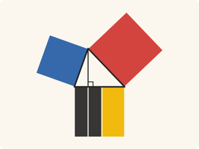
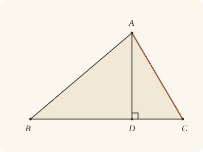
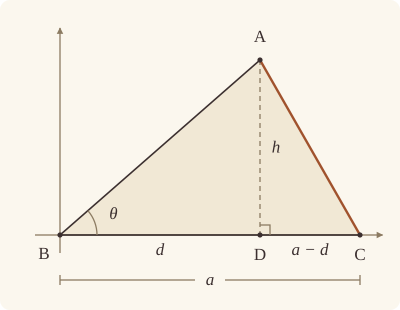

<!-- Generated by scripts/render.py. Do not edit by hand. -->

[Book II](index.md) · [← II.12](12.md) · [II.14 →](14.md)

# Book II, Proposition 13

*The square on the side subtending the acute angle*

[Euclid's proof](#euclids-proof) · [In Lean](#in-lean) · [What it rests on](#what-it-rests-on) · [Mishnah](#mishnah)

> In acute-angled triangles the square on the side subtending the acute angle is less than the squares on the sides containing the acute angle by twice the rectangle contained by one of the sides about the acute angle, namely that on which the perpendicular falls, and the straight line cut off within by the perpendicular towards the acute angle.

**In Lean:** ✅ proved, as Euclid states it · Euclid's argument

<p align="center"></p>

<p align="center"><em>In the triangle ABC, acute at B and C, the square on AC (red) equals the squares on AB (blue) and BC (yellow with black) less two rectangles contained by CB, BD (black), with AD perpendicular to BC.</em></p>

## Euclid's proof

<p align="center"></p>

<p align="center"><em>Drawn for one case: an acute angle at A, as in Heath's figure.</em></p>

Let ABC be an acute-angled triangle having the angle at B acute, and let AD be drawn from the point A perpendicular to BC;

I say that the square on AC is less than the squares on CB, BA by twice the rectangle contained by CB, BD.

For, since the straight line CB has been cut at random at D,

the squares on CB, BD are equal to twice the rectangle contained by CB, BD and the square on DC. [II. 7]

Let the square on DA be added to each;

therefore the squares on CB, BD, DA are equal to twice the rectangle contained by CB, BD and the squares on AD, DC.

But the square on AB is equal to the squares on BD, DA, for the angle at D is right; [I. 47]

and the square on AC is equal to the squares on AD, DC;

therefore the squares on CB, BA are equal to the square on AC and twice the rectangle CB, BD,

so that the square on AC alone is less than the squares on CB, BA by twice the rectangle contained by CB, BD.

Therefore etc.

Q. E. D.

## In Lean

| | |
|---|---|
| Proof | ✅ Proved |
| Statement | The whole enunciation. Asks for acute angles at B and C and nothing at A, so it says more than Euclid's acute-angled triangles; that D falls within CB is proved. |
| Argument | Euclid's. |
| Representation | Euclid's enunciation speaks of acute-angled triangles, all three angles acute. The statement leaves out the angle at A, which plays no part; the acute angles at B and C keep the foot D within CB, as "cut off within" and II.7 need. The perpendicular from A and its foot D on BC are given. The scholiast's wider reading, any triangle acute-angled at B, is not stated: with a right angle at C the foot D is C itself, and with an obtuse angle at C it falls beyond C. |
| Reviewed | The statement and every passage of the argument read against Heath's text, at commit [`10c02b989`](https://github.com/jackChallis/stoicheia/commit/10c02b989) ([the record](../../review/II/13.toml)) |

From [`Elements/BookII/Prop13.lean`](../../Elements/BookII/Prop13.lean). Euclid's sentences are the `--` comments, and our own notes are in `/- … -/`; the lines under each sentence are the Lean that carries it out. The list below marks where a lemma does a step Euclid takes for granted and where the statement already gives a step; the `/- … -/` notes in the listing explain smaller adjustments.

**How the Lean follows the text**

- **Already given.** "Let ABC be an acute-angled triangle…" The statement gives the triangle, the acute angles at B and C, and the perpendicular AD with its foot D on BC.
- **Done by `Prop13.not_beyond`.** "For, since the straight line CB has been cut at random at D…" Euclid reads off his figure that D falls within CB; the Lean proves it: a foot beyond B or C would give triangle ABD or ACD, respectively, a right angle at D and an obtuse angle at the end passed (I.13, I.17). The Lean also rules out D = B and D = C because the corresponding angle would be both acute and right, leaving `Tacit.between_cases`, the rule we assume as System E, Between 6, to put D between B and C.

<details><summary>Before the theorem, one lemma: <code>Prop13.not_beyond</code> (22 lines)</summary>

```lean
/-- The foot does not fall beyond X when the angle AXY is acute, because the angle
DXA beside it would be obtuse [I. 13] and the triangle AXD would have an obtuse and
a right angle [I. 17]. Euclid reads this off his figure when he takes the straight
line CB to be "cut at random at D". -/
theorem Prop13.not_beyond {A D X Y : Point} {L : Line} (hX : OnLine X L) (hY : OnLine Y L)
    (hD_L : OnLine D L) (hA_L : ¬ OnLine A L) (hacute : IsAcute A X Y)
    (hright : ∠ A D X = ∟) : ¬ Between D X Y := by
  intro h
  have hDX : D ≠ X := ne_of_between h
  have hDA : D ≠ A := fun e => hA_L (e ▸ hD_L)
  have h13 := BookI.Prop13 h (fun ⟨M, hD_M, hY_M, hA_M⟩ =>
    hA_L ((line_unique (ne_of_between_ends h) hD_M hY_M hD_L hY) ▸ hA_M))
  have hAXD : Triangle A X D := (Triangle.of_line hX hD_L hDX.symm hA_L).cab
  have hobtuse : ∟ < ∠ D X A := by
    have h₁ : ∠ D X A + ∠ A X Y < ∠ D X A + ∟ := by
      rw [add_comm _ ∟, add_comm (∠ D X A)]
      exact add_lt_add_right _ hacute
    rw [h13] at h₁
    exact Magnitude.lt_of_add_lt_add_right (by rw [add_comm]; exact h₁)
  have h17 := (BookI.Prop17 hAXD).1
  rw [angle_symm hAXD.ne₁₂ hDX, angle_symm hDX.symm hDA.symm, hright] at h17
  exact lt_irrefl _ (lt_trans (add_lt_add_right ∟ hobtuse) h17)
```

</details>

```lean
/-- In acute-angled triangles the square on the side subtending the acute angle is less than the
squares on the sides containing the acute angle by twice the rectangle contained by one of the
sides about the acute angle, namely that on which the perpendicular falls, and the straight line
cut off within by the perpendicular towards the acute angle. -/
theorem Prop13 {A B C D : Point} (hABC : Triangle A B C) (hB : IsAcute A B C) (hC : IsAcute A C B)
    (hD : Collinear B C D) (hAD : ∀ P : Point, Collinear B C P → P ≠ D → ∠ A D P = ∟) :
    sq A C + (rect C B B D + rect C B B D) = sq C B + sq B A := by
  -- Let ABC be an acute-angled triangle having the angle at B acute, and let AD be drawn from
  -- the point A perpendicular to BC;
  obtain ⟨BC, hB_BC, hC_BC⟩ := Postulate1 B C hABC.ne₂₃
  have hD_BC : OnLine D BC := by
    obtain ⟨L, hB_L, hC_L, hD_L⟩ := hD
    exact (line_unique hABC.ne₂₃ hB_L hC_L hB_BC hC_BC) ▸ hD_L
  have hA_BC : ¬ OnLine A BC := hABC.bca.off_line hB_BC hC_BC
  have col : ∀ {P : Point}, OnLine P BC → Collinear B C P :=
    fun h => ⟨BC, hB_BC, hC_BC, h⟩
  have hDB : D ≠ B := by
    intro e
    have h : ∠ A B C < ∟ := hB
    rw [← e, hAD C (col hC_BC) (e ▸ hABC.ne₂₃.symm)] at h
    exact lt_irrefl _ h
  have hDC : D ≠ C := by
    intro e
    have h : ∠ A C B < ∟ := hC
    rw [← e, hAD B (col hB_BC) (e ▸ hABC.ne₂₃)] at h
    exact lt_irrefl _ h
  have hDA : D ≠ A := fun e => hA_BC (e ▸ hD_BC)
  have hADB : ∠ A D B = ∟ := hAD B (col hB_BC) hDB.symm
  have hADC : ∠ A D C = ∟ := hAD C (col hC_BC) hDC.symm
  -- I say that the square on AC is less than the squares on CB, BA by twice the rectangle
  -- contained by CB, BD.
  -- For, since the straight line CB has been cut at random at D,
  /- "Cut off within": the acute angles at B and C exclude a foot beyond either
     end, by I.13 and I.17. -/
  have hBDC : Between B D C := by
    rcases between_cases hDB.symm hDC hABC.ne₂₃ hB_BC hD_BC hC_BC with h | h | h
    · exact h
    · exact absurd h (Prop13.not_beyond hB_BC hC_BC hD_BC hA_BC hB hADB)
    · exact absurd (between_symm h)
        (Prop13.not_beyond hC_BC hB_BC hD_BC hA_BC hC hADC)
  -- the squares on CB, BD are equal to twice the rectangle contained by CB, BD and the square
  -- on DC. [II. 7]
  have h7 : sq C B + sq B D = rect C B B D + rect C B B D + sq D C :=
    Prop7 (between_symm hBDC)
  -- Let the square on DA be added to each;
  have haddDA := CommonNotion2 h7 (rfl : sq D A = sq D A)
  -- therefore the squares on CB, BD, DA are equal to twice the rectangle contained by CB, BD
  -- and the squares on AD, DC.
  have hadd : sq C B + sq B D + sq D A =
      rect C B B D + rect C B B D + (sq A D + sq D C) := by
    rw [haddDA, sq_symm D A]
    ac_rfl
  -- But the square on AB is equal to the squares on BD, DA, for the angle at D is
  -- right; [I. 47]
  have hBDA : ∠ B D A = ∟ := (angle_symm hDB.symm hDA.symm).trans hADB
  have h47a : sq A B = sq B D + sq D A := by
    rw [sq_symm A B]
    exact BookI.Prop47.sq (Triangle.of_line hD_BC hB_BC hDB hA_BC) hBDA
  -- and the square on AC is equal to the squares on AD, DC;
  have h47b : sq A C = sq A D + sq D C :=
    BookI.Prop47.sq (Triangle.of_line hD_BC hC_BC hDC hA_BC).acb hADC
  -- therefore the squares on CB, BA are equal to the square on AC and twice the rectangle CB,
  -- BD,
  have h : sq C B + sq B A = sq A C + (rect C B B D + rect C B B D) := by
    rw [sq_symm B A, h47a, h47b, ← add_assoc, hadd]
    ac_rfl
  -- so that the square on AC alone is less than the squares on CB, BA by twice the rectangle
  -- contained by CB, BD.
  exact h.symm
  -- Therefore etc.
  -- Q. E. D.
```

## What it rests on

| | |
|---|---|
| Heath's references | [I.47](../I/47.md), [II.7](07.md) |
| Lean cites | [I.4](../I/04.md), [I.13](../I/13.md), [I.17](../I/17.md), [I.28](../I/28.md), [I.34](../I/34.md), [I.46](../I/46.md), [I.47](../I/47.md), [II.7](07.md) |
| Postulates | 1, 2, 3, 4, 5 |
| Definitions taken as axioms | Def. I.15 |
| Common Notions | 1, 2, 3, 4, 5 |
| Tacit rules | 39 (listed below) |
| Its own Lean calls | Postulate 1; 9 tacit rules |
| Through lemmas | Postulates 2 and 3; Def. I.15; 25 tacit rules |

Some of these come in through lemmas [shared](../../CERTIFICATE.md#shared-steps) by many proofs: [`BookI.Prop47.sq`](../../Elements/BookII/Rectangles.lean#L411) (I.4, I.28, I.34, I.46, I.47).

_Postulates, definitions, Common Notions and tacit rules: all that this proof rests on, counting those of the propositions it cites. The last two rows say which of the postulates, definitions and tacit rules its own Lean calls, in the proof or a helper written for it, and which it does not call but reaches through lemmas, of Book Zero or shared (a proposition it cites may rest on these too); the rest come in only through the propositions it cites or the Common Notions._

<details><summary>The 39 tacit rules beneath this proof, counting those of the propositions it cites</summary>

_(used here) marks a rule this proof's own Lean calls, in the proof or a helper written for it; (through …) marks one its own Lean does not call but reaches through the lemmas named, of [Book Zero](../../Elements/Figure) or shared, though a proposition it cites may rest on it too; and a rule with no mark comes in only through a proposition it cites or a Common Notion. The names in brackets are System E's: an Intersection rule says when straight lines and circles must meet, and an Intersections rule takes a point where they do (see [Book I's introduction](../I/index.md))._

**Reading the figure**

- [`between_cases`](../../Elements/Foundations/Tacit/Diagram.lean#L54) (used here): Of three different points on a straight line, one is between the other two. (Between 6)
- [`between_symm`](../../Elements/Foundations/Tacit/Diagram.lean#L47) (used here): If B is between A and C, it is between C and A. (Between 1)
- [`circles_meet`](../../Elements/Foundations/Tacit/Diagram.lean#L91) (through [`BookI.Prop47.sq`](../../Elements/BookII/Rectangles.lean#L411)): If each circle passes through a point inside the other, the circles cut one another. This is the step Euclid takes for granted in I.1. (Intersection 5)
- [`circles_meet_same_side`](../../Elements/Foundations/Tacit/Constructions.lean#L79) (through [`BookI.Prop47.sq`](../../Elements/BookII/Rectangles.lean#L411)): Two circles that cut one another do so on each side of the straight line through their centres. (Intersections 8)
- [`exists_point`](../../Elements/Foundations/Tacit/Constructions.lean#L35) (through [`BookI.Prop47.sq`](../../Elements/BookII/Rectangles.lean#L411), [`Triangle.ne₁₂`](../../Elements/Figure/Triangles.lean#L22) and [`Triangle.ne₂₃`](../../Elements/Figure/Triangles.lean#L29)): Let a point be taken. (Points 1)
- [`exists_point_inside_circle`](../../Elements/Foundations/Tacit/Constructions.lean#L42) (through [`BookI.Prop47.sq`](../../Elements/BookII/Rectangles.lean#L411)): Let a point be taken inside the circle α. (Points 8)
- [`exists_point_on_line`](../../Elements/Foundations/Tacit/Constructions.lean#L38) (through [`BookI.Prop47.sq`](../../Elements/BookII/Rectangles.lean#L411)): Let a point be taken on the straight line L. (Points 2)
- [`line_circle_between`](../../Elements/Foundations/Tacit/Constructions.lean#L67) (through [`BookI.Prop47.sq`](../../Elements/BookII/Rectangles.lean#L411)): A straight line through a point B inside a circle, heading out to a point C outside it, cuts the circle between B and C. (Intersections 4)
- [`line_circle_beyond`](../../Elements/Foundations/Tacit/Constructions.lean#L73) (through [`BookI.Prop47.sq`](../../Elements/BookII/Rectangles.lean#L411)): A straight line through a point B inside a circle, produced beyond B away from C, cuts the circle there. (Intersections 5)
- [`line_unique`](../../Elements/Foundations/Tacit/Diagram.lean#L41) (used here): Two points determine a straight line. (Generalities 1)
- [`lines_meet_of_opposite_sides`](../../Elements/Foundations/Tacit/Diagram.lean#L86) (through [`BookI.Prop47.sq`](../../Elements/BookII/Rectangles.lean#L411)): A straight line joining points on opposite sides of L crosses L. (Intersection 1)
- [`not_between_of_between`](../../Elements/Foundations/Tacit/Diagram.lean#L50) (through [`BookI.Prop47.sq`](../../Elements/BookII/Rectangles.lean#L411), [`Tacit.ne_of_between`](../../Elements/Figure/RuleBase.lean#L146) and [`Tacit.ne_of_between_ends`](../../Elements/Figure/Incidence.lean#L66)): If B is between A and C, then A is not between B and C. (Between 1)
- [`not_on_line_of_same_side`](../../Elements/Foundations/Tacit/Diagram.lean#L60) (through [`BookI.Prop47.sq`](../../Elements/BookII/Rectangles.lean#L411)): Points on one side of a straight line are not on it. (Same side 3)
- [`pasch2`](../../Elements/Foundations/Tacit/Diagram.lean#L71) (through [`BookI.Prop47.sq`](../../Elements/BookII/Rectangles.lean#L411)): If B is between A and C, A is on L and B is off it, then B and C are on the same side of L: a straight line that leaves L at A does not cross it again. (Pasch 2)
- [`same_side_trans`](../../Elements/Foundations/Tacit/Diagram.lean#L64) (through [`BookI.Prop47.sq`](../../Elements/BookII/Rectangles.lean#L411)): Two points on the same side of a straight line as a third point are on the same side as each other. (Same side 4)

**Lengths, angles and areas**

- [`angle_add_of_inside`](../../Elements/Foundations/Tacit/Transfer.lean#L47) (through [`BookI.Prop47.sq`](../../Elements/BookII/Rectangles.lean#L411)): If D lies within the angle BAC, then BAC is made up of BAD and DAC. (Diagram-angle 2)
- [`angle_eq_of_same_rays`](../../Elements/Foundations/Tacit/Transfer.lean#L54): The angle doesn't change if its arms are traced through other points on the same rays. (Diagram-angle 4)
- [`angle_le_two_right`](../../Elements/Foundations/Tacit/Metric.lean#L33): No angle exceeds two right angles. (Metric 5)
- [`angle_symm`](../../Elements/Foundations/Tacit/Metric.lean#L30) (used here): The angle ABC is the angle CBA. (Metric 4)
- [`area_add_of_between`](../../Elements/Foundations/Tacit/Transfer.lean#L70) (through [`BookI.Prop47.sq`](../../Elements/BookII/Rectangles.lean#L411)): Cutting a triangle in two from a vertex adds up. (Diagram-area 2)
- [`area_congruent`](../../Elements/Foundations/Tacit/Metric.lean#L44): Triangles equal in all their sides and angles are equal in area. Euclid uses this without comment once he has shown two triangles congruent. (Metric 9)
- [`area_degenerate`](../../Elements/Foundations/Tacit/Metric.lean#L36) (through [`BookI.Prop47.sq`](../../Elements/BookII/Rectangles.lean#L411)): A "triangle" with a repeated corner has no area. (Metric 6)
- [`area_eq_zero_of_on_line`](../../Elements/Foundations/Tacit/Transfer.lean#L62) (through [`BookI.Prop47.sq`](../../Elements/BookII/Rectangles.lean#L411)): A "triangle" whose corners lie on one straight line has no area. (Diagram-area 1)
- [`area_rotate`](../../Elements/Foundations/Tacit/Metric.lean#L39) (through [`BookI.Prop47.sq`](../../Elements/BookII/Rectangles.lean#L411)): The triangle ABC is the triangle CAB. (Metric 8)
- [`len_add_of_between`](../../Elements/Foundations/Tacit/Transfer.lean#L27) (through [`BookI.Prop47.sq`](../../Elements/BookII/Rectangles.lean#L411) and [`Tacit.ne_of_between_ends`](../../Elements/Figure/Incidence.lean#L66)): If B is between A and C, then AB and BC together make up AC. (Diagram-segment 1)
- [`len_self`](../../Elements/Foundations/Tacit/Metric.lean#L24) (through [`BookI.Prop47.sq`](../../Elements/BookII/Rectangles.lean#L411) and [`Tacit.ne_of_between_ends`](../../Elements/Figure/Incidence.lean#L66)): The "straight line" from a point to itself has no length. (Metric 1)
- [`len_symm`](../../Elements/Foundations/Tacit/Metric.lean#L27) (through [`BookI.Prop47.sq`](../../Elements/BookII/Rectangles.lean#L411) and [`sq_symm`](../../Elements/Figure/Rectangles.lean#L82)): The straight line AB is the straight line BA. (Metric 3)
- [`on_line_of_area_eq_zero`](../../Elements/Foundations/Tacit/Transfer.lean#L66): A triangle with no area has its corners on one straight line. (Diagram-area 1)
- [`radius_ne_zero`](../../Elements/Foundations/Tacit/Metric.lean#L62) (through [`BookI.Prop47.sq`](../../Elements/BookII/Rectangles.lean#L411) and [`Tacit.ne_of_between_ends`](../../Elements/Figure/Incidence.lean#L66)): A circle's radius is not nothing: the straight line from the centre to a point on the circle has some length. A rule of our own, not one of System E's: every circle is drawn with a centre and a distance (Postulate 3).
- [`same_ray_of_angle_eq_zero`](../../Elements/Foundations/Tacit/Transfer.lean#L42) (through [`BookI.Prop47.sq`](../../Elements/BookII/Rectangles.lean#L411)): If the angle BAC is nothing, C lies on the ray from A through B. (Diagram-angle 1)

**Superposition**

- [`superposition`](../../Elements/Foundations/Tacit/Superposition.lean#L52): **Superposition.** A hypothetical placement of a triangle on a given ray and side permits a restricted derivation of metric equalities about the figure already given. The derivation introduces no further objects, cites each geometric law it uses, and exports no symbol of the placement.

**Rules of magnitude**

- [`add_assoc`](../../Elements/Foundations/Tacit/Magnitudes.lean#L23) (used here): Adding three magnitudes in a row, it makes no difference whether the first two or the last two are added first. (System E §3.5)
- [`add_comm`](../../Elements/Foundations/Tacit/Magnitudes.lean#L26) (used here): The order of adding does not matter. (System E §3.5)
- [`add_lt_add_right`](../../Elements/Foundations/Tacit/Magnitudes.lean#L45) (used here): Adding the same thing to both sides keeps "less than". (System E §3.5)
- [`add_zero`](../../Elements/Foundations/Tacit/Magnitudes.lean#L29) (through [`BookI.Prop47.sq`](../../Elements/BookII/Rectangles.lean#L411)): Adding nothing changes nothing. (System E §3.5)
- [`lt_irrefl`](../../Elements/Foundations/Tacit/Magnitudes.lean#L32) (used here): No magnitude is less than itself. (System E §3.5)
- [`lt_trans`](../../Elements/Foundations/Tacit/Magnitudes.lean#L35) (used here): What is less than the less is less still. (System E §3.5)
- [`lt_trichotomy`](../../Elements/Foundations/Tacit/Magnitudes.lean#L39) (through [`BookI.Prop47.sq`](../../Elements/BookII/Rectangles.lean#L411), [`Magnitude.lt_of_add_lt_add_right`](../../Elements/Figure/Lengths.lean#L51) and [`Tacit.ne_of_between_ends`](../../Elements/Figure/Incidence.lean#L66)): Of two magnitudes, one is less, or they are equal, or the other is less. (System E §3.5)
- [`not_lt_zero`](../../Elements/Foundations/Tacit/Magnitudes.lean#L42) (through [`BookI.Prop47.sq`](../../Elements/BookII/Rectangles.lean#L411) and [`Tacit.ne_of_between_ends`](../../Elements/Figure/Incidence.lean#L66)): Nothing is less than zero. (System E §3.5)

</details>

## Mishnah

_Our commentary: why Euclid's proof, and ours, look as they do._

II.13 is II.12's partner. At an acute angle the square on the opposite side falls short of the squares on the other two sides, by twice the rectangle contained by CB, BD, where BD is the straight line the perpendicular from A cuts off within. The enunciation speaks plainly of acute-angled triangles, yet the setting-out adds that the angle at B is acute, and Heath remarks that "the last words have no point if all the angles of the triangle are necessarily acute" (vol. 1, p. 407). We keep Euclid's figure, and our statement asks for acute angles at B and C, and for nothing at A. Were the angle at C right, D would fall on C and the theorem would be I.47; were it obtuse, D would fall beyond C, and CB would not be cut at D as II.7 asks. The acute angles at B and C keep D off both ends and from falling beyond either, by II.12's argument with I.13: beyond an end, the angle beside the acute one would be obtuse.

**"One at least, if not all."** Readers saw early that the relation holds at an acute angle of any triangle, acute-angled, right-angled or obtuse-angled. Heath names Isaacus Monachus, Campanus, Christopher Clavius and others, and a Greek scholiast who explains Euclid's word away: Euclid "calls all triangles acute-angled because all have an acute angle, one at least, if not all" (vol. 1, p. 407). Heron's converse of II.13 speaks of any triangle, and Heath judges that Heron too would have left the word out. He closes on the pair: "It may be noted, lastly, that II. 12, 13 are supplementary to I. 47 and complete the theory of the relations between the squares on the sides of *any* triangle, whether right-angled or not" (vol. 1, p. 409).

**The modern way.** Take B as the origin, with $\mathrm{C} = (a, 0)$ and $\mathrm{A} = (d, h)$, where $a \gt 0$, $d \gt 0$ and $h \ne 0$, so that $\mathrm{D} = (d, 0)$ and the angle at B is acute. Then $\mathrm{AC}^2 = (a - d)^2 + h^2 = a^2 + (d^2 + h^2) - 2ad = \mathrm{CB}^2 + \mathrm{BA}^2 - 2 \cdot \mathrm{CB} \cdot \mathrm{BD}$, whether D falls within CB or not, as the scholiast reads the theorem. If $\theta$ is the angle ABC, with $0 \lt \theta \lt \pi/2$, then $\mathrm{BD} = \mathrm{AB}\cos\theta$, and with II.12 this is the law of cosines.

<p align="center"></p>

## Further reading

- René Descartes turns ruler-and-compass problems into equations in [*The Geometry of René Descartes*](https://archive.org/details/geometryofrenede0000davi_t0j4) (1925, free online), David Eugene Smith and Marcia L. Latham's translation: geometry done by algebra, as the modern way does it, in his own words.
- Kiran S. Kedlaya's [*Geometry Unbound*](https://kskedlaya.org/geometryunbound/) (2006, free online) sets coordinates, vectors and trigonometry to work beside classical proofs in ch. 2, "Algebraic methods".

[Book II](index.md) · [← II.12](12.md) · [II.14 →](14.md)

---

<sub>Euclid's text: T. L. Heath, *The Thirteen Books of Euclid's Elements*, vol. 1 (Cambridge, 1908), p. 406; [scan leaf n426](https://archive.org/details/thirteenbookseu02heibgoog/page/n426); [figure on n426](https://archive.org/details/thirteenbookseu02heibgoog/page/n426). Public domain.</sub>

<sub>The tacit rules follow the System E of Jeremy Avigad, Edward Dean and John Mumma, read alongside LeanEuclid (Logan Murphy, Kaiyu Yang, Jialiang Sun, Zhaoyu Li, Anima Anandkumar and Xujie Si).</sub>
