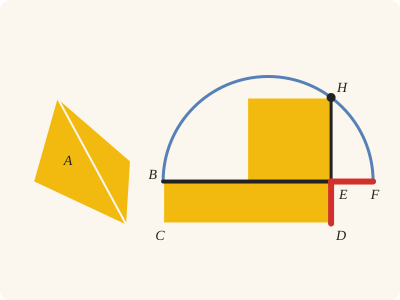
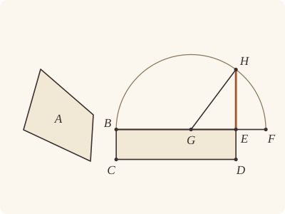
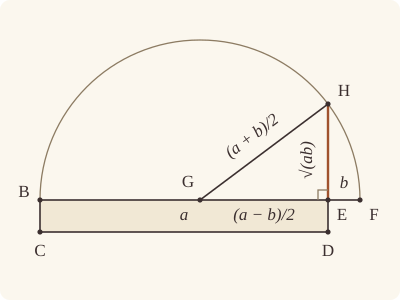

<!-- Generated by scripts/render.py. Do not edit by hand. -->

[Book II](index.md) · [← II.13](13.md) · [III.1 →](../III/01.md)

# Book II, Proposition 14

*A square equal to a given rectilineal figure*

[Euclid's proof](#euclids-proof) · [In Lean](#in-lean) · [What it rests on](#what-it-rests-on) · [Mishnah](#mishnah)

> To construct a square equal to a given rectilineal figure.

**In Lean:** ✅ proved, as Euclid states it · Euclid's argument

<p align="center"></p>

<p align="center"><em>The straight-sided figure A, two triangles, is remade as the rectangle BD, then as a square (all yellow): lay its short side ED (red) beyond BE, to F, draw the semicircle on BF (blue), and EH is the square's side.</em></p>

## Euclid's proof

<p align="center"></p>

<p align="center"><em>Drawn for one case: BE greater than ED, and A four-sided with no diagonal drawn, as in Heath's figure.</em></p>

Let A be the given rectilineal figure;

thus it is required to construct a square equal to the rectilineal figure A.

For let there be constructed the rectangular parallelogram BD equal to the rectilineal figure A. [I. 45]

Then, if BE is equal to ED, that which was enjoined will have been done; for a square BD has been constructed equal to the rectilineal figure A.

But, if not, one of the straight lines BE, ED is greater.

Let BE be greater, and let it be produced to F;

let EF be made equal to ED, and let BF be bisected at G.

With centre G and distance one of the straight lines GB, GF let the semicircle BHF be described; let DE be produced to H, and let GH be joined.

Then, since the straight line BF has been cut into equal segments at G, and into unequal segments at E,

the rectangle contained by BE, EF together with the square on EG is equal to the square on GF. [II. 5]

But GF is equal to GH;

therefore the rectangle BE, EF together with the square on GE is equal to the square on GH.

But the squares on HE, EG are equal to the square on GH; [I. 47]

therefore the rectangle BE, EF together with the square on GE is equal to the squares on HE, EG.

Let the square on GE be subtracted from each;

therefore the rectangle contained by BE, EF which remains is equal to the square on EH.

But the rectangle BE, EF is BD, for EF is equal to ED;

therefore the parallelogram BD is equal to the square on HE.

And BD is equal to the rectilineal figure A.

Therefore the rectilineal figure A is also equal to the square which can be described on EH.

Therefore a square, namely that which can be described on EH, has been constructed equal to the given rectilineal figure A.

Q. E. F.

## In Lean

| | |
|---|---|
| Proof | ✅ Proved, and its companions `Prop14.outline` ([II.14 outline](14.md#outline)), `Prop14.outline_side` ([II.14 outline_side](14.md#outline_side)), `Prop14.rectangle` ([II.14 rectangle](14.md#rectangle)), `Prop14.sum` ([II.14 sum](14.md#sum)), `Prop14.apart` ([II.14 apart](14.md#apart)), `Prop14.figure` ([II.14 figure](14.md#figure)), `Prop14.square` ([II.14 square](14.md#square)) and `Prop14.fan` ([II.14 fan](14.md#fan)) |
| Statement | The whole enunciation. `Prop14.outline` and `Prop14.outline_side` take a figure by its boundary; `Prop14` takes two triangles unchecked; the rest, lists of triangles or a rectangle. |
| Argument | Euclid's. `Prop14.rectangle` is the second part of Euclid's proof, the main theorem's argument after the rectangle is made, written out again so as not to cite II.14; `Prop14.sum` makes the rectangle for any number of triangles by I.45's `BookI.Prop45.sum`, in a right angle from I.11; and `Prop14.square` describes the square on the side found, by I.46, as Euclid's last words name it. `Prop14.outline` and `Prop14.outline_side` take the figure by its boundary alone, represented by an outline, as I.45's `BookI.Prop45.outline` does: Book Zero divides it into triangles that do not overlap, no point inside two of them (`Figures.division_exists`), `Prop14.square` and `Prop14.apart` make the square and its side for those triangles, and their sum is the figure's area, the same for every division (`Figures.area_eq`). |
| Representation | The main theorem is an area-sum theorem: it takes its two triangles, A₁A₂A₄ and A₄A₂A₃, unchecked, so that they may overlap, and returns the straight line EH, and `sq E H` is the square on it, as Euclid ends with "the square which can be described on EH"; no four corners of a square are drawn there. The other side forms return a side in the same way: `Prop14.outline_side`, `Prop14.apart`, `Prop14.figure`, `Prop14.fan`, and the constructions `Prop14.rectangle` and `Prop14.sum`. `Prop14.outline` and `Prop14.square` draw the square, a parallelogram with its four corners. It represents Euclid's pictured division when A₁ and A₃ lie on opposite sides of A₂A₄; that checked case is `Prop14.fan` for the corners A₄, A₁, A₂, A₃. `Prop14.outline` and `Prop14.outline_side` take the figure by its outline alone (`Figures.Outline`), as in I.45, with no division supplied; the older companions take a figure given with a checked division into triangles, and square those triangles together: triangles that lie apart, allowing a figure with a hole (`Prop14.apart`, `Prop14.square`); triangles glued edge to edge in a suitable order, for a figure with one boundary (`Prop14.figure`); or Euclid's and Oliver Byrne's division from one corner, checked and shown to fit together (`Prop14.fan`). |
| Reviewed | The statement and every passage of the argument read against Heath's text, at commit [`3a355341b`](https://github.com/jackChallis/stoicheia/commit/3a355341b) ([the record](../../review/II/14.toml)) |

From [`Elements/BookII/Prop14.lean`](../../Elements/BookII/Prop14.lean). Euclid's sentences are the `--` comments, and our own notes are in `/- … -/`; the lines under each sentence are the Lean that carries it out. The list below marks where a lemma does a step Euclid takes for granted and where the Lean takes a case Euclid's figure leaves aside; the `/- … -/` notes in the listing explain smaller adjustments.

**How the Lean follows the text**

- **Done by `Rectangle.of_right`.** "For let there be constructed the rectangular parallelogram BD…" Euclid asks I.45 for a rectangular parallelogram. The Lean first constructs a right angle by I.11, for which Heath gives no reference here, applies I.45 in it, and uses `Rectangle.of_right` (I.29) to prove the other three angles right. For a figure given by its outline, the triangles I.45 is applied to are proved to exist, a division into triangles that lie apart (`Figures.division_exists`), and every such division gives one sum, the figure's area (`Figures.Apart.area_eq_of_same_region`, `Figures.area_eq`), so the rectangle BD of `Prop14.outline` is equal to the figure A itself.
- **Done by `Tacit.lt_trichotomy`.** "But, if not, one of the straight lines BE, ED is greater." Euclid takes for granted that one of the unequal straight lines BE and ED is greater. The Lean obtains the two alternatives from `Tacit.lt_trichotomy`, a tacit rule of magnitude, which we assume (System E §3.5).
- **A further case.** "Let BE be greater…" Euclid takes BE the greater; when ED is, the Lean reads the rectangle the other way round, so one argument serves for both.
- **Done by `OnRay.exists_len_eq`.** "let EF be made equal to ED…" Euclid makes EF equal to ED on BE produced, then bisects BF; Heath gives no reference for either step here. The Lean chooses F by `OnRay.exists_len_eq`, using Postulate 3 and `Tacit.line_circle_beyond` (System E, Intersections 5), places E between B and F by `OnRay.between`, and bisects BF by I.10.
- **Done by `Tacit.on_circle_of_len_eq`.** "With centre G and distance one of the straight lines GB, GF…" Euclid's semicircle passes through both B and F. Postulate 3 draws the whole circle with centre G through B, and `Tacit.on_circle_of_len_eq` (System E, Diagram-segment 3), now proved in `Elements/Figure/RuleBase.lean` by comparing lengths on the straight line from the centre through the point, with our radius rule (`Tacit.radius_ne_zero`) and Postulate 3, puts F on it because GF equals GB; until 26 October 2026 that rule was proved from Postulate 3 and `circle_eq`.
- **Done by `Tacit.line_circle_beyond`.** "let DE be produced to H…" Euclid takes DE produced to meet the semicircle at H; since BE is greater than ED = EF and G bisects BF, the Lean puts G between B and E by `OnRay.between_of_len_lt`, also giving E different from G for the unequal cut in II.5. The Lean then puts E inside the circle by `between_inner` and `InsideCircle.of_between_centre`; `Tacit.line_circle_beyond` finds H beyond E from D, and GH is named by its ends.
- **Done by `Definition15`.** "But GF is equal to GH…" Euclid uses the equality of the radii GF and GH without giving a reason. The Lean obtains their equality from `Definition15`, Euclid's definition of a circle, which we assume as a rule.
- **Done by `BookI.Prop13`.** "But the squares on HE, EG are equal to the square on GH…" Euclid takes the right angle HEG for granted when he applies I.47. The Lean proves it in place: the angles DEB, BEH on the straight line DH make two right angles by I.13, taking away the rectangle's right angle DEB leaves BEH right by Common Notion 3, and the proved order B, G, E puts G on the ray EB, so that HEG is the angle HEB; then `BookI.Prop47.sq` applies I.47.

```lean
/-- To construct a square equal to a given rectilineal figure. -/
theorem Prop14 {A₁ A₂ A₃ A₄ : Point} (h₁ : Triangle A₁ A₂ A₄) (h₂ : Triangle A₄ A₂ A₃) :
    ∃ E H : Point, sq E H = △ A₁ A₂ A₄ + △ A₄ A₂ A₃ := by
  -- Let A be the given rectilineal figure;
  -- thus it is required to construct a square equal to the rectilineal figure A.
  -- For let there be constructed the rectangular parallelogram BD equal to the rectilineal
  -- figure A. [I. 45]
  /- I.45 takes a given angle; I.11 supplies a right one. -/
  obtain ⟨L, hA₁, hA₂⟩ := Postulate1 A₁ A₂ h₁.ne₁₂
  obtain ⟨R, hR, hright⟩ := BookI.Prop11 h₁.ne₁₂ ⟨L, hA₁, hA₂, hA₁⟩ h₁
  have hR' : ∠ A₂ A₁ R = ∟ := hright A₂ ⟨L, hA₁, hA₂, hA₂⟩ h₁.ne₁₂.symm
  obtain ⟨E, B, C, D, hp, hang, hBD⟩ := BookI.Prop45 h₁ h₂ hR.triangle.bac
  have hrect : Rectangle E B C D := by
    refine Rectangle.of_right hp ?_
    rw [angle_symm hp.2.2.1 hp.1.1.symm, hang, hR']
  -- Then, if BE is equal to ED, that which was enjoined will have been done; for a square BD
  -- has been constructed equal to the rectilineal figure A.
  by_cases heq : ‖B E‖ = ‖E D‖
  · exact ⟨E, B, by
      rw [← hBD, hrect.eq_rect rfl ((len_symm E B).trans heq).symm]
      rfl⟩
  -- But, if not, one of the straight lines BE, ED is greater.
  have hlt : ‖E D‖ < ‖E B‖ ∨ ‖E B‖ < ‖E D‖ := by
    rcases lt_trichotomy ‖E D‖ ‖E B‖ with h | h | h
    · exact Or.inl h
    · exact False.elim (heq ((len_symm B E).trans h.symm))
    · exact Or.inr h
  /- Euclid's case is written once. If ED is greater, read the rectangle the
     other way round. The order B, G, E, F then remains that of II.5. -/
  have greater : ∀ {E B C D : Point}, Rectangle E B C D →
      quadArea E B C D = △ A₁ A₂ A₄ + △ A₄ A₂ A₃ → ‖E D‖ < ‖E B‖ →
      ∃ E H : Point, sq E H = △ A₁ A₂ A₄ + △ A₄ A₂ A₃ := by
    intro E B C D h hBD hlt
    -- Let BE be greater, and let it be produced to F;
    have hEB : E ≠ B := h.1.1.1
    have hDE : D ≠ E := h.1.2.2.1
    obtain ⟨X, hBEX⟩ := produce hEB.symm
    -- let EF be made equal to ED, and let BF be bisected at G.
    obtain ⟨F, hF, hEF⟩ :=
      OnRay.exists_len_eq hDE.symm (ne_of_between (between_symm hBEX)).symm
    have hBEF : Between B E F := hF.between hBEX
    obtain ⟨G, hBGF, hBG⟩ := BookI.Prop10 (ne_of_between_ends hBEF)
    -- With centre G and distance one of the straight lines GB, GF let the semicircle BHF be
    -- described; let DE be produced to H, and let GH be joined.
    obtain ⟨BHF, hG_BHF, hB_BHF⟩ := Postulate3 G B (ne_of_between hBGF).symm
    have hF_BHF : OnCircle F BHF :=
      on_circle_of_len_eq hG_BHF hB_BHF (by rw [← hBG, len_symm G B])
    have hlt' : ‖E F‖ < ‖B E‖ := by rw [hEF, len_symm B E]; exact hlt
    /- G lies between B and E because BE is greater than EF, so E lies between
       the centre G and F and is within the circle by Definition I.15. -/
    have hBGE : Between B G E := by
      have hBF : ‖B F‖ = ‖B G‖ + ‖B G‖ := by
        rw [← len_add_of_between hBGF, ← hBG]
      have hBF' : ‖B F‖ = ‖B E‖ + ‖E F‖ := (len_add_of_between hBEF).symm
      refine OnRay.between_of_len_lt (OnRay.of_between hBGF) (OnRay.of_between hBEF) ?_
      rcases lt_trichotomy ‖B G‖ ‖B E‖ with h' | h' | h'
      · exact h'
      · exfalso
        rw [h', hBF'] at hBF
        have : ‖E F‖ = ‖B E‖ := CommonNotion3 (by rw [add_comm]; exact hBF) rfl
        exact lt_irrefl _ (this ▸ hlt')
      · exfalso
        have := Magnitude.add_self_lt_add_self h'
        rw [← hBF, hBF'] at this
        exact lt_irrefl _ (lt_trans hlt' (Magnitude.lt_of_add_lt_add_left this))
    have hE_BHF : InsideCircle E BHF :=
      InsideCircle.of_between_centre hG_BHF hF_BHF (between_inner hBGE hBEF)
    obtain ⟨DE, hD_DE, hE_DE⟩ := Postulate1 D E hDE
    obtain ⟨H, hH_BHF, hH_DE, hHED⟩ := line_circle_beyond hE_BHF hE_DE hD_DE hDE
    /- H lies beyond E from D, on the semicircle away from the rectangle.
       GH is the side of the triangle used below. -/
    -- Then, since the straight line BF has been cut into equal segments at G, and into unequal
    -- segments at E,
    have hEG : E ≠ G := ne_of_between (between_symm hBGE)
    -- the rectangle contained by BE, EF together with the square on EG is equal to the square on
    -- GF. [II. 5]
    have h5 : rect B E E F + sq G E = sq G F := Prop5 hBGF hBG hBEF hEG
    -- But GF is equal to GH;
    have hGF_GH : ‖G F‖ = ‖G H‖ := Definition15 hG_BHF hF_BHF hH_BHF
    -- therefore the rectangle BE, EF together with the square on GE is equal to the square on
    -- GH.
    have hsum : rect B E E F + sq G E = sq G H := h5.trans (sq_congr hGF_GH)
    -- But the squares on HE, EG are equal to the square on GH; [I. 47]
    obtain ⟨BF, hB_BF, hF_BF⟩ := Postulate1 B F (ne_of_between_ends hBEF)
    have hE_BF : OnLine E BF := on_line_of_between_ends hBEF hB_BF hF_BF
    have hG_BF : OnLine G BF := on_line_of_between_ends hBGF hB_BF hF_BF
    have hDEB : Triangle D E B := h.1.rotate.rotate.rotate.triangle
    have hD_BF : ¬ OnLine D BF := hDEB.bca.off_line hE_BF hB_BF
    have hHE : H ≠ E := ne_of_between hHED
    have hH_BF : ¬ OnLine H BF := fun hH =>
      hD_BF ((line_unique hHE hH_DE hE_DE hH hE_BF) ▸ hD_DE)
    /- The angle HEG is right. EB stands on the straight line DH, so the angles DEB,
       BEH together are two right angles [I. 13]. DEB is the rectangle's right angle;
       taking it from each leaves BEH a right angle (Common Notion 3). And HEG is the
       angle HEB, for G lies on EB. -/
    have hBEH : ∠ B E H = ∟ := by
      have h13 : ∠ D E B + ∠ B E H = ∟ + ∟ :=
        BookI.Prop13 (between_symm hHED)
          (Triangle.of_line hD_DE hH_DE (ne_of_between_ends (between_symm hHED))
            (hDEB.off_line hD_DE hE_DE))
      rw [h.2.1, add_comm ∟] at h13
      exact CommonNotion3 h13 rfl
    have hHEG : ∠ H E G = ∟ := by
      rw [angle_symm hHE (Ne.symm hEG),
        angle_onRay_left (OnRay.of_between (between_symm hBGE)) hHE]
      exact hBEH
    have h47 := BookI.Prop47.sq (Triangle.of_line hE_BF hG_BF hEG hH_BF).acb hHEG
    -- therefore the rectangle BE, EF together with the square on GE is equal to the squares on
    -- HE, EG.
    have hequal : rect B E E F + sq G E = sq H E + sq E G :=
      hsum.trans ((sq_symm G H).trans h47)
    -- Let the square on GE be subtracted from each;
    have hrem : rect B E E F = sq H E := CommonNotion3 hequal (sq_symm G E)
    -- therefore the rectangle contained by BE, EF which remains is equal to the square on EH.
    have hEH : rect B E E F = sq E H := hrem.trans (sq_symm H E)
    -- But the rectangle BE, EF is BD, for EF is equal to ED;
    have hrectangle : quadArea E B C D = rect B E E F :=
      h.eq_rect (len_symm E B) hEF.symm
    -- therefore the parallelogram BD is equal to the square on HE.
    have hBD_HE : quadArea E B C D = sq H E :=
      hrectangle.trans (hEH.trans (sq_symm E H))
    -- And BD is equal to the rectilineal figure A.
    have hBD_A : quadArea E B C D = △ A₁ A₂ A₄ + △ A₄ A₂ A₃ := hBD
    -- Therefore the rectilineal figure A is also equal to the square which can be described on
    -- EH.
    have hA_EH : △ A₁ A₂ A₄ + △ A₄ A₂ A₃ = sq E H :=
      hBD_A.symm.trans (hBD_HE.trans (sq_symm H E))
    -- Therefore a square, namely that which can be described on EH, has been constructed equal
    -- to the given rectilineal figure A.
    exact ⟨E, H, hA_EH.symm⟩
    -- Q. E. F.
  rcases hlt with h | h
  · exact greater hrect hBD h
  · exact greater hrect.reverse ((quadArea_reverse E B C D).trans hBD) h
```

<a name="rectangle"></a><a name="sum"></a><a name="apart"></a><a name="figure"></a><a name="square"></a><a name="fan"></a><a name="outline"></a><a name="outline_side"></a>

<details><summary>After the theorem, its companions, <code>Prop14.rectangle</code>, <code>Prop14.sum</code>, <code>Prop14.apart</code>, <code>Prop14.figure</code>, <code>Prop14.square</code>, <code>Prop14.fan</code>, <code>Prop14.outline</code> and <code>Prop14.outline_side</code>; and one lemma for its own proofs, <code>Prop14.area_pos</code> (280 lines)</summary>

```lean
/-- **II.14, for a rectangle** (companion of II.14). To construct a square equal to a given
rectangle EBCD: the second part of Euclid's proof, with both of its cases. If BE is equal to
ED, the rectangle is a square already. If not, the greater, say BE, is produced to F with EF
equal to ED, BF is bisected at G, the semicircle BHF is described with centre G, and DE is
produced to H; then the rectangle BE, EF with the square on EG is the square on GF [II. 5],
which is the squares on HE, EG [I. 47], and the rectangle is the square on EH. This is
the proof of `Prop14` after the rectangle is made, written out again so that it need not
cite II.14. The square is the square on PQ. -/
theorem Prop14.rectangle {E B C D : Point} (h : Rectangle E B C D) :
    ∃ P Q : Point, sq P Q = quadArea E B C D := by
  /- If BE equals ED, the rectangle is already the square on EB. -/
  by_cases heq : ‖B E‖ = ‖E D‖
  · exact ⟨E, B, (h.eq_rect rfl ((len_symm E B).trans heq).symm).symm⟩
  /- Otherwise one side is greater. -/
  have hlt : ‖E D‖ < ‖E B‖ ∨ ‖E B‖ < ‖E D‖ := by
    rcases lt_trichotomy ‖E D‖ ‖E B‖ with h' | h' | h'
    · exact Or.inl h'
    · exact False.elim (heq ((len_symm B E).trans h'.symm))
    · exact Or.inr h'
  /- Euclid's figure has BE greater. The same construction serves when ED is
     greater, by reading the rectangle the other way round. -/
  have greater : ∀ {E B C D : Point}, Rectangle E B C D → ‖E D‖ < ‖E B‖ →
      ∃ P Q : Point, sq P Q = quadArea E B C D := by
    intro E B C D h hlt
    /- Produce BE beyond E, and take EF equal to ED on that ray. -/
    have hEB : E ≠ B := h.1.1.1
    have hDE : D ≠ E := h.1.2.2.1
    obtain ⟨X, hBEX⟩ := produce hEB.symm
    obtain ⟨F, hF, hEF⟩ :=
      OnRay.exists_len_eq hDE.symm (ne_of_between (between_symm hBEX)).symm
    have hBEF : Between B E F := hF.between hBEX
    /- Bisect BF at G [I. 10]. -/
    obtain ⟨G, hBGF, hBG⟩ := BookI.Prop10 (ne_of_between_ends hBEF)
    /- Describe the circle with centre G through B (Postulate 3); it passes
       through F too, since GF equals GB. -/
    obtain ⟨BHF, hG_BHF, hB_BHF⟩ := Postulate3 G B (ne_of_between hBGF).symm
    have hF_BHF : OnCircle F BHF :=
      on_circle_of_len_eq hG_BHF hB_BHF (by rw [← hBG, len_symm G B])
    /- G lies between B and E: the half BG of BF is less than BE, since BE is
       greater than the remaining part EF. Thus E is the unequal cut of BF that
       II.5 needs, distinct from the midpoint G. -/
    have hlt' : ‖E F‖ < ‖B E‖ := by rw [hEF, len_symm B E]; exact hlt
    have hBGE : Between B G E := by
      have hBF : ‖B F‖ = ‖B G‖ + ‖B G‖ := by
        rw [← len_add_of_between hBGF, ← hBG]
      have hBF' : ‖B F‖ = ‖B E‖ + ‖E F‖ := (len_add_of_between hBEF).symm
      refine OnRay.between_of_len_lt (OnRay.of_between hBGF) (OnRay.of_between hBEF) ?_
      rcases lt_trichotomy ‖B G‖ ‖B E‖ with h' | h' | h'
      · exact h'
      · exfalso
        rw [h', hBF'] at hBF
        have : ‖E F‖ = ‖B E‖ := CommonNotion3 (by rw [add_comm]; exact hBF) rfl
        exact lt_irrefl _ (this ▸ hlt')
      · exfalso
        have := Magnitude.add_self_lt_add_self h'
        rw [← hBF, hBF'] at this
        exact lt_irrefl _ (lt_trans hlt' (Magnitude.lt_of_add_lt_add_left this))
    have hEG : E ≠ G := ne_of_between (between_symm hBGE)
    /- E is inside the circle: it lies between the centre G and F
       (Definition I.15). -/
    have hE_BHF : InsideCircle E BHF :=
      InsideCircle.of_between_centre hG_BHF hF_BHF (between_inner hBGE hBEF)
    /- Produce DE to H beyond E, on the semicircle BHF away from the rectangle. -/
    obtain ⟨DE, hD_DE, hE_DE⟩ := Postulate1 D E hDE
    obtain ⟨H, hH_BHF, hH_DE, hHED⟩ := line_circle_beyond hE_BHF hE_DE hD_DE hDE
    /- BF is cut equally at G and unequally at E: the rectangle BE, EF with the
       square on GE equals the square on GF [II. 5]. -/
    have h5 : rect B E E F + sq G E = sq G F := Prop5 hBGF hBG hBEF hEG
    /- GF and GH are radii of the same circle (Definition I.15), so the same sum
       equals the square on GH. -/
    have hGF_GH : ‖G F‖ = ‖G H‖ := Definition15 hG_BHF hF_BHF hH_BHF
    have hsum : rect B E E F + sq G E = sq G H := h5.trans (sq_congr hGF_GH)
    /- H is off BF: otherwise the straight line through H and E would be BF, and
       D on it, contrary to the rectangle's triangle DEB. So HEG is a triangle,
       with GH as its third side. -/
    obtain ⟨BF, hB_BF, hF_BF⟩ := Postulate1 B F (ne_of_between_ends hBEF)
    have hE_BF : OnLine E BF := on_line_of_between_ends hBEF hB_BF hF_BF
    have hG_BF : OnLine G BF := on_line_of_between_ends hBGF hB_BF hF_BF
    have hDEB : Triangle D E B := h.1.rotate.rotate.rotate.triangle
    have hD_BF : ¬ OnLine D BF := hDEB.bca.off_line hE_BF hB_BF
    have hHE : H ≠ E := ne_of_between hHED
    have hH_BF : ¬ OnLine H BF := fun hH =>
      hD_BF ((line_unique hHE hH_DE hE_DE hH hE_BF) ▸ hD_DE)
    /- HEG is right. The angles DEB, BEH on the straight line DH together are
       two right angles [I. 13]; taking the rectangle's right angle DEB from each
       leaves BEH right (Common Notion 3). G lies on the ray EB, so HEG is HEB. -/
    have hBEH : ∠ B E H = ∟ := by
      have h13 : ∠ D E B + ∠ B E H = ∟ + ∟ :=
        BookI.Prop13 (between_symm hHED)
          (Triangle.of_line hD_DE hH_DE (ne_of_between_ends (between_symm hHED))
            (hDEB.off_line hD_DE hE_DE))
      rw [h.2.1, add_comm ∟] at h13
      exact CommonNotion3 h13 rfl
    have hHEG : ∠ H E G = ∟ := by
      rw [angle_symm hHE (Ne.symm hEG),
        angle_onRay_left (OnRay.of_between (between_symm hBGE)) hHE]
      exact hBEH
    /- The squares on HE and EG equal the square on GH [I. 47]. Thus they
       equal the rectangle BE, EF together with the square on GE. -/
    have h47 := BookI.Prop47.sq (Triangle.of_line hE_BF hG_BF hEG hH_BF).acb hHEG
    have hequal : rect B E E F + sq G E = sq H E + sq E G :=
      hsum.trans ((sq_symm G H).trans h47)
    /- Subtract the square on GE from each: the rectangle BE, EF is the square
       on HE, hence on EH (Common Notion 3). -/
    have hrem : rect B E E F = sq H E := CommonNotion3 hequal (sq_symm G E)
    have hEH : rect B E E F = sq E H := hrem.trans (sq_symm H E)
    /- EF equals ED, so the rectangle BE, EF is the given rectangle EBCD. -/
    have hrectangle : quadArea E B C D = rect B E E F :=
      h.eq_rect (len_symm E B) hEF.symm
    exact ⟨E, H, (hrectangle.trans hEH).symm⟩
  rcases hlt with hlt | hlt
  · exact greater h hlt
  · obtain ⟨P, Q, hPQ⟩ := greater h.reverse hlt
    exact ⟨P, Q, hPQ.trans (quadArea_reverse E B C D)⟩

/-- **II.14, any number of triangles** (companion of II.14). To construct a square equal to
any number of given triangles taken together, at least one: a rectangle equal to them
[I. 45, `Prop45.sum`, in a right angle from I.11 at a corner A of the first triangle ABC, on
AB], then a square equal to the rectangle (`Prop14.rectangle`). The triangles are any
triangles; they need not fit together into one figure, and the statement claims nothing of
a figure. The square is the square on PQ. -/
theorem Prop14.sum (ts : List (Point × Point × Point)) (hne : ts ≠ [])
    (hts : ∀ t ∈ ts, Triangle t.1 t.2.1 t.2.2) :
    ∃ P Q : Point, sq P Q = Magnitude.sum (ts.map fun t => △ t.1 t.2.1 t.2.2) := by
  match ts, hne, hts with
  | (A, B, C) :: rest, _, hts =>
    have hABC : Triangle A B C := hts (A, B, C) (List.mem_cons_self ..)
    obtain ⟨L, hA, hB⟩ := Postulate1 A B hABC.ne₁₂
    obtain ⟨X, hX, hright⟩ := BookI.Prop11 hABC.ne₁₂ ⟨L, hA, hB, hA⟩ hABC
    have hX' : ∠ B A X = ∟ := hright B ⟨L, hA, hB, hB⟩ hABC.ne₁₂.symm
    obtain ⟨E, F, G, H, hp, hang, harea⟩ :=
      BookI.Prop45.sum _ (List.cons_ne_nil _ _) hts hX.triangle.bac
    have hrect : Rectangle E F G H := by
      refine Rectangle.of_right hp ?_
      rw [angle_symm hp.2.2.1 hp.1.1.symm, hang, hX']
    obtain ⟨P, Q, hPQ⟩ := Prop14.rectangle hrect
    exact ⟨P, Q, hPQ.trans harea⟩

/-- **II.14, for a figure given with triangles that do not overlap** (companion of II.14). To
construct a square equal to a given rectilineal figure, given with a checked division into
triangles, any division of it whose triangles lie apart, no point inside two of them
(`Apart`), as in `Prop45.apart`: the square on PQ is equal to those triangles taken together
(`Apart.area`). The figure may have a hole, touch itself at a corner, or be in more than one
piece. It is `Prop14.sum` for the figure's
triangles. As in `Prop45.apart`, the statement speaks of the division given, and every
division gives the same sum (`Apart.area_eq_of_same_region`). -/
theorem Prop14.apart (R : Apart) : ∃ P Q : Point, sq P Q = R.area :=
  Prop14.sum R.pieces R.ne R.triangle

/-- **II.14, for a figure with one boundary, given with triangles fitted together**
(companion of II.14). To construct a square equal to a given rectilineal figure, given with
a checked division into triangles, fitted together in a suitable order, each glued across a
side of an earlier one and meeting the earlier ones only along it (`Rectilineal`), as in
`Prop45.figure`: the square on PQ is equal to those triangles taken together
(`Rectilineal.area`). It is `Prop14.apart` for the figure's
triangles, which lie apart (`Fitted.inside_pairwise`, `Rectilineal.toApart`), and every
division gives the same sum (`Apart.area_eq_of_same_region`). -/
theorem Prop14.figure (R : Rectilineal) : ∃ P Q : Point, sq P Q = R.area :=
  Prop14.apart R.toApart

/-- The figure's area is something: its first triangle has positive area, and adding
the rest cannot make it nothing. This makes the side found by `Prop14.apart` a straight
line, not a point, so I.46 can describe the square on it. -/
theorem Prop14.area_pos (R : Apart) : 0 < R.area := by
  unfold Apart.area
  match R.pieces, R.ne, R.triangle with
  | (A, B, C) :: rest, _, htri =>
    /- The sum is the first triangle together with the sum of the rest. -/
    have hfirst : 0 < △ A B C := (htri (A, B, C) (List.mem_cons_self ..)).area_pos
    change 0 < △ A B C + Magnitude.sum (rest.map fun t => △ t.1 t.2.1 t.2.2)
    /- Adding the first triangle makes the rest greater (Common Notion 5).
       If the whole were nothing, the rest would be less than nothing. -/
    have hwhole := CommonNotion5
      (a := Magnitude.sum (rest.map fun t => △ t.1 t.2.1 t.2.2)) hfirst
    rw [add_comm] at hwhole
    apply Magnitude.pos_of_ne_zero
    intro hzero
    rw [hzero] at hwhole
    exact not_lt_zero _ hwhole

/-- **II.14, with the square drawn** (companion of II.14). To construct a square PQST equal
to a given rectilineal figure, given with a checked division into triangles that lie apart,
as in `Prop14.apart`: the square on the side that `Prop14.apart` finds, described on it
[I. 46]. The square is a
parallelogram, and it is equal to the figure's triangles taken together. A figure R given
by gluing (`Rectilineal`) is taken here as `R.toApart`, the same triangles, which lie apart,
with the same sum (`Rectilineal.area_toApart`); so is the glued figure that `Prop14.fan`
returns for a checked fan. -/
theorem Prop14.square (R : Apart) :
    ∃ P Q S T : Point, Square P Q S T ∧ Parallelogram P Q S T ∧ quadArea P Q S T = R.area := by
  /- Take the side whose square equals the given figure. Its ends differ because
     the figure has positive area, while the square on a point is nothing. -/
  obtain ⟨P, Q, hPQ⟩ := Prop14.apart R
  have hne : P ≠ Q := by
    intro heq
    subst Q
    rw [sq_self] at hPQ
    have hpos := Prop14.area_pos R
    rw [← hPQ] at hpos
    exact lt_irrefl 0 hpos
  /- Choose a point off PQ and describe the square on PQ [I. 46]. Its corners
     occur in the order P, S, T, Q. -/
  obtain ⟨X, hX, -⟩ := exists_off_line hne []
  obtain ⟨S, T, hsq, hS, hT⟩ := BookI.Prop46 hne hX
  /- The described square is a parallelogram with area sq P Q. -/
  obtain ⟨hp, harea⟩ := Square.described hsq hS hT
  exact ⟨P, S, T, Q, hsq, hp, harea.trans hPQ⟩

/-- **II.14, for a figure divided from one corner** (companion of II.14), as Euclid and
Oliver Byrne divide it. A figure with corners A₀, A₁, A₂, …, Aₙ, divided by the straight
lines from A₀ into the triangles A₀A₁A₂, …, A₀Aₙ₋₁Aₙ, with the division checked as in
`Prop45.fan`: each piece a triangle, each two neighbouring triangles on opposite sides of
the straight line A₀Aᵢ they share, and the angles at A₀ together less than four right
angles. Then those triangles, in that order, are fitted together into one figure
(`Fitted.fan`), and the square on PQ is equal to that figure, that is, to the triangles
taken together. The figure is the one with corners A₀, A₁, …, Aₙ in order round it, bounded
by that closed line (`Prop45.fan_boundary`), and the triangles' sum is its area, the same for
every division of it (`area_eq`). The square drawn is `Prop14.square R.toApart`, for the
glued figure R returned.

As in `Prop45.fan`, the first conclusion is what the two conditions are for; the square
alone would follow from each piece being a triangle, by `Prop14.sum`. -/
theorem Prop14.fan {A₀ A₁ A₂ : Point} {ps : List Point}
    (htri : ∀ s ∈ segments (A₁ :: A₂ :: ps), Triangle A₀ s.1 s.2)
    (hopp : ∀ t ∈ triples (A₁ :: A₂ :: ps), OppositeSidesOf t.1 t.2.2 A₀ t.2.1)
    (hA₀ : Magnitude.sum ((segments (A₁ :: A₂ :: ps)).map fun s => ∠ s.1 A₀ s.2) <
      ∟ + ∟ + (∟ + ∟)) :
    ∃ R : Rectilineal,
      R.pieces = (segments (A₁ :: A₂ :: ps)).map (fun s => (A₀, s.1, s.2)) ∧
      ∃ P Q : Point, sq P Q = R.area :=
  ⟨⟨_, Fitted.fan htri hopp hA₀⟩, rfl, Prop14.figure _⟩

/-- The check: the statement of `Prop14`, for I.45's two triangles A₁A₂A₄ and A₄A₂A₃ (ABD
and DBC), follows from `Prop14.sum` for the list of those two (checked by Lean, up to
unfolding definitions). -/
example : type_of% @Elements.BookII.Prop14 := by
  intro A₁ A₂ A₃ A₄ h₁ h₂
  have hts : ∀ t ∈ [(A₁, A₂, A₄), (A₄, A₂, A₃)], Triangle t.1 t.2.1 t.2.2 := by
    intro t ht
    simp only [List.mem_cons, List.not_mem_nil, or_false] at ht
    rcases ht with rfl | rfl
    · exact h₁
    · exact h₂
  obtain ⟨P, Q, hPQ⟩ := Prop14.sum _ (List.cons_ne_nil _ _) hts
  refine ⟨P, Q, ?_⟩
  rw [hPQ]
  simp only [List.map, Magnitude.sum, add_zero]

/-! ## A figure given by its outline

As in I.45 (`Prop45.outline`): the figure is given by its outline alone (`Outline`), Book
Zero divides it into triangles that lie apart (`division_exists`), and every division gives
its area (`Outline.area`, `area_eq`). Euclid's construction, applied to the triangles, gives
the square (`Prop14.square`) and its side (`Prop14.apart`). -/

open Elements.Figures

/-- **II.14, for a figure given by its outline** (companion of II.14, certificate name II.14
outline; the proposition in general). To construct a square PQST, drawn, equal to a given
rectilineal figure: the figure given by its outline alone (`Outline`), as in
`Prop45.outline`, and "equal to the figure" meaning equal to its area (`Outline.area`), which
every division of it gives. The square is a parallelogram. The division is obtained by a
theorem (`division_exists`), Euclid's rectangle and then its square are made for its
triangles (`Prop14.square`), and their sum is the outline's area (`area_eq`). -/
theorem Prop14.outline (F : Outline) :
    ∃ P Q S T : Point, Square P Q S T ∧ Parallelogram P Q S T ∧
      quadArea P Q S T = F.area := by
  obtain ⟨R, hR⟩ := division_exists F
  obtain ⟨P, Q, S, T, hs, hp, he⟩ := Elements.BookII.Prop14.square R
  exact ⟨P, Q, S, T, hs, hp, he.trans (area_eq F R hR).symm⟩

/-- **II.14, the side, for a figure given by its outline** (companion of II.14, certificate
name II.14 outline_side). The side form of `Prop14.outline`: a straight line PQ whose square
equals the outline's area, from a division (`division_exists`), the side found for its
triangles (`Prop14.apart`), and the content theorem (`area_eq`). -/
theorem Prop14.outline_side (F : Outline) :
    ∃ P Q : Point, sq P Q = F.area := by
  obtain ⟨R, hR⟩ := division_exists F
  obtain ⟨P, Q, he⟩ := Elements.BookII.Prop14.apart R
  exact ⟨P, Q, he.trans (area_eq F R hR).symm⟩
```

</details>

## What it rests on

| | Proposition | `Prop14.apart` | `Prop14.fan` | `Prop14.figure` | `Prop14.outline` | `Prop14.outline_side` | `Prop14.rectangle` | `Prop14.square` | `Prop14.sum` |
|---|---|---|---|---|---|---|---|---|---|
| Heath's references | [I.45](../I/45.md), [I.47](../I/47.md), [II.5](05.md) | none | none | none | none | none | none | none | none |
| Lean cites | [I.4](../I/04.md), [I.10](../I/10.md), [I.11](../I/11.md), [I.13](../I/13.md), [I.28](../I/28.md), [I.29](../I/29.md), [I.34](../I/34.md), [I.45](../I/45.md), [I.46](../I/46.md), [I.47](../I/47.md), [II.5](05.md) | [II.14 sum](14.md#sum) | [I.13](../I/13.md), [II.14 figure](14.md#figure) | [II.14 apart](14.md#apart) | [II.14 square](14.md#square) | [II.14 apart](14.md#apart) | [I.4](../I/04.md), [I.10](../I/10.md), [I.13](../I/13.md), [I.28](../I/28.md), [I.34](../I/34.md), [I.46](../I/46.md), [I.47](../I/47.md), [II.5](05.md) | [I.4](../I/04.md), [I.28](../I/28.md), [I.34](../I/34.md), [I.46](../I/46.md), [II.14 apart](14.md#apart) | [I.11](../I/11.md), [I.29](../I/29.md), [I.45 sum](../I/45.md#sum), [II.14 rectangle](14.md#rectangle) |
| Postulates | 1, 2, 3, 4, 5 | 1, 2, 3, 4, 5 | 1, 2, 3, 4, 5 | 1, 2, 3, 4, 5 | 1, 2, 3, 4, 5 | 1, 2, 3, 4, 5 | 1, 2, 3, 4, 5 | 1, 2, 3, 4, 5 | 1, 2, 3, 4, 5 |
| Definitions taken as axioms | Def. I.15 | Def. I.15 | Def. I.15 | Def. I.15 | Def. I.15 | Def. I.15 | Def. I.15 | Def. I.15 | Def. I.15 |
| Common Notions | 1, 2, 3, 4, 5 | 1, 2, 3, 4, 5 | 1, 2, 3, 4, 5 | 1, 2, 3, 4, 5 | 1, 2, 3, 4, 5 | 1, 2, 3, 4, 5 | 1, 2, 3, 4, 5 | 1, 2, 3, 4, 5 | 1, 2, 3, 4, 5 |
| Tacit rules | 39 (listed below) | 39 (listed below) | 39 (listed below) | 39 (listed below) | 39 (listed below) | 39 (listed below) | 39 (listed below) | 39 (listed below) | 39 (listed below) |
| Its own Lean calls | Postulates 1 and 3; Def. I.15; 10 tacit rules | none | none | none | none | none | Postulates 1 and 3; Def. I.15; 10 tacit rules | 3 tacit rules | Postulate 1; 1 tacit rule |
| Through lemmas | Postulate 2; 25 tacit rules | none | Postulates 1, 2 and 3; Def. I.15; 30 tacit rules | Postulates 1 and 3; Def. I.15; 19 tacit rules | Postulates 1, 2 and 3; Def. I.15; 33 tacit rules | Postulates 1, 2 and 3; Def. I.15; 33 tacit rules | Postulate 2; 25 tacit rules | Postulates 1, 2 and 3; Def. I.15; 31 tacit rules | Postulates 2 and 3; Def. I.15; 26 tacit rules |

Some of these come in through lemmas [shared](../../CERTIFICATE.md#shared-steps) by many proofs: [`Square.described`](../../Elements/BookII/Rectangles.lean#L149) (I.4, I.28, I.34); [`BookI.Prop47.sq`](../../Elements/BookII/Rectangles.lean#L411) (I.4, I.28, I.34, I.46, I.47); [`Rectangle.eq_rect`](../../Elements/BookII/Rectangles.lean#L102) (I.4, I.34); [`Fitted.fan`](../../Elements/BookI/Prop45.lean#L732) (I.13); [`Rectangle.of_right`](../../Elements/BookII/Rectangles.lean#L53) (I.29).

_Postulates, definitions, Common Notions and tacit rules: all that each proof rests on, counting those of the propositions it cites. The last two rows say which of the postulates, definitions and tacit rules its own Lean calls, in the proof or a helper written for it, and which it does not call but reaches through lemmas, of Book Zero or shared (a proposition it cites may rest on these too); the rest come in only through the propositions it cites or the Common Notions._

<details><summary>The 39 tacit rules beneath this proof, counting those of the propositions it cites</summary>

_(used here) marks a rule this proof's own Lean calls, in the proof or a helper written for it; (through …) marks one its own Lean does not call but reaches through the lemmas named, of [Book Zero](../../Elements/Figure) or shared, though a proposition it cites may rest on it too; and a rule with no mark comes in only through a proposition it cites or a Common Notion. The names in brackets are System E's: an Intersection rule says when straight lines and circles must meet, and an Intersections rule takes a point where they do (see [Book I's introduction](../I/index.md))._

**Reading the figure**

- [`between_cases`](../../Elements/Foundations/Tacit/Diagram.lean#L54) (through [`BookI.Prop47.sq`](../../Elements/BookII/Rectangles.lean#L411), [`OnRay.between`](../../Elements/Figure/Rays.lean#L72), [`OnRay.between_of_len_lt`](../../Elements/Figure/Rays.lean#L123) and 5 other lemmas): Of three different points on a straight line, one is between the other two. (Between 6)
- [`between_symm`](../../Elements/Foundations/Tacit/Diagram.lean#L47) (used here): If B is between A and C, it is between C and A. (Between 1)
- [`circles_meet`](../../Elements/Foundations/Tacit/Diagram.lean#L94) (through [`BookI.Prop47.sq`](../../Elements/BookII/Rectangles.lean#L411), [`OnRay.between`](../../Elements/Figure/Rays.lean#L72), [`OnRay.between_of_len_lt`](../../Elements/Figure/Rays.lean#L123) and 7 other lemmas): If each circle passes through a point inside the other, the circles cut one another. This is the step Euclid takes for granted in I.1. (Intersection 5)
- [`circles_meet_same_side`](../../Elements/Foundations/Tacit/Constructions.lean#L79) (through [`BookI.Prop47.sq`](../../Elements/BookII/Rectangles.lean#L411), [`OnRay.between`](../../Elements/Figure/Rays.lean#L72), [`OnRay.between_of_len_lt`](../../Elements/Figure/Rays.lean#L123) and 7 other lemmas): Two circles that cut one another do so on each side of the straight line through their centres. (Intersections 8)
- [`exists_point`](../../Elements/Foundations/Tacit/Constructions.lean#L35) (through [`BookI.Prop47.sq`](../../Elements/BookII/Rectangles.lean#L411), [`Rectangle.eq_rect`](../../Elements/BookII/Rectangles.lean#L102), [`Triangle.ne₁₂`](../../Elements/Figure/Triangles.lean#L22) and 1 other lemma): Let a point be taken. (Points 1)
- [`exists_point_inside_circle`](../../Elements/Foundations/Tacit/Constructions.lean#L42) (through [`BookI.Prop47.sq`](../../Elements/BookII/Rectangles.lean#L411), [`InsideCircle.of_between_centre`](../../Elements/Figure/Incidence.lean#L238), [`OnRay.between`](../../Elements/Figure/Rays.lean#L72) and 9 other lemmas): Let a point be taken inside the circle α. (Points 8)
- [`exists_point_on_line`](../../Elements/Foundations/Tacit/Constructions.lean#L38) (through [`BookI.Prop47.sq`](../../Elements/BookII/Rectangles.lean#L411), [`OnRay.between`](../../Elements/Figure/Rays.lean#L72), [`OnRay.between_of_len_lt`](../../Elements/Figure/Rays.lean#L123) and 7 other lemmas): Let a point be taken on the straight line L. (Points 2)
- [`line_circle_between`](../../Elements/Foundations/Tacit/Constructions.lean#L67) (through [`BookI.Prop47.sq`](../../Elements/BookII/Rectangles.lean#L411), [`InsideCircle.of_between_centre`](../../Elements/Figure/Incidence.lean#L238), [`OnRay.between`](../../Elements/Figure/Rays.lean#L72) and 9 other lemmas): A straight line through a point B inside a circle, heading out to a point C outside it, cuts the circle between B and C. (Intersections 4)
- [`line_circle_beyond`](../../Elements/Foundations/Tacit/Constructions.lean#L73) (used here): A straight line through a point B inside a circle, produced beyond B away from C, cuts the circle there. (Intersections 5)
- [`line_unique`](../../Elements/Foundations/Tacit/Diagram.lean#L41) (used here): Two points determine a straight line. (Generalities 1)
- [`lines_meet_of_opposite_sides`](../../Elements/Foundations/Tacit/Diagram.lean#L89) (through [`BookI.Prop47.sq`](../../Elements/BookII/Rectangles.lean#L411), [`Rectangle.eq_rect`](../../Elements/BookII/Rectangles.lean#L102) and [`Rectangle.of_right`](../../Elements/BookII/Rectangles.lean#L53)): A straight line joining points on opposite sides of L crosses L. (Intersection 1)
- [`not_between_of_between`](../../Elements/Foundations/Tacit/Diagram.lean#L50) (through [`BookI.Prop47.sq`](../../Elements/BookII/Rectangles.lean#L411), [`InsideCircle.of_between_centre`](../../Elements/Figure/Incidence.lean#L238), [`OnRay.between`](../../Elements/Figure/Rays.lean#L72) and 12 other lemmas): If B is between A and C, then A is not between B and C. (Between 1)
- [`not_on_line_of_same_side`](../../Elements/Foundations/Tacit/Diagram.lean#L60) (through [`BookI.Prop47.sq`](../../Elements/BookII/Rectangles.lean#L411), [`OnRay.between`](../../Elements/Figure/Rays.lean#L72), [`OnRay.between_of_len_lt`](../../Elements/Figure/Rays.lean#L123) and 8 other lemmas): Points on one side of a straight line are not on it. (Same side 3)
- [`pasch2`](../../Elements/Foundations/Tacit/Diagram.lean#L71) (through [`BookI.Prop47.sq`](../../Elements/BookII/Rectangles.lean#L411), [`OnRay.between`](../../Elements/Figure/Rays.lean#L72), [`OnRay.between_of_len_lt`](../../Elements/Figure/Rays.lean#L123) and 7 other lemmas): If B is between A and C, A is on L and B is off it, then B and C are on the same side of L: a straight line that leaves L at A does not cross it again. (Pasch 2)
- [`same_side_trans`](../../Elements/Foundations/Tacit/Diagram.lean#L64) (through [`BookI.Prop47.sq`](../../Elements/BookII/Rectangles.lean#L411), [`OnRay.between`](../../Elements/Figure/Rays.lean#L72), [`OnRay.between_of_len_lt`](../../Elements/Figure/Rays.lean#L123) and 7 other lemmas): Two points on the same side of a straight line as a third point are on the same side as each other. (Same side 4)

**Lengths, angles and areas**

- [`angle_add_of_inside`](../../Elements/Foundations/Tacit/Transfer.lean#L47) (through [`BookI.Prop47.sq`](../../Elements/BookII/Rectangles.lean#L411) and [`Rectangle.eq_rect`](../../Elements/BookII/Rectangles.lean#L102)): If D lies within the angle BAC, then BAC is made up of BAD and DAC. (Diagram-angle 2)
- [`angle_eq_of_same_rays`](../../Elements/Foundations/Tacit/Transfer.lean#L54) (through [`angle_onRay_left`](../../Elements/Figure/Angles.lean#L42)): The angle doesn't change if its arms are traced through other points on the same rays. (Diagram-angle 4)
- [`angle_le_two_right`](../../Elements/Foundations/Tacit/Metric.lean#L33): No angle exceeds two right angles. (Metric 5)
- [`angle_symm`](../../Elements/Foundations/Tacit/Metric.lean#L30) (used here): The angle ABC is the angle CBA. (Metric 4)
- [`area_add_of_between`](../../Elements/Foundations/Tacit/Transfer.lean#L70) (through [`BookI.Prop47.sq`](../../Elements/BookII/Rectangles.lean#L411), [`Rectangle.eq_rect`](../../Elements/BookII/Rectangles.lean#L102) and [`quadArea_reverse`](../../Elements/Figure/Areas.lean#L155)): Cutting a triangle in two from a vertex adds up. (Diagram-area 2)
- [`area_congruent`](../../Elements/Foundations/Tacit/Metric.lean#L44): Triangles equal in all their sides and angles are equal in area. Euclid uses this without comment once he has shown two triangles congruent. (Metric 9)
- [`area_degenerate`](../../Elements/Foundations/Tacit/Metric.lean#L36) (through [`BookI.Prop47.sq`](../../Elements/BookII/Rectangles.lean#L411), [`Rectangle.eq_rect`](../../Elements/BookII/Rectangles.lean#L102) and [`quadArea_reverse`](../../Elements/Figure/Areas.lean#L155)): A "triangle" with a repeated corner has no area. (Metric 6)
- [`area_eq_zero_of_on_line`](../../Elements/Foundations/Tacit/Transfer.lean#L62) (through [`BookI.Prop47.sq`](../../Elements/BookII/Rectangles.lean#L411), [`Rectangle.eq_rect`](../../Elements/BookII/Rectangles.lean#L102) and [`quadArea_reverse`](../../Elements/Figure/Areas.lean#L155)): A "triangle" whose corners lie on one straight line has no area. (Diagram-area 1)
- [`area_rotate`](../../Elements/Foundations/Tacit/Metric.lean#L39) (through [`BookI.Prop47.sq`](../../Elements/BookII/Rectangles.lean#L411), [`Rectangle.eq_rect`](../../Elements/BookII/Rectangles.lean#L102) and [`quadArea_reverse`](../../Elements/Figure/Areas.lean#L155)): The triangle ABC is the triangle CAB. (Metric 8)
- [`len_add_of_between`](../../Elements/Foundations/Tacit/Transfer.lean#L27) (used here): If B is between A and C, then AB and BC together make up AC. (Diagram-segment 1)
- [`len_self`](../../Elements/Foundations/Tacit/Metric.lean#L24) (through [`BookI.Prop47.sq`](../../Elements/BookII/Rectangles.lean#L411), [`InsideCircle.of_between_centre`](../../Elements/Figure/Incidence.lean#L238), [`OnRay.between`](../../Elements/Figure/Rays.lean#L72) and 11 other lemmas): The "straight line" from a point to itself has no length. (Metric 1)
- [`len_symm`](../../Elements/Foundations/Tacit/Metric.lean#L27) (used here): The straight line AB is the straight line BA. (Metric 3)
- [`on_line_of_area_eq_zero`](../../Elements/Foundations/Tacit/Transfer.lean#L66): A triangle with no area has its corners on one straight line. (Diagram-area 1)
- [`radius_ne_zero`](../../Elements/Foundations/Tacit/Metric.lean#L62) (through [`BookI.Prop47.sq`](../../Elements/BookII/Rectangles.lean#L411), [`InsideCircle.of_between_centre`](../../Elements/Figure/Incidence.lean#L238), [`OnRay.between`](../../Elements/Figure/Rays.lean#L72) and 11 other lemmas): A circle's radius is not nothing: the straight line from the centre to a point on the circle has some length. A rule of our own, not one of System E's: every circle is drawn with a centre and a distance (Postulate 3).
- [`same_ray_of_angle_eq_zero`](../../Elements/Foundations/Tacit/Transfer.lean#L42) (through [`BookI.Prop47.sq`](../../Elements/BookII/Rectangles.lean#L411) and [`Rectangle.eq_rect`](../../Elements/BookII/Rectangles.lean#L102)): If the angle BAC is nothing, C lies on the ray from A through B. (Diagram-angle 1)

**Superposition**

- [`superposition`](../../Elements/Foundations/Tacit/Superposition.lean#L52): **Superposition.** A hypothetical placement of a triangle on a given ray and side permits a restricted derivation of metric equalities about the figure already given. The derivation introduces no further objects, cites each geometric law it uses, and exports no symbol of the placement.

**Laws of magnitude**

- [`add_assoc`](../../Elements/Foundations/Tacit/Magnitudes.lean#L23) (through [`BookI.Prop47.sq`](../../Elements/BookII/Rectangles.lean#L411), [`OnRay.between`](../../Elements/Figure/Rays.lean#L72), [`OnRay.between_of_len_lt`](../../Elements/Figure/Rays.lean#L123) and 4 other lemmas): Adding three magnitudes in a row, it makes no difference whether the first two or the last two are added first. (System E §3.5)
- [`add_comm`](../../Elements/Foundations/Tacit/Magnitudes.lean#L26) (used here): The order of adding does not matter. (System E §3.5)
- [`add_lt_add_right`](../../Elements/Foundations/Tacit/Magnitudes.lean#L45) (through [`BookI.Prop47.sq`](../../Elements/BookII/Rectangles.lean#L411), [`Magnitude.add_self_lt_add_self`](../../Elements/Figure/Areas.lean#L46), [`Magnitude.lt_of_add_lt_add_left`](../../Elements/Figure/Lengths.lean#L61) and 7 other lemmas): Adding the same thing to both sides keeps "less than". (System E §3.5)
- [`add_zero`](../../Elements/Foundations/Tacit/Magnitudes.lean#L29) (through [`BookI.Prop47.sq`](../../Elements/BookII/Rectangles.lean#L411) and [`Rectangle.eq_rect`](../../Elements/BookII/Rectangles.lean#L102)): Adding nothing changes nothing. (System E §3.5)
- [`lt_irrefl`](../../Elements/Foundations/Tacit/Magnitudes.lean#L32) (used here): No magnitude is less than itself. (System E §3.5)
- [`lt_trans`](../../Elements/Foundations/Tacit/Magnitudes.lean#L35) (used here): What is less than the less is less still. (System E §3.5)
- [`lt_trichotomy`](../../Elements/Foundations/Tacit/Magnitudes.lean#L39) (used here): Of two magnitudes, one is less, or they are equal, or the other is less. (System E §3.5)
- [`not_lt_zero`](../../Elements/Foundations/Tacit/Magnitudes.lean#L42) (through [`BookI.Prop47.sq`](../../Elements/BookII/Rectangles.lean#L411), [`InsideCircle.of_between_centre`](../../Elements/Figure/Incidence.lean#L238), [`OnRay.between`](../../Elements/Figure/Rays.lean#L72) and 11 other lemmas): Nothing is less than zero. (System E §3.5)

</details>

## Mishnah

_Our commentary: what Euclid assumes, what Lean made us say out loud, and how the result looks by modern means._

Euclid's I.45 turns any rectilineal figure into a parallelogram, and he now turns a rectangle into a square. In Heath's words this "completes the theory of *transformation of areas* so far as it can be carried without the use of proportions" (vol. 1, p. 410). Our main theorem takes two triangles sharing a side, with corners A₁ to A₄, unchecked as a division of a figure, and finds the side EH of the square. For any rectilineal figure given by its outline alone, `Prop14.outline` constructs a square with its four corners, equal to the figure, after David Hilbert's theory of content ([I.45](../I/45.md)); the table tells the forms beside it.

J. L. Heiberg points to Aristotle's remark that squaring "is better defined as the 'finding of the mean (proportional)' than as 'the making of an equilateral rectangle equal to a given oblong,' because the former definition states the *cause*, the latter the *conclusion* only" (Heath, vol. 1, p. 410). Aristotle's text-books, Heiberg thinks, squared by proportions. Heath adds that the construction is the very one of VI.13, which finds a mean proportional; Euclid, he judges, changed only the proof, resting it on Books I and II.

Robert Simson pointed out that "*Let* BE *be greater*" is not needed: the construction works either way. Heath grants it, but "perhaps Euclid may have regarded it as conducive to clearness to have the points B, G, E, F in the same relative positions as the corresponding points … in the figure of II. 5 which he quotes in the proof" (vol. 1, p. 410). The Lean keeps Euclid's order: when ED is greater, it reads the rectangle the other way round, exchanging B and D before making the construction. In these letters BE is greater than ED, so G, where BF is bisected, falls between B and E, as C falls between A and D in II.5.

Where Euclid draws the semicircle BHF, Postulate 3 gives us the whole circle about G. Must DE produced meet it? With B, G, E, F in that order, E lies between the centre G and F, so it is inside the circle, and a straight line through a point inside cuts the circle whichever way it is produced (`line_circle_beyond`). We take the meeting beyond E, away from the rectangle, and the angle HEG is right, beside the rectangle's right angle DEB. In the end the rectangle BD, the rectangle BE, EF and the square on EH are one area under three names, and Euclid draws BD alone ([Book II's introduction](index.md#areas)).

**The modern way.** Let $\mathrm{BE} = a$ and $\mathrm{ED} = \mathrm{EF} = b$, with $a \gt b$ as in Euclid's figure. The radius is $\mathrm{GH} = (a + b)/2$ and $\mathrm{GE} = (a - b)/2$, so by I.47 and II.5's identity $\mathrm{EH}^2 = ((a + b)/2)^2 - ((a - b)/2)^2 = ab$: EH is $\sqrt{ab}$, the mean proportional between BE and ED. Heath calls Euclid's solution "the equivalent of the extraction of the square root, or of the solution of the pure quadratic equation" $x^2 = ab$ (vol. 1, p. 410).

<p align="center"></p>

## Further reading

- Richard Courant and Herbert Robbins' [*What Is Mathematics?*](https://openlibrary.org/books/OL815900M) (1996) shows in ch. III, "Geometrical Constructions. The Algebra of Number Fields", why square roots, which this proposition draws, are all that ruler and compass can reach.
- David S. Richeson's [*Tales of Impossibility*](https://doi.org/10.1515/9780691194233) (2019), a history of the four famous problems of antiquity, explains Euclid's squaring of polygons in its chapter "Quadratures".

[Book II](index.md) · [← II.13](13.md) · [III.1 →](../III/01.md)

---

<sub>Euclid's text: T. L. Heath, *The Thirteen Books of Euclid's Elements*, vol. 1 (Cambridge, 1908), pp. 409–410; [scan leaves n429–n430](https://archive.org/details/thirteenbookseu02heibgoog/page/n429); [figure on n429](https://archive.org/details/thirteenbookseu02heibgoog/page/n429). Public domain.</sub>

<sub>The tacit rules follow the System E of Jeremy Avigad, Edward Dean and John Mumma, read alongside LeanEuclid (Logan Murphy, Kaiyu Yang, Jialiang Sun, Zhaoyu Li, Anima Anandkumar and Xujie Si).</sub>
