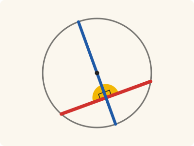
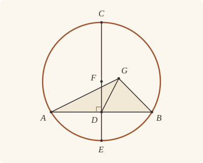

<!-- Generated by scripts/render.py. Do not edit by hand. -->

[Book III](index.md) · [← II.14](../II/14.md) · [III.2 →](02.md)

# Book III, Proposition 1

*The centre of a given circle*

[Euclid's proof](#euclids-proof) · [In Lean](#in-lean) · [What it rests on](#what-it-rests-on) · [Mishnah](#mishnah)

> To find the centre of a given circle.

**In Lean:** ✅ proved, as Euclid states it · Euclid's argument · one of our tacit rules supplies a step of a proof of it, and our proof rests on the rule (see Overlap)

<p align="center"></p>

<p align="center"><em>Halve any straight line drawn across the circle (red), draw another (blue) across the circle through its middle at right angles (yellow), and halve that one too: its middle is the centre.</em></p>

## Euclid's proof

<p align="center"></p>

<p align="center"><em>Drawn for one case: AB not through F, with the supposed centre G off CE in the reductio. Like Heath's, this figure draws the impossible supposition: G, off CE, as a centre of the circle ABC.</em></p>

Let ABC be the given circle;

thus it is required to find the centre of the circle ABC.

Let a straight line AB be drawn through it at random, and let it be bisected at the point D;

from D let DC be drawn at right angles to AB and let it be drawn through to E;

let CE be bisected at F;

I say that F is the centre of the circle ABC.

For suppose it is not, but, if possible, let G be the centre,

and let GA, GD, GB be joined.

Then, since AD is equal to DB,

and DG is common,

the two sides AD, DG are equal to the two sides BD, DG respectively;

and the base GA is equal to the base GB, for they are radii;

therefore the angle ADG is equal to the angle GDB. [I. 8]

But, when a straight line set up on a straight line makes the adjacent angles equal to one another, each of the equal angles is right; [I. Def. 10]

therefore the angle GDB is right.

But the angle FDB is also right;

therefore the angle FDB is equal to the angle GDB, the greater to the less: which is impossible.

Therefore G is not the centre of the circle ABC.

Similarly we can prove that neither is any other point except F.

Therefore the point F is the centre of the circle ABC.

<a name="porism"></a>PORISM. From this it is manifest that, if in a circle a straight line cut a straight line into two equal parts and at right angles, the centre of the circle is on the cutting straight line.

Q. E. F.

## In Lean

| | |
|---|---|
| Proof | ✅ Proved, and its porism, [III.1 Por.](01.md#porism) |
| Statement | The whole enunciation. Given a circle with some centre and two points A, B of it, constructs D, C, E and F as Euclid does and proves that F is the centre. |
| Argument | Euclid's. |
| Representation | The circle comes with some centre G, Euclid's supposed centre, a hypothesis every circle meets by `Tacit.exists_centre`, and with the two points A, B of the straight line he draws through it at random. The porism names its centre G. |
| Overlap | [`exists_centre`](../../Elements/Foundations/Tacit/Constructions.lean#L72): Our foundations assume that every circle has a centre. In `Prop1.construction` the rule supplies a centre only for the proof that D is within the circle, by III.2's argument in `Prop1.within`; that witness supplies none of the constructed points. The bisections, perpendicular straight line and proof that F is the centre remain III.1's work. The statement's hypothesis that the circle has some centre, which every circle meets by the rule, supplies the centre G for the reductio. See [the overlap catalogue](../../docs/reports/overlaps.md). |
| Reviewed | The statement and the argument read against Heath's text, for every departure from Euclid, at commit [`fbcfd542`](https://github.com/jackChallis/stoicheia/commit/fbcfd542) ([the record](../../review/III/01.toml)) |

From [`Elements/BookIII/Prop01.lean`](../../Elements/BookIII/Prop01.lean). Euclid's sentences are the `--` comments, and our own notes are in `/- … -/`; the lines under each sentence are the Lean that carries it out. The list below marks where a lemma does a step Euclid takes for granted, where several sentences share one step, where the Lean takes a case Euclid's figure leaves aside and where a porism is proved as a theorem of its own; the `/- … -/` notes in the listing explain smaller adjustments.

**How the Lean follows the text**

- **Carried together, by `Prop1.construction`.** "Let a straight line AB be drawn through it at random…" One call carries Euclid's three construction sentences: bisect AB at D, draw DC at right angles and through to E, then bisect CE at F. `Prop1.construction` receives the circle and A, B, with no centre supplied; the proof that F is the centre follows under Euclid's sentences.
- **Done by `Prop1.within`.** "from D let DC be drawn at right angles to AB and let it be drawn through to E…" Drawing DC through to E needs D within the circle, which Euclid proves only in III.2, as Todhunter observes. Inside `Prop1.construction`, `exists_centre` supplies a centre only for this proof: `Prop1.within` takes III.2's own argument, by I.5, I.16 and I.19; were the centre on AB, it would be D itself.
- **A further case, by `Prop1.middle`.** "and let GA, GD, GB be joined." Euclid's figure keeps the supposed centre G off AB. On AB it would be AB's middle point D, which is already on CE, so the Lean sets that case aside first; then DAG and DBG are triangles for I.8.
- **Done by `Prop1.perpendicular`.** "But the angle FDB is also right…" If AB passes through the centre, F is D and there is no angle FDB, so the Lean takes the angle CDB, right by construction. For "the greater to the less" it shows that at D only one straight line is at right angles to DB, wherever G lies, so G is on CE.
- **Carried together.** "Therefore G is not the centre of the circle ABC." The reductio shows that the supposed centre G lies on CE, and the Lean beneath makes it the middle point F. One argument, for any centre G, carries all three sentences.
- **Proved separately, as `Prop1.porism`.** "PORISM. From this it is manifest…" Proved as its own theorem, III.1 Por., by the argument of Euclid's reductio from the given centre G: on AB it is D by `Prop1.middle`; off AB, the shared I.8 step `Prop1.equal_adjacent` makes the adjacent angles equal, Definition I.10 makes them right, Postulate 4 identifies their measure with `∟`, and `Prop1.perpendicular` puts G on DC. It neither calls III.1 nor uses `centre_unique` or `exists_centre`.

<details><summary>Before the theorem, five lemmas: <code>Prop1.middle</code>, <code>Prop1.within</code>, <code>Prop1.perpendicular</code>, <code>Prop1.equal_adjacent</code> and <code>Prop1.construction</code> (119 lines)</summary>

```lean
/-- A straight line has one middle point. Euclid takes this for granted when he
identifies the centre on CE with its middle point F. -/
theorem Prop1.middle {A B D G : Point} (hADB : Between A D B) (hAD : ‖A D‖ = ‖D B‖)
    (hAGB : Between A G B) (hAG : ‖A G‖ = ‖G B‖) : G = D := by
  have e₁ := len_add_of_between hAGB
  have e₂ := len_add_of_between hADB
  rw [← hAG] at e₁
  rw [← hAD] at e₂
  have hlen : ‖A G‖ = ‖A D‖ := Magnitude.eq_of_add_self_eq (e₁.trans e₂.symm)
  obtain ⟨L, hA_L, hB_L⟩ := Postulate1 A B (ne_of_between_ends hADB)
  have hray : OnRay G A D := ⟨ne_of_between hADB, (ne_of_between hAGB).symm,
    ⟨L, hA_L, on_line_of_between_ends hADB hA_L hB_L, on_line_of_between_ends hAGB hA_L hB_L⟩,
    fun hb => not_between_of_between hAGB (between_of_between_right hb hADB)⟩
  exact OnRay.eq_of_len_eq hray hlen

/-- The middle point D of AB, a straight line in the circle, is within the circle. Euclid
takes it from his figure when he draws DC through to E, "a fact which Euclid first
demonstrates in III. 2", as Isaac Todhunter observes (Heath, vol. 2, p. 7). We take it by
III.2's own argument, from the centre G that the hypothesis gives. If G is on AB, it is AB's
middle point D (`Prop1.middle`). If not, the angles GAD and GBD are equal [I. 5]; the angle
GDB, outside the triangle GAD, is greater than GAD [I. 16], and so than GBD; and the greater
angle is subtended by the greater side [I. 19], so GD is less than the radius GB. -/
theorem Prop1.within {A B D G : Point} {ABC : Circle} (hG : Centre G ABC) (hA : OnCircle A ABC)
    (hB : OnCircle B ABC) (hADB : Between A D B) (hAD : ‖A D‖ = ‖D B‖) :
    InsideCircle D ABC := by
  have hAB : A ≠ B := ne_of_between_ends hADB
  obtain ⟨L, hA_L, hB_L⟩ := Postulate1 A B hAB
  have hD_L := on_line_of_between_ends hADB hA_L hB_L
  by_cases hG_L : OnLine G L
  · obtain rfl : G = D := Prop1.middle hADB hAD
      (between_of_inside_chord hG_L hA_L hB_L (centre_inside hG) hA hB hAB)
      (by rw [len_symm A G, Definition15 hG hA hB])
    exact centre_inside hG
  have hGAB : Triangle G A B := (Triangle.of_line hA_L hB_L hAB hG_L).cab
  have hGAD : Triangle G A D := (Triangle.of_line hA_L hD_L (ne_of_between hADB) hG_L).cab
  have hGDB : Triangle G D B :=
    (Triangle.of_line hD_L hB_L (ne_of_between (between_symm hADB)).symm hG_L).cab
  have h5 : ∠ G A D = ∠ G B D := by
    rw [angle_onRay_right (OnRay.of_between hADB) hGAB.ne₁₂,
      angle_onRay_right (OnRay.of_between (between_symm hADB)) hGAB.ne₁₃]
    exact BookI.Prop5.base hGAB (Definition15 hG hA hB)
  have h16 : ∠ G A D < ∠ G D B := by
    rw [angle_symm hGAD.ne₁₂ hGAD.ne₂₃.symm]
    exact (BookI.Prop16 hGAD hADB).1
  have h19 : ‖G D‖ < ‖G B‖ :=
    BookI.Prop19 hGDB (by rw [angle_symm hGDB.ne₂₃ hGDB.ne₁₃]; exact h5 ▸ h16)
  exact inside_of_len_lt hG hB h19

/-- At a point A of the straight line AD, only one straight line is at right
angles to it. Euclid takes this for granted in "the greater to the less". With E
and F on one side of AD, the equal right angles put F on AE; on opposite
sides, EA produced beyond A makes a right angle on F's side. -/
theorem Prop1.perpendicular {A D E F : Point} (hE : Triangle D A E) (hF : Triangle D A F)
    (hDAE : ∠ D A E = ∟) (hDAF : ∠ D A F = ∟) : Collinear A E F := by
  have hAD : A ≠ D := hE.ne₁₂.symm
  obtain ⟨L, hA_L, hD_L⟩ := Postulate1 A D hAD
  have hE_L : ¬ OnLine E L := hE.bac.off_line hA_L hD_L
  have hF_L : ¬ OnLine F L := hF.bac.off_line hA_L hD_L
  by_cases hs : SameSide F E L
  · exact (onRay_of_angle_eq (SameSideOf.of_line hAD hA_L hD_L hs) (hDAF.trans hDAE.symm)).2.2.1
  · obtain ⟨M, hE_M, hA_M⟩ := Postulate1 E A hE.ne₂₃.symm
    obtain ⟨E', hE'_M, hEAE', -⟩ := Postulate2 hE_M hA_M hE.ne₂₃.symm []
    have hD_M : ¬ OnLine D M := fun hD => hE ⟨M, hD, hA_M, hE_M⟩
    have hEAD : ∠ E A D = ∟ := by rw [angle_symm hE.ne₂₃.symm hE.ne₁₂]; exact hDAE
    have hDAE' : ∠ D A E' = ∟ := (adjacent_eq_of_right hE_M hE'_M hEAE' hD_M hEAD).symm.trans hEAD
    have hE'_L : ¬ OnLine E' L := fun h => hE_L (on_line_of_between (between_symm hEAE') h hA_L)
    have hFE' : SameSide F E' L := same_side_of_opposite_sides
      ⟨hE_L, hF_L, fun h => hs (same_side_symm h)⟩ ⟨hE_L, hE'_L, pasch3 hEAE' hA_L⟩
    obtain ⟨-, -, ⟨N, hA_N, hE'_N, hF_N⟩, -⟩ :=
      onRay_of_angle_eq (SameSideOf.of_line hAD hA_L hD_L hFE') (hDAF.trans hDAE'.symm)
    have hNM : N = M := line_unique (ne_of_between (between_symm hEAE')).symm hA_N hE'_N hA_M hE'_M
    subst hNM
    exact ⟨N, hA_N, hE_M, hF_N⟩

/-- With DA equal to DB and GA equal to GB, the triangles DAG and DBG have equal sides,
DG being common. I.8 makes the angles ADG and GDB equal, the comparison used in III.1 and
its porism before those adjacent angles are shown to be right. -/
theorem Prop1.equal_adjacent {A B D G : Point} (hDAG : Triangle D A G)
    (hDBG : Triangle D B G) (hDA_DB : ‖D A‖ = ‖D B‖) (hGA_GB : ‖G A‖ = ‖G B‖) :
    ∠ A D G = ∠ G D B :=
  (BookI.Prop8 hDAG hDBG hDA_DB rfl (by rw [len_symm A G, len_symm B G, hGA_GB])).trans
    (angle_symm hDBG.ne₁₂.symm hDBG.ne₁₃.symm)

/-- Euclid's construction for III.1 receives a circle and two points A, B of it, with no
centre supplied. AB is bisected at D; DC is drawn at right angles to AB and through to E;
and CE is bisected at F. The rule `exists_centre` supplies a centre only inside the proof
that D is within the circle, by `Prop1.within`. That centre supplies none of the points
returned here. The construction returns both right angles ADC and BDC and that C is off
AB; the proof that F is the centre follows in `Prop1`. -/
theorem Prop1.construction {A B : Point} {ABC : Circle} (hA : OnCircle A ABC)
    (hB : OnCircle B ABC) (hAB : A ≠ B) :
    ∃ F C D E : Point, Between A D B ∧ ‖A D‖ = ‖D B‖ ∧ OnCircle C ABC ∧
      OnCircle E ABC ∧ Between C D E ∧ ∠ A D C = ∟ ∧ ∠ B D C = ∟ ∧ ¬ Collinear A B C ∧
      Between C F E ∧ ‖C F‖ = ‖F E‖ := by
  obtain ⟨L, hA_L, hB_L⟩ := Postulate1 A B hAB
  obtain ⟨D, hADB, hAD⟩ := BookI.Prop10 hAB
  have hD_L := on_line_of_between_ends hADB hA_L hB_L
  obtain ⟨Q, hQ, -⟩ := exists_off_line hAB []
  obtain ⟨X, hXQ, hX⟩ := BookI.Prop11 hAB ⟨L, hA_L, hB_L, hD_L⟩ hQ
  have hD_in : InsideCircle D ABC := (exists_centre ABC).elim fun G hG => Prop1.within hG hA hB hADB hAD
  have hX_L : ¬ OnLine X L := hXQ.triangle.off_line hA_L hB_L
  have hDX : D ≠ X := fun e => hX_L (e ▸ hD_L)
  obtain ⟨N, hD_N, hX_N⟩ := Postulate1 D X hDX
  obtain ⟨E, hE, hE_N, hEDX⟩ := line_circle_beyond hD_in hD_N hX_N hDX.symm
  obtain ⟨C, hC, hC_N, hCDE⟩ := line_circle_beyond hD_in hD_N hE_N (ne_of_between hEDX)
  have hCray : OnRay C D X := OnRay.of_between_between hEDX (between_symm hCDE)
  have hDA : D ≠ A := (ne_of_between hADB).symm
  have hDB : D ≠ B := (ne_of_between (between_symm hADB)).symm
  have hADC : ∠ A D C = ∟ := by
    rw [angle_onRay_right hCray hDA.symm]
    exact hX A ⟨L, hA_L, hB_L, hA_L⟩ hDA.symm
  have hBDC : ∠ B D C = ∟ := by
    rw [angle_onRay_right hCray hDB.symm]
    exact hX B ⟨L, hA_L, hB_L, hB_L⟩ hDB.symm
  have hCD : C ≠ D := ne_of_between hCDE
  have hC_L : ¬ OnLine C L := fun h => hX_L ((line_unique hCD hC_N hD_N h hD_L) ▸ hX_N)
  obtain ⟨F, hCFE, hCF⟩ := BookI.Prop10 (ne_of_between_ends hCDE)
  exact ⟨F, C, D, E, hADB, hAD, hC, hE, hCDE, hADC, hBDC, Triangle.of_line hA_L hB_L hAB hC_L,
    hCFE, hCF⟩
```

</details>

```lean
/-- To find the centre of a given circle. -/
theorem Prop1 {A B : Point} {ABC : Circle} (hABC : ∃ G : Point, Centre G ABC) (hA : OnCircle A ABC)
    (hB : OnCircle B ABC) (hAB : A ≠ B) :
    ∃ F C D E : Point, Centre F ABC ∧ Between A D B ∧ ‖A D‖ = ‖D B‖ ∧ OnCircle C ABC ∧
      OnCircle E ABC ∧ Between C D E ∧ ∠ A D C = ∟ ∧ Between C F E ∧ ‖C F‖ = ‖F E‖ := by
  -- Let ABC be the given circle;
  -- thus it is required to find the centre of the circle ABC.
  -- Let a straight line AB be drawn through it at random, and let it be bisected at the point
  -- D;
  -- from D let DC be drawn at right angles to AB and let it be drawn through to E;
  -- let CE be bisected at F;
  /- The three construction sentences are carried together by `Prop1.construction`. -/
  obtain ⟨F, C, D, E, hADB, hAD, hC, hE, hCDE, hADC, hBDC, hC_AB, hCFE, hCF⟩ :=
    Prop1.construction hA hB hAB
  obtain ⟨L, hA_L, hB_L⟩ := Postulate1 A B hAB
  have hD_L := on_line_of_between_ends hADB hA_L hB_L
  have hCD : C ≠ D := ne_of_between hCDE
  obtain ⟨N, hC_N, hD_N⟩ := Postulate1 C D hCD
  have hE_N : OnLine E N := on_line_of_between hCDE hC_N hD_N
  have hDA : D ≠ A := (ne_of_between hADB).symm
  have hDB : D ≠ B := (ne_of_between (between_symm hADB)).symm
  have hC_L : ¬ OnLine C L := (show Triangle A B C from hC_AB).off_line hA_L hB_L
  -- I say that F is the centre of the circle ABC.
  -- For suppose it is not, but, if possible, let G be the centre,
  obtain ⟨G, hG⟩ := hABC
  have hG_N : OnLine G N := by
    refine Classical.byContradiction fun hG_N => ?_
    -- and let GA, GD, GB be joined.
    /- A centre on AB would be its middle point D, already on CE. We set that case aside, so
       that DAG and DBG are triangles for I.8. -/
    have hG_L : ¬ OnLine G L := fun hG_L =>
      hG_N ((Prop1.middle hADB hAD
        (between_of_inside_chord hG_L hA_L hB_L (centre_inside hG) hA hB hAB)
        (by rw [len_symm A G, Definition15 hG hA hB])) ▸ hD_N)
    have hDAG : Triangle D A G := Triangle.of_line hD_L hA_L hDA hG_L
    have hDBG : Triangle D B G := Triangle.of_line hD_L hB_L hDB hG_L
    -- Then, since AD is equal to DB,
    have hDA_DB : ‖D A‖ = ‖D B‖ := by rw [len_symm D A, hAD]
    -- and DG is common,
    -- the two sides AD, DG are equal to the two sides BD, DG respectively;
    -- and the base GA is equal to the base GB, for they are radii;
    have hGA_GB : ‖G A‖ = ‖G B‖ := Definition15 hG hA hB
    -- therefore the angle ADG is equal to the angle GDB. [I. 8]
    have h8 : ∠ A D G = ∠ G D B :=
      Prop1.equal_adjacent hDAG hDBG hDA_DB hGA_GB
    -- But, when a straight line set up on a straight line makes the adjacent angles equal to one
    -- another, each of the equal angles is right; [I. Def. 10]
    /- Definition I.10 makes each of the equal adjacent angles right, and Postulate 4
       makes it `∟`, as in I.11. -/
    have hADG : ∠ A D G = ∟ := Postulate4 ⟨B, hADB, hDAG.bac, h8⟩
    -- therefore the angle GDB is right.
    have hGDB : ∠ G D B = ∟ := h8 ▸ hADG
    -- But the angle FDB is also right;
    /- If AB passes through the centre, F is D and there is no angle FDB. We take in its
       place the angle CDB, right by construction. -/
    have hCDB : ∠ C D B = ∟ :=
      (angle_symm hCD hDB.symm).trans hBDC
    -- therefore the angle FDB is equal to the angle GDB, the greater to the less: which is
    -- impossible.
    have hDBC : Triangle D B C := Triangle.of_line hD_L hB_L hDB hC_L
    obtain ⟨M, hD_M, hC_M, hG_M⟩ := Prop1.perpendicular hDBC.bac hDBG.bac
      ((angle_symm hDB.symm hCD).trans hCDB)
      ((angle_symm hDBG.ne₁₂.symm hDBG.ne₁₃.symm).trans hGDB)
    exact hG_N ((line_unique hCD hC_M hD_M hC_N hD_N) ▸ hG_M)
  -- Therefore G is not the centre of the circle ABC.
  -- Similarly we can prove that neither is any other point except F.
  -- Therefore the point F is the centre of the circle ABC.
  /- The centre is within the circle, hence between C and E. Its equal radii
     make it the middle point F, the step Heath says Euclid takes for granted
     (vol. 2, p. 8). -/
  have hCGE := between_of_inside_chord hG_N hC_N hE_N (centre_inside hG) hC hE
    (ne_of_between_ends hCDE)
  obtain rfl : G = F := Prop1.middle hCFE hCF hCGE (by rw [len_symm C G, Definition15 hG hC hE])
  exact ⟨G, C, D, E, hG, hADB, hAD, hC, hE, hCDE, hADC, hCFE, hCF⟩
  -- PORISM. From this it is manifest that, if in a circle a straight line cut a straight line
  -- into two equal parts and at right angles, the centre of the circle is on the cutting
  -- straight line.
  /- The same comparison of the adjacent angles proves `Prop1.porism` below. -/
  -- Q. E. F.
```

<details><summary>After the theorem, its porism, <code>Prop1.porism</code> (29 lines)</summary>

```lean
/-- The Porism to III.1: "if in a circle a straight line cut a straight line into two
equal parts and at right angles, the centre of the circle is on the cutting straight
line." The straight line DC cuts AB, a straight line in the circle, at its
middle point D and at right angles, and the centre G is on DC. III.9 and III.10
cite it. -/
theorem Prop1.porism {A B C D G : Point} {ABC : Circle} (hG : Centre G ABC) (hA : OnCircle A ABC)
    (hB : OnCircle B ABC) (hADB : Between A D B) (hAD : ‖A D‖ = ‖D B‖)
    (hC : ¬ Collinear A B C) (hADC : ∠ A D C = ∟) :
    Collinear D C G := by
  have hAB : A ≠ B := ne_of_between_ends hADB
  obtain ⟨L, hA_L, hB_L⟩ := Postulate1 A B hAB
  have hD_L := on_line_of_between_ends hADB hA_L hB_L
  have hC_L : ¬ OnLine C L := (show Triangle A B C from hC).off_line hA_L hB_L
  by_cases hG_L : OnLine G L
  · have hGD : G = D := Prop1.middle hADB hAD
      (between_of_inside_chord hG_L hA_L hB_L (centre_inside hG) hA hB hAB)
      (by rw [len_symm A G, Definition15 hG hA hB])
    subst G
    obtain ⟨M, hD_M, hC_M⟩ := Postulate1 D C (fun e => hC_L (e ▸ hD_L))
    exact ⟨M, hD_M, hC_M, hD_M⟩
  have hDA : D ≠ A := (ne_of_between hADB).symm
  have hDB : D ≠ B := (ne_of_between (between_symm hADB)).symm
  have hDAG : Triangle D A G := Triangle.of_line hD_L hA_L hDA hG_L
  have hDBG : Triangle D B G := Triangle.of_line hD_L hB_L hDB hG_L
  have h8 : ∠ A D G = ∠ G D B := Prop1.equal_adjacent hDAG hDBG
    (by rw [len_symm D A, hAD]) (Definition15 hG hA hB)
  have hADG : ∠ A D G = ∟ := Postulate4 ⟨B, hADB, hDAG.bac, h8⟩
  have hDAC : Triangle D A C := Triangle.of_line hD_L hA_L hDA hC_L
  exact Prop1.perpendicular hDAC.bac hDAG.bac hADC hADG
```

</details>

## What it rests on

| | Proposition | Porism |
|---|---|---|
| Heath's references | [I.8](../I/08.md); Def. I.10 | none |
| Lean cites | [I.5](../I/05.md), [I.8](../I/08.md), [I.10](../I/10.md), [I.11](../I/11.md), [I.13](../I/13.md), [I.16](../I/16.md), [I.19](../I/19.md) | [I.8](../I/08.md), [I.13](../I/13.md) |
| Postulates | 1, 2, 3, 4 | 1, 2, 3, 4 |
| Definitions taken as axioms | Def. I.15 | Def. I.15 |
| Common Notions | 1, 2, 3, 4, 5 | 1, 2, 3, 4, 5 |
| Tacit rules | 56 (listed below) | 51 (listed below) |
| Its own Lean calls | Postulates 1, 2 and 4; Def. I.15; 18 tacit rules | Postulates 1, 2 and 4; Def. I.15; 15 tacit rules |
| Through lemmas | Postulate 3; 19 tacit rules | 14 tacit rules |

Some of these come in through lemmas [shared](../../CERTIFICATE.md#shared-steps) by many proofs: [`BookI.Prop5.base`](../../Elements/BookI/Helpers.lean#L27) (I.5); [`Tacit.adjacent_eq_of_right`](../../Elements/BookI/Prop13.lean#L189) (I.13).

_Postulates, definitions, Common Notions and tacit rules: all that each proof rests on, counting those of the propositions it cites. The last two rows say which of the postulates, definitions and tacit rules its own Lean calls, in the proof or a helper written for it, and which it does not call but reaches through lemmas, of Book Zero or shared (a proposition it cites may rest on these too); the rest come in only through the propositions it cites or the Common Notions._

_Euclid's Def. I.10 is `IsRightAngle` in Lean, a definition rather than an assumption, so the row of definitions taken as axioms does not count it._

<details><summary>The 56 tacit rules beneath this proof, counting those of the propositions it cites</summary>

_(used here) marks a rule this proof's own Lean calls, in the proof or a helper written for it; (through …) marks one its own Lean does not call but reaches through the lemmas named, of [Book Zero](../../Elements/Figure) or shared, though a proposition it cites may rest on it too; and a rule with no mark comes in only through a proposition it cites or a Common Notion. The names in brackets are System E's: an Intersection rule says when straight lines and circles must meet, and an Intersections rule takes a point where they do (see [Book I's introduction](../I/index.md))._

**Reading the figure**

- [`between_cases`](../../Elements/Foundations/Tacit/Diagram.lean#L73) (through [`OnRay.eq_of_len_eq`](../../Elements/Figure/Rays.lean#L159) and [`exists_off_line`](../../Elements/Figure/Rectangles.lean#L39)): Of three different points on a straight line, one is between the other two. (Between 6)
- [`between_of_between_left`](../../Elements/Foundations/Tacit/Diagram.lean#L65): If B is between A and C, and D is between A and B, then D is between A and C. (Between 4)
- [`between_of_between_right`](../../Elements/Foundations/Tacit/Diagram.lean#L69) (used here): If B is between A and C, and C is between B and D, then B is between A and D. (Between 5)
- [`between_of_inside_chord`](../../Elements/Foundations/Tacit/Diagram.lean#L146) (used here): A straight line through a point inside a circle has that point between the points where it meets the circle. (Circle 1)
- [`between_symm`](../../Elements/Foundations/Tacit/Diagram.lean#L42) (used here): If B is between A and C, it is between C and A. (Between 1)
- [`centre_inside`](../../Elements/Foundations/Tacit/Diagram.lean#L34) (used here): The centre of a circle is inside it. (Generalities 3)
- [`circles_meet`](../../Elements/Foundations/Tacit/Diagram.lean#L176) (through [`exists_off_line`](../../Elements/Figure/Rectangles.lean#L39)): If each circle passes through a point inside the other, the circles cut one another. This is the step Euclid takes for granted in I.1. (Intersection 5)
- [`circles_meet_same_side`](../../Elements/Foundations/Tacit/Constructions.lean#L94): Two circles that cut one another do so on each side of the straight line through their centres. (Intersections 8)
- [`exists_centre`](../../Elements/Foundations/Tacit/Constructions.lean#L72) (used here): Every circle has a centre. A rule of our own, not one of System E's: its content is Euclid's Definitions I.15 and I.16.
- [`exists_point`](../../Elements/Foundations/Tacit/Constructions.lean#L29) (through [`BookI.Prop5.base`](../../Elements/BookI/Helpers.lean#L27), [`Triangle.ne₁₂`](../../Elements/Figure/Triangles.lean#L22), [`Triangle.ne₁₃`](../../Elements/Figure/Triangles.lean#L36) and 2 other lemmas): Let a point be taken. (Points 1)
- [`exists_point_between`](../../Elements/Foundations/Tacit/Constructions.lean#L41): Let a point be taken between B and C. (Points 3)
- [`exists_point_opposite_side`](../../Elements/Foundations/Tacit/Constructions.lean#L49): Let a point be taken on the other side of L from B. (Points 6)
- [`exists_point_same_side`](../../Elements/Foundations/Tacit/Constructions.lean#L45) (through [`exists_off_line`](../../Elements/Figure/Rectangles.lean#L39)): Let a point be taken on the same side of L as B. (Points 5)
- [`inside_not_on`](../../Elements/Foundations/Tacit/Diagram.lean#L37) (through [`exists_off_line`](../../Elements/Figure/Rectangles.lean#L39)): A point inside a circle is not on it. (Generalities 4)
- [`line_circle_between`](../../Elements/Foundations/Tacit/Constructions.lean#L82): A straight line through a point B inside a circle, heading out to a point C outside it, cuts the circle between B and C. (Intersections 4)
- [`line_circle_beyond`](../../Elements/Foundations/Tacit/Constructions.lean#L88) (used here): A straight line through a point B inside a circle, produced beyond B away from C, cuts the circle there. (Intersections 5)
- [`line_unique`](../../Elements/Foundations/Tacit/Diagram.lean#L30) (used here): Two points determine a straight line. (Generalities 1)
- [`lines_meet_of_opposite_sides`](../../Elements/Foundations/Tacit/Diagram.lean#L159): A straight line joining points on opposite sides of L crosses L. (Intersection 1)
- [`ne_of_between`](../../Elements/Foundations/Tacit/Diagram.lean#L45) (used here): A point between two others differs from the first. (Between 1)
- [`ne_of_between_ends`](../../Elements/Foundations/Tacit/Diagram.lean#L48) (used here): The ends of a finite straight line differ. (Between 1)
- [`not_between_of_between`](../../Elements/Foundations/Tacit/Diagram.lean#L51) (used here): If B is between A and C, then A is not between B and C. (Between 1)
- [`not_between_of_between_between`](../../Elements/Foundations/Tacit/Diagram.lean#L78) (through [`OnRay.of_between_between`](../../Elements/Figure/Rays.lean#L86)): If B is between A and C, and also between A and D, then B is not between C and D: C and D lie on the same side of B. (Between 7)
- [`not_on_line_of_same_side`](../../Elements/Foundations/Tacit/Diagram.lean#L91) (through [`SameSideOf.triangle`](../../Elements/Figure/Sides.lean#L59), [`exists_off_line`](../../Elements/Figure/Rectangles.lean#L39) and [`onRay_of_angle_eq`](../../Elements/Figure/Angles.lean#L204)): Points on one side of a straight line are not on it. (Same side 3)
- [`on_line_of_between`](../../Elements/Foundations/Tacit/Diagram.lean#L55) (used here): A straight line through A and B, with B between A and C, passes through C. (Between 2)
- [`on_line_of_between_ends`](../../Elements/Foundations/Tacit/Diagram.lean#L60) (used here): A straight line through A and C passes through every point between them. (Between 3)
- [`pasch2`](../../Elements/Foundations/Tacit/Diagram.lean#L110): If B is between A and C, A is on L and B is off it, then B and C are on the same side of L: a straight line that leaves L at A does not cross it again. (Pasch 2)
- [`pasch3`](../../Elements/Foundations/Tacit/Diagram.lean#L113) (used here): A straight line through a point between A and C separates them. (Pasch 3)
- [`pasch4`](../../Elements/Foundations/Tacit/Diagram.lean#L118): If two different straight lines L and M meet at B, and A and C are points of M, different from each other and from B, that are not on the same side of L, then B is between A and C. (Pasch 4)
- [`same_side_or`](../../Elements/Foundations/Tacit/Diagram.lean#L98) (through [`same_side_of_opposite_sides`](../../Elements/Figure/Sides.lean#L111)): A straight line has only two sides. (Same side 5)
- [`same_side_refl`](../../Elements/Foundations/Tacit/Diagram.lean#L84): A point off a straight line is on the same side of it as itself. (Same side 1)
- [`same_side_symm`](../../Elements/Foundations/Tacit/Diagram.lean#L88) (used here): If A is on the same side of a straight line as B, then B is on the same side as A. (Same side 2)
- [`same_side_trans`](../../Elements/Foundations/Tacit/Diagram.lean#L95): Two points on the same side of a straight line as a third point are on the same side as each other. (Same side 4)
- [`triple_incidence1`](../../Elements/Foundations/Tacit/Diagram.lean#L130): Take B on L, C on M and D on N, three straight lines through A. If C lies within the angle BAD (on D's side of L and on B's side of N), then B and D are not on the same side of M: the straight line AC separates them. (Triple incidence 1)
- [`triple_incidence2`](../../Elements/Foundations/Tacit/Diagram.lean#L138) (through [`onRay_of_angle_eq`](../../Elements/Figure/Angles.lean#L204)): Take B on L, C on M and D on N, three straight lines through A, with B other than A and D off M. If C and D are on the same side of L, and B and D are not on the same side of M, then B and C are on the same side of N: C lies within the angle BAD. (Triple incidence 2)

**Lengths, angles and areas**

- [`angle_add_of_inside`](../../Elements/Foundations/Tacit/Transfer.lean#L55) (through [`onRay_of_angle_eq`](../../Elements/Figure/Angles.lean#L204)): If D lies within the angle BAC, then BAC is made up of BAD and DAC. (Diagram-angle 2)
- [`angle_eq_of_same_rays`](../../Elements/Foundations/Tacit/Transfer.lean#L62) (through [`angle_onRay_right`](../../Elements/Figure/Angles.lean#L47)): The angle doesn't change if its arms are traced through other points on the same rays. (Diagram-angle 4)
- [`angle_symm`](../../Elements/Foundations/Tacit/Metric.lean#L26) (used here): The angle ABC is the angle CBA. (Metric 4)
- [`area_congruent`](../../Elements/Foundations/Tacit/Metric.lean#L43): Triangles equal in all their sides and angles are equal in area. Euclid uses this without comment once he has shown two triangles congruent. (Metric 9)
- [`area_rotate`](../../Elements/Foundations/Tacit/Metric.lean#L35): The triangle ABC is the triangle CAB. (Metric 8)
- [`area_swap`](../../Elements/Foundations/Tacit/Metric.lean#L38): The triangle ABC is the triangle ACB. (Metric 8)
- [`eq_of_len_eq_zero`](../../Elements/Foundations/Tacit/Metric.lean#L17) (through [`OnRay.eq_of_len_eq`](../../Elements/Figure/Rays.lean#L159) and [`exists_off_line`](../../Elements/Figure/Rectangles.lean#L39)): A finite straight line with distinct ends has length. (Metric 1)
- [`inside_of_len_lt`](../../Elements/Foundations/Tacit/Transfer.lean#L34) (used here): A point nearer the centre than the circumference is inside. (Diagram-segment 4)
- [`len_add_of_between`](../../Elements/Foundations/Tacit/Transfer.lean#L22) (used here): If B is between A and C, then AB and BC together make up AC. (Diagram-segment 1)
- [`len_lt_of_inside`](../../Elements/Foundations/Tacit/Transfer.lean#L38): A point inside is nearer the centre than the circumference. (Diagram-segment 4)
- [`len_self`](../../Elements/Foundations/Tacit/Metric.lean#L20): The "straight line" from a point to itself has no length. (Metric 1)
- [`len_symm`](../../Elements/Foundations/Tacit/Metric.lean#L23) (used here): The straight line AB is the straight line BA. (Metric 3)
- [`same_ray_of_angle_eq_zero`](../../Elements/Foundations/Tacit/Transfer.lean#L50) (through [`onRay_of_angle_eq`](../../Elements/Figure/Angles.lean#L204)): If the angle BAC is nothing, C lies on the ray from A through B. (Diagram-angle 1)

**Superposition**

- [`superposition`](../../Elements/Foundations/Tacit/Superposition.lean#L48): **Superposition.** A hypothetical placement of a triangle on a given ray and side permits a restricted derivation of metric equalities about the figure already given. The derivation introduces no further objects, cites each geometric law it uses, and exports no symbol of the placement.

**Laws of magnitude**

- [`add_assoc`](../../Elements/Foundations/Tacit/Magnitudes.lean#L23): Adding three magnitudes in a row, it makes no difference whether the first two or the last two are added first. (System E §3.5)
- [`add_comm`](../../Elements/Foundations/Tacit/Magnitudes.lean#L26) (through [`Magnitude.eq_of_add_self_eq`](../../Elements/Figure/Areas.lean#L52) and [`Tacit.adjacent_eq_of_right`](../../Elements/BookI/Prop13.lean#L189)): The order of adding does not matter. (System E §3.5)
- [`add_lt_add_right`](../../Elements/Foundations/Tacit/Magnitudes.lean#L45) (through [`Magnitude.eq_of_add_self_eq`](../../Elements/Figure/Areas.lean#L52)): Adding the same thing to both sides keeps "less than". (System E §3.5)
- [`add_zero`](../../Elements/Foundations/Tacit/Magnitudes.lean#L29): Adding nothing changes nothing. (System E §3.5)
- [`lt_irrefl`](../../Elements/Foundations/Tacit/Magnitudes.lean#L32) (through [`Magnitude.eq_of_add_self_eq`](../../Elements/Figure/Areas.lean#L52), [`OnRay.eq_of_len_eq`](../../Elements/Figure/Rays.lean#L159), [`exists_off_line`](../../Elements/Figure/Rectangles.lean#L39) and 1 other lemma): No magnitude is less than itself. (System E §3.5)
- [`lt_trans`](../../Elements/Foundations/Tacit/Magnitudes.lean#L35) (through [`Magnitude.eq_of_add_self_eq`](../../Elements/Figure/Areas.lean#L52)): What is less than the less is less still. (System E §3.5)
- [`lt_trichotomy`](../../Elements/Foundations/Tacit/Magnitudes.lean#L39) (through [`Magnitude.eq_of_add_self_eq`](../../Elements/Figure/Areas.lean#L52), [`OnRay.eq_of_len_eq`](../../Elements/Figure/Rays.lean#L159), [`exists_off_line`](../../Elements/Figure/Rectangles.lean#L39) and 1 other lemma): Of two magnitudes, one is less, or they are equal, or the other is less. (System E §3.5)
- [`not_lt_zero`](../../Elements/Foundations/Tacit/Magnitudes.lean#L42) (through [`OnRay.eq_of_len_eq`](../../Elements/Figure/Rays.lean#L159), [`exists_off_line`](../../Elements/Figure/Rectangles.lean#L39) and [`onRay_of_angle_eq`](../../Elements/Figure/Angles.lean#L204)): Nothing is less than zero. (System E §3.5)

</details>

## Mishnah

_Our commentary: what Euclid assumes, what Lean made us say out loud, and how the result looks by modern means._

**Where must the centre lie?** Book III opens by finding the point so many of its proofs will need. Euclid bisects AB at D and draws DC at right angles to it, and the centre must lie on that straight line; bisecting CE then picks it out. Book I's two tools, the bisection and the right angle, are all it takes.

**"Nothing more to base the proof upon."** Why construct F and then argue that no other point G can be the centre? Robert Simson observed that the proof could only be by *reductio ad absurdum*, and Heath explains why: "At the beginning of Book III. we have nothing more to base the proof upon than the definition of a circle, and this cannot be made use of unless we assume some point to be the centre" (vol. 2, p. 8). Our foundations give every circle a centre, by a rule of our own (`Tacit.exists_centre`), so our statement's hypothesis that the circle has some centre (`∃ G, Centre G ABC`), Euclid's G, holds of every circle. This proposition proves that Euclid's construction finds it: bisecting CE gives the point F, and the reductio from G shows that F is that centre.

**"Taken for granted rather than proved."** Isaac Todhunter observes that D is taken to be within the circle, which Euclid proves only in III.2, and Heath that the straight line through D must meet the circle twice, which nothing before it ensures (vol. 2, p. 7). And at the end, "It is however taken for granted rather than proved that the centre must be the middle point of CE" (Heath, vol. 2, p. 8). All three are settled here: `Prop1.within` puts D within the circle by Euclid's own argument for III.2, from a centre supplied by `Tacit.exists_centre` within that proof, without System E's Circle 3 or its consequence Circle 2, which would give III.2 at once; the rule System E calls Intersections 5 then finds C and E; and `Prop1.middle` proves that a straight line has one middle point.

**"The greater to the less."** In Euclid's figure the centre is off AB, the angle FDB is right, and GDB is a part of it. But if AB passes through the centre, F falls on D and there is no angle FDB at all. So we set the right angle CDB beside GDB, and `Prop1.perpendicular` says what "the greater to the less" stands for: at D only one straight line is at right angles to DB, wherever G lies. The Porism uses this same argument from its given centre G: if G is on AB, it is D; otherwise the equal adjacent angles put G on DC. It needs no appeal to the rule that a circle has only one centre.

**The modern way.** The points p as far from a as from b satisfy 2p·(b − a) = |b|² − |a|², the perpendicular bisector of AB, and the centre o is one of them. That line meets the circle of radius r at o ± ru, for a unit vector u along it, and their midpoint is o.

## Further reading

- For why the centre can be proved only indirectly, since "no direct Demonstration can be given of it", Robert Simson's [*The Elements of Euclid*](https://archive.org/details/bim_eighteenth-century_elements-english-sele_euclid_1756_0) (1756, free online), the note "Prop. I. B. III." (p. 363), in the Glasgow first edition whose notes Heath quotes again and again.
- For the whole of Book III as a mathematician reads it today, Benno Artmann's [*Euclid: The Creation of Mathematics*](https://doi.org/10.1007/978-1-4612-1412-0) (1999), the chapter "Euclid Book III: About the Circle", a walk through the book in today's language.

[Book III](index.md) · [← II.14](../II/14.md) · [III.2 →](02.md)

---

<sub>Euclid's text: T. L. Heath, *The Thirteen Books of Euclid's Elements*, vol. 2 (Cambridge, 1908), pp. 6–7; [scan leaves n18–n19](https://archive.org/details/thirteenbookseu00heibgoog/page/n18); [figure on n18](https://archive.org/details/thirteenbookseu00heibgoog/page/n18). Public domain.</sub>

<sub>The tacit rules follow the System E of Jeremy Avigad, Edward Dean and John Mumma, read alongside LeanEuclid (Logan Murphy, Kaiyu Yang, Jialiang Sun, Zhaoyu Li, Anima Anandkumar and Xujie Si).</sub>
