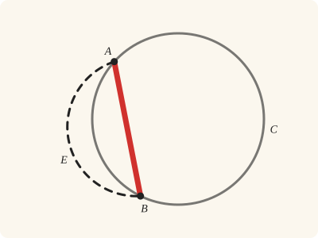
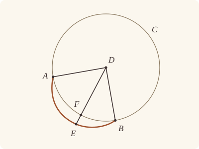

<!-- Generated by scripts/render.py. Do not edit by hand. -->

[Book III](index.md) · [← III.1](01.md) · [III.3 →](03.md)

# Book III, Proposition 2

*The straight line joining two points falls within the circle*

[Euclid's proof](#euclids-proof) · [In Lean](#in-lean) · [What it rests on](#what-it-rests-on) · [Mishnah](#mishnah)

> If on the circumference of a circle two points be taken at random, the straight line joining the points will fall within the circle.

**In Lean:** ✅ proved, as Euclid states it · Euclid's argument, with one step changed

<p align="center"></p>

<p align="center"><em>Join any two points on a circle with a straight line (red), and it falls within the circle: never outside it (dashed), nor along the circumference.</em></p>

## Euclid's proof

<p align="center"></p>

<p align="center"><em>Drawn for one case: the centre D off AB, as in Heath's figure. Like Heath's, this figure draws the impossible supposition: the straight line AEB falling outside the circle, and so drawn bent, since no straight line can.</em></p>

Let ABC be a circle, and let two points A, B be taken at random on its circumference;

I say that the straight line joined from A to B will fall within the circle.

For suppose it does not, but, if possible, let it fall outside, as AEB;

let the centre of the circle ABC be taken [III. 1], and let it be D; let DA, DB be joined, and let DFE be drawn through.

Then, since DA is equal to DB,

the angle DAE is also equal to the angle DBE. [I. 5]

And, since one side AEB of the triangle DAE is produced,

the angle DEB is greater than the angle DAE. [I. 16]

But the angle DAE is equal to the angle DBE;

therefore the angle DEB is greater than the angle DBE.

And the greater angle is subtended by the greater side; [I. 19]

therefore DB is greater than DE.

But DB is equal to DF;

therefore DF is greater than DE,

the less than the greater: which is impossible.

Therefore the straight line joined from A to B will not fall outside the circle.

Similarly we can prove that neither will it fall on the circumference itself;

therefore it will fall within.

Therefore etc.

Q. E. D.

## In Lean

| | |
|---|---|
| Proof | ✅ Proved |
| Statement | The whole enunciation. Every point strictly between two points of the circle is within it, AB through the centre included, which Euclid's figure leaves aside. |
| Argument | Euclid's, with one step changed. Euclid's argument, but for the centre D: Euclid takes it by III.1 (Heath's reference), and the Lean from `Tacit.exists_centre`, a rule we assume, for the proof needs the centre alone. |
| Reviewed | The statement and every passage of the argument read against Heath's text, at commit [`81424ad0a`](https://github.com/jackChallis/stoicheia/commit/81424ad0a) ([the record](../../review/III/02.toml)) |

From [`Elements/BookIII/Prop02.lean`](../../Elements/BookIII/Prop02.lean). Euclid's sentences are the `--` comments, and our own notes are in `/- … -/`; the lines under each sentence are the Lean that carries it out. The list below marks where a lemma does a step Euclid takes for granted, where several sentences share one step, where the Lean takes a case Euclid's figure leaves aside and where a step is argued another way; the `/- … -/` notes in the listing explain smaller adjustments.

**How the Lean follows the text**

- **Carried together.** "For suppose it does not, but, if possible, let it fall outside…" That DE is less than DB does not need the supposition, so the Lean proves it first, and then refutes "outside" and "on the circumference" each by that one comparison.
- **Argued another way, by `Tacit.exists_centre`.** "let the centre of the circle ABC be taken…" Euclid takes the centre D by III.1 (Heath's reference). The proof needs the centre alone, so a call of III.1 would do no work: the Lean takes D from `Tacit.exists_centre`, a rule we assume from Definitions I.15 and I.16, not a proved lemma or a rule of System E.
- **Done by `Tacit.line_circle_between`.** "and let DFE be drawn through." Euclid draws DFE through the circle, taking F between D and the supposed outside point E. The Lean obtains F after proving DE less than DB, using the proved theorem `Tacit.centre_inside` (System E, Generalities 3) and the assumed rule `Tacit.line_circle_between` (System E, Intersections 4).
- **A further case, by `Prop2.through_centre`.** "Then, since DA is equal to DB…" Euclid's figure keeps the centre D off AB; when AB passes through D, the Lean puts D within the circle by the proved theorem `Tacit.centre_inside` (System E, Generalities 3) and then between A and B by the assumed rule `Tacit.between_of_inside_chord` (System E, Circle 1). There are then no triangles DAE and DEB, and `Prop2.through_centre` shows DE less than DB directly: if E is D, DE has length zero and DB a positive length; otherwise DE is part of DA or of DB, which are equal.
- **Done by `Definition15`.** "But DB is equal to DF…" Euclid uses equal radii here and in DA = DB without a reference from Heath. The Lean obtains both equalities from `Definition15`, Euclid's definition of a circle, which we assume as a rule.
- **Done by `len_lt_of_between`.** "the less than the greater…" Euclid treats DF as less than DE because F lies between D and E. The Lean proves this by `len_lt_of_between`, adding DF and FE to make DE and applying Common Notion 5, so DF cannot also be greater than DE.
- **Carried together.** "Similarly we can prove that neither will it fall on the circumference itself…" Euclid leaves the case of a point on the circumference to the same argument without writing it out. Under that supposition, the Lean obtains DE equal to DB from `Definition15`, the assumed rule for equal radii.

<details><summary>Before the theorem, one lemma: <code>Prop2.through_centre</code> (21 lines)</summary>

```lean
/-- Euclid's figure takes the centre off AB. When the centre D is on AB,
a point E between its ends is nearer D than either end is, for DE is part of
DA or of DB, which are equal. -/
theorem Prop2.through_centre {A B D E : Point} {L : Line} (hADB : Between A D B)
    (hAEB : Between A E B) (hD_L : OnLine D L) (hA_L : OnLine A L) (hDA_DB : ‖D A‖ = ‖D B‖) :
    ‖D E‖ < ‖D B‖ := by
  by_cases hED : E = D
  · subst hED
    rw [len_self]
    exact len_pos (ne_of_between (between_symm hADB)).symm
  have hB_L := on_line_of_between hADB hA_L hD_L
  have hE_L := on_line_of_between_ends hAEB hA_L hB_L
  rcases between_cases (ne_of_between hADB) (Ne.symm hED) (ne_of_between hAEB)
      hA_L hD_L hE_L with h | h | h
  · /- If D is between A and E, then E is between D and B. -/
    exact len_lt_of_between (between_inner h hAEB)
  · /- A cannot be between D and E, since D is between A and B. -/
    exact absurd (between_of_between_right h hAEB) (not_between_of_between hADB)
  · /- If E is between A and D, then DE is less than DA. -/
    rw [← hDA_DB]
    exact len_lt_of_between (between_symm h)
```

</details>

```lean
/-- If on the circumference of a circle two points be taken at random, the straight line joining the
points will fall within the circle. -/
theorem Prop2 {A B : Point} {ABC : Circle} (hA : OnCircle A ABC)
    (hB : OnCircle B ABC) :
    ∀ E : Point, Between A E B → InsideCircle E ABC := by
  -- Let ABC be a circle, and let two points A, B be taken at random on its circumference;
  -- I say that the straight line joined from A to B will fall within the circle.
  intro E hAEB
  -- For suppose it does not, but, if possible, let it fall outside, as AEB;
  /- DE is less than DB, and that one comparison serves both suppositions, outside and on
     the circle. We take up the outside one, and the point F it supplies, below. -/
  -- let the centre of the circle ABC be taken [III. 1], and let it be D; let DA, DB be joined,
  -- and let DFE be drawn through.
  /- III.1 is not needed: the proof uses the centre alone, which the rule `exists_centre`
     gives, so the centre is taken from it, and Heath's reference stays on the page. -/
  obtain ⟨D, hD⟩ := exists_centre ABC
  have hAB : A ≠ B := ne_of_between_ends hAEB
  obtain ⟨L, hA_L, hB_L⟩ := Postulate1 A B hAB
  have hE_L := on_line_of_between_ends hAEB hA_L hB_L
  -- Then, since DA is equal to DB,
  have hDA_DB : ‖D A‖ = ‖D B‖ := Definition15 hD hA hB
  have hDE_DB : ‖D E‖ < ‖D B‖ := by
    by_cases hD_L : OnLine D L
    · exact Prop2.through_centre
        (between_of_inside_chord hD_L hA_L hB_L (centre_inside hD) hA hB hAB)
        hAEB hD_L hA_L hDA_DB
    have hDAB : Triangle D A B := Triangle.of_line hA_L hB_L hAB hD_L |>.cab
    have hDAE : Triangle D A E :=
      Triangle.of_line hA_L hE_L (ne_of_between hAEB) hD_L |>.cab
    have hDEB : Triangle D E B :=
      Triangle.of_line hE_L hB_L (ne_of_between (between_symm hAEB)).symm hD_L |>.cab
    -- the angle DAE is also equal to the angle DBE. [I. 5]
    have hDAE_DBE : ∠ D A E = ∠ D B E := by
      rw [angle_onRay_right (OnRay.of_between hAEB) hDAB.ne₁₂,
        angle_onRay_right (OnRay.of_between (between_symm hAEB)) hDAB.ne₁₃]
      exact BookI.Prop5.base hDAB hDA_DB
    -- And, since one side AEB of the triangle DAE is produced,
    -- the angle DEB is greater than the angle DAE. [I. 16]
    have hDAE_DEB : ∠ D A E < ∠ D E B := by
      rw [angle_symm hDAE.ne₁₂ hDAE.ne₂₃.symm]
      exact (BookI.Prop16 hDAE hAEB).1
    -- But the angle DAE is equal to the angle DBE;
    -- therefore the angle DEB is greater than the angle DBE.
    have hDBE_DEB : ∠ D B E < ∠ D E B := hDAE_DBE ▸ hDAE_DEB
    -- And the greater angle is subtended by the greater side; [I. 19]
    -- therefore DB is greater than DE.
    exact BookI.Prop19 hDEB (by rw [angle_symm hDEB.ne₂₃ hDEB.ne₁₃]; exact hDBE_DEB)
  have hout : ¬ OutsideCircle E ABC := by
    intro hE_out
    have hDE : D ≠ E := fun e => hE_out.1 (e ▸ centre_inside hD)
    obtain ⟨N, hD_N, hE_N⟩ := Postulate1 D E hDE
    /- DFE crosses the circle between its centre D and the supposed outside point E
       (System E, Intersections 4). -/
    obtain ⟨F, hF, -, hDFE⟩ := line_circle_between (centre_inside hD) hD_N hE_out hE_N
    -- But DB is equal to DF;
    have hDB_DF : ‖D B‖ = ‖D F‖ := Definition15 hD hB hF
    -- therefore DF is greater than DE,
    have hDE_DF : ‖D E‖ < ‖D F‖ := hDB_DF ▸ hDE_DB
    -- the less than the greater: which is impossible.
    exact lt_irrefl _ (lt_trans hDE_DF (len_lt_of_between hDFE))
  -- Therefore the straight line joined from A to B will not fall outside the circle.
  -- Similarly we can prove that neither will it fall on the circumference itself;
  have hon : ¬ OnCircle E ABC := by
    intro hE_on
    have hDB_DE : ‖D B‖ = ‖D E‖ := Definition15 hD hB hE_on
    exact lt_irrefl _ (hDB_DE ▸ hDE_DB)
  -- therefore it will fall within.
  exact Classical.byContradiction fun hin => hout ⟨hin, hon⟩
  -- Therefore etc.
  -- Q. E. D.
```

<details><summary>After the theorem, four theorems later propositions use, <code>Prop2.within</code>, <code>Prop2.triangle</code>, <code>Prop2.oppositeSide</code> and <code>Prop2.sameSide</code>; and six lemmas beside the proposition, <code>_root_.Elements.Tacit.outside_of_between</code>, <code>_root_.Elements.Tacit.inside_of_between</code>, <code>inside_point_of_chord</code>, <code>_root_.Elements.Tacit.exists_point_outside_circle</code>, <code>circle_intersections_of_inside</code> and <code>_root_.Elements.Tacit.line_meets_circle_of_opposite_sides</code> (144 lines)</summary>

```lean
/-- III.2 for points on or within the circle: a point between two such points is within
it. Produced beyond each end that is within, the straight line meets the circle (System E,
Intersections 5), and the point lies between the two points where it meets it, so within
the circle by III.2. [III. 2] -/
theorem Prop2.within {A B C : Point} {α : Circle}
    (hA : InsideCircle A α ∨ OnCircle A α) (hB : InsideCircle B α ∨ OnCircle B α)
    (h : Between A C B) : InsideCircle C α := by
  obtain ⟨L, hA_L, hB_L⟩ := Postulate1 A B (ne_of_between_ends h)
  obtain ⟨P, hP, hP_L, hPCB⟩ : ∃ P : Point, OnCircle P α ∧ OnLine P L ∧ Between P C B := by
    rcases hA with hA | hA
    · obtain ⟨P, hP, hP_L, hPAB⟩ :=
        line_circle_beyond hA hA_L hB_L (ne_of_between_ends h).symm
      exact ⟨P, hP, hP_L,
        between_symm (between_of_between_left (between_symm hPAB) (between_symm h))⟩
    · exact ⟨A, hA, hA_L, h⟩
  obtain ⟨Q, hQ, hPCQ⟩ : ∃ Q : Point, OnCircle Q α ∧ Between P C Q := by
    rcases hB with hB | hB
    · obtain ⟨Q, hQ, -, hQBP⟩ := line_circle_beyond hB hB_L hP_L (ne_of_between_ends hPCB)
      exact ⟨Q, hQ, between_of_between_left (between_symm hQBP) hPCB⟩
    · exact ⟨B, hB, hPCB⟩
  exact Prop2 hP hQ C hPCQ

/-- Three points of a circle are not on one straight line: were they, one would lie
between the other two, and so within the circle, not on it. [III. 2] -/
theorem Prop2.triangle {A B C : Point} {α : Circle}
    (hA : OnCircle A α) (hB : OnCircle B α) (hC : OnCircle C α)
    (hAB : A ≠ B) (hBC : B ≠ C) (hAC : A ≠ C) : Triangle A B C := by
  rintro ⟨L, hA_L, hB_L, hC_L⟩
  rcases between_cases hAB hBC hAC hA_L hB_L hC_L with h | h | h
  · exact inside_not_on (Prop2 hA hC B h) hB
  · exact inside_not_on (Prop2 hB hC A h) hA
  · exact inside_not_on (Prop2 hA hB C h) hC

/-- A straight line BC in a circle has a point of the circle on the other side of it from
any point K off it. Take M between B and C; it is within the circle [III. 2], so the
straight line KM, produced beyond M, meets the circle (System E, Intersections 5), on the
other side of BC from K (Pasch 3). -/
theorem Prop2.oppositeSide {B C K : Point} {α : Circle}
    (hB : OnCircle B α) (hC : OnCircle C α) (hK : Triangle B C K) :
    ∃ A : Point, OnCircle A α ∧ OppositeSidesOf A K B C := by
  obtain ⟨L, hB_L, hC_L⟩ := Postulate1 B C hK.ne₁₂
  obtain ⟨M, hM_L, hBMC, -⟩ := exists_point_between hB_L hC_L hK.ne₁₂ []
  have hM_in : InsideCircle M α := Prop2 hB hC M hBMC
  have hK_L : ¬ OnLine K L := hK.off_line hB_L hC_L
  have hKM : K ≠ M := fun e => hK_L (e ▸ hM_L)
  obtain ⟨N, hK_N, hM_N⟩ := Postulate1 K M hKM
  obtain ⟨A, hA_α, hA_N, hAMK⟩ := line_circle_beyond hM_in hM_N hK_N hKM
  /- A is off BC: the straight lines KM and BC meet only at M, and A is on the circle,
     not within it. -/
  have hAM : A ≠ M := fun e => inside_not_on hM_in (e ▸ hA_α)
  have hA_L : ¬ OnLine A L := fun hA_L =>
    hK_L ((line_unique hAM hA_N hM_N hA_L hM_L) ▸ hK_N)
  exact ⟨A, hA_α, OppositeSidesOf.of_line hK.ne₁₂ hB_L hC_L
    ⟨hA_L, hK_L, pasch3 hAMK hM_L⟩⟩

/-- A straight line BC in a circle has a point of the circle on the same side of it as any
point K off it: take a point on the other side from K, and a point of the circle on the
other side from that (`Prop2.oppositeSide`). [III. 2] -/
theorem Prop2.sameSide {B C K : Point} {α : Circle}
    (hB : OnCircle B α) (hC : OnCircle C α) (hK : Triangle B C K) :
    ∃ A : Point, OnCircle A α ∧ SameSideOf A K B C := by
  obtain ⟨Q, hQ, -⟩ := exists_oppositeSidesOf hK []
  obtain ⟨A, hA_α, hAQ⟩ := Prop2.oppositeSide hB hC hQ.triangle
  exact ⟨A, hA_α, OppositeSidesOf.sameSideOf hAQ.symm hQ⟩

/-! ## Rules that III.2 gives back

System E's Circle 2 and Circle 3 say what III.2 proves, so they are proved here, after
it, under their own names, with Points 9 and Intersection 2, whose proofs used Circle 3
and now take its step from III.2 itself. Nothing before III.2 may use them: a use cites
III.2. -/

/-- Once a straight line has left a circle, it does not come back (System E, Circle 3):
with A on or within the circle, and C, between A and B, not within it, B is outside the
circle. We prove it from III.2, by `Prop2.within`: were B within the circle or on it, C,
between A and B, would be within it. This was an assumption until 24 October 2026. -/
theorem _root_.Elements.Tacit.outside_of_between {A B C : Point} {α : Circle}
    (hA : InsideCircle A α ∨ OnCircle A α) (hC : ¬ InsideCircle C α)
    (h : Between A C B) : OutsideCircle B α :=
  ⟨fun hB => hC (Prop2.within hA (Or.inl hB) h), fun hB => hC (Prop2.within hA (Or.inr hB) h)⟩

/-- Between two points on or within a circle, every point is within it (System E,
Circle 2). This is `Prop2.within`, III.2 for points on or within the circle. It was an
assumption until 19 October 2026, and was then proved from Circle 3, an assumption until
24 October 2026. -/
theorem _root_.Elements.Tacit.inside_of_between {A B C : Point} {α : Circle}
    (hA : InsideCircle A α ∨ OnCircle A α)
    (hB : InsideCircle B α ∨ OnCircle B α) (h : Between A C B) : InsideCircle C α :=
  Prop2.within hA hB h

/-- Two distinct circumference points enclose an interior point avoiding any finite list. -/
private theorem inside_point_of_chord (α : Circle) (avoid : List Point) :
    ∃ A : Point, InsideCircle A α ∧ A ∉ avoid := by
  obtain ⟨B, hB, _⟩ := Elements.Tacit.exists_point_on_circle α []
  obtain ⟨C, hC, hCB⟩ := Elements.Tacit.exists_point_on_circle α [B]
  have hBC : B ≠ C := by
    intro e
    exact hCB (e ▸ List.mem_singleton_self B)
  obtain ⟨L, hBL, hCL⟩ := Postulate1 B C hBC
  obtain ⟨A, _, hBAC, hA⟩ := exists_point_between hBL hCL hBC avoid
  exact ⟨A, Prop2 hB hC A hBAC, hA⟩

/-- A point can be taken outside a circle while avoiding any finite list of points
(System E, Points 9). This was an assumption until 19 October 2026, and is proved from
Points 7 and 3, Postulates 1 and 2, and III.2, which took the place of Circle 3 on
24 October 2026: take a point between two points on the circle, within it by III.2, then
produce a straight line from it beyond the circumference. Postulate 2 chooses the endpoint
outside the given list, and the endpoint is outside the circle: were it within the circle
or on it, the point of the circle between would be within it, by III.2 again. -/
theorem _root_.Elements.Tacit.exists_point_outside_circle (α : Circle) (avoid : List Point) :
    ∃ A : Point, OutsideCircle A α ∧ A ∉ avoid := by
  obtain ⟨B, hB, _⟩ := inside_point_of_chord α []
  obtain ⟨C, hC, _⟩ := Elements.Tacit.exists_point_on_circle α []
  have hBC : B ≠ C := fun e => inside_not_on (e ▸ hB) hC
  obtain ⟨L, hBL, hCL⟩ := Postulate1 B C hBC
  obtain ⟨A, _, hBCA, hA⟩ := Postulate2 hBL hCL hBC avoid
  exact ⟨A, ⟨fun hA' => inside_not_on (Prop2.within (Or.inl hB) (Or.inl hA') hBCA) hC,
    fun hA' => inside_not_on (Prop2.within (Or.inl hB) (Or.inr hA') hBCA) hC⟩, hA⟩

/-- Two opposite extensions from an interior point meet the circumference distinctly. -/
private theorem circle_intersections_of_inside {A : Point} {L : Line} {α : Circle}
    (hA : InsideCircle A α) (hAL : OnLine A L) : LineMeetsCircle L α := by
  obtain ⟨C, hCL, hCA⟩ := exists_point_on_line L [A]
  have hCA' : C ≠ A := by simpa using hCA
  obtain ⟨P, hP, hPL, hPAC⟩ := line_circle_beyond hA hAL hCL hCA'
  obtain ⟨Q, hQ, hQL, hQAP⟩ :=
    line_circle_beyond hA hAL hPL (ne_of_between hPAC)
  exact ⟨Q, P, ne_of_between_ends hQAP, hQL, hQ, hPL, hP⟩

/-- A straight line separating two points on or inside a circle cuts the circle
(System E, Intersection 2). This was an assumption until 19 October 2026, and is proved
from Intersection 1, the order of collinear points, Pasch 2, III.2 and Intersections 5;
III.2 took the place of Circle 3 on 24 October 2026. The crossing lies between the given
points, and so within the circle by III.2; producing the straight line in both directions
gives two distinct circumference points. -/
theorem _root_.Elements.Tacit.line_meets_circle_of_opposite_sides {A B : Point} {L : Line}
    {α : Circle} (hA : InsideCircle A α ∨ OnCircle A α)
    (hB : InsideCircle B α ∨ OnCircle B α) (h : OppositeSides A B L) : LineMeetsCircle L α := by
  have hAB : A ≠ B := fun e => h.2.2 (e ▸ same_side_refl h.1)
  obtain ⟨M, hAM, hBM⟩ := Postulate1 A B hAB
  obtain ⟨hLM, X, hXL, hXM⟩ := lines_meet_of_opposite_sides h hAM hBM
  have hAXB : Between A X B := between_at_crossing hLM hXL hXM hAM hBM hAB
    (fun e => h.1 (e ▸ hXL)) (fun e => h.2.1 (e ▸ hXL)) h.2.2
  exact circle_intersections_of_inside (Prop2.within hA hB hAXB) hXL
```

</details>

## What it rests on

| | |
|---|---|
| Heath's references | [I.5](../I/05.md), [I.16](../I/16.md), [I.19](../I/19.md), [III.1](01.md) |
| Lean cites | [I.5](../I/05.md), [I.16](../I/16.md), [I.19](../I/19.md) |
| Postulates | 1, 2, 3, 4 |
| Definitions taken as axioms | Def. I.15 |
| Common Notions | 1, 2, 3, 4, 5 |
| Tacit rules | 39 (listed below) |
| Its own Lean calls | Postulate 1; Def. I.15; 10 tacit rules |
| Through lemmas | Postulates 2 and 3; 19 tacit rules |

Some of these come in through lemmas [shared](../../CERTIFICATE.md#shared-steps) by many proofs: [`BookI.Prop5.base`](../../Elements/BookI/Helpers.lean#L27) (I.5).

_Postulates, definitions, Common Notions and tacit rules: all that this proof rests on, counting those of the propositions it cites. The last two rows say which of the postulates, definitions and tacit rules its own Lean calls, in the proof or a helper written for it, and which it does not call but reaches through lemmas, of Book Zero or shared (a proposition it cites may rest on these too); the rest come in only through the propositions it cites or the Common Notions._

<details><summary>The 39 tacit rules beneath this proof, counting those of the propositions it cites</summary>

_(used here) marks a rule this proof's own Lean calls, in the proof or a helper written for it; (through …) marks one its own Lean does not call but reaches through the lemmas named, of [Book Zero](../../Elements/Figure) or shared, though a proposition it cites may rest on it too; and a rule with no mark comes in only through a proposition it cites or a Common Notion. The names in brackets are System E's: an Intersection rule says when straight lines and circles must meet, and an Intersections rule takes a point where they do (see [Book I's introduction](../I/index.md))._

**Reading the figure**

- [`between_cases`](../../Elements/Foundations/Tacit/Diagram.lean#L54) (used here): Of three different points on a straight line, one is between the other two. (Between 6)
- [`between_of_inside_chord`](../../Elements/Foundations/Tacit/Diagram.lean#L81) (used here): A straight line through a point inside a circle has that point between the points where it meets the circle. (Circle 1)
- [`between_symm`](../../Elements/Foundations/Tacit/Diagram.lean#L47) (used here): If B is between A and C, it is between C and A. (Between 1)
- [`circles_meet`](../../Elements/Foundations/Tacit/Diagram.lean#L94) (through [`OnRay.of_between`](../../Elements/Figure/Rays.lean#L34), [`Tacit.between_of_between_right`](../../Elements/Figure/Incidence.lean#L207), [`Tacit.on_line_of_between`](../../Elements/Figure/Incidence.lean#L77) and 2 other lemmas): If each circle passes through a point inside the other, the circles cut one another. This is the step Euclid takes for granted in I.1. (Intersection 5)
- [`circles_meet_same_side`](../../Elements/Foundations/Tacit/Constructions.lean#L79) (through [`OnRay.of_between`](../../Elements/Figure/Rays.lean#L34), [`Tacit.between_of_between_right`](../../Elements/Figure/Incidence.lean#L207), [`Tacit.on_line_of_between`](../../Elements/Figure/Incidence.lean#L77) and 2 other lemmas): Two circles that cut one another do so on each side of the straight line through their centres. (Intersections 8)
- [`exists_centre`](../../Elements/Foundations/Tacit/Constructions.lean#L57) (used here): Every circle has a centre. A rule of our own, not one of System E's: its content is Euclid's Definitions I.15 and I.16.
- [`exists_point`](../../Elements/Foundations/Tacit/Constructions.lean#L35) (through [`BookI.Prop5.base`](../../Elements/BookI/Helpers.lean#L27), [`OnRay.of_between`](../../Elements/Figure/Rays.lean#L34), [`Tacit.between_of_between_right`](../../Elements/Figure/Incidence.lean#L207) and 9 other lemmas): Let a point be taken. (Points 1)
- [`exists_point_inside_circle`](../../Elements/Foundations/Tacit/Constructions.lean#L42) (through [`OnRay.of_between`](../../Elements/Figure/Rays.lean#L34), [`Tacit.between_of_between_right`](../../Elements/Figure/Incidence.lean#L207), [`Tacit.centre_inside`](../../Elements/Figure/RuleBase.lean#L87) and 7 other lemmas): Let a point be taken inside the circle α. (Points 8)
- [`exists_point_on_line`](../../Elements/Foundations/Tacit/Constructions.lean#L38) (through [`OnRay.of_between`](../../Elements/Figure/Rays.lean#L34), [`Tacit.between_of_between_right`](../../Elements/Figure/Incidence.lean#L207), [`Tacit.on_line_of_between`](../../Elements/Figure/Incidence.lean#L77) and 2 other lemmas): Let a point be taken on the straight line L. (Points 2)
- [`line_circle_between`](../../Elements/Foundations/Tacit/Constructions.lean#L67) (used here): A straight line through a point B inside a circle, heading out to a point C outside it, cuts the circle between B and C. (Intersections 4)
- [`line_circle_beyond`](../../Elements/Foundations/Tacit/Constructions.lean#L73) (through [`OnRay.of_between`](../../Elements/Figure/Rays.lean#L34), [`Tacit.between_of_between_right`](../../Elements/Figure/Incidence.lean#L207), [`Tacit.centre_inside`](../../Elements/Figure/RuleBase.lean#L87) and 7 other lemmas): A straight line through a point B inside a circle, produced beyond B away from C, cuts the circle there. (Intersections 5)
- [`line_unique`](../../Elements/Foundations/Tacit/Diagram.lean#L41) (through [`Tacit.between_of_between_right`](../../Elements/Figure/Incidence.lean#L207), [`Tacit.on_line_of_between`](../../Elements/Figure/Incidence.lean#L77), [`Triangle.of_line`](../../Elements/Figure/Triangles.lean#L82) and 1 other lemma): Two points determine a straight line. (Generalities 1)
- [`lines_meet_of_opposite_sides`](../../Elements/Foundations/Tacit/Diagram.lean#L89): A straight line joining points on opposite sides of L crosses L. (Intersection 1)
- [`not_between_of_between`](../../Elements/Foundations/Tacit/Diagram.lean#L50) (used here): If B is between A and C, then A is not between B and C. (Between 1)
- [`not_on_line_of_same_side`](../../Elements/Foundations/Tacit/Diagram.lean#L60) (through [`OnRay.of_between`](../../Elements/Figure/Rays.lean#L34), [`Tacit.between_of_between_right`](../../Elements/Figure/Incidence.lean#L207), [`Tacit.on_line_of_between`](../../Elements/Figure/Incidence.lean#L77) and 2 other lemmas): Points on one side of a straight line are not on it. (Same side 3)
- [`pasch2`](../../Elements/Foundations/Tacit/Diagram.lean#L71) (through [`OnRay.of_between`](../../Elements/Figure/Rays.lean#L34), [`Tacit.between_of_between_right`](../../Elements/Figure/Incidence.lean#L207), [`Tacit.on_line_of_between`](../../Elements/Figure/Incidence.lean#L77) and 2 other lemmas): If B is between A and C, A is on L and B is off it, then B and C are on the same side of L: a straight line that leaves L at A does not cross it again. (Pasch 2)
- [`same_side_trans`](../../Elements/Foundations/Tacit/Diagram.lean#L64) (through [`OnRay.of_between`](../../Elements/Figure/Rays.lean#L34), [`Tacit.between_of_between_right`](../../Elements/Figure/Incidence.lean#L207), [`Tacit.on_line_of_between`](../../Elements/Figure/Incidence.lean#L77) and 2 other lemmas): Two points on the same side of a straight line as a third point are on the same side as each other. (Same side 4)

**Lengths, angles and areas**

- [`angle_add_of_inside`](../../Elements/Foundations/Tacit/Transfer.lean#L47): If D lies within the angle BAC, then BAC is made up of BAD and DAC. (Diagram-angle 2)
- [`angle_eq_of_same_rays`](../../Elements/Foundations/Tacit/Transfer.lean#L54) (through [`angle_onRay_right`](../../Elements/Figure/Angles.lean#L49)): The angle doesn't change if its arms are traced through other points on the same rays. (Diagram-angle 4)
- [`angle_symm`](../../Elements/Foundations/Tacit/Metric.lean#L27) (used here): The angle ABC is the angle CBA. (Metric 4)
- [`area_add_of_between`](../../Elements/Foundations/Tacit/Transfer.lean#L70): Cutting a triangle in two from a vertex adds up. (Diagram-area 2)
- [`area_congruent`](../../Elements/Foundations/Tacit/Metric.lean#L41): Triangles equal in all their sides and angles are equal in area. Euclid uses this without comment once he has shown two triangles congruent. (Metric 9)
- [`area_degenerate`](../../Elements/Foundations/Tacit/Metric.lean#L33): A "triangle" with a repeated corner has no area. (Metric 6)
- [`area_eq_zero_of_on_line`](../../Elements/Foundations/Tacit/Transfer.lean#L62): A "triangle" whose corners lie on one straight line has no area. (Diagram-area 1)
- [`area_rotate`](../../Elements/Foundations/Tacit/Metric.lean#L36): The triangle ABC is the triangle CAB. (Metric 8)
- [`circle_eq`](../../Elements/Foundations/Tacit/Transfer.lean#L30) (through [`OnRay.of_between`](../../Elements/Figure/Rays.lean#L34), [`Tacit.between_of_between_right`](../../Elements/Figure/Incidence.lean#L207), [`Tacit.centre_inside`](../../Elements/Figure/RuleBase.lean#L87) and 7 other lemmas): A circle is fixed by its centre and its radius. (Diagram-segment 2)
- [`len_add_of_between`](../../Elements/Foundations/Tacit/Transfer.lean#L27) (through [`OnRay.of_between`](../../Elements/Figure/Rays.lean#L34), [`Tacit.between_of_between_right`](../../Elements/Figure/Incidence.lean#L207), [`Tacit.centre_inside`](../../Elements/Figure/RuleBase.lean#L87) and 7 other lemmas): If B is between A and C, then AB and BC together make up AC. (Diagram-segment 1)
- [`len_self`](../../Elements/Foundations/Tacit/Metric.lean#L21) (used here): The "straight line" from a point to itself has no length. (Metric 1)
- [`len_symm`](../../Elements/Foundations/Tacit/Metric.lean#L24) (through [`OnRay.of_between`](../../Elements/Figure/Rays.lean#L34), [`Tacit.between_of_between_right`](../../Elements/Figure/Incidence.lean#L207), [`Tacit.centre_inside`](../../Elements/Figure/RuleBase.lean#L87) and 7 other lemmas): The straight line AB is the straight line BA. (Metric 3)
- [`same_ray_of_angle_eq_zero`](../../Elements/Foundations/Tacit/Transfer.lean#L42): If the angle BAC is nothing, C lies on the ray from A through B. (Diagram-angle 1)

**Superposition**

- [`superposition`](../../Elements/Foundations/Tacit/Superposition.lean#L48): **Superposition.** A hypothetical placement of a triangle on a given ray and side permits a restricted derivation of metric equalities about the figure already given. The derivation introduces no further objects, cites each geometric law it uses, and exports no symbol of the placement.

**Rules of magnitude**

- [`add_assoc`](../../Elements/Foundations/Tacit/Magnitudes.lean#L23) (through [`Tacit.between_of_between_right`](../../Elements/Figure/Incidence.lean#L207) and [`between_inner`](../../Elements/Figure/Lines.lean#L44)): Adding three magnitudes in a row, it makes no difference whether the first two or the last two are added first. (System E §3.5)
- [`add_comm`](../../Elements/Foundations/Tacit/Magnitudes.lean#L26) (through [`OnRay.of_between`](../../Elements/Figure/Rays.lean#L34), [`Tacit.between_of_between_right`](../../Elements/Figure/Incidence.lean#L207), [`Tacit.centre_inside`](../../Elements/Figure/RuleBase.lean#L87) and 7 other lemmas): The order of adding does not matter. (System E §3.5)
- [`add_lt_add_right`](../../Elements/Foundations/Tacit/Magnitudes.lean#L45) (through [`Tacit.between_of_between_right`](../../Elements/Figure/Incidence.lean#L207) and [`between_inner`](../../Elements/Figure/Lines.lean#L44)): Adding the same thing to both sides keeps "less than". (System E §3.5)
- [`add_zero`](../../Elements/Foundations/Tacit/Magnitudes.lean#L29): Adding nothing changes nothing. (System E §3.5)
- [`lt_irrefl`](../../Elements/Foundations/Tacit/Magnitudes.lean#L32) (used here): No magnitude is less than itself. (System E §3.5)
- [`lt_trans`](../../Elements/Foundations/Tacit/Magnitudes.lean#L35) (used here): What is less than the less is less still. (System E §3.5)
- [`lt_trichotomy`](../../Elements/Foundations/Tacit/Magnitudes.lean#L39) (through [`OnRay.of_between`](../../Elements/Figure/Rays.lean#L34), [`Tacit.between_of_between_right`](../../Elements/Figure/Incidence.lean#L207), [`Tacit.centre_inside`](../../Elements/Figure/RuleBase.lean#L87) and 7 other lemmas): Of two magnitudes, one is less, or they are equal, or the other is less. (System E §3.5)
- [`not_lt_zero`](../../Elements/Foundations/Tacit/Magnitudes.lean#L42) (through [`OnRay.of_between`](../../Elements/Figure/Rays.lean#L34), [`Tacit.between_of_between_right`](../../Elements/Figure/Incidence.lean#L207), [`Tacit.centre_inside`](../../Elements/Figure/RuleBase.lean#L87) and 7 other lemmas): Nothing is less than zero. (System E §3.5)

</details>

## Mishnah

_Our commentary: why Euclid's proof, and ours, look as they do._

**A straight line that bows outside.** To show that the straight line AB falls within the circle, Euclid supposes that it falls outside, as AEB, and his figure bends it to make room for the impossible. Then DE is read two ways. The angles of the triangle DEB make it less than the radius DB; but with E outside, DE reaches past the circumference and is greater than the radius DF. The same straight line would be both less and greater.

Heath would rather prove it directly: "The *reductio ad absurdum* form of proof is not really necessary in this case, and it has the additional disadvantage that it requires the destruction of two hypotheses, namely that the chord is (1) outside, (2) on the circle" (vol. 2, p. 9). Euclid dismisses the second with "Similarly", and in our proof it is the shorter: on the circumference, DE would itself be a radius, and the angles have already made it less than one. So the comparison with the radius, which is all Heath's direct proof needs, carries both.

Euclid's figure keeps the centre off AB, so that DAE and DEB are triangles. Our statement lets AB pass through the centre too, and our proof takes that case apart in `Prop2.through_centre`: D is then between A and B, and DE is part of DA or of DB, which are equal. When E is D itself there is no straight line DE at all, and our representation counts its length as zero.

**A rule that contains III.2.** System E has this proposition among its rules, as Circle 2, in a stronger form: between two points on or within a circle, every point is within it. Its Circle 3, that a straight line which has left a circle does not come back, gives III.2 at once. We assume neither. Both are proved after III.2, from its corollary `Prop2.within`, III.2 for points on or within the circle, so neither is among the rules we assume, and a proof that uses either cites III.2, as none before it may. We follow Euclid. Our III.2 takes its centre D from `exists_centre`, as the [introduction](index.md) explains. The angles do the work, by I.5, I.16 and I.19, as in Euclid; the [catalogue of overlaps](../../docs/reports/overlaps.md) records both rules, and how they came to be proved from III.2.

**The modern way.** Put D at the origin, and write $\mathbf{a}$ and $\mathbf{b}$ for the positions of A and B, with $|\mathbf{a}| = |\mathbf{b}| = r$ and $\mathbf{a} \ne \mathbf{b}$. For $0 \lt t \lt 1$, $|(1 - t)\mathbf{a} + t\mathbf{b}|^2 = r^2 - t(1 - t)|\mathbf{a} - \mathbf{b}|^2 \lt r^2$, so every point strictly between A and B lies within the circle.

## Further reading

- Why may System E take as a rule the very fact III.2 proves? Kenneth Manders' essay ["The Euclidean Diagram (1995)"](https://doi.org/10.1093/acprof:oso/9780199296453.003.0005) (2008) sorts what a figure may be trusted to show from what it never shows, and System E is built on that line.
- John Stillwell's [*The Four Pillars of Geometry*](https://doi.org/10.1007/0-387-29052-4) (2005), a short, clear book that looks at the plane four ways, works out where straight lines meet circles by algebra in §3.4, "Intersections of lines and circles" (from p. 53).

[Book III](index.md) · [← III.1](01.md) · [III.3 →](03.md)

---

<sub>Euclid's text: T. L. Heath, *The Thirteen Books of Euclid's Elements*, vol. 2 (Cambridge, 1908), pp. 8–9; [scan leaves n20–n21](https://archive.org/details/thirteenbookseu00heibgoog/page/n20); [figure on n20](https://archive.org/details/thirteenbookseu00heibgoog/page/n20). Public domain.</sub>

<sub>The tacit rules follow the System E of Jeremy Avigad, Edward Dean and John Mumma, read alongside LeanEuclid (Logan Murphy, Kaiyu Yang, Jialiang Sun, Zhaoyu Li, Anima Anandkumar and Xujie Si).</sub>
