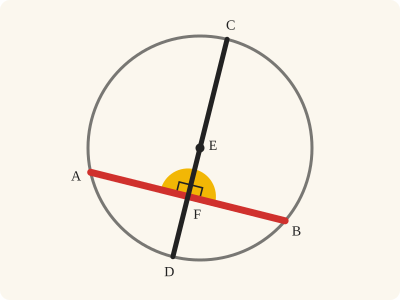
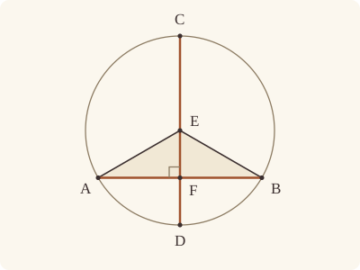

<!-- Generated by scripts/render.py. Do not edit by hand. -->

[Book III](index.md) · [← III.2](02.md) · [III.4 →](04.md)

# Book III, Proposition 3

*Through the centre, to bisect is to cut at right angles*

[Euclid's proof](#euclids-proof) · [In Lean](#in-lean) · [What it rests on](#what-it-rests-on) · [Mishnah](#mishnah)

> If in a circle a straight line through the centre bisect a straight line not through the centre, it also cuts it at right angles; and if it cut it at right angles, it also bisects it.

**In Lean:** ✅ proved, as Euclid states it · Euclid's argument

<p align="center"></p>

<p align="center"><em>Halve a straight line (red) in the circle and draw the straight line (black) from the centre through its middle: it meets the red at right angles (yellow). Make the angles right, and the red is halved.</em></p>

## Euclid's proof

<p align="center"></p>

Let ABC be a circle, and in it let a straight line CD through the centre bisect a straight line AB not through the centre at the point F;

I say that it also cuts it at right angles.

For let the centre of the circle ABC be taken, and let it be E; let EA, EB be joined.

Then, since AF is equal to FB,

and FE is common,

two sides are equal to two sides;

and the base EA is equal to the base EB;

therefore the angle AFE is equal to the angle BFE. [I. 8]

But, when a straight line set up on a straight line makes the adjacent angles equal to one another, each of the equal angles is right; [I. Def. 10]

therefore each of the angles AFE, BFE is right.

Therefore CD, which is through the centre, and bisects AB which is not through the centre, also cuts it at right angles.

Again, let CD cut AB at right angles;

I say that it also bisects it, that is, that AF is equal to FB.

For, with the same construction,

since EA is equal to EB,

the angle EAF is also equal to the angle EBF. [I. 5]

But the right angle AFE is equal to the right angle BFE,

therefore EAF, EBF are two triangles having two angles equal to two angles and one side equal to one side, namely EF, which is common to them, and subtends one of the equal angles;

therefore they will also have the remaining sides equal to the remaining sides; [I. 26]

therefore AF is equal to FB.

Therefore etc.

Q. E. D.

## In Lean

| | |
|---|---|
| Proof | ✅ Proved |
| Statement | The whole enunciation. The centre E is given and FE represents CD. F is between A and B; the converse asks only that AFE be right. |
| Argument | Euclid's. |
| Reviewed | The statement and every passage of the argument read against Heath's text, at commit [`f34cfd07`](https://github.com/jackChallis/stoicheia/commit/f34cfd07) ([the record](../../review/III/03.toml)) |

From [`Elements/BookIII/Prop03.lean`](../../Elements/BookIII/Prop03.lean). Euclid's sentences are the `--` comments, and our own notes are in `/- … -/`; the lines under each sentence are the Lean that carries it out. The list below marks where a lemma does a step Euclid takes for granted and where the statement already gives a step; the `/- … -/` notes in the listing explain smaller adjustments.

**How the Lean follows the text**

- **Already given.** "For let the centre of the circle ABC be taken…" The centre E is given, as Euclid's setting-out takes it. FE represents his straight line CD through the centre, so C and D need no Lean names. F is between A and B, as bisecting and cutting a straight line mean.
- **Done by `Definition15`.** "and the base EA is equal to the base EB…" Euclid uses the equality of the radii EA and EB without giving a reason. The Lean obtains their equality from `Definition15`, Euclid's definition of a circle, which we assume as a rule.
- **Done by `Definition15`.** "since EA is equal to EB…" Euclid again uses equal radii without giving a reason. The Lean applies the assumed rule `Definition15` again, now for the converse.
- **Done by `Tacit.adjacent_eq_of_right`.** "But the right angle AFE is equal to the right angle BFE…" Euclid treats both adjacent angles as right; the converse assumes only that AFE is right. The Lean obtains their equality from `Tacit.adjacent_eq_of_right`, proved from I.13 and Common Notion 3, for which Heath gives no reference here.

```lean
/-- If in a circle a straight line through the centre bisect a straight line not through the centre,
it also cuts it at right angles; and if it cut it at right angles, it also bisects it. -/
theorem Prop3 {A B E F : Point} {ABC : Circle} (hE : Centre E ABC) (hA : OnCircle A ABC)
    (hB : OnCircle B ABC) (hAFB : Between A F B) (hE_AB : ¬ Collinear A B E) :
    (‖A F‖ = ‖F B‖ → ∠ A F E = ∟ ∧ ∠ B F E = ∟) ∧ (∠ A F E = ∟ → ‖A F‖ = ‖F B‖) := by
  -- Let ABC be a circle, and in it let a straight line CD through the centre bisect a straight
  -- line AB not through the centre at the point F;
  obtain ⟨L, hA_L, hB_L⟩ := Postulate1 A B (ne_of_between_ends hAFB)
  have hF_L : OnLine F L := on_line_of_between_ends hAFB hA_L hB_L
  have hE_L : ¬ OnLine E L := (show Triangle A B E from hE_AB).off_line hA_L hB_L
  -- I say that it also cuts it at right angles.
  -- For let the centre of the circle ABC be taken, and let it be E; let EA, EB be joined.
  have hFAE : Triangle F A E := Triangle.of_line hF_L hA_L (ne_of_between hAFB).symm hE_L
  have hFBE : Triangle F B E :=
    Triangle.of_line hF_L hB_L (ne_of_between (between_symm hAFB)).symm hE_L
  refine ⟨fun hAF => ?_, fun hAFE => ?_⟩
  · /- The first part: if AF is equal to FB, the angles at F are right. -/
    -- Then, since AF is equal to FB,
    -- and FE is common,
    have hFE : ‖F E‖ = ‖F E‖ := rfl
    -- two sides are equal to two sides;
    have hFA : ‖F A‖ = ‖F B‖ := by rw [len_symm F A, hAF]
    -- and the base EA is equal to the base EB;
    have hEA : ‖E A‖ = ‖E B‖ := Definition15 hE hA hB
    -- therefore the angle AFE is equal to the angle BFE. [I. 8]
    have h8 : ∠ A F E = ∠ B F E :=
      BookI.Prop8 hFAE hFBE hFA hFE (by rw [len_symm A E, len_symm B E, hEA])
    -- But, when a straight line set up on a straight line makes the adjacent angles equal to one
    -- another, each of the equal angles is right; [I. Def. 10]
    have hright : IsRightAngle A F E :=
      ⟨B, hAFB, hFAE.bac, h8.trans (angle_symm hFBE.ne₁₂.symm hFBE.ne₁₃.symm)⟩
    -- therefore each of the angles AFE, BFE is right.
    have hAFE : ∠ A F E = ∟ := Postulate4 hright
    -- Therefore CD, which is through the centre, and bisects AB which is not through the centre,
    -- also cuts it at right angles.
    exact ⟨hAFE, h8 ▸ hAFE⟩
  -- Again, let CD cut AB at right angles;
  -- I say that it also bisects it, that is, that AF is equal to FB.
  · /- The converse: if the angle AFE is right, AF is equal to FB. -/
    -- For, with the same construction,
    -- since EA is equal to EB,
    have hEA : ‖E A‖ = ‖E B‖ := Definition15 hE hA hB
    -- the angle EAF is also equal to the angle EBF. [I. 5]
    have h5 : ∠ E A B = ∠ E B A :=
      BookI.Prop5.base (show Triangle A B E from hE_AB).cab hEA
    have hEAF : ∠ E A F = ∠ E B F := by
      rw [angle_onRay_right (OnRay.of_between hAFB) hFAE.ne₂₃.symm,
        angle_onRay_right (OnRay.of_between (between_symm hAFB)) hFBE.ne₂₃.symm]
      exact h5
    -- But the right angle AFE is equal to the right angle BFE,
    have hadj : ∠ A F E = ∠ E F B := adjacent_eq_of_right hA_L hB_L hAFB hE_L hAFE
    have hEFA : ∠ E F A = ∠ E F B :=
      (angle_symm hFAE.ne₁₃.symm hFAE.ne₁₂.symm).trans hadj
    -- therefore EAF, EBF are two triangles having two angles equal to two angles and one side
    -- equal to one side, namely EF, which is common to them, and subtends one of the equal
    -- angles;
    have hFAE_FBE : ∠ F A E = ∠ F B E := by
      rw [angle_symm hFAE.ne₁₂ hFAE.ne₂₃.symm,
        angle_symm hFBE.ne₁₂ hFBE.ne₂₃.symm]
      exact hEAF
    -- therefore they will also have the remaining sides equal to the remaining sides; [I. 26]
    have h26 := BookI.Prop26 hFAE.cab hFBE.cab hEFA hFAE_FBE (Or.inr rfl)
    -- therefore AF is equal to FB.
    exact (len_symm A F).trans h26.2.2.1
  -- Therefore etc.
  -- Q. E. D.
```

## What it rests on

| | |
|---|---|
| Heath's references | [I.5](../I/05.md), [I.8](../I/08.md), [I.26](../I/26.md); Def. I.10 |
| Lean cites | [I.5](../I/05.md), [I.8](../I/08.md), [I.13](../I/13.md), [I.26](../I/26.md) |
| Postulates | 1, 2, 3, 4 |
| Definitions taken as axioms | Def. I.15 |
| Common Notions | 1, 2, 3, 4, 5 |
| Tacit rules | 37 (listed below) |
| Its own Lean calls | Postulates 1 and 4; Def. I.15; 3 tacit rules |
| Through lemmas | Postulates 2 and 3; 21 tacit rules |

Some of these come in through lemmas [shared](../../CERTIFICATE.md#shared-steps) by many proofs: [`BookI.Prop5.base`](../../Elements/BookI/Helpers.lean#L27) (I.5); [`Tacit.adjacent_eq_of_right`](../../Elements/BookI/Prop13.lean#L188) (I.13).

_Postulates, definitions, Common Notions and tacit rules: all that this proof rests on, counting those of the propositions it cites. The last two rows say which of the postulates, definitions and tacit rules its own Lean calls, in the proof or a helper written for it, and which it does not call but reaches through lemmas, of Book Zero or shared (a proposition it cites may rest on these too); the rest come in only through the propositions it cites or the Common Notions._

_Euclid's Def. I.10 is `IsRightAngle` in Lean, a definition rather than an assumption, so the row of definitions taken as axioms does not count it._

<details><summary>The 37 tacit rules beneath this proof, counting those of the propositions it cites</summary>

_(used here) marks a rule this proof's own Lean calls, in the proof or a helper written for it; (through …) marks one its own Lean does not call but reaches through the lemmas named, of [Book Zero](../../Elements/Figure) or shared, though a proposition it cites may rest on it too; and a rule with no mark comes in only through a proposition it cites or a Common Notion. The names in brackets are System E's: an Intersection rule says when straight lines and circles must meet, and an Intersections rule takes a point where they do (see [Book I's introduction](../I/index.md))._

**Reading the figure**

- [`between_cases`](../../Elements/Foundations/Tacit/Diagram.lean#L54): Of three different points on a straight line, one is between the other two. (Between 6)
- [`between_symm`](../../Elements/Foundations/Tacit/Diagram.lean#L47) (used here): If B is between A and C, it is between C and A. (Between 1)
- [`circles_meet`](../../Elements/Foundations/Tacit/Diagram.lean#L91) (through [`OnRay.of_between`](../../Elements/Figure/Rays.lean#L34) and [`Tacit.on_line_of_between_ends`](../../Elements/Figure/RuleBase.lean#L142)): If each circle passes through a point inside the other, the circles cut one another. This is the step Euclid takes for granted in I.1. (Intersection 5)
- [`circles_meet_same_side`](../../Elements/Foundations/Tacit/Constructions.lean#L79) (through [`OnRay.of_between`](../../Elements/Figure/Rays.lean#L34) and [`Tacit.on_line_of_between_ends`](../../Elements/Figure/RuleBase.lean#L142)): Two circles that cut one another do so on each side of the straight line through their centres. (Intersections 8)
- [`exists_point`](../../Elements/Foundations/Tacit/Constructions.lean#L35) (through [`BookI.Prop5.base`](../../Elements/BookI/Helpers.lean#L27), [`Triangle.ne₁₂`](../../Elements/Figure/Triangles.lean#L22), [`Triangle.ne₁₃`](../../Elements/Figure/Triangles.lean#L36) and 1 other lemma): Let a point be taken. (Points 1)
- [`exists_point_inside_circle`](../../Elements/Foundations/Tacit/Constructions.lean#L42) (through [`OnRay.of_between`](../../Elements/Figure/Rays.lean#L34) and [`Tacit.on_line_of_between_ends`](../../Elements/Figure/RuleBase.lean#L142)): Let a point be taken inside the circle α. (Points 8)
- [`exists_point_on_line`](../../Elements/Foundations/Tacit/Constructions.lean#L38) (through [`OnRay.of_between`](../../Elements/Figure/Rays.lean#L34) and [`Tacit.on_line_of_between_ends`](../../Elements/Figure/RuleBase.lean#L142)): Let a point be taken on the straight line L. (Points 2)
- [`line_circle_between`](../../Elements/Foundations/Tacit/Constructions.lean#L67) (through [`OnRay.of_between`](../../Elements/Figure/Rays.lean#L34) and [`Tacit.on_line_of_between_ends`](../../Elements/Figure/RuleBase.lean#L142)): A straight line through a point B inside a circle, heading out to a point C outside it, cuts the circle between B and C. (Intersections 4)
- [`line_circle_beyond`](../../Elements/Foundations/Tacit/Constructions.lean#L73) (through [`OnRay.of_between`](../../Elements/Figure/Rays.lean#L34) and [`Tacit.on_line_of_between_ends`](../../Elements/Figure/RuleBase.lean#L142)): A straight line through a point B inside a circle, produced beyond B away from C, cuts the circle there. (Intersections 5)
- [`line_unique`](../../Elements/Foundations/Tacit/Diagram.lean#L41) (through [`Tacit.adjacent_eq_of_right`](../../Elements/BookI/Prop13.lean#L188) and [`Triangle.of_line`](../../Elements/Figure/Triangles.lean#L82)): Two points determine a straight line. (Generalities 1)
- [`lines_meet_of_opposite_sides`](../../Elements/Foundations/Tacit/Diagram.lean#L86): A straight line joining points on opposite sides of L crosses L. (Intersection 1)
- [`not_between_of_between`](../../Elements/Foundations/Tacit/Diagram.lean#L50) (through [`OnRay.of_between`](../../Elements/Figure/Rays.lean#L34), [`Tacit.adjacent_eq_of_right`](../../Elements/BookI/Prop13.lean#L188), [`Tacit.ne_of_between`](../../Elements/Figure/RuleBase.lean#L135) and 3 other lemmas): If B is between A and C, then A is not between B and C. (Between 1)
- [`not_on_line_of_same_side`](../../Elements/Foundations/Tacit/Diagram.lean#L60) (through [`OnRay.of_between`](../../Elements/Figure/Rays.lean#L34) and [`Tacit.on_line_of_between_ends`](../../Elements/Figure/RuleBase.lean#L142)): Points on one side of a straight line are not on it. (Same side 3)
- [`pasch2`](../../Elements/Foundations/Tacit/Diagram.lean#L71) (through [`OnRay.of_between`](../../Elements/Figure/Rays.lean#L34) and [`Tacit.on_line_of_between_ends`](../../Elements/Figure/RuleBase.lean#L142)): If B is between A and C, A is on L and B is off it, then B and C are on the same side of L: a straight line that leaves L at A does not cross it again. (Pasch 2)
- [`same_side_trans`](../../Elements/Foundations/Tacit/Diagram.lean#L64) (through [`OnRay.of_between`](../../Elements/Figure/Rays.lean#L34) and [`Tacit.on_line_of_between_ends`](../../Elements/Figure/RuleBase.lean#L142)): Two points on the same side of a straight line as a third point are on the same side as each other. (Same side 4)

**Lengths, angles and areas**

- [`angle_add_of_inside`](../../Elements/Foundations/Tacit/Transfer.lean#L47): If D lies within the angle BAC, then BAC is made up of BAD and DAC. (Diagram-angle 2)
- [`angle_eq_of_same_rays`](../../Elements/Foundations/Tacit/Transfer.lean#L54) (through [`angle_onRay_right`](../../Elements/Figure/Angles.lean#L49)): The angle doesn't change if its arms are traced through other points on the same rays. (Diagram-angle 4)
- [`angle_symm`](../../Elements/Foundations/Tacit/Metric.lean#L30) (used here): The angle ABC is the angle CBA. (Metric 4)
- [`area_add_of_between`](../../Elements/Foundations/Tacit/Transfer.lean#L70): Cutting a triangle in two from a vertex adds up. (Diagram-area 2)
- [`area_congruent`](../../Elements/Foundations/Tacit/Metric.lean#L44): Triangles equal in all their sides and angles are equal in area. Euclid uses this without comment once he has shown two triangles congruent. (Metric 9)
- [`area_degenerate`](../../Elements/Foundations/Tacit/Metric.lean#L36): A "triangle" with a repeated corner has no area. (Metric 6)
- [`area_eq_zero_of_on_line`](../../Elements/Foundations/Tacit/Transfer.lean#L62): A "triangle" whose corners lie on one straight line has no area. (Diagram-area 1)
- [`area_rotate`](../../Elements/Foundations/Tacit/Metric.lean#L39): The triangle ABC is the triangle CAB. (Metric 8)
- [`len_add_of_between`](../../Elements/Foundations/Tacit/Transfer.lean#L27) (through [`OnRay.of_between`](../../Elements/Figure/Rays.lean#L34), [`Tacit.adjacent_eq_of_right`](../../Elements/BookI/Prop13.lean#L188), [`Tacit.ne_of_between_ends`](../../Elements/Figure/Incidence.lean#L66) and 2 other lemmas): If B is between A and C, then AB and BC together make up AC. (Diagram-segment 1)
- [`len_self`](../../Elements/Foundations/Tacit/Metric.lean#L24) (through [`OnRay.of_between`](../../Elements/Figure/Rays.lean#L34), [`Tacit.adjacent_eq_of_right`](../../Elements/BookI/Prop13.lean#L188), [`Tacit.ne_of_between_ends`](../../Elements/Figure/Incidence.lean#L66) and 2 other lemmas): The "straight line" from a point to itself has no length. (Metric 1)
- [`len_symm`](../../Elements/Foundations/Tacit/Metric.lean#L27) (used here): The straight line AB is the straight line BA. (Metric 3)
- [`radius_ne_zero`](../../Elements/Foundations/Tacit/Metric.lean#L62) (through [`OnRay.of_between`](../../Elements/Figure/Rays.lean#L34), [`Tacit.adjacent_eq_of_right`](../../Elements/BookI/Prop13.lean#L188), [`Tacit.ne_of_between_ends`](../../Elements/Figure/Incidence.lean#L66) and 2 other lemmas): A circle's radius is not nothing: the straight line from the centre to a point on the circle has some length. A rule of our own, not one of System E's: every circle is drawn with a centre and a distance (Postulate 3).
- [`same_ray_of_angle_eq_zero`](../../Elements/Foundations/Tacit/Transfer.lean#L42): If the angle BAC is nothing, C lies on the ray from A through B. (Diagram-angle 1)

**Superposition**

- [`superposition`](../../Elements/Foundations/Tacit/Superposition.lean#L52): **Superposition.** A hypothetical placement of a triangle on a given ray and side permits a restricted derivation of metric equalities about the figure already given. The derivation introduces no further objects, cites each geometric law it uses, and exports no symbol of the placement.

**Rules of magnitude**

- [`add_assoc`](../../Elements/Foundations/Tacit/Magnitudes.lean#L23): Adding three magnitudes in a row, it makes no difference whether the first two or the last two are added first. (System E §3.5)
- [`add_comm`](../../Elements/Foundations/Tacit/Magnitudes.lean#L26) (through [`OnRay.of_between`](../../Elements/Figure/Rays.lean#L34), [`Tacit.adjacent_eq_of_right`](../../Elements/BookI/Prop13.lean#L188), [`Tacit.ne_of_between_ends`](../../Elements/Figure/Incidence.lean#L66) and 2 other lemmas): The order of adding does not matter. (System E §3.5)
- [`add_lt_add_right`](../../Elements/Foundations/Tacit/Magnitudes.lean#L45): Adding the same thing to both sides keeps "less than". (System E §3.5)
- [`add_zero`](../../Elements/Foundations/Tacit/Magnitudes.lean#L29): Adding nothing changes nothing. (System E §3.5)
- [`lt_irrefl`](../../Elements/Foundations/Tacit/Magnitudes.lean#L32) (through [`OnRay.of_between`](../../Elements/Figure/Rays.lean#L34) and [`Tacit.on_line_of_between_ends`](../../Elements/Figure/RuleBase.lean#L142)): No magnitude is less than itself. (System E §3.5)
- [`lt_trans`](../../Elements/Foundations/Tacit/Magnitudes.lean#L35) (through [`OnRay.of_between`](../../Elements/Figure/Rays.lean#L34) and [`Tacit.on_line_of_between_ends`](../../Elements/Figure/RuleBase.lean#L142)): What is less than the less is less still. (System E §3.5)
- [`lt_trichotomy`](../../Elements/Foundations/Tacit/Magnitudes.lean#L39) (through [`OnRay.of_between`](../../Elements/Figure/Rays.lean#L34), [`Tacit.adjacent_eq_of_right`](../../Elements/BookI/Prop13.lean#L188), [`Tacit.ne_of_between_ends`](../../Elements/Figure/Incidence.lean#L66) and 2 other lemmas): Of two magnitudes, one is less, or they are equal, or the other is less. (System E §3.5)
- [`not_lt_zero`](../../Elements/Foundations/Tacit/Magnitudes.lean#L42) (through [`OnRay.of_between`](../../Elements/Figure/Rays.lean#L34), [`Tacit.adjacent_eq_of_right`](../../Elements/BookI/Prop13.lean#L188), [`Tacit.ne_of_between_ends`](../../Elements/Figure/Incidence.lean#L66) and 2 other lemmas): Nothing is less than zero. (System E §3.5)

</details>

## Mishnah

_Our commentary: why Euclid's proof, and ours, look as they do._

**Which part of I.26?** Joining EA and EB brings in all we know of a circle's centre, that its radii are equal, and the same two triangles then serve both ways: by I.8 when AF is equal to FB, and by I.26 when the angles at F are right. For the second Euclid takes the part of I.26 in which the equal side subtends one of the equal angles: the common side EF lies opposite the angles at A and B, which the equal radii make equal.

Heath writes: "This proposition asserts the two *partial* converses (cf. note on I. 6) of the Porism to III. 1" (vol. 2, p. 11), and adds that Augustus De Morgan would place it next to III.1. Three things go together: a straight line in the circle bisected, cut at right angles, and cut by a straight line through the centre. The Porism to III.1 gets the third from the first two; III.3 assumes the third and either of the others, and gets the remaining one. Heath sets out the same pattern under III.18, for a straight line touching the circle.

**One right angle is enough.** For the converse our statement asks only that the angle AFE be right. Euclid, writing "the right angle AFE is equal to the right angle BFE", takes its neighbour to be right as well, and our proof has that from I.13: the two adjacent angles together make two right angles, so taking the given right angle away leaves one right angle. The theorem `adjacent_eq_of_right`, proved after I.13, is System E's Diagram-angle 3. We keep Euclid's "not through the centre", and add that F is between A and B, as bisecting a straight line means. Were AB through the centre, it would be bisected at E itself, and there would be no angle AFE to speak of.

**The modern way.** With the centre E at the origin and $\mathbf{a}$, $\mathbf{b}$ the positions of A and B, $|\mathbf{a}| = |\mathbf{b}|$ gives $(\mathbf{b} - \mathbf{a}) \cdot (\mathbf{a} + \mathbf{b}) = |\mathbf{b}|^2 - |\mathbf{a}|^2 = 0$: the straight line from the centre to the middle point $(\mathbf{a} + \mathbf{b})/2$ is at right angles to AB. Conversely, the foot $\mathbf{a} + t(\mathbf{b} - \mathbf{a})$ of the perpendicular from the centre has $t = \mathbf{a} \cdot (\mathbf{a} - \mathbf{b})/|\mathbf{b} - \mathbf{a}|^2 = 1/2$, since $|\mathbf{b} - \mathbf{a}|^2 = 2(|\mathbf{a}|^2 - \mathbf{a} \cdot \mathbf{b})$.

## Further reading

- Isaac Todhunter's [*The Elements of Euclid*](https://archive.org/details/todhuntereuclid00todhrich) (1872, free online) gives seven short, kindly pages of notes on Book III (pp. 271–277), where the remarks Heath passes on can be read in Todhunter's own words. His note on III.3 (p. 272) sets out the three things that go together: each half of III.3 is the converse of the other, and the whole is the converse of III.1's porism.
- The dot product of the modern way is zero exactly when two directions are at right angles. Grant Sanderson's short animated lessons, [*Essence of linear algebra*](https://www.3blue1brown.com/topics/linear-algebra) (2016, free online), show it in moving pictures in ch. 9, "Dot products and duality".

[Book III](index.md) · [← III.2](02.md) · [III.4 →](04.md)

---

<sub>Euclid's text: T. L. Heath, *The Thirteen Books of Euclid's Elements*, vol. 2 (Cambridge, 1908), pp. 10–11; [scan leaves n22–n23](https://archive.org/details/thirteenbookseu00heibgoog/page/n22); [figure on n22](https://archive.org/details/thirteenbookseu00heibgoog/page/n22). Public domain.</sub>

<sub>The tacit rules follow the System E of Jeremy Avigad, Edward Dean and John Mumma, read alongside LeanEuclid (Logan Murphy, Kaiyu Yang, Jialiang Sun, Zhaoyu Li, Anima Anandkumar and Xujie Si).</sub>
