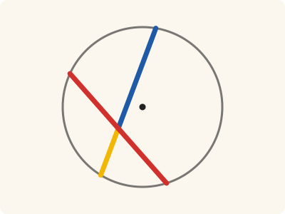
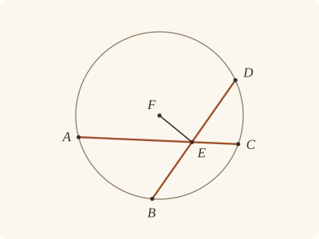

<!-- Generated by scripts/render.py. Do not edit by hand. -->

[Book III](index.md) · [← III.3](03.md) · [III.5 →](05.md)

# Book III, Proposition 4

*Straight lines not through the centre do not bisect one another*

[Euclid's proof](#euclids-proof) · [In Lean](#in-lean) · [What it rests on](#what-it-rests-on) · [Mishnah](#mishnah)

> If in a circle two straight lines cut one another which are not through the centre, they do not bisect one another.

**In Lean:** ✅ proved, as Euclid states it · Euclid's argument

<p align="center"></p>

<p align="center"><em>Cross two straight lines in a circle away from the centre, and halve one (red): the pieces of the other (blue, yellow) come out unequal. They never halve each other.</em></p>

## Euclid's proof

<p align="center"></p>

<p align="center"><em>Drawn for one case: B on A's side of FE, as in Heath's figure. Like Heath's, Euclid's figure accompanies the impossible supposition that AC and BD bisect one another; the drawn halves are unequal. At a glance, AC is bisected and D lies on A's side of FE, the other case of the proof.</em></p>

Let ABCD be a circle, and in it let the two straight lines AC, BD, which are not through the centre, cut one another at E;

I say that they do not bisect one another.

For, if possible, let them bisect one another, so that AE is equal to EC, and BE to ED;

let the centre of the circle ABCD be taken [III. 1], and let it be F; let FE be joined.

Then, since a straight line FE through the centre bisects a straight line AC not through the centre,

it also cuts it at right angles; [III. 3]

therefore the angle FEA is right.

Again, since a straight line FE bisects a straight line BD,

it also cuts it at right angles; [III. 3]

therefore the angle FEB is right.

But the angle FEA was also proved right;

therefore the angle FEA is equal to the angle FEB, the less to the greater: which is impossible.

Therefore AC, BD do not bisect one another.

Therefore etc.

Q. E. D.

## In Lean

| | |
|---|---|
| Proof | ✅ Proved |
| Statement | The whole enunciation. "Not through the centre" is said of every centre of the circle, and B is off AC, so that the two straight lines are really two. |
| Argument | Euclid's. |
| Reviewed | The statement and every passage of the argument read against Heath's text, at commit [`3888f1b86`](https://github.com/dodecaplex-co/stoicheia/commit/3888f1b86) ([the record](../../review/III/04.toml)) |

From [`Elements/BookIII/Prop04.lean`](../../Elements/BookIII/Prop04.lean). Euclid's sentences are the `--` comments, and our own notes are in `/- … -/`; the lines under each sentence are the Lean that carries it out. The list below marks where a lemma does a step Euclid takes for granted, where several sentences share one step and where the Lean takes a case Euclid's figure leaves aside; the `/- … -/` notes in the listing explain smaller adjustments.

**How the Lean follows the text**

- **Done by `Prop1.of_circle`.** "let the centre of the circle ABCD be taken…" Euclid takes the centre F by III.1 (Heath's reference), and so does the Lean: `Prop1.of_circle` takes two points of the circle, the ends of a straight line drawn through it at random, and runs III.1 on them, its construction and its proof that the point found is the centre; the proof keeps the centre alone, as Euclid does. "Not through the centre", said of every centre, puts F off AC and BD, so that FE can be joined.
- **A further case.** "therefore the angle FEA is equal to the angle FEB…" If B is on A's side of FE, the equal right angles put B on EA; otherwise D is on that side and the angle FED is right, so the same argument puts D on EA. Either would make BD and AC one straight line.
- **Done by `onRay_of_angle_eq`.** "which is impossible." Euclid rejects equal angles when one is part of the other; `onRay_of_angle_eq` proves, by angle addition and Common Notion 5, that equal angles on the same side of FE put their other arms on one ray. The Lean places B or D on A's side using `Tacit.pasch3` (System E, Pasch 3), proved in `Elements/Figure/RuleBase.lean`, and `same_side_of_opposite_sides`, then the assumed rule `Tacit.line_unique` (System E, Generalities 1) would make AC and BD one straight line.
- **Carried together.** "Therefore AC, BD do not bisect one another." The reductio's conclusion. The Lean supposed the bisection at the start and has reached the contradiction above, which proves it.

```lean
/-- If in a circle two straight lines cut one another which are not through the centre, they do not
bisect one another. -/
theorem Prop4 {A B C D E : Point} {ABCD : Circle}
    (hA : OnCircle A ABCD) (hB : OnCircle B ABCD) (hC : OnCircle C ABCD)
    (hD : OnCircle D ABCD) (hAEC : Between A E C) (hBED : Between B E D)
    (hB_AC : ¬ Collinear A C B) (hAC : ∀ F : Point, Centre F ABCD → ¬ Collinear A C F)
    (hBD : ∀ F : Point, Centre F ABCD → ¬ Collinear B D F) :
    ¬ (‖A E‖ = ‖E C‖ ∧ ‖B E‖ = ‖E D‖) := by
  -- Let ABCD be a circle, and in it let the two straight lines AC, BD, which are not through
  -- the centre, cut one another at E;
  obtain ⟨L, hA_L, hC_L⟩ := Postulate1 A C (ne_of_between_ends hAEC)
  have hE_L : OnLine E L := on_line_of_between_ends hAEC hA_L hC_L
  obtain ⟨N, hB_N, hD_N⟩ := Postulate1 B D (ne_of_between_ends hBED)
  have hE_N : OnLine E N := on_line_of_between_ends hBED hB_N hD_N
  -- I say that they do not bisect one another.
  -- For, if possible, let them bisect one another, so that AE is equal to EC, and BE to ED;
  rintro ⟨hAE, hBE⟩
  -- let the centre of the circle ABCD be taken [III. 1], and let it be F; let FE be joined.
  /- The centre is found by III.1's construction, on a straight line drawn through the
     circle at random (`Prop1.of_circle`), as Euclid finds it. The proof keeps the centre
     alone, which is what Euclid takes from III.1. -/
  obtain ⟨-, -, F, -, -, -, -, -, hF, -⟩ := Prop1.of_circle ABCD
  have hF_L : ¬ OnLine F L := (show Triangle A C F from hAC F hF).off_line hA_L hC_L
  have hF_N : ¬ OnLine F N := (show Triangle B D F from hBD F hF).off_line hB_N hD_N
  have hEF : E ≠ F := fun h => hF_L (h ▸ hE_L)
  obtain ⟨M, hE_M, hF_M⟩ := Postulate1 E F hEF
  -- Then, since a straight line FE through the centre bisects a straight line AC not through
  -- the centre,
  -- it also cuts it at right angles; [III. 3]
  have h₁ := (Prop3 hF hA hC hAEC (hAC F hF)).1 hAE
  -- therefore the angle FEA is right.
  have hFEA : ∠ F E A = ∟ := (angle_symm hEF.symm (ne_of_between hAEC)).trans h₁.1
  -- Again, since a straight line FE bisects a straight line BD,
  -- it also cuts it at right angles; [III. 3]
  have h₂ := (Prop3 hF hB hD hBED (hBD F hF)).1 hBE
  -- therefore the angle FEB is right.
  have hFEB : ∠ F E B = ∟ := (angle_symm hEF.symm (ne_of_between hBED)).trans h₂.1
  -- But the angle FEA was also proved right;
  -- therefore the angle FEA is equal to the angle FEB, the less to the greater: which is
  -- impossible.
  have hFEA_FEB : ∠ F E A = ∠ F E B := hFEA.trans hFEB.symm
  /- Whichever of B and D lies on A's side of FE (in Euclid's figure, B) makes with FE
     an angle equal to FEA, so it lies on the straight line EA (`onRay_of_angle_eq`, whose
     proof is the part equal to the whole); then BD would be AC. -/
  have hA_M : ¬ OnLine A M := fun h =>
    hF_L (line_unique (ne_of_between hAEC) hA_L hE_L h hE_M ▸ hF_M)
  have hB_M : ¬ OnLine B M := fun h =>
    hF_N (line_unique (ne_of_between hBED) hB_N hE_N h hE_M ▸ hF_M)
  have hD_M : ¬ OnLine D M := fun h =>
    hF_N (line_unique (ne_of_between (between_symm hBED)) hD_N hE_N h hE_M ▸ hF_M)
  have hless : ∀ P : Point, OnLine P N → SameSide P A M → ∠ F E A = ∠ F E P → False := by
    intro P hP_N hPA hFEP
    obtain ⟨-, hPE, hEAP, -⟩ :=
      onRay_of_angle_eq (SameSideOf.of_line hEF hE_M hF_M hPA) hFEP.symm
    obtain ⟨K, hE_K, hA_K, hP_K⟩ := hEAP
    have hKL : K = L := line_unique (ne_of_between hAEC).symm hE_K hA_K hE_L hA_L
    have hP_L : OnLine P L := hKL ▸ hP_K
    have hNL : N = L := line_unique hPE hP_N hE_N hP_L hE_L
    exact hB_AC ⟨L, hA_L, hC_L, hNL ▸ hB_N⟩
  by_cases hs : SameSide B A M
  · exact hless B hB_N hs hFEA_FEB
  · have hBA : OppositeSides B A M := ⟨hB_M, hA_M, hs⟩
    have hBD' : OppositeSides B D M := ⟨hB_M, hD_M, pasch3 hBED hE_M⟩
    have hFED : ∠ F E D = ∟ :=
      (angle_symm hEF.symm (ne_of_between (between_symm hBED))).trans h₂.2
    exact hless D hD_N (same_side_symm (same_side_of_opposite_sides hBA hBD'))
      (hFEA.trans hFED.symm)
  -- Therefore AC, BD do not bisect one another.
  -- Therefore etc.
  -- Q. E. D.
```

## What it rests on

| | |
|---|---|
| Heath's references | [III.1](01.md), [III.3](03.md) |
| Lean cites | [III.1](01.md), [III.3](03.md) |
| Postulates | 1, 2, 3, 4 |
| Definitions taken as axioms | Def. I.15 |
| Common Notions | 1, 2, 3, 4, 5 |
| Tacit rules | 38 (listed below) |
| Its own Lean calls | Postulate 1; 3 tacit rules |
| Through lemmas | Postulates 2 and 3; Def. I.15; 26 tacit rules |

Some of these come in through lemmas [shared](../../CERTIFICATE.md#shared-steps) by many proofs: [`Prop1.of_circle`](../../Elements/BookIII/Prop01.lean#L266) (III.1).

_Postulates, definitions, Common Notions and tacit rules: all that this proof rests on, counting those of the propositions it cites. The last two rows say which of the postulates, definitions and tacit rules its own Lean calls, in the proof or a helper written for it, and which it does not call but reaches through lemmas, of Book Zero or shared (a proposition it cites may rest on these too); the rest come in only through the propositions it cites or the Common Notions._

<details><summary>The 38 tacit rules beneath this proof, counting those of the propositions it cites</summary>

_(used here) marks a rule this proof's own Lean calls, in the proof or a helper written for it; (through …) marks one its own Lean does not call but reaches through the lemmas named, of [Book Zero](../../Elements/Figure) or shared, though a proposition it cites may rest on it too; and a rule with no mark comes in only through a proposition it cites or a Common Notion. The names in brackets are System E's: an Intersection rule says when straight lines and circles must meet, and an Intersections rule takes a point where they do (see [Book I's introduction](../I/index.md))._

**Reading the figure**

- [`between_cases`](../../Elements/Foundations/Tacit/Diagram.lean#L54) (through [`Prop1.of_circle`](../../Elements/BookIII/Prop01.lean#L266), [`onRay_of_angle_eq`](../../Elements/Figure/Angles.lean#L206) and [`same_side_of_opposite_sides`](../../Elements/Figure/Sides.lean#L113)): Of three different points on a straight line, one is between the other two. (Between 6)
- [`between_symm`](../../Elements/Foundations/Tacit/Diagram.lean#L47) (used here): If B is between A and C, it is between C and A. (Between 1)
- [`circles_meet`](../../Elements/Foundations/Tacit/Diagram.lean#L91) (through [`Prop1.of_circle`](../../Elements/BookIII/Prop01.lean#L266), [`Tacit.on_line_of_between_ends`](../../Elements/Figure/RuleBase.lean#L153), [`Tacit.pasch3`](../../Elements/Figure/RuleBase.lean#L225) and 3 other lemmas): If each circle passes through a point inside the other, the circles cut one another. This is the step Euclid takes for granted in I.1. (Intersection 5)
- [`circles_meet_same_side`](../../Elements/Foundations/Tacit/Constructions.lean#L79) (through [`Prop1.of_circle`](../../Elements/BookIII/Prop01.lean#L266), [`Tacit.on_line_of_between_ends`](../../Elements/Figure/RuleBase.lean#L153), [`Tacit.pasch3`](../../Elements/Figure/RuleBase.lean#L225) and 3 other lemmas): Two circles that cut one another do so on each side of the straight line through their centres. (Intersections 8)
- [`exists_centre`](../../Elements/Foundations/Tacit/Constructions.lean#L57) (through [`Prop1.of_circle`](../../Elements/BookIII/Prop01.lean#L266)): Every circle has a centre. A rule of our own, not one of System E's: its content is Euclid's Definitions I.15 and I.16.
- [`exists_point`](../../Elements/Foundations/Tacit/Constructions.lean#L35) (through [`Prop1.of_circle`](../../Elements/BookIII/Prop01.lean#L266) and [`onRay_of_angle_eq`](../../Elements/Figure/Angles.lean#L206)): Let a point be taken. (Points 1)
- [`exists_point_inside_circle`](../../Elements/Foundations/Tacit/Constructions.lean#L42) (through [`Prop1.of_circle`](../../Elements/BookIII/Prop01.lean#L266), [`Tacit.on_line_of_between_ends`](../../Elements/Figure/RuleBase.lean#L153), [`Tacit.pasch3`](../../Elements/Figure/RuleBase.lean#L225) and 3 other lemmas): Let a point be taken inside the circle α. (Points 8)
- [`exists_point_on_line`](../../Elements/Foundations/Tacit/Constructions.lean#L38) (through [`Prop1.of_circle`](../../Elements/BookIII/Prop01.lean#L266), [`Tacit.on_line_of_between_ends`](../../Elements/Figure/RuleBase.lean#L153), [`Tacit.pasch3`](../../Elements/Figure/RuleBase.lean#L225) and 3 other lemmas): Let a point be taken on the straight line L. (Points 2)
- [`line_circle_between`](../../Elements/Foundations/Tacit/Constructions.lean#L67) (through [`Prop1.of_circle`](../../Elements/BookIII/Prop01.lean#L266), [`Tacit.on_line_of_between_ends`](../../Elements/Figure/RuleBase.lean#L153), [`Tacit.pasch3`](../../Elements/Figure/RuleBase.lean#L225) and 3 other lemmas): A straight line through a point B inside a circle, heading out to a point C outside it, cuts the circle between B and C. (Intersections 4)
- [`line_circle_beyond`](../../Elements/Foundations/Tacit/Constructions.lean#L73) (through [`Prop1.of_circle`](../../Elements/BookIII/Prop01.lean#L266), [`Tacit.on_line_of_between_ends`](../../Elements/Figure/RuleBase.lean#L153), [`Tacit.pasch3`](../../Elements/Figure/RuleBase.lean#L225) and 3 other lemmas): A straight line through a point B inside a circle, produced beyond B away from C, cuts the circle there. (Intersections 5)
- [`line_unique`](../../Elements/Foundations/Tacit/Diagram.lean#L41) (used here): Two points determine a straight line. (Generalities 1)
- [`lines_meet_of_opposite_sides`](../../Elements/Foundations/Tacit/Diagram.lean#L86) (through [`onRay_of_angle_eq`](../../Elements/Figure/Angles.lean#L206) and [`same_side_of_opposite_sides`](../../Elements/Figure/Sides.lean#L113)): A straight line joining points on opposite sides of L crosses L. (Intersection 1)
- [`not_between_of_between`](../../Elements/Foundations/Tacit/Diagram.lean#L50) (through [`Prop1.of_circle`](../../Elements/BookIII/Prop01.lean#L266), [`Tacit.ne_of_between`](../../Elements/Figure/RuleBase.lean#L146), [`Tacit.ne_of_between_ends`](../../Elements/Figure/Incidence.lean#L66) and 5 other lemmas): If B is between A and C, then A is not between B and C. (Between 1)
- [`not_on_line_of_same_side`](../../Elements/Foundations/Tacit/Diagram.lean#L60) (through [`Prop1.of_circle`](../../Elements/BookIII/Prop01.lean#L266), [`Tacit.on_line_of_between_ends`](../../Elements/Figure/RuleBase.lean#L153), [`Tacit.pasch3`](../../Elements/Figure/RuleBase.lean#L225) and 3 other lemmas): Points on one side of a straight line are not on it. (Same side 3)
- [`pasch2`](../../Elements/Foundations/Tacit/Diagram.lean#L71) (through [`Prop1.of_circle`](../../Elements/BookIII/Prop01.lean#L266), [`Tacit.on_line_of_between_ends`](../../Elements/Figure/RuleBase.lean#L153), [`Tacit.pasch3`](../../Elements/Figure/RuleBase.lean#L225) and 2 other lemmas): If B is between A and C, A is on L and B is off it, then B and C are on the same side of L: a straight line that leaves L at A does not cross it again. (Pasch 2)
- [`same_side_trans`](../../Elements/Foundations/Tacit/Diagram.lean#L64) (through [`Prop1.of_circle`](../../Elements/BookIII/Prop01.lean#L266), [`Tacit.on_line_of_between_ends`](../../Elements/Figure/RuleBase.lean#L153), [`Tacit.pasch3`](../../Elements/Figure/RuleBase.lean#L225) and 3 other lemmas): Two points on the same side of a straight line as a third point are on the same side as each other. (Same side 4)

**Lengths, angles and areas**

- [`angle_add_of_inside`](../../Elements/Foundations/Tacit/Transfer.lean#L47) (through [`Tacit.pasch3`](../../Elements/Figure/RuleBase.lean#L225), [`onRay_of_angle_eq`](../../Elements/Figure/Angles.lean#L206) and [`same_side_of_opposite_sides`](../../Elements/Figure/Sides.lean#L113)): If D lies within the angle BAC, then BAC is made up of BAD and DAC. (Diagram-angle 2)
- [`angle_eq_of_same_rays`](../../Elements/Foundations/Tacit/Transfer.lean#L54): The angle doesn't change if its arms are traced through other points on the same rays. (Diagram-angle 4)
- [`angle_symm`](../../Elements/Foundations/Tacit/Metric.lean#L30) (used here): The angle ABC is the angle CBA. (Metric 4)
- [`area_add_of_between`](../../Elements/Foundations/Tacit/Transfer.lean#L70): Cutting a triangle in two from a vertex adds up. (Diagram-area 2)
- [`area_congruent`](../../Elements/Foundations/Tacit/Metric.lean#L44): Triangles equal in all their sides and angles are equal in area. Euclid uses this without comment once he has shown two triangles congruent. (Metric 9)
- [`area_degenerate`](../../Elements/Foundations/Tacit/Metric.lean#L36): A "triangle" with a repeated corner has no area. (Metric 6)
- [`area_eq_zero_of_on_line`](../../Elements/Foundations/Tacit/Transfer.lean#L62): A "triangle" whose corners lie on one straight line has no area. (Diagram-area 1)
- [`area_rotate`](../../Elements/Foundations/Tacit/Metric.lean#L39): The triangle ABC is the triangle CAB. (Metric 8)
- [`len_add_of_between`](../../Elements/Foundations/Tacit/Transfer.lean#L27) (through [`Prop1.of_circle`](../../Elements/BookIII/Prop01.lean#L266), [`Tacit.ne_of_between_ends`](../../Elements/Figure/Incidence.lean#L66), [`Tacit.on_line_of_between_ends`](../../Elements/Figure/RuleBase.lean#L153) and 4 other lemmas): If B is between A and C, then AB and BC together make up AC. (Diagram-segment 1)
- [`len_self`](../../Elements/Foundations/Tacit/Metric.lean#L24) (through [`Prop1.of_circle`](../../Elements/BookIII/Prop01.lean#L266), [`Tacit.ne_of_between_ends`](../../Elements/Figure/Incidence.lean#L66), [`Tacit.on_line_of_between_ends`](../../Elements/Figure/RuleBase.lean#L153) and 4 other lemmas): The "straight line" from a point to itself has no length. (Metric 1)
- [`len_symm`](../../Elements/Foundations/Tacit/Metric.lean#L27) (through [`Prop1.of_circle`](../../Elements/BookIII/Prop01.lean#L266), [`Tacit.on_line_of_between_ends`](../../Elements/Figure/RuleBase.lean#L153), [`Tacit.pasch3`](../../Elements/Figure/RuleBase.lean#L225) and 3 other lemmas): The straight line AB is the straight line BA. (Metric 3)
- [`radius_ne_zero`](../../Elements/Foundations/Tacit/Metric.lean#L62) (through [`Prop1.of_circle`](../../Elements/BookIII/Prop01.lean#L266), [`Tacit.ne_of_between_ends`](../../Elements/Figure/Incidence.lean#L66), [`Tacit.on_line_of_between_ends`](../../Elements/Figure/RuleBase.lean#L153) and 4 other lemmas): A circle's radius is not nothing: the straight line from the centre to a point on the circle has some length. A rule of our own, not one of System E's: every circle is drawn with a centre and a distance (Postulate 3).
- [`same_ray_of_angle_eq_zero`](../../Elements/Foundations/Tacit/Transfer.lean#L42) (through [`Tacit.pasch3`](../../Elements/Figure/RuleBase.lean#L225), [`onRay_of_angle_eq`](../../Elements/Figure/Angles.lean#L206) and [`same_side_of_opposite_sides`](../../Elements/Figure/Sides.lean#L113)): If the angle BAC is nothing, C lies on the ray from A through B. (Diagram-angle 1)

**Superposition**

- [`superposition`](../../Elements/Foundations/Tacit/Superposition.lean#L52): **Superposition.** A hypothetical placement of a triangle on a given ray and side permits a restricted derivation of metric equalities about the figure already given. The derivation introduces no further objects, cites each geometric law it uses, and exports no symbol of the placement.

**Rules of magnitude**

- [`add_assoc`](../../Elements/Foundations/Tacit/Magnitudes.lean#L23): Adding three magnitudes in a row, it makes no difference whether the first two or the last two are added first. (System E §3.5)
- [`add_comm`](../../Elements/Foundations/Tacit/Magnitudes.lean#L26) (through [`Prop1.of_circle`](../../Elements/BookIII/Prop01.lean#L266), [`Tacit.ne_of_between_ends`](../../Elements/Figure/Incidence.lean#L66), [`Tacit.on_line_of_between_ends`](../../Elements/Figure/RuleBase.lean#L153) and 4 other lemmas): The order of adding does not matter. (System E §3.5)
- [`add_lt_add_right`](../../Elements/Foundations/Tacit/Magnitudes.lean#L45) (through [`onRay_of_angle_eq`](../../Elements/Figure/Angles.lean#L206) and [`same_side_of_opposite_sides`](../../Elements/Figure/Sides.lean#L113)): Adding the same thing to both sides keeps "less than". (System E §3.5)
- [`add_zero`](../../Elements/Foundations/Tacit/Magnitudes.lean#L29): Adding nothing changes nothing. (System E §3.5)
- [`lt_irrefl`](../../Elements/Foundations/Tacit/Magnitudes.lean#L32) (through [`Prop1.of_circle`](../../Elements/BookIII/Prop01.lean#L266), [`Tacit.on_line_of_between_ends`](../../Elements/Figure/RuleBase.lean#L153), [`Tacit.pasch3`](../../Elements/Figure/RuleBase.lean#L225) and 3 other lemmas): No magnitude is less than itself. (System E §3.5)
- [`lt_trans`](../../Elements/Foundations/Tacit/Magnitudes.lean#L35) (through [`Prop1.of_circle`](../../Elements/BookIII/Prop01.lean#L266), [`Tacit.on_line_of_between_ends`](../../Elements/Figure/RuleBase.lean#L153), [`Tacit.pasch3`](../../Elements/Figure/RuleBase.lean#L225) and 3 other lemmas): What is less than the less is less still. (System E §3.5)
- [`lt_trichotomy`](../../Elements/Foundations/Tacit/Magnitudes.lean#L39) (through [`Prop1.of_circle`](../../Elements/BookIII/Prop01.lean#L266), [`Tacit.ne_of_between_ends`](../../Elements/Figure/Incidence.lean#L66), [`Tacit.on_line_of_between_ends`](../../Elements/Figure/RuleBase.lean#L153) and 4 other lemmas): Of two magnitudes, one is less, or they are equal, or the other is less. (System E §3.5)
- [`not_lt_zero`](../../Elements/Foundations/Tacit/Magnitudes.lean#L42) (through [`Prop1.of_circle`](../../Elements/BookIII/Prop01.lean#L266), [`Tacit.ne_of_between_ends`](../../Elements/Figure/Incidence.lean#L66), [`Tacit.on_line_of_between_ends`](../../Elements/Figure/RuleBase.lean#L153) and 4 other lemmas): Nothing is less than zero. (System E §3.5)

</details>

## Mishnah

_Our commentary: why Euclid's proof, and ours, look as they do._

**Two right angles where there is room for one.** Euclid supposes that AC and BD bisect one another at E, takes the centre F, and joins FE. Now III.3 applies twice: FE would be at right angles to both straight lines, so the angles FEA and FEB would both be right. In Heath's figure EA lies within the angle FEB, so FEA is only a part of FEB, and Euclid ends on Common Notion 5, the whole greater than the part: "the less to the greater: which is impossible."

Without "not through the centre" the proposition is false. Two diameters, straight lines through the centre with their ends on the circle (Definition I.17), do bisect one another, at the centre, since their halves are radii. And the two straight lines must really be two: AC named twice would bisect itself. Our statement says both, and the proof uses both.

Euclid draws B on A's side of FE. Not every figure need do so, but one of B and D is there, since E lies between them and FE separates them; and III.3 has made the angle FED right as well as FEB. Whichever it is, the equal angles at E put it on the straight line EA, for on one side of FE equal angles at E have their other arms along one ray (`onRay_of_angle_eq`). That is Euclid's part and whole once more, and here it would lay BD along AC.

**The modern way.** Measure the positions $\mathbf{a}$, $\mathbf{b}$, $\mathbf{c}$, $\mathbf{d}$ and $\mathbf{e}$ of A, B, C, D and E from the centre F. A common middle point would give $\mathbf{e} = (\mathbf{a} + \mathbf{c})/2 = (\mathbf{b} + \mathbf{d})/2$, so $\mathbf{e} \cdot (\mathbf{c} - \mathbf{a}) = (|\mathbf{c}|^2 - |\mathbf{a}|^2)/2 = 0$, and likewise $\mathbf{e} \cdot (\mathbf{d} - \mathbf{b}) = 0$. Two straight lines that cut one another have independent directions, so $\mathbf{e} = \mathbf{0}$: E would be the centre, through which neither straight line passes.

## Further reading

- A common middle point is ruled out by contradiction, and Daniel J. Velleman's [*How to Prove It*](https://doi.org/10.1017/9781108539890) (2019), a patient introduction to the logic under every proof, takes such proofs slowly in §3.2, "Proofs Involving Negations and Conditionals".

[Book III](index.md) · [← III.3](03.md) · [III.5 →](05.md)

---

<sub>Euclid's text: T. L. Heath, *The Thirteen Books of Euclid's Elements*, vol. 2 (Cambridge, 1908), pp. 11–12; [scan leaves n23–n24](https://archive.org/details/thirteenbookseu00heibgoog/page/n23); [figure on n23](https://archive.org/details/thirteenbookseu00heibgoog/page/n23). Public domain.</sub>

<sub>The tacit rules follow the System E of Jeremy Avigad, Edward Dean and John Mumma, read alongside LeanEuclid (Logan Murphy, Kaiyu Yang, Jialiang Sun, Zhaoyu Li, Anima Anandkumar and Xujie Si).</sub>
