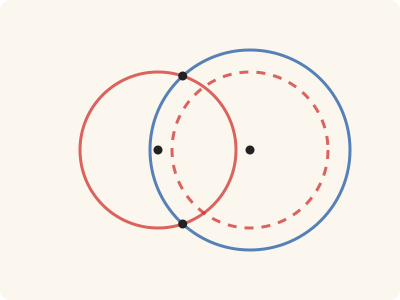
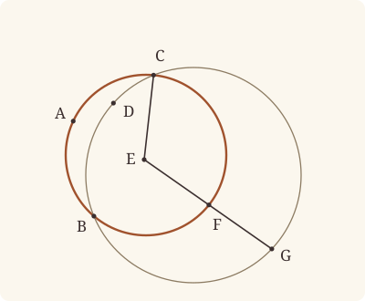

<!-- Generated by scripts/render.py. Do not edit by hand. -->

[Book III](index.md) · [← III.4](04.md) · [III.6 →](06.md)

# Book III, Proposition 5

*Circles cutting one another do not have the same centre*

[Euclid's proof](#euclids-proof) · [In Lean](#in-lean) · [What it rests on](#what-it-rests-on) · [Mishnah](#mishnah)

> If two circles cut one another, they will not have the same centre.

**In Lean:** ✅ proved, as Euclid states it · Euclid's argument · one of our tacit rules contains it too, though this proof does not use it (see Overlap)

<p align="center"></p>

<p align="center"><em>Give two circles that cut (red, blue) one centre, and the smaller (dashed) falls wholly within the larger, meeting it nowhere. Circles that cut never share a centre.</em></p>

## Euclid's proof

<p align="center"></p>

<p align="center"><em>Like Heath's, this figure draws the impossible supposition: E as one centre of ABC and CDG, two circles that cut.</em></p>

For let the circles ABC, CDG cut one another at the points B, C;

I say that they will not have the same centre.

For, if possible, let it be E; let EC be joined, and let EFG be drawn through at random.

Then, since the point E is the centre of the circle ABC,

EC is equal to EF. [I. Def. 15]

Again, since the point E is the centre of the circle CDG,

EC is equal to EG.

But EC was proved equal to EF also;

therefore EF is also equal to EG, the less to the greater: which is impossible.

Therefore the point E is not the centre of the circles ABC, CDG.

Therefore etc.

Q. E. D.

## In Lean

| | |
|---|---|
| Proof | ✅ Proved |
| Statement | The whole enunciation. Cutting (`CirclesCut`) means two common points and a point of each circle within the other; the proof uses one common point and one point within. |
| Argument | Euclid's. |
| Overlap | [`circle_eq`](../../Elements/Foundations/Tacit/Transfer.lean#L30): Diagram-segment 2 with Generalities 4 gives III.5 at once: one centre and a common point make the circles one, making F both within that circle and on it. Definition I.15 with Diagram-segment 4 and a magnitude law gives another short proof; with Diagram-segment 3's second half and Generalities 4 it gives a third. Generalities 4, Diagram-segment 3's second half and Diagram-segment 4 are proved in Elements/Figure/RuleBase.lean and Elements/Figure/Incidence.lean, so, Definition I.15 and the magnitude law aside, Diagram-segment 2 is the one rule among them we assume. The proofs of Diagram-segment 3's second half and Diagram-segment 4 rest not on it but on our radius rule (`Tacit.radius_ne_zero`), which gives neither III.5 nor III.6, for it says only that a radius is something; so the second and third short proofs do not rest on Diagram-segment 2. Our proof follows Euclid by Definition I.15 and the order on EFG, citing neither Diagram-segment 2, Diagram-segment 3's second half, Diagram-segment 4 nor Circle 4, and it does not rest on Diagram-segment 2: Book Zero's lemmas beneath it, `ne_of_centre_of_on` and `len_lt_of_between`, rest on the radius rule, the first directly and the second through Metric 1 (`Tacit.eq_of_len_eq_zero`), a proved rule, which adds Postulate 3. See [the overlap catalogue](../../docs/reports/overlaps.md). |
| Reviewed | The statement and every passage of the argument read against Heath's text, at commit [`5bbb773a7`](https://github.com/jackChallis/stoicheia/commit/5bbb773a7) ([the record](../../review/III/05.toml)) |

From [`Elements/BookIII/Prop05.lean`](../../Elements/BookIII/Prop05.lean). Euclid's sentences are the `--` comments, and our own notes are in `/- … -/`; the lines under each sentence are the Lean that carries it out. The list below marks where a lemma does a step Euclid takes for granted and where several sentences share one step; the `/- … -/` notes in the listing explain smaller adjustments.

**How the Lean follows the text**

- **Done by `Tacit.line_circle_beyond`.** "let EC be joined…" Euclid takes from his figure where EFG meets the circles, F on ABC before G on CDG; EC is drawn for the eye, and the Lean uses only its ends. The Lean draws EFG through F, a point of ABC within CDG, and produces it beyond F to meet CDG at G by `Tacit.line_circle_beyond`, a rule we assume (System E, Intersections 5): this gives the order in Euclid's figure, and one straight line from E meeting the circles at different points is enough for his contradiction.
- **Done by `len_lt_of_between`.** "therefore EF is also equal to EG…" Euclid reads off his figure that EF is the less. F lies between E and G by `Tacit.line_circle_beyond`, beneath the drawing of EFG, so `len_lt_of_between` makes EF less than EG, the part less than the whole (Common Notion 5).
- **Carried together.** "Therefore the point E is not the centre of the circles ABC, CDG." The reductio's conclusion. The Lean supposed E the centre of both circles at the start and has reached the contradiction above, which proves it.

```lean
/-- If two circles cut one another, they will not have the same centre. -/
theorem Prop5 {E : Point} {ABC CDG : Circle} (hcut : CirclesCut ABC CDG) :
    ¬ (Centre E ABC ∧ Centre E CDG) := by
  -- For let the circles ABC, CDG cut one another at the points B, C;
  obtain ⟨⟨B, C, -, -, -, hC_ABC, hC_CDG⟩, ⟨F, hF_ABC, hF_in⟩, -⟩ := hcut
  -- I say that they will not have the same centre.
  -- For, if possible, let it be E; let EC be joined, and let EFG be drawn through at random.
  rintro ⟨hE_ABC, hE_CDG⟩
  /- EC is drawn for the eye; our proof uses only its ends. EFG is drawn through F, a point
     of ABC within CDG, where the circles cut one another; produced beyond F, it meets CDG
     at G. One straight line from E meeting the circles at two points is all the argument
     needs, as Heath says under III.6. -/
  have hFE : F ≠ E := ne_of_centre_of_on hE_ABC hF_ABC
  obtain ⟨EFG, hE_EFG, hF_EFG⟩ := Postulate1 E F hFE.symm
  obtain ⟨G, hG_CDG, -, hGFE⟩ := line_circle_beyond hF_in hF_EFG hE_EFG hFE.symm
  -- Then, since the point E is the centre of the circle ABC,
  -- EC is equal to EF. [I. Def. 15]
  have hECF : ‖E C‖ = ‖E F‖ := Definition15 hE_ABC hC_ABC hF_ABC
  -- Again, since the point E is the centre of the circle CDG,
  -- EC is equal to EG.
  have hECG : ‖E C‖ = ‖E G‖ := Definition15 hE_CDG hC_CDG hG_CDG
  -- But EC was proved equal to EF also;
  -- therefore EF is also equal to EG, the less to the greater: which is impossible.
  have hEFG : ‖E F‖ = ‖E G‖ := hECF.symm.trans hECG
  /- F lies between E and G, so EF is the less, as in Euclid's figure. -/
  have hlt : ‖E F‖ < ‖E G‖ := len_lt_of_between (between_symm hGFE)
  rw [hEFG] at hlt
  exact lt_irrefl _ hlt
  -- Therefore the point E is not the centre of the circles ABC, CDG.
  -- Therefore etc.
  -- Q. E. D.
```

## What it rests on

| | |
|---|---|
| Heath's references | Def. I.15 |
| Lean cites | no propositions |
| Postulates | 1, 3 |
| Definitions taken as axioms | Def. I.15 |
| Common Notions | 5 |
| Tacit rules | 12 (listed below) |
| Its own Lean calls | Postulate 1; Def. I.15; 3 tacit rules |
| Through lemmas | Postulate 3; 6 tacit rules |

_Postulates, definitions, Common Notions and tacit rules: all that this proof rests on, counting those of the propositions it cites. The last two rows say which of the postulates, definitions and tacit rules its own Lean calls, in the proof or a helper written for it, and which it does not call but reaches through lemmas, of Book Zero or shared (a proposition it cites may rest on these too); the rest come in only through the propositions it cites or the Common Notions._

<details><summary>The 12 tacit rules beneath this proof</summary>

_(used here) marks a rule this proof's own Lean calls, in the proof or a helper written for it; (through …) marks one its own Lean does not call but reaches through the lemmas named, of [Book Zero](../../Elements/Figure) or shared; and a rule with no mark comes in only through a Common Notion. The names in brackets are System E's: an Intersection rule says when straight lines and circles must meet, and an Intersections rule takes a point where they do (see [Book I's introduction](../I/index.md))._

**Reading the figure**

- [`between_symm`](../../Elements/Foundations/Tacit/Diagram.lean#L47) (used here): If B is between A and C, it is between C and A. (Between 1)
- [`line_circle_beyond`](../../Elements/Foundations/Tacit/Constructions.lean#L73) (used here): A straight line through a point B inside a circle, produced beyond B away from C, cuts the circle there. (Intersections 5)
- [`not_between_of_between`](../../Elements/Foundations/Tacit/Diagram.lean#L50) (through [`len_lt_of_between`](../../Elements/Figure/Lengths.lean#L92)): If B is between A and C, then A is not between B and C. (Between 1)

**Lengths, angles and areas**

- [`len_add_of_between`](../../Elements/Foundations/Tacit/Transfer.lean#L27) (through [`len_lt_of_between`](../../Elements/Figure/Lengths.lean#L92)): If B is between A and C, then AB and BC together make up AC. (Diagram-segment 1)
- [`len_self`](../../Elements/Foundations/Tacit/Metric.lean#L24) (through [`ne_of_centre_of_on`](../../Elements/Figure/Circles.lean#L138)): The "straight line" from a point to itself has no length. (Metric 1)
- [`radius_ne_zero`](../../Elements/Foundations/Tacit/Metric.lean#L62) (through [`len_lt_of_between`](../../Elements/Figure/Lengths.lean#L92) and [`ne_of_centre_of_on`](../../Elements/Figure/Circles.lean#L138)): A circle's radius is not nothing: the straight line from the centre to a point on the circle has some length. A rule of our own, not one of System E's: every circle is drawn with a centre and a distance (Postulate 3).

**Rules of magnitude**

- [`add_comm`](../../Elements/Foundations/Tacit/Magnitudes.lean#L26): The order of adding does not matter. (System E §3.5)
- [`add_lt_add_right`](../../Elements/Foundations/Tacit/Magnitudes.lean#L45): Adding the same thing to both sides keeps "less than". (System E §3.5)
- [`add_zero`](../../Elements/Foundations/Tacit/Magnitudes.lean#L29): Adding nothing changes nothing. (System E §3.5)
- [`lt_irrefl`](../../Elements/Foundations/Tacit/Magnitudes.lean#L32) (used here): No magnitude is less than itself. (System E §3.5)
- [`lt_trichotomy`](../../Elements/Foundations/Tacit/Magnitudes.lean#L39) (through [`len_lt_of_between`](../../Elements/Figure/Lengths.lean#L92)): Of two magnitudes, one is less, or they are equal, or the other is less. (System E §3.5)
- [`not_lt_zero`](../../Elements/Foundations/Tacit/Magnitudes.lean#L42) (through [`len_lt_of_between`](../../Elements/Figure/Lengths.lean#L92)): Nothing is less than zero. (System E §3.5)

</details>

## Mishnah

_Our commentary: why Euclid's proof, and ours, look as they do._

**What does the figure show?** Euclid supposes that the circles ABC and CDG, which cut one another at B and C, have one centre E. He draws EFG through that centre. EF and EG are each equal to EC, and so to one another; yet F comes before G, and EF is the less. No figure can show two circles that cut and share a centre, so his shows us the supposition at the moment it fails.

The place of F matters. Our reading of cutting, `CirclesCut`, says that the circles meet at two points and each passes within the other. It gives F on ABC and within CDG. Draw EF and produce it beyond F to meet CDG at G: now F lies between E and G by the construction, and the comparison of lengths follows. Euclid lets the line be drawn at random; we choose this direction to obtain the order his figure shows. One such line is enough for the contradiction.

**Cutting says more than meeting.** Both common points, and both points within, belong to the description of the figure. The proof needs only C and the point of ABC within CDG. The other common point and the reverse crossing stay in the definition because cutting is mutual. The point within also makes the circles different: if they were one circle, F would be both on it and within it. No separate hypothesis that ABC and CDG differ is needed.

Heath brings III.5 and III.6 together as a statement about two different circles meeting at even one point (vol. 2, p. 12). That wider claim follows at once from a rule our foundations assume, that one centre and one radius determine a circle (Diagram-segment 2). Our proof here follows the crossing figure and the order of its points; it does not prove that wider claim on its own. The [overlap catalogue](../../docs/reports/overlaps.md#iii5) explains how the two readings are connected.

**The modern way.** A circle with centre E and radius r is the set of points at distance r from E. Two circles about E through C have the same radius and are the same set. Different circles about one centre therefore never meet.

## Further reading

- For the combined enunciation Heath gives, Isaac Todhunter's [*The Elements of Euclid*](https://archive.org/details/todhuntereuclid00todhrich) (1872, free online), his note on III.5 and III.6 (p. 272), which says they "should have been taken together" and that "circles which have the same centre and one point in their circumferences common, must coincide altogether" (also on [III.3](03.md)).
- For III.5 in red, yellow and blue, Nicholas Rougeux's [*Byrne's Euclid*](https://www.c82.net/euclid/) (2018, free online), where each coloured part lights up in the proof.

[Book III](index.md) · [← III.4](04.md) · [III.6 →](06.md)

---

<sub>Euclid's text: T. L. Heath, *The Thirteen Books of Euclid's Elements*, vol. 2 (Cambridge, 1908), p. 12; [scan leaf n24](https://archive.org/details/thirteenbookseu00heibgoog/page/n24); [figure on n24](https://archive.org/details/thirteenbookseu00heibgoog/page/n24). Public domain.</sub>

<sub>The tacit rules follow the System E of Jeremy Avigad, Edward Dean and John Mumma, read alongside LeanEuclid (Logan Murphy, Kaiyu Yang, Jialiang Sun, Zhaoyu Li, Anima Anandkumar and Xujie Si).</sub>
