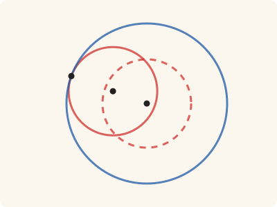
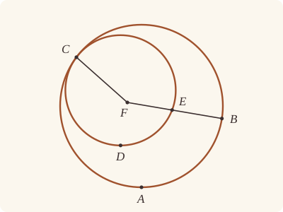

<!-- Generated by scripts/render.py. Do not edit by hand. -->

[Book III](index.md) · [← III.5](05.md) · [III.7 →](07.md)

# Book III, Proposition 6

*Circles touching one another do not have the same centre*

[Euclid's proof](#euclids-proof) · [In Lean](#in-lean) · [What it rests on](#what-it-rests-on) · [Mishnah](#mishnah)

> If two circles touch one another, they will not have the same centre.

**In Lean:** ✅ proved, as Euclid states it · Euclid's argument · one of our tacit rules contains it too, though this proof does not use it (see Overlap)

<p align="center"></p>

<p align="center"><em>Give the red circle the centre of the blue it touches, and it no longer touches (dashed): it lies inside with room all round. Touching circles never share a centre.</em></p>

## Euclid's proof

<p align="center"></p>

<p align="center"><em>Drawn for one case: the circles touching within, as in Heath's figure. Like Heath's, this figure draws the impossible supposition: F as one centre of ABC and CDE, two circles that touch.</em></p>

For let the two circles ABC, CDE touch one another at the point C;

I say that they will not have the same centre.

For, if possible, let it be F; let FC be joined, and let FEB be drawn through at random.

Then, since the point F is the centre of the circle ABC,

FC is equal to FB.

Again, since the point F is the centre of the circle CDE,

FC is equal to FE.

But FC was proved equal to FB;

therefore FE is also equal to FB, the less to the greater: which is impossible.

Therefore F is not the centre of the circles ABC, CDE.

Therefore etc.

Q. E. D.

## In Lean

| | |
|---|---|
| Proof | ✅ Proved |
| Statement | The whole enunciation. Covers contact within, either circle the inner, with a point within the outer, and contact without, the case Euclid leaves to the reader. |
| Argument | Euclid's. |
| Representation | Touching is read of the whole circles. For contact within the inner has a point within the outer and none outside it; for contact without no point is within both. The point within does not make this Heath's preferred local reading of Definition III.3. |
| Overlap | [`circle_eq`](../../Elements/Foundations/Tacit/Transfer.lean#L30): Diagram-segment 2 with Generalities 4 ends contact within at once; Generalities 3 ends contact without, so the three rules give III.6 at once. Generalities 3 (`Tacit.centre_inside`) and 4 are former assumptions, proved since 19 October 2026 in Elements/Figure/RuleBase.lean, so Diagram-segment 2 is the one assumption among them. Our proof cites neither Diagram-segment 2 nor Circle 4: contact within follows Euclid by Definition I.15 and the order on FEB. Contact without does end by Generalities 3, the clause of Definition I.15 placing the centre within the figure; it is the case Euclid leaves to the reader and Heath regards as self-evident (vol. 2, p. 13). Since 26 October 2026 our proof does not rest on Diagram-segment 2: the proved rules beneath it that compare lengths, such as `Tacit.centre_inside`, rest instead on our radius rule (`Tacit.radius_ne_zero`), with Postulate 3; the radius rule gives neither III.5 nor III.6, for it says only that a radius is something. See [the overlap catalogue](../../docs/reports/overlaps.md). |
| Reviewed | The statement and every passage of the argument read against Heath's text, at commit [`5e9858c62`](https://github.com/dodecaplex-co/stoicheia/commit/5e9858c62) ([the record](../../review/III/06.toml)) |

From [`Elements/BookIII/Prop06.lean`](../../Elements/BookIII/Prop06.lean). Euclid's sentences are the `--` comments, and our own notes are in `/- … -/`; the lines under each sentence are the Lean that carries it out. The list below marks where a lemma does a step Euclid takes for granted, where several sentences share one step and where the Lean takes a case Euclid's figure leaves aside; the `/- … -/` notes in the listing explain smaller adjustments.

**How the Lean follows the text**

- **A further case.** "For, if possible, let it be F…" Contact without ends here: F would be within both circles, which contact without forbids. It is the case Euclid leaves to the reader, and the Lean puts F within each circle by the proved rule `Tacit.centre_inside` (System E, Generalities 3).
- **Done by `Tacit.line_circle_beyond`.** "let FC be joined…" Euclid takes from his figure where FEB meets the circles, E on CDE before B on ABC; FC is drawn for the eye, and the Lean uses only its ends. For contact within, either circle the inner, the Lean draws FEB through a point of the inner within the outer and produces it to the outer by `Tacit.line_circle_beyond`, a rule we assume (System E, Intersections 5): the one line meeting the circles at different points that Heath says suffices in his answer to J. G. Camerer (vol. 2, p. 13).
- **Done by `len_lt_of_between`.** "therefore FE is also equal to FB…" Euclid reads off his figure that FE is the less. The point on the inner circle lies between F and the point on the outer, by `Tacit.line_circle_beyond` beneath the drawing of FEB, so `len_lt_of_between` makes its distance from F the less, the part less than the whole (Common Notion 5): FE in Euclid's figure, where CDE is the inner, and FB when ABC is.
- **Carried together.** "Therefore F is not the centre of the circles ABC, CDE." The reductio's conclusion. The Lean supposed F the centre of both circles at the start and has reached a contradiction in each kind of contact: at once for contact without, and by Euclid's argument for contact within.

```lean
/-- If two circles touch one another, they will not have the same centre. -/
theorem Prop6 {C F : Point} {ABC CDE : Circle} (htouch : CirclesTouch ABC CDE C) :
    ¬ (Centre F ABC ∧ Centre F CDE) := by
  -- For let the two circles ABC, CDE touch one another at the point C;
  have hC : OnCircle C ABC ∧ OnCircle C CDE := by
    rcases htouch with ⟨h₁, h₂, -⟩ | ⟨h₂, h₁, -⟩ | ⟨h₁, h₂, -⟩ <;> exact ⟨h₁, h₂⟩
  -- I say that they will not have the same centre.
  -- For, if possible, let it be F; let FC be joined, and let FEB be drawn through at random.
  rintro ⟨hF₁, hF₂⟩
  /- Contact without, which Euclid leaves to the reader, ends here: F would be within
     each circle, as a centre is (`centre_inside`), and circles touching without have no
     point within both. So the circles touch within, whichever is the inner, and the inner
     has passed within the outer, at a point the definition gives. FC is drawn for the eye;
     our proof uses only its ends. FEB is drawn through that point and produced beyond it to
     the outer circle, so that E is on CDE and B on ABC, and the nearer F of the two is the
     point of the inner circle: one straight line meeting the circles at two points, as
     Heath answers Camerer. -/
  obtain ⟨E, B, hE, hB, hnear⟩ : ∃ E B : Point, OnCircle E CDE ∧ OnCircle B ABC ∧
      (Between F E B ∨ Between F B E) := by
    rcases htouch with ⟨-, -, ⟨E, hE, hE_in⟩, -⟩ | ⟨-, -, ⟨B, hB, hB_in⟩, -⟩ | ⟨-, -, hout⟩
    · have hEF : E ≠ F := ne_of_centre_of_on hF₂ hE
      obtain ⟨L, hF_L, hE_L⟩ := Postulate1 F E hEF.symm
      obtain ⟨B, hB, -, hBEF⟩ := line_circle_beyond hE_in hE_L hF_L hEF.symm
      exact ⟨E, B, hE, hB, Or.inl (between_symm hBEF)⟩
    · have hBF : B ≠ F := ne_of_centre_of_on hF₁ hB
      obtain ⟨L, hF_L, hB_L⟩ := Postulate1 F B hBF.symm
      obtain ⟨E, hE, -, hEBF⟩ := line_circle_beyond hB_in hB_L hF_L hBF.symm
      exact ⟨E, B, hE, hB, Or.inr (between_symm hEBF)⟩
    · exact absurd (centre_inside hF₂) (hout F (centre_inside hF₁))
  -- Then, since the point F is the centre of the circle ABC,
  -- FC is equal to FB.
  have hFB : ‖F C‖ = ‖F B‖ := Definition15 hF₁ hC.1 hB
  -- Again, since the point F is the centre of the circle CDE,
  -- FC is equal to FE.
  have hFE : ‖F C‖ = ‖F E‖ := Definition15 hF₂ hC.2 hE
  -- But FC was proved equal to FB;
  -- therefore FE is also equal to FB, the less to the greater: which is impossible.
  have hEB : ‖F E‖ = ‖F B‖ := hFE.symm.trans hFB
  /- Whichever of E and B is the nearer F is the less; in Euclid's figure, CDE is the inner
     circle, and E the nearer. -/
  rcases hnear with h | h
  · have hlt : ‖F E‖ < ‖F B‖ := len_lt_of_between h
    rw [hEB] at hlt
    exact lt_irrefl _ hlt
  · have hlt : ‖F B‖ < ‖F E‖ := len_lt_of_between h
    rw [← hEB] at hlt
    exact lt_irrefl _ hlt
  -- Therefore F is not the centre of the circles ABC, CDE.
  -- Therefore etc.
  -- Q. E. D.
```

## What it rests on

| | |
|---|---|
| Heath's references | none |
| Lean cites | no propositions |
| Postulates | 1, 3 |
| Definitions taken as axioms | Def. I.15 |
| Common Notions | 5 |
| Tacit rules | 16 (listed below) |
| Its own Lean calls | Postulate 1; Def. I.15; 3 tacit rules |
| Through lemmas | Postulate 3; 11 tacit rules |

_Postulates, definitions, Common Notions and tacit rules: all that this proof rests on, counting those of the propositions it cites. The last two rows say which of the postulates, definitions and tacit rules its own Lean calls, in the proof or a helper written for it, and which it does not call but reaches through lemmas, of Book Zero or shared (a proposition it cites may rest on these too); the rest come in only through the propositions it cites or the Common Notions._

<details><summary>The 16 tacit rules beneath this proof</summary>

_(used here) marks a rule this proof's own Lean calls, in the proof or a helper written for it; (through …) marks one its own Lean does not call but reaches through the lemmas named, of [Book Zero](../../Elements/Figure) or shared; and a rule with no mark comes in only through a Common Notion. The names in brackets are System E's: an Intersection rule says when straight lines and circles must meet, and an Intersections rule takes a point where they do (see [Book I's introduction](../I/index.md))._

**Reading the figure**

- [`between_symm`](../../Elements/Foundations/Tacit/Diagram.lean#L47) (used here): If B is between A and C, it is between C and A. (Between 1)
- [`exists_point_inside_circle`](../../Elements/Foundations/Tacit/Constructions.lean#L42) (through [`Tacit.centre_inside`](../../Elements/Figure/RuleBase.lean#L56)): Let a point be taken inside the circle α. (Points 8)
- [`line_circle_between`](../../Elements/Foundations/Tacit/Constructions.lean#L67) (through [`Tacit.centre_inside`](../../Elements/Figure/RuleBase.lean#L56)): A straight line through a point B inside a circle, heading out to a point C outside it, cuts the circle between B and C. (Intersections 4)
- [`line_circle_beyond`](../../Elements/Foundations/Tacit/Constructions.lean#L73) (used here): A straight line through a point B inside a circle, produced beyond B away from C, cuts the circle there. (Intersections 5)
- [`not_between_of_between`](../../Elements/Foundations/Tacit/Diagram.lean#L50) (through [`Tacit.centre_inside`](../../Elements/Figure/RuleBase.lean#L56) and [`len_lt_of_between`](../../Elements/Figure/Lengths.lean#L92)): If B is between A and C, then A is not between B and C. (Between 1)

**Lengths, angles and areas**

- [`len_add_of_between`](../../Elements/Foundations/Tacit/Transfer.lean#L27) (through [`Tacit.centre_inside`](../../Elements/Figure/RuleBase.lean#L56) and [`len_lt_of_between`](../../Elements/Figure/Lengths.lean#L92)): If B is between A and C, then AB and BC together make up AC. (Diagram-segment 1)
- [`len_self`](../../Elements/Foundations/Tacit/Metric.lean#L24) (through [`Tacit.centre_inside`](../../Elements/Figure/RuleBase.lean#L56) and [`ne_of_centre_of_on`](../../Elements/Figure/Circles.lean#L138)): The "straight line" from a point to itself has no length. (Metric 1)
- [`len_symm`](../../Elements/Foundations/Tacit/Metric.lean#L27) (through [`Tacit.centre_inside`](../../Elements/Figure/RuleBase.lean#L56)): The straight line AB is the straight line BA. (Metric 3)
- [`radius_ne_zero`](../../Elements/Foundations/Tacit/Metric.lean#L62) (through [`Tacit.centre_inside`](../../Elements/Figure/RuleBase.lean#L56), [`len_lt_of_between`](../../Elements/Figure/Lengths.lean#L92) and [`ne_of_centre_of_on`](../../Elements/Figure/Circles.lean#L138)): A circle's radius is not nothing: the straight line from the centre to a point on the circle has some length. A rule of our own, not one of System E's: every circle is drawn with a centre and a distance (Postulate 3).

**Rules of magnitude**

- [`add_comm`](../../Elements/Foundations/Tacit/Magnitudes.lean#L26) (through [`Tacit.centre_inside`](../../Elements/Figure/RuleBase.lean#L56)): The order of adding does not matter. (System E §3.5)
- [`add_lt_add_right`](../../Elements/Foundations/Tacit/Magnitudes.lean#L45): Adding the same thing to both sides keeps "less than". (System E §3.5)
- [`add_zero`](../../Elements/Foundations/Tacit/Magnitudes.lean#L29): Adding nothing changes nothing. (System E §3.5)
- [`lt_irrefl`](../../Elements/Foundations/Tacit/Magnitudes.lean#L32) (used here): No magnitude is less than itself. (System E §3.5)
- [`lt_trans`](../../Elements/Foundations/Tacit/Magnitudes.lean#L35) (through [`Tacit.centre_inside`](../../Elements/Figure/RuleBase.lean#L56)): What is less than the less is less still. (System E §3.5)
- [`lt_trichotomy`](../../Elements/Foundations/Tacit/Magnitudes.lean#L39) (through [`Tacit.centre_inside`](../../Elements/Figure/RuleBase.lean#L56) and [`len_lt_of_between`](../../Elements/Figure/Lengths.lean#L92)): Of two magnitudes, one is less, or they are equal, or the other is less. (System E §3.5)
- [`not_lt_zero`](../../Elements/Foundations/Tacit/Magnitudes.lean#L42) (through [`Tacit.centre_inside`](../../Elements/Figure/RuleBase.lean#L56) and [`len_lt_of_between`](../../Elements/Figure/Lengths.lean#L92)): Nothing is less than zero. (System E §3.5)

</details>

## Mishnah

_Our commentary: why Euclid's proof, and ours, look as they do._

Euclid supposes that two touching circles have one centre, F, and lets the point of contact C settle it. FC is a radius of both. The straight line FEB reaches the inner circle at E before the outer at B, yet FE and FB would each equal FC: "the less to the greater: which is impossible" (Heath, vol. 2, p. 13).

**One line is enough.** J. G. Camerer questioned whether the proof assumes that E and B differ before III.13 has shown that touching circles cannot meet again. Heath answers that the argument needs just one line from the supposed centre meeting the circles at different points (vol. 2, p. 13). We draw it through a point of the inner circle within the outer. For CDE within ABC, that point is E; produce FE beyond E to meet ABC at B. The construction puts E between F and B, so the smaller length is a proper part of the larger. Exchanging the circles gives the other case of contact within.

The point within belongs to our definition of contact, `TouchesInternally`. Heath says Definition III.3 must admit that the inner circle passes through points within the outer before meeting it (vol. 2, p. 3). We include such a point, together with the common point C and the requirement that no point of the inner circle lie outside the outer. This is Isaac Todhunter's reading, of the whole circles. Heath reports it and prefers to read Definition III.3 only at the point of contact (vol. 2, p. 3); III.11 tells why we keep Todhunter's. It also leaves III.13 something to prove, since it does not assume that C is their only common point.

Contact without ends sooner. A common centre would be within both circles, and our definition of contact without forbids that. The rule that a centre is within its circle expresses that clause of Definition I.15. It settles the case Euclid leaves to the reader, which Heath regards as self-evident (vol. 2, p. 13), before FEB is drawn.

**The modern way.** For positive radii R and r, touching circles have their centres R + r apart for contact without, and |R − r| apart for contact within. In the latter case R and r differ. Neither distance is zero.

## Further reading

- For the test of the modern way, centres R + r apart for circles touching without and |R − r| for circles touching within, Roger A. Johnson's [*Modern Geometry*](https://archive.org/details/bwb_P9-AFM-481) (1929, free online), ch. VI, "Tangent Circles", §152 (p. 110), an elementary treatise on the triangle and the circle, now free to read, that begins where Euclid's circles leave off.

[Book III](index.md) · [← III.5](05.md) · [III.7 →](07.md)

---

<sub>Euclid's text: T. L. Heath, *The Thirteen Books of Euclid's Elements*, vol. 2 (Cambridge, 1908), p. 13; [scan leaf n25](https://archive.org/details/thirteenbookseu00heibgoog/page/n25); [figure on n25](https://archive.org/details/thirteenbookseu00heibgoog/page/n25). Public domain.</sub>

<sub>The tacit rules follow the System E of Jeremy Avigad, Edward Dean and John Mumma, read alongside LeanEuclid (Logan Murphy, Kaiyu Yang, Jialiang Sun, Zhaoyu Li, Anima Anandkumar and Xujie Si).</sub>
