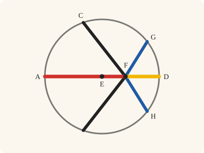
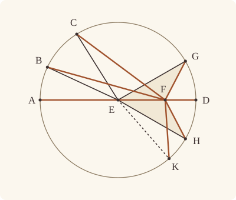

<!-- Generated by scripts/render.py. Do not edit by hand. -->

[Book III](index.md) · [← III.6](06.md) · [III.8 →](08.md)

# Book III, Proposition 7

*Straight lines falling from a point on a diameter*

[Euclid's proof](#euclids-proof) · [In Lean](#in-lean) · [What it rests on](#what-it-rests-on) · [Mishnah](#mishnah)

> If on the diameter of a circle a point be taken which is not the centre of the circle, and from the point straight lines fall upon the circle, that will be greatest on which the centre is, the remainder of the same diameter will be least, and of the rest the nearer to the straight line through the centre is always greater than the more remote, and only two equal straight lines will fall from the point on the circle, one on each side of the least straight line.

**In Lean:** ✅ proved, as Euclid states it · Euclid's argument

<p align="center"></p>

<p align="center"><em>Stand at a point of a diameter, off the centre: the straight line through the centre is longest (red), the rest of the diameter shortest (yellow), and in between they shrink as they turn, equal only in pairs (black, blue).</em></p>

## Euclid's proof

<p align="center"></p>

<p align="center"><em>Drawn for one case: FB, FC and FG compared on one side of AD, as in Heath's figure. K marks the supposed third point of Euclid's reductio, with FK equal to FG and FH. The drawing keeps K distinct from G and H, so it cannot make those three lengths equal.</em></p>

Let ABCD be a circle, and let AD be a diameter of it;

on AD let a point F be taken which is not the centre of the circle, let E be the centre of the circle,

and from F let straight lines FB, FC, FG fall upon the circle ABCD;

I say that FA is greatest, FD is least, and of the rest FB is greater than FC, and FC than FG.

For let BE, CE, GE be joined.

Then, since in any triangle two sides are greater than the remaining one, [I. 20]

EB, EF are greater than BF.

But AE is equal to BE;

therefore AF is greater than BF.

Again, since BE is equal to CE,

and FE is common,

the two sides BE, EF are equal to the two sides CE, EF.

But the angle BEF is also greater than the angle CEF;

therefore the base BF is greater than the base CF. [I. 24]

For the same reason

CF is also greater than FG.

Again, since GF, FE are greater than EG,

and EG is equal to ED,

GF, FE are greater than ED.

Let EF be subtracted from each;

therefore the remainder GF is greater than the remainder FD.

Therefore FA is greatest, FD is least, and FB is greater than FC, and FC than FG.

I say also that from the point F only two equal straight lines will fall on the circle ABCD, one on each side of the least FD.

For on the straight line EF, and at the point E on it, let the angle FEH be constructed equal to the angle GEF [I. 23], and let FH be joined.

Then, since GE is equal to EH,

and EF is common,

the two sides GE, EF are equal to the two sides HE, EF;

and the angle GEF is equal to the angle HEF;

therefore the base FG is equal to the base FH. [I. 4]

I say again that another straight line equal to FG will not fall on the circle from the point F.

For, if possible, let FK so fall.

Then, since FK is equal to FG, and FH to FG,

FK is also equal to FH,

the nearer to the straight line through the centre being thus equal to the more remote: which is impossible.

Therefore another straight line equal to GF will not fall from the point F upon the circle;

therefore only one straight line will so fall.

Therefore etc.

Q. E. D.

## In Lean

| | |
|---|---|
| Proof | ✅ Proved, and its companion `Prop7.general` ([III.7 general](07.md#general)) |
| Statement | The whole enunciation. With its companion: `Prop7.general` compares any two of the rest, on one side of AD or on opposite sides; `Prop7` keeps two on one side. |
| Argument | Euclid's. Across AD the companion moves C to its partner on B's side, as far from F. Euclid's own I.4 step, which makes FH equal to FG, makes the angles at F equal too, so the partner is as near FA as C (`Prop7.partner`), as Heath reads the comparison across the diameter (vol. 2, p. 17); the comparison on one side finishes. |
| Reviewed | The statement and every passage of the argument read against Heath's text, at commit [`689ab169f`](https://github.com/jackChallis/stoicheia/commit/689ab169f) ([the record](../../review/III/07.toml)) |

From [`Elements/BookIII/Prop07.lean`](../../Elements/BookIII/Prop07.lean). Euclid's sentences are the `--` comments, and our own notes are in `/- … -/`; the lines under each sentence are the Lean that carries it out. The list below marks where a lemma does a step Euclid takes for granted, where several sentences share one step, where the Lean takes a case Euclid's figure leaves aside, where the statement already gives a step and where a companion is proved as a theorem of its own; the `/- … -/` notes in the listing explain smaller adjustments.

**How the Lean follows the text**

- **Already given.** "on AD let a point F be taken…" The centre E is given, as Euclid's setting-out takes it. "Nearer" is Euclid's meaning, the less angle at F with the ray FA, unsigned: an obtuse angle is not exchanged for its acute supplement. F is a point strictly within the diameter, between E and D, so not the centre, since F at an end would make the least straight line nothing. The statement speaks of every point of the circle.
- **A further case.** "For let BE, CE, GE be joined." Euclid joins radii to points off AD; the Lean also compares the ends of the diameter, proving FD less than FA by parts of equal radii before either triangle inequality. Beneath the setting-out, `Tacit.centre_inside` (System E, Generalities 3), proved in `Elements/Figure/RuleBase.lean`, and `Tacit.between_of_inside_chord` (System E, Circle 1), proved after III.2, put E between A and any other point of the circle on AD; equal radii and `OnRay.eq_of_len_eq` make that point D.
- **Done by `Definition15`.** "But AE is equal to BE…" Euclid uses the equality of AE and BE without giving a reason. The Lean obtains it from `Definition15`, Euclid's definition of a circle, which we assume as a rule.
- **Done by `Tacit.len_add_of_between`.** "therefore AF is greater than BF." Euclid takes AF as AE and EF together. Beneath the setting-out, `between_cut` puts E between A and F; the Lean then identifies the sum by `Tacit.len_add_of_between`, a rule we assume (System E, Diagram-segment 1), and uses AE equal to BE.
- **Done by `Definition15`.** "Again, since BE is equal to CE…" Euclid uses the equality of BE and CE without giving a reason. The Lean obtains it from `Definition15`, the assumed rule for equal radii.
- **Done by `BookI.Prop24.within`.** "But the angle BEF is also greater than the angle CEF…" Euclid reads the greater angle BEF from his figure, without a reference from Heath. The Lean uses `BookI.Prop24.within` and `crossbar` to place M on EC and the ray FB, `InsideCircle.of_between_centre` to put F and M within the circle, and `Tacit.between_cases`, a rule we assume (System E, Between 6), to split the orders of F, M and B; the ray excludes F between M and B, and `Prop2.within` (III.2, for which Heath prints no reference here) excludes B between F and M, leaving M between F and B, so `angle_lt_of_between` gives the comparison at E.
- **Carried together.** "For the same reason…" Euclid leaves C and G to the same argument without writing it out. The Lean proves the comparison above for any two points B, C of the circle on one side of AD, so it includes C and G.
- **Done by `Definition15`.** "and EG is equal to ED…" Euclid uses the equality of EG and ED without giving a reason. The Lean obtains it from `Definition15`, the assumed rule for equal radii.
- **Done by `Tacit.len_add_of_between`.** "Let EF be subtracted from each…" Euclid subtracts EF from ED, taking ED as EF and FD together. The Lean writes this sum using `Tacit.len_add_of_between`, a rule we assume (System E, Diagram-segment 1), with F between E and D, and cancels the common length by `Magnitude.lt_of_add_lt_add_left`.
- **Proved separately, as `Prop7.general`.** "Therefore FA is greatest, FD is least, and FB is greater than FC…"
- **Done by `Tacit.line_circle_beyond`.** "For on the straight line EF, and at the point E on it…" Euclid constructs the equal angle by I.23 and takes its arm to meet the circle at H. After `BookI.Prop23`, the Lean finds H using the proved rule `Tacit.centre_inside` (System E, Generalities 3) and `Tacit.line_circle_beyond` (System E, Intersections 5), a rule we assume, with Postulate 2 producing the arm backwards so the meeting lies on the chosen ray.
- **Done by `Definition15`.** "Then, since GE is equal to EH…" Euclid uses the equality of GE and EH without giving a reason. The Lean obtains it from `Definition15`, the assumed rule for equal radii.
- **Done by `onRay_of_angle_eq`.** "the nearer to the straight line through the centre being thus equal to the more remote…" Euclid takes distinct points on one side of AD to give a nearer and a more remote straight line. The Lean compares their angles by `Tacit.lt_trichotomy`, a rule we assume (System E §3.5): unequal angles use the comparison already proved, equal angles put the points on one ray by `onRay_of_angle_eq` and make them coincide by `OnRay.eq_of_len_eq`; A and D are excluded by the greatest and least clauses, and the two sides of AD give G or H.
- **Carried together.** "Therefore another straight line equal to GF will not fall…" The conclusion of the argument above, which has shown that every point K of the circle with FK equal to FG is G or H.

```lean
/-- If on the diameter of a circle a point be taken which is not the centre of the circle, and from
the point straight lines fall upon the circle, that will be greatest on which the centre is, the
remainder of the same diameter will be least, and of the rest the nearer to the straight line
through the centre is always greater than the more remote, and only two equal straight lines
will fall from the point on the circle, one on each side of the least straight line. -/
theorem Prop7 {A D E F : Point} {ABCD : Circle} (hE : Centre E ABCD) (hA : OnCircle A ABCD)
    (hD : OnCircle D ABCD) (hAED : Between A E D) (hEFD : Between E F D) :
    (∀ B : Point, OnCircle B ABCD → B ≠ A → ‖F B‖ < ‖F A‖) ∧
    (∀ G : Point, OnCircle G ABCD → G ≠ D → ‖F D‖ < ‖F G‖) ∧
    (∀ B C : Point, OnCircle B ABCD → OnCircle C ABCD → SameSideOf B C A D →
      ∠ A F B < ∠ A F C → ‖F C‖ < ‖F B‖) ∧
    (∀ G : Point, OnCircle G ABCD → ¬ Collinear A D G → ∃ H : Point, OnCircle H ABCD ∧
      OppositeSidesOf H G A D ∧ ‖F H‖ = ‖F G‖ ∧
      ∀ K : Point, OnCircle K ABCD → ‖F K‖ = ‖F G‖ → K = G ∨ K = H) := by
  -- Let ABCD be a circle, and let AD be a diameter of it;
  have hAD : A ≠ D := ne_of_between_ends hAED
  obtain ⟨L, hA_L, hD_L⟩ := Postulate1 A D hAD
  have hE_L : OnLine E L := on_line_of_between_ends hAED hA_L hD_L
  -- on AD let a point F be taken which is not the centre of the circle, let E be the centre of
  -- the circle,
  have hF_L : OnLine F L := on_line_of_between_ends hEFD hE_L hD_L
  have hEF : E ≠ F := ne_of_between hEFD
  have hAEF : Between A E F := between_cut hAED hEFD
  have hFA : F ≠ A := (ne_of_between_ends hAEF).symm
  have hF_in : InsideCircle F ABCD :=
    InsideCircle.of_between_centre hE hD hEFD
  /- A point of the circle on the diameter is A or D (System E, Circle 1). -/
  have hends : ∀ K, OnCircle K ABCD → OnLine K L → K ≠ A → K = D := by
    intro K hK hK_L hKA
    have hAEK : Between A E K :=
      between_of_inside_chord hE_L hA_L hK_L (centre_inside hE) hA hK hKA.symm
    exact (OnRay.of_between_between hAED hAEK).eq_of_len_eq (Definition15 hE hK hD)
  /- FD is less than FA, for FD is less than ED, which is equal to EA, and EA is less
     than FA. -/
  have hDA : ‖F D‖ < ‖F A‖ := by
    have h₁ : ‖D F‖ < ‖D E‖ := len_lt_of_between (between_symm hEFD)
    have h₂ : ‖A E‖ < ‖A F‖ := len_lt_of_between hAEF
    rw [len_symm D F, len_symm D E, Definition15 hE hD hA, len_symm E A] at h₁
    rw [len_symm A F] at h₂
    exact lt_trans h₁ h₂
  -- and from F let straight lines FB, FC, FG fall upon the circle ABCD;
  -- I say that FA is greatest, FD is least, and of the rest FB is greater than FC, and FC than
  -- FG.
  -- For let BE, CE, GE be joined.
  have hgreatest : ∀ B : Point, OnCircle B ABCD → B ≠ A → ‖F B‖ < ‖F A‖ := by
    intro B hB hBA
    by_cases hB_L : OnLine B L
    · rw [hends B hB hB_L hBA]
      exact hDA
    have hEBF : Triangle E B F := (Triangle.of_line hE_L hF_L hEF hB_L).acb
    -- Then, since in any triangle two sides are greater than the remaining one, [I. 20]
    -- EB, EF are greater than BF.
    have h20 : ‖B F‖ < ‖B E‖ + ‖E F‖ := (BookI.Prop20 hEBF).1
    -- But AE is equal to BE;
    have hAE : ‖A E‖ = ‖B E‖ := by rw [len_symm A E, len_symm B E]; exact Definition15 hE hA hB
    -- therefore AF is greater than BF.
    rw [← hAE, len_add_of_between hAEF, len_symm B F, len_symm A F] at h20
    exact h20
  have hnearer : ∀ B C : Point, OnCircle B ABCD → OnCircle C ABCD → SameSideOf B C A D →
      ∠ A F B < ∠ A F C → ‖F C‖ < ‖F B‖ := by
    intro B C hB hC hBC hlt
    -- Again, since BE is equal to CE,
    have hBE : ‖E B‖ = ‖E C‖ := Definition15 hE hB hC
    -- and FE is common,
    have hEF_common : ‖E F‖ = ‖E F‖ := rfl
    -- the two sides BE, EF are equal to the two sides CE, EF.
    -- But the angle BEF is also greater than the angle CEF;
    have hBC' : SameSideOf B C F E := SameSideOf.of_line hEF.symm hF_L hE_L (hBC.sameSide hA_L hD_L)
    have hBF : B ≠ F := fun e => inside_not_on hF_in (e ▸ hB)
    have hCF : C ≠ F := fun e => inside_not_on hF_in (e ▸ hC)
    /- Euclid reads this off the figure, the gap Augustus De Morgan points out (Heath,
       vol. 2, p. 15). The angle EFB is the angle AFB, since E is on FA, so FB falls within
       the angle EFC (`BookI.Prop24.within`) and crosses EC at a point M (`crossbar`). -/
    have hEray : OnRay E F A := OnRay.of_between (between_symm hAEF)
    rw [← angle_onRay_left hEray hBF, ← angle_onRay_left hEray hCF] at hlt
    have hwithin : SameSideOf B E F C := BookI.Prop24.within hBC'.symm hlt
    obtain ⟨M, hEMC, hM⟩ := crossbar hBC' hwithin
    have hM_in : InsideCircle M ABCD := InsideCircle.of_between_centre hE hC hEMC
    /- M is between F and B: it is on the ray from F through B, and not beyond B, for
       then B would be within the circle (`Prop2.within`). -/
    have hFMB : Between F M B := by
      obtain ⟨-, hMF, ⟨N, hF_N, hB_N, hM_N⟩, hMFB⟩ := hM
      have hMB : M ≠ B := fun e => inside_not_on hM_in (e ▸ hB)
      rcases between_cases hMF.symm hMB hBF.symm hF_N hM_N hB_N with h | h | h
      · exact h
      · exact absurd h hMFB
      · exact absurd hB (inside_not_on (Prop2.within (Or.inl hF_in) (Or.inl hM_in) h))
    have hBFE : Triangle B F E := hBC'.triangle.cab
    have hang : ∠ C E F < ∠ B E F := by
      rw [← angle_onRay_left (OnRay.of_between hEMC) hEF.symm]
      exact angle_lt_of_between hBFE (between_symm hFMB)
    -- therefore the base BF is greater than the base CF. [I. 24]
    have hECF : Triangle E C F := hBC'.symm.triangle.bca
    have h24 : ‖C F‖ < ‖B F‖ := BookI.Prop24 hBFE.cab hECF hBE hEF_common hang
    rw [len_symm C F, len_symm B F] at h24
    exact h24
  -- For the same reason
  -- CF is also greater than FG.
  /- We gave Euclid's argument above for any two points B, C on one side of AD, and C, G are
     such a pair. -/
  have hleast : ∀ G : Point, OnCircle G ABCD → G ≠ D → ‖F D‖ < ‖F G‖ := by
    intro G hG hGD
    by_cases hG_L : OnLine G L
    · have hGA : G = A := Classical.byContradiction fun h => hGD (hends G hG hG_L h)
      rw [hGA]
      exact hDA
    have hFGE : Triangle F G E := (Triangle.of_line hF_L hE_L hEF.symm hG_L).acb
    -- Again, since GF, FE are greater than EG,
    have h20 : ‖G E‖ < ‖G F‖ + ‖F E‖ := (BookI.Prop20 hFGE).1
    -- and EG is equal to ED,
    have hEG : ‖E G‖ = ‖E D‖ := Definition15 hE hG hD
    -- GF, FE are greater than ED.
    rw [len_symm G E, hEG] at h20
    -- Let EF be subtracted from each;
    -- therefore the remainder GF is greater than the remainder FD.
    rw [← len_add_of_between hEFD, len_symm F E, add_comm (‖G F‖)] at h20
    rw [len_symm F G]
    exact Magnitude.lt_of_add_lt_add_left h20
  -- Therefore FA is greatest, FD is least, and FB is greater than FC, and FC than FG.
  refine ⟨hgreatest, hleast, hnearer, ?_⟩
  -- I say also that from the point F only two equal straight lines will fall on the circle
  -- ABCD, one on each side of the least FD.
  intro G hG hG_AD
  have hG_L : ¬ OnLine G L := fun h => hG_AD ⟨L, hA_L, hD_L, h⟩
  -- For on the straight line EF, and at the point E on it, let the angle FEH be constructed
  -- equal to the angle GEF [I. 23], and let FH be joined.
  have hEFG : Triangle E F G := Triangle.of_line hE_L hF_L hEF hG_L
  obtain ⟨P, hPG, -⟩ := exists_point_opposite_side hG_L []
  have hP_EF : ¬ Collinear E F P := Triangle.of_line hE_L hF_L hEF hPG.1
  obtain ⟨H', F', hF', hH', hang⟩ := BookI.Prop23 hEF hEFG.cab hP_EF
  have hEH' : E ≠ H' := hH'.triangle.ne₁₃
  /- H is where the straight line EH' meets the circle on the side of E where H' is
     (System E, Intersections 5, with H'E produced to a point Q). -/
  obtain ⟨N, hE_N, hH'_N⟩ := Postulate1 E H' hEH'
  obtain ⟨Q, hH'EQ⟩ := produce hEH'.symm
  have hQ_N : OnLine Q N := on_line_of_between hH'EQ hH'_N hE_N
  obtain ⟨H, hH, -, hHEQ⟩ :=
    line_circle_beyond (centre_inside hE) hE_N hQ_N (ne_of_between (between_symm hH'EQ))
  have hH_ray : OnRay H E H' := OnRay.of_between_between (between_symm hH'EQ) (between_symm hHEQ)
  /- H is on the other side of AD from G. -/
  have hHP : SameSideOf H P E F := SameSideOf.of_onRay hH_ray hH'
  have hHG_EF : OppositeSidesOf H G E F :=
    hHP.trans_opposite (OppositeSidesOf.of_line hEF hE_L hF_L hPG)
  have hHG : OppositeSidesOf H G A D :=
    OppositeSidesOf.of_line hAD hA_L hD_L (hHG_EF.oppositeSides hE_L hF_L)
  -- Then, since GE is equal to EH,
  have hEH : ‖E H‖ = ‖E G‖ := Definition15 hE hH hG
  -- and EF is common,
  have hEF_common : ‖E F‖ = ‖E F‖ := rfl
  -- the two sides GE, EF are equal to the two sides HE, EF;
  -- and the angle GEF is equal to the angle HEF;
  have hFEH : ∠ F E H = ∠ G E F :=
    (angle_eq_of_onRay hF'.symm hH_ray).trans ((angle_symm hF'.2.1 hEH'.symm).trans hang)
  have hEHF : Triangle E H F := hHG_EF.triangle.acb
  have hGEF_HEF : ∠ G E F = ∠ H E F := by
    rw [← hFEH, angle_symm hEF.symm hEHF.ne₁₂.symm]
  -- therefore the base FG is equal to the base FH. [I. 4]
  have hFG_FH : ‖G F‖ = ‖H F‖ := (BookI.Prop4 hEFG.acb hEHF hEH.symm hEF_common hGEF_HEF).1
  have hFH : ‖F H‖ = ‖F G‖ := by rw [len_symm F H, len_symm F G]; exact hFG_FH.symm
  -- I say again that another straight line equal to FG will not fall on the circle from the
  -- point F.
  refine ⟨H, hH, hHG, hFH, ?_⟩
  -- For, if possible, let FK so fall.
  intro K hK hFK
  -- Then, since FK is equal to FG, and FH to FG,
  -- FK is also equal to FH,
  have hFKH : ‖F K‖ = ‖F H‖ := hFK.trans hFH.symm
  -- the nearer to the straight line through the centre being thus equal to the more remote:
  -- which is impossible.
  /- On one side of AD, two points of the circle equally distant from F are one point:
     were they two, one would be the nearer to FA, and greater. -/
  have hone : ∀ X Y : Point, OnCircle X ABCD → OnCircle Y ABCD → SameSideOf X Y A D →
      ‖F X‖ = ‖F Y‖ → X = Y := by
    intro X Y hX hY hXY hFXY
    rcases lt_trichotomy (∠ A F X) (∠ A F Y) with h | h | h
    · exact absurd hFXY (Magnitude.ne_of_lt (hnearer X Y hX hY hXY h)).symm
    · have hXY' : SameSideOf X Y F A :=
        SameSideOf.of_line hFA hF_L hA_L (hXY.sameSide hA_L hD_L)
      exact (onRay_of_angle_eq hXY' h).eq_of_len_eq hFXY
    · exact absurd hFXY (Magnitude.ne_of_lt (hnearer Y X hY hX hXY.symm h))
  by_cases hK_L : OnLine K L
  · /- A point K on the diameter is A, the greatest, or D, the least. -/
    have hGA : G ≠ A := fun e => hG_L (e ▸ hA_L)
    have hGD : G ≠ D := fun e => hG_L (e ▸ hD_L)
    by_cases hKA : K = A
    · subst hKA
      exact absurd hFK (Magnitude.ne_of_lt (hgreatest G hG hGA)).symm
    · have hKD := hends K hK hK_L hKA
      subst hKD
      exact absurd hFK (Magnitude.ne_of_lt (hleast G hG hGD))
  by_cases hKG : SameSideOf K G A D
  · exact Or.inl (hone K G hK hG hKG hFK)
  · have hKG' : OppositeSidesOf K G A D :=
      OppositeSidesOf.of_line hAD hA_L hD_L
        ⟨hK_L, hG_L, fun hs => hKG (SameSideOf.of_line hAD hA_L hD_L hs)⟩
    exact Or.inr (hone K H hK hH (OppositeSidesOf.sameSideOf hKG'.symm hHG.symm)
      hFKH)
  -- Therefore another straight line equal to GF will not fall from the point F upon the
  -- circle;
  -- therefore only one straight line will so fall.
  -- Therefore etc.
  -- Q. E. D.
```

<a name="general"></a>

<details><summary>After the theorem, its companion, <code>Prop7.general</code> and one lemma for its own proofs, <code>Prop7.partner</code> (112 lines)</summary>

```lean
/-- **III.7, the partner equally inclined** (a step of III.7 general). F is on the diameter
AD of the circle ABCD with centre E, between E and D; if G and H are points of the circle on
opposite sides of AD, and FH is equal to FG, then the angles AFH and AFG are equal, so the
partner of a straight line from F makes the same angle with the ray FA. Euclid's
construction of H, the angle FEH made equal to GEF (I.23), gives the equal angles at F by
I.4, and his last step shows that no other point is H. -/
theorem Prop7.partner {A D E F G H : Point} {ABCD : Circle} (hE : Centre E ABCD)
    (hA : OnCircle A ABCD) (hD : OnCircle D ABCD) (hAED : Between A E D) (hEFD : Between E F D)
    (hG : OnCircle G ABCD) (hH : OnCircle H ABCD) (hHG : OppositeSidesOf H G A D)
    (hFH : ‖F H‖ = ‖F G‖) :
    ∠ A F H = ∠ A F G := by
  have hAD : A ≠ D := ne_of_between_ends hAED
  obtain ⟨L, hA_L, hD_L⟩ := Postulate1 A D hAD
  have hE_L : OnLine E L := on_line_of_between_ends hAED hA_L hD_L
  have hF_L : OnLine F L := on_line_of_between_ends hEFD hE_L hD_L
  have hEF : E ≠ F := ne_of_between hEFD
  have hG_L : ¬ OnLine G L := (hHG.oppositeSides hA_L hD_L).2.1
  have hEFG : Triangle E F G := Triangle.of_line hE_L hF_L hEF hG_L
  /- On EF at E make the angle FEH' equal to GEF, on the other side from G. -/
  obtain ⟨P, hPG, -⟩ := exists_point_opposite_side hG_L []
  have hP_EF : ¬ Collinear E F P := Triangle.of_line hE_L hF_L hEF hPG.1
  obtain ⟨X, F', hF', hX, hang⟩ := BookI.Prop23 hEF hEFG.cab hP_EF
  /- H' is where the straight line EX meets the circle on the side of E where X is
     (System E, Intersections 5, with XE produced to a point Q). -/
  obtain ⟨N, hE_N, hX_N⟩ := Postulate1 E X hX.triangle.ne₁₃
  obtain ⟨Q, hXEQ⟩ := produce hX.triangle.ne₁₃.symm
  have hQ_N : OnLine Q N := on_line_of_between hXEQ hX_N hE_N
  obtain ⟨H', hH', -, hH'EQ⟩ :=
    line_circle_beyond (centre_inside hE) hE_N hQ_N
      (ne_of_between (between_symm hXEQ))
  have hH'_ray : OnRay H' E X :=
    OnRay.of_between_between (between_symm hXEQ) (between_symm hH'EQ)
  /- H' is on the other side of AD from G. -/
  have hH'G_EF : OppositeSidesOf H' G E F :=
    (SameSideOf.of_onRay hH'_ray hX).trans_opposite
      (OppositeSidesOf.of_line hEF hE_L hF_L hPG)
  have hH'G : OppositeSidesOf H' G A D :=
    OppositeSidesOf.of_line hAD hA_L hD_L (hH'G_EF.oppositeSides hE_L hF_L)
  have hFEH' : ∠ F E H' = ∠ G E F :=
    (angle_eq_of_onRay hF'.symm hH'_ray).trans
      ((angle_symm hF'.2.1 hX.triangle.ne₁₃.symm).trans hang)
  have hEH'F : Triangle E H' F := hH'G_EF.triangle.acb
  have hGEF : ∠ G E F = ∠ H' E F :=
    hFEH'.symm.trans (angle_symm hEF.symm hEH'F.ne₁₂.symm)
  /- I.4 gives both the equal bases and the equal angles at F. -/
  have h4 := BookI.Prop4 hEFG.acb hEH'F (Definition15 hE hG hH') rfl hGEF
  have hFH' : ‖F H'‖ = ‖F G‖ := by
    rw [len_symm F H', len_symm F G]
    exact h4.1.symm
  have hEray : OnRay E F A := OnRay.of_between (between_symm (between_cut hAED hEFD))
  have hangle : ∠ A F H' = ∠ A F G := by
    rw [← angle_onRay_left hEray hEH'F.ne₂₃,
      ← angle_onRay_left hEray hEFG.ne₂₃.symm]
    exact h4.2.2.2.symm
  /- H and H' are both the unique partner of G on the other side of AD. -/
  obtain ⟨J, -, -, -, hunique⟩ := (Prop7 hE hA hD hAED hEFD).2.2.2 G hG hHG.symm.triangle
  have hHG_ne : H ≠ G := by
    intro e
    have hs := hHG.oppositeSides hA_L hD_L
    exact hs.2.2 (e ▸ same_side_refl hs.1)
  have hH'G_ne : H' ≠ G := by
    intro e
    have hs := hH'G.oppositeSides hA_L hD_L
    exact hs.2.2 (e ▸ same_side_refl hs.1)
  have hHJ : H = J := (hunique H hH hFH).resolve_left hHG_ne
  have hH'J : H' = J := (hunique H' hH' hFH').resolve_left hH'G_ne
  exact (hHJ.trans hH'J.symm) ▸ hangle

/-- **III.7, general** (companion of III.7). F is on the diameter AD of the circle ABCD with
centre E, strictly between E and D, so not the centre. Of the straight lines from F to the
circle, FA, the one through the centre, is greater than every other; FD, the rest of the
diameter, is less than every other. Of any two straight lines FB, FC whose ends B, C are off
the diameter, on one side of it or on opposite sides, the one making the less angle with the
ray FA at F is the greater: if the angle AFB is less than the angle AFC, then FC is less than
FB. Each point G of the circle off the diameter has one partner H on the other side with FH
equal to FG, and no third point of the circle is as far from F. -/
theorem Prop7.general {A D E F : Point} {ABCD : Circle} (hE : Centre E ABCD)
    (hA : OnCircle A ABCD) (hD : OnCircle D ABCD) (hAED : Between A E D) (hEFD : Between E F D) :
    (∀ B : Point, OnCircle B ABCD → B ≠ A → ‖F B‖ < ‖F A‖) ∧
    (∀ G : Point, OnCircle G ABCD → G ≠ D → ‖F D‖ < ‖F G‖) ∧
    (∀ B C : Point, OnCircle B ABCD → OnCircle C ABCD → ¬ Collinear A D B →
      ¬ Collinear A D C → ∠ A F B < ∠ A F C → ‖F C‖ < ‖F B‖) ∧
    (∀ G : Point, OnCircle G ABCD → ¬ Collinear A D G → ∃ H : Point, OnCircle H ABCD ∧
      OppositeSidesOf H G A D ∧ ‖F H‖ = ‖F G‖ ∧
      ∀ K : Point, OnCircle K ABCD → ‖F K‖ = ‖F G‖ → K = G ∨ K = H) := by
  obtain ⟨hgreatest, hleast, hnearer, hpartner⟩ := Prop7 hE hA hD hAED hEFD
  refine ⟨hgreatest, hleast, ?_, hpartner⟩
  intro B C hB hC hB_AD hC_AD hlt
  by_cases hBC : SameSideOf B C A D
  · exact hnearer B C hB hC hBC hlt
  /- Move C to its partner H on B's side of AD. -/
  have hAD : A ≠ D := ne_of_between_ends hAED
  obtain ⟨L, hA_L, hD_L⟩ := Postulate1 A D hAD
  have hBC' : OppositeSidesOf B C A D :=
    OppositeSidesOf.of_line hAD hA_L hD_L
      ⟨fun h => hB_AD ⟨L, hA_L, hD_L, h⟩,
        fun h => hC_AD ⟨L, hA_L, hD_L, h⟩,
        fun hs => hBC (SameSideOf.of_line hAD hA_L hD_L hs)⟩
  obtain ⟨H, hH, hHC, hFH, -⟩ := hpartner C hC hC_AD
  have hBH : SameSideOf B H A D := OppositeSidesOf.sameSideOf hBC'.symm hHC.symm
  have hang : ∠ A F H = ∠ A F C := Prop7.partner hE hA hD hAED hEFD hC hH hHC hFH
  have hlt' : ∠ A F B < ∠ A F H := by rw [hang]; exact hlt
  have hless := hnearer B H hB hH hBH hlt'
  rwa [hFH] at hless

/-- The check: the statement of `Prop7` follows from `Prop7.general` (checked by Lean).
Two points on one side of AD are off it. -/
example : type_of% @Elements.BookIII.Prop7 := by
  intro A D E F ABCD hE hA hD hAED hEFD
  obtain ⟨hgreatest, hleast, hnearer, hpartner⟩ := Prop7.general hE hA hD hAED hEFD
  exact ⟨hgreatest, hleast, fun B C hB hC hBC hlt =>
    hnearer B C hB hC hBC.triangle hBC.symm.triangle hlt, hpartner⟩
```

</details>

## What it rests on

| | Proposition | `Prop7.general` |
|---|---|---|
| Heath's references | [I.4](../I/04.md), [I.20](../I/20.md), [I.23](../I/23.md), [I.24](../I/24.md) | none |
| Lean cites | [I.4](../I/04.md), [I.20](../I/20.md), [I.23](../I/23.md), [I.24](../I/24.md), [III.2](02.md) | [I.4](../I/04.md), [I.23](../I/23.md), [III.7](07.md) |
| Postulates | 1, 2, 3, 4 | 1, 2, 3, 4 |
| Definitions taken as axioms | Def. I.15 | Def. I.15 |
| Common Notions | 1, 2, 3, 4, 5 | 1, 2, 3, 4, 5 |
| Tacit rules | 38 (listed below) | 38 (listed below) |
| Its own Lean calls | Postulate 1; Def. I.15; 9 tacit rules | Postulate 1; Def. I.15; 4 tacit rules |
| Through lemmas | Postulates 2 and 3; 22 tacit rules | Postulates 2 and 3; 26 tacit rules |

Some of these come in through lemmas [shared](../../CERTIFICATE.md#shared-steps) by many proofs: [`Prop2.within`](../../Elements/BookIII/Prop02.lean#L117), [`Tacit.between_of_inside_chord`](../../Elements/BookIII/Prop02.lean#L192) (III.2).

_Postulates, definitions, Common Notions and tacit rules: all that each proof rests on, counting those of the propositions it cites. The last two rows say which of the postulates, definitions and tacit rules its own Lean calls, in the proof or a helper written for it, and which it does not call but reaches through lemmas, of Book Zero or shared (a proposition it cites may rest on these too); the rest come in only through the propositions it cites or the Common Notions._

<details><summary>The 38 tacit rules beneath this proof, counting those of the propositions it cites</summary>

_(used here) marks a rule this proof's own Lean calls, in the proof or a helper written for it; (through …) marks one its own Lean does not call but reaches through the lemmas named, of [Book Zero](../../Elements/Figure) or shared, though a proposition it cites may rest on it too; and a rule with no mark comes in only through a proposition it cites or a Common Notion. The names in brackets are System E's: an Intersection rule says when straight lines and circles must meet, and an Intersections rule takes a point where they do (see [Book I's introduction](../I/index.md))._

**Reading the figure**

- [`between_cases`](../../Elements/Foundations/Tacit/Diagram.lean#L54) (used here): Of three different points on a straight line, one is between the other two. (Between 6)
- [`between_symm`](../../Elements/Foundations/Tacit/Diagram.lean#L47) (used here): If B is between A and C, it is between C and A. (Between 1)
- [`circles_meet`](../../Elements/Foundations/Tacit/Diagram.lean#L91) (through [`BookI.Prop24.within`](../../Elements/BookI/Prop24.lean#L35), [`OnRay.of_between`](../../Elements/Figure/Rays.lean#L34), [`OnRay.of_between_between`](../../Elements/Figure/Rays.lean#L88) and 13 other lemmas): If each circle passes through a point inside the other, the circles cut one another. This is the step Euclid takes for granted in I.1. (Intersection 5)
- [`circles_meet_same_side`](../../Elements/Foundations/Tacit/Constructions.lean#L79) (through [`BookI.Prop24.within`](../../Elements/BookI/Prop24.lean#L35), [`OnRay.of_between`](../../Elements/Figure/Rays.lean#L34), [`OnRay.of_between_between`](../../Elements/Figure/Rays.lean#L88) and 13 other lemmas): Two circles that cut one another do so on each side of the straight line through their centres. (Intersections 8)
- [`exists_centre`](../../Elements/Foundations/Tacit/Constructions.lean#L57) (through [`Tacit.between_of_inside_chord`](../../Elements/BookIII/Prop02.lean#L192) and [`Tacit.inside_not_on`](../../Elements/Figure/RuleBase.lean#L249)): Every circle has a centre. A rule of our own, not one of System E's: its content is Euclid's Definitions I.15 and I.16.
- [`exists_point`](../../Elements/Foundations/Tacit/Constructions.lean#L35) (through [`BookI.Prop24.within`](../../Elements/BookI/Prop24.lean#L35), [`Triangle.ne₁₂`](../../Elements/Figure/Triangles.lean#L22), [`Triangle.ne₁₃`](../../Elements/Figure/Triangles.lean#L36) and 3 other lemmas): Let a point be taken. (Points 1)
- [`exists_point_inside_circle`](../../Elements/Foundations/Tacit/Constructions.lean#L42) (through [`BookI.Prop24.within`](../../Elements/BookI/Prop24.lean#L35), [`InsideCircle.of_between_centre`](../../Elements/Figure/Incidence.lean#L238), [`OnRay.of_between`](../../Elements/Figure/Rays.lean#L34) and 15 other lemmas): Let a point be taken inside the circle α. (Points 8)
- [`exists_point_on_line`](../../Elements/Foundations/Tacit/Constructions.lean#L38) (through [`BookI.Prop24.within`](../../Elements/BookI/Prop24.lean#L35), [`OnRay.of_between`](../../Elements/Figure/Rays.lean#L34), [`OnRay.of_between_between`](../../Elements/Figure/Rays.lean#L88) and 13 other lemmas): Let a point be taken on the straight line L. (Points 2)
- [`line_circle_between`](../../Elements/Foundations/Tacit/Constructions.lean#L67) (through [`BookI.Prop24.within`](../../Elements/BookI/Prop24.lean#L35), [`InsideCircle.of_between_centre`](../../Elements/Figure/Incidence.lean#L238), [`OnRay.of_between`](../../Elements/Figure/Rays.lean#L34) and 15 other lemmas): A straight line through a point B inside a circle, heading out to a point C outside it, cuts the circle between B and C. (Intersections 4)
- [`line_circle_beyond`](../../Elements/Foundations/Tacit/Constructions.lean#L73) (used here): A straight line through a point B inside a circle, produced beyond B away from C, cuts the circle there. (Intersections 5)
- [`line_unique`](../../Elements/Foundations/Tacit/Diagram.lean#L41) (through [`BookI.Prop24.within`](../../Elements/BookI/Prop24.lean#L35), [`OnRay.of_between_between`](../../Elements/Figure/Rays.lean#L88), [`OppositeSidesOf.of_line`](../../Elements/Figure/Sides.lean#L69) and 10 other lemmas): Two points determine a straight line. (Generalities 1)
- [`lines_meet_of_opposite_sides`](../../Elements/Foundations/Tacit/Diagram.lean#L86) (through [`BookI.Prop24.within`](../../Elements/BookI/Prop24.lean#L35), [`OppositeSidesOf.sameSideOf`](../../Elements/Figure/Sides.lean#L129), [`crossbar`](../../Elements/Figure/Angles.lean#L132) and 1 other lemma): A straight line joining points on opposite sides of L crosses L. (Intersection 1)
- [`not_between_of_between`](../../Elements/Foundations/Tacit/Diagram.lean#L50) (through [`BookI.Prop24.within`](../../Elements/BookI/Prop24.lean#L35), [`InsideCircle.of_between_centre`](../../Elements/Figure/Incidence.lean#L238), [`OnRay.of_between`](../../Elements/Figure/Rays.lean#L34) and 20 other lemmas): If B is between A and C, then A is not between B and C. (Between 1)
- [`not_on_line_of_same_side`](../../Elements/Foundations/Tacit/Diagram.lean#L60) (through [`BookI.Prop24.within`](../../Elements/BookI/Prop24.lean#L35), [`OnRay.of_between`](../../Elements/Figure/Rays.lean#L34), [`OnRay.of_between_between`](../../Elements/Figure/Rays.lean#L88) and 15 other lemmas): Points on one side of a straight line are not on it. (Same side 3)
- [`pasch2`](../../Elements/Foundations/Tacit/Diagram.lean#L71) (through [`BookI.Prop24.within`](../../Elements/BookI/Prop24.lean#L35), [`OnRay.of_between`](../../Elements/Figure/Rays.lean#L34), [`OnRay.of_between_between`](../../Elements/Figure/Rays.lean#L88) and 11 other lemmas): If B is between A and C, A is on L and B is off it, then B and C are on the same side of L: a straight line that leaves L at A does not cross it again. (Pasch 2)
- [`same_side_trans`](../../Elements/Foundations/Tacit/Diagram.lean#L64) (through [`BookI.Prop24.within`](../../Elements/BookI/Prop24.lean#L35), [`OnRay.of_between`](../../Elements/Figure/Rays.lean#L34), [`OnRay.of_between_between`](../../Elements/Figure/Rays.lean#L88) and 14 other lemmas): Two points on the same side of a straight line as a third point are on the same side as each other. (Same side 4)

**Lengths, angles and areas**

- [`angle_add_of_inside`](../../Elements/Foundations/Tacit/Transfer.lean#L47) (through [`BookI.Prop24.within`](../../Elements/BookI/Prop24.lean#L35), [`OppositeSidesOf.sameSideOf`](../../Elements/Figure/Sides.lean#L129), [`Tacit.exists_point_opposite_side`](../../Elements/Figure/Incidence.lean#L291) and 3 other lemmas): If D lies within the angle BAC, then BAC is made up of BAD and DAC. (Diagram-angle 2)
- [`angle_eq_of_same_rays`](../../Elements/Foundations/Tacit/Transfer.lean#L54) (through [`BookI.Prop24.within`](../../Elements/BookI/Prop24.lean#L35), [`angle_eq_of_onRay`](../../Elements/Figure/Angles.lean#L33) and [`angle_onRay_left`](../../Elements/Figure/Angles.lean#L42)): The angle doesn't change if its arms are traced through other points on the same rays. (Diagram-angle 4)
- [`angle_symm`](../../Elements/Foundations/Tacit/Metric.lean#L30) (used here): The angle ABC is the angle CBA. (Metric 4)
- [`area_add_of_between`](../../Elements/Foundations/Tacit/Transfer.lean#L70): Cutting a triangle in two from a vertex adds up. (Diagram-area 2)
- [`area_congruent`](../../Elements/Foundations/Tacit/Metric.lean#L44): Triangles equal in all their sides and angles are equal in area. Euclid uses this without comment once he has shown two triangles congruent. (Metric 9)
- [`area_degenerate`](../../Elements/Foundations/Tacit/Metric.lean#L36): A "triangle" with a repeated corner has no area. (Metric 6)
- [`area_eq_zero_of_on_line`](../../Elements/Foundations/Tacit/Transfer.lean#L62): A "triangle" whose corners lie on one straight line has no area. (Diagram-area 1)
- [`area_rotate`](../../Elements/Foundations/Tacit/Metric.lean#L39): The triangle ABC is the triangle CAB. (Metric 8)
- [`len_add_of_between`](../../Elements/Foundations/Tacit/Transfer.lean#L27) (used here): If B is between A and C, then AB and BC together make up AC. (Diagram-segment 1)
- [`len_self`](../../Elements/Foundations/Tacit/Metric.lean#L24) (through [`BookI.Prop24.within`](../../Elements/BookI/Prop24.lean#L35), [`InsideCircle.of_between_centre`](../../Elements/Figure/Incidence.lean#L238), [`OnRay.of_between`](../../Elements/Figure/Rays.lean#L34) and 18 other lemmas): The "straight line" from a point to itself has no length. (Metric 1)
- [`len_symm`](../../Elements/Foundations/Tacit/Metric.lean#L27) (used here): The straight line AB is the straight line BA. (Metric 3)
- [`radius_ne_zero`](../../Elements/Foundations/Tacit/Metric.lean#L62) (through [`BookI.Prop24.within`](../../Elements/BookI/Prop24.lean#L35), [`InsideCircle.of_between_centre`](../../Elements/Figure/Incidence.lean#L238), [`OnRay.eq_of_len_eq`](../../Elements/Figure/Rays.lean#L161) and 20 other lemmas): A circle's radius is not nothing: the straight line from the centre to a point on the circle has some length. A rule of our own, not one of System E's: every circle is drawn with a centre and a distance (Postulate 3).
- [`same_ray_of_angle_eq_zero`](../../Elements/Foundations/Tacit/Transfer.lean#L42) (through [`BookI.Prop24.within`](../../Elements/BookI/Prop24.lean#L35), [`OppositeSidesOf.sameSideOf`](../../Elements/Figure/Sides.lean#L129), [`Tacit.exists_point_opposite_side`](../../Elements/Figure/Incidence.lean#L291) and 3 other lemmas): If the angle BAC is nothing, C lies on the ray from A through B. (Diagram-angle 1)

**Superposition**

- [`superposition`](../../Elements/Foundations/Tacit/Superposition.lean#L52): **Superposition.** A hypothetical placement of a triangle on a given ray and side permits a restricted derivation of metric equalities about the figure already given. The derivation introduces no further objects, cites each geometric law it uses, and exports no symbol of the placement.

**Laws of magnitude**

- [`add_assoc`](../../Elements/Foundations/Tacit/Magnitudes.lean#L23) (through [`Prop2.within`](../../Elements/BookIII/Prop02.lean#L117), [`Tacit.between_of_inside_chord`](../../Elements/BookIII/Prop02.lean#L192) and [`between_cut`](../../Elements/Figure/Lines.lean#L65)): Adding three magnitudes in a row, it makes no difference whether the first two or the last two are added first. (System E §3.5)
- [`add_comm`](../../Elements/Foundations/Tacit/Magnitudes.lean#L26) (used here): The order of adding does not matter. (System E §3.5)
- [`add_lt_add_right`](../../Elements/Foundations/Tacit/Magnitudes.lean#L45) (through [`BookI.Prop24.within`](../../Elements/BookI/Prop24.lean#L35), [`Magnitude.lt_of_add_lt_add_left`](../../Elements/Figure/Lengths.lean#L61), [`OnRay.of_between_between`](../../Elements/Figure/Rays.lean#L88) and 3 other lemmas): Adding the same thing to both sides keeps "less than". (System E §3.5)
- [`add_zero`](../../Elements/Foundations/Tacit/Magnitudes.lean#L29): Adding nothing changes nothing. (System E §3.5)
- [`lt_irrefl`](../../Elements/Foundations/Tacit/Magnitudes.lean#L32) (through [`BookI.Prop24.within`](../../Elements/BookI/Prop24.lean#L35), [`InsideCircle.of_between_centre`](../../Elements/Figure/Incidence.lean#L238), [`Magnitude.lt_of_add_lt_add_left`](../../Elements/Figure/Lengths.lean#L61) and 19 other lemmas): No magnitude is less than itself. (System E §3.5)
- [`lt_trans`](../../Elements/Foundations/Tacit/Magnitudes.lean#L35) (used here): What is less than the less is less still. (System E §3.5)
- [`lt_trichotomy`](../../Elements/Foundations/Tacit/Magnitudes.lean#L39) (used here): Of two magnitudes, one is less, or they are equal, or the other is less. (System E §3.5)
- [`not_lt_zero`](../../Elements/Foundations/Tacit/Magnitudes.lean#L42) (through [`BookI.Prop24.within`](../../Elements/BookI/Prop24.lean#L35), [`InsideCircle.of_between_centre`](../../Elements/Figure/Incidence.lean#L238), [`OnRay.eq_of_len_eq`](../../Elements/Figure/Rays.lean#L161) and 20 other lemmas): Nothing is less than zero. (System E §3.5)

</details>

## Mishnah

_Our commentary: what Euclid assumes, what Lean made us say out loud, and how the result looks by modern means._

**"Only two equal straight lines."** Of the straight lines from F to the circle, FA, through the centre E, is greatest, and FD, the rest of the diameter, is least. Between them Euclid puts everything in order: on either side of AD, the nearer a straight line is to FA, the greater it is, "nearer" meaning the less angle at F. That order does the last part too. Euclid makes FH equal to FG on the other side of AD, and a third would be "the nearer to the straight line through the centre being thus equal to the more remote: which is impossible". So "only two" needs nothing new.

Augustus De Morgan saw a gap here, and Heath passes it on: "De Morgan points out that there is an unproved assumption in this demonstration" (vol. 2, p. 15). The straight lines are ordered by their angles at F, but I.24 needs the angles at the centre, between equal radii, and Euclid reads off his figure that the angle BEF is greater than CEF. Heath proves it from the point where FB crosses EC, with the perpendicular from E on FB. H. M. Taylor avoids the question by ordering the straight lines by the angle at the centre, but Heath keeps Euclid's plan as "the more instructive and useful of the two" (vol. 2, p. 16).

We prove De Morgan's step with the circle, in place of Heath's perpendicular. The figure of I.24 puts FB within the angle EFC (`BookI.Prop24.within`), and the crossbar theorem finds the point where FB crosses EC (`crossbar`). That point lies between the centre E and C, so it is within the circle; and it comes before B, for were B between F and it, B too would be within, by III.2 carried over to points within the circle. So EC falls within the angle BEF, and CEF is less than BEF, just what I.24 needs. Our statement speaks of every point of the circle, and a point of it on AD itself is A or D (System E, Circle 1), the greatest or the least.

**"Equally inclined to it on the other side."** The enunciation compares any two of the rest, but Euclid's proof compares straight lines on one side of AD, as his figure draws them, and so does our main theorem. Heath explains why that is enough: "Nor was it necessary to find a new proof for the case where the two lines which are compared are on *opposite* sides of the diameter, since Euclid shows that for each line from the point to the circumference on one side of the diameter there is another of the same length equally inclined to it on the other side" (vol. 2, p. 17). The companion, III.7 general, takes his route (`Prop7.partner`): the I.4 step by which Euclid makes FH equal to FG makes the angles at F equal too, so a straight line on the other side may be exchanged for its partner on this one, and the comparison on one side does the rest.

**The modern way.** Put E at the origin, let the radius be $r$, and put F at the distance $d$ from E towards D, with $0 \lt d \lt r$. The ray from F that makes the angle $\theta$ with FA, for $0 \le \theta \le \pi$, meets the circle at the distance $\rho(\theta) = d\cos\theta + \sqrt{r^2 - d^2\sin^2\theta}$ from F, and $\rho$ keeps falling as $\theta$ grows, from $r + d$, which is FA, to $r - d$, which is FD. The ray on the other side of AD that makes the same angle meets the circle at the same distance, so each length between the two comes exactly twice, once on each side of AD.

## Further reading

- Augustus De Morgan's ["Short Supplementary Remarks on the First Six Books of Euclid's Elements"](https://archive.org/details/sim_british-almanac-companion_1849) (1849, free online) are sixteen brisk pages of advice to teachers, from which Heath draws his reports of De Morgan. The remarks on Book III (pp. 9–11) give the gap found here in his own words, "There is an unproved assumption", with the remedy he proposes.
- The crossbar theorem that closes De Morgan's gap is worked through, with betweenness and Pasch's axiom, in ch. 3, "Hilbert's Axioms", of Marvin Jay Greenberg's [*Euclidean and Non-Euclidean Geometries*](https://store.macmillanlearning.com/us/product/Euclidean-and-Non-Euclidean-Geometries/p/0716799480) (2008), a warm textbook on the rules of order that Euclid leaves unsaid.

[Book III](index.md) · [← III.6](06.md) · [III.8 →](08.md)

---

<sub>Euclid's text: T. L. Heath, *The Thirteen Books of Euclid's Elements*, vol. 2 (Cambridge, 1908), pp. 14–15; [scan leaves n26–n27](https://archive.org/details/thirteenbookseu00heibgoog/page/n26); [figure on n26](https://archive.org/details/thirteenbookseu00heibgoog/page/n26). Public domain.</sub>

<sub>The tacit rules follow the System E of Jeremy Avigad, Edward Dean and John Mumma, read alongside LeanEuclid (Logan Murphy, Kaiyu Yang, Jialiang Sun, Zhaoyu Li, Anima Anandkumar and Xujie Si).</sub>
