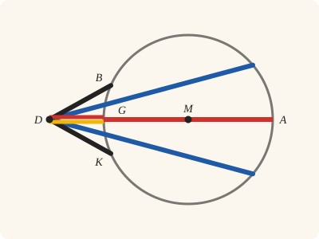
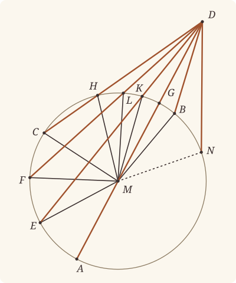

<!-- Generated by scripts/render.py. Do not edit by hand. -->

[Book III](index.md) · [← III.7](07.md) · [III.9 →](09.md)

# Book III, Proposition 8

*Straight lines falling from a point outside a circle*

[Euclid's proof](#euclids-proof) · [In Lean](#in-lean) · [What it rests on](#what-it-rests-on) · [Mishnah](#mishnah)

> If a point be taken outside a circle and from the point straight lines be drawn through to the circle, one of which is through the centre and the others are drawn at random, then, of the straight lines which fall on the concave circumference, that through the centre is greatest, while of the rest the nearer to that through the centre is always greater than the more remote, but, of the straight lines falling on the convex circumference, that between the point and the diameter is least, while of the rest the nearer to the least is always less than the more remote, and only two equal straight lines will fall on the circle from the point, one on each side of the least.

**In Lean:** ✅ proved, as Euclid states it · Euclid's argument

<p align="center"></p>

<p align="center"><em>Stand outside the circle and look in: the straight line through the centre is longest (red), its part outside shortest (yellow), and the others pair off equal, one each side, to the far circumference (the blue pair) or the near (the black pair).</em></p>

## Euclid's proof

<p align="center"></p>

<p align="center"><em>Drawn for one case: DE, DF, DC and DK, DL, DH compared on one side of DA, as in Heath's figure. N marks the supposed third point of Euclid's reductio, with DN equal to DK and DB. The drawing keeps N distinct from K and B, so it cannot make those three lengths equal.</em></p>

Let ABC be a circle, and let a point D be taken outside ABC; let there be drawn through from it straight lines DA, DE, DF, DC, and let DA be through the centre;

I say that, of the straight lines falling on the concave circumference AEFC, the straight line DA through the centre is greatest,

while DE is greater than DF and DF than DC;

but, of the straight lines falling on the convex circumference HLKG, the straight line DG between the point and the diameter AG is least; and the nearer to the least DG is always less than the more remote, namely DK than DL, and DL than DH.

For let the centre of the circle ABC be taken [III. 1], and let it be M; let ME, MF, MC, MK, ML, MH be joined.

Then, since AM is equal to EM,

let MD be added to each;

therefore AD is equal to EM, MD.

But EM, MD are greater than ED; [I. 20]

therefore AD is also greater than ED.

Again, since ME is equal to MF,

and MD is common,

therefore EM, MD are equal to FM, MD;

and the angle EMD is greater than the angle FMD;

therefore the base ED is greater than the base FD. [I. 24]

Similarly we can prove that FD is greater than CD;

therefore DA is greatest, while DE is greater than DF,

and DF than DC.

Next, since MK, KD are greater than MD, [I. 20]

and MG is equal to MK,

therefore the remainder KD is greater than the remainder GD,

so that GD is less than KD.

And, since on MD, one of the sides of the triangle MLD, two straight lines MK, KD were constructed meeting within the triangle,

therefore MK, KD are less than ML, LD; [I. 21]

and MK is equal to ML;

therefore the remainder DK is less than the remainder DL.

Similarly we can prove that DL is also less than DH;

therefore DG is least, while DK is less than DL, and DL than DH.

I say also that only two equal straight lines will fall from the point D on the circle, one on each side of the least DG.

On the straight line MD, and at the point M on it,

let the angle DMB be constructed equal to the angle KMD, and let DB be joined.

Then, since MK is equal to MB,

and MD is common,

the two sides KM, MD are equal to the two sides BM, MD respectively;

and the angle KMD is equal to the angle BMD;

therefore the base DK is equal to the base DB. [I. 4]

I say that no other straight line equal to the straight line DK will fall on the circle from the point D.

For, if possible, let a straight line so fall, and let it be DN.

Then, since DK is equal to DN,

while DK is equal to DB,

DB is also equal to DN,

that is, the nearer to the least DG equal to the more remote: which was proved impossible.

Therefore no more than two equal straight lines will fall on the circle ABC from the point D, one on each side of DG the least.

Therefore etc.

Q. E. D.

## In Lean

| | |
|---|---|
| Proof | ✅ Proved, and its companion `Prop8.general` ([III.8 general](08.md#general)) |
| Statement | The whole enunciation. `Prop8.general` covers both sides of DA; contact is included. The conditions placing F on the concave and L on the convex circumference are kept but unused. |
| Argument | Euclid's. Across DA the companion moves a point to its partner on the other side, as far from D: Euclid's I.4 step at M makes it equally inclined to DA, and it stays in its class (`Prop8.partner`). |
| Reviewed | The statement and every passage of the argument read against Heath's text, at commit [`1c21c147b`](https://github.com/jackChallis/stoicheia/commit/1c21c147b) ([the record](../../review/III/08.toml)) |

From [`Elements/BookIII/Prop08.lean`](../../Elements/BookIII/Prop08.lean). Euclid's sentences are the `--` comments, and our own notes are in `/- … -/`; the lines under each sentence are the Lean that carries it out. The list below marks where a lemma does a step Euclid takes for granted, where several sentences share one step, where the Lean takes a case Euclid's figure leaves aside, where the statement already gives a step and where a companion is proved as a theorem of its own; the `/- … -/` notes in the listing explain smaller adjustments.

**How the Lean follows the text**

- **Already given.** "Let ABC be a circle…" "Nearer" is the less angle at D with the ray DA, unsigned. The convex circumference is read as where a straight line from D first meets the circle, the concave as where it meets it again, and the two orders are kept apart: the two meetings of one straight line make one angle with DA. A straight line touching the circle from D falls on neither, by convention, as Euclid's lines are drawn through; that its point of contact has no point of the circle before it or beyond it follows from Definition III.2, and is not stated in Lean. The last clause covers a point of contact too.
- **Done by `Prop1.of_circle`.** "For let the centre of the circle ABC be taken…" Euclid takes the centre M by III.1 (Heath's reference), and so does the Lean: `Prop1.of_circle` takes two points of the circle, the ends of a straight line drawn through it at random, and runs III.1 on them, its construction and its proof that the point found is the centre; the proof keeps the centre alone, as Euclid does. The statement, which asks of every centre that it lie between G and A, puts M there. The companion's step `Prop8.partner` takes its centre in the same way.
- **A further case, by `Prop8.on_diameter`.** "let ME, MF, MC, MK, ML, MH be joined." Euclid joins radii to points off DA. The Lean also treats E = G and K = A in the greatest and least comparisons: `Prop8.on_diameter`, using `Prop2.triangle` (III.2, which Heath does not cite here), leaves only the two ends of the diameter, and `len_lt_of_between` makes DG less than DA.
- **Done by `Definition15`.** "Then, since AM is equal to EM…" Euclid uses the equality of AM and EM without giving a reason. The Lean obtains it from `Definition15`, Euclid's definition of a circle, which we assume as a rule, through the equal radii established beneath the taking of M.
- **Done by `Tacit.len_add_of_between`.** "therefore AD is equal to EM, MD." Euclid takes AD as AM and MD together. The Lean writes this sum using `Tacit.len_add_of_between`, a rule we assume (System E, Diagram-segment 1), with M between A and D, then substitutes EM for AM.
- **Done by `Definition15`.** "Again, since ME is equal to MF…" Euclid uses the equality of ME and MF without giving a reason. The Lean obtains both radii equal to MA from `Definition15`, the assumed rule for equal radii, and combines those equalities.
- **Done by `Prop8.outside`.** "and the angle EMD is greater than the angle FMD…" Euclid reads E outside the triangle DFM from his figure, without a reference from Heath. In `Prop8.outside`, the Lean uses `BookI.Prop24.within` and `crossbar` to find Y on MF and DE, puts Y within the circle by `InsideCircle.of_between_centre`, and uses `Tacit.between_of_inside_chord` (System E, Circle 1), proved after III.2, to put Y between H and E; `angle_lt_of_between` then compares the angles at M.
- **Carried together.** "Similarly we can prove that FD is greater than CD…" Euclid leaves F and C to the same argument without writing it out. The Lean proves the comparison above for any two points of the concave circumference on one side of DA, so it includes F and C.
- **Proved separately, as `Prop8.general`.** "therefore DA is greatest, while DE is greater than DF…"
- **Done by `Definition15`.** "and MG is equal to MK…" Euclid uses the equality of MG and MK without giving a reason. The Lean obtains both radii equal to MA from `Definition15`, the assumed rule for equal radii, and combines those equalities.
- **Done by `Tacit.len_add_of_between`.** "therefore the remainder KD is greater than the remainder GD…" Euclid takes MD as MG and GD together before subtracting the equal radii MK and MG. The Lean writes this sum using `Tacit.len_add_of_between`, a rule we assume (System E, Diagram-segment 1), with G between M and D, and cancels the common length by `Magnitude.lt_of_add_lt_add_left`.
- **Done by `Prop8.within`.** "And, since on MD, one of the sides of the triangle MLD…" Euclid reads K within the triangle DLM from his figure. In `Prop8.within`, the Lean uses `BookI.Prop24.within`, `crossbar` and `InsideCircle.of_between_centre` to find Z on ML and DK within the circle; `Tacit.between_of_inside_chord` (System E, Circle 1), proved after III.2, puts Z between K and C, so K is between D and Z, and the assumed rule `Tacit.pasch2` (System E, Pasch 2) puts K on D's side of ML.
- **Done by `Definition15`.** "and MK is equal to ML…" Euclid uses the equality of MK and ML without giving a reason. The Lean obtains both radii equal to MA from `Definition15`, the assumed rule for equal radii, and combines those equalities.
- **Done by `Magnitude.lt_of_add_lt_add_left`.** "therefore the remainder DK is less than the remainder DL." Euclid keeps the strict inequality when the equal radii MK and ML are taken away. The Lean substitutes ML for MK and uses `Magnitude.lt_of_add_lt_add_left` to cancel the common length.
- **Carried together.** "Similarly we can prove that DL is also less than DH…" Euclid leaves L and H to the same argument without writing it out. The Lean proves the comparison above for any two points of the convex circumference on one side of DA, so it includes L and H.
- **Proved separately, as `Prop8.general`.** "therefore DG is least, while DK is less than DL…"
- **Done by `BookI.Prop23`.** "On the straight line MD, and at the point M on it…" Euclid constructs the equal angle at M and takes B on the circle, without a reference from Heath for the construction. The Lean uses `BookI.Prop23` on K's other side and `OnRay.exists_len_eq` to set MB equal to MK, using Postulate 3 and `Tacit.line_circle_beyond`, the rule we assume as System E, Intersections 5; `Tacit.on_circle_of_len_eq` (System E, Diagram-segment 3), proved in `Elements/Figure/RuleBase.lean`, puts B on ABC.
- **Done by `Definition15`.** "Then, since MK is equal to MB…" Euclid uses the equality of MK and MB without giving a reason. The Lean obtains both radii equal to MA from `Definition15`, the assumed rule for equal radii, and combines those equalities.
- **Done by `onRay_of_angle_eq`.** "that is, the nearer to the least DG equal to the more remote…" Euclid takes for granted that DN, a straight line other than DB, makes a different angle with DA, so that one of the two is the nearer. The Lean compares the angles at D by `Tacit.lt_trichotomy`, a rule we assume (System E §3.5): equal angles put N and B, or N and K when N is on K's side, on one ray from D by `onRay_of_angle_eq`, and `OnRay.eq_of_len_eq` makes them one point.
- **A further case, by `Prop8.contact_last`.** "which was proved impossible." Euclid appeals to the convex order, which compares points of the convex circumference, where his figure has K and B; his figure leaves aside K and B on the concave circumference, DK touching the circle, and DN ending on the concave circumference or at a point of contact. The Lean takes his step by his orders in every case. Of N and the point it is compared with, the one making the less angle with DA is the nearer: if it ends on the convex circumference it is the less, by the convex order (I.21), and if on the concave, the greater, by the concave order (I.24 at M). Neither argument asks where the more remote ends, so it may end on the other circumference, or at a point of contact, which is on neither and ends both orders: `Prop8.contact_last` shows that no point of the circle on its side makes a greater angle with DA, for the straight line touching would cross that point's radius (`crossbar`) at a point within the circle, and so meet the circle again, by `Tacit.line_circle_between` or `Tacit.line_circle_beyond` (System E, Intersections 4 and 5), rules we assume. For N on DA, `Prop8.on_diameter`, using `Prop2.triangle` (III.2, for which Heath prints no reference here), gives A or G, which the greatest and least clauses exclude; off DA, it compares N with K on K's side, or uses `same_side_of_opposite_sides` to put N on B's side and compares it with B.

<details><summary>Before the theorem, four lemmas: <code>Prop8.outside</code>, <code>Prop8.within</code>, <code>Prop8.contact_last</code> and <code>Prop8.on_diameter</code> (78 lines)</summary>

```lean
/-- This is the second of Augustus De Morgan's assumptions: E falls outside the triangle
DFM, so that the angle EMD is greater than the angle FMD. As in III.7, DE crosses MF at
a point Y within the circle, and Y is between H and E (System E, Circle 1), so E lies
beyond MF. -/
theorem Prop8.outside {D M E F H : Point} {α : Circle} (hM : Centre M α) (hE : OnCircle E α)
    (hF : OnCircle F α) (hH : OnCircle H α) (hDHE : Between D H E) (hEF : SameSideOf E F D M)
    (hlt : ∠ M D E < ∠ M D F) : ∠ F M D < ∠ E M D := by
  have hEM : SameSideOf E M D F := BookI.Prop24.within hEF.symm hlt
  obtain ⟨Y, hMYF, hY⟩ := crossbar hEF hEM
  have hY_in : InsideCircle Y α := InsideCircle.of_between_centre hM hF hMYF
  obtain ⟨-, -, ⟨L, hD_L, hE_L, hY_L⟩, -⟩ := hY
  have hH_L : OnLine H L := on_line_of_between_ends hDHE hD_L hE_L
  have hHE : H ≠ E := ne_of_between (between_symm hDHE) |>.symm
  have hHYE : Between H Y E := between_of_inside_chord hY_L hH_L hE_L hY_in hH hE hHE
  have hEYD : Between E Y D := between_of_between_left (between_symm hDHE) (between_symm hHYE)
  have hEDM : Triangle E D M := hEF.triangle.cab
  have h1 : ∠ Y M D < ∠ E M D := angle_lt_of_between hEDM hEYD
  rwa [angle_onRay_left (OnRay.of_between hMYF) hEF.1] at h1

/-- This is De Morgan's first assumption: K falls within the triangle DLM. DK crosses ML
at a point Z within the circle, and K is between D and Z. -/
theorem Prop8.within {D M K L C : Point} {α : Circle} (hM : Centre M α) (hK : OnCircle K α)
    (hL : OnCircle L α) (hC : OnCircle C α) (hDKC : Between D K C) (hKL : SameSideOf K L D M)
    (hlt : ∠ M D K < ∠ M D L) : InsideTriangle K L M D := by
  have hKM : SameSideOf K M D L := BookI.Prop24.within hKL.symm hlt
  obtain ⟨Z, hMZL, hZ⟩ := crossbar hKL hKM
  have hZ_in : InsideCircle Z α := InsideCircle.of_between_centre hM hL hMZL
  obtain ⟨-, -, ⟨N, hD_N, hK_N, hZ_N⟩, -⟩ := hZ
  have hC_N : OnLine C N := on_line_of_between hDKC hD_N hK_N
  have hKC : K ≠ C := (ne_of_between (between_symm hDKC)).symm
  have hKZC : Between K Z C := between_of_inside_chord hZ_N hK_N hC_N hZ_in hK hC hKC
  have hDKZ : Between D K Z := between_cut hDKC hKZC
  /- K is on D's side of LM, for Z is on LM and K is between D and Z. -/
  have hLM : L ≠ M := ne_of_between_ends (between_symm hMZL)
  obtain ⟨P, hL_P, hM_P⟩ := Postulate1 L M hLM
  have hZ_P : OnLine Z P := on_line_of_between_ends hMZL hM_P hL_P
  have hD_P : ¬ OnLine D P := hKL.symm.triangle.cba.off_line hL_P hM_P
  have hK_P : ¬ OnLine K P := fun hK_P =>
    hD_P (on_line_of_between (between_symm hDKZ) hZ_P hK_P)
  exact ⟨hKL.swap, hKM, SameSideOf.of_line hLM hL_P hM_P (pasch2 (between_symm hDKZ) hZ_P hK_P)⟩

/-- A point of contact is at the end of both orders. Let T be a point of the circle with no
point of the circle between D and T, and none on DT produced beyond T: a point where a
straight line from D touches the circle, on neither circumference. Then no point R of the
circle on T's side of DM makes a greater angle with DM at D. Otherwise DT, within the angle
MDR, crosses the radius MR at a point Y within the circle (`crossbar`,
`InsideCircle.of_between_centre`), and Y is not T. If Y is between D and T, the straight
line meets the circle between D and Y (System E, Intersections 4); if T is between D and Y,
it meets it again beyond Y (Intersections 5). Either way T has a point of the circle before
it or beyond it. -/
theorem Prop8.contact_last {D M T R : Point} {α : Circle} (hM : Centre M α)
    (hD : OutsideCircle D α) (hT : OnCircle T α) (hR : OnCircle R α)
    (hC : ¬ ∃ C : Point, OnCircle C α ∧ Between D T C)
    (hH : ¬ ∃ H : Point, OnCircle H α ∧ Between D H T)
    (hTR : SameSideOf T R D M) : ¬ ∠ M D T < ∠ M D R := by
  intro hlt
  have hTM : SameSideOf T M D R := BookI.Prop24.within hTR.symm hlt
  obtain ⟨Y, hMYR, hY⟩ := crossbar hTR hTM
  have hY_in : InsideCircle Y α := InsideCircle.of_between_centre hM hR hMYR
  obtain ⟨hDT, hYD, ⟨N, hD_N, hT_N, hY_N⟩, hYDT⟩ := hY
  have hYT : Y ≠ T := fun e => inside_not_on hY_in (e ▸ hT)
  rcases between_cases hYD.symm hYT hDT hD_N hY_N hT_N with h | h | h
  · obtain ⟨F, hF, -, hYFD⟩ := line_circle_between hY_in hY_N hD hD_N
    exact hH ⟨F, hF, between_of_between_left h (between_symm hYFD)⟩
  · exact hYDT h
  · obtain ⟨C, hC', -, hCYD⟩ := line_circle_beyond hY_in hY_N hD_N hYD.symm
    exact hC ⟨C, hC', between_of_between_left (between_symm hCYD) h⟩

/-- A point of the circle on the straight line DA is A or G, for no three points of a
circle lie on one straight line. -/
theorem Prop8.on_diameter {A G N : Point} {α : Circle} {L : Line}
    (hA : OnCircle A α)
    (hG : OnCircle G α) (hN : OnCircle N α) (hAG : A ≠ G) (hA_L : OnLine A L)
    (hG_L : OnLine G L) (hN_L : OnLine N L) : N = A ∨ N = G := by
  refine Classical.byContradiction fun h => ?_
  have hNA : N ≠ A := fun e => h (Or.inl e)
  have hNG : N ≠ G := fun e => h (Or.inr e)
  exact Prop2.triangle hA hG hN hAG hNG.symm hNA.symm ⟨L, hA_L, hG_L, hN_L⟩
```

</details>

```lean
/-- If a point be taken outside a circle and from the point straight lines be drawn through to the
circle, one of which is through the centre and the others are drawn at random, then, of the
straight lines which fall on the concave circumference, that through the centre is greatest,
while of the rest the nearer to that through the centre is always greater than the more remote,
but, of the straight lines falling on the convex circumference, that between the point and the
diameter is least, while of the rest the nearer to the least is always less than the more
remote, and only two equal straight lines will fall on the circle from the point, one on each
side of the least. -/
theorem Prop8 {A D G : Point} {ABC : Circle}
    (hD : OutsideCircle D ABC) (hA : OnCircle A ABC) (hG : OnCircle G ABC)
    (hDGA : Between D G A) (hGA : ∀ M : Point, Centre M ABC → Between G M A) :
    (∀ E : Point, OnCircle E ABC → E ≠ A → ‖D E‖ < ‖D A‖) ∧
    (∀ E F : Point, OnCircle E ABC → OnCircle F ABC →
      (∃ H : Point, OnCircle H ABC ∧ Between D H E) →
      (∃ L : Point, OnCircle L ABC ∧ Between D L F) →
      SameSideOf E F D A → ∠ A D E < ∠ A D F → ‖D F‖ < ‖D E‖) ∧
    (∀ K : Point, OnCircle K ABC → K ≠ G → ‖D G‖ < ‖D K‖) ∧
    (∀ K L : Point, OnCircle K ABC → OnCircle L ABC →
      (∃ C : Point, OnCircle C ABC ∧ Between D K C) →
      (∃ F : Point, OnCircle F ABC ∧ Between D L F) →
      SameSideOf K L D A → ∠ A D K < ∠ A D L → ‖D K‖ < ‖D L‖) ∧
    (∀ K : Point, OnCircle K ABC → ¬ Collinear D A K → ∃ B : Point, OnCircle B ABC ∧
      OppositeSidesOf B K D A ∧ ‖D B‖ = ‖D K‖ ∧
      ∀ N : Point, OnCircle N ABC → ‖D N‖ = ‖D K‖ → N = K ∨ N = B) := by
  -- Let ABC be a circle, and let a point D be taken outside ABC; let there be drawn through
  -- from it straight lines DA, DE, DF, DC, and let DA be through the centre;
  -- I say that, of the straight lines falling on the concave circumference AEFC, the straight
  -- line DA through the centre is greatest,
  -- while DE is greater than DF and DF than DC;
  -- but, of the straight lines falling on the convex circumference HLKG, the straight line DG
  -- between the point and the diameter AG is least; and the nearer to the least DG is always
  -- less than the more remote, namely DK than DL, and DL than DH.
  -- For let the centre of the circle ABC be taken [III. 1], and let it be M; let ME, MF, MC,
  -- MK, ML, MH be joined.
  /- The centre is found by III.1's construction, on a straight line drawn through the
     circle at random (`Prop1.of_circle`), as Euclid finds it. The proof keeps the centre
     alone, which is what Euclid takes from III.1. -/
  obtain ⟨-, -, M, -, -, -, -, -, hM, -⟩ := Prop1.of_circle ABC
  have hAG : A ≠ G := ne_of_between (between_symm hDGA)
  have hGMA : Between G M A := hGA M hM
  have hDGM : Between D G M := between_cut hDGA hGMA
  have hDMA : Between D M A :=
    between_symm (between_of_between_left (between_symm hDGA) (between_symm hGMA))
  have hDM : D ≠ M := ne_of_between hDMA
  obtain ⟨Ld, hD_Ld, hA_Ld⟩ := Postulate1 D A (ne_of_between_ends hDGA)
  have hM_Ld : OnLine M Ld := on_line_of_between_ends hDMA hD_Ld hA_Ld
  have hG_Ld : OnLine G Ld := on_line_of_between_ends hDGA hD_Ld hA_Ld
  have hMA : ∀ P, OnCircle P ABC → ‖M P‖ = ‖M A‖ := fun P hP => Definition15 hM hP hA
  have hDP : ∀ P, OnCircle P ABC → P ≠ D := fun P hP e => hD.2 (e ▸ hP)
  /- A point off the straight line DA makes a triangle with M and D. -/
  have tri : ∀ P, ¬ OnLine P Ld → Triangle M P D := fun P hP =>
    (Triangle.of_line hM_Ld hD_Ld hDM.symm hP).acb
  have side : ∀ P Q, SameSideOf P Q D A → SameSideOf P Q D M := fun P Q h =>
    SameSideOf.of_line hDM hD_Ld hM_Ld (h.sameSide hD_Ld hA_Ld)
  have ang : ∀ P, P ≠ D → ∠ A D P = ∠ M D P := fun P hP =>
    (angle_onRay_left (OnRay.of_between hDMA) hP).symm
  have offL : ∀ P Q, SameSideOf P Q D A → ¬ OnLine P Ld := fun P Q h =>
    not_on_line_of_same_side (h.sameSide hD_Ld hA_Ld)
  have greatest : ∀ E : Point, OnCircle E ABC → E ≠ A → ‖D E‖ < ‖D A‖ := by
    intro E hE hEA
    /- On DA, E must be G: the part DG is less than the whole DA. -/
    by_cases hE_Ld : OnLine E Ld
    · rcases Prop8.on_diameter hA hG hE hAG hA_Ld hG_Ld hE_Ld with rfl | rfl
      · exact absurd rfl hEA
      · exact len_lt_of_between hDGA
    -- Then, since AM is equal to EM,
    have hAM_EM : ‖A M‖ = ‖E M‖ := by
      rw [len_symm A M, len_symm E M]
      exact (hMA E hE).symm
    -- let MD be added to each;
    have hadd : ‖A M‖ + ‖M D‖ = ‖E M‖ + ‖M D‖ := by rw [hAM_EM]
    -- therefore AD is equal to EM, MD.
    have hAD : ‖A D‖ = ‖E M‖ + ‖M D‖ := by
      rw [← len_add_of_between (between_symm hDMA)]
      exact hadd
    -- But EM, MD are greater than ED; [I. 20]
    have h20 : ‖E D‖ < ‖E M‖ + ‖M D‖ := (BookI.Prop20 (tri E hE_Ld)).1
    -- therefore AD is also greater than ED.
    rw [len_symm D E, len_symm D A, hAD]
    exact h20
  /- Euclid's argument asks only that E, the nearer, be on the concave circumference, so
     F may be any point of the circle making the greater angle with DA. -/
  have concave : ∀ E F : Point, OnCircle E ABC → OnCircle F ABC →
      (∃ H : Point, OnCircle H ABC ∧ Between D H E) →
      SameSideOf E F D A → ∠ A D E < ∠ A D F → ‖D F‖ < ‖D E‖ := by
    intro E F hE hF ⟨H, hH, hDHE⟩ hEF hlt
    -- Again, since ME is equal to MF,
    have hME_MF : ‖M E‖ = ‖M F‖ := (hMA E hE).trans (hMA F hF).symm
    -- and MD is common,
    have hMD : ‖M D‖ = ‖M D‖ := rfl
    -- therefore EM, MD are equal to FM, MD;
    have hsides := And.intro hME_MF hMD
    -- and the angle EMD is greater than the angle FMD;
    /- The less angle at D puts E beyond MF, outside the triangle DFM (`Prop8.outside`). -/
    rw [ang E (hDP E hE), ang F (hDP F hF)] at hlt
    have hout := Prop8.outside hM hE hF hH hDHE (side E F hEF) hlt
    -- therefore the base ED is greater than the base FD. [I. 24]
    have h24 := BookI.Prop24 (tri E (offL E F hEF)) (tri F (offL F E hEF.symm))
      hsides.1 hsides.2 hout
    rwa [len_symm D F, len_symm D E]
  -- Similarly we can prove that FD is greater than CD;
  -- therefore DA is greatest, while DE is greater than DF,
  -- and DF than DC.
  /- The comparison above holds for any two such points, F and C among them. -/
  have least : ∀ K : Point, OnCircle K ABC → K ≠ G → ‖D G‖ < ‖D K‖ := by
    intro K hK hKG
    /- On DA, K must be A, and DG is a part of DA. -/
    by_cases hK_Ld : OnLine K Ld
    · rcases Prop8.on_diameter hA hG hK hAG hA_Ld hG_Ld hK_Ld with rfl | rfl
      · exact len_lt_of_between hDGA
      · exact absurd rfl hKG
    -- Next, since MK, KD are greater than MD, [I. 20]
    have h20 : ‖M D‖ < ‖M K‖ + ‖K D‖ := (BookI.Prop20 (tri K hK_Ld)).2.1
    -- and MG is equal to MK,
    have hMG_MK : ‖M G‖ = ‖M K‖ := (hMA G hG).trans (hMA K hK).symm
    -- therefore the remainder KD is greater than the remainder GD,
    have hMD : ‖M D‖ = ‖M G‖ + ‖G D‖ := len_add_of_between (between_symm hDGM) |>.symm
    rw [hMD, ← hMG_MK] at h20
    have hGD_KD : ‖G D‖ < ‖K D‖ := Magnitude.lt_of_add_lt_add_left h20
    -- so that GD is less than KD.
    rw [len_symm D G, len_symm D K]
    exact hGD_KD
  /- As on the concave circumference, the argument asks only that K, the nearer, be on the
     convex circumference: L may be any point of the circle making the greater angle. -/
  have convex : ∀ K L : Point, OnCircle K ABC → OnCircle L ABC →
      (∃ C : Point, OnCircle C ABC ∧ Between D K C) →
      SameSideOf K L D A → ∠ A D K < ∠ A D L → ‖D K‖ < ‖D L‖ := by
    intro K L hK hL ⟨C, hC, hDKC⟩ hKL hlt
    -- And, since on MD, one of the sides of the triangle MLD, two straight lines MK, KD were
    -- constructed meeting within the triangle,
    /- K is within the triangle DLM, De Morgan's other placement (`Prop8.within`). -/
    rw [ang K (hDP K hK), ang L (hDP L hL)] at hlt
    have hin := Prop8.within hM hK hL hC hDKC (side K L hKL) hlt
    -- therefore MK, KD are less than ML, LD; [I. 21]
    have h21 : ‖M K‖ + ‖K D‖ < ‖M L‖ + ‖L D‖ :=
      (BookI.Prop21 (tri L (offL L K hKL.symm)).bac hin).1
    -- and MK is equal to ML;
    have hMK_ML : ‖M K‖ = ‖M L‖ := (hMA K hK).trans (hMA L hL).symm
    -- therefore the remainder DK is less than the remainder DL.
    rw [hMK_ML] at h21
    rw [len_symm D K, len_symm D L]
    exact Magnitude.lt_of_add_lt_add_left h21
  -- Similarly we can prove that DL is also less than DH;
  -- therefore DG is least, while DK is less than DL, and DL than DH.
  /- The comparison above holds for any two such points, L and H among them. -/
  -- I say also that only two equal straight lines will fall from the point D on the circle,
  -- one on each side of the least DG.
  have two_equal : ∀ K : Point, OnCircle K ABC → ¬ Collinear D A K →
      ∃ B : Point, OnCircle B ABC ∧ OppositeSidesOf B K D A ∧ ‖D B‖ = ‖D K‖ ∧
      ∀ N : Point, OnCircle N ABC → ‖D N‖ = ‖D K‖ → N = K ∨ N = B := by
    intro K hK hKcol
    have hK_Ld : ¬ OnLine K Ld := fun h => hKcol ⟨Ld, hD_Ld, hA_Ld, h⟩
    have hMKD : Triangle M K D := tri K hK_Ld
    -- On the straight line MD, and at the point M on it,
    -- let the angle DMB be constructed equal to the angle KMD, and let DB be joined.
    /- This is the construction of I.23, on the other side of MD. Its unlettered
       points Q, F', G' choose the side and the two arms; B is on the circle. -/
    obtain ⟨Q, hQK, -⟩ := exists_oppositeSidesOf hMKD.acb []
    obtain ⟨G', F', hF', hG'Q, hang⟩ := BookI.Prop23 hDM.symm hMKD.bac hQK.triangle
    obtain ⟨B, hB_ray, hMB⟩ :=
      OnRay.exists_len_eq (ne_of_centre_of_on hM hK).symm hG'Q.triangle.ne₁₃
    have hB : OnCircle B ABC := on_circle_of_len_eq hM hK hMB
    have hDMB : ∠ D M B = ∠ K M D :=
      (angle_eq_of_onRay hF'.symm hB_ray).trans
        ((angle_symm hF'.2.1 hG'Q.triangle.ne₁₃.symm).trans hang)
    have hBK : OppositeSidesOf B K M D :=
      (SameSideOf.of_onRay hB_ray hG'Q).trans_opposite hQK
    have hBK' : OppositeSidesOf B K D A :=
      OppositeSidesOf.of_line (ne_of_between_ends hDGA) hD_Ld hA_Ld
        (hBK.oppositeSides hM_Ld hD_Ld)
    have hB_Ld : ¬ OnLine B Ld := (hBK.oppositeSides hM_Ld hD_Ld).1
    -- Then, since MK is equal to MB,
    have hMK_MB : ‖M K‖ = ‖M B‖ := (hMA K hK).trans (hMA B hB).symm
    -- and MD is common,
    have hMD : ‖M D‖ = ‖M D‖ := rfl
    -- the two sides KM, MD are equal to the two sides BM, MD respectively;
    have hsides := And.intro hMK_MB hMD
    -- and the angle KMD is equal to the angle BMD;
    have hKMD : ∠ K M D = ∠ B M D :=
      hDMB.symm.trans (angle_symm hDM (ne_of_centre_of_on hM hB))
    -- therefore the base DK is equal to the base DB. [I. 4]
    have hKD : ‖K D‖ = ‖B D‖ :=
      (BookI.Prop4 hMKD (tri B hB_Ld) hsides.1 hsides.2 hKMD).1
    have hDB : ‖D B‖ = ‖D K‖ := by rw [len_symm D B, len_symm D K, hKD]
    -- I say that no other straight line equal to the straight line DK will fall on the circle
    -- from the point D.
    refine ⟨B, hB, hBK', hDB, ?_⟩
    -- For, if possible, let a straight line so fall, and let it be DN.
    intro N hN hDN
    -- Then, since DK is equal to DN,
    have hDK_DN : ‖D K‖ = ‖D N‖ := hDN.symm
    -- while DK is equal to DB,
    have hDK_DB : ‖D K‖ = ‖D B‖ := hDB.symm
    -- DB is also equal to DN,
    have hDB_DN : ‖D B‖ = ‖D N‖ := hDK_DB.symm.trans hDK_DN
    -- that is, the nearer to the least DG equal to the more remote: which was proved impossible.
    /- Euclid compares DN with DB, on B's side of DA; on K's side, a placing his figure
       leaves aside, DN is compared with DK in the same way. So let P be B or K, on N's
       side, with DN equal to DP. -/
    have one_side : ∀ P, OnCircle P ABC → ∀ N, OnCircle N ABC →
        SameSide N P Ld → ‖D N‖ = ‖D P‖ → N = P := by
      intro P hP N hN hs hDN
      have hNP : SameSideOf N P D A := SameSideOf.of_line (ne_of_between_ends hDGA) hD_Ld hA_Ld hs
      /- Euclid's comparison. Of two points of the circle on one side of DA, the one making
         the less angle with DA is the nearer to the least DG. On the convex circumference it
         is the less, by the order proved there, and on the concave the greater, by that
         circumference's order, a case Euclid's figure leaves aside; either way the two are
         not equal. Each order asks only that the nearer be on its circumference, so the
         other may be on either circumference, or a point where a straight line from D
         touches the circle: such a point is at the end of both orders, and cannot be the
         nearer, for no point of the circle on its side makes a greater angle with DA
         (`Prop8.contact_last`). -/
      have unequal : ∀ X Y : Point, OnCircle X ABC → OnCircle Y ABC → SameSideOf X Y D A →
          ∠ A D X < ∠ A D Y → ‖D X‖ = ‖D Y‖ → False := by
        intro X Y hX hY hXY hlt hDXY
        by_cases hcx : ∃ C : Point, OnCircle C ABC ∧ Between D X C
        · have hless := convex X Y hX hY hcx hXY hlt
          rw [hDXY] at hless
          exact lt_irrefl _ hless
        by_cases hcv : ∃ H : Point, OnCircle H ABC ∧ Between D H X
        · have hless := concave X Y hX hY hcv hXY hlt
          rw [hDXY] at hless
          exact lt_irrefl _ hless
        rw [ang X (hDP X hX), ang Y (hDP Y hY)] at hlt
        exact Prop8.contact_last hM hD hX hY hcx hcv (side X Y hXY) hlt
      rcases lt_trichotomy (∠ A D N) (∠ A D P) with hl | he | hg
      · exact absurd hDN (unequal N P hN hP hNP hl)
      · /- Euclid takes DN to be a straight line other than DB, so that one of the two is
           the nearer. Were the angles ADN and ADP equal, N would lie on the ray DP, as far
           from D as P is, and so be P itself. -/
        exact OnRay.eq_of_len_eq (onRay_of_angle_eq hNP he) hDN
      · exact absurd hDN.symm (unequal P N hP hN hNP.symm hg)
    /- On DA itself, N is A or G, and DA is the greatest and DG the least, as proved above,
       so neither is as far from D as K. -/
    by_cases hN_Ld : OnLine N Ld
    · rcases Prop8.on_diameter hA hG hN hAG hA_Ld hG_Ld hN_Ld with rfl | rfl
      · have hlt := greatest K hK (fun e => hK_Ld (e ▸ hA_Ld))
        rw [← hDN] at hlt
        exact absurd hlt (lt_irrefl _)
      · have hlt := least K hK (fun e => hK_Ld (e ▸ hG_Ld))
        rw [hDN] at hlt
        exact absurd hlt (lt_irrefl _)
    by_cases hs : SameSide N K Ld
    · exact Or.inl (one_side K hK N hN hs hDN)
    · have hsB : SameSide N B Ld := same_side_of_opposite_sides
        ⟨hK_Ld, hN_Ld, fun h => hs (same_side_symm h)⟩
        (hBK.symm.oppositeSides hM_Ld hD_Ld)
      exact Or.inr (one_side B hB N hN hsB hDB_DN.symm)
  -- Therefore no more than two equal straight lines will fall on the circle ABC from the point
  -- D, one on each side of DG the least.
  -- Therefore etc.
  /- The statement's orders ask the more remote point to be on its circumference too; the
     comparisons above do not need it. -/
  exact ⟨greatest, fun E F hE hF hHE _ => concave E F hE hF hHE, least,
    fun K L hK hL hKC _ => convex K L hK hL hKC, two_equal⟩
  -- Q. E. D.
```

<a name="general"></a>

<details><summary>After the theorem, its companion, <code>Prop8.general</code> and one lemma for its own proofs, <code>Prop8.partner</code> (199 lines)</summary>

```lean
/-- **III.8, the partner equally inclined and in the same class** (a step of III.8
general). D is outside the circle ABC, and the straight line DA passes through the centre,
meeting the circle first at G and again at A. If K and B are points of the circle on
opposite sides of DA, and DB is equal to DK, then the angles ADB and ADK are equal; B is on
the convex circumference exactly when K is (the straight line from D meets the circle again
beyond it); and B is on the concave circumference exactly when K is (it meets the circle
before reaching it). Euclid's construction of B, the angle DMB made equal to KMD at the
centre M (I.23), gives the equal angles at D by I.4, and `Prop8`'s last clause, that no
third point of the circle is as far from D, shows that no other point is B; the class
follows from the equal angles: a point of the circle beyond K on the straight line DK has
its partner on the ray DB beyond B, and a point of the circle between D and K has its
partner between D and B. -/
theorem Prop8.partner {A D G K B : Point} {ABC : Circle}
    (hD : OutsideCircle D ABC) (hA : OnCircle A ABC) (hG : OnCircle G ABC)
    (hDGA : Between D G A) (hGA : ∀ M : Point, Centre M ABC → Between G M A)
    (hK : OnCircle K ABC) (hB : OnCircle B ABC) (hBK : OppositeSidesOf B K D A)
    (hDB : ‖D B‖ = ‖D K‖) :
    ∠ A D B = ∠ A D K ∧
    ((∃ C : Point, OnCircle C ABC ∧ Between D B C) ↔
      (∃ C : Point, OnCircle C ABC ∧ Between D K C)) ∧
    ((∃ H : Point, OnCircle H ABC ∧ Between D H B) ↔
      (∃ H : Point, OnCircle H ABC ∧ Between D H K)) := by
  have hpartner := (Prop8 hD hA hG hDGA hGA).2.2.2.2
  /- The centre M is found by III.1's construction, as in `Prop8` (`Prop1.of_circle`). -/
  obtain ⟨-, -, M, -, -, -, -, -, hM, -⟩ := Prop1.of_circle ABC
  have hDMA : Between D M A :=
    between_symm (between_of_between_left (between_symm hDGA)
      (between_symm (hGA M hM)))
  have hDM : D ≠ M := ne_of_between hDMA
  have hDA : D ≠ A := ne_of_between_ends hDGA
  obtain ⟨Ld, hD_Ld, hA_Ld⟩ := Postulate1 D A hDA
  have hM_Ld : OnLine M Ld := on_line_of_between_ends hDMA hD_Ld hA_Ld
  /- The equal angles, for any two partners K, B: Euclid's I.4 step at M. -/
  have hangle : ∀ K B : Point, OnCircle K ABC → OnCircle B ABC →
      OppositeSidesOf B K D A → ‖D B‖ = ‖D K‖ → ∠ A D B = ∠ A D K := by
    intro K B hK hB hBK hDB
    have hK_Ld : ¬ OnLine K Ld := (hBK.oppositeSides hD_Ld hA_Ld).2.1
    have hMKD : Triangle M K D :=
      (Triangle.of_line hM_Ld hD_Ld hDM.symm hK_Ld).acb
    /- Make DMB' equal to KMD on the other side of MD from K. -/
    obtain ⟨Q, hQK, -⟩ := exists_oppositeSidesOf hMKD.acb []
    obtain ⟨X, F', hF', hXQ, hang⟩ := BookI.Prop23 hDM.symm hMKD.bac hQK.triangle
    obtain ⟨B', hB'_ray, hMB'⟩ :=
      OnRay.exists_len_eq (ne_of_centre_of_on hM hK).symm hXQ.triangle.ne₁₃
    have hB' : OnCircle B' ABC := on_circle_of_len_eq hM hK hMB'
    have hDMB' : ∠ D M B' = ∠ K M D :=
      (angle_eq_of_onRay hF'.symm hB'_ray).trans
        ((angle_symm hF'.2.1 hXQ.triangle.ne₁₃.symm).trans hang)
    have hB'K_MD : OppositeSidesOf B' K M D :=
      (SameSideOf.of_onRay hB'_ray hXQ).trans_opposite hQK
    have hB'K : OppositeSidesOf B' K D A :=
      OppositeSidesOf.of_line hDA hD_Ld hA_Ld (hB'K_MD.oppositeSides hM_Ld hD_Ld)
    have hMB'D : Triangle M B' D := hB'K_MD.triangle.acb
    have hKMD : ∠ K M D = ∠ B' M D :=
      hDMB'.symm.trans (angle_symm hDM (ne_of_centre_of_on hM hB'))
    /- I.4 gives DB' equal to DK and MDB' equal to MDK. -/
    have h4 := BookI.Prop4 hMKD hMB'D hMB'.symm rfl hKMD
    have hDB' : ‖D B'‖ = ‖D K‖ := by
      rw [len_symm D B', len_symm D K]
      exact h4.1.symm
    have hang' : ∠ A D B' = ∠ A D K := by
      rw [← angle_onRay_left (OnRay.of_between hDMA) hMB'D.ne₂₃,
        ← angle_onRay_left (OnRay.of_between hDMA) hMKD.ne₂₃]
      exact h4.2.2.2.symm
    /- B and B' are both the unique partner of K on the other side of DA. -/
    obtain ⟨J, -, -, -, hunique⟩ := hpartner K hK hBK.symm.triangle
    have hBK_ne : B ≠ K := by
      intro e
      have hs := hBK.oppositeSides hD_Ld hA_Ld
      exact hs.2.2 (e ▸ same_side_refl hs.1)
    have hB'K_ne : B' ≠ K := by
      intro e
      have hs := hB'K.oppositeSides hD_Ld hA_Ld
      exact hs.2.2 (e ▸ same_side_refl hs.1)
    have hBJ : B = J := (hunique B hB hDB).resolve_left hBK_ne
    have hB'J : B' = J := (hunique B' hB' hDB').resolve_left hB'K_ne
    exact (hBJ.trans hB'J.symm) ▸ hang'
  /- If C is beyond K, its partner C' is beyond B on the ray DB. -/
  have hconvex : ∀ K B : Point, OnCircle K ABC → OnCircle B ABC →
      OppositeSidesOf B K D A → ‖D B‖ = ‖D K‖ →
      (∃ C : Point, OnCircle C ABC ∧ Between D K C) →
      ∃ C : Point, OnCircle C ABC ∧ Between D B C := by
    intro K B hK hB hBK hDB ⟨C, hC, hDKC⟩
    have hCK : SameSideOf C K D A :=
      SameSideOf.of_onRay (OnRay.of_beyond hDKC) (OppositeSidesOf.sameSideOf hBK hBK)
    obtain ⟨C', hC', hC'C, hDC', -⟩ := hpartner C hC hCK.triangle
    have hC'B : SameSideOf C' B D A :=
      OppositeSidesOf.sameSideOf hC'C.symm (hCK.trans_opposite hBK.symm)
    have hang : ∠ A D C' = ∠ A D B :=
      (hangle C C' hC hC' hC'C hDC').trans
        ((angle_onRay_right (OnRay.of_beyond hDKC) hDA.symm).trans
          (hangle K B hK hB hBK hDB).symm)
    have hC'_ray : OnRay C' D B := onRay_of_angle_eq hC'B hang
    have hlt : ‖D B‖ < ‖D C'‖ := by
      rw [hDB, hDC']
      exact len_lt_of_between hDKC
    exact ⟨C', hC', (OnRay.self hBK.triangle.ne₁₃).between_of_len_lt hC'_ray hlt⟩
  /- If H is between D and K, its partner H' is between D and B. -/
  have hconcave : ∀ K B : Point, OnCircle K ABC → OnCircle B ABC →
      OppositeSidesOf B K D A → ‖D B‖ = ‖D K‖ →
      (∃ H : Point, OnCircle H ABC ∧ Between D H K) →
      ∃ H : Point, OnCircle H ABC ∧ Between D H B := by
    intro K B hK hB hBK hDB ⟨H, hH, hDHK⟩
    have hHK : SameSideOf H K D A :=
      SameSideOf.of_onRay (OnRay.of_between hDHK) (OppositeSidesOf.sameSideOf hBK hBK)
    obtain ⟨H', hH', hH'H, hDH', -⟩ := hpartner H hH hHK.triangle
    have hH'B : SameSideOf H' B D A :=
      OppositeSidesOf.sameSideOf hH'H.symm (hHK.trans_opposite hBK.symm)
    have hang : ∠ A D H' = ∠ A D B :=
      (hangle H H' hH hH' hH'H hDH').trans
        ((angle_onRay_right (OnRay.of_between hDHK) hDA.symm).trans
          (hangle K B hK hB hBK hDB).symm)
    have hH'_ray : OnRay H' D B := onRay_of_angle_eq hH'B hang
    have hlt : ‖D H'‖ < ‖D B‖ := by
      rw [hDH', hDB]
      exact len_lt_of_between hDHK
    exact ⟨H', hH', hH'_ray.between_of_len_lt (OnRay.self hBK.triangle.ne₁₃) hlt⟩
  exact ⟨hangle K B hK hB hBK hDB,
    ⟨hconvex B K hB hK hBK.symm hDB.symm, hconvex K B hK hB hBK hDB⟩,
    ⟨hconcave B K hB hK hBK.symm hDB.symm, hconcave K B hK hB hBK hDB⟩⟩

/-- **III.8, general** (companion of III.8). D is outside the circle ABC, and the straight
line DA passes through the centre, meeting the circle first at G and again at A. Of the
straight lines from D to the circle, DA is greater than every other, and DG less than every
other. Of any two points E, F of the concave circumference (each with a point of the circle
between it and D) off DA, on one side of it or on opposite sides, the one making the less
angle with the ray DA at D is the farther: if the angle ADE is less than the angle ADF, then
DF is less than DE. Of any two points K, L of the convex circumference (each with a point of
the circle beyond it) off DA, the one making the less angle is the nearer: if the angle ADK
is less than the angle ADL, then DK is less than DL. By convention, read from "drawn
through", a point where a straight line from D touches the circle is on neither
circumference; the comparisons speak only of points with a point of the circle before them
or beyond them, and that a point of contact has neither, which follows from Definition III.2,
is not stated here. Each point K of the circle off DA has one partner B on the other side
with DB equal to DK, and no third point of the circle is as far from D. -/
theorem Prop8.general {A D G : Point} {ABC : Circle}
    (hD : OutsideCircle D ABC) (hA : OnCircle A ABC) (hG : OnCircle G ABC)
    (hDGA : Between D G A) (hGA : ∀ M : Point, Centre M ABC → Between G M A) :
    (∀ E : Point, OnCircle E ABC → E ≠ A → ‖D E‖ < ‖D A‖) ∧
    (∀ E F : Point, OnCircle E ABC → OnCircle F ABC →
      (∃ H : Point, OnCircle H ABC ∧ Between D H E) →
      (∃ L : Point, OnCircle L ABC ∧ Between D L F) →
      ¬ Collinear D A E → ¬ Collinear D A F → ∠ A D E < ∠ A D F → ‖D F‖ < ‖D E‖) ∧
    (∀ K : Point, OnCircle K ABC → K ≠ G → ‖D G‖ < ‖D K‖) ∧
    (∀ K L : Point, OnCircle K ABC → OnCircle L ABC →
      (∃ C : Point, OnCircle C ABC ∧ Between D K C) →
      (∃ F : Point, OnCircle F ABC ∧ Between D L F) →
      ¬ Collinear D A K → ¬ Collinear D A L → ∠ A D K < ∠ A D L → ‖D K‖ < ‖D L‖) ∧
    (∀ K : Point, OnCircle K ABC → ¬ Collinear D A K → ∃ B : Point, OnCircle B ABC ∧
      OppositeSidesOf B K D A ∧ ‖D B‖ = ‖D K‖ ∧
      ∀ N : Point, OnCircle N ABC → ‖D N‖ = ‖D K‖ → N = K ∨ N = B) := by
  obtain ⟨hgreatest, hconcave, hleast, hconvex, hpartner⟩ := Prop8 hD hA hG hDGA hGA
  have hDA : D ≠ A := ne_of_between_ends hDGA
  obtain ⟨Ld, hD_Ld, hA_Ld⟩ := Postulate1 D A hDA
  /- Two points off DA that are not on one side are on opposite sides. -/
  have hopposite : ∀ X Y : Point, ¬ Collinear D A X → ¬ Collinear D A Y →
      ¬ SameSideOf X Y D A → OppositeSidesOf X Y D A := by
    intro X Y hX hY hXY
    exact OppositeSidesOf.of_line hDA hD_Ld hA_Ld
      ⟨fun h => hX ⟨Ld, hD_Ld, hA_Ld, h⟩,
        fun h => hY ⟨Ld, hD_Ld, hA_Ld, h⟩,
        fun hs => hXY (SameSideOf.of_line hDA hD_Ld hA_Ld hs)⟩
  refine ⟨hgreatest, ?_, hleast, ?_, hpartner⟩
  · intro E F hE hF hHE hLF hE_DA hF_DA hlt
    by_cases hEF : SameSideOf E F D A
    · exact hconcave E F hE hF hHE hLF hEF hlt
    /- F's partner B is on E's side and remains on the concave circumference. -/
    have hEF' := hopposite E F hE_DA hF_DA hEF
    obtain ⟨B, hB, hBF, hDB, -⟩ := hpartner F hF hF_DA
    have hEB : SameSideOf E B D A := OppositeSidesOf.sameSideOf hEF'.symm hBF.symm
    obtain ⟨hang, -, hclass⟩ := Prop8.partner hD hA hG hDGA hGA hF hB hBF hDB
    have hlt' : ∠ A D E < ∠ A D B := by rw [hang]; exact hlt
    have hless := hconcave E B hE hB hHE (hclass.mpr hLF) hEB hlt'
    rwa [hDB] at hless
  · intro K L hK hL hKC hLF hK_DA hL_DA hlt
    by_cases hKL : SameSideOf K L D A
    · exact hconvex K L hK hL hKC hLF hKL hlt
    /- L's partner B is on K's side and remains on the convex circumference. -/
    have hKL' := hopposite K L hK_DA hL_DA hKL
    obtain ⟨B, hB, hBL, hDB, -⟩ := hpartner L hL hL_DA
    have hKB : SameSideOf K B D A := OppositeSidesOf.sameSideOf hKL'.symm hBL.symm
    obtain ⟨hang, hclass, -⟩ := Prop8.partner hD hA hG hDGA hGA hL hB hBL hDB
    have hlt' : ∠ A D K < ∠ A D B := by rw [hang]; exact hlt
    have hless := hconvex K B hK hB hKC (hclass.mpr hLF) hKB hlt'
    rwa [hDB] at hless

/-- The check: the statement of `Prop8` follows from `Prop8.general` (checked by Lean).
Two points on one side of DA are off it. -/
example : type_of% @Elements.BookIII.Prop8 := by
  intro A D G ABC hD hA hG hDGA hGA
  obtain ⟨hgreatest, hconcave, hleast, hconvex, hpartner⟩ :=
    Prop8.general hD hA hG hDGA hGA
  exact ⟨hgreatest,
    fun E F hE hF hHE hLF hEF hlt =>
      hconcave E F hE hF hHE hLF hEF.triangle hEF.symm.triangle hlt,
    hleast,
    fun K L hK hL hKC hLF hKL hlt =>
      hconvex K L hK hL hKC hLF hKL.triangle hKL.symm.triangle hlt,
    hpartner⟩
```

</details>

## What it rests on

| | Proposition | `Prop8.general` |
|---|---|---|
| Heath's references | [I.4](../I/04.md), [I.20](../I/20.md), [I.21](../I/21.md), [I.24](../I/24.md), [III.1](01.md) | none |
| Lean cites | [I.4](../I/04.md), [I.20](../I/20.md), [I.21](../I/21.md), [I.23](../I/23.md), [I.24](../I/24.md), [III.1 of_circle](01.md#of_circle), [III.2](02.md) | [I.4](../I/04.md), [I.23](../I/23.md), [III.1 of_circle](01.md#of_circle), [III.8](08.md) |
| Postulates | 1, 2, 3, 4 | 1, 2, 3, 4 |
| Definitions taken as axioms | Def. I.15 | Def. I.15 |
| Common Notions | 1, 2, 3, 4, 5 | 1, 2, 3, 4, 5 |
| Tacit rules | 38 (listed below) | 38 (listed below) |
| Its own Lean calls | Postulate 1; Def. I.15; 11 tacit rules | Postulate 1; 3 tacit rules |
| Through lemmas | Postulates 2 and 3; 20 tacit rules | Postulates 2 and 3; Def. I.15; 27 tacit rules |

Some of these come in through lemmas [shared](../../CERTIFICATE.md#shared-steps) by many proofs: [`Prop2.triangle`](../../Elements/BookIII/Prop02.lean#L139), [`Tacit.between_of_inside_chord`](../../Elements/BookIII/Prop02.lean#L194) (III.2).

_Postulates, definitions, Common Notions and tacit rules: all that each proof rests on, counting those of the propositions it cites. The last two rows say which of the postulates, definitions and tacit rules its own Lean calls, in the proof or a helper written for it, and which it does not call but reaches through lemmas, of Book Zero or shared (a proposition it cites may rest on these too); the rest come in only through the propositions it cites or the Common Notions._

<details><summary>The 38 tacit rules beneath this proof, counting those of the propositions it cites</summary>

_(used here) marks a rule this proof's own Lean calls, in the proof or a helper written for it; (through …) marks one its own Lean does not call but reaches through the lemmas named, of [Book Zero](../../Elements/Figure) or shared, though a proposition it cites may rest on it too; and a rule with no mark comes in only through a proposition it cites or a Common Notion. The names in brackets are System E's: an Intersection rule says when straight lines and circles must meet, and an Intersections rule takes a point where they do (see [Book I's introduction](../I/index.md))._

**Reading the figure**

- [`between_cases`](../../Elements/Foundations/Tacit/Diagram.lean#L54) (used here): Of three different points on a straight line, one is between the other two. (Between 6)
- [`between_symm`](../../Elements/Foundations/Tacit/Diagram.lean#L47) (used here): If B is between A and C, it is between C and A. (Between 1)
- [`circles_meet`](../../Elements/Foundations/Tacit/Diagram.lean#L91) (through [`BookI.Prop24.within`](../../Elements/BookI/Prop24.lean#L35), [`OnRay.exists_len_eq`](../../Elements/Figure/Rays.lean#L141), [`OnRay.of_between`](../../Elements/Figure/Rays.lean#L34) and 14 other lemmas): If each circle passes through a point inside the other, the circles cut one another. This is the step Euclid takes for granted in I.1. (Intersection 5)
- [`circles_meet_same_side`](../../Elements/Foundations/Tacit/Constructions.lean#L79) (through [`BookI.Prop24.within`](../../Elements/BookI/Prop24.lean#L35), [`OnRay.exists_len_eq`](../../Elements/Figure/Rays.lean#L141), [`OnRay.of_between`](../../Elements/Figure/Rays.lean#L34) and 14 other lemmas): Two circles that cut one another do so on each side of the straight line through their centres. (Intersections 8)
- [`exists_centre`](../../Elements/Foundations/Tacit/Constructions.lean#L57) (through [`Prop2.triangle`](../../Elements/BookIII/Prop02.lean#L139), [`Tacit.between_of_inside_chord`](../../Elements/BookIII/Prop02.lean#L194) and [`Tacit.inside_not_on`](../../Elements/Figure/RuleBase.lean#L249)): Every circle has a centre. A rule of our own, not one of System E's: its content is Euclid's Definitions I.15 and I.16.
- [`exists_point`](../../Elements/Foundations/Tacit/Constructions.lean#L35) (through [`BookI.Prop24.within`](../../Elements/BookI/Prop24.lean#L35), [`Triangle.ne₁₃`](../../Elements/Figure/Triangles.lean#L36), [`angle_lt_of_between`](../../Elements/Figure/Angles.lean#L110) and 3 other lemmas): Let a point be taken. (Points 1)
- [`exists_point_inside_circle`](../../Elements/Foundations/Tacit/Constructions.lean#L42) (through [`BookI.Prop24.within`](../../Elements/BookI/Prop24.lean#L35), [`InsideCircle.of_between_centre`](../../Elements/Figure/Incidence.lean#L238), [`OnRay.exists_len_eq`](../../Elements/Figure/Rays.lean#L141) and 16 other lemmas): Let a point be taken inside the circle α. (Points 8)
- [`exists_point_on_line`](../../Elements/Foundations/Tacit/Constructions.lean#L38) (through [`BookI.Prop24.within`](../../Elements/BookI/Prop24.lean#L35), [`OnRay.exists_len_eq`](../../Elements/Figure/Rays.lean#L141), [`OnRay.of_between`](../../Elements/Figure/Rays.lean#L34) and 14 other lemmas): Let a point be taken on the straight line L. (Points 2)
- [`line_circle_between`](../../Elements/Foundations/Tacit/Constructions.lean#L67) (used here): A straight line through a point B inside a circle, heading out to a point C outside it, cuts the circle between B and C. (Intersections 4)
- [`line_circle_beyond`](../../Elements/Foundations/Tacit/Constructions.lean#L73) (used here): A straight line through a point B inside a circle, produced beyond B away from C, cuts the circle there. (Intersections 5)
- [`line_unique`](../../Elements/Foundations/Tacit/Diagram.lean#L41) (through [`BookI.Prop24.within`](../../Elements/BookI/Prop24.lean#L35), [`OnRay.exists_len_eq`](../../Elements/Figure/Rays.lean#L141), [`OppositeSidesOf.of_line`](../../Elements/Figure/Sides.lean#L69) and 10 other lemmas): Two points determine a straight line. (Generalities 1)
- [`lines_meet_of_opposite_sides`](../../Elements/Foundations/Tacit/Diagram.lean#L86) (through [`BookI.Prop24.within`](../../Elements/BookI/Prop24.lean#L35), [`crossbar`](../../Elements/Figure/Angles.lean#L132), [`onRay_of_angle_eq`](../../Elements/Figure/Angles.lean#L206) and 1 other lemma): A straight line joining points on opposite sides of L crosses L. (Intersection 1)
- [`not_between_of_between`](../../Elements/Foundations/Tacit/Diagram.lean#L50) (through [`BookI.Prop24.within`](../../Elements/BookI/Prop24.lean#L35), [`InsideCircle.of_between_centre`](../../Elements/Figure/Incidence.lean#L238), [`OnRay.exists_len_eq`](../../Elements/Figure/Rays.lean#L141) and 22 other lemmas): If B is between A and C, then A is not between B and C. (Between 1)
- [`not_on_line_of_same_side`](../../Elements/Foundations/Tacit/Diagram.lean#L60) (used here): Points on one side of a straight line are not on it. (Same side 3)
- [`pasch2`](../../Elements/Foundations/Tacit/Diagram.lean#L71) (used here): If B is between A and C, A is on L and B is off it, then B and C are on the same side of L: a straight line that leaves L at A does not cross it again. (Pasch 2)
- [`same_side_trans`](../../Elements/Foundations/Tacit/Diagram.lean#L64) (through [`BookI.Prop24.within`](../../Elements/BookI/Prop24.lean#L35), [`OnRay.exists_len_eq`](../../Elements/Figure/Rays.lean#L141), [`OnRay.of_between`](../../Elements/Figure/Rays.lean#L34) and 15 other lemmas): Two points on the same side of a straight line as a third point are on the same side as each other. (Same side 4)

**Lengths, angles and areas**

- [`angle_add_of_inside`](../../Elements/Foundations/Tacit/Transfer.lean#L47) (through [`BookI.Prop24.within`](../../Elements/BookI/Prop24.lean#L35), [`angle_lt_of_between`](../../Elements/Figure/Angles.lean#L110), [`crossbar`](../../Elements/Figure/Angles.lean#L132) and 3 other lemmas): If D lies within the angle BAC, then BAC is made up of BAD and DAC. (Diagram-angle 2)
- [`angle_eq_of_same_rays`](../../Elements/Foundations/Tacit/Transfer.lean#L54) (through [`BookI.Prop24.within`](../../Elements/BookI/Prop24.lean#L35), [`angle_eq_of_onRay`](../../Elements/Figure/Angles.lean#L33) and [`angle_onRay_left`](../../Elements/Figure/Angles.lean#L42)): The angle doesn't change if its arms are traced through other points on the same rays. (Diagram-angle 4)
- [`angle_symm`](../../Elements/Foundations/Tacit/Metric.lean#L30) (used here): The angle ABC is the angle CBA. (Metric 4)
- [`area_add_of_between`](../../Elements/Foundations/Tacit/Transfer.lean#L70): Cutting a triangle in two from a vertex adds up. (Diagram-area 2)
- [`area_congruent`](../../Elements/Foundations/Tacit/Metric.lean#L44): Triangles equal in all their sides and angles are equal in area. Euclid uses this without comment once he has shown two triangles congruent. (Metric 9)
- [`area_degenerate`](../../Elements/Foundations/Tacit/Metric.lean#L36): A "triangle" with a repeated corner has no area. (Metric 6)
- [`area_eq_zero_of_on_line`](../../Elements/Foundations/Tacit/Transfer.lean#L62): A "triangle" whose corners lie on one straight line has no area. (Diagram-area 1)
- [`area_rotate`](../../Elements/Foundations/Tacit/Metric.lean#L39): The triangle ABC is the triangle CAB. (Metric 8)
- [`len_add_of_between`](../../Elements/Foundations/Tacit/Transfer.lean#L27) (used here): If B is between A and C, then AB and BC together make up AC. (Diagram-segment 1)
- [`len_self`](../../Elements/Foundations/Tacit/Metric.lean#L24) (through [`BookI.Prop24.within`](../../Elements/BookI/Prop24.lean#L35), [`InsideCircle.of_between_centre`](../../Elements/Figure/Incidence.lean#L238), [`OnRay.exists_len_eq`](../../Elements/Figure/Rays.lean#L141) and 21 other lemmas): The "straight line" from a point to itself has no length. (Metric 1)
- [`len_symm`](../../Elements/Foundations/Tacit/Metric.lean#L27) (used here): The straight line AB is the straight line BA. (Metric 3)
- [`radius_ne_zero`](../../Elements/Foundations/Tacit/Metric.lean#L62) (through [`BookI.Prop24.within`](../../Elements/BookI/Prop24.lean#L35), [`InsideCircle.of_between_centre`](../../Elements/Figure/Incidence.lean#L238), [`OnRay.eq_of_len_eq`](../../Elements/Figure/Rays.lean#L161) and 23 other lemmas): A circle's radius is not nothing: the straight line from the centre to a point on the circle has some length. A rule of our own, not one of System E's: every circle is drawn with a centre and a distance (Postulate 3).
- [`same_ray_of_angle_eq_zero`](../../Elements/Foundations/Tacit/Transfer.lean#L42) (through [`BookI.Prop24.within`](../../Elements/BookI/Prop24.lean#L35), [`angle_lt_of_between`](../../Elements/Figure/Angles.lean#L110), [`crossbar`](../../Elements/Figure/Angles.lean#L132) and 3 other lemmas): If the angle BAC is nothing, C lies on the ray from A through B. (Diagram-angle 1)

**Superposition**

- [`superposition`](../../Elements/Foundations/Tacit/Superposition.lean#L52): **Superposition.** A hypothetical placement of a triangle on a given ray and side permits a restricted derivation of metric equalities about the figure already given. The derivation introduces no further objects, cites each geometric law it uses, and exports no symbol of the placement.

**Rules of magnitude**

- [`add_assoc`](../../Elements/Foundations/Tacit/Magnitudes.lean#L23) (through [`Tacit.between_of_between_left`](../../Elements/Figure/Incidence.lean#L136), [`Tacit.between_of_inside_chord`](../../Elements/BookIII/Prop02.lean#L194) and [`between_cut`](../../Elements/Figure/Lines.lean#L65)): Adding three magnitudes in a row, it makes no difference whether the first two or the last two are added first. (System E §3.5)
- [`add_comm`](../../Elements/Foundations/Tacit/Magnitudes.lean#L26) (through [`BookI.Prop24.within`](../../Elements/BookI/Prop24.lean#L35), [`InsideCircle.of_between_centre`](../../Elements/Figure/Incidence.lean#L238), [`Magnitude.lt_of_add_lt_add_left`](../../Elements/Figure/Lengths.lean#L61) and 19 other lemmas): The order of adding does not matter. (System E §3.5)
- [`add_lt_add_right`](../../Elements/Foundations/Tacit/Magnitudes.lean#L45) (through [`BookI.Prop24.within`](../../Elements/BookI/Prop24.lean#L35), [`Magnitude.lt_of_add_lt_add_left`](../../Elements/Figure/Lengths.lean#L61), [`OnRay.exists_len_eq`](../../Elements/Figure/Rays.lean#L141) and 3 other lemmas): Adding the same thing to both sides keeps "less than". (System E §3.5)
- [`add_zero`](../../Elements/Foundations/Tacit/Magnitudes.lean#L29): Adding nothing changes nothing. (System E §3.5)
- [`lt_irrefl`](../../Elements/Foundations/Tacit/Magnitudes.lean#L32) (used here): No magnitude is less than itself. (System E §3.5)
- [`lt_trans`](../../Elements/Foundations/Tacit/Magnitudes.lean#L35) (through [`BookI.Prop24.within`](../../Elements/BookI/Prop24.lean#L35), [`InsideCircle.of_between_centre`](../../Elements/Figure/Incidence.lean#L238), [`Magnitude.lt_of_add_lt_add_left`](../../Elements/Figure/Lengths.lean#L61) and 17 other lemmas): What is less than the less is less still. (System E §3.5)
- [`lt_trichotomy`](../../Elements/Foundations/Tacit/Magnitudes.lean#L39) (used here): Of two magnitudes, one is less, or they are equal, or the other is less. (System E §3.5)
- [`not_lt_zero`](../../Elements/Foundations/Tacit/Magnitudes.lean#L42) (through [`BookI.Prop24.within`](../../Elements/BookI/Prop24.lean#L35), [`InsideCircle.of_between_centre`](../../Elements/Figure/Incidence.lean#L238), [`OnRay.eq_of_len_eq`](../../Elements/Figure/Rays.lean#L161) and 22 other lemmas): Nothing is less than zero. (System E §3.5)

</details>

## Mishnah

_Our commentary: why Euclid's proof, and ours, look as they do._

From D outside the circle, Euclid draws straight lines through to the far side. DA, through the centre, is the greatest of them, and the nearer to DA is always greater than the more remote. Their parts outside the circle go the other way: DG, between D and the diameter, is the least, and the nearer to DG is always less. Euclid never defines the concave and the convex circumference, as Heath remarks under III.7 (vol. 2, p. 16). We read the convex as where a straight line from D first meets the circle, and the concave as where it meets it again.

**The gap of III.7, twice over.** Augustus De Morgan finds it here twice, as Heath reports: "As De Morgan points out, there are here two assumptions similar to that tacitly made in the proof of III. 7, namely that K falls within the triangle DLM and E outside the triangle DFM" (vol. 2, p. 20). The first lets I.21 compare MK, KD with ML, LD; the second gives I.24 its greater angle at M. We prove both as in III.7, with the circle rather than Heath's perpendicular (`Prop8.within`, `Prop8.outside`): where DK crosses the radius ML, or DE crosses MF, the crossing is within the circle, so System E, Circle 1 puts it between the two points where that straight line meets the circle. Heath observes on Definition III.3 that no genuine proof in Book III uses III.7 or III.8, and accounts for them as means of answering possible objections (vol. 2, p. 3).

Euclid's last step, "which was proved impossible", looks back to the convex circumference: a third straight line DN equal to DK would make the nearer to the least equal to the more remote. Our proof takes his step by his own orders throughout. Off DA, DN lies on one side of it with DB or with DK, and the one making the less angle with DA is the nearer. When the nearer ends on the convex circumference, the order proved there makes it the less, so the two are not equal; when it ends on the concave, a case his figure leaves aside, that circumference's own order makes it the greater. Neither of Euclid's arguments asks where the more remote ends: K lies within the triangle on L, for I.21, wherever L is on the circle, and the angle EMD is greater than FMD, for I.24, wherever F is. So the more remote may end on the other circumference, or where a straight line from D touches the circle, a point on neither circumference that ends both orders. Such a point is never the nearer. Were a point of the circle on its side to make a greater angle with DA, the straight line touching would pass within that angle, cross the radius to that point at a point within the circle, and so meet the circle again, before the point of contact or beyond it.

Euclid's proof compares straight lines on one side of DA, as his figure draws them, and so does our main theorem; the companion, III.8 general, compares two on opposite sides as well. Heron, Heath reports, compared such straight lines directly, by their distances from the centre, and for those that first meet the circle "the method fails, and Heron is reduced to proving, in the first instance, the property usually deduced from III. 36" (vol. 2, p. 20). We go round by the partner of the same length on the other side, the way Heath points to under III.7 (vol. 2, p. 17).

**Which circumference is the partner on?** In III.7 each ray from F meets the circle once. From D a ray may meet it twice, at two points that make one angle with DA and lie at different distances from D, so each comparison the statements make is within one class, both points on the convex circumference or both on the concave. A partner of the same length is therefore not enough: it must make the same angle with DA and keep its point's class, and that is the step the companion turns on (`Prop8.partner`). Euclid's I.4 step at M, which makes DB equal to DK, makes the angles ADB and ADK equal as well. If K is on the convex circumference, DK produced meets the circle again, at E in Euclid's figure: E has its own partner, equally inclined to DA and so on the ray DB, and as far from D as E is, so beyond B, and B, like K, is on the convex circumference. If K is on the concave circumference, a point of the circle between D and K has its partner between D and B, and B is on the concave circumference too. Euclid had none of this to say: his comparisons stay on one side of DA, and the other side is the same figure turned over, the convex circumference still facing D.

**The modern way.** Put M at the origin, let the radius be $r$, and let $\mathrm{MD} = d \gt r$. A point of the circle whose radius makes the angle $\theta$ with MD, for $0 \le \theta \le \pi$, lies at the distance $\sqrt{d^2 + r^2 - 2dr\cos\theta}$ from D, which grows with $\theta$: DG is least, at $\theta = 0$, DA is greatest, at $\theta = \pi$, and each length between them comes at one point on each side of DA. This orders the straight lines by the angle at the centre, the substitution Heath discusses under III.7, which in III.8 also does away with the convex and the concave circumference (vol. 2, p. 16): the angle at M runs from G round to A without a break.

## Further reading

- The two placements De Morgan asks Euclid to justify are in his remarks on III.8 (p. 10), with a remark on "how much Euclid is depending upon the eye", convex and concave never being defined: Augustus De Morgan's ["Short Supplementary Remarks on the First Six Books of Euclid's Elements"](https://archive.org/details/sim_british-almanac-companion_1849) (1849, free online) (also on [III.7](07.md)).
- The law of cosines behind the modern way's d² + r² − 2dr cos θ comes out of the inner product in §4.5, "Inner product and cosine" (from p. 77), of John Stillwell's [*The Four Pillars of Geometry*](https://doi.org/10.1007/0-387-29052-4) (2005) (also on [III.2](02.md)).

[Book III](index.md) · [← III.7](07.md) · [III.9 →](09.md)

---

<sub>Euclid's text: T. L. Heath, *The Thirteen Books of Euclid's Elements*, vol. 2 (Cambridge, 1908), pp. 17–19; [scan leaves n29–n31](https://archive.org/details/thirteenbookseu00heibgoog/page/n29); [figure on n30](https://archive.org/details/thirteenbookseu00heibgoog/page/n30). Public domain.</sub>

<sub>The tacit rules follow the System E of Jeremy Avigad, Edward Dean and John Mumma, read alongside LeanEuclid (Logan Murphy, Kaiyu Yang, Jialiang Sun, Zhaoyu Li, Anima Anandkumar and Xujie Si).</sub>
