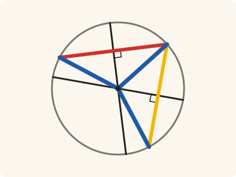
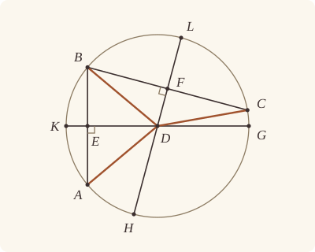

<!-- Generated by scripts/render.py. Do not edit by hand. -->

[Book III](index.md) · [← III.8](08.md) · [III.10 →](10.md)

# Book III, Proposition 9

*More than two equal straight lines fall only from the centre*

[Euclid's proof](#euclids-proof) · [In Lean](#in-lean) · [What it rests on](#what-it-rests-on) · [Mishnah](#mishnah)

> If a point be taken within a circle, and more than two equal straight lines fall from the point on the circle, the point taken is the centre of the circle.

**In Lean:** ✅ proved, as Euclid states it · Euclid's argument

<p align="center"></p>

<p align="center"><em>Let three equal straight lines (blue) fall from a point to the circle. Join their ends (red, yellow) and halve each at right angles (black): both black lines pass through the point and the centre, so the point is the centre.</em></p>

## Euclid's proof

<p align="center"></p>

<p align="center"><em>Drawn for one case: D off both AB and BC, as in Heath's figure.</em></p>

Let ABC be a circle and D a point within it, and from D let more than two equal straight lines, namely DA, DB, DC, fall on the circle ABC;

I say that the point D is the centre of the circle ABC.

For let AB, BC be joined and bisected at the points E, F, and let ED, FD be joined and drawn through to the points G, K, H, L.

Then, since AE is equal to EB,

and ED is common,

the two sides AE, ED are equal to the two sides BE, ED;

and the base DA is equal to the base DB;

therefore the angle AED is equal to the angle BED. [I. 8]

Therefore each of the angles AED, BED is right; [I. Def. 10]

therefore GK cuts AB into two equal parts and at right angles.

And since, if in a circle a straight line cut a straight line into two equal parts and at right angles, the centre of the circle is on the cutting straight line, [III. 1, Por.]

the centre of the circle is on GK.

For the same reason

the centre of the circle ABC is also on HL.

And the straight lines GK, HL have no other point common but the point D;

therefore the point D is the centre of the circle ABC.

Therefore etc.

Q. E. D.

## In Lean

| | |
|---|---|
| Proof | ✅ Proved |
| Statement | The whole enunciation. Leaves out Euclid's "within": any point from which three equal straight lines fall on the circle is its centre, as III.25 needs. |
| Argument | Euclid's. |
| Representation | `Tacit.exists_centre`, the rule that every circle has a centre, supplies one, which the proof shows is D. Euclid's proof never uses that D is within, and the statement does not ask it. |
| Reviewed | The statement and every passage of the argument read against Heath's text, at commit [`07416606e`](https://github.com/jackChallis/stoicheia/commit/07416606e) ([the record](../../review/III/09.toml)) |

From [`Elements/BookIII/Prop09.lean`](../../Elements/BookIII/Prop09.lean). Euclid's sentences are the `--` comments, and our own notes are in `/- … -/`; the lines under each sentence are the Lean that carries it out. The list below marks where a lemma does a step Euclid takes for granted, where several sentences share one step and where the Lean takes a case Euclid's figure leaves aside; the `/- … -/` notes in the listing explain smaller adjustments.

**How the Lean follows the text**

- **Done by `Tacit.exists_centre`.** "Let ABC be a circle and D a point within it…" Euclid uses the circle's centre without constructing it; the Lean takes O from `Tacit.exists_centre`, the rule that every circle has a centre. It also uses `Prop2.triangle` (III.2, for which Heath prints no reference here) to show that A, B and C are not on one straight line.
- **A further case.** "For let AB, BC be joined and bisected at the points E, F…" If AB or BC passes through D, the Lean also bisects CA and applies the same I.8 and III.1 Por. argument to the two straight lines that miss D, using `Prop9.centre_on`. In Euclid's case ED and FD name GK and HL, so G, K, H and L need no further construction.
- **Carried together, by `Prop1.porism`.** "therefore GK cuts AB into two equal parts and at right angles." Euclid takes GK to bisect AB at right angles; the Lean has already constructed E and F by I.10 (`BookI.Prop10`), for which Heath prints no reference here. The Lean carries these sentences together in one call to `Prop1.porism`, putting the centre O on ED, which names GK.
- **Carried together, by `Prop9.centre_on`.** "For the same reason…" Euclid gives the same reason for the centre lying on HL without writing out the argument. The Lean proves the I.8, Definition I.10 and III.1 Por. steps once over any letters in `Prop9.centre_on`, then applies them to BC and its middle point F.
- **Done by `Prop9.apart`.** "And the straight lines GK, HL have no other point common but the point D…" Euclid reads from the figure that GK and HL are two straight lines with only D in common. The Lean proves they differ by `Prop9.apart`, using I.13 and I.17, for which Heath prints no reference here, then identifies their common centre O with D by `Prop9.meet_at` and the assumed rule `Tacit.line_unique` (System E, Generalities 1).

<details><summary>Before the theorem, five lemmas: <code>Prop9.centre_on</code>, <code>Prop9.apart</code>, <code>Prop9.ne_ends</code>, <code>Prop9.not_two</code> and <code>Prop9.meet_at</code> (87 lines)</summary>

```lean
/-- When DA is equal to DB and D is off AB, the centre is on the straight line from D
to the middle point E of AB. This is Euclid's argument for GK, which his "For the same
reason" repeats for HL: I.8 and Definition I.10 make the angles at E right, and the
porism to III.1 puts the centre on ED. -/
theorem Prop9.centre_on {A B D E O : Point} {ABC : Circle} (hO : Centre O ABC)
    (hA : OnCircle A ABC) (hB : OnCircle B ABC) (hAEB : Between A E B) (hAE : ‖A E‖ = ‖E B‖)
    (hDA : ‖D A‖ = ‖D B‖) (hD : ¬ Collinear A B D) : ∠ A E D = ∟ ∧ Collinear E D O := by
  obtain ⟨L, hA_L, hB_L⟩ := Postulate1 A B (ne_of_between_ends hAEB)
  have hE_L := on_line_of_between_ends hAEB hA_L hB_L
  have hD_L : ¬ OnLine D L := (show Triangle A B D from hD).off_line hA_L hB_L
  have hEAD : Triangle E A D := Triangle.of_line hE_L hA_L (ne_of_between hAEB).symm hD_L
  have hEBD : Triangle E B D :=
    Triangle.of_line hE_L hB_L (ne_of_between (between_symm hAEB)).symm hD_L
  have h8 : ∠ A E D = ∠ B E D := BookI.Prop8 hEAD hEBD (by rw [len_symm E A, hAE]) rfl
    (by rw [len_symm A D, len_symm B D, hDA])
  have hr : ∠ A E D = ∟ := Postulate4
    ⟨B, hAEB, hEAD.bac, h8.trans (angle_symm hEBD.ne₁₂.symm hEBD.ne₁₃.symm)⟩
  exact ⟨hr, Prop1.porism hO hA hB hAEB hAE hD hr⟩

/-- The straight lines at right angles to AB at E and to BC at F are not one straight
line, for then the triangle BEF would have two right angles [I. 17]. Euclid reads this
off his figure. -/
theorem Prop9.apart {A B C D E F : Point} (hABC : Triangle A B C) (hAEB : Between A E B)
    (hBFC : Between B F C) (hDAB : ¬ Collinear A B D) (hDBC : ¬ Collinear B C D)
    (hAED : ∠ A E D = ∟) (hBFD : ∠ B F D = ∟) : ¬ Collinear E F D := by
  rintro ⟨L, hE_L, hF_L, hD_L⟩
  obtain ⟨M, hA_M, hB_M⟩ := Postulate1 A B hABC.ne₁₂
  obtain ⟨N, hB_N, hC_N⟩ := Postulate1 B C hABC.ne₂₃
  have hE_M := on_line_of_between_ends hAEB hA_M hB_M
  have hF_N := on_line_of_between_ends hBFC hB_N hC_N
  have hED : E ≠ D := fun e => hDAB ⟨M, hA_M, hB_M, e ▸ hE_M⟩
  have hFD : F ≠ D := fun e => hDBC ⟨N, hB_N, hC_N, e ▸ hF_N⟩
  have hBE : B ≠ E := ne_of_between (between_symm hAEB)
  have hEF : E ≠ F := by
    rintro rfl
    exact hABC ⟨M, hA_M, hB_M, (line_unique hBE.symm hE_M hB_M hF_N hB_N) ▸ hC_N⟩
  have hB_L : ¬ OnLine B L := fun hB =>
    hDAB ⟨M, hA_M, hB_M, (line_unique hBE hB hE_L hB_M hE_M) ▸ hD_L⟩
  have hBED : ∠ B E D = ∟ := by
    have := adjacent_eq_of_right hA_M hB_M hAEB (fun h => hDAB ⟨M, hA_M, hB_M, h⟩) hAED
    rw [angle_symm hBE hED.symm, ← this]; exact hAED
  have hDEB : ∠ D E B = ∟ := by rw [angle_symm hED.symm hBE]; exact hBED
  /- Whether F is on the ray ED or on the opposite ray, the angle BEF is right. -/
  have hBEF : ∠ B E F = ∟ := by
    by_cases hb : Between D E F
    · have := adjacent_eq_of_right hD_L hF_L hb hB_L hDEB
      rw [← this]; exact hDEB
    · rw [angle_onRay_right ⟨hED, hEF.symm, ⟨L, hE_L, hD_L, hF_L⟩, fun h => hb (between_symm h)⟩
        hBE]
      exact hBED
  have hBFE : ∠ B F E = ∟ := by
    by_cases hb : Between D F E
    · have h1 : ∠ D F B = ∟ := by
        rw [angle_symm hFD.symm (ne_of_between hBFC)]; exact hBFD
      have := adjacent_eq_of_right hD_L hE_L hb hB_L h1
      rw [← this]; exact h1
    · rw [angle_onRay_right ⟨hFD, hEF, ⟨L, hF_L, hD_L, hE_L⟩, fun h => hb (between_symm h)⟩
        (ne_of_between hBFC)]
      exact hBFD
  have hBEF_t : Triangle B E F := Triangle.of_line hE_L hF_L hEF hB_L |>.bca |>.bca
  have h17 := (BookI.Prop17 hBEF_t).1
  rw [hBEF, angle_symm hEF (ne_of_between hBFC), hBFE] at h17
  exact lt_irrefl _ h17

/-- A point D as far from A as from B is neither A nor B. -/
theorem Prop9.ne_ends {A B D : Point} (hAB : A ≠ B) (hDA : ‖D A‖ = ‖D B‖) : D ≠ A ∧ D ≠ B := by
  constructor
  · rintro rfl
    exact hAB (eq_of_len_eq_zero (by rw [← hDA, len_self]))
  · rintro rfl
    exact hAB (eq_of_len_eq_zero (by rw [len_symm, hDA, len_self]))

/-- A point other than B is not on both of the sides AB and BC of the triangle ABC. -/
theorem Prop9.not_two {A B C D : Point} (hABC : Triangle A B C) (hDB : D ≠ B)
    (h₁ : Collinear A B D) (h₂ : Collinear B C D) : False := by
  obtain ⟨L, hA, hB, hD⟩ := h₁
  obtain ⟨M, hB', hC, hD'⟩ := h₂
  exact hABC ⟨L, hA, hB, (line_unique hDB hD' hB' hD hB) ▸ hC⟩

/-- If the centre O is on both ED and FD, and these are not one straight line, then O
is D. -/
theorem Prop9.meet_at {E F D O : Point} (h₁ : Collinear E D O) (h₂ : Collinear F D O)
    (hap : ¬ Collinear E F D) : O = D := by
  refine Classical.byContradiction fun hOD => ?_
  obtain ⟨L, hE, hD, hO⟩ := h₁
  obtain ⟨M, hF, hD', hO'⟩ := h₂
  exact hap ⟨L, hE, (line_unique (Ne.symm hOD) hD' hO' hD hO) ▸ hF, hD⟩
```

</details>

```lean
/-- If a point be taken within a circle, and more than two equal straight lines fall from the point
on the circle, the point taken is the centre of the circle. -/
theorem Prop9 {A B C D : Point} {ABC : Circle}
    (hA : OnCircle A ABC) (hB : OnCircle B ABC)
    (hC : OnCircle C ABC) (hAB : A ≠ B) (hBC : B ≠ C) (hAC : A ≠ C)
    (hDA : ‖D A‖ = ‖D B‖) (hDB : ‖D B‖ = ‖D C‖) :
    Centre D ABC := by
  -- Let ABC be a circle and D a point within it, and from D let more than two equal straight
  -- lines, namely DA, DB, DC, fall on the circle ABC;
  obtain ⟨O, hO⟩ := exists_centre ABC
  have hT : Triangle A B C := Prop2.triangle hA hB hC hAB hBC hAC
  -- I say that the point D is the centre of the circle ABC.
  -- For let AB, BC be joined and bisected at the points E, F, and let ED, FD be joined and
  -- drawn through to the points G, K, H, L.
  obtain ⟨E, hAEB, hAE⟩ := BookI.Prop10 hAB
  obtain ⟨F, hBFC, hBF⟩ := BookI.Prop10 hBC
  /- This is J. G. Camerer's case (Heath, vol. 2, p. 22), where AB or BC passes through D.
     At most one of AB, BC, CA can, since D is none of A, B, C; so we bisect CA too, at an
     unlettered point, and use `Prop9.centre_on` on the two that miss D. -/
  obtain ⟨hDA', hDB'⟩ := Prop9.ne_ends hAB hDA
  have hDC' : D ≠ C := (Prop9.ne_ends hBC hDB).2
  have hDCA : ‖D C‖ = ‖D A‖ := (hDA.trans hDB).symm
  by_cases hDAB : Collinear A B D
  · have hDBC : ¬ Collinear B C D := fun h => Prop9.not_two hT hDB' hDAB h
    have hDCA' : ¬ Collinear C A D := fun h => Prop9.not_two hT.cab hDA' h hDAB
    obtain ⟨X, hCXA, hCX⟩ := BookI.Prop10 hAC.symm
    obtain ⟨hBFD, hFDO⟩ := Prop9.centre_on hO hB hC hBFC hBF hDB hDBC
    obtain ⟨hCXD, hXDO⟩ := Prop9.centre_on hO hC hA hCXA hCX hDCA hDCA'
    have hap := Prop9.apart hT.bca hBFC hCXA hDBC hDCA' hBFD hCXD
    obtain rfl := Prop9.meet_at hFDO hXDO hap
    exact hO
  by_cases hDBC : Collinear B C D
  · have hDCA' : ¬ Collinear C A D := fun h => Prop9.not_two hT.bca hDC' hDBC h
    obtain ⟨X, hCXA, hCX⟩ := BookI.Prop10 hAC.symm
    obtain ⟨hCXD, hXDO⟩ := Prop9.centre_on hO hC hA hCXA hCX hDCA hDCA'
    obtain ⟨hAED, hEDO⟩ := Prop9.centre_on hO hA hB hAEB hAE hDA hDAB
    have hap := Prop9.apart hT.cab hCXA hAEB hDCA' hDAB hCXD hAED
    obtain rfl := Prop9.meet_at hXDO hEDO hap
    exact hO
  /- In Euclid's figure D is off both AB and BC. ED names GK, and FD names HL;
     their ends G, K, H, L need no further construction in Lean. -/
  obtain ⟨AB, hA_AB, hB_AB⟩ := Postulate1 A B hAB
  have hE_AB := on_line_of_between_ends hAEB hA_AB hB_AB
  have hD_AB : ¬ OnLine D AB := fun h => hDAB ⟨AB, hA_AB, hB_AB, h⟩
  have hEAD : Triangle E A D :=
    Triangle.of_line hE_AB hA_AB (ne_of_between hAEB).symm hD_AB
  have hEBD : Triangle E B D :=
    Triangle.of_line hE_AB hB_AB (ne_of_between (between_symm hAEB)).symm hD_AB
  -- Then, since AE is equal to EB,
  have hAE_BE : ‖A E‖ = ‖B E‖ := hAE.trans (len_symm E B)
  -- and ED is common,
  have hED : ‖E D‖ = ‖E D‖ := rfl
  -- the two sides AE, ED are equal to the two sides BE, ED;
  have hEA_EB : ‖E A‖ = ‖E B‖ := by rw [len_symm E A, hAE_BE, len_symm B E]
  -- and the base DA is equal to the base DB;
  have hAD_BD : ‖A D‖ = ‖B D‖ := by rw [len_symm A D, len_symm B D, hDA]
  -- therefore the angle AED is equal to the angle BED. [I. 8]
  have h8 : ∠ A E D = ∠ B E D := BookI.Prop8 hEAD hEBD hEA_EB hED hAD_BD
  -- Therefore each of the angles AED, BED is right; [I. Def. 10]
  have hAED : ∠ A E D = ∟ := Postulate4
    ⟨B, hAEB, hEAD.bac, h8.trans (angle_symm hEBD.ne₁₂.symm hEBD.ne₁₃.symm)⟩
  -- therefore GK cuts AB into two equal parts and at right angles.
  -- And since, if in a circle a straight line cut a straight line into two equal parts and at
  -- right angles, the centre of the circle is on the cutting straight line, [III. 1, Por.]
  -- the centre of the circle is on GK.
  have hEDO : Collinear E D O := Prop1.porism hO hA hB hAEB hAE hDAB hAED
  -- For the same reason
  -- the centre of the circle ABC is also on HL.
  obtain ⟨hBFD, hFDO⟩ := Prop9.centre_on hO hB hC hBFC hBF hDB hDBC
  -- And the straight lines GK, HL have no other point common but the point D;
  /- GK and HL are two straight lines (`Prop9.apart`), and two straight lines have at
     most one point in common. -/
  have hap := Prop9.apart hT hAEB hBFC hDAB hDBC hAED hBFD
  obtain rfl : O = D := Prop9.meet_at hEDO hFDO hap
  -- therefore the point D is the centre of the circle ABC.
  exact hO
  -- Therefore etc.
  -- Q. E. D.
```

## What it rests on

| | |
|---|---|
| Heath's references | [I.8](../I/08.md), [III.1 Por.](01.md#porism); Def. I.10 |
| Lean cites | [I.8](../I/08.md), [I.10](../I/10.md), [I.13](../I/13.md), [I.17](../I/17.md), [III.1 Por.](01.md#porism), [III.2](02.md) |
| Postulates | 1, 2, 3, 4 |
| Definitions taken as axioms | Def. I.15 |
| Common Notions | 1, 2, 3, 4, 5 |
| Tacit rules | 38 (listed below) |
| Its own Lean calls | Postulates 1 and 4; 7 tacit rules |
| Through lemmas | Postulate 3; Def. I.15; 19 tacit rules |

Some of these come in through lemmas [shared](../../CERTIFICATE.md#shared-steps) by many proofs: [`Tacit.adjacent_eq_of_right`](../../Elements/BookI/Prop13.lean#L188) (I.13); [`Prop2.triangle`](../../Elements/BookIII/Prop02.lean#L137) (III.2).

_Postulates, definitions, Common Notions and tacit rules: all that this proof rests on, counting those of the propositions it cites. The last two rows say which of the postulates, definitions and tacit rules its own Lean calls, in the proof or a helper written for it, and which it does not call but reaches through lemmas, of Book Zero or shared (a proposition it cites may rest on these too); the rest come in only through the propositions it cites or the Common Notions._

_Euclid's Def. I.10 is `IsRightAngle` in Lean, a definition rather than an assumption, so the row of definitions taken as axioms does not count it._

<details><summary>The 38 tacit rules beneath this proof, counting those of the propositions it cites</summary>

_(used here) marks a rule this proof's own Lean calls, in the proof or a helper written for it; (through …) marks one its own Lean does not call but reaches through the lemmas named, of [Book Zero](../../Elements/Figure) or shared, though a proposition it cites may rest on it too; and a rule with no mark comes in only through a proposition it cites or a Common Notion. The names in brackets are System E's: an Intersection rule says when straight lines and circles must meet, and an Intersections rule takes a point where they do (see [Book I's introduction](../I/index.md))._

**Reading the figure**

- [`between_cases`](../../Elements/Foundations/Tacit/Diagram.lean#L54) (through [`Prop2.triangle`](../../Elements/BookIII/Prop02.lean#L137)): Of three different points on a straight line, one is between the other two. (Between 6)
- [`between_symm`](../../Elements/Foundations/Tacit/Diagram.lean#L47) (used here): If B is between A and C, it is between C and A. (Between 1)
- [`circles_meet`](../../Elements/Foundations/Tacit/Diagram.lean#L91) (through [`Tacit.on_line_of_between_ends`](../../Elements/Figure/RuleBase.lean#L142)): If each circle passes through a point inside the other, the circles cut one another. This is the step Euclid takes for granted in I.1. (Intersection 5)
- [`circles_meet_same_side`](../../Elements/Foundations/Tacit/Constructions.lean#L79) (through [`Tacit.on_line_of_between_ends`](../../Elements/Figure/RuleBase.lean#L142)): Two circles that cut one another do so on each side of the straight line through their centres. (Intersections 8)
- [`exists_centre`](../../Elements/Foundations/Tacit/Constructions.lean#L57) (used here): Every circle has a centre. A rule of our own, not one of System E's: its content is Euclid's Definitions I.15 and I.16.
- [`exists_point`](../../Elements/Foundations/Tacit/Constructions.lean#L35) (through [`Triangle.ne₁₂`](../../Elements/Figure/Triangles.lean#L22), [`Triangle.ne₁₃`](../../Elements/Figure/Triangles.lean#L36) and [`Triangle.ne₂₃`](../../Elements/Figure/Triangles.lean#L29)): Let a point be taken. (Points 1)
- [`exists_point_inside_circle`](../../Elements/Foundations/Tacit/Constructions.lean#L42) (through [`Tacit.on_line_of_between_ends`](../../Elements/Figure/RuleBase.lean#L142)): Let a point be taken inside the circle α. (Points 8)
- [`exists_point_on_line`](../../Elements/Foundations/Tacit/Constructions.lean#L38) (through [`Tacit.on_line_of_between_ends`](../../Elements/Figure/RuleBase.lean#L142)): Let a point be taken on the straight line L. (Points 2)
- [`line_circle_between`](../../Elements/Foundations/Tacit/Constructions.lean#L67) (through [`Tacit.on_line_of_between_ends`](../../Elements/Figure/RuleBase.lean#L142)): A straight line through a point B inside a circle, heading out to a point C outside it, cuts the circle between B and C. (Intersections 4)
- [`line_circle_beyond`](../../Elements/Foundations/Tacit/Constructions.lean#L73) (through [`Prop2.triangle`](../../Elements/BookIII/Prop02.lean#L137) and [`Tacit.on_line_of_between_ends`](../../Elements/Figure/RuleBase.lean#L142)): A straight line through a point B inside a circle, produced beyond B away from C, cuts the circle there. (Intersections 5)
- [`line_unique`](../../Elements/Foundations/Tacit/Diagram.lean#L41) (used here): Two points determine a straight line. (Generalities 1)
- [`lines_meet_of_opposite_sides`](../../Elements/Foundations/Tacit/Diagram.lean#L86): A straight line joining points on opposite sides of L crosses L. (Intersection 1)
- [`not_between_of_between`](../../Elements/Foundations/Tacit/Diagram.lean#L50) (through [`Prop2.triangle`](../../Elements/BookIII/Prop02.lean#L137), [`Tacit.adjacent_eq_of_right`](../../Elements/BookI/Prop13.lean#L188), [`Tacit.ne_of_between`](../../Elements/Figure/RuleBase.lean#L135) and 3 other lemmas): If B is between A and C, then A is not between B and C. (Between 1)
- [`not_on_line_of_same_side`](../../Elements/Foundations/Tacit/Diagram.lean#L60) (through [`Tacit.on_line_of_between_ends`](../../Elements/Figure/RuleBase.lean#L142)): Points on one side of a straight line are not on it. (Same side 3)
- [`pasch2`](../../Elements/Foundations/Tacit/Diagram.lean#L71) (through [`Tacit.on_line_of_between_ends`](../../Elements/Figure/RuleBase.lean#L142)): If B is between A and C, A is on L and B is off it, then B and C are on the same side of L: a straight line that leaves L at A does not cross it again. (Pasch 2)
- [`same_side_trans`](../../Elements/Foundations/Tacit/Diagram.lean#L64) (through [`Tacit.on_line_of_between_ends`](../../Elements/Figure/RuleBase.lean#L142)): Two points on the same side of a straight line as a third point are on the same side as each other. (Same side 4)

**Lengths, angles and areas**

- [`angle_add_of_inside`](../../Elements/Foundations/Tacit/Transfer.lean#L47): If D lies within the angle BAC, then BAC is made up of BAD and DAC. (Diagram-angle 2)
- [`angle_eq_of_same_rays`](../../Elements/Foundations/Tacit/Transfer.lean#L54) (through [`angle_onRay_right`](../../Elements/Figure/Angles.lean#L49)): The angle doesn't change if its arms are traced through other points on the same rays. (Diagram-angle 4)
- [`angle_symm`](../../Elements/Foundations/Tacit/Metric.lean#L30) (used here): The angle ABC is the angle CBA. (Metric 4)
- [`area_add_of_between`](../../Elements/Foundations/Tacit/Transfer.lean#L70): Cutting a triangle in two from a vertex adds up. (Diagram-area 2)
- [`area_congruent`](../../Elements/Foundations/Tacit/Metric.lean#L44): Triangles equal in all their sides and angles are equal in area. Euclid uses this without comment once he has shown two triangles congruent. (Metric 9)
- [`area_degenerate`](../../Elements/Foundations/Tacit/Metric.lean#L36): A "triangle" with a repeated corner has no area. (Metric 6)
- [`area_eq_zero_of_on_line`](../../Elements/Foundations/Tacit/Transfer.lean#L62): A "triangle" whose corners lie on one straight line has no area. (Diagram-area 1)
- [`area_rotate`](../../Elements/Foundations/Tacit/Metric.lean#L39): The triangle ABC is the triangle CAB. (Metric 8)
- [`len_add_of_between`](../../Elements/Foundations/Tacit/Transfer.lean#L27) (through [`Prop2.triangle`](../../Elements/BookIII/Prop02.lean#L137), [`Tacit.adjacent_eq_of_right`](../../Elements/BookI/Prop13.lean#L188), [`Tacit.ne_of_between_ends`](../../Elements/Figure/Incidence.lean#L66) and 2 other lemmas): If B is between A and C, then AB and BC together make up AC. (Diagram-segment 1)
- [`len_self`](../../Elements/Foundations/Tacit/Metric.lean#L24) (used here): The "straight line" from a point to itself has no length. (Metric 1)
- [`len_symm`](../../Elements/Foundations/Tacit/Metric.lean#L27) (used here): The straight line AB is the straight line BA. (Metric 3)
- [`radius_ne_zero`](../../Elements/Foundations/Tacit/Metric.lean#L62) (through [`Prop2.triangle`](../../Elements/BookIII/Prop02.lean#L137), [`Tacit.adjacent_eq_of_right`](../../Elements/BookI/Prop13.lean#L188), [`Tacit.eq_of_len_eq_zero`](../../Elements/Figure/RuleBase.lean#L254) and 3 other lemmas): A circle's radius is not nothing: the straight line from the centre to a point on the circle has some length. A rule of our own, not one of System E's: every circle is drawn with a centre and a distance (Postulate 3).
- [`same_ray_of_angle_eq_zero`](../../Elements/Foundations/Tacit/Transfer.lean#L42): If the angle BAC is nothing, C lies on the ray from A through B. (Diagram-angle 1)

**Superposition**

- [`superposition`](../../Elements/Foundations/Tacit/Superposition.lean#L52): **Superposition.** A hypothetical placement of a triangle on a given ray and side permits a restricted derivation of metric equalities about the figure already given. The derivation introduces no further objects, cites each geometric law it uses, and exports no symbol of the placement.

**Rules of magnitude**

- [`add_assoc`](../../Elements/Foundations/Tacit/Magnitudes.lean#L23): Adding three magnitudes in a row, it makes no difference whether the first two or the last two are added first. (System E §3.5)
- [`add_comm`](../../Elements/Foundations/Tacit/Magnitudes.lean#L26) (through [`Tacit.adjacent_eq_of_right`](../../Elements/BookI/Prop13.lean#L188), [`Tacit.ne_of_between_ends`](../../Elements/Figure/Incidence.lean#L66), [`Tacit.on_line_of_between_ends`](../../Elements/Figure/RuleBase.lean#L142) and 1 other lemma): The order of adding does not matter. (System E §3.5)
- [`add_lt_add_right`](../../Elements/Foundations/Tacit/Magnitudes.lean#L45): Adding the same thing to both sides keeps "less than". (System E §3.5)
- [`add_zero`](../../Elements/Foundations/Tacit/Magnitudes.lean#L29): Adding nothing changes nothing. (System E §3.5)
- [`lt_irrefl`](../../Elements/Foundations/Tacit/Magnitudes.lean#L32) (used here): No magnitude is less than itself. (System E §3.5)
- [`lt_trans`](../../Elements/Foundations/Tacit/Magnitudes.lean#L35) (through [`Tacit.on_line_of_between_ends`](../../Elements/Figure/RuleBase.lean#L142)): What is less than the less is less still. (System E §3.5)
- [`lt_trichotomy`](../../Elements/Foundations/Tacit/Magnitudes.lean#L39) (through [`Prop2.triangle`](../../Elements/BookIII/Prop02.lean#L137), [`Tacit.adjacent_eq_of_right`](../../Elements/BookI/Prop13.lean#L188), [`Tacit.ne_of_between_ends`](../../Elements/Figure/Incidence.lean#L66) and 2 other lemmas): Of two magnitudes, one is less, or they are equal, or the other is less. (System E §3.5)
- [`not_lt_zero`](../../Elements/Foundations/Tacit/Magnitudes.lean#L42) (through [`Prop2.triangle`](../../Elements/BookIII/Prop02.lean#L137), [`Tacit.adjacent_eq_of_right`](../../Elements/BookI/Prop13.lean#L188), [`Tacit.ne_of_between_ends`](../../Elements/Figure/Incidence.lean#L66) and 2 other lemmas): Nothing is less than zero. (System E §3.5)

</details>

## Mishnah

_Our commentary: why Euclid's proof, and ours, look as they do._

Euclid turns equal lengths into right angles. He bisects AB and BC at E and F, and I.8 makes the two angles at E equal, and so right, and those at F too. By the porism to III.1 the centre lies on each of the straight lines GK and HL, and these have only D in common, so D is the centre. The construction that opened Book III comes back, now to recognise the centre in a given point.

Augustus De Morgan saw it already proved: "III. 9 is, as De Morgan remarks, a *logical* equivalent of part of III. 7, where it is proved that every *non*-central point is *not* a point from which three equal straight lines can be drawn to the circle" (Heath, vol. 2, p. 22). H. M. Taylor draws III.9 from his own III.7 as a corollary. Euclid proves it afresh, and Heath sees a habit in that: "Euclid does not allow himself these logical inferences, as we shall have occasion to observe elsewhere also" (vol. 2, p. 22).

J. G. Camerer asks what happens if AB passes through D: then one of the middle points is D itself, and there is no straight line ED or FD to draw. Heath answers that Euclid takes "the most obscure case for proof" (vol. 2, p. 22), as in III.6 he leaves the plainer case, of contact without, to the reader. Our proof leaves nothing to the reader, and one more bisection, of CA, answers Camerer.

**Within, or anywhere?** Euclid takes D within the circle, and our statement leaves "within" out. His proof never uses it: ED and FD are drawn through from E and F, which are within wherever D is, and III.25 needs III.9 in this form, for a point not yet known to be within. One thing the figure shows still wants its reason, that GK and HL are two straight lines, and I.17 gives it.

**The modern way.** Write $\mathbf{a}$, $\mathbf{b}$ and $\mathbf{c}$ for the positions of A, B and C. A point at $\mathbf{x}$ is as far from all three when $|\mathbf{x} - \mathbf{a}| = |\mathbf{x} - \mathbf{b}| = |\mathbf{x} - \mathbf{c}|$, and these are two linear equations, $2\mathbf{x} \cdot (\mathbf{b} - \mathbf{a}) = |\mathbf{b}|^2 - |\mathbf{a}|^2$ and $2\mathbf{x} \cdot (\mathbf{c} - \mathbf{b}) = |\mathbf{c}|^2 - |\mathbf{b}|^2$. A, B and C are not on one straight line, so $\mathbf{b} - \mathbf{a}$ and $\mathbf{c} - \mathbf{b}$ are independent, and exactly one point is as far from all three: the centre and D are both that point.

## Further reading

- For De Morgan's remark that III.9 is "a logical equivalent of part of III. 7", which Euclid proves afresh all the same, see his remarks on III.9 (p. 10) in Augustus De Morgan's ["Short Supplementary Remarks on the First Six Books of Euclid's Elements"](https://archive.org/details/sim_british-almanac-companion_1849) (1849, free online) (also on [III.7](07.md)).
- Ian Mueller's [*Philosophy of Mathematics and Deductive Structure in Euclid's Elements*](https://openlibrary.org/books/OL7640284M) (1981), a careful, scholarly book, charts what each proof rests on, and so the web of Book III's proofs, in which III.9 goes back to the porism of III.1 rather than to III.7.

[Book III](index.md) · [← III.8](08.md) · [III.10 →](10.md)

---

<sub>Euclid's text: T. L. Heath, *The Thirteen Books of Euclid's Elements*, vol. 2 (Cambridge, 1908), pp. 21–22; [scan leaves n33–n34](https://archive.org/details/thirteenbookseu00heibgoog/page/n33); [figure on n33](https://archive.org/details/thirteenbookseu00heibgoog/page/n33). Public domain.</sub>

<sub>The tacit rules follow the System E of Jeremy Avigad, Edward Dean and John Mumma, read alongside LeanEuclid (Logan Murphy, Kaiyu Yang, Jialiang Sun, Zhaoyu Li, Anima Anandkumar and Xujie Si).</sub>
