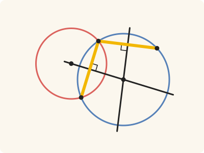
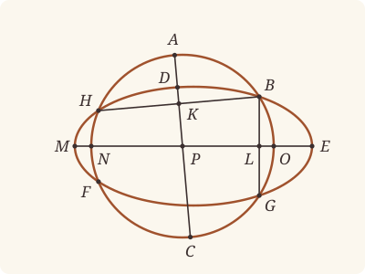

<!-- Generated by scripts/render.py. Do not edit by hand. -->

[Book III](index.md) · [← III.9](09.md) · [III.11 →](11.md)

# Book III, Proposition 10

*A circle does not cut a circle at more points than two*

[Euclid's proof](#euclids-proof) · [In Lean](#in-lean) · [What it rests on](#what-it-rests-on) · [Mishnah](#mishnah)

> A circle does not cut a circle at more points than two.

**In Lean:** ✅ proved, as Euclid states it · Euclid's argument, with one step changed

<p align="center"></p>

<p align="center"><em>Suppose two circles (red, blue) met at B, G, F, H: the red is a dashed oval, since no second circle can. Each black straight line, halving a yellow one at right angles, would pass through both centres: both at P, which III.5 forbids.</em></p>

## Euclid's proof

<p align="center"></p>

<p align="center"><em>Like Heath's, this figure draws the impossible supposition: DEF meeting ABC at four points, B, G, F, H, and so drawn as an oval, since no second circle can.</em></p>

For, if possible, let the circle ABC cut the circle DEF at more points than two, namely B, G, F, H;

let BH, BG be joined and bisected at the points K, L,

and from K, L let KC, LM be drawn at right angles to BH, BG and carried through to the points A, E.

Then, since in the circle ABC a straight line AC cuts a straight line BH into two equal parts and at right angles,

the centre of the circle ABC is on AC. [III. 1, Por.]

Again, since in the same circle ABC a straight line NO cuts a straight line BG into two equal parts and at right angles,

the centre of the circle ABC is on NO.

But it was also proved to be on AC, and the straight lines AC, NO meet at no point except at P;

therefore the point P is the centre of the circle ABC.

Similarly we can prove that P is also the centre of the circle DEF;

therefore the two circles ABC, DEF which cut one another have the same centre P: which is impossible. [III. 5]

Therefore etc.

Q. E. D.

## In Lean

| | |
|---|---|
| Proof | ✅ Proved |
| Statement | The whole enunciation. Stated positively: two circles with three points in common are one circle, whether they cut or only meet. |
| Argument | Euclid's, with one step changed. The construction and the argument locating both centres at P follow Euclid. The last step uses `circle_eq` directly: one centre and the common point B make the circles one, whereas the restated III.5 requires crossing and this statement covers circles that only meet. |
| Representation | The rule supplies both centres, so the porism to III.1 puts each centre on both perpendiculars. That the circles cut is not asked, only three common points, of the four Euclid names. C and O are points of the perpendiculars produced beyond K and L, not their meetings with the circle: the straight lines AC and NO they name are Euclid's. |
| Reviewed | The statement and every passage of the argument read against Heath's text, at commit [`0dddd7220`](https://github.com/jackChallis/stoicheia/commit/0dddd7220) ([the record](../../review/III/10.toml)) |

From [`Elements/BookIII/Prop10.lean`](../../Elements/BookIII/Prop10.lean). Euclid's sentences are the `--` comments, and our own notes are in `/- … -/`; the lines under each sentence are the Lean that carries it out. The list below marks where a lemma does a step Euclid takes for granted, where several sentences share one step and where a step is argued another way; the `/- … -/` notes in the listing explain smaller adjustments.

**How the Lean follows the text**

- **Done by `Prop2.triangle`.** "For, if possible, let the circle ABC cut the circle DEF…" Euclid supposes more than two common points; the Lean assumes the circles differ and uses three of those points. `Prop2.triangle` (III.2, for which Heath prints no reference here) shows that B, H and G are not on one straight line, as the perpendicular constructions and their unique meeting require.
- **Done by `BookI.Prop10`.** "let BH, BG be joined and bisected at the points K, L…" Euclid bisects BH and BG without a reference from Heath here. The Lean joins them by Postulate 1 and constructs K and L by I.10 (`BookI.Prop10`).
- **Done by `BookI.Prop11`.** "and from K, L let KC, LM be drawn at right angles…" Euclid draws the perpendiculars and carries them through the circle; the Lean draws them by I.11 and produces each beyond its foot by Postulate 2 (`produce`), to C and to O, with no reference from Heath for these constructions. The argument needs only a second point of each perpendicular, never where it meets the circle, so A and E are not named. `Tacit.adjacent_eq_of_right`, proved from I.13 and Common Notion 3, makes BLO right on the other side of L; LM and NO name the same straight line, and N and M need no further construction.
- **Done by `Tacit.exists_centre`.** "Then, since in the circle ABC a straight line AC…" Euclid places the centre on AC by the porism to III.1. The Lean first takes that centre, named P, from `Tacit.exists_centre`, a rule we assume from Definitions I.15 and I.16, not a proved lemma or a rule of System E, then applies `Prop1.porism`.
- **Done by `Prop10.meet_once`.** "But it was also proved to be on AC…" Euclid reads from the figure that AC and NO meet only at P. `Prop10.meet_once` proves this using I.13 through `Prop10.right_on_line` and I.17, for which Heath prints no reference here: if the perpendiculars were one straight line, the triangle BKL would have two right angles.
- **Carried together.** "therefore the point P is the centre of the circle ABC." The rule gives ABC its centre, which the Lean names P at once; that AC and NO meet only there is the step above, so this sentence needs no Lean of its own.
- **Carried together, by `Prop1.porism`.** "Similarly we can prove that P is also the centre of the circle DEF…" Euclid invokes the same argument for DEF without writing it out. The Lean takes its centre from the same assumed rule `Tacit.exists_centre`, applies `Prop1.porism` to BH and BG again, and uses the unique meeting just proved to identify that centre with P.
- **Argued another way.** "therefore the two circles ABC, DEF which cut one another…" The Lean ends by `circle_eq` (Diagram-segment 2), from the common centre P and the common point B, instead of III.5: `Prop5` asks that the circles cut one another, and this statement gives only common points. Heath states this under III.5, beside the enunciation that joins III.5 and III.6: two circles with the same centre and one point of their circumferences in common coincide altogether (vol. 2, p. 12). It applies also to circles that only meet.

<details><summary>Before the theorem, two lemmas: <code>Prop10.right_on_line</code> and <code>Prop10.meet_once</code> (48 lines)</summary>

```lean
/-- If the angle BKC is right, so is the angle BKX for any other point X of the straight
line KC, on either side of K. -/
theorem Prop10.right_on_line {B K C X : Point} {N : Line} (hK : OnLine K N) (hC : OnLine C N)
    (hX : OnLine X N) (hKC : K ≠ C) (hXK : X ≠ K) (hB : ¬ OnLine B N) (hBKC : ∠ B K C = ∟) :
    ∠ B K X = ∟ := by
  have hBK : B ≠ K := fun e => hB (e ▸ hK)
  by_cases hb : Between X K C
  · have h := adjacent_eq_of_right hC hX (between_symm hb) hB
      (by rw [angle_symm hKC.symm hBK]; exact hBKC)
    rw [← h, angle_symm hKC.symm hBK]; exact hBKC
  · rw [angle_onRay_right ⟨hKC, hXK, ⟨N, hK, hC, hX⟩, hb⟩ hBK]; exact hBKC

/-- The straight lines at right angles to BH at K and to BG at L have at most one
common point. Euclid takes for granted that they are two straight lines; as in III.9
(`Prop9.apart`), were they one, the triangle BKL would have two right angles. -/
theorem Prop10.meet_once {B G H K L C O P Q : Point} (hBHG : Triangle B H G)
    (hBKH : Between B K H) (hBLG : Between B L G)
    (hC : ¬ Collinear B H C) (hBKC : ∠ B K C = ∟) (hO : ¬ Collinear B G O)
    (hBLO : ∠ B L O = ∟)
    (hKCP : Collinear K C P) (hKCQ : Collinear K C Q) (hLOP : Collinear L O P)
    (hLOQ : Collinear L O Q) : P = Q := by
  refine Classical.byContradiction fun hPQ => ?_
  obtain ⟨M₁, hK₁, hC₁, hP₁⟩ := hKCP
  obtain ⟨M₂, hK₂, hC₂, hQ₂⟩ := hKCQ
  obtain ⟨M₃, hL₃, hO₃, hP₃⟩ := hLOP
  obtain ⟨M₄, hL₄, hO₄, hQ₄⟩ := hLOQ
  obtain ⟨BH, hB_BH, hH_BH⟩ := Postulate1 B H (ne_of_between_ends hBKH)
  have hK_BH := on_line_of_between_ends hBKH hB_BH hH_BH
  obtain ⟨BG, hB_BG, hG_BG⟩ := Postulate1 B G (ne_of_between_ends hBLG)
  have hL_BG := on_line_of_between_ends hBLG hB_BG hG_BG
  have hKC : K ≠ C := fun e => hC ⟨BH, hB_BH, hH_BH, e ▸ hK_BH⟩
  have hLO : L ≠ O := fun e => hO ⟨BG, hB_BG, hG_BG, e ▸ hL_BG⟩
  obtain rfl := line_unique hKC hK₁ hC₁ hK₂ hC₂
  obtain rfl := line_unique hLO hL₃ hO₃ hL₄ hO₄
  obtain rfl := line_unique hPQ hP₁ hQ₂ hP₃ hQ₄
  /- Now one straight line, M₁, passes through K, C, L and O. -/
  have hKL : K ≠ L := by
    rintro rfl
    have hBK : B ≠ K := ne_of_between hBKH
    exact hBHG ⟨BH, hB_BH, hH_BH, (line_unique hBK hB_BG hL_BG hB_BH hK_BH) ▸ hG_BG⟩
  have hB : ¬ OnLine B M₁ := fun hB =>
    hC ⟨BH, hB_BH, hH_BH,
      (line_unique (ne_of_between hBKH) hB hK₁ hB_BH hK_BH) ▸ hC₁⟩
  have h₁ : ∠ B K L = ∟ := Prop10.right_on_line hK₁ hC₁ hL₃ hKC hKL.symm hB hBKC
  have h₂ : ∠ B L K = ∟ := Prop10.right_on_line hL₃ hO₃ hK₁ hLO hKL hB hBLO
  have h17 := (BookI.Prop17 (Triangle.of_line hK₁ hL₃ hKL hB).cab).1
  rw [h₁, angle_symm hKL (fun e => hB (by rw [e]; exact hL₃)), h₂] at h17
  exact lt_irrefl _ h17
```

</details>

```lean
/-- A circle does not cut a circle at more points than two. -/
theorem Prop10 {B G H : Point} {ABC DEF : Circle}
    (hB₁ : OnCircle B ABC) (hB₂ : OnCircle B DEF)
    (hG₁ : OnCircle G ABC) (hG₂ : OnCircle G DEF) (hH₁ : OnCircle H ABC)
    (hH₂ : OnCircle H DEF) (hBG : B ≠ G) (hBH : B ≠ H) (hGH : G ≠ H) :
    ABC = DEF := by
  -- For, if possible, let the circle ABC cut the circle DEF at more points than two, namely B,
  -- G, F, H;
  refine Classical.byContradiction fun hne => ?_
  /- Three common points suffice; Euclid never uses the fourth, F. -/
  have hBHG : Triangle B H G := Prop2.triangle hB₁ hH₁ hG₁ hBH hGH.symm hBG
  -- let BH, BG be joined and bisected at the points K, L,
  obtain ⟨BH, hB_BH, hH_BH⟩ := Postulate1 B H hBH
  obtain ⟨BG, hB_BG, hG_BG⟩ := Postulate1 B G hBG
  obtain ⟨K, hBKH, hBK⟩ := BookI.Prop10 hBH
  obtain ⟨L, hBLG, hBL⟩ := BookI.Prop10 hBG
  have hK_BH := on_line_of_between_ends hBKH hB_BH hH_BH
  have hL_BG := on_line_of_between_ends hBLG hB_BG hG_BG
  -- and from K, L let KC, LM be drawn at right angles to BH, BG and carried through to the
  -- points A, E.
  obtain ⟨X, hXG, hKX⟩ := BookI.Prop11 hBH ⟨BH, hB_BH, hH_BH, hK_BH⟩ hBHG
  obtain ⟨Y, hYH, hLY⟩ := BookI.Prop11 hBG ⟨BG, hB_BG, hG_BG, hL_BG⟩ hBHG.acb
  have hX_BH : ¬ OnLine X BH := hXG.triangle.off_line hB_BH hH_BH
  have hY_BG : ¬ OnLine Y BG := hYH.triangle.off_line hB_BG hG_BG
  have hKX_ne : K ≠ X := fun e => hX_BH (e ▸ hK_BH)
  have hLY_ne : L ≠ Y := fun e => hY_BG (e ▸ hL_BG)
  /- The argument needs only a point of each perpendicular besides K and L, never where
     the perpendicular meets the circle; so KX is produced to C and YL to O [Post. 2], and
     A and E are not named. O is on the other side of BG from H, as in the figure. -/
  obtain ⟨AC, hK_AC, hX_AC⟩ := Postulate1 K X hKX_ne
  obtain ⟨C, hKXC⟩ := produce hKX_ne
  have hC_AC := on_line_of_between hKXC hK_AC hX_AC
  obtain ⟨NO, hL_NO, hY_NO⟩ := Postulate1 L Y hLY_ne
  obtain ⟨O, hYLO⟩ := produce hLY_ne.symm
  have hO_NO := on_line_of_between hYLO hY_NO hL_NO
  have hBK_ne : B ≠ K := ne_of_between hBKH
  have hBL_ne : B ≠ L := ne_of_between hBLG
  have hBKC : ∠ B K C = ∟ := by
    rw [angle_onRay_right (OnRay.of_beyond hKXC) hBK_ne]
    exact hKX B ⟨BH, hB_BH, hH_BH, hB_BH⟩ hBK_ne
  have hB_NO : ¬ OnLine B NO := fun h =>
    hY_BG ((line_unique hBL_ne h hL_NO hB_BG hL_BG) ▸ hY_NO)
  have hYLB : ∠ Y L B = ∟ := by
    rw [angle_symm hLY_ne.symm hBL_ne]
    exact hLY B ⟨BG, hB_BG, hG_BG, hB_BG⟩ hBL_ne
  have hBLO : ∠ B L O = ∟ :=
    (adjacent_eq_of_right hY_NO hO_NO hYLO hB_NO hYLB).symm.trans hYLB
  have hKC : K ≠ C := ne_of_between_ends hKXC
  have hLO : L ≠ O := (ne_of_between (between_symm hYLO)).symm
  have hC_off : ¬ Collinear B H C := fun ⟨M, h1, h2, h3⟩ => hX_BH (by
    have e₁ := line_unique hBH h1 h2 hB_BH hH_BH
    have hK_M : OnLine K M := e₁ ▸ hK_BH
    have e₂ := line_unique hKC hK_M h3 hK_AC hC_AC
    exact e₁ ▸ e₂ ▸ hX_AC)
  have hO_off : ¬ Collinear B G O := fun ⟨M, h1, h2, h3⟩ => hY_BG (by
    have e₁ := line_unique hBG h1 h2 hB_BG hG_BG
    have hL_M : OnLine L M := e₁ ▸ hL_BG
    have e₂ := line_unique hLO hL_M h3 hL_NO hO_NO
    exact e₁ ▸ e₂ ▸ hY_NO)
  -- Then, since in the circle ABC a straight line AC cuts a straight line BH into two equal
  -- parts and at right angles,
  -- the centre of the circle ABC is on AC. [III. 1, Por.]
  obtain ⟨P, hP⟩ := exists_centre ABC
  have hP_AC : Collinear K C P := Prop1.porism hP hB₁ hH₁ hBKH hBK hC_off hBKC
  -- Again, since in the same circle ABC a straight line NO cuts a straight line BG into two
  -- equal parts and at right angles,
  -- the centre of the circle ABC is on NO.
  have hP_NO : Collinear L O P := Prop1.porism hP hB₁ hG₁ hBLG hBL hO_off hBLO
  -- But it was also proved to be on AC, and the straight lines AC, NO meet at no point except
  -- at P;
  /- AC and NO are two straight lines (`Prop10.meet_once`), so any point on both is P,
     even if P is K or L. -/
  have hmeet : ∀ Q : Point, Collinear K C Q → Collinear L O Q → Q = P :=
    fun Q hQ_AC hQ_NO =>
      Prop10.meet_once hBHG hBKH hBLG hC_off hBKC hO_off hBLO hQ_AC hP_AC hQ_NO hP_NO
  -- therefore the point P is the centre of the circle ABC.
  /- The centre the rule gives the circle ABC has already been named P. -/
  -- Similarly we can prove that P is also the centre of the circle DEF;
  obtain ⟨P', hP'⟩ := exists_centre DEF
  have hP'_AC : Collinear K C P' := Prop1.porism hP' hB₂ hH₂ hBKH hBK hC_off hBKC
  have hP'_NO : Collinear L O P' := Prop1.porism hP' hB₂ hG₂ hBLG hBL hO_off hBLO
  obtain rfl : P' = P := hmeet P' hP'_AC hP'_NO
  -- therefore the two circles ABC, DEF which cut one another have the same centre P: which is
  -- impossible. [III. 5]
  /- Heath's bracket gives III.5. `Prop5` asks that the circles cut one another, each
     passing within the other, and this statement gives only three common points, so it
     cannot serve. Heath states under III.5 what does: circles with one centre and one
     common point coincide altogether, here P and B (`circle_eq`). -/
  exact hne (circle_eq hP hP' hB₁ hB₂ rfl)
  -- Therefore etc.
  -- Q. E. D.
```

## What it rests on

| | |
|---|---|
| Heath's references | [III.1 Por.](01.md#porism), [III.5](05.md) |
| Lean cites | [I.10](../I/10.md), [I.11](../I/11.md), [I.13](../I/13.md), [I.17](../I/17.md), [III.1 Por.](01.md#porism), [III.2](02.md) |
| Postulates | 1, 2, 3, 4 |
| Definitions taken as axioms | Def. I.15 |
| Common Notions | 1, 2, 3, 4, 5 |
| Tacit rules | 39 (listed below) |
| Its own Lean calls | Postulate 1; 6 tacit rules |
| Through lemmas | Postulates 2 and 3; Def. I.15; 20 tacit rules |

Some of these come in through lemmas [shared](../../CERTIFICATE.md#shared-steps) by many proofs: [`Tacit.adjacent_eq_of_right`](../../Elements/BookI/Prop13.lean#L188) (I.13); [`Prop2.triangle`](../../Elements/BookIII/Prop02.lean#L137) (III.2).

_Postulates, definitions, Common Notions and tacit rules: all that this proof rests on, counting those of the propositions it cites. The last two rows say which of the postulates, definitions and tacit rules its own Lean calls, in the proof or a helper written for it, and which it does not call but reaches through lemmas, of Book Zero or shared (a proposition it cites may rest on these too); the rest come in only through the propositions it cites or the Common Notions._

<details><summary>The 39 tacit rules beneath this proof, counting those of the propositions it cites</summary>

_(used here) marks a rule this proof's own Lean calls, in the proof or a helper written for it; (through …) marks one its own Lean does not call but reaches through the lemmas named, of [Book Zero](../../Elements/Figure) or shared, though a proposition it cites may rest on it too; and a rule with no mark comes in only through a proposition it cites or a Common Notion. The names in brackets are System E's: an Intersection rule says when straight lines and circles must meet, and an Intersections rule takes a point where they do (see [Book I's introduction](../I/index.md))._

**Reading the figure**

- [`between_cases`](../../Elements/Foundations/Tacit/Diagram.lean#L54) (through [`Prop2.triangle`](../../Elements/BookIII/Prop02.lean#L137)): Of three different points on a straight line, one is between the other two. (Between 6)
- [`between_symm`](../../Elements/Foundations/Tacit/Diagram.lean#L47) (used here): If B is between A and C, it is between C and A. (Between 1)
- [`circles_meet`](../../Elements/Foundations/Tacit/Diagram.lean#L91) (through [`OnRay.of_beyond`](../../Elements/Figure/Rays.lean#L41), [`Tacit.on_line_of_between`](../../Elements/Figure/Incidence.lean#L78) and [`Tacit.on_line_of_between_ends`](../../Elements/Figure/RuleBase.lean#L153)): If each circle passes through a point inside the other, the circles cut one another. This is the step Euclid takes for granted in I.1. (Intersection 5)
- [`circles_meet_same_side`](../../Elements/Foundations/Tacit/Constructions.lean#L79) (through [`OnRay.of_beyond`](../../Elements/Figure/Rays.lean#L41), [`Tacit.on_line_of_between`](../../Elements/Figure/Incidence.lean#L78) and [`Tacit.on_line_of_between_ends`](../../Elements/Figure/RuleBase.lean#L153)): Two circles that cut one another do so on each side of the straight line through their centres. (Intersections 8)
- [`exists_centre`](../../Elements/Foundations/Tacit/Constructions.lean#L57) (used here): Every circle has a centre. A rule of our own, not one of System E's: its content is Euclid's Definitions I.15 and I.16.
- [`exists_point`](../../Elements/Foundations/Tacit/Constructions.lean#L35): Let a point be taken. (Points 1)
- [`exists_point_inside_circle`](../../Elements/Foundations/Tacit/Constructions.lean#L42) (through [`OnRay.of_beyond`](../../Elements/Figure/Rays.lean#L41), [`Tacit.on_line_of_between`](../../Elements/Figure/Incidence.lean#L78) and [`Tacit.on_line_of_between_ends`](../../Elements/Figure/RuleBase.lean#L153)): Let a point be taken inside the circle α. (Points 8)
- [`exists_point_on_line`](../../Elements/Foundations/Tacit/Constructions.lean#L38) (through [`OnRay.of_beyond`](../../Elements/Figure/Rays.lean#L41), [`Tacit.on_line_of_between`](../../Elements/Figure/Incidence.lean#L78) and [`Tacit.on_line_of_between_ends`](../../Elements/Figure/RuleBase.lean#L153)): Let a point be taken on the straight line L. (Points 2)
- [`line_circle_between`](../../Elements/Foundations/Tacit/Constructions.lean#L67) (through [`OnRay.of_beyond`](../../Elements/Figure/Rays.lean#L41), [`Tacit.on_line_of_between`](../../Elements/Figure/Incidence.lean#L78) and [`Tacit.on_line_of_between_ends`](../../Elements/Figure/RuleBase.lean#L153)): A straight line through a point B inside a circle, heading out to a point C outside it, cuts the circle between B and C. (Intersections 4)
- [`line_circle_beyond`](../../Elements/Foundations/Tacit/Constructions.lean#L73) (through [`OnRay.of_beyond`](../../Elements/Figure/Rays.lean#L41), [`Prop2.triangle`](../../Elements/BookIII/Prop02.lean#L137), [`Tacit.on_line_of_between`](../../Elements/Figure/Incidence.lean#L78) and 1 other lemma): A straight line through a point B inside a circle, produced beyond B away from C, cuts the circle there. (Intersections 5)
- [`line_unique`](../../Elements/Foundations/Tacit/Diagram.lean#L41) (used here): Two points determine a straight line. (Generalities 1)
- [`lines_meet_of_opposite_sides`](../../Elements/Foundations/Tacit/Diagram.lean#L86): A straight line joining points on opposite sides of L crosses L. (Intersection 1)
- [`not_between_of_between`](../../Elements/Foundations/Tacit/Diagram.lean#L50) (through [`OnRay.of_beyond`](../../Elements/Figure/Rays.lean#L41), [`Prop2.triangle`](../../Elements/BookIII/Prop02.lean#L137), [`Tacit.adjacent_eq_of_right`](../../Elements/BookI/Prop13.lean#L188) and 5 other lemmas): If B is between A and C, then A is not between B and C. (Between 1)
- [`not_on_line_of_same_side`](../../Elements/Foundations/Tacit/Diagram.lean#L60) (through [`OnRay.of_beyond`](../../Elements/Figure/Rays.lean#L41), [`SameSideOf.triangle`](../../Elements/Figure/Sides.lean#L61), [`Tacit.on_line_of_between`](../../Elements/Figure/Incidence.lean#L78) and 1 other lemma): Points on one side of a straight line are not on it. (Same side 3)
- [`pasch2`](../../Elements/Foundations/Tacit/Diagram.lean#L71) (through [`OnRay.of_beyond`](../../Elements/Figure/Rays.lean#L41), [`Tacit.on_line_of_between`](../../Elements/Figure/Incidence.lean#L78) and [`Tacit.on_line_of_between_ends`](../../Elements/Figure/RuleBase.lean#L153)): If B is between A and C, A is on L and B is off it, then B and C are on the same side of L: a straight line that leaves L at A does not cross it again. (Pasch 2)
- [`same_side_trans`](../../Elements/Foundations/Tacit/Diagram.lean#L64) (through [`OnRay.of_beyond`](../../Elements/Figure/Rays.lean#L41), [`Tacit.on_line_of_between`](../../Elements/Figure/Incidence.lean#L78) and [`Tacit.on_line_of_between_ends`](../../Elements/Figure/RuleBase.lean#L153)): Two points on the same side of a straight line as a third point are on the same side as each other. (Same side 4)

**Lengths, angles and areas**

- [`angle_add_of_inside`](../../Elements/Foundations/Tacit/Transfer.lean#L47): If D lies within the angle BAC, then BAC is made up of BAD and DAC. (Diagram-angle 2)
- [`angle_eq_of_same_rays`](../../Elements/Foundations/Tacit/Transfer.lean#L54) (through [`angle_onRay_right`](../../Elements/Figure/Angles.lean#L49)): The angle doesn't change if its arms are traced through other points on the same rays. (Diagram-angle 4)
- [`angle_symm`](../../Elements/Foundations/Tacit/Metric.lean#L30) (used here): The angle ABC is the angle CBA. (Metric 4)
- [`area_add_of_between`](../../Elements/Foundations/Tacit/Transfer.lean#L70): Cutting a triangle in two from a vertex adds up. (Diagram-area 2)
- [`area_congruent`](../../Elements/Foundations/Tacit/Metric.lean#L44): Triangles equal in all their sides and angles are equal in area. Euclid uses this without comment once he has shown two triangles congruent. (Metric 9)
- [`area_degenerate`](../../Elements/Foundations/Tacit/Metric.lean#L36): A "triangle" with a repeated corner has no area. (Metric 6)
- [`area_eq_zero_of_on_line`](../../Elements/Foundations/Tacit/Transfer.lean#L62): A "triangle" whose corners lie on one straight line has no area. (Diagram-area 1)
- [`area_rotate`](../../Elements/Foundations/Tacit/Metric.lean#L39): The triangle ABC is the triangle CAB. (Metric 8)
- [`circle_eq`](../../Elements/Foundations/Tacit/Transfer.lean#L30) (used here): A circle is fixed by its centre and its radius. (Diagram-segment 2)
- [`len_add_of_between`](../../Elements/Foundations/Tacit/Transfer.lean#L27) (through [`OnRay.of_beyond`](../../Elements/Figure/Rays.lean#L41), [`Prop2.triangle`](../../Elements/BookIII/Prop02.lean#L137), [`Tacit.adjacent_eq_of_right`](../../Elements/BookI/Prop13.lean#L188) and 4 other lemmas): If B is between A and C, then AB and BC together make up AC. (Diagram-segment 1)
- [`len_self`](../../Elements/Foundations/Tacit/Metric.lean#L24) (through [`OnRay.of_beyond`](../../Elements/Figure/Rays.lean#L41), [`Prop2.triangle`](../../Elements/BookIII/Prop02.lean#L137), [`Tacit.adjacent_eq_of_right`](../../Elements/BookI/Prop13.lean#L188) and 4 other lemmas): The "straight line" from a point to itself has no length. (Metric 1)
- [`len_symm`](../../Elements/Foundations/Tacit/Metric.lean#L27) (through [`OnRay.of_beyond`](../../Elements/Figure/Rays.lean#L41), [`Tacit.on_line_of_between`](../../Elements/Figure/Incidence.lean#L78) and [`Tacit.on_line_of_between_ends`](../../Elements/Figure/RuleBase.lean#L153)): The straight line AB is the straight line BA. (Metric 3)
- [`radius_ne_zero`](../../Elements/Foundations/Tacit/Metric.lean#L62) (through [`OnRay.of_beyond`](../../Elements/Figure/Rays.lean#L41), [`Prop2.triangle`](../../Elements/BookIII/Prop02.lean#L137), [`Tacit.adjacent_eq_of_right`](../../Elements/BookI/Prop13.lean#L188) and 4 other lemmas): A circle's radius is not nothing: the straight line from the centre to a point on the circle has some length. A rule of our own, not one of System E's: every circle is drawn with a centre and a distance (Postulate 3).
- [`same_ray_of_angle_eq_zero`](../../Elements/Foundations/Tacit/Transfer.lean#L42): If the angle BAC is nothing, C lies on the ray from A through B. (Diagram-angle 1)

**Superposition**

- [`superposition`](../../Elements/Foundations/Tacit/Superposition.lean#L52): **Superposition.** A hypothetical placement of a triangle on a given ray and side permits a restricted derivation of metric equalities about the figure already given. The derivation introduces no further objects, cites each geometric law it uses, and exports no symbol of the placement.

**Laws of magnitude**

- [`add_assoc`](../../Elements/Foundations/Tacit/Magnitudes.lean#L23): Adding three magnitudes in a row, it makes no difference whether the first two or the last two are added first. (System E §3.5)
- [`add_comm`](../../Elements/Foundations/Tacit/Magnitudes.lean#L26) (through [`OnRay.of_beyond`](../../Elements/Figure/Rays.lean#L41), [`Tacit.adjacent_eq_of_right`](../../Elements/BookI/Prop13.lean#L188), [`Tacit.ne_of_between_ends`](../../Elements/Figure/Incidence.lean#L66) and 3 other lemmas): The order of adding does not matter. (System E §3.5)
- [`add_lt_add_right`](../../Elements/Foundations/Tacit/Magnitudes.lean#L45): Adding the same thing to both sides keeps "less than". (System E §3.5)
- [`add_zero`](../../Elements/Foundations/Tacit/Magnitudes.lean#L29): Adding nothing changes nothing. (System E §3.5)
- [`lt_irrefl`](../../Elements/Foundations/Tacit/Magnitudes.lean#L32) (used here): No magnitude is less than itself. (System E §3.5)
- [`lt_trans`](../../Elements/Foundations/Tacit/Magnitudes.lean#L35) (through [`OnRay.of_beyond`](../../Elements/Figure/Rays.lean#L41), [`Tacit.on_line_of_between`](../../Elements/Figure/Incidence.lean#L78) and [`Tacit.on_line_of_between_ends`](../../Elements/Figure/RuleBase.lean#L153)): What is less than the less is less still. (System E §3.5)
- [`lt_trichotomy`](../../Elements/Foundations/Tacit/Magnitudes.lean#L39) (through [`OnRay.of_beyond`](../../Elements/Figure/Rays.lean#L41), [`Prop2.triangle`](../../Elements/BookIII/Prop02.lean#L137), [`Tacit.adjacent_eq_of_right`](../../Elements/BookI/Prop13.lean#L188) and 4 other lemmas): Of two magnitudes, one is less, or they are equal, or the other is less. (System E §3.5)
- [`not_lt_zero`](../../Elements/Foundations/Tacit/Magnitudes.lean#L42) (through [`OnRay.of_beyond`](../../Elements/Figure/Rays.lean#L41), [`Prop2.triangle`](../../Elements/BookIII/Prop02.lean#L137), [`Tacit.adjacent_eq_of_right`](../../Elements/BookI/Prop13.lean#L188) and 4 other lemmas): Nothing is less than zero. (System E §3.5)

</details>

## Mishnah

_Our commentary: what Euclid assumes, what Lean made us say out loud, and how the result looks by modern means._

Euclid supposes two circles meeting at four points, B, G, F and H, and uses three. He joins BH and BG, bisects them at K and L, and draws KC and LM at right angles to them. By the porism to III.1 the centre of each circle lies on both straight lines, and they meet only at P, so the two circles have one centre, which Euclid rules out by III.5. F never enters the argument, so our statement asks for three common points, and it says the proposition positively: two circles with three distinct points in common are one circle. Our figure keeps Heath's oval for DEF, since no second circle can meet ABC in the four points the supposition asks for.

**Must they cut?** Heath writes: "There is nothing in the demonstration of this proposition which assumes that the circles *cut* one another; it proves that two circles cannot *meet* at more than two points, whether they cut or meet without cutting, i.e. *touch* one another" (vol. 2, p. 23). Here, as his footnote says, "circle" means the circumference. Our statement keeps that scope: three distinct common points are all it asks. That matters at the last step, for our III.5 asks that the circles cross, each with a point within the other, and here they are given only common points. So once both centres are P, the Lean uses `circle_eq` in place of III.5: one centre and the common point B make the radii equal, and so make the circles one. Heath states this under III.5, beside the enunciation that joins III.5 and III.6: two circles with the same centre and one point of their circumferences in common coincide altogether (vol. 2, p. 12). It is a change to Euclid's final inference; the construction and the argument that finds the centres remain his. Heath also reports Heron's proof by III.9, which he calls incomplete: it assumes that the centre of the one circle is within the other (vol. 2, p. 24).

"Euclid's proof contains an unproved assumption," Heath observes, "namely that the lines bisecting BG, BH at right angles *will* meet in a point P" (vol. 2, p. 24). The rule `exists_centre` gives each circle a centre, and by the porism each centre is a point on both straight lines, so the rule closes Heath's gap. What remains is that AC and NO are two straight lines, and I.17 gives it (`Prop10.meet_once`), as in III.9: were they one, the triangle BKL would have two right angles. Since they meet only once, the two centres are one point.

**The modern way.** Two different circles have equations $x^2 + y^2 + a_{1}x + b_{1}y + c_{1} = 0$ and $x^2 + y^2 + a_{2}x + b_{2}y + c_{2} = 0$, and their common points satisfy the difference, $(a_{1} - a_{2})x + (b_{1} - b_{2})y + c_{1} - c_{2} = 0$. When the centres differ, that is a straight line, the radical axis; when they are one point, it has no points at all, for the circles are different. A straight line meets a circle in at most two points, so two different circles have at most two in common.

## Further reading

- S. L. Loney's [*The Elements of Coordinate Geometry*](https://archive.org/details/elementsofcoordi00lone) (1895, free online), a clear Victorian textbook that does with equations what Book III does with figures, finds the radical axis as the modern way does, by subtracting one circle's equation from the other's, and shows it at right angles to the line of centres, in ch. IX, "Systems of Circles", Art. 183 (p. 161).
- In I. M. Yaglom's [*Geometric Transformations IV: Circular Transformations*](https://doi.org/10.5948/UPO9780883859582) (2009), which introduces reflection in a circle by analogy with reflection in a line, the radical axis is where a point has equal powers with respect to the two circles, the power of a point at distance d from the centre of a circle of radius r being d² − r²: ch. 3, "Pencils of circles. The radical axis of two circles" (pp. 49–51).

[Book III](index.md) · [← III.9](09.md) · [III.11 →](11.md)

---

<sub>Euclid's text: T. L. Heath, *The Thirteen Books of Euclid's Elements*, vol. 2 (Cambridge, 1908), p. 23; [scan leaf n35](https://archive.org/details/thirteenbookseu00heibgoog/page/n35); [figure on n35](https://archive.org/details/thirteenbookseu00heibgoog/page/n35). Public domain.</sub>

<sub>The tacit rules follow the System E of Jeremy Avigad, Edward Dean and John Mumma, read alongside LeanEuclid (Logan Murphy, Kaiyu Yang, Jialiang Sun, Zhaoyu Li, Anima Anandkumar and Xujie Si).</sub>
