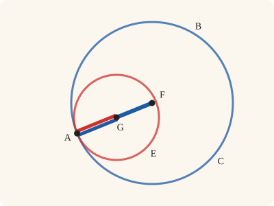
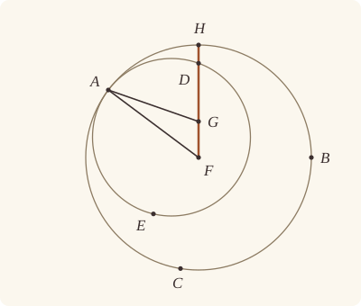

<!-- Generated by scripts/render.py. Do not edit by hand. -->

[Book III](index.md) · [← III.10](10.md) · [III.12 →](12.md)

# Book III, Proposition 11

*The centres of circles touching internally*

[Euclid's proof](#euclids-proof) · [In Lean](#in-lean) · [What it rests on](#what-it-rests-on) · [Mishnah](#mishnah)

> If two circles touch one another internally, and their centres be taken, the straight line joining their centres, if it be also produced, will fall on the point of contact of the circles.

**In Lean:** ✅ proved, as Euclid states it · Euclid's argument

<p align="center"></p>

<p align="center"><em>Let the red circle touch the blue from inside. Join their centres and carry the straight line on: it reaches the point of contact, where a radius of each (blue, red) lies along one straight line.</em></p>

## Euclid's proof

<p align="center"></p>

<p align="center"><em>Drawn for one case: A off the straight line FG, as in Heath's figure. Like Heath's, this figure draws the impossible supposition: FG produced falling as FGH, away from A, so the G drawn is not the centre of ADE.</em></p>

For let the two circles ABC, ADE touch one another internally at the point A, and let the centre F of the circle ABC, and the centre G of ADE, be taken;

I say that the straight line joined from G to F and produced will fall on A.

For suppose it does not, but, if possible, let it fall as FGH, and let AF, AG be joined.

Then, since AG, GF are greater than FA, that is, than FH,

let FG be subtracted from each;

therefore the remainder AG is greater than the remainder GH.

But AG is equal to GD;

therefore GD is also greater than GH,

the less than the greater: which is impossible.

Therefore the straight line joined from F to G will not fall outside;

therefore it will fall at A on the point of contact.

Therefore etc.

Q. E. D.

## In Lean

| | |
|---|---|
| Proof | ✅ Proved |
| Statement | The whole enunciation. FG produced beyond G, the centre of the inner circle ADE, falls on the point of contact A (`Between F G A`). |
| Argument | Euclid's. |
| Representation | The centres F and G are given, as the enunciation takes them. Touching within is read of the whole circles: a point of ADE is within ABC and no point of ADE is outside ABC, which carries what Heath says Euclid assumes, that touching circles cross nowhere. The point within serves through III.6 to distinguish F and G; the remaining proof uses the condition that none lies outside. |
| Reviewed | The statement and every passage of the argument read against Heath's text, at commit [`d87e0632f`](https://github.com/jackChallis/stoicheia/commit/d87e0632f) ([the record](../../review/III/11.toml)) |

From [`Elements/BookIII/Prop11.lean`](../../Elements/BookIII/Prop11.lean). Euclid's sentences are the `--` comments, and our own notes are in `/- … -/`; the lines under each sentence are the Lean that carries it out. The list below marks where a lemma does a step Euclid takes for granted, where several sentences share one step and where the Lean takes a case Euclid's figure leaves aside; the `/- … -/` notes in the listing explain smaller adjustments.

**How the Lean follows the text**

- **Done by `Prop6`.** "For let the two circles ABC, ADE touch one another internally…" Euclid takes F and G as the centres and treats them as different points, so that FG can be joined. The statement supplies the centres, and the Lean proves them different by III.6 (`Prop6`), for which Heath prints no reference here.
- **Done by `Prop2.within`.** "For suppose it does not, but, if possible, let it fall as FGH…" Euclid takes G within ABC before producing FG to H; the Lean places G between A and another point of ADE, then uses `Prop11.not_outside` and `Prop2.within` (III.2, for which Heath prints no reference here). It obtains that point and H from `Tacit.line_circle_beyond`, the rule we assume as System E, Intersections 5, first placing G within ADE by `Tacit.centre_inside` (System E, Generalities 3), proved in `Elements/Figure/RuleBase.lean`.
- **A further case.** "Then, since AG, GF are greater than FA…" A may lie on GF produced beyond F, a case Heath says Euclid would have left to the reader (vol. 2, p. 26). For A on FG, the Lean puts F between A and H by the proved rule `Tacit.centre_inside` (System E, Generalities 3) and `Tacit.between_of_inside_chord` (System E, Circle 1), proved after III.2, then puts F between A and G by `between_cut`, so AG is AF and FG together and AG, GF exceed FA; off FG it uses `BookI.Prop20`, for which Heath prints no reference here, and `Definition15`, the assumed rule for equal radii, replaces FA by FH in both cases.
- **Done by `Tacit.len_add_of_between`.** "let FG be subtracted from each…" Euclid subtracts FG from FH, taking FH as FG and GH together. The Lean writes that sum using `Tacit.len_add_of_between`, a rule we assume (System E, Diagram-segment 1), with G between F and H.
- **Done by `Magnitude.lt_of_add_lt_add_left`.** "therefore the remainder AG is greater than the remainder GH." Euclid keeps the strict inequality when the common length FG is taken away. `Magnitude.lt_of_add_lt_add_left` proves this cancellation from the laws of magnitudes.
- **Done by `Definition15`.** "But AG is equal to GD…" Euclid uses AG and GD as equal radii of ADE; the Lean applies `Definition15`, Euclid's definition of a circle, which we assume as a rule. It first obtains D on FG produced beyond G from `Tacit.line_circle_beyond`, the rule we assume as System E, Intersections 5, with G within ADE by `Tacit.centre_inside` (System E, Generalities 3), proved as above.
- **Done by `outside_of_len_gt`.** "the less than the greater…" Euclid rules out GD greater than GH because the inner circle cannot extend outside ABC. The Lean places D beyond H by `OnRay.between_of_len_lt`, adds FG to compare FD with FH, and uses `outside_of_len_gt` to put D outside ABC, contrary to internal contact.
- **Carried together.** "Therefore the straight line joined from F to G will not fall outside…" The Lean's single reductio proves that G lies between F and A. That conclusion carries both closing sentences about FG produced falling on the point of contact.

<details><summary>Before the theorem, one lemma: <code>Prop11.not_outside</code> (6 lines)</summary>

```lean
/-- A point not outside a circle is within it or on it. Euclid reads the points of
the inner circle this way when placing its centre within the outer circle. -/
theorem Prop11.not_outside {P : Point} {α : Circle} (h : ¬ OutsideCircle P α) :
    InsideCircle P α ∨ OnCircle P α := by
  exact Classical.byContradiction fun h' =>
    h ⟨fun hi => h' (Or.inl hi), fun ho => h' (Or.inr ho)⟩
```

</details>

```lean
/-- If two circles touch one another internally, and their centres be taken, the straight line
joining their centres, if it be also produced, will fall on the point of contact of the circles. -/
theorem Prop11 {A F G : Point} {ABC ADE : Circle} (hF : Centre F ABC) (hG : Centre G ADE)
    (htouch : TouchesInternally ABC ADE A) :
    Between F G A := by
  -- For let the two circles ABC, ADE touch one another internally at the point A, and let the
  -- centre F of the circle ABC, and the centre G of ADE, be taken;
  /- By III.6 the centres differ, so FG is a straight line. -/
  have hFG : F ≠ G := fun e => Prop6 (Or.inl htouch) ⟨hF, e ▸ hG⟩
  obtain ⟨hA₁, hA₂, -, hwithin⟩ := htouch
  -- I say that the straight line joined from G to F and produced will fall on A.
  -- For suppose it does not, but, if possible, let it fall as FGH, and let AF, AG be joined.
  have hnot : ¬ ¬ Between F G A := by
    intro hFGA
    obtain ⟨L, hF_L, hG_L⟩ := Postulate1 F G hFG
    /- The inner centre is within the outer circle: it lies between two points
       of the inner circle, neither of which is outside the outer. -/
    have hGA : G ≠ A := (ne_of_centre_of_on hG hA₂).symm
    obtain ⟨M, hG_M, hA_M⟩ := Postulate1 G A hGA
    obtain ⟨Q, hQ, -, hQGA⟩ :=
      line_circle_beyond (centre_inside hG) hG_M hA_M hGA.symm
    have hG_in : InsideCircle G ABC :=
      Prop2.within (Prop11.not_outside (hwithin Q hQ)) (Or.inr hA₁) hQGA
    obtain ⟨H, hH, hH_L, hHGF⟩ := line_circle_beyond hG_in hG_L hF_L hFG
    have hFGH : Between F G H := between_symm hHGF
    have hAH : A ≠ H := fun e => hFGA (e ▸ hFGH)
    -- Then, since AG, GF are greater than FA, that is, than FH,
    have h20 : ‖F A‖ < ‖F G‖ + ‖G A‖ := by
      by_cases hA_L : OnLine A L
      · /- A lies on GF produced beyond F, a case Heath says Euclid would have left to
           the reader (vol. 2, p. 26). Here AG is AF and FG together, so it already
           exceeds AF. -/
        have hAFH : Between A F H :=
          between_of_inside_chord hF_L hA_L hH_L (centre_inside hF) hA₁ hH hAH
        have hAFG : Between A F G := between_cut hAFH hFGH
        have hFA_GA : ‖F A‖ < ‖G A‖ := by
          rw [len_symm F A, len_symm G A, ← len_add_of_between hAFG]
          exact CommonNotion5 (len_pos hFG)
        exact lt_trans hFA_GA (by rw [add_comm]; exact CommonNotion5 (len_pos hFG))
      · exact (BookI.Prop20 (Triangle.of_line hG_L hF_L hFG.symm hA_L)).1
    rw [Definition15 hF hA₁ hH] at h20
    -- let FG be subtracted from each;
    rw [← len_add_of_between hFGH] at h20
    -- therefore the remainder AG is greater than the remainder GH.
    have hGH_GA : ‖G H‖ < ‖G A‖ := Magnitude.lt_of_add_lt_add_left h20
    -- But AG is equal to GD;
    obtain ⟨D, hD, -, hDGF⟩ := line_circle_beyond (centre_inside hG) hG_L hF_L hFG
    have hGA_GD : ‖G A‖ = ‖G D‖ := Definition15 hG hA₂ hD
    -- therefore GD is also greater than GH,
    have hGH_GD : ‖G H‖ < ‖G D‖ := hGA_GD ▸ hGH_GA
    -- the less than the greater: which is impossible.
    /- GD greater than GH puts D beyond H, outside ABC, which internal contact forbids; and
       since GD is greater, D is not H itself. -/
    have hGHD : Between G H D :=
      OnRay.between_of_len_lt (OnRay.self (ne_of_between hHGF).symm)
        (OnRay.of_between_between hFGH (between_symm hDGF)) hGH_GD
    have hFGD : Between F G D := between_of_between_right hFGH hGHD
    have hFD : ‖F H‖ < ‖F D‖ := by
      rw [← len_add_of_between hFGH, ← len_add_of_between hFGD,
        add_comm (‖F G‖), add_comm (‖F G‖)]
      exact add_lt_add_right _ hGH_GD
    exact hwithin D hD (outside_of_len_gt hF hH hFD)
  -- Therefore the straight line joined from F to G will not fall outside;
  -- therefore it will fall at A on the point of contact.
  exact Classical.byContradiction hnot
  -- Therefore etc.
  -- Q. E. D.
```

## What it rests on

| | |
|---|---|
| Heath's references | none |
| Lean cites | [I.20](../I/20.md), [III.2](02.md), [III.6](06.md) |
| Postulates | 1, 2, 3, 4 |
| Definitions taken as axioms | Def. I.15 |
| Common Notions | 1, 2, 3, 4, 5 |
| Tacit rules | 38 (listed below) |
| Its own Lean calls | Postulate 1; Def. I.15; 7 tacit rules |
| Through lemmas | Postulates 2 and 3; 18 tacit rules |

Some of these come in through lemmas [shared](../../CERTIFICATE.md#shared-steps) by many proofs: [`Prop2.within`](../../Elements/BookIII/Prop02.lean#L117), [`Tacit.between_of_inside_chord`](../../Elements/BookIII/Prop02.lean#L192) (III.2).

_Postulates, definitions, Common Notions and tacit rules: all that this proof rests on, counting those of the propositions it cites. The last two rows say which of the postulates, definitions and tacit rules its own Lean calls, in the proof or a helper written for it, and which it does not call but reaches through lemmas, of Book Zero or shared (a proposition it cites may rest on these too); the rest come in only through the propositions it cites or the Common Notions._

<details><summary>The 38 tacit rules beneath this proof, counting those of the propositions it cites</summary>

_(used here) marks a rule this proof's own Lean calls, in the proof or a helper written for it; (through …) marks one its own Lean does not call but reaches through the lemmas named, of [Book Zero](../../Elements/Figure) or shared, though a proposition it cites may rest on it too; and a rule with no mark comes in only through a proposition it cites or a Common Notion. The names in brackets are System E's: an Intersection rule says when straight lines and circles must meet, and an Intersections rule takes a point where they do (see [Book I's introduction](../I/index.md))._

**Reading the figure**

- [`between_cases`](../../Elements/Foundations/Tacit/Diagram.lean#L54) (through [`OnRay.between_of_len_lt`](../../Elements/Figure/Rays.lean#L123), [`OnRay.of_between_between`](../../Elements/Figure/Rays.lean#L88), [`Prop2.within`](../../Elements/BookIII/Prop02.lean#L117) and 3 other lemmas): Of three different points on a straight line, one is between the other two. (Between 6)
- [`between_symm`](../../Elements/Foundations/Tacit/Diagram.lean#L47) (used here): If B is between A and C, it is between C and A. (Between 1)
- [`circles_meet`](../../Elements/Foundations/Tacit/Diagram.lean#L91) (through [`OnRay.between_of_len_lt`](../../Elements/Figure/Rays.lean#L123), [`OnRay.of_between_between`](../../Elements/Figure/Rays.lean#L88), [`Prop2.within`](../../Elements/BookIII/Prop02.lean#L117) and 3 other lemmas): If each circle passes through a point inside the other, the circles cut one another. This is the step Euclid takes for granted in I.1. (Intersection 5)
- [`circles_meet_same_side`](../../Elements/Foundations/Tacit/Constructions.lean#L79) (through [`OnRay.between_of_len_lt`](../../Elements/Figure/Rays.lean#L123), [`OnRay.of_between_between`](../../Elements/Figure/Rays.lean#L88), [`Prop2.within`](../../Elements/BookIII/Prop02.lean#L117) and 3 other lemmas): Two circles that cut one another do so on each side of the straight line through their centres. (Intersections 8)
- [`exists_centre`](../../Elements/Foundations/Tacit/Constructions.lean#L57) (through [`Tacit.between_of_inside_chord`](../../Elements/BookIII/Prop02.lean#L192)): Every circle has a centre. A rule of our own, not one of System E's: its content is Euclid's Definitions I.15 and I.16.
- [`exists_point`](../../Elements/Foundations/Tacit/Constructions.lean#L35): Let a point be taken. (Points 1)
- [`exists_point_inside_circle`](../../Elements/Foundations/Tacit/Constructions.lean#L42) (through [`OnRay.between_of_len_lt`](../../Elements/Figure/Rays.lean#L123), [`OnRay.of_between_between`](../../Elements/Figure/Rays.lean#L88), [`Prop2.within`](../../Elements/BookIII/Prop02.lean#L117) and 4 other lemmas): Let a point be taken inside the circle α. (Points 8)
- [`exists_point_on_line`](../../Elements/Foundations/Tacit/Constructions.lean#L38) (through [`OnRay.between_of_len_lt`](../../Elements/Figure/Rays.lean#L123), [`OnRay.of_between_between`](../../Elements/Figure/Rays.lean#L88), [`Prop2.within`](../../Elements/BookIII/Prop02.lean#L117) and 3 other lemmas): Let a point be taken on the straight line L. (Points 2)
- [`line_circle_between`](../../Elements/Foundations/Tacit/Constructions.lean#L67) (through [`OnRay.between_of_len_lt`](../../Elements/Figure/Rays.lean#L123), [`OnRay.of_between_between`](../../Elements/Figure/Rays.lean#L88), [`Prop2.within`](../../Elements/BookIII/Prop02.lean#L117) and 4 other lemmas): A straight line through a point B inside a circle, heading out to a point C outside it, cuts the circle between B and C. (Intersections 4)
- [`line_circle_beyond`](../../Elements/Foundations/Tacit/Constructions.lean#L73) (used here): A straight line through a point B inside a circle, produced beyond B away from C, cuts the circle there. (Intersections 5)
- [`line_unique`](../../Elements/Foundations/Tacit/Diagram.lean#L41) (through [`OnRay.between_of_len_lt`](../../Elements/Figure/Rays.lean#L123), [`OnRay.of_between_between`](../../Elements/Figure/Rays.lean#L88), [`Tacit.between_of_between_right`](../../Elements/Figure/Incidence.lean#L208) and 2 other lemmas): Two points determine a straight line. (Generalities 1)
- [`lines_meet_of_opposite_sides`](../../Elements/Foundations/Tacit/Diagram.lean#L86): A straight line joining points on opposite sides of L crosses L. (Intersection 1)
- [`not_between_of_between`](../../Elements/Foundations/Tacit/Diagram.lean#L50) (through [`OnRay.between_of_len_lt`](../../Elements/Figure/Rays.lean#L123), [`OnRay.of_between_between`](../../Elements/Figure/Rays.lean#L88), [`OnRay.self`](../../Elements/Figure/Rays.lean#L29) and 7 other lemmas): If B is between A and C, then A is not between B and C. (Between 1)
- [`not_on_line_of_same_side`](../../Elements/Foundations/Tacit/Diagram.lean#L60) (through [`OnRay.between_of_len_lt`](../../Elements/Figure/Rays.lean#L123), [`OnRay.of_between_between`](../../Elements/Figure/Rays.lean#L88), [`Prop2.within`](../../Elements/BookIII/Prop02.lean#L117) and 3 other lemmas): Points on one side of a straight line are not on it. (Same side 3)
- [`pasch2`](../../Elements/Foundations/Tacit/Diagram.lean#L71) (through [`OnRay.between_of_len_lt`](../../Elements/Figure/Rays.lean#L123), [`OnRay.of_between_between`](../../Elements/Figure/Rays.lean#L88), [`Prop2.within`](../../Elements/BookIII/Prop02.lean#L117) and 3 other lemmas): If B is between A and C, A is on L and B is off it, then B and C are on the same side of L: a straight line that leaves L at A does not cross it again. (Pasch 2)
- [`same_side_trans`](../../Elements/Foundations/Tacit/Diagram.lean#L64) (through [`OnRay.between_of_len_lt`](../../Elements/Figure/Rays.lean#L123), [`OnRay.of_between_between`](../../Elements/Figure/Rays.lean#L88), [`Prop2.within`](../../Elements/BookIII/Prop02.lean#L117) and 3 other lemmas): Two points on the same side of a straight line as a third point are on the same side as each other. (Same side 4)

**Lengths, angles and areas**

- [`angle_add_of_inside`](../../Elements/Foundations/Tacit/Transfer.lean#L47): If D lies within the angle BAC, then BAC is made up of BAD and DAC. (Diagram-angle 2)
- [`angle_eq_of_same_rays`](../../Elements/Foundations/Tacit/Transfer.lean#L54): The angle doesn't change if its arms are traced through other points on the same rays. (Diagram-angle 4)
- [`angle_symm`](../../Elements/Foundations/Tacit/Metric.lean#L30): The angle ABC is the angle CBA. (Metric 4)
- [`area_add_of_between`](../../Elements/Foundations/Tacit/Transfer.lean#L70): Cutting a triangle in two from a vertex adds up. (Diagram-area 2)
- [`area_congruent`](../../Elements/Foundations/Tacit/Metric.lean#L44): Triangles equal in all their sides and angles are equal in area. Euclid uses this without comment once he has shown two triangles congruent. (Metric 9)
- [`area_degenerate`](../../Elements/Foundations/Tacit/Metric.lean#L36): A "triangle" with a repeated corner has no area. (Metric 6)
- [`area_eq_zero_of_on_line`](../../Elements/Foundations/Tacit/Transfer.lean#L62): A "triangle" whose corners lie on one straight line has no area. (Diagram-area 1)
- [`area_rotate`](../../Elements/Foundations/Tacit/Metric.lean#L39): The triangle ABC is the triangle CAB. (Metric 8)
- [`len_add_of_between`](../../Elements/Foundations/Tacit/Transfer.lean#L27) (used here): If B is between A and C, then AB and BC together make up AC. (Diagram-segment 1)
- [`len_self`](../../Elements/Foundations/Tacit/Metric.lean#L24) (through [`OnRay.between_of_len_lt`](../../Elements/Figure/Rays.lean#L123), [`OnRay.of_between_between`](../../Elements/Figure/Rays.lean#L88), [`OnRay.self`](../../Elements/Figure/Rays.lean#L29) and 7 other lemmas): The "straight line" from a point to itself has no length. (Metric 1)
- [`len_symm`](../../Elements/Foundations/Tacit/Metric.lean#L27) (used here): The straight line AB is the straight line BA. (Metric 3)
- [`radius_ne_zero`](../../Elements/Foundations/Tacit/Metric.lean#L62) (through [`OnRay.between_of_len_lt`](../../Elements/Figure/Rays.lean#L123), [`OnRay.of_between_between`](../../Elements/Figure/Rays.lean#L88), [`OnRay.self`](../../Elements/Figure/Rays.lean#L29) and 8 other lemmas): A circle's radius is not nothing: the straight line from the centre to a point on the circle has some length. A rule of our own, not one of System E's: every circle is drawn with a centre and a distance (Postulate 3).
- [`same_ray_of_angle_eq_zero`](../../Elements/Foundations/Tacit/Transfer.lean#L42): If the angle BAC is nothing, C lies on the ray from A through B. (Diagram-angle 1)

**Superposition**

- [`superposition`](../../Elements/Foundations/Tacit/Superposition.lean#L48): **Superposition.** A hypothetical placement of a triangle on a given ray and side permits a restricted derivation of metric equalities about the figure already given. The derivation introduces no further objects, cites each geometric law it uses, and exports no symbol of the placement.

**Laws of magnitude**

- [`add_assoc`](../../Elements/Foundations/Tacit/Magnitudes.lean#L23) (through [`OnRay.between_of_len_lt`](../../Elements/Figure/Rays.lean#L123), [`Prop2.within`](../../Elements/BookIII/Prop02.lean#L117), [`Tacit.between_of_between_right`](../../Elements/Figure/Incidence.lean#L208) and 2 other lemmas): Adding three magnitudes in a row, it makes no difference whether the first two or the last two are added first. (System E §3.5)
- [`add_comm`](../../Elements/Foundations/Tacit/Magnitudes.lean#L26) (used here): The order of adding does not matter. (System E §3.5)
- [`add_lt_add_right`](../../Elements/Foundations/Tacit/Magnitudes.lean#L45) (used here): Adding the same thing to both sides keeps "less than". (System E §3.5)
- [`add_zero`](../../Elements/Foundations/Tacit/Magnitudes.lean#L29): Adding nothing changes nothing. (System E §3.5)
- [`lt_irrefl`](../../Elements/Foundations/Tacit/Magnitudes.lean#L32) (through [`Magnitude.lt_of_add_lt_add_left`](../../Elements/Figure/Lengths.lean#L61), [`OnRay.between_of_len_lt`](../../Elements/Figure/Rays.lean#L123), [`OnRay.of_between_between`](../../Elements/Figure/Rays.lean#L88) and 6 other lemmas): No magnitude is less than itself. (System E §3.5)
- [`lt_trans`](../../Elements/Foundations/Tacit/Magnitudes.lean#L35) (used here): What is less than the less is less still. (System E §3.5)
- [`lt_trichotomy`](../../Elements/Foundations/Tacit/Magnitudes.lean#L39) (through [`Magnitude.lt_of_add_lt_add_left`](../../Elements/Figure/Lengths.lean#L61), [`OnRay.between_of_len_lt`](../../Elements/Figure/Rays.lean#L123), [`OnRay.of_between_between`](../../Elements/Figure/Rays.lean#L88) and 8 other lemmas): Of two magnitudes, one is less, or they are equal, or the other is less. (System E §3.5)
- [`not_lt_zero`](../../Elements/Foundations/Tacit/Magnitudes.lean#L42) (through [`OnRay.between_of_len_lt`](../../Elements/Figure/Rays.lean#L123), [`OnRay.of_between_between`](../../Elements/Figure/Rays.lean#L88), [`OnRay.self`](../../Elements/Figure/Rays.lean#L29) and 7 other lemmas): Nothing is less than zero. (System E §3.5)

</details>

## Mishnah

_Our commentary: what Euclid assumes, what Lean made us say out loud, and how the result looks by modern means._

**"Beset with difficulties."** Euclid joins the centres F and G, produces the straight line beyond G to meet the outer circle at H, and supposes that H is not A; then GD comes out greater than GH, "the less than the greater". Heath finds the proof "beset with difficulties in consequence of what it tacitly assumes in the figure" (vol. 2, p. 25), and sets out J. G. Camerer's careful note.

Definition III.3 has touching circles meet but not cut one another. Isaac Todhunter reads this of the whole circles, Heath of the point of contact alone: "Todhunter thinks the latter opinion correct. I do not think this is proved; and I prefer to read the definition as meaning simply that the circles meet at a point but do not cut *at that point*" (vol. 2, p. 3). On Heath's reading, that they cross nowhere else wants a proof, and Euclid "does practically assume in III. 11–13, without stating, the theorem that circles touching at one point do not intersect anywhere else" (vol. 2, p. 3).

**Todhunter's reading, made exact.** Heath's reading lives at a single point, and our foundations can now express neighbourhoods. His local contact is defined too, and after III.13 its companions prove it the same as our whole-circle reading, for any two circles (`Prop13.touchesInternally_iff`). Here we take Todhunter's whole circles, made exact with the inside and outside that Heath says the definition must imply: in `TouchesInternally`, ABC and ADE meet at A, a point of ADE is within ABC, and no point of ADE is outside ABC. The point within is the inner circle's passage into the outer, and it makes the circles different without a hypothesis of its own; III.6 uses it to show that F and G differ, so that FG can be drawn. Our definition carries what Euclid assumes, that touching circles cross nowhere, and here that matters, for D must be kept from falling outside ABC however far it lies from A. That they meet at one point only is left for III.13.

Euclid's proof becomes "absolutely conclusive", Heath shows, once FG is produced beyond G, the centre of the inner circle, and found to meet that circle "*not further* from G" than the other (vol. 2, p. 26). Our statement asks the first, `Between F G A`, and our proof finds the second inside Euclid's argument: G lies within ABC, between two points of ADE, neither of them outside ABC, and GD greater than GH puts D beyond H, outside ABC, which touching internally forbids. Heath gives no reference for "AG, GF are greater than FA", which is I.20, or for the centres being two, which is III.6.

**The modern way.** Circles with centres F and G and radii $R \gt r$ touch internally exactly when $\mathrm{FG} = R - r$, and the point of contact is then $\mathrm{A} = \mathrm{F} + \frac{R}{R - r}\overrightarrow{\mathrm{FG}}$, beyond G on the ray from F.

## Further reading

- Isaac Todhunter's note on the third definition (p. 271), in his [*The Elements of Euclid*](https://archive.org/details/todhuntereuclid00todhrich) (1872, free online), reads Definition III.3 as our definition of touching within makes exact: touching circles "do not cut at all" (also on [III.3](03.md)).
- Augustus De Morgan's remarks on III.11–13 (pp. 10–11) find that "the contact of circles is in a state of confusion in Euclid", and speak of the "positive assumption" that a circle touching within lies entirely within the other, the assumption our definition carries: ["Short Supplementary Remarks on the First Six Books of Euclid's Elements"](https://archive.org/details/sim_british-almanac-companion_1849) (1849, free online) (also on [III.7](07.md)).

[Book III](index.md) · [← III.10](10.md) · [III.12 →](12.md)

---

<sub>Euclid's text: T. L. Heath, *The Thirteen Books of Euclid's Elements*, vol. 2 (Cambridge, 1908), pp. 24–25; [scan leaves n36–n37](https://archive.org/details/thirteenbookseu00heibgoog/page/n36); [figure on n36](https://archive.org/details/thirteenbookseu00heibgoog/page/n36). Public domain.</sub>

<sub>The tacit rules follow the System E of Jeremy Avigad, Edward Dean and John Mumma, read alongside LeanEuclid (Logan Murphy, Kaiyu Yang, Jialiang Sun, Zhaoyu Li, Anima Anandkumar and Xujie Si).</sub>
