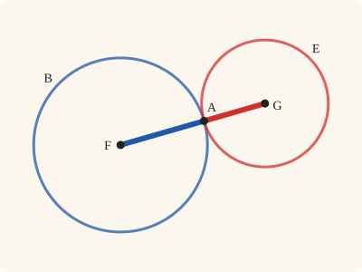
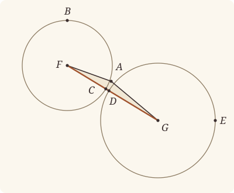

<!-- Generated by scripts/render.py. Do not edit by hand. -->

[Book III](index.md) · [← III.11](11.md) · [III.13 →](13.md)

# Book III, Proposition 12

*The centres of circles touching externally*

[Euclid's proof](#euclids-proof) · [In Lean](#in-lean) · [What it rests on](#what-it-rests-on) · [Mishnah](#mishnah)

> [If two circles touch one another externally, the straight line joining their centres will pass through the point of contact.

_Heath prints this whole proposition in square brackets; the mishnah tells why._

**In Lean:** ✅ proved, as Euclid states it · the argument Heath prints

<p align="center"></p>

<p align="center"><em>Join the centres of two circles touching from outside: the straight line passes through the point of contact, a radius of each (blue, red) laid end to end.</em></p>

## Euclid's proof

<p align="center"></p>

<p align="center"><em>Drawn for one case: A off FG, and C and D apart on it, as in Heath's figure. Like Heath's, this figure draws the impossible supposition: FG passing as FCDG, away from A, so the F and G drawn are not the centres of ABC and ADE.</em></p>

For let the two circles ABC, ADE touch one another externally at the point A, and let the centre F of ABC, and the centre G of ADE, be taken;

I say that the straight line joined from F to G will pass through the point of contact at A.

For suppose it does not, but, if possible, let it pass as FCDG, and let AF, AG be joined.

Then, since the point F is the centre of the circle ABC,

FA is equal to FC.

Again, since the point G is the centre of the circle ADE,

GA is equal to GD.

But FA was also proved equal to FC;

therefore FA, AG are equal to FC, GD,

so that the whole FG is greater than FA, AG;

but it is also less [I. 20]: which is impossible.

Therefore the straight line joined from F to G will not fail to pass through the point of contact at A;

therefore it will pass through it.

Therefore etc.

Q. E. D.]

## In Lean

| | |
|---|---|
| Proof | ✅ Proved |
| Statement | The whole enunciation. The point of contact lies between the centres (`Between F A G`). Heath prints III.12 in square brackets; it is stated and proved like the rest. |
| Argument | The argument Heath prints. |
| Representation | The centres F and G are given, as the setting-out takes them. Touching without is read of the whole circles: no point is within both. |
| Reviewed | The statement and every passage of the argument read against Heath's text, at commit [`07416606e`](https://github.com/jackChallis/stoicheia/commit/07416606e) ([the record](../../review/III/12.toml)) |

From [`Elements/BookIII/Prop12.lean`](../../Elements/BookIII/Prop12.lean). Euclid's sentences are the `--` comments, and our own notes are in `/- … -/`; the lines under each sentence are the Lean that carries it out. The list below marks where a lemma does a step Euclid takes for granted, where several sentences share one step and where the Lean takes a case Euclid's figure leaves aside; the `/- … -/` notes in the listing explain smaller adjustments.

**How the Lean follows the text**

- **Done by `Prop6`.** "For let the two circles ABC, ADE touch one another externally…" Euclid takes F and G as the centres and treats them as different points, so that FG can be joined. The statement supplies the centres, and the Lean proves them different by III.6 (`Prop6`), for which Heath prints no reference here.
- **A further case.** "For suppose it does not, but, if possible, let it pass as FCDG…" Euclid's figure has A off FG; the Lean uses `Tacit.between_cases` (System E, Between 6) to split the three orders of F, A and G on FG and excludes A on FG produced either way, the case Heath says Euclid would have left to the reader (vol. 2, p. 29), because `InsideCircle.of_between_centre` would put one centre within the other circle. Each centre is within its own circle by `Tacit.centre_inside` (System E, Generalities 3), proved in `Elements/Figure/RuleBase.lean`, and `Prop12.centre_outside` proves it outside the other, so `Tacit.line_circle_between` (System E, Intersections 4) supplies C and D between F and G. `Tacit.between_cases` and `Tacit.line_circle_between` are rules we assume.
- **Done by `Tacit.len_add_of_between`.** "so that the whole FG is greater than FA, AG…" C and D may be one point, as Heath allows (vol. 2, p. 28), so the Lean proves only that FA, AG together are not greater than FG; I.20's "less" still gives the contradiction. The Lean excludes C within ADE by `exists_between_nearer`: a point towards F sufficiently near C would be within both circles, by `InsideCircle.of_between_centre` and `Tacit.inside_of_len_lt` (System E, Diagram-segment 4), proved in `Elements/Figure/Incidence.lean`, and then writes FG as FC and CG together by `Tacit.len_add_of_between`, a rule we assume (System E, Diagram-segment 1), and compares the lengths by `Magnitude.lt_of_add_lt_add_left`.
- **Carried together.** "Therefore the straight line joined from F to G will not fail to pass…" The Lean's single reductio proves that A lies between F and G. That conclusion carries both closing sentences, including the double negative Heath preserves.

<details><summary>Before the theorem, one lemma: <code>Prop12.centre_outside</code> (12 lines)</summary>

```lean
/-- Each centre is outside the other circle when no point is within both.
If the centre lay on the other circle, a point sufficiently near it towards
the other centre would be within both. -/
theorem Prop12.centre_outside {A F G : Point} {α β : Circle}
    (hF : Centre F α) (hG : Centre G β) (hA : OnCircle A α) (hFG : F ≠ G)
    (hout : ∀ P, InsideCircle P α → ¬ InsideCircle P β) : OutsideCircle F β := by
  refine ⟨hout F (centre_inside hF), ?_⟩
  intro hF_on
  obtain ⟨P, hFPG, hP⟩ := exists_between_nearer (O := F) (C := A) hFG (Or.inl rfl)
    (by rw [len_self]; exact len_pos (ne_of_centre_of_on hF hA).symm)
  exact hout P (inside_of_len_lt hF hA hP)
    (InsideCircle.of_between_centre hG hF_on (between_symm hFPG))
```

</details>

```lean
/-- If two circles touch one another externally, the straight line joining their centres will pass
through the point of contact. -/
theorem Prop12 {A F G : Point} {ABC ADE : Circle} (hF : Centre F ABC) (hG : Centre G ADE)
    (htouch : TouchesExternally ABC ADE A) :
    Between F A G := by
  -- For let the two circles ABC, ADE touch one another externally at the point A, and let the
  -- centre F of ABC, and the centre G of ADE, be taken;
  /- As in III.11, the centres differ by III.6, so FG is a straight line. -/
  have hFG : F ≠ G := fun e => Prop6 (Or.inr (Or.inr htouch)) ⟨hF, e ▸ hG⟩
  obtain ⟨hA₁, hA₂, hout⟩ := htouch
  have hFA : F ≠ A := (ne_of_centre_of_on hF hA₁).symm
  have hGA : G ≠ A := (ne_of_centre_of_on hG hA₂).symm
  obtain ⟨L, hF_L, hG_L⟩ := Postulate1 F G hFG
  -- I say that the straight line joined from F to G will pass through the point of contact at
  -- A.
  -- For suppose it does not, but, if possible, let it pass as FCDG, and let AF, AG be joined.
  have hnot : ¬ ¬ Between F A G := by
    intro hFAG
    /- If A lay on FG produced, one centre would be within both circles. -/
    have hA_L : ¬ OnLine A L := by
      intro hA_L
      rcases between_cases hFA hGA.symm hFG hF_L hA_L hG_L with h | h | h
      · exact hFAG h
      · exact hout F (centre_inside hF)
          (InsideCircle.of_between_centre hG hA₂ (between_symm h))
      · exact hout G (InsideCircle.of_between_centre hF hA₁ h)
          (centre_inside hG)
    obtain ⟨C, hC, -, hFCG⟩ := line_circle_between (centre_inside hF) hF_L
      (Prop12.centre_outside hG hF hA₂ hFG.symm (fun P h₁ h₂ => hout P h₂ h₁)) hG_L
    obtain ⟨D, hD, -, -⟩ := line_circle_between (centre_inside hG) hG_L
      (Prop12.centre_outside hF hG hA₁ hFG hout) hF_L
    -- Then, since the point F is the centre of the circle ABC,
    -- FA is equal to FC.
    have h1 : ‖F A‖ = ‖F C‖ := Definition15 hF hA₁ hC
    -- Again, since the point G is the centre of the circle ADE,
    -- GA is equal to GD.
    have h2 : ‖G A‖ = ‖G D‖ := Definition15 hG hA₂ hD
    -- But FA was also proved equal to FC;
    -- therefore FA, AG are equal to FC, GD,
    have h3 : ‖F A‖ + ‖A G‖ = ‖F C‖ + ‖G D‖ := by
      rw [h1, len_symm A G, h2]
    -- so that the whole FG is greater than FA, AG;
    /- C cannot be within ADE: a point of CF sufficiently near C would be
       within both circles. C and D may be one point, so "not less" suffices. -/
    have hC_out : ¬ ‖G C‖ < ‖G A‖ := by
      intro h
      obtain ⟨P, hCPF, hP⟩ :=
        exists_between_nearer (O := G) (C := A) (ne_of_between hFCG).symm
          (Or.inr (between_symm hFCG)) h
      exact hout P (InsideCircle.of_between_centre hF hC (between_symm hCPF))
        (inside_of_len_lt hG hA₂ hP)
    have h4 : ‖F A‖ + ‖A G‖ ≤ ‖F G‖ := by
      intro h
      rw [h3, ← len_add_of_between hFCG] at h
      have hlt := Magnitude.lt_of_add_lt_add_left h
      rw [len_symm C G, ← h2] at hlt
      exact hC_out hlt
    -- but it is also less [I. 20]: which is impossible.
    exact h4 (BookI.Prop20 (Triangle.of_line hF_L hG_L hFG hA_L).cab).1
  -- Therefore the straight line joined from F to G will not fail to pass through the point of
  -- contact at A;
  -- therefore it will pass through it.
  exact Classical.byContradiction hnot
  -- Therefore etc.
  -- Q. E. D.]
```

## What it rests on

| | |
|---|---|
| Heath's references | [I.20](../I/20.md) |
| Lean cites | [I.20](../I/20.md), [III.6](06.md) |
| Postulates | 1, 2, 3, 4 |
| Definitions taken as axioms | Def. I.15 |
| Common Notions | 1, 2, 3, 4, 5 |
| Tacit rules | 38 (listed below) |
| Its own Lean calls | Postulate 1; Def. I.15; 6 tacit rules |
| Through lemmas | Postulate 3; 20 tacit rules |

_Postulates, definitions, Common Notions and tacit rules: all that this proof rests on, counting those of the propositions it cites. The last two rows say which of the postulates, definitions and tacit rules its own Lean calls, in the proof or a helper written for it, and which it does not call but reaches through lemmas, of Book Zero or shared (a proposition it cites may rest on these too); the rest come in only through the propositions it cites or the Common Notions._

<details><summary>The 38 tacit rules beneath this proof, counting those of the propositions it cites</summary>

_(used here) marks a rule this proof's own Lean calls, in the proof or a helper written for it; (through …) marks one its own Lean does not call but reaches through the lemmas named, of [Book Zero](../../Elements/Figure) or shared, though a proposition it cites may rest on it too; and a rule with no mark comes in only through a proposition it cites or a Common Notion. The names in brackets are System E's: an Intersection rule says when straight lines and circles must meet, and an Intersections rule takes a point where they do (see [Book I's introduction](../I/index.md))._

**Reading the figure**

- [`between_cases`](../../Elements/Foundations/Tacit/Diagram.lean#L54) (used here): Of three different points on a straight line, one is between the other two. (Between 6)
- [`between_of_inside_chord`](../../Elements/Foundations/Tacit/Diagram.lean#L81) (through [`InsideCircle.of_between_centre`](../../Elements/Figure/Circles.lean#L164), [`Tacit.centre_inside`](../../Elements/Figure/RuleBase.lean#L87), [`Tacit.inside_of_len_lt`](../../Elements/Figure/Incidence.lean#L33) and 3 other lemmas): A straight line through a point inside a circle has that point between the points where it meets the circle. (Circle 1)
- [`between_symm`](../../Elements/Foundations/Tacit/Diagram.lean#L47) (used here): If B is between A and C, it is between C and A. (Between 1)
- [`circles_meet`](../../Elements/Foundations/Tacit/Diagram.lean#L94) (through [`exists_between_nearer`](../../Elements/Figure/Circles.lean#L187)): If each circle passes through a point inside the other, the circles cut one another. This is the step Euclid takes for granted in I.1. (Intersection 5)
- [`circles_meet_same_side`](../../Elements/Foundations/Tacit/Constructions.lean#L79) (through [`exists_between_nearer`](../../Elements/Figure/Circles.lean#L187)): Two circles that cut one another do so on each side of the straight line through their centres. (Intersections 8)
- [`exists_point`](../../Elements/Foundations/Tacit/Constructions.lean#L35) (through [`InsideCircle.of_between_centre`](../../Elements/Figure/Circles.lean#L164), [`Tacit.inside_of_len_lt`](../../Elements/Figure/Incidence.lean#L33), [`exists_between_nearer`](../../Elements/Figure/Circles.lean#L187) and 2 other lemmas): Let a point be taken. (Points 1)
- [`exists_point_inside_circle`](../../Elements/Foundations/Tacit/Constructions.lean#L42) (through [`InsideCircle.of_between_centre`](../../Elements/Figure/Circles.lean#L164), [`Tacit.centre_inside`](../../Elements/Figure/RuleBase.lean#L87), [`Tacit.inside_of_len_lt`](../../Elements/Figure/Incidence.lean#L33) and 3 other lemmas): Let a point be taken inside the circle α. (Points 8)
- [`exists_point_on_line`](../../Elements/Foundations/Tacit/Constructions.lean#L38) (through [`exists_between_nearer`](../../Elements/Figure/Circles.lean#L187)): Let a point be taken on the straight line L. (Points 2)
- [`line_circle_between`](../../Elements/Foundations/Tacit/Constructions.lean#L67) (used here): A straight line through a point B inside a circle, heading out to a point C outside it, cuts the circle between B and C. (Intersections 4)
- [`line_circle_beyond`](../../Elements/Foundations/Tacit/Constructions.lean#L73) (through [`InsideCircle.of_between_centre`](../../Elements/Figure/Circles.lean#L164), [`Tacit.centre_inside`](../../Elements/Figure/RuleBase.lean#L87), [`Tacit.inside_of_len_lt`](../../Elements/Figure/Incidence.lean#L33) and 3 other lemmas): A straight line through a point B inside a circle, produced beyond B away from C, cuts the circle there. (Intersections 5)
- [`line_unique`](../../Elements/Foundations/Tacit/Diagram.lean#L41) (through [`Triangle.of_line`](../../Elements/Figure/Triangles.lean#L82) and [`exists_between_nearer`](../../Elements/Figure/Circles.lean#L187)): Two points determine a straight line. (Generalities 1)
- [`lines_meet_of_opposite_sides`](../../Elements/Foundations/Tacit/Diagram.lean#L89): A straight line joining points on opposite sides of L crosses L. (Intersection 1)
- [`not_between_of_between`](../../Elements/Foundations/Tacit/Diagram.lean#L50) (through [`InsideCircle.of_between_centre`](../../Elements/Figure/Circles.lean#L164), [`Tacit.centre_inside`](../../Elements/Figure/RuleBase.lean#L87), [`Tacit.inside_of_len_lt`](../../Elements/Figure/Incidence.lean#L33) and 4 other lemmas): If B is between A and C, then A is not between B and C. (Between 1)
- [`not_on_line_of_same_side`](../../Elements/Foundations/Tacit/Diagram.lean#L60) (through [`exists_between_nearer`](../../Elements/Figure/Circles.lean#L187)): Points on one side of a straight line are not on it. (Same side 3)
- [`pasch2`](../../Elements/Foundations/Tacit/Diagram.lean#L71) (through [`exists_between_nearer`](../../Elements/Figure/Circles.lean#L187)): If B is between A and C, A is on L and B is off it, then B and C are on the same side of L: a straight line that leaves L at A does not cross it again. (Pasch 2)
- [`same_side_trans`](../../Elements/Foundations/Tacit/Diagram.lean#L64) (through [`exists_between_nearer`](../../Elements/Figure/Circles.lean#L187)): Two points on the same side of a straight line as a third point are on the same side as each other. (Same side 4)

**Lengths, angles and areas**

- [`angle_add_of_inside`](../../Elements/Foundations/Tacit/Transfer.lean#L47): If D lies within the angle BAC, then BAC is made up of BAD and DAC. (Diagram-angle 2)
- [`angle_eq_of_same_rays`](../../Elements/Foundations/Tacit/Transfer.lean#L54): The angle doesn't change if its arms are traced through other points on the same rays. (Diagram-angle 4)
- [`angle_symm`](../../Elements/Foundations/Tacit/Metric.lean#L30): The angle ABC is the angle CBA. (Metric 4)
- [`area_add_of_between`](../../Elements/Foundations/Tacit/Transfer.lean#L70): Cutting a triangle in two from a vertex adds up. (Diagram-area 2)
- [`area_congruent`](../../Elements/Foundations/Tacit/Metric.lean#L44): Triangles equal in all their sides and angles are equal in area. Euclid uses this without comment once he has shown two triangles congruent. (Metric 9)
- [`area_degenerate`](../../Elements/Foundations/Tacit/Metric.lean#L36): A "triangle" with a repeated corner has no area. (Metric 6)
- [`area_eq_zero_of_on_line`](../../Elements/Foundations/Tacit/Transfer.lean#L62): A "triangle" whose corners lie on one straight line has no area. (Diagram-area 1)
- [`area_rotate`](../../Elements/Foundations/Tacit/Metric.lean#L39): The triangle ABC is the triangle CAB. (Metric 8)
- [`circle_eq`](../../Elements/Foundations/Tacit/Transfer.lean#L30) (through [`InsideCircle.of_between_centre`](../../Elements/Figure/Circles.lean#L164), [`Tacit.centre_inside`](../../Elements/Figure/RuleBase.lean#L87), [`Tacit.inside_of_len_lt`](../../Elements/Figure/Incidence.lean#L33) and 3 other lemmas): A circle is fixed by its centre and its radius. (Diagram-segment 2)
- [`len_add_of_between`](../../Elements/Foundations/Tacit/Transfer.lean#L27) (used here): If B is between A and C, then AB and BC together make up AC. (Diagram-segment 1)
- [`len_self`](../../Elements/Foundations/Tacit/Metric.lean#L24) (used here): The "straight line" from a point to itself has no length. (Metric 1)
- [`len_symm`](../../Elements/Foundations/Tacit/Metric.lean#L27) (used here): The straight line AB is the straight line BA. (Metric 3)
- [`same_ray_of_angle_eq_zero`](../../Elements/Foundations/Tacit/Transfer.lean#L42): If the angle BAC is nothing, C lies on the ray from A through B. (Diagram-angle 1)

**Superposition**

- [`superposition`](../../Elements/Foundations/Tacit/Superposition.lean#L48): **Superposition.** A hypothetical placement of a triangle on a given ray and side permits a restricted derivation of metric equalities about the figure already given. The derivation introduces no further objects, cites each geometric law it uses, and exports no symbol of the placement.

**Laws of magnitude**

- [`add_assoc`](../../Elements/Foundations/Tacit/Magnitudes.lean#L23) (through [`exists_between_nearer`](../../Elements/Figure/Circles.lean#L187)): Adding three magnitudes in a row, it makes no difference whether the first two or the last two are added first. (System E §3.5)
- [`add_comm`](../../Elements/Foundations/Tacit/Magnitudes.lean#L26) (through [`InsideCircle.of_between_centre`](../../Elements/Figure/Circles.lean#L164), [`Magnitude.lt_of_add_lt_add_left`](../../Elements/Figure/Lengths.lean#L61), [`Tacit.centre_inside`](../../Elements/Figure/RuleBase.lean#L87) and 4 other lemmas): The order of adding does not matter. (System E §3.5)
- [`add_lt_add_right`](../../Elements/Foundations/Tacit/Magnitudes.lean#L45) (through [`Magnitude.lt_of_add_lt_add_left`](../../Elements/Figure/Lengths.lean#L61) and [`exists_between_nearer`](../../Elements/Figure/Circles.lean#L187)): Adding the same thing to both sides keeps "less than". (System E §3.5)
- [`add_zero`](../../Elements/Foundations/Tacit/Magnitudes.lean#L29): Adding nothing changes nothing. (System E §3.5)
- [`lt_irrefl`](../../Elements/Foundations/Tacit/Magnitudes.lean#L32) (through [`InsideCircle.of_between_centre`](../../Elements/Figure/Circles.lean#L164), [`Magnitude.lt_of_add_lt_add_left`](../../Elements/Figure/Lengths.lean#L61), [`Tacit.centre_inside`](../../Elements/Figure/RuleBase.lean#L87) and 4 other lemmas): No magnitude is less than itself. (System E §3.5)
- [`lt_trans`](../../Elements/Foundations/Tacit/Magnitudes.lean#L35) (through [`InsideCircle.of_between_centre`](../../Elements/Figure/Circles.lean#L164), [`Magnitude.lt_of_add_lt_add_left`](../../Elements/Figure/Lengths.lean#L61), [`Tacit.centre_inside`](../../Elements/Figure/RuleBase.lean#L87) and 4 other lemmas): What is less than the less is less still. (System E §3.5)
- [`lt_trichotomy`](../../Elements/Foundations/Tacit/Magnitudes.lean#L39) (through [`InsideCircle.of_between_centre`](../../Elements/Figure/Circles.lean#L164), [`Magnitude.lt_of_add_lt_add_left`](../../Elements/Figure/Lengths.lean#L61), [`Tacit.centre_inside`](../../Elements/Figure/RuleBase.lean#L87) and 4 other lemmas): Of two magnitudes, one is less, or they are equal, or the other is less. (System E §3.5)
- [`not_lt_zero`](../../Elements/Foundations/Tacit/Magnitudes.lean#L42) (through [`InsideCircle.of_between_centre`](../../Elements/Figure/Circles.lean#L164), [`Tacit.centre_inside`](../../Elements/Figure/RuleBase.lean#L87), [`Tacit.inside_of_len_lt`](../../Elements/Figure/Incidence.lean#L33) and 3 other lemmas): Nothing is less than zero. (System E §3.5)

</details>

## Mishnah

_Our commentary: what Euclid assumes, what Lean made us say out loud, and how the result looks by modern means._

**"But I will show how."** Heath prints III.12 in square brackets. Heron, he reports, says on III.11: "Euclid in proposition 11 has supposed the two circles to touch internally … *But I will show how it is to be proved if the contact is external.*" Heron's proof and figure are substantially these, and Heath judges: "It is most probable that Theon or some other editor added Heron's proof in his edition and made Prop. 12 out of it" (vol. 2, p. 28). We state and prove it like the rest: it completes III.11, putting the point of external contact between the centres.

Heath finds a condition in the figure, as in III.11: "Euclid's proof is valid provided only that, if FG, joining the assumed centres, meets the circle with centre F in C and the other circle in D, C is not within the circle ADE and D is not within the circle ABC" (vol. 2, p. 28). Were either within, the radii FC and GD would overlap along FG.

**Each centre is outside the other circle.** On our reading of Definition III.3, as in III.11, circles touching externally have no point within both, and from that we prove the half of Heath's condition the argument needs: C is not within ADE. Each centre is outside the other circle (`Prop12.centre_outside`): it is within its own circle, so not within the other; and were it on the other, a point a little towards the other centre would be within both. So FG leaves the circle ABC at C and enters ADE at D, and C is not within ADE, for the same reason. Then FC and GD, which are the radii FA and GA, are together not more than FG, even if C and D are one point, as Heath allows. But if A is off FG, FAG is a triangle, and I.20 makes FA and AG greater.

Heath names a case that Euclid "would in any case have left to the reader, namely that A does not lie on FG but on FG *produced* in either direction" (vol. 2, p. 29). Our proof closes it at once: one centre would then be within both circles. The conclusion keeps the double negative Heath finds in the Greek: the straight line "will not fail to pass" through A. Modern continental textbooks, Heath notes, take another road, from "the relation in which the distance between their centres stands to the length of their radii" (vol. 2, p. 30), which is the road of the modern way.

**The modern way.** Circles with centres F and G and radii $R$ and $r$ touch externally exactly when $\mathrm{FG} = R + r$, and the point of contact is then $\mathrm{A} = \mathrm{F} + \frac{R}{R + r}\overrightarrow{\mathrm{FG}}$, between the centres, dividing FG in the ratio of the radii.

## Further reading

- Heath thinks a later editor made III.12 out of Heron's proof for circles touching without. Heron has a chapter of his own, ch. XVIII, "Mensuration: Heron of Alexandria", in the second volume of Thomas L. Heath's own history, [*A History of Greek Mathematics*, vol. 2](https://archive.org/details/cu31924008704227) (1921, free online), which runs from Aristarchus to Diophantus.
- The points of contact in the modern ways of III.11 and III.12 divide FG in the ratio of the radii, outwardly and inwardly, and geometers call them the two centres of similitude. Roger A. Johnson's [*Modern Geometry*](https://archive.org/details/bwb_P9-AFM-481) (1929, free online) sees two circles as similar figures in ch. II, §25, "Centers of Similitude of Two Circles" (pp. 18–21) (also on [III.6](06.md)).

[Book III](index.md) · [← III.11](11.md) · [III.13 →](13.md)

---

<sub>Euclid's text: T. L. Heath, *The Thirteen Books of Euclid's Elements*, vol. 2 (Cambridge, 1908), pp. 27–28; [scan leaves n39–n40](https://archive.org/details/thirteenbookseu00heibgoog/page/n39); [figure on n40](https://archive.org/details/thirteenbookseu00heibgoog/page/n40). Public domain.</sub>

<sub>The tacit rules follow the System E of Jeremy Avigad, Edward Dean and John Mumma, read alongside LeanEuclid (Logan Murphy, Kaiyu Yang, Jialiang Sun, Zhaoyu Li, Anima Anandkumar and Xujie Si).</sub>
