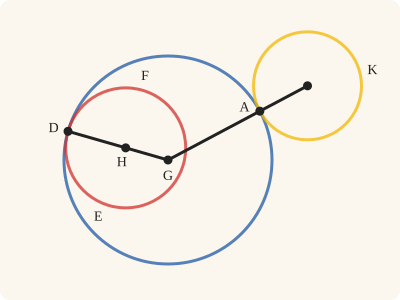
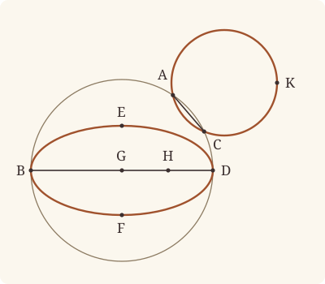

<!-- Generated by scripts/render.py. Do not edit by hand. -->

[Book III](index.md) · [← III.12](12.md) · [III.14 →](14.md)

# Book III, Proposition 13

*A circle does not touch a circle at more points than one*

[Euclid's proof](#euclids-proof) · [In Lean](#in-lean) · [What it rests on](#what-it-rests-on) · [Mishnah](#mishnah)

> A circle does not touch a circle at more points than one, whether it touch it internally or externally.

**In Lean:** ✅ proved, as Euclid states it · Euclid's argument

<p align="center"></p>

<p align="center"><em>Let a circle touch the blue one from inside (red) or from outside (yellow): they meet at the point of contact and nowhere else, and the straight line through the centres (black) runs to it.</em></p>

## Euclid's proof

<p align="center"></p>

<p align="center"><em>Drawn for one case: EBFD within ABDC, and ACK touching ABDC externally, under the two impossible suppositions. Like Heath's, this figure draws both impossible suppositions: EBFD touching ABDC internally at B and D, drawn as an oval, since no second circle can; and ACK touching ABDC externally at A and C, drawn as a true circle that crosses ABDC there.</em></p>

For, if possible, let the circle ABDC touch the circle EBFD, first internally, at more points than one, namely D, B.

Let the centre G of the circle ABDC, and the centre H of EBFD, be taken.

Therefore the straight line joined from G to H will fall on B, D. [III. 11]

Let it so fall, as BGHD.

Then, since the point G is the centre of the circle ABCD,

BG is equal to GD;

therefore BG is greater than HD;

therefore BH is much greater than HD.

Again, since the point H is the centre of the circle EBFD,

BH is equal to HD;

but it was also proved much greater than it: which is impossible.

Therefore a circle does not touch a circle internally at more points than one.

I say further that neither does it so touch it externally.

For, if possible, let the circle ACK touch the circle ABDC at more points than one, namely A, C,

and let AC be joined.

Then, since on the circumference of each of the circles ABDC, ACK two points A, C have been taken at random, the straight line joining the points will fall within each circle; [III. 2]

but it fell within the circle ABCD and outside ACK [III. Def. 3]: which is absurd.

Therefore a circle does not touch a circle externally at more points than one.

And it was proved that neither does it so touch it internally.

Therefore etc.

Q. E. D.

## In Lean

| | |
|---|---|
| Proof | ✅ Proved, and its companions `Prop13.touchesInternally_iff` ([III.13 touchesInternally_iff](13.md#touchesInternally_iff)), `Prop13.touchesExternally_iff` ([III.13 touchesExternally_iff](13.md#touchesExternally_iff)) and `Prop13.circlesTouch_iff` ([III.13 circlesTouch_iff](13.md#circlesTouch_iff)) |
| Statement | The whole enunciation. `Prop13`: touching circles meet only at the point of contact. Its companions prove Heath's reading at that point the same as ours, for any two circles. |
| Argument | Euclid's. `Prop13` follows Euclid. The companions come after it and are not his: they read Definition III.3 at the point of contact, as Heath prefers, and prove it the same as our reading of the whole circles, by Book I, III.2 and the rule that every circle has a centre, citing nothing later than III.13 and neither III.11 nor III.12. On the way, `TouchesInternallyAt.between` and `TouchesExternallyAt.between` reach the conclusions of III.11 and III.12 from contact at the point, by I.24, with I.20 for contact within and III.2 for contact without, a route that is not Euclid's; they are steps of the companions, and replace neither proof. |
| Representation | Touching is read of the whole circles: for contact within a point of the inner circle is within the outer and none is outside it. Both clauses carry unchanged from contact at D to a supposed second common point B, so the circles touch within at B too; III.13 applies III.11 at both points to show that they cannot meet again. For contact without no point is within both circles, so the point of AC that III.2 puts within both is at once absurd. The companions read contact at the point as well (`TouchesInternallyAt`, `TouchesExternallyAt`, `CirclesTouchAt`): the circles meet at C, and within some circle about C no point of the inner circle falls outside the outer, the circles being two, or, for contact without, no point is within both. They prove that reading the same as the whole-circle one for any two circles, so III.13's statement may be read either way. |
| Reviewed | The statement and every passage of the argument read against Heath's text, at commit [`689ab169f`](https://github.com/dodecaplex-co/stoicheia/commit/689ab169f) ([the record](../../review/III/13.toml)) |

From [`Elements/BookIII/Prop13.lean`](../../Elements/BookIII/Prop13.lean). Euclid's sentences are the `--` comments, and our own notes are in `/- … -/`; the lines under each sentence are the Lean that carries it out. The list below marks where a lemma does a step Euclid takes for granted and where the Lean takes a case Euclid's figure leaves aside; the `/- … -/` notes in the listing explain smaller adjustments.

**How the Lean follows the text**

- **Done by `Tacit.exists_centre`.** "Let the centre G of the circle ABDC…" Euclid takes the centres G and H without citing III.1. The Lean takes both from `Tacit.exists_centre`, a rule we assume from Definitions I.15 and I.16, not a proved lemma or a rule of System E.
- **Done by `Tacit.between_of_inside_chord`.** "Let it so fall, as BGHD." Euclid places B, G, H and D in that order. The Lean puts G between B and D by `Tacit.between_of_inside_chord` (System E, Circle 1), proved after III.2, and `Tacit.centre_inside` (System E, Generalities 3), proved in `Elements/Figure/RuleBase.lean`, and combines this with G, H, D from III.11 by `between_cut`.
- **Done by `len_lt_of_between`.** "therefore BG is greater than HD…" Euclid compares HD with the equal radii GD and BG. The Lean uses `len_lt_of_between` to make HD less than GD from the order G, H, D, then substitutes BG for GD.
- **Done by `len_lt_of_between`.** "therefore BH is much greater than HD." Euclid passes from BG to the greater straight line BH. The Lean uses `len_lt_of_between` on B, G, H and combines BG less than BH with the preceding inequality.
- **A further case.** "Therefore a circle does not touch a circle internally…" Euclid's figure puts EBFD within ABDC. The Lean also takes ABDC within EBFD, applying the internal-contact argument with the circles' names exchanged.
- **Done by `Tacit.exists_point_between`.** "and let AC be joined." Euclid joins AC and next argues that it falls within both circles. The Lean chooses a point P between A and C by `Tacit.exists_point_between` (System E, Points 3), proved in `Elements/Figure/Incidence.lean`, so that III.2 can put that point within each circle.

```lean
/-- A circle does not touch a circle at more points than one, whether it touch it internally or
externally. -/
theorem Prop13 {A B C D : Point} {ABDC EBFD ACK : Circle} :
    ((TouchesInternally ABDC EBFD D ∨ TouchesInternally EBFD ABDC D) →
      OnCircle B ABDC → OnCircle B EBFD → B = D) ∧
    (TouchesExternally ACK ABDC A → OnCircle C ACK → OnCircle C ABDC → C = A) := by
  have within : ∀ {α β : Circle}, TouchesInternally α β D → OnCircle B α → OnCircle B β → B = D := by
    intro α β ht hBα hBβ
    -- For, if possible, let the circle ABDC touch the circle EBFD, first internally, at more
    -- points than one, namely D, B.
    refine Classical.byContradiction fun hBD => ?_
    have htB : TouchesInternally α β B := ⟨hBα, hBβ, ht.2.2.1, ht.2.2.2⟩
    -- Let the centre G of the circle ABDC, and the centre H of EBFD, be taken.
    obtain ⟨G, hG⟩ := exists_centre α
    obtain ⟨H, hH⟩ := exists_centre β
    -- Therefore the straight line joined from G to H will fall on B, D. [III. 11]
    have hGHD : Between G H D := Prop11 hG hH ht
    have hGHB : Between G H B := Prop11 hG hH htB
    obtain ⟨L, hG_L, hH_L⟩ := Postulate1 G H (ne_of_between hGHD)
    have hD_L : OnLine D L := on_line_of_between hGHD hG_L hH_L
    have hB_L : OnLine B L := on_line_of_between hGHB hG_L hH_L
    -- Let it so fall, as BGHD.
    have hBGD : Between B G D :=
      between_of_inside_chord hG_L hB_L hD_L (centre_inside hG) hBα ht.1 hBD
    have hBGH : Between B G H := between_cut hBGD hGHD
    -- Then, since the point G is the centre of the circle ABCD,
    -- BG is equal to GD;
    have hBG_GD : ‖B G‖ = ‖G D‖ := (len_symm B G).trans (Definition15 hG hBα ht.1)
    -- therefore BG is greater than HD;
    have hHD_BG : ‖H D‖ < ‖B G‖ := by
      rw [hBG_GD, len_symm H D, len_symm G D]
      exact len_lt_of_between (between_symm hGHD)
    -- therefore BH is much greater than HD.
    have hHD_BH : ‖H D‖ < ‖B H‖ := lt_trans hHD_BG (len_lt_of_between hBGH)
    -- Again, since the point H is the centre of the circle EBFD,
    -- BH is equal to HD;
    have hBH_HD : ‖B H‖ = ‖H D‖ := (len_symm B H).trans (Definition15 hH hBβ ht.2.1)
    -- but it was also proved much greater than it: which is impossible.
    rw [hBH_HD] at hHD_BH
    exact lt_irrefl _ hHD_BH
  -- Therefore a circle does not touch a circle internally at more points than one.
  have hinternal : (TouchesInternally ABDC EBFD D ∨ TouchesInternally EBFD ABDC D) →
      OnCircle B ABDC → OnCircle B EBFD → B = D := by
    intro h hB₁ hB₂
    /- The same argument serves with the circles' names exchanged. -/
    rcases h with h | h
    · exact within h hB₁ hB₂
    · exact within h hB₂ hB₁
  -- I say further that neither does it so touch it externally.
  have hexternal : TouchesExternally ACK ABDC A → OnCircle C ACK → OnCircle C ABDC →
      C = A := by
    intro h hC₁ hC₂
    -- For, if possible, let the circle ACK touch the circle ABDC at more points than one, namely
    -- A, C,
    obtain ⟨hA₁, hA₂, hout⟩ := h
    refine Classical.byContradiction fun hCA => ?_
    -- and let AC be joined.
    obtain ⟨AC, hA_AC, hC_AC⟩ := Postulate1 A C (Ne.symm hCA)
    obtain ⟨P, -, hAPC, -⟩ := exists_point_between hA_AC hC_AC (Ne.symm hCA) []
    -- Then, since on the circumference of each of the circles ABDC, ACK two points A, C have
    -- been taken at random, the straight line joining the points will fall within each
    -- circle; [III. 2]
    have hP₂ : InsideCircle P ABDC := Prop2 hA₂ hC₂ P hAPC
    have hP₁ : InsideCircle P ACK := Prop2 hA₁ hC₁ P hAPC
    -- but it fell within the circle ABCD and outside ACK [III. Def. 3]: which is absurd.
    exact hout P hP₁ hP₂
  -- Therefore a circle does not touch a circle externally at more points than one.
  -- And it was proved that neither does it so touch it internally.
  -- Therefore etc.
  -- Q. E. D.
  exact ⟨hinternal, hexternal⟩
```

<a name="touchesInternally_iff"></a><a name="touchesExternally_iff"></a><a name="circlesTouch_iff"></a>

<details><summary>After the theorem, its companions, <code>Prop13.touchesInternally_iff</code>, <code>Prop13.touchesExternally_iff</code> and <code>Prop13.circlesTouch_iff</code>; seven lemmas for its own proofs, <code>Touching.len_lt_of_outside</code>, <code>Touching.sameSide_of_near</code>, <code>Touching.small</code>, <code>TouchesInternallyAt.between</code>, <code>TouchesExternallyAt.between</code>, <code>Touching.internally_of_between</code> and <code>Touching.externally_of_between</code>; and six lemmas beside the proposition, <code>Prop13.internally</code>, <code>Prop13.externally</code>, <code>TouchesInternallyAt.of_whole</code>, <code>TouchesExternallyAt.of_whole</code>, <code>TouchesInternallyAt.whole</code> and <code>TouchesExternallyAt.whole</code> (424 lines)</summary>

```lean
/-- **III.13 for circles touching within**, with only the two circles it speaks of: circles
touching within, either inside the other, have no common point but the point of contact.
A lemma beside III.13, its first clause alone; it rests on whatever III.13 rests on.
Without it, a citer of that clause names III.13's third circle, which the clause never
mentions. -/
theorem Prop13.internally {B D : Point} {α β : Circle}
    (h : TouchesInternally α β D ∨ TouchesInternally β α D) (hBα : OnCircle B α)
    (hBβ : OnCircle B β) : B = D :=
  (Prop13 (A := D) (C := D) (ACK := α)).1 h hBα hBβ

/-- **III.13 for circles touching without**, with only the two circles it speaks of: they
have no common point but the point of contact. A lemma beside III.13, its second clause
alone; it rests on whatever III.13 rests on. -/
theorem Prop13.externally {A C : Point} {α β : Circle} (h : TouchesExternally α β A)
    (hCα : OnCircle C α) (hCβ : OnCircle C β) : C = A :=
  (Prop13 (B := A) (D := A) (EBFD := β)).2 h hCα hCβ

/-! ## Definition III.3 read at the point of contact, after III.13

Euclid's Definition III.3 reads "Circles are said to touch one another which, meeting one
another, do not cut one another". Heath reports two readings of it (vol. 2, p. 3): that the
circles do not cut near the point of contact, or that they do not cut at all, and "Todhunter
thinks the latter opinion correct". Heath himself prefers to read it "as meaning simply that
the circles meet at a point but do not cut *at that point*". Our Lean reads it of the whole
circles (`TouchesInternally`, `TouchesExternally`, `CirclesTouch` in
`Elements/Foundations/DefinitionsIII.lean`), and so carries in the definition what Heath
says Euclid "does practically assume" in III.11 to III.13: that "circles touching at one
point do not intersect anywhere else".

Heath's reading, said at the point, is defined beside them. "Near C" is said with a circle
about C, as Euclid would draw it, and with no numbers (`Touching.Near`), as the mixed angles
of `Elements/Foundations/DefinitionsIII.lean` say "near the vertex". Touching within at C
(`TouchesInternallyAt`): the circles meet at C, they are two circles, and near C no point of
the inner circle falls outside the outer. Touching without at C (`TouchesExternallyAt`): they
meet at C, and near C no point is within both. Each is the whole-circle definition with
"every point" narrowed to "every point near C", save one clause: where `TouchesInternally`
asks for a point of the inner circle within the outer (brief 0008, section 7), contact within
at C asks that the circles be two, and the agreement below shows that the readings still say
the same. Nothing new is assumed, and no axiom is added.

Then the agreement: since every circle has a centre (`Tacit.exists_centre`), the reading at
the point and the reading of the whole circles say the same (`Prop13.touchesInternally_iff`,
`Prop13.touchesExternally_iff`, `Prop13.circlesTouch_iff`). That the whole-circle reading
gives the local one is immediate. The other way is the content, and it goes through the
straight line joining the centres. Were
the point of contact C off that straight line, a small circle about C would cut the inner
circle at a point on the far side of the radius GC from the outer centre F, and the angle at
G would put that point farther from F than C is [I. 24], as III.7 compares straight lines
from a point to a circle; without, the point on the near side would be within the other
circle, and a point of the chord joining it to C [III. 2] within both. Were C on that
straight line on the wrong side, I.20, or a point of a radius near C, would do the same.
So C lies on the straight line through the centres, beyond the inner centre within
(`TouchesInternallyAt.between`) and between the centres without
(`TouchesExternallyAt.between`); and from there I.20 and Definition I.15 give the whole
circles. The proofs use Book I, III.2 and System E's diagram and construction rules,
Intersections 8 and 9 among the latter, with the rule that every circle has a centre, and
nothing that rests on Circle 2 or Circle 3.

These two lemmas reach the conclusions of III.11 and III.12 by a route that is not
Euclid's. They come after III.13, and they are not meant to replace his proofs: the
statements of III.11 to III.13 keep the whole-circle reading.
-/

/-! ### Small facts the agreement needs

Five others are proved elsewhere, and are cited from there: `exists_circle_about` and
`onLine_of_collinear`, in `Elements/Figure/Regions.lean`, and `foot_nearest`,
`len_lt_of_add_lt` and `surrounds_sameSideOf`, in `Elements/BookIII/MixedAngles.lean`;
`onLine_of_collinear` and `foot_nearest` through `surrounds_sameSideOf`, which cites them. -/

/-- A point outside a circle is farther from the centre than the circumference: were it
nearer, it would be within; at the same distance, on it (System E, Diagram-segment 3
and 4). -/
theorem Touching.len_lt_of_outside {F C P : Point} {α : Circle} (hF : Centre F α)
    (hC : OnCircle C α) (hP : OutsideCircle P α) : ‖F C‖ < ‖F P‖ := by
  rcases lt_trichotomy ‖F P‖ ‖F C‖ with h | h | h
  · exact absurd (inside_of_len_lt hF hC h) hP.1
  · exact absurd (on_circle_of_len_eq hF hC h) hP.2
  · exact h

/-- **Near a point off a straight line, every point is on its side.** If C is off the
straight line GF, there is a point N other than C such that every point nearer C than N is
on C's side of GF. This is `surrounds_sameSideOf` (`Elements/BookIII/MixedAngles.lean`),
said with a distance in place of a circle, and it is cited from there: C is on its own side
of GF (System E, Same side 1), so every point within the circle about C through the foot of
the perpendicular from C to GF is on that side; N is a point of that circle (System E,
Points 7), and a point nearer C than N is within it (System E, Diagram-segment 4). -/
theorem Touching.sameSide_of_near {C F G : Point} (hGFC : Triangle G F C) :
    ∃ N : Point, N ≠ C ∧ ∀ X : Point, ‖C X‖ < ‖C N‖ → SameSideOf X C G F := by
  have hCC : SameSideOf C C G F := by
    obtain ⟨L, hG_L, hF_L⟩ := Postulate1 G F hGFC.ne₁₂
    exact SameSideOf.of_line hGFC.ne₁₂ hG_L hF_L (same_side_refl (hGFC.off_line hG_L hF_L))
  obtain ⟨δ, hδ, hall⟩ := surrounds_sameSideOf hCC
  obtain ⟨N, hN, -⟩ := exists_point_on_circle δ []
  exact ⟨N, ne_of_centre_of_on hδ hN, fun X hX => hall X (inside_of_len_lt hδ hN hX)⟩

/-- **A small circle about the point of contact.** Within any circle `γ` about a point C of
the circle `β`, with G its centre, which every circle has (`Tacit.exists_centre`), a circle
`δ` about C can be drawn that cuts `β`, and whose
points are all within `γ` and nearer C than a given point N. Its radius is CA, for a point A
of CG taken near C (`exists_between_nearer`, twice). A is within `β`, being between its
centre and C, and C, the centre of `δ`, is within `δ` and on `β`; so the circles cut
(System E, Intersection 5). -/
theorem Touching.small {β γ : Circle} {C N : Point} (hC : OnCircle C β)
    (hγ : Centre C γ) (hCN : C ≠ N) :
    ∃ δ : Circle, Centre C δ ∧ CirclesMeet δ β ∧
      ∀ X : Point, OnCircle X δ → InsideCircle X γ ∧ ‖C X‖ < ‖C N‖ := by
  obtain ⟨G, hG⟩ := exists_centre β
  obtain ⟨K, hK, -⟩ := exists_point_on_circle γ []
  have hCK : C ≠ K := (ne_of_centre_of_on hγ hK).symm
  have hCG : C ≠ G := ne_of_centre_of_on hG hC
  obtain ⟨A₁, hCA₁G, hA₁⟩ := exists_between_nearer (O := C) (P := C) (Q := G) (C := K) hCG
    (Or.inl rfl) (by rw [len_self]; exact len_pos hCK)
  obtain ⟨A, hCAA₁, hA⟩ := exists_between_nearer (O := C) (P := C) (Q := A₁) (C := N)
    (ne_of_between hCA₁G) (Or.inl rfl) (by rw [len_self]; exact len_pos hCN)
  have hCAG : Between C A G := between_of_between_left hCA₁G hCAA₁
  obtain ⟨δ, hδ, hAδ⟩ := Postulate3 C A (ne_of_between hCAG)
  have hAβ : InsideCircle A β := InsideCircle.of_between_centre hG hC (between_symm hCAG)
  refine ⟨δ, hδ, circles_meet hAδ (centre_inside hδ) hAβ hC, fun X hX => ?_⟩
  have hCX : ‖C X‖ = ‖C A‖ := Definition15 hδ hX hAδ
  refine ⟨inside_of_len_lt hγ hK ?_, ?_⟩
  · rw [hCX]; exact lt_trans (len_lt_of_between hCAA₁) hA₁
  · rw [hCX]; exact hA

/-! ### From the point to the straight line through the centres -/

/-- **Contact within at a point puts it on the straight line through the centres, beyond the
inner centre.** If `α`, with centre F, and `β`, with centre G, touch within at C, `β` within
`α`, then G lies between F and C.

Were it not so, we find a point X of `β`, as near C as we please, farther from F than C is,
and so outside `α`. Off the straight line FG, a small circle about C cuts `β` on the far side
of GC from F, and near enough to C to be on C's side of GF (`Touching.small`,
`Touching.sameSide_of_near`); then GC falls within the angle FGX, and the greater angle at G
gives the greater base [I. 24], GX and GC being radii. This is III.7's comparison, made at
the centre. On the straight line FG, with F between G and C, or C between the centres, any
point of the small circle's crossing off FG will do [I. 20].

The conclusion is III.11's, reached by another route. -/
theorem TouchesInternallyAt.between {α β : Circle} {C F G : Point} (hF : Centre F α)
    (hG : Centre G β) (h : TouchesInternallyAt α β C) : Between F G C := by
  obtain ⟨hCα, hCβ, hαβ, γ, hγ, hnear⟩ := h
  /- F and G are two points: about one centre, two circles through C would be one circle
     (System E, Diagram-segment 2). -/
  have hFG : F ≠ G := by
    rintro rfl
    exact hαβ (circle_eq hF hG hCα hCβ rfl)
  have hFC : F ≠ C := (ne_of_centre_of_on hF hCα).symm
  have hGC : G ≠ C := (ne_of_centre_of_on hG hCβ).symm
  refine Classical.byContradiction fun hFGC => ?_
  /- It is enough to find a point of `β` near C farther from F than C is: it is outside `α`,
     and the contact at C forbids it. -/
  suffices hX : ∃ X : Point, OnCircle X β ∧ InsideCircle X γ ∧ ‖F C‖ < ‖F X‖ by
    obtain ⟨X, hXβ, hXγ, hlt⟩ := hX
    exact hnear X hXγ hXβ (outside_of_len_gt hF hCα hlt)
  obtain ⟨L, hF_L, hG_L⟩ := Postulate1 F G hFG
  by_cases hC_L : OnLine C L
  · /- C on the straight line FG, but not beyond G. A small circle about C cuts `β` off FG,
       at X; GX is equal to GC. -/
    obtain ⟨δ, hδ, hmeet, hsmall⟩ := Touching.small (N := G) hCβ hγ hGC.symm
    obtain ⟨B, hB, -⟩ := exists_off_line hFG []
    obtain ⟨X, hXδ, hXβ, hXB⟩ :=
      circles_meet_same_side hmeet hδ hG hC_L hG_L (hB.off_line hF_L hG_L)
    have hFGX : Triangle F G X := Triangle.of_line hF_L hG_L hFG (not_on_line_of_same_side hXB)
    have hGX : ‖G X‖ = ‖G C‖ := Definition15 hG hXβ hCβ
    refine ⟨X, hXβ, (hsmall X hXδ).1, ?_⟩
    rcases between_cases hFG hGC hFC hF_L hG_L hC_L with h | h | h
    · exact absurd h hFGC
    · /- F between G and C: GF, FC make GC, that is GX, which is less than GF, FX
         [I. 20]. -/
      have h20 : ‖G X‖ < ‖G F‖ + ‖F X‖ := (BookI.Prop20 hFGX).1
      rw [hGX, ← len_add_of_between h] at h20
      exact Magnitude.lt_of_add_lt_add_left h20
    · /- C between the centres: FC, CG make FG, which is less than FX, XG [I. 20], and XG
         is CG. -/
      have h20 : ‖F G‖ < ‖F X‖ + ‖X G‖ := (BookI.Prop20 hFGX.cab).1
      rw [← len_add_of_between h, len_symm X G, hGX, len_symm G C] at h20
      exact Magnitude.lt_of_add_lt_add_right h20
  · /- C off the straight line FG. -/
    have hGFC : Triangle G F C := Triangle.of_line hG_L hF_L hFG.symm hC_L
    obtain ⟨N, hNC, hside⟩ := Touching.sameSide_of_near hGFC
    obtain ⟨δ, hδ, hmeet, hsmall⟩ := Touching.small hCβ hγ hNC.symm
    obtain ⟨M, hC_M, hG_M⟩ := Postulate1 C G hGC.symm
    have hF_M : ¬ OnLine F M := fun hF_M =>
      hC_L (line_unique hFG hF_M hG_M hF_L hG_L ▸ hC_M)
    /- The small circle cuts `β` at X, on the far side of GC from F (System E,
       Intersections 9), and on C's side of GF. -/
    obtain ⟨X, hXδ, hXβ, hXF⟩ := circles_meet_opposite_side hmeet hδ hG hC_M hG_M hF_M
    have hXγ : InsideCircle X γ := (hsmall X hXδ).1
    have hXC : SameSideOf X C G F := hside X (hsmall X hXδ).2
    have hX_M : ¬ OnLine X M := hXF.1
    have hGX : G ≠ X := fun e => hX_M (e ▸ hG_M)
    obtain ⟨N', hG_N', hX_N'⟩ := Postulate1 G X hGX
    /- So GC falls within the angle FGX (System E, Triple incidence 2), and the angle FGX
       is made up of FGC and CGX. -/
    have hFC_N' : SameSide F C N' :=
      triple_incidence2 hG_L hG_M hG_N' hF_L hC_M hX_N' (hXC.symm.sameSide hG_L hF_L)
        (fun hs => hXF.2.2 (same_side_symm hs)) hX_M hFG
    have hadd : ∠ F G X = ∠ F G C + ∠ C G X :=
      angle_add_of_within hXC.symm (SameSideOf.of_line hGX hG_N' hX_N' (same_side_symm hFC_N'))
    have hCGX : Triangle C G X := Triangle.of_line hC_M hG_M hGC.symm hX_M
    have hlt : ∠ F G C < ∠ F G X := by
      rw [hadd]; exact CommonNotion5 hCGX.angle_pos
    /- GF is common and GX equal to GC, so the greater angle at G stands on the greater
       base [I. 24]. -/
    exact ⟨X, hXβ, hXγ,
      BookI.Prop24 hXC.triangle hGFC rfl (Definition15 hG hXβ hCβ) hlt⟩

/-- **Contact without at a point puts it between the centres.** If `α`, with centre F, and
`β`, with centre G, touch without at C, then C lies between F and G.

Were it not so, we find a point within both circles, as near C as we please. With one centre,
or with the centres on one side of C on a straight line through it, a point between C and
the nearer centre will do. Off the straight line FG, a small circle about C cuts `β` at X on
F's side of GC, and near enough to C to be on C's side of GF (`Touching.small`,
`Touching.sameSide_of_near`); then GX falls within the angle FGC, and the less angle at G
gives the less base [I. 24], so X is within `α`. A point of the chord CX of `β` near C is
then within `β` [III. 2], within `α` (III.2 for points on or within the circle), and near C.

The conclusion is III.12's, reached by another route. -/
theorem TouchesExternallyAt.between {α β : Circle} {C F G : Point} (hF : Centre F α)
    (hG : Centre G β) (h : TouchesExternallyAt α β C) : Between F C G := by
  obtain ⟨hCα, hCβ, γ, hγ, hnear⟩ := h
  have hFC : F ≠ C := (ne_of_centre_of_on hF hCα).symm
  have hGC : G ≠ C := (ne_of_centre_of_on hG hCβ).symm
  obtain ⟨K, hK, -⟩ := exists_point_on_circle γ []
  have hCK : C ≠ K := (ne_of_centre_of_on hγ hK).symm
  refine Classical.byContradiction fun hFCG => ?_
  /- It is enough to find a point near C within both circles. -/
  suffices hP : ∃ P : Point, InsideCircle P γ ∧ InsideCircle P α ∧ InsideCircle P β by
    obtain ⟨P, hPγ, hPα, hPβ⟩ := hP
    exact hnear P hPγ hPα hPβ
  /- A point M that is a centre, or lies between C and it, for each circle: a point of CM
     near C is within `γ`, and within each circle, between its centre and C. -/
  have seg : ∀ M : Point, M ≠ C → (M = F ∨ Between C M F) → (M = G ∨ Between C M G) →
      ∃ P : Point, InsideCircle P γ ∧ InsideCircle P α ∧ InsideCircle P β := by
    intro M hMC hMF hMG
    obtain ⟨P, hCPM, hP⟩ := exists_between_nearer (O := C) (P := C) (Q := M) (C := K)
      hMC.symm (Or.inl rfl) (by rw [len_self]; exact len_pos hCK)
    have hin : ∀ {O : Point} {ε : Circle}, Centre O ε → OnCircle C ε →
        (M = O ∨ Between C M O) → InsideCircle P ε := by
      intro O ε hO hCε hMO
      refine InsideCircle.of_between_centre hO hCε (between_symm ?_)
      rcases hMO with e | hCMO
      · exact e ▸ hCPM
      · exact between_of_between_left hCMO hCPM
    exact ⟨P, inside_of_len_lt hγ hK hP, hin hF hCα hMF, hin hG hCβ hMG⟩
  by_cases hFG : F = G
  · /- One centre: a point of its radius near C is within both. -/
    exact seg F hFC (Or.inl rfl) (Or.inl hFG)
  obtain ⟨L, hF_L, hG_L⟩ := Postulate1 F G hFG
  by_cases hC_L : OnLine C L
  · /- C on the straight line FG, not between the centres: the nearer centre lies between
       C and the other. -/
    rcases between_cases hFG hGC hFC hF_L hG_L hC_L with h | h | h
    · exact seg G hGC (Or.inr (between_symm h)) (Or.inl rfl)
    · exact seg F hFC (Or.inl rfl) (Or.inr (between_symm h))
    · exact absurd h hFCG
  /- C off the straight line FG. -/
  have hGFC : Triangle G F C := Triangle.of_line hG_L hF_L (Ne.symm hFG) hC_L
  obtain ⟨N, hNC, hside⟩ := Touching.sameSide_of_near hGFC
  obtain ⟨δ, hδ, hmeet, hsmall⟩ := Touching.small hCβ hγ hNC.symm
  obtain ⟨M, hC_M, hG_M⟩ := Postulate1 C G hGC.symm
  have hF_M : ¬ OnLine F M := fun hF_M =>
    hC_L (line_unique hFG hF_M hG_M hF_L hG_L ▸ hC_M)
  /- The small circle cuts `β` at X, on F's side of GC (System E, Intersections 8), and on
     C's side of GF. -/
  obtain ⟨X, hXδ, hXβ, hXF⟩ := circles_meet_same_side hmeet hδ hG hC_M hG_M hF_M
  have hXγ : InsideCircle X γ := (hsmall X hXδ).1
  have hXC : SameSideOf X C G F := hside X (hsmall X hXδ).2
  have hXF' : SameSideOf X F G C := SameSideOf.of_line hGC hG_M hC_M hXF
  /- So GX falls within the angle FGC, which is made up of FGX and XGC. -/
  have hadd : ∠ F G C = ∠ F G X + ∠ X G C := angle_add_of_within hXC hXF'
  have hlt : ∠ F G X < ∠ F G C := by
    rw [hadd]; exact CommonNotion5 hXF'.triangle.cab.angle_pos
  /- GF is common and GX equal to GC, so the less angle at G stands on the less base
     [I. 24]: X is within `α`. -/
  have hFX : ‖F X‖ < ‖F C‖ :=
    BookI.Prop24 hGFC hXC.triangle rfl (Definition15 hG hCβ hXβ) hlt
  have hXα : InsideCircle X α := inside_of_len_lt hF hCα hFX
  /- A point P of the chord CX: within `γ`, as X is; within `β` [III. 2]; and within `α`,
     between C on it and X within it (III.2, for points on or within the circle). -/
  have hCX : C ≠ X := (ne_of_centre_of_on hδ hXδ).symm
  obtain ⟨T, hC_T, hX_T⟩ := Postulate1 C X hCX
  obtain ⟨P, -, hCPX, -⟩ := exists_point_between hC_T hX_T hCX []
  exact ⟨P, InsideCircle.of_between_centre_of_inside hγ hK hXγ hCPX,
    Prop2.within (Or.inr hCα) (Or.inl hXα) hCPX, Prop2 hCβ hXβ P hCPX⟩

/-! ### From the straight line through the centres to the whole circles -/

/-- **Contact within, from the line of the centres.** If the centre G of `β` lies between the
centre F of `α` and a common point C, no point P of `β` is outside `α`: FP is not greater than
FG, GP together [I. 20], and these are FG, GC (Definition I.15), which make FC. And a point
X of `β` off the straight line FG, where a straight line through G meets `β` (System E,
Intersections 5), is within `α`: FX is less than FG, GX together [I. 20], which are FG, GC
again. -/
theorem Touching.internally_of_between {α β : Circle} {C F G : Point} (hF : Centre F α)
    (hG : Centre G β) (hCα : OnCircle C α) (hCβ : OnCircle C β) (h : Between F G C) :
    TouchesInternally α β C := by
  refine ⟨hCα, hCβ, ?_, fun P hP hout => ?_⟩
  · /- The straight line from G to a point B off FG meets `β` at X, off FG (System E,
       Intersections 5); FX is less than FG, GX [I. 20], that is FG, GC, which make FC. -/
    have hFG : F ≠ G := ne_of_between h
    obtain ⟨L, hF_L, hG_L⟩ := Postulate1 F G hFG
    obtain ⟨B, hB, -⟩ := exists_off_line hFG []
    have hB_L : ¬ OnLine B L := hB.off_line hF_L hG_L
    have hGB : G ≠ B := fun e => hB_L (e ▸ hG_L)
    obtain ⟨M, hG_M, hB_M⟩ := Postulate1 G B hGB
    obtain ⟨X, hXβ, hX_M, -⟩ := line_circle_beyond (centre_inside hG) hG_M hB_M hGB.symm
    have hX_L : ¬ OnLine X L := fun hX_L =>
      hB_L (line_unique (ne_of_centre_of_on hG hXβ) hX_M hG_M hX_L hG_L ▸ hB_M)
    have h20 : ‖F X‖ < ‖F G‖ + ‖G X‖ :=
      (BookI.Prop20 (Triangle.of_line hF_L hG_L hFG hX_L).bac).1
    rw [Definition15 hG hXβ hCβ, len_add_of_between h] at h20
    exact ⟨X, hXβ, inside_of_len_lt hF hCα h20⟩
  have hlt : ‖F G‖ + ‖G P‖ < ‖F P‖ := by
    rw [Definition15 hG hP hCβ, len_add_of_between h]
    exact Touching.len_lt_of_outside hF hCα hout
  exact lt_irrefl _ (len_lt_of_add_lt hlt)

/-- **Contact without, from the line of the centres.** If a common point C lies between the
centres F and G, no point P is within both circles: FP, PG together would be less than FC,
CG, which make FG, and so FG less than itself [I. 20]. -/
theorem Touching.externally_of_between {α β : Circle} {C F G : Point} (hF : Centre F α)
    (hG : Centre G β) (hCα : OnCircle C α) (hCβ : OnCircle C β) (h : Between F C G) :
    TouchesExternally α β C := by
  refine ⟨hCα, hCβ, fun P hPα hPβ => ?_⟩
  have h₁ : ‖F P‖ < ‖F C‖ := len_lt_of_inside hF hCα hPα
  have h₂ : ‖P G‖ < ‖C G‖ := by
    rw [len_symm P G, len_symm C G]; exact len_lt_of_inside hG hCβ hPβ
  have hlt : ‖F P‖ + ‖P G‖ < ‖F G‖ := by
    rw [← len_add_of_between h]
    refine lt_trans (add_lt_add_right _ h₁) ?_
    rw [add_comm ‖F C‖, add_comm ‖F C‖]
    exact add_lt_add_right _ h₂
  exact lt_irrefl _ (len_lt_of_add_lt hlt)

/-! ### The agreement, in the form Book III uses

Every circle has a centre (`Tacit.exists_centre`), and Book III states its propositions
without one where the setting-out does not name it (III.2). So the two readings are one for
every circle, and every statement of Book III that speaks of circles touching may be read
either way. -/

/-- **The two readings of contact within agree**, for any two circles. -/
theorem Prop13.touchesInternally_iff {α β : Circle} {C : Point} :
    TouchesInternally α β C ↔ TouchesInternallyAt α β C := by
  constructor
  · /- From the whole circles to the point: what holds of every point of `β` holds of those
       near C, and the circles are two, for the point Q of `β` within `α` is not on `α`
       (System E, Generalities 4). -/
    intro h
    obtain ⟨hCα, hCβ, ⟨Q, hQβ, hQα⟩, hall⟩ := h
    have hαβ : α ≠ β := fun e => inside_not_on hQα (e ▸ hQβ)
    obtain ⟨γ, hγ⟩ := exists_circle_about C
    exact ⟨hCα, hCβ, hαβ, γ, hγ, fun P _ => hall P⟩
  · /- From the point to the whole circles, the centres taken by the rule that every circle
       has one: the point lies on the straight line through the centres, beyond the inner
       centre, and then no point of the inner circle is outside the outer, and some point
       of it is within. -/
    intro h
    obtain ⟨F, hF⟩ := exists_centre α
    obtain ⟨G, hG⟩ := exists_centre β
    exact Touching.internally_of_between hF hG h.1 h.2.1 (TouchesInternallyAt.between hF hG h)

/-- **The two readings of contact without agree**, for any two circles. -/
theorem Prop13.touchesExternally_iff {α β : Circle} {C : Point} :
    TouchesExternally α β C ↔ TouchesExternallyAt α β C := by
  constructor
  · /- From the whole circles to the point: what holds of every point holds of those near
       C. -/
    intro h
    obtain ⟨hCα, hCβ, hall⟩ := h
    obtain ⟨γ, hγ⟩ := exists_circle_about C
    exact ⟨hCα, hCβ, γ, hγ, fun P _ => hall P⟩
  · /- From the point to the whole circles, the centres taken by the rule: the point lies
       between the centres, and then no point is within both. -/
    intro h
    obtain ⟨F, hF⟩ := exists_centre α
    obtain ⟨G, hG⟩ := exists_centre β
    exact Touching.externally_of_between hF hG h.1 h.2.1 (TouchesExternallyAt.between hF hG h)

/-- **The two readings of Definition III.3 agree**, for any two circles: the circles touch at
C, read of the whole circles, exactly when they touch at C, read at the point. -/
theorem Prop13.circlesTouch_iff {α β : Circle} {C : Point} :
    CirclesTouch α β C ↔ CirclesTouchAt α β C := by
  have h₁ := Prop13.touchesInternally_iff (α := α) (β := β) (C := C)
  have h₂ := Prop13.touchesInternally_iff (α := β) (β := α) (C := C)
  have h₃ := Prop13.touchesExternally_iff (α := α) (β := β) (C := C)
  exact or_congr h₁ (or_congr h₂ h₃)

/-! ### Each way of the agreement

Each way of each agreement, as a theorem of its own. Each is cited from the agreement, which
proves it. -/

/-- Contact within, read of the whole circles, is contact within at the point: what holds of
every point of `β` holds of those near C. -/
theorem TouchesInternallyAt.of_whole {α β : Circle} {C : Point}
    (h : TouchesInternally α β C) : TouchesInternallyAt α β C :=
  Prop13.touchesInternally_iff.mp h

/-- Contact without, read of the whole circles, is contact without at the point. -/
theorem TouchesExternallyAt.of_whole {α β : Circle} {C : Point}
    (h : TouchesExternally α β C) : TouchesExternallyAt α β C :=
  Prop13.touchesExternally_iff.mp h

/-- **Contact within at a point is contact within of the whole circles**, the centres taken
by the rule that every circle has one (`Tacit.exists_centre`): the point lies on the straight
line through the centres, beyond the inner centre (`TouchesInternallyAt.between`), and then no
point of the inner circle is outside the outer, and some point of it is within
(`Touching.internally_of_between`). This is what Heath says Euclid "does practically assume"
in III.11 to III.13, proved. -/
theorem TouchesInternallyAt.whole {α β : Circle} {C : Point} (h : TouchesInternallyAt α β C) :
    TouchesInternally α β C :=
  Prop13.touchesInternally_iff.mpr h

/-- **Contact without at a point is contact without of the whole circles**, the centres taken
by the rule that every circle has one (`Tacit.exists_centre`): the point lies between the
centres (`TouchesExternallyAt.between`), and then no point is within both
(`Touching.externally_of_between`). -/
theorem TouchesExternallyAt.whole {α β : Circle} {C : Point} (h : TouchesExternallyAt α β C) :
    TouchesExternally α β C :=
  Prop13.touchesExternally_iff.mpr h
```

</details>

## What it rests on

| | Proposition | `Prop13.circlesTouch_iff` | `Prop13.touchesExternally_iff` | `Prop13.touchesInternally_iff` |
|---|---|---|---|---|
| Heath's references | [III.2](02.md), [III.11](11.md); Def. III.3 | none | none | none |
| Lean cites | [III.2](02.md), [III.11](11.md) | [III.13 touchesExternally_iff](13.md#touchesExternally_iff), [III.13 touchesInternally_iff](13.md#touchesInternally_iff) | [I.12](../I/12.md), [I.17](../I/17.md), [I.19](../I/19.md), [I.20](../I/20.md), [I.24](../I/24.md), [III.2](02.md) | [I.12](../I/12.md), [I.17](../I/17.md), [I.19](../I/19.md), [I.20](../I/20.md), [I.24](../I/24.md) |
| Postulates | 1, 2, 3, 4 | 1, 2, 3, 4 | 1, 2, 3, 4 | 1, 2, 3, 4 |
| Definitions taken as axioms | Def. I.15 | Def. I.15 | Def. I.15 | Def. I.15 |
| Common Notions | 1, 2, 3, 4, 5 | 1, 2, 3, 4, 5 | 1, 2, 3, 4, 5 | 1, 2, 3, 4, 5 |
| Tacit rules | 38 (listed below) | 39 (listed below) | 38 (listed below) | 39 (listed below) |
| Its own Lean calls | Postulate 1; Def. I.15; 5 tacit rules | none | 1 tacit rule | 1 tacit rule |
| Through lemmas | Postulate 3; 20 tacit rules | none | Postulates 1, 2 and 3; Def. I.15; 29 tacit rules | Postulates 1, 2 and 3; Def. I.15; 30 tacit rules |

Some of these come in through lemmas [shared](../../CERTIFICATE.md#shared-steps) by many proofs: [`TouchesInternallyAt.between`](../../Elements/BookIII/Prop13.lean#L238) (I.12, I.17, I.19, I.20, I.24); [`TouchesExternallyAt.between`](../../Elements/BookIII/Prop13.lean#L319) (I.12, I.17, I.19, I.24, III.2); [`Touching.externally_of_between`](../../Elements/BookIII/Prop13.lean#L422), [`Touching.internally_of_between`](../../Elements/BookIII/Prop13.lean#L395) (I.20); [`Tacit.between_of_inside_chord`](../../Elements/BookIII/Prop02.lean#L194) (III.2).

_Postulates, definitions, Common Notions and tacit rules: all that each proof rests on, counting those of the propositions it cites. The last two rows say which of the postulates, definitions and tacit rules its own Lean calls, in the proof or a helper written for it, and which it does not call but reaches through lemmas, of Book Zero or shared (a proposition it cites may rest on these too); the rest come in only through the propositions it cites or the Common Notions._

_Euclid's Def. III.3 is `CirclesCut`, `TouchesInternally` and `TouchesExternally` in Lean, a definition rather than an assumption, so the row of definitions taken as axioms does not count it._

<details><summary>The 38 tacit rules beneath this proof, counting those of the propositions it cites, and 1 more beneath <code>Prop13.circlesTouch_iff</code></summary>

_(used here) marks a rule this proof's own Lean calls, in the proof or a helper written for it; (through …) marks one its own Lean does not call but reaches through the lemmas named, of [Book Zero](../../Elements/Figure) or shared, though a proposition it cites may rest on it too; and a rule with no mark comes in only through a proposition it cites or a Common Notion. The names in brackets are System E's: an Intersection rule says when straight lines and circles must meet, and an Intersections rule takes a point where they do (see [Book I's introduction](../I/index.md))._

**Reading the figure**

- [`between_cases`](../../Elements/Foundations/Tacit/Diagram.lean#L54) (through [`Tacit.between_of_inside_chord`](../../Elements/BookIII/Prop02.lean#L194), [`Tacit.exists_point_between`](../../Elements/Figure/Incidence.lean#L314) and [`between_cut`](../../Elements/Figure/Lines.lean#L65)): Of three different points on a straight line, one is between the other two. (Between 6)
- [`between_symm`](../../Elements/Foundations/Tacit/Diagram.lean#L47) (used here): If B is between A and C, it is between C and A. (Between 1)
- [`circles_meet`](../../Elements/Foundations/Tacit/Diagram.lean#L91) (through [`Tacit.between_of_inside_chord`](../../Elements/BookIII/Prop02.lean#L194), [`Tacit.exists_point_between`](../../Elements/Figure/Incidence.lean#L314), [`Tacit.on_line_of_between`](../../Elements/Figure/Incidence.lean#L78) and 1 other lemma): If each circle passes through a point inside the other, the circles cut one another. This is the step Euclid takes for granted in I.1. (Intersection 5)
- [`circles_meet_same_side`](../../Elements/Foundations/Tacit/Constructions.lean#L79) (through [`Tacit.between_of_inside_chord`](../../Elements/BookIII/Prop02.lean#L194), [`Tacit.exists_point_between`](../../Elements/Figure/Incidence.lean#L314), [`Tacit.on_line_of_between`](../../Elements/Figure/Incidence.lean#L78) and 1 other lemma): Two circles that cut one another do so on each side of the straight line through their centres. (Intersections 8)
- [`exists_centre`](../../Elements/Foundations/Tacit/Constructions.lean#L57) (used here): Every circle has a centre. A rule of our own, not one of System E's: its content is Euclid's Definitions I.15 and I.16.
- [`exists_point`](../../Elements/Foundations/Tacit/Constructions.lean#L35): Let a point be taken. (Points 1)
- [`exists_point_inside_circle`](../../Elements/Foundations/Tacit/Constructions.lean#L42) (through [`Tacit.between_of_inside_chord`](../../Elements/BookIII/Prop02.lean#L194), [`Tacit.centre_inside`](../../Elements/Figure/RuleBase.lean#L56), [`Tacit.exists_point_between`](../../Elements/Figure/Incidence.lean#L314) and 2 other lemmas): Let a point be taken inside the circle α. (Points 8)
- [`exists_point_on_line`](../../Elements/Foundations/Tacit/Constructions.lean#L38) (through [`Tacit.between_of_inside_chord`](../../Elements/BookIII/Prop02.lean#L194), [`Tacit.exists_point_between`](../../Elements/Figure/Incidence.lean#L314), [`Tacit.on_line_of_between`](../../Elements/Figure/Incidence.lean#L78) and 1 other lemma): Let a point be taken on the straight line L. (Points 2)
- [`line_circle_between`](../../Elements/Foundations/Tacit/Constructions.lean#L67) (through [`Tacit.between_of_inside_chord`](../../Elements/BookIII/Prop02.lean#L194), [`Tacit.centre_inside`](../../Elements/Figure/RuleBase.lean#L56), [`Tacit.exists_point_between`](../../Elements/Figure/Incidence.lean#L314) and 2 other lemmas): A straight line through a point B inside a circle, heading out to a point C outside it, cuts the circle between B and C. (Intersections 4)
- [`line_circle_beyond`](../../Elements/Foundations/Tacit/Constructions.lean#L73) (through [`Tacit.between_of_inside_chord`](../../Elements/BookIII/Prop02.lean#L194), [`Tacit.centre_inside`](../../Elements/Figure/RuleBase.lean#L56), [`Tacit.exists_point_between`](../../Elements/Figure/Incidence.lean#L314) and 2 other lemmas): A straight line through a point B inside a circle, produced beyond B away from C, cuts the circle there. (Intersections 5)
- [`line_unique`](../../Elements/Foundations/Tacit/Diagram.lean#L41) (through [`Tacit.on_line_of_between`](../../Elements/Figure/Incidence.lean#L78) and [`between_cut`](../../Elements/Figure/Lines.lean#L65)): Two points determine a straight line. (Generalities 1)
- [`lines_meet_of_opposite_sides`](../../Elements/Foundations/Tacit/Diagram.lean#L86): A straight line joining points on opposite sides of L crosses L. (Intersection 1)
- [`not_between_of_between`](../../Elements/Foundations/Tacit/Diagram.lean#L50) (through [`Tacit.between_of_inside_chord`](../../Elements/BookIII/Prop02.lean#L194), [`Tacit.centre_inside`](../../Elements/Figure/RuleBase.lean#L56), [`Tacit.exists_point_between`](../../Elements/Figure/Incidence.lean#L314) and 4 other lemmas): If B is between A and C, then A is not between B and C. (Between 1)
- [`not_on_line_of_same_side`](../../Elements/Foundations/Tacit/Diagram.lean#L60) (through [`Tacit.between_of_inside_chord`](../../Elements/BookIII/Prop02.lean#L194), [`Tacit.exists_point_between`](../../Elements/Figure/Incidence.lean#L314), [`Tacit.on_line_of_between`](../../Elements/Figure/Incidence.lean#L78) and 1 other lemma): Points on one side of a straight line are not on it. (Same side 3)
- [`pasch2`](../../Elements/Foundations/Tacit/Diagram.lean#L71) (through [`Tacit.between_of_inside_chord`](../../Elements/BookIII/Prop02.lean#L194), [`Tacit.exists_point_between`](../../Elements/Figure/Incidence.lean#L314), [`Tacit.on_line_of_between`](../../Elements/Figure/Incidence.lean#L78) and 1 other lemma): If B is between A and C, A is on L and B is off it, then B and C are on the same side of L: a straight line that leaves L at A does not cross it again. (Pasch 2)
- [`same_side_trans`](../../Elements/Foundations/Tacit/Diagram.lean#L64) (through [`Tacit.between_of_inside_chord`](../../Elements/BookIII/Prop02.lean#L194), [`Tacit.exists_point_between`](../../Elements/Figure/Incidence.lean#L314), [`Tacit.on_line_of_between`](../../Elements/Figure/Incidence.lean#L78) and 1 other lemma): Two points on the same side of a straight line as a third point are on the same side as each other. (Same side 4)

**Lengths, angles and areas**

- [`angle_add_of_inside`](../../Elements/Foundations/Tacit/Transfer.lean#L47): If D lies within the angle BAC, then BAC is made up of BAD and DAC. (Diagram-angle 2)
- [`angle_eq_of_same_rays`](../../Elements/Foundations/Tacit/Transfer.lean#L54): The angle doesn't change if its arms are traced through other points on the same rays. (Diagram-angle 4)
- [`angle_symm`](../../Elements/Foundations/Tacit/Metric.lean#L30): The angle ABC is the angle CBA. (Metric 4)
- [`area_add_of_between`](../../Elements/Foundations/Tacit/Transfer.lean#L70): Cutting a triangle in two from a vertex adds up. (Diagram-area 2)
- [`area_congruent`](../../Elements/Foundations/Tacit/Metric.lean#L44): Triangles equal in all their sides and angles are equal in area. Euclid uses this without comment once he has shown two triangles congruent. (Metric 9)
- [`area_degenerate`](../../Elements/Foundations/Tacit/Metric.lean#L36): A "triangle" with a repeated corner has no area. (Metric 6)
- [`area_eq_zero_of_on_line`](../../Elements/Foundations/Tacit/Transfer.lean#L62): A "triangle" whose corners lie on one straight line has no area. (Diagram-area 1)
- [`area_rotate`](../../Elements/Foundations/Tacit/Metric.lean#L39): The triangle ABC is the triangle CAB. (Metric 8)
- [`circle_eq`](../../Elements/Foundations/Tacit/Transfer.lean#L30) (`Prop13.circlesTouch_iff`): A circle is fixed by its centre and its radius. (Diagram-segment 2)
- [`len_add_of_between`](../../Elements/Foundations/Tacit/Transfer.lean#L27) (through [`Tacit.between_of_inside_chord`](../../Elements/BookIII/Prop02.lean#L194), [`Tacit.centre_inside`](../../Elements/Figure/RuleBase.lean#L56), [`Tacit.exists_point_between`](../../Elements/Figure/Incidence.lean#L314) and 3 other lemmas): If B is between A and C, then AB and BC together make up AC. (Diagram-segment 1)
- [`len_self`](../../Elements/Foundations/Tacit/Metric.lean#L24) (through [`Tacit.between_of_inside_chord`](../../Elements/BookIII/Prop02.lean#L194), [`Tacit.centre_inside`](../../Elements/Figure/RuleBase.lean#L56), [`Tacit.exists_point_between`](../../Elements/Figure/Incidence.lean#L314) and 2 other lemmas): The "straight line" from a point to itself has no length. (Metric 1)
- [`len_symm`](../../Elements/Foundations/Tacit/Metric.lean#L27) (used here): The straight line AB is the straight line BA. (Metric 3)
- [`radius_ne_zero`](../../Elements/Foundations/Tacit/Metric.lean#L62) (through [`Tacit.between_of_inside_chord`](../../Elements/BookIII/Prop02.lean#L194), [`Tacit.centre_inside`](../../Elements/Figure/RuleBase.lean#L56), [`Tacit.exists_point_between`](../../Elements/Figure/Incidence.lean#L314) and 3 other lemmas): A circle's radius is not nothing: the straight line from the centre to a point on the circle has some length. A rule of our own, not one of System E's: every circle is drawn with a centre and a distance (Postulate 3).
- [`same_ray_of_angle_eq_zero`](../../Elements/Foundations/Tacit/Transfer.lean#L42): If the angle BAC is nothing, C lies on the ray from A through B. (Diagram-angle 1)

**Superposition**

- [`superposition`](../../Elements/Foundations/Tacit/Superposition.lean#L52): **Superposition.** A hypothetical placement of a triangle on a given ray and side permits a restricted derivation of metric equalities about the figure already given. The derivation introduces no further objects, cites each geometric law it uses, and exports no symbol of the placement.

**Rules of magnitude**

- [`add_assoc`](../../Elements/Foundations/Tacit/Magnitudes.lean#L23) (through [`Tacit.between_of_inside_chord`](../../Elements/BookIII/Prop02.lean#L194), [`Tacit.exists_point_between`](../../Elements/Figure/Incidence.lean#L314) and [`between_cut`](../../Elements/Figure/Lines.lean#L65)): Adding three magnitudes in a row, it makes no difference whether the first two or the last two are added first. (System E §3.5)
- [`add_comm`](../../Elements/Foundations/Tacit/Magnitudes.lean#L26) (through [`Tacit.between_of_inside_chord`](../../Elements/BookIII/Prop02.lean#L194), [`Tacit.centre_inside`](../../Elements/Figure/RuleBase.lean#L56), [`Tacit.exists_point_between`](../../Elements/Figure/Incidence.lean#L314) and 2 other lemmas): The order of adding does not matter. (System E §3.5)
- [`add_lt_add_right`](../../Elements/Foundations/Tacit/Magnitudes.lean#L45) (through [`between_cut`](../../Elements/Figure/Lines.lean#L65)): Adding the same thing to both sides keeps "less than". (System E §3.5)
- [`add_zero`](../../Elements/Foundations/Tacit/Magnitudes.lean#L29): Adding nothing changes nothing. (System E §3.5)
- [`lt_irrefl`](../../Elements/Foundations/Tacit/Magnitudes.lean#L32) (used here): No magnitude is less than itself. (System E §3.5)
- [`lt_trans`](../../Elements/Foundations/Tacit/Magnitudes.lean#L35) (used here): What is less than the less is less still. (System E §3.5)
- [`lt_trichotomy`](../../Elements/Foundations/Tacit/Magnitudes.lean#L39) (through [`Tacit.between_of_inside_chord`](../../Elements/BookIII/Prop02.lean#L194), [`Tacit.centre_inside`](../../Elements/Figure/RuleBase.lean#L56), [`Tacit.exists_point_between`](../../Elements/Figure/Incidence.lean#L314) and 3 other lemmas): Of two magnitudes, one is less, or they are equal, or the other is less. (System E §3.5)
- [`not_lt_zero`](../../Elements/Foundations/Tacit/Magnitudes.lean#L42) (through [`Tacit.between_of_inside_chord`](../../Elements/BookIII/Prop02.lean#L194), [`Tacit.centre_inside`](../../Elements/Figure/RuleBase.lean#L56), [`Tacit.exists_point_between`](../../Elements/Figure/Incidence.lean#L314) and 3 other lemmas): Nothing is less than zero. (System E §3.5)

</details>

## Mishnah

_Our commentary: why Euclid's proof, and ours, look as they do._

Euclid gives the two kinds of touching two different proofs. When the circles touch internally, III.11 puts both points of contact on the line of centres, and BH comes out both equal to HD and much greater than it. When they touch externally, the straight line AC falls within both circles by III.2, though circles touching externally have no point within both.

**Which way is the line of centres produced?** Heath reports J. G. Camerer's objection: "it is assumed that the supposed second point of contact lies on the line of centres *produced beyond the centre of the 'outer' circle*, whereas all that is proved in III. 11 is that the line of centres *produced beyond the centre of the 'inner' circle* passes through a point of contact" (vol. 2, p. 33).

Heath answers that a common point off the line of centres would bring a third with it, so that "the only hypothesis left is that the second point of contact may be *on* the line of centres but in the direction of the centre of the '*outer*' circle; and Euclid's proof disposes of this hypothesis" (vol. 2, p. 33). So Euclid, having produced the line of centres through the inner centre to D, turns back through the outer centre to B. His comparison needs the four points in the order B, G, H, D; four points that merely lie on one straight line would not give it.

**Every common point is a point of contact.** We read Definition III.3 of the whole circles, as in III.11, so circles that touch internally at D and also meet at B touch internally at B too, and III.11 puts B, like D, on the line of centres. G, the centre of the outer circle, lies between B and D, two points of that circle on a straight line through it (`between_of_inside_chord`), and H then gives the order B, G, H, D. When the circles touch externally, our proof takes a point between A and C, and III.2 puts it within both.

**Heath's reading, at the point of contact.** Heath prefers to read Definition III.3 at the point of contact alone, as III.11's commentary tells, and on that reading what Euclid assumes in III.11 to III.13, that touching circles cross nowhere else, wants a proof. The companions after III.13 give it. Contact at C is said with a small circle about C, as Euclid would draw one: within, the circles are two, meet at C, and near C no point of the inner circle falls outside the outer; without, they meet at C, and near C no point is within both. The companions prove this reading the same as our reading of the whole circles, for any two circles (`Prop13.circlesTouch_iff`), so III.11 to III.13 may be read either way. The work is done on the straight line joining the centres. Were C off it, a small circle about C would cut the inner circle at a point farther from the outer centre than C is, by I.24 at the inner centre, or, without, find a point within both circles, by I.24 and III.2; were C on that straight line on the wrong side, I.20, or a point of a radius near C, would do the same. So contact at the point puts C beyond the inner centre (`TouchesInternallyAt.between`) or between the centres (`TouchesExternallyAt.between`): the conclusions of III.11 and III.12, reached by another route. These steps come after III.13 and cite neither III.11 nor III.12; they are not Euclid's proofs, which keep the whole-circle reading.

**The modern way.** Two circles with different centres G and H and radii $r$ and $s$ touch when GH is $r + s$ or $|r - s|$, as in III.11 and III.12. At a common point $P$, the distances $r$ from G and $s$ from H make one of the triangle inequalities among G, H and $P$ an equality, so $P$ lies on the straight line GH; and there only one point is $r$ from G and $s$ from H.

## Further reading

- Jacques Hadamard revised his school geometry twelve times, and its book on the circle walks much of Book III's road. In Mark Saul's translation, [*Lessons in Geometry, I: Plane Geometry*](https://doi.org/10.1090/mbk/057) (2008), the Complements to Hadamard's own Book III, on similarity, follow touching circles to circles touching three given circles, with Note C, "On the problem of tangent circles" (pp. 297–302).
- Both arguments can be followed in colour, straight line by straight line, in Oliver Byrne's proof, rebuilt for the web by Nicholas Rougeux as [*Byrne's Euclid*](https://www.c82.net/euclid/) (2018, free online) (also on [III.5](05.md)).

[Book III](index.md) · [← III.12](12.md) · [III.14 →](14.md)

---

<sub>Euclid's text: T. L. Heath, *The Thirteen Books of Euclid's Elements*, vol. 2 (Cambridge, 1908), pp. 32–33; [scan leaves n44–n45](https://archive.org/details/thirteenbookseu00heibgoog/page/n44); [figure on n44](https://archive.org/details/thirteenbookseu00heibgoog/page/n44). Public domain.</sub>

<sub>The tacit rules follow the System E of Jeremy Avigad, Edward Dean and John Mumma, read alongside LeanEuclid (Logan Murphy, Kaiyu Yang, Jialiang Sun, Zhaoyu Li, Anima Anandkumar and Xujie Si).</sub>
