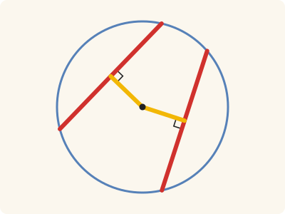

<!-- Generated by scripts/render.py. Do not edit by hand. -->

[Book III](index.md) · [← III.13](13.md) · [III.15 →](15.md)

# Book III, Proposition 14

*Equal straight lines are equally distant from the centre*

> In a circle equal straight lines are equally distant from the centre, and those which are equally distant from the centre are equal to one another.

<p align="center"></p>

<p align="center"><em>In a circle, equal straight lines (red) stand equally far from the centre (yellow), and straight lines that stand equally far from it are equal.</em></p>

## Euclid's proof

_Euclid's figure, with Heath's letters, is still to be drawn; until then, Heath's own is on [scan leaf n47](https://archive.org/details/thirteenbookseu00heibgoog/page/n47)._

Let ABDC be a circle, and let AB, CD be equal straight lines in it;

I say that AB, CD are equally distant from the centre.

For let the centre of the circle ABDC be taken [III. 1], and let it be E; from E let EF, EG be drawn perpendicular to AB, CD, and let AE, EC be joined.

Then, since a straight line EF through the centre cuts a straight line AB not through the centre at right angles, it also bisects it. [III. 3]

Therefore AF is equal to FB;

therefore AB is double of AF.

For the same reason

CD is also double of CG;

and AB is equal to CD;

therefore AF is also equal to CG.

And, since AE is equal to EC,

the square on AE is also equal to the square on EC.

But the squares on AF, EF are equal to the square on AE, for the angle at F is right;

and the squares on EG, GC are equal to the square on EC, for the angle at G is right; [I. 47]

therefore the squares on AF, FE are equal to the squares on CG, GE,

of which the square on AF is equal to the square on CG, for AF is equal to CG;

therefore the square on FE which remains is equal to the square on EG,

therefore EF is equal to EG.

But in a circle straight lines are said to be equally distant from the centre when the perpendiculars drawn to them from the centre are equal; [III. Def. 4]

therefore AB, CD are equally distant from the centre.

Next, let the straight lines AB, CD be equally distant from the centre; that is, let EF be equal to EG.

I say that AB is also equal to CD.

For, with the same construction, we can prove, similarly, that AB is double of AF, and CD of CG.

And, since AE is equal to CE,

the square on AE is equal to the square on CE.

But the squares on EF, FA are equal to the square on AE,

and the squares on EG, GC equal to the square on CE. [I. 47]

Therefore the squares on EF, FA are equal to the squares on EG, GC,

of which the square on EF is equal to the square on EG, for EF is equal to EG;

therefore the square on AF which remains is equal to the square on CG;

therefore AF is equal to CG.

And AB is double of AF, and CD double of CG;

therefore AB is equal to CD.

Therefore etc.

Q. E. D.

## In Lean

🚧 Stated: the statement and Euclid's sentences are in place; the proof is to come

From [`Elements/BookIII/Prop14.lean`](../../Elements/BookIII/Prop14.lean). Euclid's sentences are the `--` comments. The Lean that will carry each one out is still to be written; `sorry` is Lean's word for a step not yet taken.

```lean
/-- In a circle equal straight lines are equally distant from the centre, and those which are
equally distant from the centre are equal to one another. -/
theorem Prop14 {A B C D E F G : Point} {ABDC : Circle} (hE : Centre E ABDC) (hA : OnCircle A ABDC)
    (hB : OnCircle B ABDC) (hC : OnCircle C ABDC) (hD : OnCircle D ABDC)
    (hE_AB : ¬ Collinear A B E) (hE_CD : ¬ Collinear C D E) (hF : Collinear A B F)
    (hEF : ∀ P : Point, Collinear A B P → P ≠ F → ∠ E F P = ∟) (hG : Collinear C D G)
    (hEG : ∀ P : Point, Collinear C D P → P ≠ G → ∠ E G P = ∟) :
    ‖A B‖ = ‖C D‖ ↔ ‖E F‖ = ‖E G‖ := by
  -- Let ABDC be a circle, and let AB, CD be equal straight lines in it;
  -- I say that AB, CD are equally distant from the centre.
  -- For let the centre of the circle ABDC be taken [III. 1], and let it be E; from E let EF,
  -- EG be drawn perpendicular to AB, CD, and let AE, EC be joined.
  -- Then, since a straight line EF through the centre cuts a straight line AB not through the
  -- centre at right angles, it also bisects it. [III. 3]
  -- Therefore AF is equal to FB;
  -- therefore AB is double of AF.
  -- For the same reason
  -- CD is also double of CG;
  -- and AB is equal to CD;
  -- therefore AF is also equal to CG.
  -- And, since AE is equal to EC,
  -- the square on AE is also equal to the square on EC.
  -- But the squares on AF, EF are equal to the square on AE, for the angle at F is right;
  -- and the squares on EG, GC are equal to the square on EC, for the angle at G is
  -- right; [I. 47]
  -- therefore the squares on AF, FE are equal to the squares on CG, GE,
  -- of which the square on AF is equal to the square on CG, for AF is equal to CG;
  -- therefore the square on FE which remains is equal to the square on EG,
  -- therefore EF is equal to EG.
  -- But in a circle straight lines are said to be equally distant from the centre when the
  -- perpendiculars drawn to them from the centre are equal; [III. Def. 4]
  -- therefore AB, CD are equally distant from the centre.
  -- Next, let the straight lines AB, CD be equally distant from the centre; that is, let EF be
  -- equal to EG.
  -- I say that AB is also equal to CD.
  -- For, with the same construction, we can prove, similarly, that AB is double of AF, and CD
  -- of CG.
  -- And, since AE is equal to CE,
  -- the square on AE is equal to the square on CE.
  -- But the squares on EF, FA are equal to the square on AE,
  -- and the squares on EG, GC equal to the square on CE. [I. 47]
  -- Therefore the squares on EF, FA are equal to the squares on EG, GC,
  -- of which the square on EF is equal to the square on EG, for EF is equal to EG;
  -- therefore the square on AF which remains is equal to the square on CG;
  -- therefore AF is equal to CG.
  -- And AB is double of AF, and CD double of CG;
  -- therefore AB is equal to CD.
  -- Therefore etc.
  -- Q. E. D.
  sorry
```

## What it rests on

| | |
|---|---|
| Euclid cites | [I.47](../I/47.md), [III.1](01.md), [III.3](03.md); Def. 4 |

_Not yet proved in Lean, so what the Lean rests on is not yet known._

## Mishnah

_Commentary to come._

---

<sub>Euclid's text: T. L. Heath, The Thirteen Books of Euclid's Elements, vol. 2 (Cambridge, 1908), pp. 34–36; scan leaves n46–n48; figure on n47. Public domain.</sub>

<sub>The tacit rules follow the System E of Jeremy Avigad, Edward Dean and John Mumma, read alongside LeanEuclid (Logan Murphy, Kaiyu Yang, Jialiang Sun, Zhaoyu Li, Anima Anandkumar and Xujie Si).</sub>
