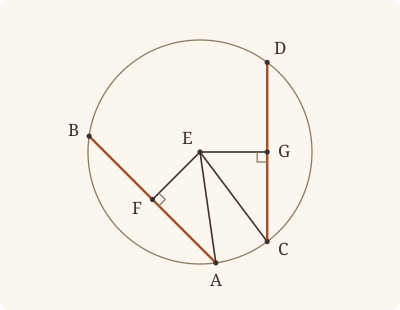

<!-- Generated by scripts/render.py. Do not edit by hand. -->

[Book III](index.md) · [← III.13](13.md) · [III.15 →](15.md)

# Book III, Proposition 14

*Equal straight lines are equally distant from the centre*

[Euclid's proof](#euclids-proof) · [In Lean](#in-lean) · [What it rests on](#what-it-rests-on) · [Mishnah](#mishnah)

> In a circle equal straight lines are equally distant from the centre, and those which are equally distant from the centre are equal to one another.

**In Lean:** ✅ proved, as Euclid states it · Euclid's argument

<p align="center"></p>

<p align="center"><em>Lay two equal straight lines in a circle (red), and the perpendiculars from the centre to them come out equal (yellow). Make the perpendiculars equal, and the lines are equal.</em></p>

## Euclid's proof

<p align="center"></p>

<p align="center"><em>Drawn for one case: two equal straight lines AB and CD, neither through E.</em></p>

Let ABDC be a circle, and let AB, CD be equal straight lines in it;

I say that AB, CD are equally distant from the centre.

For let the centre of the circle ABDC be taken [III. 1], and let it be E; from E let EF, EG be drawn perpendicular to AB, CD, and let AE, EC be joined.

Then, since a straight line EF through the centre cuts a straight line AB not through the centre at right angles, it also bisects it. [III. 3]

Therefore AF is equal to FB;

therefore AB is double of AF.

For the same reason

CD is also double of CG;

and AB is equal to CD;

therefore AF is also equal to CG.

And, since AE is equal to EC,

the square on AE is also equal to the square on EC.

But the squares on AF, EF are equal to the square on AE, for the angle at F is right;

and the squares on EG, GC are equal to the square on EC, for the angle at G is right; [I. 47]

therefore the squares on AF, FE are equal to the squares on CG, GE,

of which the square on AF is equal to the square on CG, for AF is equal to CG;

therefore the square on FE which remains is equal to the square on EG,

therefore EF is equal to EG.

But in a circle straight lines are said to be equally distant from the centre when the perpendiculars drawn to them from the centre are equal; [III. Def. 4]

therefore AB, CD are equally distant from the centre.

Next, let the straight lines AB, CD be equally distant from the centre; that is, let EF be equal to EG.

I say that AB is also equal to CD.

For, with the same construction, we can prove, similarly, that AB is double of AF, and CD of CG.

And, since AE is equal to CE,

the square on AE is equal to the square on CE.

But the squares on EF, FA are equal to the square on AE,

and the squares on EG, GC equal to the square on CE. [I. 47]

Therefore the squares on EF, FA are equal to the squares on EG, GC,

of which the square on EF is equal to the square on EG, for EF is equal to EG;

therefore the square on AF which remains is equal to the square on CG;

therefore AF is equal to CG.

And AB is double of AF, and CD double of CG;

therefore AB is equal to CD.

Therefore etc.

Q. E. D.

## In Lean

| | |
|---|---|
| Proof | ✅ Proved, and its companion `Prop14.general` ([III.14 general](14.md#general)) |
| Statement | The whole enunciation. With its companion: `Prop14.general` takes any two straight lines in the circle, a diameter at no distance; `Prop14` keeps two not through the centre. |
| Argument | Euclid's. The companion takes Euclid's case, two straight lines not through the centre, from `Prop14`. A straight line through the centre is a diameter, two radii together (`Prop14.diameter_sum`), its foot the centre; and of a diameter and a straight line not through the centre, the diameter is the greater [I. 20]. |
| Representation | The centre E and the feet F, G of the perpendiculars are given, since Definition III.4 measures from them; the proof still takes III.1's centre and shows that it is E. The companion is given the feet as `Foot`, the foot of the perpendicular, which is E itself for a straight line through E, so that a diameter is at no distance from the centre (Definition III.4, extended to that case). |
| Reviewed | The statement and the argument read against Heath's text, for every departure from Euclid, at commit [`eadf7a4c`](https://github.com/jackChallis/stoicheia/commit/eadf7a4c) ([the record](../../review/III/14.toml)) |

From [`Elements/BookIII/Prop14.lean`](../../Elements/BookIII/Prop14.lean). Euclid's sentences are the `--` comments, and our own notes are in `/- … -/`; the lines under each sentence are the Lean that carries it out. The list below marks where several sentences share one step, where the Lean takes a case Euclid's figure leaves aside and where a step needs a word of its own; the `/- … -/` notes in the listing explain smaller adjustments.

**How the Lean follows the text**

- **A further case.** "Then, since a straight line EF through the centre cuts a straight line AB not through the centre…" Euclid's proof takes AB and CD not through the centre, and `Prop14` asks as much. `Prop14.general` takes diameters too: two diameters are equal, and both at no distance; a diameter is greater than a straight line not through the centre [I. 20], which is at some distance.
- **Carried.** "But in a circle straight lines are said to be equally distant from the centre…" Definition III.4 is how the statement says "equally distant": its conclusion is that EF is equal to EG, which the Lean above has proved.
- **Carried together.** "Next, let the straight lines AB, CD be equally distant from the centre…" The converse needs no Lean of its own until "And, since AE is equal to CE": the halves, AB double of AF and CD of CG, were found once, before the two directions part.

```lean
/-- In a circle equal straight lines are equally distant from the centre, and those which are
equally distant from the centre are equal to one another. -/
theorem Prop14 {A B C D E F G : Point} {ABDC : Circle} (hE : Centre E ABDC) (hA : OnCircle A ABDC)
    (hB : OnCircle B ABDC) (hC : OnCircle C ABDC) (hD : OnCircle D ABDC)
    (hE_AB : ¬ Collinear A B E) (hE_CD : ¬ Collinear C D E) (hF : Collinear A B F)
    (hEF : ∀ P : Point, Collinear A B P → P ≠ F → ∠ E F P = ∟) (hG : Collinear C D G)
    (hEG : ∀ P : Point, Collinear C D P → P ≠ G → ∠ E G P = ∟) :
    ‖A B‖ = ‖C D‖ ↔ ‖E F‖ = ‖E G‖ := by
  -- Let ABDC be a circle, and let AB, CD be equal straight lines in it;
  -- I say that AB, CD are equally distant from the centre.
  -- For let the centre of the circle ABDC be taken [III. 1], and let it be E; from E let EF,
  -- EG be drawn perpendicular to AB, CD, and let AE, EC be joined.
  obtain ⟨E₀, -, -, -, hE₀, -⟩ := Prop1 ⟨E, hE⟩ hA hB (Triangle.ne₁₂ hE_AB)
  obtain rfl : E = E₀ := centre_unique hE hE₀
  /- The given perpendiculars fall between the ends of their straight lines. -/
  have hAFB : Between A F B := foot_between hE hA hB hE_AB hF hEF
  have hCGD : Between C G D := foot_between hE hC hD hE_CD hG hEG
  obtain ⟨L, hA_L, hB_L⟩ := Postulate1 A B (ne_of_between_ends hAFB)
  obtain ⟨M, hC_M, hD_M⟩ := Postulate1 C D (ne_of_between_ends hCGD)
  have hF_L : OnLine F L := on_line_of_between_ends hAFB hA_L hB_L
  have hG_M : OnLine G M := on_line_of_between_ends hCGD hC_M hD_M
  have hE_L : ¬ OnLine E L := Triangle.off_line hE_AB hA_L hB_L
  have hE_M : ¬ OnLine E M := Triangle.off_line hE_CD hC_M hD_M
  have hEF' : E ≠ F := fun e => hE_L (e ▸ hF_L)
  have hEG' : E ≠ G := fun e => hE_M (e ▸ hG_M)
  have hAFE : ∠ A F E = ∟ := by
    rw [angle_symm (ne_of_between hAFB) hEF']
    exact hEF A ⟨L, hA_L, hB_L, hA_L⟩ (ne_of_between hAFB)
  have hCGE : ∠ C G E = ∟ := by
    rw [angle_symm (ne_of_between hCGD) hEG']
    exact hEG C ⟨M, hC_M, hD_M, hC_M⟩ (ne_of_between hCGD)
  have tF : Triangle F A E :=
    Triangle.of_line hF_L hA_L (ne_of_between hAFB).symm hE_L
  have tG : Triangle G C E :=
    Triangle.of_line hG_M hC_M (ne_of_between hCGD).symm hE_M
  -- Then, since a straight line EF through the centre cuts a straight line AB not through the
  -- centre at right angles, it also bisects it. [III. 3]
  have hbisect := (Prop3 hE hA hB hAFB hE_AB).2 hAFE
  -- Therefore AF is equal to FB;
  have hAF : ‖A F‖ = ‖F B‖ := hbisect
  -- therefore AB is double of AF.
  have hAB : ‖A B‖ = ‖A F‖ + ‖A F‖ := by
    rw [← len_add_of_between hAFB, ← hAF]
  -- For the same reason
  have hCG : ‖C G‖ = ‖G D‖ := (Prop3 hE hC hD hCGD hE_CD).2 hCGE
  -- CD is also double of CG;
  have hCD : ‖C D‖ = ‖C G‖ + ‖C G‖ := by
    rw [← len_add_of_between hCGD, ← hCG]
  -- and AB is equal to CD;
  refine ⟨fun hABCD => ?_, fun hEFG => ?_⟩
  -- therefore AF is also equal to CG.
  · have hAFCG : ‖A F‖ = ‖C G‖ :=
      Magnitude.eq_of_add_self_eq (hAB.symm.trans (hABCD.trans hCD))
    -- And, since AE is equal to EC,
    have hAEEC : ‖A E‖ = ‖E C‖ := (len_symm A E).trans (Definition15 hE hA hC)
    -- the square on AE is also equal to the square on EC.
    have hsqAEEC : sq A E = sq E C := sq_congr hAEEC
    -- But the squares on AF, EF are equal to the square on AE, for the angle at F is right;
    have h47F : sq A E = sq A F + sq F E := BookI.Prop47.sq tF hAFE
    -- and the squares on EG, GC are equal to the square on EC, for the angle at G is
    -- right; [I. 47]
    have h47G : sq C E = sq C G + sq G E := BookI.Prop47.sq tG hCGE
    -- therefore the squares on AF, FE are equal to the squares on CG, GE,
    have hsums : sq F E + sq A F = sq E G + sq C G := by
      calc
        sq F E + sq A F = sq A F + sq F E := by ac_rfl
        _ = sq A E := h47F.symm
        _ = sq E C := hsqAEEC
        _ = sq C E := sq_symm E C
        _ = sq C G + sq G E := h47G
        _ = sq E G + sq C G := by rw [sq_symm G E]; ac_rfl
    -- of which the square on AF is equal to the square on CG, for AF is equal to CG;
    have hsides : sq A F = sq C G := sq_congr hAFCG
    -- therefore the square on FE which remains is equal to the square on EG,
    have hremain : sq F E = sq E G := CommonNotion3 hsums hsides
    -- therefore EF is equal to EG.
    have hequal : ‖E F‖ = ‖E G‖ := (len_symm E F).trans (BookI.Prop46.sq hremain)
    -- But in a circle straight lines are said to be equally distant from the centre when the
    -- perpendiculars drawn to them from the centre are equal; [III. Def. 4]
    -- therefore AB, CD are equally distant from the centre.
    exact hequal
  -- Next, let the straight lines AB, CD be equally distant from the centre; that is, let EF be
  -- equal to EG.
  -- I say that AB is also equal to CD.
  -- For, with the same construction, we can prove, similarly, that AB is double of AF, and CD
  -- of CG.
  /- The same construction has already shown that AB is double of AF, and CD of CG. -/
  -- And, since AE is equal to CE,
  · have hAECE : ‖A E‖ = ‖C E‖ :=
      (len_symm A E).trans ((Definition15 hE hA hC).trans (len_symm E C))
    -- the square on AE is equal to the square on CE.
    have hsqAECE : sq A E = sq C E := sq_congr hAECE
    -- But the squares on EF, FA are equal to the square on AE,
    have h47F : sq A E = sq A F + sq F E := BookI.Prop47.sq tF hAFE
    -- and the squares on EG, GC equal to the square on CE. [I. 47]
    have h47G : sq C E = sq C G + sq G E := BookI.Prop47.sq tG hCGE
    -- Therefore the squares on EF, FA are equal to the squares on EG, GC,
    have hsums : sq A F + sq E F = sq C G + sq E G := by
      rw [sq_symm E F, sq_symm E G, ← h47F, ← h47G]
      exact hsqAECE
    -- of which the square on EF is equal to the square on EG, for EF is equal to EG;
    have hfeet : sq E F = sq E G := sq_congr hEFG
    -- therefore the square on AF which remains is equal to the square on CG;
    have hremain : sq A F = sq C G := CommonNotion3 hsums hfeet
    -- therefore AF is equal to CG.
    have hAFCG : ‖A F‖ = ‖C G‖ := BookI.Prop46.sq hremain
    -- And AB is double of AF, and CD double of CG;
    have hdoubles : ‖A F‖ + ‖A F‖ = ‖C G‖ + ‖C G‖ := CommonNotion2 hAFCG hAFCG
    -- therefore AB is equal to CD.
    exact hAB.trans (hdoubles.trans hCD.symm)
  -- Therefore etc.
  -- Q. E. D.
```

<a name="general"></a>

<details><summary>After the theorem, its companion, <code>Prop14.general</code> and one more theorem later propositions use, <code>Prop14.diameter_sum</code> (77 lines)</summary>

```lean
/-- A diameter is two radii together, and any two radii of the circle will do: with E between
A and B, AB is CE, ED (Def. I.15). This is Euclid's step in III.15, "AD is equal to ME,
EN"; here it compares a diameter with another straight line in the same circle. -/
theorem Prop14.diameter_sum {A B C D E : Point} {α : Circle} (hE : Centre E α)
    (hA : OnCircle A α) (hB : OnCircle B α) (hC : OnCircle C α)
    (hD : OnCircle D α) (hAEB : Between A E B) :
    ‖A B‖ = ‖C E‖ + ‖E D‖ := by
  have hAE_CE : ‖A E‖ = ‖C E‖ :=
    (len_symm A E).trans ((Definition15 hE hA hC).trans (len_symm E C))
  have hEB_ED : ‖E B‖ = ‖E D‖ := Definition15 hE hB hD
  rw [← len_add_of_between hAEB, hAE_CE, hEB_ED]

/-- **III.14, general** (companion of III.14). In a circle, straight lines AB, CD are equal
exactly when they are equally distant from the centre E: EF and EG are equal, F and G being
the feet of the perpendiculars from E. Two straight lines not through the centre are
Euclid's case [III. 14]; two diameters are equal, and both at no distance; and of a diameter
and a straight line not through the centre, the diameter is the greater [I. 20], and the
other is at some distance from the centre. -/
theorem Prop14.general {A B C D E F G : Point} {ABDC : Circle} (hE : Centre E ABDC)
    (hA : OnCircle A ABDC) (hB : OnCircle B ABDC) (hC : OnCircle C ABDC)
    (hD : OnCircle D ABDC) (hAB : A ≠ B) (hCD : C ≠ D) (hF : Foot E A B F)
    (hG : Foot E C D G) :
    ‖A B‖ = ‖C D‖ ↔ ‖E F‖ = ‖E G‖ := by
  by_cases hE_AB : Collinear A B E
  · /- AB passes through E: its foot is E, and E lies between A and B, which are on the
       circle, so AB is a diameter, two radii together. -/
    have hF_E : F = E := hF.2.1 hE_AB
    obtain ⟨L, hA_L, hB_L, hE_L⟩ := hE_AB
    have hAEB : Between A E B :=
      between_of_inside_chord hE_L hA_L hB_L (centre_inside hE) hA hB hAB
    have hAB_sum : ‖A B‖ = ‖C E‖ + ‖E D‖ :=
      Prop14.diameter_sum hE hA hB hC hD hAEB
    by_cases hE_CD : Collinear C D E
    · /- Both straight lines are diameters: each is two radii, and both feet are E. -/
      have hG_E : G = E := hG.2.1 hE_CD
      obtain ⟨M, hC_M, hD_M, hE_M⟩ := hE_CD
      have hCED : Between C E D :=
        between_of_inside_chord hE_M hC_M hD_M (centre_inside hE) hC hD hCD
      have hAB_CD : ‖A B‖ = ‖C D‖ := hAB_sum.trans (len_add_of_between hCED)
      exact ⟨fun _ => by rw [hF_E, hG_E], fun _ => hAB_CD⟩
    · /- Only AB is a diameter: CD is shorter, and its foot is at some distance from E. -/
      have hCD_AB : ‖C D‖ < ‖A B‖ := by
        rw [hAB_sum]
        exact (BookI.Prop20 (Triangle.cab hE_CD)).1
      have hE_G : E ≠ G := fun h => hE_CD (h ▸ hG.1)
      have hdist : ‖E F‖ ≠ ‖E G‖ := by
        rw [hF_E, len_self]
        exact (len_ne_zero hE_G).symm
      exact ⟨fun h => False.elim (Magnitude.ne_of_lt hCD_AB h.symm),
        fun h => False.elim (hdist h)⟩
  · by_cases hE_CD : Collinear C D E
    · /- Only CD is a diameter: AB is shorter, and its foot is at some distance from E. -/
      have hG_E : G = E := hG.2.1 hE_CD
      obtain ⟨M, hC_M, hD_M, hE_M⟩ := hE_CD
      have hCED : Between C E D :=
        between_of_inside_chord hE_M hC_M hD_M (centre_inside hE) hC hD hCD
      have hCD_sum : ‖C D‖ = ‖A E‖ + ‖E B‖ :=
        Prop14.diameter_sum hE hC hD hA hB hCED
      have hAB_CD : ‖A B‖ < ‖C D‖ := by
        rw [hCD_sum]
        exact (BookI.Prop20 (Triangle.cab hE_AB)).1
      have hE_F : E ≠ F := fun h => hE_AB (h ▸ hF.1)
      have hdist : ‖E F‖ ≠ ‖E G‖ := by
        rw [hG_E, len_self]
        exact len_ne_zero hE_F
      exact ⟨fun h => False.elim (Magnitude.ne_of_lt hAB_CD h),
        fun h => False.elim (hdist h)⟩
    · /- Neither straight line passes through E: this is III.14's worked configuration. -/
      exact Prop14 hE hA hB hC hD hE_AB hE_CD hF.1 (hF.2.2 hE_AB)
        hG.1 (hG.2.2 hE_CD)

/-- The check: the statement of `Prop14` follows from `Prop14.general`, for two straight
lines not through the centre (checked by Lean). -/
example : type_of% @Elements.BookIII.Prop14 := by
  intro A B C D E F G ABDC hE hA hB hC hD hE_AB hE_CD hF hEF hG hEG
  exact Prop14.general hE hA hB hC hD (Triangle.ne₁₂ hE_AB) (Triangle.ne₁₂ hE_CD)
    ⟨hF, fun h => absurd h hE_AB, fun _ => hEF⟩ ⟨hG, fun h => absurd h hE_CD, fun _ => hEG⟩
```

</details>

## What it rests on

| | Proposition | `Prop14.general` |
|---|---|---|
| Heath's references | [I.47](../I/47.md), [III.1](01.md), [III.3](03.md); Def. III.4 | none |
| Lean cites | [I.3](../I/03.md), [I.4](../I/04.md), [I.17](../I/17.md), [I.19](../I/19.md), [I.28](../I/28.md), [I.34](../I/34.md), [I.46](../I/46.md), [I.47](../I/47.md), [III.1](01.md), [III.3](03.md) | [I.20](../I/20.md), [III.14](14.md) |
| Postulates | 1, 2, 3, 4, 5 | 1, 2, 3, 4, 5 |
| Definitions taken as axioms | Def. I.15 | Def. I.15 |
| Common Notions | 1, 2, 3, 4, 5 | 1, 2, 3, 4, 5 |
| Tacit rules | 64 (listed below) | 64 (listed below) |
| Its own Lean calls | Postulate 1; Def. I.15; 6 tacit rules | Def. I.15; 5 tacit rules |
| Through lemmas | Postulates 2 and 3; 46 tacit rules | 2 tacit rules |

Some of these come in through lemmas [shared](../../CERTIFICATE.md#shared-steps) by many proofs: [`BookI.Prop46.sq`](../../Elements/BookIII/Squares.lean#L59) (I.3, I.4, I.28, I.34, I.46); [`BookI.Prop47.sq`](../../Elements/BookII/Rectangles.lean#L411) (I.4, I.28, I.34, I.46, I.47); [`foot_between`](../../Elements/BookIII/Squares.lean#L95) (I.17, I.19).

_Postulates, definitions, Common Notions and tacit rules: all that each proof rests on, counting those of the propositions it cites. The last two rows say which of the postulates, definitions and tacit rules its own Lean calls, in the proof or a helper written for it, and which it does not call but reaches through lemmas, of Book Zero or shared (a proposition it cites may rest on these too); the rest come in only through the propositions it cites or the Common Notions._

_Euclid's Def. III.4 is said in Lean by the perpendiculars from the centre, `‖E F‖ = ‖E G‖`, a definition rather than an assumption, so the row of definitions taken as axioms does not count it._

<details><summary>The 64 tacit rules beneath this proof, counting those of the propositions it cites</summary>

_(used here) marks a rule this proof's own Lean calls, in the proof or a helper written for it; (through …) marks one its own Lean does not call but reaches through the lemmas named, of [Book Zero](../../Elements/Figure) or shared, though a proposition it cites may rest on it too; and a rule with no mark comes in only through a proposition it cites or a Common Notion. The names in brackets are System E's: an Intersection rule says when straight lines and circles must meet, and an Intersections rule takes a point where they do (see [Book I's introduction](../I/index.md))._

**Reading the figure**

- [`between_cases`](../../Elements/Foundations/Tacit/Diagram.lean#L73) (through [`BookI.Prop46.sq`](../../Elements/BookIII/Squares.lean#L59) and [`BookI.Prop47.sq`](../../Elements/BookII/Rectangles.lean#L411)): Of three different points on a straight line, one is between the other two. (Between 6)
- [`between_of_between_left`](../../Elements/Foundations/Tacit/Diagram.lean#L65) (through [`BookI.Prop46.sq`](../../Elements/BookIII/Squares.lean#L59)): If B is between A and C, and D is between A and B, then D is between A and C. (Between 4)
- [`between_of_between_right`](../../Elements/Foundations/Tacit/Diagram.lean#L69) (through [`BookI.Prop46.sq`](../../Elements/BookIII/Squares.lean#L59) and [`BookI.Prop47.sq`](../../Elements/BookII/Rectangles.lean#L411)): If B is between A and C, and C is between B and D, then B is between A and D. (Between 5)
- [`between_of_inside_chord`](../../Elements/Foundations/Tacit/Diagram.lean#L146) (through [`Tacit.centre_unique`](../../Elements/Figure/Circles.lean#L25) and [`foot_between`](../../Elements/BookIII/Squares.lean#L95)): A straight line through a point inside a circle has that point between the points where it meets the circle. (Circle 1)
- [`between_symm`](../../Elements/Foundations/Tacit/Diagram.lean#L42) (through [`BookI.Prop46.sq`](../../Elements/BookIII/Squares.lean#L59), [`BookI.Prop47.sq`](../../Elements/BookII/Rectangles.lean#L411) and [`Tacit.centre_unique`](../../Elements/Figure/Circles.lean#L25)): If B is between A and C, it is between C and A. (Between 1)
- [`centre_inside`](../../Elements/Foundations/Tacit/Diagram.lean#L34) (through [`BookI.Prop46.sq`](../../Elements/BookIII/Squares.lean#L59) and [`Tacit.centre_unique`](../../Elements/Figure/Circles.lean#L25)): The centre of a circle is inside it. (Generalities 3)
- [`circles_meet`](../../Elements/Foundations/Tacit/Diagram.lean#L176) (through [`BookI.Prop46.sq`](../../Elements/BookIII/Squares.lean#L59)): If each circle passes through a point inside the other, the circles cut one another. This is the step Euclid takes for granted in I.1. (Intersection 5)
- [`circles_meet_of_on_inside_outside`](../../Elements/Foundations/Tacit/Diagram.lean#L170): Two circles cut one another if the first passes through a point A inside the second, and a point B outside the second is inside or on the first. (Intersection 4, in LeanEuclid's corrected form)
- [`circles_meet_same_side`](../../Elements/Foundations/Tacit/Constructions.lean#L94): Two circles that cut one another do so on each side of the straight line through their centres. (Intersections 8)
- [`exists_centre`](../../Elements/Foundations/Tacit/Constructions.lean#L72): Every circle has a centre. A rule of our own, not one of System E's: its content is Euclid's Definitions I.15 and I.16.
- [`exists_point`](../../Elements/Foundations/Tacit/Constructions.lean#L29) (through [`BookI.Prop46.sq`](../../Elements/BookIII/Squares.lean#L59), [`BookI.Prop47.sq`](../../Elements/BookII/Rectangles.lean#L411), [`Triangle.ne₁₂`](../../Elements/Figure/Triangles.lean#L22) and 1 other lemma): Let a point be taken. (Points 1)
- [`exists_point_between`](../../Elements/Foundations/Tacit/Constructions.lean#L41): Let a point be taken between B and C. (Points 3)
- [`exists_point_on_line`](../../Elements/Foundations/Tacit/Constructions.lean#L32): Let a point be taken on the straight line L. (Points 2)
- [`exists_point_on_line_off_line`](../../Elements/Foundations/Tacit/Constructions.lean#L37): Let a point be taken on L, not on the different straight line M. (Points 2, with "distinct from M")
- [`exists_point_opposite_side`](../../Elements/Foundations/Tacit/Constructions.lean#L49) (through [`BookI.Prop47.sq`](../../Elements/BookII/Rectangles.lean#L411)): Let a point be taken on the other side of L from B. (Points 6)
- [`exists_point_same_side`](../../Elements/Foundations/Tacit/Constructions.lean#L45) (through [`BookI.Prop46.sq`](../../Elements/BookIII/Squares.lean#L59)): Let a point be taken on the same side of L as B. (Points 5)
- [`inside_not_on`](../../Elements/Foundations/Tacit/Diagram.lean#L37) (through [`BookI.Prop46.sq`](../../Elements/BookIII/Squares.lean#L59)): A point inside a circle is not on it. (Generalities 4)
- [`line_circle_between`](../../Elements/Foundations/Tacit/Constructions.lean#L82): A straight line through a point B inside a circle, heading out to a point C outside it, cuts the circle between B and C. (Intersections 4)
- [`line_circle_beyond`](../../Elements/Foundations/Tacit/Constructions.lean#L88) (through [`Tacit.centre_unique`](../../Elements/Figure/Circles.lean#L25)): A straight line through a point B inside a circle, produced beyond B away from C, cuts the circle there. (Intersections 5)
- [`line_unique`](../../Elements/Foundations/Tacit/Diagram.lean#L30) (through [`BookI.Prop46.sq`](../../Elements/BookIII/Squares.lean#L59), [`BookI.Prop47.sq`](../../Elements/BookII/Rectangles.lean#L411), [`Triangle.of_line`](../../Elements/Figure/Triangles.lean#L82) and 1 other lemma): Two points determine a straight line. (Generalities 1)
- [`lines_meet_of_opposite_sides`](../../Elements/Foundations/Tacit/Diagram.lean#L159) (through [`BookI.Prop46.sq`](../../Elements/BookIII/Squares.lean#L59) and [`BookI.Prop47.sq`](../../Elements/BookII/Rectangles.lean#L411)): A straight line joining points on opposite sides of L crosses L. (Intersection 1)
- [`ne_of_between`](../../Elements/Foundations/Tacit/Diagram.lean#L45) (used here): A point between two others differs from the first. (Between 1)
- [`ne_of_between_ends`](../../Elements/Foundations/Tacit/Diagram.lean#L48) (used here): The ends of a finite straight line differ. (Between 1)
- [`not_between_of_between`](../../Elements/Foundations/Tacit/Diagram.lean#L51) (through [`BookI.Prop46.sq`](../../Elements/BookIII/Squares.lean#L59)): If B is between A and C, then A is not between B and C. (Between 1)
- [`not_between_of_between_between`](../../Elements/Foundations/Tacit/Diagram.lean#L78) (through [`BookI.Prop46.sq`](../../Elements/BookIII/Squares.lean#L59)): If B is between A and C, and also between A and D, then B is not between C and D: C and D lie on the same side of B. (Between 7)
- [`not_on_line_of_same_side`](../../Elements/Foundations/Tacit/Diagram.lean#L91) (through [`BookI.Prop46.sq`](../../Elements/BookIII/Squares.lean#L59) and [`BookI.Prop47.sq`](../../Elements/BookII/Rectangles.lean#L411)): Points on one side of a straight line are not on it. (Same side 3)
- [`on_line_of_between`](../../Elements/Foundations/Tacit/Diagram.lean#L55) (through [`BookI.Prop46.sq`](../../Elements/BookIII/Squares.lean#L59) and [`BookI.Prop47.sq`](../../Elements/BookII/Rectangles.lean#L411)): A straight line through A and B, with B between A and C, passes through C. (Between 2)
- [`on_line_of_between_ends`](../../Elements/Foundations/Tacit/Diagram.lean#L60) (used here): A straight line through A and C passes through every point between them. (Between 3)
- [`pasch2`](../../Elements/Foundations/Tacit/Diagram.lean#L110) (through [`BookI.Prop46.sq`](../../Elements/BookIII/Squares.lean#L59) and [`BookI.Prop47.sq`](../../Elements/BookII/Rectangles.lean#L411)): If B is between A and C, A is on L and B is off it, then B and C are on the same side of L: a straight line that leaves L at A does not cross it again. (Pasch 2)
- [`pasch3`](../../Elements/Foundations/Tacit/Diagram.lean#L113) (through [`BookI.Prop46.sq`](../../Elements/BookIII/Squares.lean#L59) and [`BookI.Prop47.sq`](../../Elements/BookII/Rectangles.lean#L411)): A straight line through a point between A and C separates them. (Pasch 3)
- [`pasch4`](../../Elements/Foundations/Tacit/Diagram.lean#L118) (through [`BookI.Prop46.sq`](../../Elements/BookIII/Squares.lean#L59) and [`BookI.Prop47.sq`](../../Elements/BookII/Rectangles.lean#L411)): If two different straight lines L and M meet at B, and A and C are points of M, different from each other and from B, that are not on the same side of L, then B is between A and C. (Pasch 4)
- [`same_side_or`](../../Elements/Foundations/Tacit/Diagram.lean#L98): A straight line has only two sides. (Same side 5)
- [`same_side_refl`](../../Elements/Foundations/Tacit/Diagram.lean#L84) (through [`BookI.Prop46.sq`](../../Elements/BookIII/Squares.lean#L59) and [`BookI.Prop47.sq`](../../Elements/BookII/Rectangles.lean#L411)): A point off a straight line is on the same side of it as itself. (Same side 1)
- [`same_side_symm`](../../Elements/Foundations/Tacit/Diagram.lean#L88) (through [`BookI.Prop46.sq`](../../Elements/BookIII/Squares.lean#L59) and [`BookI.Prop47.sq`](../../Elements/BookII/Rectangles.lean#L411)): If A is on the same side of a straight line as B, then B is on the same side as A. (Same side 2)
- [`same_side_trans`](../../Elements/Foundations/Tacit/Diagram.lean#L95) (through [`BookI.Prop46.sq`](../../Elements/BookIII/Squares.lean#L59) and [`BookI.Prop47.sq`](../../Elements/BookII/Rectangles.lean#L411)): Two points on the same side of a straight line as a third point are on the same side as each other. (Same side 4)
- [`triple_incidence1`](../../Elements/Foundations/Tacit/Diagram.lean#L130) (through [`BookI.Prop46.sq`](../../Elements/BookIII/Squares.lean#L59) and [`BookI.Prop47.sq`](../../Elements/BookII/Rectangles.lean#L411)): Take B on L, C on M and D on N, three straight lines through A. If C lies within the angle BAD (on D's side of L and on B's side of N), then B and D are not on the same side of M: the straight line AC separates them. (Triple incidence 1)
- [`triple_incidence2`](../../Elements/Foundations/Tacit/Diagram.lean#L138) (through [`BookI.Prop46.sq`](../../Elements/BookIII/Squares.lean#L59)): Take B on L, C on M and D on N, three straight lines through A, with B other than A and D off M. If C and D are on the same side of L, and B and D are not on the same side of M, then B and C are on the same side of N: C lies within the angle BAD. (Triple incidence 2)

**Lengths, angles and areas**

- [`angle_add_of_inside`](../../Elements/Foundations/Tacit/Transfer.lean#L55) (through [`BookI.Prop46.sq`](../../Elements/BookIII/Squares.lean#L59)): If D lies within the angle BAC, then BAC is made up of BAD and DAC. (Diagram-angle 2)
- [`angle_eq_of_same_rays`](../../Elements/Foundations/Tacit/Transfer.lean#L62) (through [`BookI.Prop46.sq`](../../Elements/BookIII/Squares.lean#L59)): The angle doesn't change if its arms are traced through other points on the same rays. (Diagram-angle 4)
- [`angle_le_two_right`](../../Elements/Foundations/Tacit/Metric.lean#L29): No angle exceeds two right angles. (Metric 5)
- [`angle_symm`](../../Elements/Foundations/Tacit/Metric.lean#L26) (used here): The angle ABC is the angle CBA. (Metric 4)
- [`area_add_of_between`](../../Elements/Foundations/Tacit/Transfer.lean#L78) (through [`BookI.Prop46.sq`](../../Elements/BookIII/Squares.lean#L59) and [`BookI.Prop47.sq`](../../Elements/BookII/Rectangles.lean#L411)): Cutting a triangle in two from a vertex adds up. (Diagram-area 2)
- [`area_congruent`](../../Elements/Foundations/Tacit/Metric.lean#L43): Triangles equal in all their sides and angles are equal in area. Euclid uses this without comment once he has shown two triangles congruent. (Metric 9)
- [`area_degenerate`](../../Elements/Foundations/Tacit/Metric.lean#L32) (through [`BookI.Prop46.sq`](../../Elements/BookIII/Squares.lean#L59) and [`BookI.Prop47.sq`](../../Elements/BookII/Rectangles.lean#L411)): A "triangle" with a repeated corner has no area. (Metric 6)
- [`area_eq_zero_of_on_line`](../../Elements/Foundations/Tacit/Transfer.lean#L70) (through [`BookI.Prop46.sq`](../../Elements/BookIII/Squares.lean#L59) and [`BookI.Prop47.sq`](../../Elements/BookII/Rectangles.lean#L411)): A "triangle" whose corners lie on one straight line has no area. (Diagram-area 1)
- [`area_rotate`](../../Elements/Foundations/Tacit/Metric.lean#L35) (through [`BookI.Prop46.sq`](../../Elements/BookIII/Squares.lean#L59) and [`BookI.Prop47.sq`](../../Elements/BookII/Rectangles.lean#L411)): The triangle ABC is the triangle CAB. (Metric 8)
- [`area_swap`](../../Elements/Foundations/Tacit/Metric.lean#L38) (through [`BookI.Prop46.sq`](../../Elements/BookIII/Squares.lean#L59) and [`BookI.Prop47.sq`](../../Elements/BookII/Rectangles.lean#L411)): The triangle ABC is the triangle ACB. (Metric 8)
- [`eq_of_len_eq_zero`](../../Elements/Foundations/Tacit/Metric.lean#L17) (through [`BookI.Prop46.sq`](../../Elements/BookIII/Squares.lean#L59), [`BookI.Prop47.sq`](../../Elements/BookII/Rectangles.lean#L411) and [`Tacit.centre_unique`](../../Elements/Figure/Circles.lean#L25)): A finite straight line with distinct ends has length. (Metric 1)
- [`inside_of_len_lt`](../../Elements/Foundations/Tacit/Transfer.lean#L34) (through [`foot_between`](../../Elements/BookIII/Squares.lean#L95)): A point nearer the centre than the circumference is inside. (Diagram-segment 4)
- [`len_add_of_between`](../../Elements/Foundations/Tacit/Transfer.lean#L22) (used here): If B is between A and C, then AB and BC together make up AC. (Diagram-segment 1)
- [`len_lt_of_inside`](../../Elements/Foundations/Tacit/Transfer.lean#L38): A point inside is nearer the centre than the circumference. (Diagram-segment 4)
- [`len_self`](../../Elements/Foundations/Tacit/Metric.lean#L20) (through [`BookI.Prop46.sq`](../../Elements/BookIII/Squares.lean#L59)): The "straight line" from a point to itself has no length. (Metric 1)
- [`len_symm`](../../Elements/Foundations/Tacit/Metric.lean#L23) (used here): The straight line AB is the straight line BA. (Metric 3)
- [`on_line_of_area_eq_zero`](../../Elements/Foundations/Tacit/Transfer.lean#L74) (through [`BookI.Prop46.sq`](../../Elements/BookIII/Squares.lean#L59)): A triangle with no area has its corners on one straight line. (Diagram-area 1)
- [`same_ray_of_angle_eq_zero`](../../Elements/Foundations/Tacit/Transfer.lean#L50) (through [`BookI.Prop46.sq`](../../Elements/BookIII/Squares.lean#L59)): If the angle BAC is nothing, C lies on the ray from A through B. (Diagram-angle 1)

**Superposition**

- [`superposition`](../../Elements/Foundations/Tacit/Superposition.lean#L48): **Superposition.** A hypothetical placement of a triangle on a given ray and side permits a restricted derivation of metric equalities about the figure already given. The derivation introduces no further objects, cites each geometric law it uses, and exports no symbol of the placement.

**Laws of magnitude**

- [`add_assoc`](../../Elements/Foundations/Tacit/Magnitudes.lean#L23) (through [`BookI.Prop46.sq`](../../Elements/BookIII/Squares.lean#L59), [`BookI.Prop47.sq`](../../Elements/BookII/Rectangles.lean#L411) and [`Magnitude.instAssociative`](../../Elements/Figure/Areas.lean#L33)): Adding three magnitudes in a row, it makes no difference whether the first two or the last two are added first. (System E §3.5)
- [`add_comm`](../../Elements/Foundations/Tacit/Magnitudes.lean#L26) (through [`BookI.Prop46.sq`](../../Elements/BookIII/Squares.lean#L59), [`BookI.Prop47.sq`](../../Elements/BookII/Rectangles.lean#L411), [`Magnitude.eq_of_add_self_eq`](../../Elements/Figure/Areas.lean#L52) and 3 other lemmas): The order of adding does not matter. (System E §3.5)
- [`add_lt_add_right`](../../Elements/Foundations/Tacit/Magnitudes.lean#L45) (through [`BookI.Prop46.sq`](../../Elements/BookIII/Squares.lean#L59), [`Magnitude.eq_of_add_self_eq`](../../Elements/Figure/Areas.lean#L52), [`Tacit.centre_unique`](../../Elements/Figure/Circles.lean#L25) and 1 other lemma): Adding the same thing to both sides keeps "less than". (System E §3.5)
- [`add_zero`](../../Elements/Foundations/Tacit/Magnitudes.lean#L29) (through [`BookI.Prop46.sq`](../../Elements/BookIII/Squares.lean#L59) and [`BookI.Prop47.sq`](../../Elements/BookII/Rectangles.lean#L411)): Adding nothing changes nothing. (System E §3.5)
- [`lt_irrefl`](../../Elements/Foundations/Tacit/Magnitudes.lean#L32) (through [`BookI.Prop46.sq`](../../Elements/BookIII/Squares.lean#L59), [`Magnitude.eq_of_add_self_eq`](../../Elements/Figure/Areas.lean#L52), [`Tacit.centre_unique`](../../Elements/Figure/Circles.lean#L25) and 1 other lemma): No magnitude is less than itself. (System E §3.5)
- [`lt_trans`](../../Elements/Foundations/Tacit/Magnitudes.lean#L35) (through [`BookI.Prop46.sq`](../../Elements/BookIII/Squares.lean#L59), [`Magnitude.eq_of_add_self_eq`](../../Elements/Figure/Areas.lean#L52), [`Tacit.centre_unique`](../../Elements/Figure/Circles.lean#L25) and 1 other lemma): What is less than the less is less still. (System E §3.5)
- [`lt_trichotomy`](../../Elements/Foundations/Tacit/Magnitudes.lean#L39) (through [`BookI.Prop46.sq`](../../Elements/BookIII/Squares.lean#L59), [`Magnitude.eq_of_add_self_eq`](../../Elements/Figure/Areas.lean#L52), [`Tacit.centre_unique`](../../Elements/Figure/Circles.lean#L25) and 1 other lemma): Of two magnitudes, one is less, or they are equal, or the other is less. (System E §3.5)
- [`not_lt_zero`](../../Elements/Foundations/Tacit/Magnitudes.lean#L42) (through [`BookI.Prop46.sq`](../../Elements/BookIII/Squares.lean#L59) and [`Tacit.centre_unique`](../../Elements/Figure/Circles.lean#L25)): Nothing is less than zero. (System E §3.5)

</details>

## Mishnah

_Our commentary: what Euclid assumes, what Lean made us say out loud, and how the result looks by modern means._

**The same squares, taken away twice.** Euclid makes two right-angled triangles, each with a radius for its greatest side. The perpendiculars from the centre bisect AB and CD, so equal straight lines have equal halves; take the squares on the halves from the equal squares on the radii, and the squares on the perpendiculars that remain are equal. For the converse he changes what is taken away: equal perpendiculars leave equal halves, and doubling them gives back the whole straight lines. One construction and one figure serve both ways; only the subtraction changes. Each time he passes from equal squares to equal straight lines without a word.

**Must E lie between them?** Heath reports that Heron has "an elaborate addition to this proposition in which he proves, first by *reductio ad absurdum*, and then directly, that the centre of the circle falls between the two chords" (vol. 2, p. 36). Euclid's proof never asks where E lies; it asks only that each foot fall between the ends of its own straight line. The circle is ABDC, in the order of the points round it, where Euclid writes ABCD, as Heath notes under III.13.

**"Let it be E."** Definition III.4 measures how far AB and CD stand from the centre by the perpendiculars EF and EG, so our statement names E and the feet F and G before it can say "equally distant", and nothing is left to construct by I.12. Euclid still takes the centre by III.1, and so does our proof, as Book III's introduction tells. III.3, which bisects AB and CD, wants F between A and B and G between C and D, and Euclid reads both off his figure. We prove them (`foot_between`): the foot of a perpendicular is nearer the centre than any other point of its straight line, so it lies within the circle, and so between the ends.

**What about diameters?** The enunciation speaks of any equal straight lines in a circle, but Euclid's proof takes "a straight line AB not through the centre", in the words of III.3, and our main statement asks as much of both: neither AB nor CD passes through E. A diameter stands at no distance from the centre at all, for the foot of its perpendicular is the centre itself. The companion `Prop14.general` measures every straight line to its foot (`Foot`), and so takes the diameters in: two diameters are equal and equally distant, and a diameter, two radii together, is greater by I.20 than a straight line not through the centre, which stands at some distance. Euclid's own case it takes from his proof.

**The modern way.** A straight line in a circle of radius r whose perpendicular from the centre has length d has length 2√(r² − d²), and d ↦ 2√(r² − d²) is one-to-one for 0 ≤ d < r. That takes in the diameters too, at d = 0, as the companion does.

## Further reading

- For the engineers who lay out a curve too large for a tape with equal chords equally far from the centre, David Eugene Smith's [*The Teaching of Geometry*](https://www.gutenberg.org/ebooks/37681) (1911, free online), ch. XV, "The Leading Propositions of Book II" (p. 203; his Book II is the circle, in the American order), a warm, practical book for teachers, full of history and outdoor uses.
- For the length of the straight line a circle cuts off, 2√(r² − d²) in the modern way, found there from the two roots of a quadratic, S. L. Loney's [*The Elements of Coordinate Geometry*](https://archive.org/details/elementsofcoordi00lone) (1895, free online), ch. VIII, "The Circle", Art. 154 (p. 130) (also on [III.10](10.md)).

[Book III](index.md) · [← III.13](13.md) · [III.15 →](15.md)

---

<sub>Euclid's text: T. L. Heath, *The Thirteen Books of Euclid's Elements*, vol. 2 (Cambridge, 1908), pp. 34–36; [scan leaves n46–n48](https://archive.org/details/thirteenbookseu00heibgoog/page/n46); [figure on n47](https://archive.org/details/thirteenbookseu00heibgoog/page/n47). Public domain.</sub>

<sub>The tacit rules follow the System E of Jeremy Avigad, Edward Dean and John Mumma, read alongside LeanEuclid (Logan Murphy, Kaiyu Yang, Jialiang Sun, Zhaoyu Li, Anima Anandkumar and Xujie Si).</sub>
