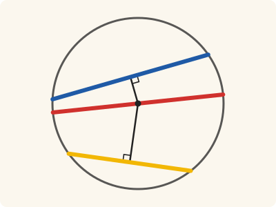
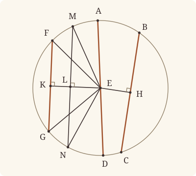

<!-- Generated by scripts/render.py. Do not edit by hand. -->

[Book III](index.md) · [← III.14](14.md) · [III.16 →](16.md)

# Book III, Proposition 15

*Of straight lines in a circle the diameter is greatest*

[Euclid's proof](#euclids-proof) · [In Lean](#in-lean) · [What it rests on](#what-it-rests-on) · [Mishnah](#mishnah)

> Of straight lines in a circle the diameter is greatest, and of the rest the nearer to the centre is always greater than the more remote.

**In Lean:** ✅ proved, as Euclid states it · Euclid's argument

<p align="center"></p>

<p align="center"><em>Slide a straight line in the circle nearer the centre and it grows: the blue, nearer, is longer than the yellow, and through the centre (red) it is longest.</em></p>

## Euclid's proof

<p align="center"></p>

<p align="center"><em>Drawn for one case: AD a diameter, neither BC nor FG through E, and EH less than EK.</em></p>

Let ABCD be a circle, let AD be its diameter and E the centre; and let BC be nearer to the diameter AD, and FG more remote;

I say that AD is greatest and BC greater than FG.

For from the centre E let EH, EK be drawn perpendicular to BC, FG.

Then, since BC is nearer to the centre and FG more remote, EK is greater than EH. [III. Def. 5]

Let EL be made equal to EH, through L let LM be drawn at right angles to EK and carried through to N, and let ME, EN, FE, EG be joined.

Then, since EH is equal to EL,

BC is also equal to MN. [III. 14]

Again, since AE is equal to EM, and ED to EN,

AD is equal to ME, EN.

But ME, EN are greater than MN, [I. 20]

and MN is equal to BC;

therefore AD is greater than BC.

And, since the two sides ME, EN are equal to the two sides FE, EG,

and the angle MEN greater than the angle FEG,

therefore the base MN is greater than the base FG. [I. 24]

But MN was proved equal to BC.

Therefore the diameter AD is greatest and BC greater than FG.

Therefore etc.

Q. E. D.

## In Lean

| | |
|---|---|
| Proof | ✅ Proved, and its companions `Prop15.le_diameter` ([III.15 le_diameter](15.md#le_diameter)) and `Prop15.nearer` ([III.15 nearer](15.md#nearer)) |
| Statement | The whole enunciation. E and the feet are given. `Prop15.le_diameter` bounds any straight line; `Prop15.nearer` compares any two, a diameter at no distance; `Prop15` keeps the figure. |
| Argument | Euclid's. `Prop15.le_diameter` uses Euclid's step [I. 20], two sides of a triangle together greater than the third, when BC does not pass through E, and treats diameters and coincident endpoints separately. `Prop15.nearer` takes two straight lines not through the centre from `Prop15`, by his argument [III. 14, I. 24], and a nearer diameter from `Prop15.le_diameter`. `Prop15` and `Prop15.nearer` rest on `Tacit.exists_centre` through III.14 and III.2; `Prop15.le_diameter` does not. |
| Reviewed | The statement and the argument read against Heath's text, for every departure from Euclid, at commit [`d0508d6c`](https://github.com/jackChallis/stoicheia/commit/d0508d6c) ([the record](../../review/III/15.toml)) |

From [`Elements/BookIII/Prop15.lean`](../../Elements/BookIII/Prop15.lean). Euclid's sentences are the `--` comments, and our own notes are in `/- … -/`; the lines under each sentence are the Lean that carries it out. The list below marks where the Lean takes a case Euclid's figure leaves aside and where the statement already gives a step; the `/- … -/` notes in the listing explain smaller adjustments.

**How the Lean follows the text**

- **Already given.** "For from the centre E let EH, EK be drawn…" The centre E and the perpendiculars EH, EK are given, since Definition III.5 measures from them, and "nearer" is `‖E H‖ < ‖E K‖`. The companion `Prop15.nearer` is given the feet as `Foot`, the foot of the perpendicular, which is E itself for a straight line through E, so that the nearer may be a diameter, at no distance.
- **Already given.** "Then, since BC is nearer to the centre and FG more remote…" The statement assumes that EH is less than EK (`‖E H‖ < ‖E K‖`), for Definition III.5 is how it says that BC is nearer; no Lean is needed beneath.
- **A further case.** "Again, since AE is equal to EM, and ED to EN…" Euclid shows AD greater than BC through MN, beside the more remote FG, and `Prop15` keeps his figure. `Prop15.le_diameter` bounds every BC by AD without MN: if BC does not pass through E, BE and EC together exceed BC [I. 20]; if E lies between B and C, BC equals AD; if B and C coincide, BC has length zero.
- **A further case.** "Therefore the diameter AD is greatest and BC greater than FG." Euclid's nearer straight line BC is not through the centre. `Prop15.nearer` lets it be a diameter, at no distance, and `Prop15.le_diameter` then makes FG the less, since FG, more remote, cannot pass through the centre.

<details><summary>Before the theorem, two lemmas: <code>Prop15.half</code> and <code>Prop15.perp</code> (43 lines)</summary>

```lean
/-- This is half of Euclid's "the angle MEN greater than the angle FEG". Where MN cuts EF,
at X, the point X is within the circle and on M's side of EK, so it lies between M and L,
and the angle FEK, which is the angle XEL, is a part of the angle MEL. -/
theorem Prop15.half {E F K L M : Point} {α : Circle} {EK MN : Line}
    (hE : Centre E α) (hF : OnCircle F α) (hM : OnCircle M α)
    (hE_EK : OnLine E EK) (hL_EK : OnLine L EK) (hELK : Between E L K)
    (hL_MN : OnLine L MN) (hM_MN : OnLine M MN) (hE_MN : ¬ OnLine E MN)
    (hL_in : InsideCircle L α) (hEF : OppositeSides E F MN)
    (hMF : SameSide M F EK) (hF_EK : ¬ OnLine F EK) :
    ∠ F E K < ∠ M E L := by
  obtain ⟨X, hX_MN, hEXF⟩ := hEF.exists_between
  have hX_in : InsideCircle X α := InsideCircle.of_between_centre hE hF hEXF
  have hX_EK : ¬ OnLine X EK := fun h => hF_EK (on_line_of_between hEXF hE_EK h)
  have hXF : SameSide X F EK := pasch2 hEXF hE_EK hX_EK
  have hXM : SameSide X M EK := same_side_trans (same_side_symm hXF) (same_side_symm hMF)
  have hMX : M ≠ X := fun e => inside_not_on hX_in (e ▸ hM)
  have hXL : X ≠ L := fun e => hX_EK (e ▸ hL_EK)
  have hML : M ≠ L := fun e => not_on_line_of_same_side hMF (e ▸ hL_EK)
  have hMXL : Between M X L := by
    rcases between_cases hMX hXL hML hM_MN hX_MN hL_MN with h | h | h
    · exact h
    · exact absurd hM (inside_not_on (Prop2.within (Or.inl hX_in) (Or.inl hL_in) h))
    · exact absurd (same_side_symm hXM) (pasch3 h hL_EK)
  have hMLE : Triangle M L E := Triangle.of_line hM_MN hL_MN hML hE_MN
  rw [← angle_eq_of_onRay (OnRay.of_between hEXF) (OnRay.of_between hELK)]
  exact angle_lt_of_between hMLE hMXL

/-- When M, L, N lie in that order and the angle ELM is right, EL makes a right angle
with every ray of MN issuing from L. Euclid carries LM through to N and uses this
perpendicular to compare distances from the centre. -/
theorem Prop15.perp {E L M N : Point} {MN : Line} (hM_MN : OnLine M MN) (hN_MN : OnLine N MN)
    (hMLN : Between M L N) (hE_MN : ¬ OnLine E MN) (hELM : ∠ E L M = ∟) :
    ∀ P : Point, Collinear M N P → P ≠ L → ∠ E L P = ∟ := by
  have hEL : E ≠ L := fun e => hE_MN (e ▸ on_line_of_between_ends hMLN hM_MN hN_MN)
  have hML : M ≠ L := ne_of_between hMLN
  have hMLE : ∠ M L E = ∟ := (angle_symm hML hEL).trans hELM
  have hELN : ∠ E L N = ∟ := (adjacent_eq_of_right hM_MN hN_MN hMLN hE_MN hMLE).symm.trans hMLE
  intro P hP hPL
  obtain ⟨ν, hM_ν, hN_ν, hP_ν⟩ := hP
  rw [line_unique (ne_of_between_ends hMLN) hM_ν hN_ν hM_MN hN_MN] at hP_ν
  rcases OnRay.cases_of_between hMLN hM_MN hN_MN hP_ν hPL with h | h
  · exact (angle_onRay_right h hEL).trans hELM
  · exact (angle_onRay_right h hEL).trans hELN
```

</details>

```lean
/-- Of straight lines in a circle the diameter is greatest, and of the rest the nearer to the centre
is always greater than the more remote. -/
theorem Prop15 {A B C D E F G H K : Point} {ABCD : Circle} (hE : Centre E ABCD)
    (hA : OnCircle A ABCD) (hD : OnCircle D ABCD) (hAED : Between A E D)
    (hB : OnCircle B ABCD) (hC : OnCircle C ABCD) (hF : OnCircle F ABCD)
    (hG : OnCircle G ABCD) (hE_BC : ¬ Collinear B C E) (hE_FG : ¬ Collinear F G E)
    (hH : Collinear B C H) (hEH : ∀ P : Point, Collinear B C P → P ≠ H → ∠ E H P = ∟)
    (hK : Collinear F G K) (hEK : ∀ P : Point, Collinear F G P → P ≠ K → ∠ E K P = ∟)
    (hnearer : ‖E H‖ < ‖E K‖) :
    ‖B C‖ < ‖A D‖ ∧ ‖F G‖ < ‖B C‖ := by
  -- Let ABCD be a circle, let AD be its diameter and E the centre; and let BC be nearer to the
  -- diameter AD, and FG more remote;
  -- I say that AD is greatest and BC greater than FG.
  -- For from the centre E let EH, EK be drawn perpendicular to BC, FG.
  /- Our statement gives the perpendiculars, and the foot K falls between F and G
     (`foot_between`, as in III.14). -/
  have hFKG : Between F K G := foot_between hE hF hG hE_FG hK hEK
  -- Then, since BC is nearer to the centre and FG more remote, EK is greater than
  -- EH. [III. Def. 5]
  /- Our statement assumes this. -/
  -- Let EL be made equal to EH, through L let LM be drawn at right angles to EK and carried
  -- through to N, and let ME, EN, FE, EG be joined.
  /- We cut EL off EK, equal to EH [I. 3]. -/
  have hEH' : E ≠ H := fun e => hE_BC (e ▸ hH)
  obtain ⟨L, hELK, hEL⟩ := BookI.Prop3 hEH' hnearer
  have hEK' : E ≠ K := ne_of_between_ends hELK
  obtain ⟨EK, hE_EK, hK_EK⟩ := Postulate1 E K hEK'
  have hL_EK : OnLine L EK := on_line_of_between_ends hELK hE_EK hK_EK
  obtain ⟨FG, hF_FG, hG_FG⟩ := Postulate1 F G (ne_of_between_ends hFKG)
  have hK_FG : OnLine K FG := on_line_of_between_ends hFKG hF_FG hG_FG
  have hE_FG_line : ¬ OnLine E FG := fun h => hE_FG ⟨FG, hF_FG, hG_FG, h⟩
  have hF_EK : ¬ OnLine F EK := fun h =>
    hE_FG_line (line_unique (ne_of_between hFKG) h hK_EK hF_FG hK_FG ▸ hE_EK)
  have hG_EK : ¬ OnLine G EK := fun h =>
    hE_FG_line (line_unique (ne_of_between (between_symm hFKG)) h hK_EK hG_FG hK_FG ▸ hE_EK)
  /- We draw LM at right angles to EK, on F's side [I. 11]. -/
  obtain ⟨R, hRF, hR⟩ := BookI.Prop11 hEK' ⟨EK, hE_EK, hK_EK, hL_EK⟩
    (fun ⟨l, h1, h2, h3⟩ => hF_EK (line_unique hEK' h1 h2 hE_EK hK_EK ▸ h3))
  have hR_EK : ¬ OnLine R EK := not_on_line_of_same_side (hRF.sameSide hE_EK hK_EK)
  have hRL : R ≠ L := fun e => hR_EK (e ▸ hL_EK)
  obtain ⟨MN, hL_MN, hR_MN⟩ := Postulate1 L R hRL.symm
  /- L is within the circle, so the straight line LM, carried through, meets the circle on
     each side of L, at N and at M. -/
  have hK_in : InsideCircle K ABCD := Prop2 hF hG K hFKG
  have hL_in : InsideCircle L ABCD :=
    InsideCircle.of_between_centre_of_inside hE hF hK_in hELK
  obtain ⟨N, hN, hN_MN, hNLR⟩ := line_circle_beyond hL_in hL_MN hR_MN hRL
  obtain ⟨M, hM, hM_MN, hMLN⟩ := line_circle_beyond hL_in hL_MN hN_MN (ne_of_between hNLR)
  /- MN meets EK at L alone. -/
  have only_L : ∀ P, OnLine P MN → OnLine P EK → P = L := fun P hPMN hPEK =>
    Classical.byContradiction fun hPL => hR_EK (line_unique hPL hPMN hL_MN hPEK hL_EK ▸ hR_MN)
  have hE_MN_line : ¬ OnLine E MN := fun h => (ne_of_between hELK) (only_L E h hE_EK)
  have hK_MN : ¬ OnLine K MN := fun h => (ne_of_between (between_symm hELK)) (only_L K h hK_EK)
  have hM_EK : ¬ OnLine M EK := fun h => (ne_of_between hMLN) (only_L M hM_MN h)
  have hN_EK : ¬ OnLine N EK := fun h => (ne_of_between (between_symm hMLN)) (only_L N hN_MN h)
  /- M lies on F's side of EK, and N on G's. -/
  have hNR : OppositeSides N R EK := ⟨hN_EK, hR_EK, pasch3 hNLR hL_EK⟩
  have hNM : OppositeSides N M EK := ⟨hN_EK, hM_EK, pasch3 (between_symm hMLN) hL_EK⟩
  have hMF : SameSide M F EK :=
    same_side_trans (same_side_of_opposite_sides hNR hNM) (hRF.sameSide hE_EK hK_EK)
  have hFG : OppositeSides F G EK := ⟨hF_EK, hG_EK, pasch3 hFKG hK_EK⟩
  have hFN : OppositeSides F N EK :=
    ⟨hF_EK, hN_EK, fun h => hNR.2.2 (same_side_trans h (same_side_symm (hRF.sameSide hE_EK hK_EK)))⟩
  have hNG : SameSide N G EK := same_side_of_opposite_sides hFN hFG
  /- The perpendicular makes right angles with both rays of MN from L. -/
  have hMLR : OnRay M L R := OnRay.of_between_between hNLR (between_symm hMLN)
  have hELM : ∠ E L M = ∟ :=
    (angle_onRay_right hMLR (ne_of_between hELK)).trans
      (hR E ⟨EK, hE_EK, hK_EK, hE_EK⟩ (ne_of_between hELK))
  have hEL_perp := Prop15.perp hM_MN hN_MN hMLN hE_MN_line hELM
  /- Joining ME and EN makes the triangle MEN. -/
  have hE_MN : ¬ Collinear M N E := fun ⟨l, h1, h2, h3⟩ =>
    hE_MN_line (line_unique (ne_of_between_ends hMLN) h1 h2 hM_MN hN_MN ▸ h3)
  have hL : Collinear M N L := ⟨MN, hM_MN, hN_MN, hL_MN⟩
  -- Then, since EH is equal to EL,
  have hEH_EL : ‖E H‖ = ‖E L‖ := hEL.symm
  -- BC is also equal to MN. [III. 14]
  have hBC_MN : ‖B C‖ = ‖M N‖ :=
    (Prop14 hE hB hC hM hN hE_BC hE_MN hH hEH hL hEL_perp).2 hEH_EL
  -- Again, since AE is equal to EM, and ED to EN,
  have hAE : ‖A E‖ = ‖E M‖ := (len_symm A E).trans (Definition15 hE hA hM)
  have hED : ‖E D‖ = ‖E N‖ := Definition15 hE hD hN
  -- AD is equal to ME, EN.
  have hAD : ‖A D‖ = ‖M E‖ + ‖E N‖ := by
    rw [← len_add_of_between hAED, hAE, hED, len_symm M E]
  -- But ME, EN are greater than MN, [I. 20]
  have h20 : ‖M N‖ < ‖M E‖ + ‖E N‖ := (BookI.Prop20 (Triangle.cab hE_MN)).1
  -- and MN is equal to BC;
  rw [← hBC_MN] at h20
  -- therefore AD is greater than BC.
  have hdiameter : ‖B C‖ < ‖A D‖ := by
    rw [hAD]
    exact h20
  -- And, since the two sides ME, EN are equal to the two sides FE, EG,
  have hEM : ‖E M‖ = ‖E F‖ := Definition15 hE hM hF
  have hEN : ‖E N‖ = ‖E G‖ := Definition15 hE hN hG
  -- and the angle MEN greater than the angle FEG,
  /- FG and MN never meet, for at a common point Z the triangle ZLK would have two right
     angles, against I.17. So F and G are on K's side of MN, and E is on the other. -/
  have par : Parallel FG MN := Parallel.of_not_meet hF_FG fun Z hZFG hZMN => by
    have hZL : Z ≠ L := by
      intro e
      have hFG_EK := line_unique (ne_of_between (between_symm hELK)).symm
        (e ▸ hZFG) hK_FG hL_EK hK_EK
      exact hE_FG_line (hFG_EK ▸ hE_EK)
    have hZ_EK : ¬ OnLine Z EK := fun h => hZL (only_L Z hZMN h)
    have hZK : Z ≠ K := fun e => hZ_EK (e ▸ hK_EK)
    have hELZ : ∠ E L Z = ∟ := hEL_perp Z ⟨MN, hM_MN, hN_MN, hZMN⟩ hZL
    have hZLK : ∠ Z L K = ∟ := by
      have h := adjacent_eq_of_right hE_EK hK_EK hELK hZ_EK hELZ
      exact h.symm.trans hELZ
    have hLKZ : ∠ L K Z = ∟ := by
      have hEKZ : ∠ E K Z = ∟ := hEK Z ⟨FG, hF_FG, hG_FG, hZFG⟩ hZK
      rw [angle_onRay_left (OnRay.of_between (between_symm hELK)) hZK]
      exact hEKZ
    have hZLK' : Triangle Z L K :=
      (Triangle.of_line hL_EK hK_EK (ne_of_between (between_symm hELK)).symm hZ_EK).cab
    have h17 := (BookI.Prop17 hZLK').1
    rw [hZLK, hLKZ] at h17
    exact lt_irrefl _ h17
  have hEK_MN : OppositeSides E K MN := ⟨hE_MN_line, hK_MN, pasch3 hELK hL_MN⟩
  have hEF_MN : OppositeSides E F MN :=
    ⟨hE_MN_line, par.not_onLine hF_FG, fun h => hEK_MN.2.2 (same_side_trans (same_side_symm h)
      (par.sameSide hF_FG hK_FG))⟩
  have hEG_MN : OppositeSides E G MN :=
    ⟨hE_MN_line, par.not_onLine hG_FG, fun h => hEK_MN.2.2 (same_side_trans (same_side_symm h)
      (par.sameSide hG_FG hK_FG))⟩
  have h1 : ∠ F E K < ∠ M E L :=
    Prop15.half hE hF hM hE_EK hL_EK hELK hL_MN hM_MN hE_MN_line hL_in hEF_MN hMF hF_EK
  have h2 : ∠ G E K < ∠ N E L :=
    Prop15.half hE hG hN hE_EK hL_EK hELK hL_MN hN_MN hE_MN_line hL_in hEG_MN hNG hG_EK
  have hMEN : ∠ F E G < ∠ M E N := by
    rw [angle_add_of_between hE_FG hFKG, angle_add_of_between hE_MN hMLN,
      angle_symm hEK'.symm (fun e : G = E => hG_EK (e ▸ hE_EK)),
      angle_symm (ne_of_between hELK).symm (fun e : N = E => hN_EK (e ▸ hE_EK))]
    exact lt_trans (add_lt_add_right _ h1) (by
      rw [add_comm (∠ M E L), add_comm (∠ M E L)]; exact add_lt_add_right _ h2)
  -- therefore the base MN is greater than the base FG. [I. 24]
  have h24 : ‖F G‖ < ‖M N‖ := BookI.Prop24 (Triangle.cab hE_MN) (Triangle.cab hE_FG) hEM hEN hMEN
  -- But MN was proved equal to BC.
  rw [← hBC_MN] at h24
  -- Therefore the diameter AD is greatest and BC greater than FG.
  exact ⟨hdiameter, h24⟩
  -- Therefore etc.
  -- Q. E. D.
```

<a name="le_diameter"></a><a name="nearer"></a>

<details><summary>After the theorem, its companions, <code>Prop15.le_diameter</code> and <code>Prop15.nearer</code> (95 lines)</summary>

```lean
/-- **III.15, the diameter is greatest** (companion of III.15). Of the straight lines in a
circle, none is greater than the diameter AD, and a straight line BC in it is equal to the
diameter exactly when it passes through the centre E: when it is a diameter too. If BC is
not through the centre, BE, EC together are greater than BC [I. 20], and they are equal to
AD. BC may be a point, and then it is nothing. -/
theorem Prop15.le_diameter {A B C D E : Point} {ABCD : Circle} (hE : Centre E ABCD)
    (hA : OnCircle A ABCD) (hD : OnCircle D ABCD) (hAED : Between A E D)
    (hB : OnCircle B ABCD) (hC : OnCircle C ABCD) :
    ‖B C‖ ≤ ‖A D‖ ∧ (‖B C‖ = ‖A D‖ ↔ Between B E C) := by
  /- AD is two radii, BE and EC (`Prop14.diameter_sum`, as in III.14 general). -/
  have hAD_sum : ‖A D‖ = ‖B E‖ + ‖E C‖ :=
    Prop14.diameter_sum hE hA hD hB hC hAED
  by_cases hBC : B = C
  · /- BC is a point: its length is nothing, and E cannot lie between its equal ends. -/
    subst C
    rw [len_self]
    refine ⟨not_lt_zero _, ?_⟩
    exact ⟨fun h => False.elim (len_ne_zero (ne_of_between_ends hAED) h.symm),
      fun h => False.elim (ne_of_between_ends h rfl)⟩
  · by_cases hE_BC : Collinear B C E
    · /- BC passes through E: it too is a diameter, equal to the same two radii. -/
      obtain ⟨L, hB_L, hC_L, hE_L⟩ := hE_BC
      have hBEC : Between B E C :=
        between_of_inside_chord hE_L hB_L hC_L (centre_inside hE) hB hC hBC
      have hBC_AD : ‖B C‖ = ‖A D‖ := (len_add_of_between hBEC).symm.trans hAD_sum.symm
      refine ⟨?_, ⟨fun _ => hBEC, fun _ => hBC_AD⟩⟩
      rw [hBC_AD]
      exact lt_irrefl _
    · /- BC does not pass through E: BE and EC together exceed BC by I.20. -/
      have hBC_AD : ‖B C‖ < ‖A D‖ := by
        rw [hAD_sum]
        exact (BookI.Prop20 (Triangle.cab hE_BC)).1
      have hnot_between : ¬ Between B E C := by
        intro hBEC
        obtain ⟨L, hB_L, hE_L, hC_L⟩ := collinear_of_between hBEC
        exact hE_BC ⟨L, hB_L, hC_L, hE_L⟩
      exact ⟨fun h => lt_irrefl _ (lt_trans hBC_AD h),
        ⟨fun h => False.elim (Magnitude.ne_of_lt hBC_AD h),
          fun h => False.elim (hnot_between h)⟩⟩

/-- **III.15, the nearer is greater** (companion of III.15). Of two straight lines BC, FG in
a circle, the one nearer to the centre E is the greater: if EH is less than EK, H and K being
the feet of the perpendiculars from E, then FG is less than BC. The nearer, BC, may be a
diameter, at no distance; the more remote cannot be. (Nor can FG be a point: its foot would
be E, and EK nothing.) -/
theorem Prop15.nearer {B C E F G H K : Point} {ABCD : Circle} (hE : Centre E ABCD)
    (hB : OnCircle B ABCD) (hC : OnCircle C ABCD) (hF : OnCircle F ABCD)
    (hG : OnCircle G ABCD) (hBC : B ≠ C) (hH : Foot E B C H) (hK : Foot E F G K)
    (hnearer : ‖E H‖ < ‖E K‖) :
    ‖F G‖ < ‖B C‖ := by
  /- FG cannot pass through E, even with coincident ends: its foot would be E. -/
  have hE_FG : ¬ Collinear F G E := by
    intro h
    have hK_E : K = E := hK.2.1 h
    rw [hK_E, len_self] at hnearer
    exact not_lt_zero _ hnearer
  by_cases hE_BC : Collinear B C E
  · /- BC is a diameter. The diameter bound is strict for FG, which does not pass through E. -/
    obtain ⟨L, hB_L, hC_L, hE_L⟩ := hE_BC
    have hBEC : Between B E C :=
      between_of_inside_chord hE_L hB_L hC_L (centre_inside hE) hB hC hBC
    obtain ⟨hbound, hequal⟩ := Prop15.le_diameter hE hB hC hBEC hF hG
    have hunequal : ‖F G‖ ≠ ‖B C‖ := by
      intro h
      obtain ⟨M, hF_M, hE_M, hG_M⟩ := collinear_of_between (hequal.mp h)
      exact hE_FG ⟨M, hF_M, hG_M, hE_M⟩
    rcases lt_trichotomy ‖F G‖ ‖B C‖ with h | h | h
    · exact h
    · exact False.elim (hunequal h)
    · exact False.elim (hbound h)
  · /- Neither straight line passes through E: this is III.15's worked configuration. Draw
       the diameter through B, carrying BE on through the centre to A on the circle; III.15's
       second conclusion is then that FG is less than BC. -/
    have hB_E : B ≠ E := ne_of_centre_of_on hE hB
    obtain ⟨L, hE_L, hB_L⟩ := Postulate1 E B hB_E.symm
    obtain ⟨A, hA, -, hAEB⟩ := line_circle_beyond (centre_inside hE) hE_L hB_L hB_E
    exact (Prop15 hE hA hB hAEB hB hC hF hG hE_BC hE_FG
      hH.1 (hH.2.2 hE_BC) hK.1 (hK.2.2 hE_FG) hnearer).2

/-- The check: the statement of `Prop15` follows from `Prop15.le_diameter` and
`Prop15.nearer` (checked by Lean). BC is not through the centre, so it is less than the
diameter. -/
example : type_of% @Elements.BookIII.Prop15 := by
  intro A B C D E F G H K ABCD hE hA hD hAED hB hC hF hG hE_BC hE_FG hH hEH hK hEK hnearer
  obtain ⟨hle, hiff⟩ := Prop15.le_diameter hE hA hD hAED hB hC
  refine ⟨?_, Prop15.nearer hE hB hC hF hG (Triangle.ne₁₂ hE_BC)
    ⟨hH, fun h => absurd h hE_BC, fun _ => hEH⟩ ⟨hK, fun h => absurd h hE_FG, fun _ => hEK⟩
    hnearer⟩
  have hne : ‖B C‖ ≠ ‖A D‖ := fun h => by
    obtain ⟨L, hB_L, hE_L, hC_L⟩ := collinear_of_between (hiff.mp h)
    exact hE_BC ⟨L, hB_L, hC_L, hE_L⟩
  rcases lt_trichotomy ‖B C‖ ‖A D‖ with h | h | h
  · exact h
  · exact absurd h hne
  · exact absurd h hle
```

</details>

## What it rests on

| | Proposition | `Prop15.le_diameter` | `Prop15.nearer` |
|---|---|---|---|
| Heath's references | [I.20](../I/20.md), [I.24](../I/24.md), [III.14](14.md); Def. III.5 | none | none |
| Lean cites | [I.3](../I/03.md), [I.11](../I/11.md), [I.13](../I/13.md), [I.17](../I/17.md), [I.19](../I/19.md), [I.20](../I/20.md), [I.24](../I/24.md), [III.2](02.md), [III.14](14.md) | [I.20](../I/20.md) | [III.15](15.md), [III.15 le_diameter](15.md#le_diameter) |
| Postulates | 1, 2, 3, 4, 5 | 1, 2, 3, 4 | 1, 2, 3, 4, 5 |
| Definitions taken as axioms | Def. I.15 | Def. I.15 | Def. I.15 |
| Common Notions | 1, 2, 3, 4, 5 | 1, 2, 3, 4, 5 | 1, 2, 3, 4, 5 |
| Tacit rules | 64 (listed below) | 53 (listed below) | 64 (listed below) |
| Its own Lean calls | Postulate 1; Def. I.15; 21 tacit rules | 8 tacit rules | Postulate 1; 6 tacit rules |
| Through lemmas | 17 tacit rules | Postulate 1; Def. I.15; 3 tacit rules | 3 tacit rules |

Some of these come in through lemmas [shared](../../CERTIFICATE.md#shared-steps) by many proofs: [`Tacit.adjacent_eq_of_right`](../../Elements/BookI/Prop13.lean#L189) (I.13); [`foot_between`](../../Elements/BookIII/Squares.lean#L95) (I.17, I.19); [`Prop2.within`](../../Elements/BookIII/Prop02.lean#L116) (III.2).

_Postulates, definitions, Common Notions and tacit rules: all that each proof rests on, counting those of the propositions it cites. The last two rows say which of the postulates, definitions and tacit rules its own Lean calls, in the proof or a helper written for it, and which it does not call but reaches through lemmas, of Book Zero or shared (a proposition it cites may rest on these too); the rest come in only through the propositions it cites or the Common Notions._

_Euclid's Def. III.5 is said in Lean by the perpendiculars from the centre, `‖E H‖ < ‖E K‖`, a definition rather than an assumption, so the row of definitions taken as axioms does not count it._

<details><summary>The 64 tacit rules beneath this proof, counting those of the propositions it cites</summary>

_(used here) marks a rule this proof's own Lean calls, in the proof or a helper written for it; (through …) marks one its own Lean does not call but reaches through the lemmas named, of [Book Zero](../../Elements/Figure) or shared, though a proposition it cites may rest on it too; and a rule with no mark comes in only through a proposition it cites or a Common Notion. The names in brackets are System E's: an Intersection rule says when straight lines and circles must meet, and an Intersections rule takes a point where they do (see [Book I's introduction](../I/index.md))._

**Reading the figure**

- [`between_cases`](../../Elements/Foundations/Tacit/Diagram.lean#L73) (used here): Of three different points on a straight line, one is between the other two. (Between 6)
- [`between_of_between_left`](../../Elements/Foundations/Tacit/Diagram.lean#L65) (through [`Prop2.within`](../../Elements/BookIII/Prop02.lean#L116)): If B is between A and C, and D is between A and B, then D is between A and C. (Between 4)
- [`between_of_between_right`](../../Elements/Foundations/Tacit/Diagram.lean#L69): If B is between A and C, and C is between B and D, then B is between A and D. (Between 5)
- [`between_of_inside_chord`](../../Elements/Foundations/Tacit/Diagram.lean#L146) (through [`foot_between`](../../Elements/BookIII/Squares.lean#L95)): A straight line through a point inside a circle has that point between the points where it meets the circle. (Circle 1)
- [`between_symm`](../../Elements/Foundations/Tacit/Diagram.lean#L42) (used here): If B is between A and C, it is between C and A. (Between 1)
- [`centre_inside`](../../Elements/Foundations/Tacit/Diagram.lean#L34): The centre of a circle is inside it. (Generalities 3)
- [`circles_meet`](../../Elements/Foundations/Tacit/Diagram.lean#L176): If each circle passes through a point inside the other, the circles cut one another. This is the step Euclid takes for granted in I.1. (Intersection 5)
- [`circles_meet_of_on_inside_outside`](../../Elements/Foundations/Tacit/Diagram.lean#L170): Two circles cut one another if the first passes through a point A inside the second, and a point B outside the second is inside or on the first. (Intersection 4, in LeanEuclid's corrected form)
- [`circles_meet_same_side`](../../Elements/Foundations/Tacit/Constructions.lean#L94): Two circles that cut one another do so on each side of the straight line through their centres. (Intersections 8)
- [`exists_centre`](../../Elements/Foundations/Tacit/Constructions.lean#L72): Every circle has a centre. A rule of our own, not one of System E's: its content is Euclid's Definitions I.15 and I.16.
- [`exists_point`](../../Elements/Foundations/Tacit/Constructions.lean#L29) (through [`angle_lt_of_between`](../../Elements/Figure/Angles.lean#L108) and [`foot_between`](../../Elements/BookIII/Squares.lean#L95)): Let a point be taken. (Points 1)
- [`exists_point_between`](../../Elements/Foundations/Tacit/Constructions.lean#L41): Let a point be taken between B and C. (Points 3)
- [`exists_point_on_line`](../../Elements/Foundations/Tacit/Constructions.lean#L32): Let a point be taken on the straight line L. (Points 2)
- [`exists_point_on_line_off_line`](../../Elements/Foundations/Tacit/Constructions.lean#L37): Let a point be taken on L, not on the different straight line M. (Points 2, with "distinct from M")
- [`exists_point_opposite_side`](../../Elements/Foundations/Tacit/Constructions.lean#L49): Let a point be taken on the other side of L from B. (Points 6)
- [`exists_point_same_side`](../../Elements/Foundations/Tacit/Constructions.lean#L45): Let a point be taken on the same side of L as B. (Points 5)
- [`inside_not_on`](../../Elements/Foundations/Tacit/Diagram.lean#L37) (used here): A point inside a circle is not on it. (Generalities 4)
- [`line_circle_between`](../../Elements/Foundations/Tacit/Constructions.lean#L82): A straight line through a point B inside a circle, heading out to a point C outside it, cuts the circle between B and C. (Intersections 4)
- [`line_circle_beyond`](../../Elements/Foundations/Tacit/Constructions.lean#L88) (used here): A straight line through a point B inside a circle, produced beyond B away from C, cuts the circle there. (Intersections 5)
- [`line_unique`](../../Elements/Foundations/Tacit/Diagram.lean#L30) (used here): Two points determine a straight line. (Generalities 1)
- [`lines_meet_of_opposite_sides`](../../Elements/Foundations/Tacit/Diagram.lean#L159) (through [`OppositeSides.exists_between`](../../Elements/Figure/Sides.lean#L117) and [`Parallel.sameSide`](../../Elements/Figure/Parallels.lean#L52)): A straight line joining points on opposite sides of L crosses L. (Intersection 1)
- [`ne_of_between`](../../Elements/Foundations/Tacit/Diagram.lean#L45) (used here): A point between two others differs from the first. (Between 1)
- [`ne_of_between_ends`](../../Elements/Foundations/Tacit/Diagram.lean#L48) (used here): The ends of a finite straight line differ. (Between 1)
- [`not_between_of_between`](../../Elements/Foundations/Tacit/Diagram.lean#L51) (through [`OnRay.of_between`](../../Elements/Figure/Rays.lean#L32)): If B is between A and C, then A is not between B and C. (Between 1)
- [`not_between_of_between_between`](../../Elements/Foundations/Tacit/Diagram.lean#L78) (through [`OnRay.cases_of_between`](../../Elements/Figure/Rays.lean#L54) and [`OnRay.of_between_between`](../../Elements/Figure/Rays.lean#L86)): If B is between A and C, and also between A and D, then B is not between C and D: C and D lie on the same side of B. (Between 7)
- [`not_on_line_of_same_side`](../../Elements/Foundations/Tacit/Diagram.lean#L91) (used here): Points on one side of a straight line are not on it. (Same side 3)
- [`on_line_of_between`](../../Elements/Foundations/Tacit/Diagram.lean#L55) (used here): A straight line through A and B, with B between A and C, passes through C. (Between 2)
- [`on_line_of_between_ends`](../../Elements/Foundations/Tacit/Diagram.lean#L60) (used here): A straight line through A and C passes through every point between them. (Between 3)
- [`pasch2`](../../Elements/Foundations/Tacit/Diagram.lean#L110) (used here): If B is between A and C, A is on L and B is off it, then B and C are on the same side of L: a straight line that leaves L at A does not cross it again. (Pasch 2)
- [`pasch3`](../../Elements/Foundations/Tacit/Diagram.lean#L113) (used here): A straight line through a point between A and C separates them. (Pasch 3)
- [`pasch4`](../../Elements/Foundations/Tacit/Diagram.lean#L118) (through [`OppositeSides.exists_between`](../../Elements/Figure/Sides.lean#L117)): If two different straight lines L and M meet at B, and A and C are points of M, different from each other and from B, that are not on the same side of L, then B is between A and C. (Pasch 4)
- [`same_side_or`](../../Elements/Foundations/Tacit/Diagram.lean#L98) (through [`same_side_of_opposite_sides`](../../Elements/Figure/Sides.lean#L111)): A straight line has only two sides. (Same side 5)
- [`same_side_refl`](../../Elements/Foundations/Tacit/Diagram.lean#L84) (through [`OppositeSides.exists_between`](../../Elements/Figure/Sides.lean#L117)): A point off a straight line is on the same side of it as itself. (Same side 1)
- [`same_side_symm`](../../Elements/Foundations/Tacit/Diagram.lean#L88) (used here): If A is on the same side of a straight line as B, then B is on the same side as A. (Same side 2)
- [`same_side_trans`](../../Elements/Foundations/Tacit/Diagram.lean#L95) (used here): Two points on the same side of a straight line as a third point are on the same side as each other. (Same side 4)
- [`triple_incidence1`](../../Elements/Foundations/Tacit/Diagram.lean#L130): Take B on L, C on M and D on N, three straight lines through A. If C lies within the angle BAD (on D's side of L and on B's side of N), then B and D are not on the same side of M: the straight line AC separates them. (Triple incidence 1)
- [`triple_incidence2`](../../Elements/Foundations/Tacit/Diagram.lean#L138): Take B on L, C on M and D on N, three straight lines through A, with B other than A and D off M. If C and D are on the same side of L, and B and D are not on the same side of M, then B and C are on the same side of N: C lies within the angle BAD. (Triple incidence 2)

**Lengths, angles and areas**

- [`angle_add_of_inside`](../../Elements/Foundations/Tacit/Transfer.lean#L55) (through [`angle_add_of_between`](../../Elements/Figure/Angles.lean#L83) and [`angle_lt_of_between`](../../Elements/Figure/Angles.lean#L108)): If D lies within the angle BAC, then BAC is made up of BAD and DAC. (Diagram-angle 2)
- [`angle_eq_of_same_rays`](../../Elements/Foundations/Tacit/Transfer.lean#L62) (through [`angle_eq_of_onRay`](../../Elements/Figure/Angles.lean#L31), [`angle_onRay_left`](../../Elements/Figure/Angles.lean#L40) and [`angle_onRay_right`](../../Elements/Figure/Angles.lean#L47)): The angle doesn't change if its arms are traced through other points on the same rays. (Diagram-angle 4)
- [`angle_le_two_right`](../../Elements/Foundations/Tacit/Metric.lean#L29): No angle exceeds two right angles. (Metric 5)
- [`angle_symm`](../../Elements/Foundations/Tacit/Metric.lean#L26) (used here): The angle ABC is the angle CBA. (Metric 4)
- [`area_add_of_between`](../../Elements/Foundations/Tacit/Transfer.lean#L78): Cutting a triangle in two from a vertex adds up. (Diagram-area 2)
- [`area_congruent`](../../Elements/Foundations/Tacit/Metric.lean#L43): Triangles equal in all their sides and angles are equal in area. Euclid uses this without comment once he has shown two triangles congruent. (Metric 9)
- [`area_degenerate`](../../Elements/Foundations/Tacit/Metric.lean#L32): A "triangle" with a repeated corner has no area. (Metric 6)
- [`area_eq_zero_of_on_line`](../../Elements/Foundations/Tacit/Transfer.lean#L70): A "triangle" whose corners lie on one straight line has no area. (Diagram-area 1)
- [`area_rotate`](../../Elements/Foundations/Tacit/Metric.lean#L35): The triangle ABC is the triangle CAB. (Metric 8)
- [`area_swap`](../../Elements/Foundations/Tacit/Metric.lean#L38): The triangle ABC is the triangle ACB. (Metric 8)
- [`eq_of_len_eq_zero`](../../Elements/Foundations/Tacit/Metric.lean#L17) (through [`InsideCircle.of_between_centre`](../../Elements/Figure/Circles.lean#L223) and [`InsideCircle.of_between_centre_of_inside`](../../Elements/Figure/Circles.lean#L231)): A finite straight line with distinct ends has length. (Metric 1)
- [`inside_of_len_lt`](../../Elements/Foundations/Tacit/Transfer.lean#L34) (through [`InsideCircle.of_between_centre`](../../Elements/Figure/Circles.lean#L223), [`InsideCircle.of_between_centre_of_inside`](../../Elements/Figure/Circles.lean#L231) and [`foot_between`](../../Elements/BookIII/Squares.lean#L95)): A point nearer the centre than the circumference is inside. (Diagram-segment 4)
- [`len_add_of_between`](../../Elements/Foundations/Tacit/Transfer.lean#L22) (used here): If B is between A and C, then AB and BC together make up AC. (Diagram-segment 1)
- [`len_lt_of_inside`](../../Elements/Foundations/Tacit/Transfer.lean#L38) (through [`InsideCircle.of_between_centre_of_inside`](../../Elements/Figure/Circles.lean#L231)): A point inside is nearer the centre than the circumference. (Diagram-segment 4)
- [`len_self`](../../Elements/Foundations/Tacit/Metric.lean#L20): The "straight line" from a point to itself has no length. (Metric 1)
- [`len_symm`](../../Elements/Foundations/Tacit/Metric.lean#L23) (used here): The straight line AB is the straight line BA. (Metric 3)
- [`on_line_of_area_eq_zero`](../../Elements/Foundations/Tacit/Transfer.lean#L74): A triangle with no area has its corners on one straight line. (Diagram-area 1)
- [`same_ray_of_angle_eq_zero`](../../Elements/Foundations/Tacit/Transfer.lean#L50) (through [`angle_lt_of_between`](../../Elements/Figure/Angles.lean#L108)): If the angle BAC is nothing, C lies on the ray from A through B. (Diagram-angle 1)

**Superposition**

- [`superposition`](../../Elements/Foundations/Tacit/Superposition.lean#L30): **Superposition.** The triangle ABC can be applied to the straight line L with A on D, B on the ray from D through G, and C on the side of L where H is, without changing any side or angle.

**Laws of magnitude**

- [`add_assoc`](../../Elements/Foundations/Tacit/Magnitudes.lean#L23): Adding three magnitudes in a row, it makes no difference whether the first two or the last two are added first. (System E §3.5)
- [`add_comm`](../../Elements/Foundations/Tacit/Magnitudes.lean#L26) (used here): The order of adding does not matter. (System E §3.5)
- [`add_lt_add_right`](../../Elements/Foundations/Tacit/Magnitudes.lean#L45) (used here): Adding the same thing to both sides keeps "less than". (System E §3.5)
- [`add_zero`](../../Elements/Foundations/Tacit/Magnitudes.lean#L29): Adding nothing changes nothing. (System E §3.5)
- [`lt_irrefl`](../../Elements/Foundations/Tacit/Magnitudes.lean#L32) (used here): No magnitude is less than itself. (System E §3.5)
- [`lt_trans`](../../Elements/Foundations/Tacit/Magnitudes.lean#L35) (used here): What is less than the less is less still. (System E §3.5)
- [`lt_trichotomy`](../../Elements/Foundations/Tacit/Magnitudes.lean#L39) (through [`InsideCircle.of_between_centre`](../../Elements/Figure/Circles.lean#L223), [`InsideCircle.of_between_centre_of_inside`](../../Elements/Figure/Circles.lean#L231), [`angle_lt_of_between`](../../Elements/Figure/Angles.lean#L108) and 1 other lemma): Of two magnitudes, one is less, or they are equal, or the other is less. (System E §3.5)
- [`not_lt_zero`](../../Elements/Foundations/Tacit/Magnitudes.lean#L42) (through [`InsideCircle.of_between_centre`](../../Elements/Figure/Circles.lean#L223), [`InsideCircle.of_between_centre_of_inside`](../../Elements/Figure/Circles.lean#L231) and [`angle_lt_of_between`](../../Elements/Figure/Angles.lean#L108)): Nothing is less than zero. (System E §3.5)

</details>

## Mishnah

_Our commentary: what Euclid assumes, what Lean made us say out loud, and how the result looks by modern means._

**Move BC beside FG.** Euclid draws a new straight line MN as far from E as BC, so III.14 makes them equal, and at right angles to EK, so it lies beside FG, parallel to it. Two triangles with equal radii for sides now stand at E, and the greater angle MEN gives the greater base by I.24. The same MN settles the diameter's claim: AD is two radii, and two radii together exceed MN by I.20.

**Greatest of all?** Euclid shows the diameter greater than BC with MN, which he draws to compare BC with FG, so his figure says it only of a BC with a more remote straight line beside it, and our main statement keeps his figure. The companion `Prop15.le_diameter` needs no MN: BE and EC are two radii, together equal to AD, and greater than BC by I.20, unless BC passes through E and is a diameter too. The companion `Prop15.nearer` measures the distances to the feet of the perpendiculars (`Foot`), so that the nearer straight line may be a diameter; two straight lines not through the centre it leaves to Euclid's proof.

**"Euclid himself assumes."** Heath sees the figure at work: "Euclid himself assumes that the angle subtended at the centre by MN is greater than the angle subtended by FG, or, in other words, that M, N both fall outside the triangle FEG" (vol. 2, p. 37), an assumption like those of III.7 and III.8. The reason is ready: "its truth is obvious because EM, EN, being radii of the circle, are greater than the distances from E to the points in which MN cuts EF, EG" (Heath, vol. 2, p. 37).

**Why can MN and FG never meet?** Heath's reason takes for granted that MN cuts EF and EG at all, and we prove that too. MN and FG are both at right angles to EK, so by I.17 they never meet, and F and G lie across MN from E. Each point where MN cuts EF or EG is then within the circle, and so between L and the end of MN on its side. Done for each half of the angle (`Prop15.half`), this gives Euclid's MEN greater than FEG.

**Robert Simson leaves MN out.** His proof compares instead the squares on the perpendiculars and on the halves of the straight lines, after a similar proof by Theodosius (*Sphaerica* I.6), and Simson adds the converse. Heath wonders whether Euclid "would have regarded this as too complicated an inference to make without explanation or without an increase in the number of his axioms" (vol. 2, p. 37). Euclid's MN keeps the comparison in the two triangles before us, but asks us to account for where their points fall.

**The modern way.** A straight line in a circle of radius r that subtends the angle θ at the centre has length 2r sin(θ/2), which grows with θ until θ is two right angles and the straight line is the diameter, 2r. That is Euclid's route: the nearer straight line subtends the greater angle, and I.24 does the rest.

## Further reading

- For why Robert Simson leaves MN out, proving III.15 like III.14 and Theodosius' *Sphaerica* I.6, and adds the converse, Robert Simson's [*The Elements of Euclid*](https://archive.org/details/bim_eighteenth-century_elements-english-sele_euclid_1756_0) (1756, free online), his note on III.15 (pp. 364–365) (also on [III.1](01.md)).
- For the 2r sin(θ/2) of the modern way, which is Ptolemy's chord, crd α = 120 sin(α/2) in a circle of radius 60, Alexander Ostermann and Gerhard Wanner's [*Geometry by Its History*](https://doi.org/10.1007/978-3-642-29163-0) (2012), §5.1, "Ptolemy and the Chord Function" (pp. 113–115), geometry learned from the old masters, roughly in the order it was found.

[Book III](index.md) · [← III.14](14.md) · [III.16 →](16.md)

---

<sub>Euclid's text: T. L. Heath, *The Thirteen Books of Euclid's Elements*, vol. 2 (Cambridge, 1908), pp. 36–37; [scan leaves n48–n49](https://archive.org/details/thirteenbookseu00heibgoog/page/n48); [figure on n48](https://archive.org/details/thirteenbookseu00heibgoog/page/n48). Public domain.</sub>

<sub>The tacit rules follow the System E of Jeremy Avigad, Edward Dean and John Mumma, read alongside LeanEuclid (Logan Murphy, Kaiyu Yang, Jialiang Sun, Zhaoyu Li, Anima Anandkumar and Xujie Si).</sub>
