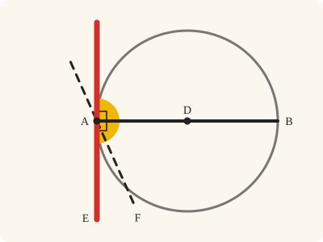
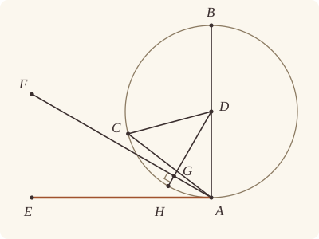

<!-- Generated by scripts/render.py. Do not edit by hand. -->

[Book III](index.md) · [← III.15](15.md) · [III.17 →](17.md)

# Book III, Proposition 16

*The straight line at right angles to a diameter from its extremity*

[Euclid's proof](#euclids-proof) · [In Lean](#in-lean) · [What it rests on](#what-it-rests-on) · [Mishnah](#mishnah)

> The straight line drawn at right angles to the diameter of a circle from its extremity will fall outside the circle, and into the space between the straight line and the circumference another straight line cannot be interposed; further the angle of the semicircle is greater, and the remaining angle less, than any acute rectilineal angle.

**In Lean:** ✅ proved, as Euclid states it · Euclid's argument, with two steps changed

<p align="center"></p>

<p align="center"><em>Stand a straight line (red) at right angles (yellow) to a diameter at its end, and it touches the circle. Tilt it ever so little (dashed) and it cuts in: no straight line fits between it and the circumference.</em></p>

## Euclid's proof

<p align="center"></p>

<p align="center"><em>Drawn for one case: FA off the centre, with G distinct from A and between D and H; the mixed angles are on E's side of AB. G is drawn within the circle, where the proof puts it, and H, where DG produced meets the circumference, beyond it; Heath's figure draws the supposition, with H between D and G. CA is drawn as the first reductio supposes it, within the circle; the true perpendicular to AB is AE.</em></p>

Let ABC be a circle about D as centre and AB as diameter;

I say that the straight line drawn from A at right angles to AB from its extremity will fall outside the circle.

For suppose it does not, but, if possible, let it fall within as CA, and let DC be joined.

Since DA is equal to DC,

the angle DAC is also equal to the angle ACD. [I. 5]

But the angle DAC is right;

therefore the angle ACD is also right:

thus, in the triangle ACD, the two angles DAC, ACD are equal to two right angles; which is impossible. [I. 17]

Therefore the straight line drawn from the point A at right angles to BA will not fall within the circle.

Similarly we can prove that neither will it fall on the circumference;

therefore it will fall outside.

Let it fall as AE;

I say next that into the space between the straight line AE and the circumference CHA another straight line cannot be interposed.

For, if possible, let another straight line be so interposed, as FA, and let DG be drawn from the point D perpendicular to FA.

Then, since the angle AGD is right,

and the angle DAG is less than a right angle,

AD is greater than DG. [I. 19]

But DA is equal to DH;

therefore DH is greater than DG, the less than the greater: which is impossible.

Therefore another straight line cannot be interposed into the space between the straight line and the circumference.

I say further that the angle of the semicircle contained by the straight line BA and the circumference CHA is greater than any acute rectilineal angle,

and the remaining angle contained by the circumference CHA and the straight line AE is less than any acute rectilineal angle.

For, if there is any rectilineal angle greater than the angle contained by the straight line BA and the circumference CHA, and any rectilineal angle less than the angle contained by the circumference CHA and the straight line AE, then into the space between the circumference and the straight line AE a straight line will be interposed such as will make an angle contained by straight lines which is greater than the angle contained by the straight line BA and the circumference CHA, and another angle contained by straight lines which is less than the angle contained by the circumference CHA and the straight line AE.

But such a straight line cannot be interposed;

therefore there will not be any acute angle contained by straight lines which is greater than the angle contained by the straight line BA and the circumference CHA, nor yet any acute angle contained by straight lines which is less than the angle contained by the circumference CHA and the straight line AE.—

<a name="porism"></a>PORISM. From this it is manifest that the straight line drawn at right angles to the diameter of a circle from its extremity touches the circle.

Q. E. D.

## In Lean

| | |
|---|---|
| Proof | ✅ Proved, and its porism, [III.16 Por.](16.md#porism), and its companions `Prop16.semicircle` ([III.16 semicircle](16.md#semicircle)), `Prop16.remaining` ([III.16 remaining](16.md#remaining)) and `Prop16.acute` ([III.16 acute](16.md#acute)) |
| Statement | The whole enunciation. With its companions: `Prop16.semicircle` and `Prop16.remaining` compare the two angles with every acute angle placed at A; `Prop16.acute` with any acute angle. |
| Argument | Euclid's, with two steps changed. Euclid proves the angle clauses by reductio from the second part, since a straight line would be interposed; the companions argue directly from it. The straight line of an acute angle falls within the circle, so near A the acute angle lies within the angle of the semicircle, and the remaining angle within the acute angle, each with whole small circles to spare (`Prop16.semicircle_gt`, `Prop16.horn_lt`). How near A is said by the perpendicular from A, by I.12, I.17 and I.19, which Euclid leaves unsaid. |
| Representation | An angle contained by a straight line and a circumference is a mixed angle (`MixedAngle`), read as the region it opens near its vertex: the angle of the semicircle is the points within the circle on E's side of AB, and the remaining angle the points without it, between AE and the circumference. A mixed angle is greater than a rectilineal angle placed at A along its straight arm, on its side, when near A the rectilineal angle lies within it with whole small circles to spare, and less the other way about. The companions place every acute rectilineal angle so, and prove that A, B and E make each a mixed angle as Euclid draws one (`MixedAngle.WellFormed`): A on the circle, the ray AB passing within it, E off AB, and AE touching it; no addition, ratio or motion of mixed angles is claimed. The centre D is given, as Euclid's setting-out names it. |
| Reviewed | The statement and every passage of the argument read against Heath's text, at commit [`07416606e`](https://github.com/jackChallis/stoicheia/commit/07416606e) ([the record](../../review/III/16.toml)) |

From [`Elements/BookIII/Prop16.lean`](../../Elements/BookIII/Prop16.lean). Euclid's sentences are the `--` comments, and our own notes are in `/- … -/`; the lines under each sentence are the Lean that carries it out. The list below marks where a lemma does a step Euclid takes for granted, where several sentences share one step, where the Lean takes a case Euclid's figure leaves aside, where a step is argued another way and where a porism and three companions are proved as theorems of their own; the `/- … -/` notes in the listing explain smaller adjustments.

**How the Lean follows the text**

- **Done by `Definition15`.** "Since DA is equal to DC…" Euclid uses the equality of the radii DA and DC without giving a reason. The Lean obtains it from `Definition15`, Euclid's definition of a circle, which we assume as a rule.
- **Done by `Tacit.adjacent_eq_of_right`.** "But the angle DAC is right…" Euclid takes DAC to be right, as supposed. The Lean proves this for either ray of AE beneath the setting-out, using `Tacit.adjacent_eq_of_right`, proved from I.13 and Common Notion 3, for the ray beyond A from E; Heath prints no reference to I.13 here.
- **Done by `Tacit.line_circle_beyond`.** "Therefore the straight line drawn from the point A at right angles to BA will not fall within…" Euclid rules out a straight line entering the circle by the contradiction at C. From a supposed interior point P, the Lean obtains C on the circumference beyond P from A by `Tacit.line_circle_beyond`, the rule we assume as System E, Intersections 5, and applies the preceding contradiction.
- **Carried together.** "Similarly we can prove that neither will it fall on the circumference…" One step shows that no point of AE but A is on the circle; it gives both "not within" and "not on the circumference".
- **A further case, by `Prop1.perpendicular`.** "For, if possible, let another straight line be so interposed…" Euclid's figure keeps FA off the centre and G, the foot of DG, away from A. If FA passes through the centre, `Tacit.centre_inside` (System E, Generalities 3), proved in `Elements/Figure/RuleBase.lean`, supplies D within; otherwise I.12 draws DG and `Prop1.perpendicular`, proved using I.13, rules out G at A, since only one straight line there is at right angles to AD, with no reference to either proposition printed by Heath here.
- **Done by `BookI.Prop17`.** "and the angle DAG is less than a right angle…" Euclid takes the angle DAG to be less than a right angle without a printed reference here. The Lean uses I.17 in triangle DGA and removes the right angle at G from the inequality by `Magnitude.lt_of_add_lt_add_left`.
- **Carried together.** "But DA is equal to DH…" Our proof names no point H: DG, less than the radius DA, puts G within the circle by `Tacit.inside_of_len_lt` (System E, Diagram-segment 4), proved in `Elements/Figure/Incidence.lean`, which the supposed interposition forbids. One step carries both sentences.
- **Carried together.** "Therefore another straight line cannot be interposed…" The conclusion of the second reductio, which the contradiction above has proved: the supposed FA has a point G within the circle.
- **Proved separately, as `Prop16.semicircle`.** "I say further that the angle of the semicircle…" Proved as its own companion, III.16 semicircle.
- **Proved separately, as `Prop16.remaining`.** "and the remaining angle contained by the circumference CHA…" For the remaining angle, `Prop16.horn_within` excludes points on AF and on its far side, which would be within the circle near A. It uses `Tacit.same_side_or` (System E, Same side 5), proved in `Elements/Figure/Incidence.lean`, to put every point of the horn on E's side of AF.
- **Argued another way, by `Prop16.near_inside`.** "For, if there is any rectilineal angle greater than the angle contained…" Euclid infers an interposed straight line from the supposed angle comparisons; the Lean instead uses `Prop16.near_inside` for containment and `near_across` for whole small circles of excess, through I.12, I.17, I.19, I.20 and III.2, for which Heath prints no references here. To put the interior point on the required ray, `Prop16.sameSideOf_of_inside` uses III.2 with `Tacit.lines_meet_of_opposite_sides` (System E, Intersection 1) and `Tacit.pasch4` (System E, Pasch 4), proved in `Elements/Figure/RuleBase.lean`; `near_across` takes a crossing of the circumference by `Tacit.line_circle_between` (System E, Intersections 4), the two intersection rules being assumed.
- **Argued another way.** "But such a straight line cannot be interposed…" Euclid invokes the second part to rule out the supposed interposition. The companions use it directly through `Prop16.near_inside` to find a point of the acute angle's straight line within the circle, as the route note explains.
- **Proved separately, as `Prop16.acute`.** "therefore there will not be any acute angle contained by straight lines…" Euclid concludes for any acute rectilineal angle. `Prop16.acute` places it at A along AB and along AE by I.23, for which Heath prints no reference here, and applies the two comparisons.
- **Proved separately, as `Prop16.porism`.** "PORISM. From this it is manifest…" Proved as its own theorem, III.16 Por., from the first part of the statement.

```lean
/-- The straight line drawn at right angles to the diameter of a circle from its extremity will fall
outside the circle, and into the space between the straight line and the circumference another
straight line cannot be interposed; further the angle of the semicircle is greater, and the
remaining angle less, than any acute rectilineal angle. -/
theorem Prop16 {A B D E : Point} {ABC : Circle} (hD : Centre D ABC) (hA : OnCircle A ABC)
    (hADB : Between A D B) (hE : ¬ Collinear A B E) (hBAE : ∠ B A E = ∟) :
    (∀ P : Point, Collinear A E P → P ≠ A → OutsideCircle P ABC) ∧
    (∀ F : Point, ¬ Collinear A E F → ∃ G : Point, Collinear A F G ∧ InsideCircle G ABC) := by
  -- Let ABC be a circle about D as centre and AB as diameter;
  have hABE : Triangle A B E := hE
  have hDAE : ∠ D A E = ∟ := by
    rw [angle_onRay_left (OnRay.of_between hADB) hABE.ne₁₃.symm]; exact hBAE
  have hDAE' : Triangle D A E := by
    obtain ⟨L, hA_L, hB_L⟩ := Postulate1 A B hABE.ne₁₂
    have hD_L : OnLine D L := on_line_of_between_ends hADB hA_L hB_L
    exact (Triangle.of_line hA_L hD_L (ne_of_between hADB) (hABE.off_line hA_L hB_L)).bac
  obtain ⟨L, hA_L, hE_L⟩ := Postulate1 A E hDAE'.ne₂₃
  have hD_L : ¬ OnLine D L := hDAE'.bca.off_line hA_L hE_L
  /- Every point of AE but A makes a right angle with AD: on E's ray the angle
     is unchanged; beyond A its adjacent angle is right (I.13, `adjacent_eq_of_right`). -/
  have hright : ∀ {P : Point}, OnLine P L → P ≠ A → ∠ D A P = ∟ := by
    intro P hP_L hPA
    by_cases hb : Between P A E
    · have hEAD : ∠ E A D = ∟ := by
        rw [angle_symm hDAE'.ne₂₃.symm hDAE'.ne₁₂]; exact hDAE
      rw [← adjacent_eq_of_right hE_L hP_L (between_symm hb) hD_L hEAD, hEAD]
    · rw [angle_onRay_right ⟨hDAE'.ne₂₃, hPA, ⟨L, hA_L, hE_L, hP_L⟩, hb⟩ hDAE'.ne₁₂]
      exact hDAE
  -- I say that the straight line drawn from A at right angles to AB from its extremity will
  -- fall outside the circle.
  refine ⟨fun P hP hPA => ?_, fun F hF => ?_⟩
  · have hP_L : OnLine P L := by
      obtain ⟨M, h1, h2, h3⟩ := hP
      exact (line_unique hDAE'.ne₂₃ h1 h2 hA_L hE_L) ▸ h3
    -- For suppose it does not, but, if possible, let it fall within as CA, and let DC be joined.
    have key : ∀ C : Point, OnLine C L → C ≠ A → ¬ OnCircle C ABC := by
      intro C hC_L hCA hC
      have hACD : Triangle A C D := Triangle.of_line hA_L hC_L hCA.symm hD_L
      -- Since DA is equal to DC,
      have hDADC : ‖D A‖ = ‖D C‖ := Definition15 hD hA hC
      -- the angle DAC is also equal to the angle ACD. [I. 5]
      have h5 : ∠ D A C = ∠ A C D := by
        rw [BookI.Prop5.base hACD.cab hDADC]; exact angle_symm hACD.ne₂₃.symm hACD.ne₁₂
      -- But the angle DAC is right;
      have hDAC : ∠ D A C = ∟ := hright hC_L hCA
      -- therefore the angle ACD is also right:
      have hACD' : ∠ A C D = ∟ := h5 ▸ hDAC
      -- thus, in the triangle ACD, the two angles DAC, ACD are equal to two right angles; which is
      -- impossible. [I. 17]
      have h17 := (BookI.Prop17 hACD).2.2
      rw [hDAC, hACD'] at h17
      exact lt_irrefl _ h17
    -- Therefore the straight line drawn from the point A at right angles to BA will not fall
    -- within the circle.
    have hin : ¬ InsideCircle P ABC := by
      intro hin
      obtain ⟨C, hC, hC_L, hCPA⟩ := line_circle_beyond hin hP_L hA_L hPA.symm
      exact key C hC_L (ne_of_between_ends hCPA) hC
    -- Similarly we can prove that neither will it fall on the circumference;
    have hon : ¬ OnCircle P ABC := key P hP_L hPA
    -- therefore it will fall outside.
    exact ⟨hin, hon⟩
  -- Let it fall as AE;
  -- I say next that into the space between the straight line AE and the circumference CHA
  -- another straight line cannot be interposed.
  -- For, if possible, let another straight line be so interposed, as FA, and let DG be drawn
  -- from the point D perpendicular to FA.
  · refine Classical.byContradiction fun hFA => ?_
    have hAF : A ≠ F := by
      rintro rfl
      exact hF ⟨L, hA_L, hE_L, hA_L⟩
    /- If AF passes through the centre, D itself is already within the circle. -/
    have hDF : ¬ Collinear A F D := fun h => hFA ⟨D, h, centre_inside hD⟩
    /- Heath gives no bracket for drawing this perpendicular: it is I.12. -/
    obtain ⟨G, hG, hDG⟩ := BookI.Prop12 hAF hDF
    have hDAF : Triangle D A F := fun ⟨M, h1, h2, h3⟩ => hDF ⟨M, h2, h3, h1⟩
    /- Were G to be A, AF would be at right angles to AD at A, as AE is; but at A only
       one straight line is at right angles to AD, as in III.1 (`Prop1.perpendicular`). -/
    have hGA : G ≠ A := by
      rintro rfl
      obtain ⟨M, h1, h2⟩ := Postulate1 G F hAF
      exact hF (Prop1.perpendicular hDAE' hDAF hDAE (hDG F ⟨M, h1, h2, h2⟩ hAF.symm))
    obtain ⟨M, hA_M, hF_M, hG_M⟩ := hG
    have hD_M : ¬ OnLine D M := fun hD => hDF ⟨M, hA_M, hF_M, hD⟩
    have hDGA : Triangle D G A := (Triangle.of_line hG_M hA_M hGA hD_M).bca.bca
    -- Then, since the angle AGD is right,
    have hDGA' : ∠ D G A = ∟ := hDG A ⟨M, hA_M, hF_M, hA_M⟩ hGA.symm
    -- and the angle DAG is less than a right angle,
    have h17 := (BookI.Prop17 hDGA).1
    rw [hDGA'] at h17
    have hGAD : ∠ G A D < ∟ := Magnitude.lt_of_add_lt_add_left h17
    -- AD is greater than DG. [I. 19]
    have h19 : ‖D G‖ < ‖D A‖ := BookI.Prop19 hDGA (hDGA' ▸ hGAD)
    -- But DA is equal to DH;
    /- DA itself is a radius, equal to DH by Definition I.15. Comparing DG with DA
       therefore puts G within the circle, contradicting the supposed interposition. -/
    -- therefore DH is greater than DG, the less than the greater: which is impossible.
    exact hFA ⟨G, ⟨M, hA_M, hF_M, hG_M⟩, inside_of_len_lt hD hA h19⟩
  -- Therefore another straight line cannot be interposed into the space between the straight
  -- line and the circumference.
  /- The angle clauses below are proved after the theorem, from the second part above, by
     the companions `Prop16.semicircle` and `Prop16.remaining`: directly, where Euclid
     argues by reductio that no acute angle is greater than the one or less than the
     other. -/
  -- I say further that the angle of the semicircle contained by the straight line BA and the
  -- circumference CHA is greater than any acute rectilineal angle,
  -- and the remaining angle contained by the circumference CHA and the straight line AE is
  -- less than any acute rectilineal angle.
  -- For, if there is any rectilineal angle greater than the angle contained by the straight
  -- line BA and the circumference CHA, and any rectilineal angle less than the angle contained
  -- by the circumference CHA and the straight line AE, then into the space between the
  -- circumference and the straight line AE a straight line will be interposed such as will
  -- make an angle contained by straight lines which is greater than the angle contained by the
  -- straight line BA and the circumference CHA, and another angle contained by straight lines
  -- which is less than the angle contained by the circumference CHA and the straight line AE.
  -- But such a straight line cannot be interposed;
  -- therefore there will not be any acute angle contained by straight lines which is greater
  -- than the angle contained by the straight line BA and the circumference CHA, nor yet any
  -- acute angle contained by straight lines which is less than the angle contained by the
  -- circumference CHA and the straight line AE.—
  /- The Porism is proved below, as `Prop16.porism`. -/
  -- PORISM. From this it is manifest that the straight line drawn at right angles to the
  -- diameter of a circle from its extremity touches the circle.
  -- Q. E. D.
```

<a name="semicircle"></a><a name="remaining"></a><a name="acute"></a>

<details><summary>After the theorem, its porism, <code>Prop16.porism</code>; its companions, <code>Prop16.semicircle</code>, <code>Prop16.remaining</code> and <code>Prop16.acute</code>; seven more theorems later propositions use, <code>Prop16.Outside</code>, <code>Prop16.FallsWithin</code>, <code>Prop16.inside_sameSideOf</code>, <code>Prop16.horn_locallyEqual</code>, <code>Prop16.semicircle_gt</code>, <code>Prop16.horn_lt</code> and <code>Prop16.semicircle_wellFormed</code>; seven lemmas for its own proofs, <code>Prop16.Outside.ne</code>, <code>Prop16.outside_of_onRay</code>, <code>Prop16.sameSideOf_of_inside</code>, <code>Prop16.near_inside</code>, <code>Prop16.horn_nearVertex</code>, <code>Prop16.horn_within</code> and <code>Prop16.horn_wellFormed</code>; and 18 lemmas beside the proposition, <code>Prop16.semicircle_nearVertex</code>, <code>Prop16.horn_no_ray</code>, <code>Prop16.right_parts</code>, <code>Prop16.semicircle_lt_right</code>, <code>Segment.exceeds_iff</code>, <code>Segment.nearVertexOpen</code>, <code>Segment.fallsShort_iff</code>, <code>Segment.tangent_parts</code>, <code>Segment.exists_tangent</code>, <code>Segment.angle_tangent_of_sameSideOf</code>, <code>Segment.angle_tangent_of_oppositeSidesOf</code>, <code>Segment.compare_alike</code>, <code>Prop16.semicircle_exceeds_iff</code>, <code>Prop16.semicircle_fallsShort_iff</code>, <code>Prop16.semicircle_compare_alike</code>, <code>Prop16.horn_fallsShort_iff</code>, <code>Prop16.horn_not_exceeds</code> and <code>Prop16.horn_compare_alike</code> (830 lines)</summary>

```lean
/-- The Porism to III.16: "the straight line drawn at right angles to the diameter of a
circle from its extremity touches the circle." The diameter through A is the
straight line AD, D the centre, and AE is drawn at right angles to it. III.17,
III.33 and III.37 cite it, and Book IV after them. -/
theorem Prop16.porism {A D E : Point} {ABC : Circle} (hD : Centre D ABC) (hA : OnCircle A ABC)
    (hE : ¬ Collinear D A E) (hDAE : ∠ D A E = ∟) :
    Touches A E ABC := by
  have hDAE' : Triangle D A E := hE
  obtain ⟨B, hADB⟩ := produce hDAE'.ne₁₂.symm
  have hBAE : ∠ B A E = ∟ := by
    rw [← angle_onRay_left (OnRay.of_between hADB) hDAE'.ne₂₃.symm]; exact hDAE
  have hABE : ¬ Collinear A B E := by
    obtain ⟨L, hA_L, hD_L⟩ := Postulate1 A D hDAE'.ne₁₂.symm
    have hB_L : OnLine B L := on_line_of_between hADB hA_L hD_L
    exact Triangle.of_line hA_L hB_L (ne_of_between_ends hADB) (hDAE'.bac.off_line hA_L hD_L)
  have h := (Prop16 hD hA hADB hABE hBAE).1
  refine ⟨hDAE'.ne₂₃, fun L hA_L hE_L => ⟨⟨A, hA_L, hA⟩, ?_⟩⟩
  rintro ⟨X, Y, hXY, hX_L, hX, hY_L, hY⟩
  by_cases hXA : X = A
  · subst hXA
    exact (h Y ⟨L, hX_L, hE_L, hY_L⟩ (Ne.symm hXY)).2 hY
  · exact (h X ⟨L, hA_L, hE_L, hX_L⟩ hXA).2 hX

/-! ## The angles of the last clause

In Heath's letters: the circle ABC about D, AB a diameter, AE at right angles to it at A.
The angle of the semicircle is `MixedAngle.ofSegment A B ABC E`, contained by the straight
line BA and the circumference on E's side, which is Heath's CHA; the remaining angle is
`MixedAngle.ofContact A E ABC B`, contained by that circumference and the straight line AE.
The steps take the theorem's two parts as hypotheses (`Prop16.Outside`,
`Prop16.FallsWithin`), and the companions take them from the theorem. -/

/-- III.16's first part, for the circle `α` at A: every point of the straight line AE but A
is without the circle. -/
def Prop16.Outside (A E : Point) (α : Circle) : Prop :=
  ∀ P : Point, Collinear A E P → P ≠ A → OutsideCircle P α

/-- III.16's second part, for the circle `α` at A: every other straight line AF through A
falls within the circle, at some point G. -/
def Prop16.FallsWithin (A E : Point) (α : Circle) : Prop :=
  ∀ F : Point, ¬ Collinear A E F → ∃ G : Point, Collinear A F G ∧ InsideCircle G α

/-- The straight line AE of III.16's first part has two ends: were E the point A, every
straight line through A would be AE, and a point K within the circle would be without it. -/
theorem Prop16.Outside.ne {A E K : Point} {α : Circle} (hA : OnCircle A α)
    (hK : InsideCircle K α) (hAE_out : Outside A E α) : A ≠ E := by
  intro e
  subst e
  have hAK : A ≠ K := fun e => inside_not_on (e ▸ hK) hA
  obtain ⟨L, hA_L, hK_L⟩ := Postulate1 A K hAK
  exact (hAE_out K ⟨L, hA_L, hA_L, hK_L⟩ hAK.symm).1 hK

/-- The points of the ray AE are without the circle: III.16's first part. -/
theorem Prop16.outside_of_onRay {A E : Point} {α : Circle} (hAE_out : Outside A E α) :
    ∀ P : Point, OnRay P A E → OutsideCircle P α :=
  fun P hP => hAE_out P hP.2.2.1 hP.2.1

/-- **The circle lies on one side of the straight line AE.** Under III.16's first part, every
point within the circle, or on it other than A, is on the side of AE of any point K within
the circle: a point on AE, or across it, would put a point of AE within the circle, on the
way to K (System E, Intersection 1; III.2, as `InsideCircle.of_between` gives it). -/
theorem Prop16.sameSideOf_of_inside {A E K Q : Point} {α : Circle}
    (hA : OnCircle A α) (hAE_out : Prop16.Outside A E α)
    (hK : InsideCircle K α) (hQ : InsideCircle Q α ∨ OnCircle Q α) (hQA : Q ≠ A) :
    SameSideOf Q K A E := by
  have hAE : A ≠ E := Prop16.Outside.ne hA hK hAE_out
  obtain ⟨L, hA_L, hE_L⟩ := Postulate1 A E hAE
  have hoff : ∀ X : Point, InsideCircle X α → ¬ OnLine X L := fun X hX hX_L =>
    (hAE_out X ⟨L, hA_L, hE_L, hX_L⟩ (fun e => inside_not_on (e ▸ hX) hA)).1 hX
  have hQ_L : ¬ OnLine Q L := by
    intro hQ_L
    have hout := hAE_out Q ⟨L, hA_L, hE_L, hQ_L⟩ hQA
    rcases hQ with h | h
    · exact hout.1 h
    · exact hout.2 h
  refine SameSideOf.of_line hAE hA_L hE_L ?_
  refine Classical.byContradiction fun hs => ?_
  obtain ⟨X, hX_L, hQXK⟩ := OppositeSides.exists_between ⟨hQ_L, hoff K hK, hs⟩
  exact hoff X (InsideCircle.of_between hQ (Or.inl hK) hQXK) hX_L

/-- The points within the circle are on B's side of AE: on the centre's side
(`Prop16.sameSideOf_of_inside`), which is B's, since D is between A and B. -/
theorem Prop16.inside_sameSideOf {A B D E Q : Point} {ABC : Circle} (hD : Centre D ABC)
    (hA : OnCircle A ABC) (hADB : Between A D B) (hE : ¬ Collinear A B E)
    (hAE_out : Outside A E ABC) (hQ : InsideCircle Q ABC) : SameSideOf Q B A E :=
  (sameSideOf_of_inside hA hAE_out (centre_inside hD) (Or.inl hQ)
    (fun e => inside_not_on (e ▸ hQ) hA)).trans
    (SameSideOf.of_onRay (OnRay.of_between hADB)
      (sameSideOf_self (show Triangle A B E from hE).acb))

/-- **No straight line between, near A.** For a point F within the angle EAB, some circle
about A holds no point within the angle FAB, nor on the ray AF, that is not within the
circle. This is III.16's second part made local: the straight line AF falls within the circle
at some G, on F's side of A, since the circle lies on B's side of AE; and near A the angle
GAD lies within the circle (`near_inside_of_angle`). -/
theorem Prop16.near_inside {A B D E F : Point} {ABC : Circle} (hD : Centre D ABC)
    (hA : OnCircle A ABC) (hADB : Between A D B) (hE : ¬ Collinear A B E)
    (hAE_out : Outside A E ABC) (hAE_in : FallsWithin A E ABC) (hF : WithinAngle E A B F) :
    LocallyWithin A (fun P => WithinAngle F A B P ∨ OnRay P A F)
      (fun P => InsideCircle P ABC) := by
  obtain ⟨G, hG, hGα⟩ := hAE_in F hF.1.triangle
  have hGA : G ≠ A := fun e => inside_not_on (e ▸ hGα) hA
  have hGB : SameSideOf G B A E := inside_sameSideOf hD hA hADB hE hAE_out hGα
  have hGray : OnRay G A F := OnRay.of_sameSideOf (hGB.trans hF.1.symm) hG hGA
  have hDray : OnRay D A B := OnRay.of_between hADB
  have hGE : SameSideOf G E A B := SameSideOf.of_onRay hGray hF.2
  obtain ⟨L, hA_L, hB_L⟩ := Postulate1 A B hDray.1
  have hD_L : OnLine D L := hDray.onLine hA_L hB_L
  have hG_L : ¬ OnLine G L := not_on_line_of_same_side (hGE.sameSide hA_L hB_L)
  have hGAD : Triangle G A D := (Triangle.of_line hA_L hD_L hDray.2.1.symm hG_L).cab
  obtain ⟨γ, hγ, hnear⟩ :=
    near_inside_of_angle (Or.inr hA) (Or.inl hGα) (Or.inl (centre_inside hD)) hGAD
  refine ⟨γ, hγ, fun P hPγ hP => hnear P hPγ ?_⟩
  rcases hP with hW | hR
  · exact Or.inl ((WithinAngle.congr hGray hDray).2 hW)
  · exact Or.inr (Or.inl (OnRay.of_sameRay hR hGray))

/-- **The horn-like angle is something.** Every circle about A, however small, holds a whole
circle within the remaining angle: within the angle EAB and without the circle. The points
of AB near A are within the circle, every point of AE but A is without it, and the
circumference crosses between them (`near_across`). -/
theorem Prop16.horn_nearVertex {A B D E : Point} {ABC : Circle} (hD : Centre D ABC)
    (hA : OnCircle A ABC) (hADB : Between A D B) (hE : ¬ Collinear A B E)
    (hAE_out : Outside A E ABC) :
    NearVertexOpen A (MixedAngle.ofContact A E ABC B).region :=
  (near_across (show Triangle A B E from hE).bac
    (near_inside_of_onRay hA (OnRay.of_between hADB) (Or.inl (centre_inside hD)))
    (outside_of_onRay hAE_out)).2.mono fun _ hP =>
      MixedAngle.region_ofContact.2 ⟨WithinAngle.comm.1 hP.1, hP.2⟩

/-- **The angle of the semicircle is something.** Every circle about A holds a whole circle
within the angle BAE and within the circle, which is in the angle of the semicircle
(`near_across`). -/
theorem Prop16.semicircle_nearVertex {A B D E : Point} {ABC : Circle} (hD : Centre D ABC)
    (hA : OnCircle A ABC) (hADB : Between A D B) (hE : ¬ Collinear A B E)
    (hAE_out : Outside A E ABC) :
    NearVertexOpen A (MixedAngle.ofSegment A B ABC E).region :=
  (near_across (show Triangle A B E from hE).bac
    (near_inside_of_onRay hA (OnRay.of_between hADB) (Or.inl (centre_inside hD)))
    (outside_of_onRay hAE_out)).1.mono fun _ hP =>
      MixedAngle.region_ofSegment.2 ⟨hP.1.1, hP.2⟩

/-- **No straight ray runs within the horn.** For every point F within the angle EAB, the
points of the ray AF near A are not in the remaining angle: they are within the circle. So
the horn is not the region of any rectilineal angle, though it holds whole circles as near A
as we please (`Prop16.horn_nearVertex`). -/
theorem Prop16.horn_no_ray {A B D E F : Point} {ABC : Circle} (hD : Centre D ABC)
    (hA : OnCircle A ABC) (hADB : Between A D B) (hE : ¬ Collinear A B E)
    (hAE_out : Outside A E ABC) (hAE_in : FallsWithin A E ABC) (hF : WithinAngle E A B F) :
    LocallyWithin A (fun P => OnRay P A F)
      (fun P => ¬ (MixedAngle.ofContact A E ABC B).region P) := by
  obtain ⟨γ, hγ, hnear⟩ := near_inside hD hA hADB hE hAE_out hAE_in hF
  exact ⟨γ, hγ, fun P hPγ hPF hP =>
    (MixedAngle.region_ofContact.1 hP).2.1 (hnear P hPγ (Or.inr hPF))⟩

/-- **The horn lies within every angle EAF near A.** For a point F within the angle EAB, near
A a point of the remaining angle cannot be on AF or beyond it, for there the points are
within the circle (`Prop16.near_inside`). -/
theorem Prop16.horn_within {A B D E F : Point} {ABC : Circle} (hD : Centre D ABC)
    (hA : OnCircle A ABC) (hADB : Between A D B) (hE : ¬ Collinear A B E)
    (hAE_out : Outside A E ABC) (hAE_in : FallsWithin A E ABC) (hFw : WithinAngle E A B F) :
    LocallyWithin A (MixedAngle.ofContact A E ABC B).region (WithinAngle E A F) := by
  have hF : SameSideOf F B A E := hFw.1
  obtain ⟨γ₀, hγ₀, hnear⟩ := near_inside hD hA hADB hE hAE_out hAE_in hFw
  refine ⟨γ₀, hγ₀, fun P hPγ hP => ?_⟩
  obtain ⟨hW, hout⟩ := MixedAngle.region_ofContact.1 hP
  have hPF : SameSideOf P F A E := hW.1.trans hF.symm
  refine ⟨hPF, ?_⟩
  have hAF : A ≠ F := hF.triangle.ne₁₃
  obtain ⟨M, hA_M, hF_M⟩ := Postulate1 A F hAF
  have hE_M : ¬ OnLine E M := fun h => hF.triangle ⟨M, hA_M, h, hF_M⟩
  have hB_M : ¬ OnLine B M := fun h => hFw.2.triangle ⟨M, hA_M, h, hF_M⟩
  have hPA : P ≠ A := hW.1.triangle.ne₁₃.symm
  by_cases hP_M : OnLine P M
  · exact absurd (hnear P hPγ (Or.inr (OnRay.of_sameSideOf hPF ⟨M, hA_M, hF_M, hP_M⟩ hPA)))
      hout.1
  have hEB_M : ¬ SameSide E B M := fun h =>
    hFw.not_sameSideOf (SameSideOf.of_line hAF hA_M hF_M h)
  rcases same_side_or hE_M hB_M hP_M hEB_M with h | h
  · exact SameSideOf.of_line hAF hA_M hF_M (same_side_symm h)
  · exact absurd (hnear P hPγ (Or.inl ⟨SameSideOf.of_line hAF hA_M hF_M (same_side_symm h),
      hW.2.trans hFw.2.symm⟩)) hout.1

/-- **The angle of contact does not depend on the straight line that names its branch**, in
III.16's figure, where AE is at right angles to the diameter AB. For any point B′ on B's side
of AE, that is, any straight line AB′ from A into the circle, the angle of contact named by
B′ is locally equal to the one named by the diameter. If B′ is on the ray AB, the regions are
the same. If it is within the angle EAB, the one region lies within the other, and the rest,
between AB′ and AB, is within the circle near A. If it is on the other side of AB, the same
holds with AE produced beyond A to E′, which is at right angles to AB as well. -/
theorem Prop16.horn_locallyEqual {A B B' D E : Point} {ABC : Circle} (hD : Centre D ABC)
    (hA : OnCircle A ABC) (hADB : Between A D B) (hE : ¬ Collinear A B E)
    (hAE_out : Outside A E ABC) (hAE_in : FallsWithin A E ABC) (hB' : SameSideOf B' B A E) :
    LocallyEqual A (MixedAngle.ofContact A E ABC B).region
      (MixedAngle.ofContact A E ABC B').region := by
  have hABE : Triangle A B E := hE
  have hAB : A ≠ B := hABE.ne₁₂
  have hAE : A ≠ E := hABE.ne₁₃
  have hB'A : B' ≠ A := hB'.triangle.ne₁₃.symm
  obtain ⟨L, hA_L, hB_L⟩ := Postulate1 A B hAB
  have hE_L : ¬ OnLine E L := hABE.off_line hA_L hB_L
  by_cases hB'_L : OnLine B' L
  · /- B′ on the ray AB. -/
    have hray : OnRay B' A B := OnRay.of_sameSideOf hB' ⟨L, hA_L, hB_L, hB'_L⟩ hB'A
    exact LocallyEqual.of_iff fun P =>
      (MixedAngle.ofContact_congr (P := P) (α := ABC) (OnRay.self hAE) hray).symm
  by_cases hs : SameSide B' E L
  · /- B′ within the angle EAB. -/
    have hFw : WithinAngle E A B B' := ⟨hB', SameSideOf.of_line hAB hA_L hB_L hs⟩
    obtain ⟨γ₀, hγ₀⟩ := exists_circle_about A
    obtain ⟨γ, hγ, hW⟩ := horn_within hD hA hADB hE hAE_out hAE_in hFw
    exact ⟨⟨γ, hγ, fun P hPγ hP => MixedAngle.region_ofContact.2
        ⟨hW P hPγ hP, (MixedAngle.region_ofContact.1 hP).2⟩⟩,
      ⟨γ₀, hγ₀, fun P _ hP => MixedAngle.region_ofContact.2
        ⟨WithinAngle.mono_left hFw (MixedAngle.region_ofContact.1 hP).1,
          (MixedAngle.region_ofContact.1 hP).2⟩⟩⟩
  /- B′ on the other side of AB from E: AE is produced beyond A to E′. -/
  have hopp : OppositeSidesOf B' E A B :=
    OppositeSidesOf.of_line hAB hA_L hB_L ⟨hB'_L, hE_L, hs⟩
  obtain ⟨E', hEAE'⟩ := produce hAE.symm
  have hEE'_AB : OppositeSidesOf E E' A B := (OppositeSidesOf.of_between hABE.bac hEAE').swap
  have hB'E' : SameSideOf B' E' A B := OppositeSidesOf.sameSideOf hopp.symm hEE'_AB
  have hABE' : ¬ Collinear A B E' := hB'E'.symm.triangle
  have hAE' : A ≠ E' := (ne_of_between (between_symm hEAE')).symm
  obtain ⟨M, hE_M, hA_M⟩ := Postulate1 E A hAE.symm
  have hE'_M : OnLine E' M := on_line_of_between hEAE' hE_M hA_M
  have hcol : Collinear A E E' := ⟨M, hA_M, hE_M, hE'_M⟩
  have hcol' : Collinear A E' E := ⟨M, hA_M, hE'_M, hE_M⟩
  /- III.16's two parts hold for AE′, which is the straight line AE. -/
  have hAE'_out : Outside A E' ABC :=
    fun P hP hPA => hAE_out P (Collinear.change_point hAE' hcol' hP) hPA
  have hAE'_in : FallsWithin A E' ABC :=
    fun F hF => hAE_in F fun h => hF (Collinear.change_point hAE hcol h)
  have hFw' : WithinAngle E' A B B' :=
    ⟨(sameSideOf_congr_collinear hAE hAE'.symm hcol).2 hB', hB'E'⟩
  obtain ⟨γ₁, hγ₁, hnear₁⟩ := near_inside hD hA hADB hABE' hAE'_out hAE'_in hFw'
  have hDray : OnRay D A B := OnRay.of_between hADB
  obtain ⟨γ₂, hγ₂, hnear₂⟩ :=
    near_inside_of_ray hA (Or.inl (centre_inside hD)) hDray.2.1.symm
  obtain ⟨γ, hγ, hboth⟩ := exists_inside_both hγ₁ hγ₂
  /- E and B are on one side of AB′: AB′ separates E′ from B, and E from E′. -/
  have hAB'B : Triangle A B' B := by
    rintro ⟨N, hA_N, hB'_N, hB_N⟩
    exact hB'_L (onLine_of_collinear hAB ⟨N, hA_N, hB_N, hB'_N⟩ hA_L hB_L)
  have hEE'_AB' : OppositeSidesOf E E' A B' :=
    (OppositeSidesOf.of_between hB'.triangle.cab hEAE').swap
  have hE'B : OppositeSidesOf E' B A B' := by
    obtain ⟨N, hA_N, hB'_N⟩ := Postulate1 A B' hB'A.symm
    exact OppositeSidesOf.of_line hB'A.symm hA_N hB'_N
      ⟨(hEE'_AB'.oppositeSides hA_N hB'_N).2.1, hAB'B.off_line hA_N hB'_N,
        fun h => hFw'.not_sameSideOf (SameSideOf.of_line hB'A.symm hA_N hB'_N h)⟩
  have hEB : SameSideOf E B A B' := OppositeSidesOf.sameSideOf hEE'_AB'.symm hE'B
  have hBin : WithinAngle E A B' B := ⟨hB'.symm, hEB.symm⟩
  refine ⟨⟨γ, hγ, fun P _ hP => ?_⟩, ⟨γ, hγ, fun P hPγ hP => ?_⟩⟩
  · obtain ⟨hW, hout⟩ := MixedAngle.region_ofContact.1 hP
    exact MixedAngle.region_ofContact.2 ⟨WithinAngle.mono_left hBin hW, hout⟩
  · obtain ⟨hW, hout⟩ := MixedAngle.region_ofContact.1 hP
    have hPB : SameSideOf P B A E := hW.1.trans hB'
    have hPA : P ≠ A := hW.1.triangle.ne₁₃.symm
    refine MixedAngle.region_ofContact.2 ⟨⟨hPB, ?_⟩, hout⟩
    by_cases hP_L : OnLine P L
    · exact absurd (hnear₂ P (hboth P hPγ).2
        (OnRay.of_sameRay (OnRay.of_sameSideOf hPB ⟨L, hA_L, hB_L, hP_L⟩ hPA) hDray)) hout.1
    by_cases hsP : SameSide P E L
    · exact SameSideOf.of_line hAB hA_L hB_L hsP
    · exfalso
      have hPE : OppositeSidesOf E P A B :=
        OppositeSidesOf.of_line hAB hA_L hB_L ⟨hE_L, hP_L, fun h => hsP (same_side_symm h)⟩
      have hPB' : SameSideOf P B' A B := OppositeSidesOf.sameSideOf hPE hopp.symm
      exact hout.1 (hnear₁ P (hboth P hPγ).1 (Or.inl ⟨hW.2.trans hEB, hPB'⟩))

/-- **Heath's "remaining angle".** Within the right angle BAE, every point is in the angle of
the semicircle, or in the remaining angle, or on the circumference; and every point of those
is within the right angle. No point is both within a circle and on it, and a point without
it is neither, so the three parts have no point in common: the remaining angle is what is
left of the right angle BAE when the angle of the semicircle is taken away, with the
circumference between them. -/
theorem Prop16.right_parts {A B D E : Point} {ABC : Circle} (hD : Centre D ABC)
    (hA : OnCircle A ABC) (hADB : Between A D B) (hE : ¬ Collinear A B E)
    (hAE_out : Outside A E ABC) (P : Point) :
    WithinAngle B A E P ↔ (MixedAngle.ofSegment A B ABC E).region P ∨
      (MixedAngle.ofContact A E ABC B).region P ∨ (OnCircle P ABC ∧ WithinAngle B A E P) := by
  constructor
  · intro hW
    by_cases hin : InsideCircle P ABC
    · exact Or.inl (MixedAngle.region_ofSegment.2 ⟨hW.1, hin⟩)
    by_cases hon : OnCircle P ABC
    · exact Or.inr (Or.inr ⟨hon, hW⟩)
    exact Or.inr (Or.inl (MixedAngle.region_ofContact.2 ⟨WithinAngle.comm.1 hW, hin, hon⟩))
  · rintro (h | h | h)
    · obtain ⟨hPE, hPα⟩ := MixedAngle.region_ofSegment.1 h
      exact ⟨hPE, inside_sameSideOf hD hA hADB hE hAE_out hPα⟩
    · exact WithinAngle.comm.1 (MixedAngle.region_ofContact.1 h).1
    · exact h.2

/-- **The angle of the semicircle exceeds the acute angle BAF.** For F on E's side of the
diameter AB with the angle BAF acute, near A the angle BAF lies within the circle
(`Prop16.near_inside`), and every circle about A holds whole circles within the circle and
within the angle FAE, which are in the angle of the semicircle and not in BAF. -/
theorem Prop16.semicircle_gt {A B D E F : Point} {ABC : Circle} (hD : Centre D ABC)
    (hA : OnCircle A ABC) (hADB : Between A D B) (hE : ¬ Collinear A B E)
    (hBAE : ∠ B A E = ∟) (hAE_out : Outside A E ABC) (hAE_in : FallsWithin A E ABC)
    (hF : SameSideOf F E A B) (hBAF : ∠ B A F < ∟) :
    (MixedAngle.ofSegment A B ABC E).Exceeds B F := by
  refine ⟨hF.triangle.bac, ?_⟩
  show LocallyLess A (WithinAngle B A F) (MixedAngle.ofSegment A B ABC E).region
  have hlt : ∠ B A F < ∠ B A E := by rw [hBAE]; exact hBAF
  have hFw : WithinAngle E A B F := ⟨sameSideOf_of_angle_lt hF hlt, hF⟩
  obtain ⟨γ₀, hγ₀, hnear⟩ := near_inside hD hA hADB hE hAE_out hAE_in hFw
  refine ⟨⟨γ₀, hγ₀, fun P hPγ hP => MixedAngle.region_ofSegment.2
    ⟨hP.1.trans hF, hnear P hPγ (Or.inl (WithinAngle.comm.1 hP))⟩⟩, ?_⟩
  refine (near_across hFw.1.triangle.cab ⟨γ₀, hγ₀, fun P hP hPF => hnear P hP (Or.inr hPF)⟩
    (outside_of_onRay hAE_out)).1.mono fun P hP => ?_
  obtain ⟨hPw, hPα⟩ := hP
  refine ⟨MixedAngle.region_ofSegment.2
    ⟨(WithinAngle.mono_left hFw (WithinAngle.comm.1 hPw)).2, hPα⟩, fun h' => ?_⟩
  exact hFw.not_sameSideOf (hPw.1.symm.trans h'.2)

/-- **The remaining angle falls short of the acute angle EAF.** For F on the circle's side of
AE with the angle EAF acute, the remaining angle comes as near A as we please
(`Prop16.horn_nearVertex`); near A it lies within the angle EAF (`Prop16.horn_within`); and
every circle about A holds whole circles within the angle EAF and within the circle, which
are not in the horn. -/
theorem Prop16.horn_lt {A B D E F : Point} {ABC : Circle} (hD : Centre D ABC)
    (hA : OnCircle A ABC) (hADB : Between A D B) (hE : ¬ Collinear A B E)
    (hBAE : ∠ B A E = ∟) (hAE_out : Outside A E ABC) (hAE_in : FallsWithin A E ABC)
    (hF : SameSideOf F B A E) (hEAF : ∠ E A F < ∟) :
    (MixedAngle.ofContact A E ABC B).FallsShort E F := by
  refine ⟨hF.triangle.bac, horn_nearVertex hD hA hADB hE hAE_out, ?_⟩
  show LocallyLess A (MixedAngle.ofContact A E ABC B).region (WithinAngle E A F)
  have hABE : Triangle A B E := hE
  have hlt : ∠ E A F < ∠ E A B := by
    rw [angle_symm hABE.ne₁₃.symm hABE.ne₁₂.symm, hBAE]; exact hEAF
  have hFw : WithinAngle E A B F := ⟨hF, sameSideOf_of_angle_lt hF hlt⟩
  refine ⟨horn_within hD hA hADB hE hAE_out hAE_in hFw, ?_⟩
  obtain ⟨γ₀, hγ₀, hnear⟩ := near_inside hD hA hADB hE hAE_out hAE_in hFw
  exact (near_across hFw.1.triangle.cab ⟨γ₀, hγ₀, fun P hP hPF => hnear P hP (Or.inr hPF)⟩
    (outside_of_onRay hAE_out)).1.mono fun P hP =>
      ⟨WithinAngle.comm.1 hP.1, fun h' => (MixedAngle.region_ofContact.1 h').2.1 hP.2⟩

/-- **The angle of the semicircle is less than a right angle.** It comes as near A as we
please (`Prop16.semicircle_nearVertex`) and lies within the right angle BAE, the whole circle
being on B's side of AE; and every circle about A holds whole circles of the horn, which are
within BAE and not in the angle of the semicircle. So the angle of the semicircle lies
strictly between every acute angle and a right angle (`Prop16.semicircle`,
`LocallyLess.trans`). -/
theorem Prop16.semicircle_lt_right {A B D E : Point} {ABC : Circle} (hD : Centre D ABC)
    (hA : OnCircle A ABC) (hADB : Between A D B) (hE : ¬ Collinear A B E)
    (hAE_out : Outside A E ABC) :
    (MixedAngle.ofSegment A B ABC E).FallsShort B E := by
  refine ⟨(show Triangle A B E from hE).bac, semicircle_nearVertex hD hA hADB hE hAE_out, ?_⟩
  show LocallyLess A (MixedAngle.ofSegment A B ABC E).region (WithinAngle B A E)
  obtain ⟨γ₀, hγ₀⟩ := exists_circle_about A
  refine ⟨⟨γ₀, hγ₀, fun P _ hP => ?_⟩,
    (horn_nearVertex hD hA hADB hE hAE_out).mono fun P hP => ?_⟩
  · obtain ⟨hPE, hPα⟩ := MixedAngle.region_ofSegment.1 hP
    exact ⟨hPE, inside_sameSideOf hD hA hADB hE hAE_out hPα⟩
  · obtain ⟨hW, hout⟩ := MixedAngle.region_ofContact.1 hP
    exact ⟨WithinAngle.comm.1 hW, fun h' => hout.1 (MixedAngle.region_ofSegment.1 h').2⟩

/-- **The angle of the semicircle as Euclid draws it.** A is on the circle, the ray AB passes
within it at the centre D, and E is off AB. -/
theorem Prop16.semicircle_wellFormed {A B D E : Point} {ABC : Circle} (hD : Centre D ABC)
    (hA : OnCircle A ABC) (hADB : Between A D B) (hE : ¬ Collinear A B E) :
    (MixedAngle.ofSegment A B ABC E).WellFormed :=
  ⟨hA, ⟨D, OnRay.of_between hADB, centre_inside hD⟩, hE⟩

/-- **The angle of contact as Euclid draws it.** A is on the circle; AE, at right angles to
the diameter, touches it, by the porism; the ray AB passes within it at the centre D; and B
is off AE. -/
theorem Prop16.horn_wellFormed {A B D E : Point} {ABC : Circle} (hD : Centre D ABC)
    (hA : OnCircle A ABC) (hADB : Between A D B) (hE : ¬ Collinear A B E)
    (hBAE : ∠ B A E = ∟) : (MixedAngle.ofContact A E ABC B).WellFormed := by
  have hABE : Triangle A B E := hE
  have hDray : OnRay D A B := OnRay.of_between hADB
  have hDAE : ∠ D A E = ∟ := by
    rw [angle_onRay_left hDray hABE.ne₁₃.symm]; exact hBAE
  have hDAE' : Triangle D A E := by
    obtain ⟨L, hA_L, hB_L⟩ := Postulate1 A B hABE.ne₁₂
    have hD_L : OnLine D L := on_line_of_between_ends hADB hA_L hB_L
    exact (Triangle.of_line hA_L hD_L (ne_of_between hADB) (hABE.off_line hA_L hB_L)).bac
  exact ⟨hA, Prop16.porism hD hA hDAE' hDAE, ⟨D, hDray, centre_inside hD⟩, hABE.acb⟩

/-- **III.16: the angle of the semicircle is greater than any acute rectilineal angle.** In
Euclid's figure, the circle ABC about D with the diameter AB and AE at right angles to it,
the angle of the semicircle, contained by the straight line BA and the circumference on E's
side, is a mixed angle as Euclid draws it, and it exceeds every acute angle BAF placed at A
along AB on that side. Every acute rectilineal angle can be placed so (`Prop16.acute`). -/
theorem Prop16.semicircle {A B D E : Point} {ABC : Circle} (hD : Centre D ABC)
    (hA : OnCircle A ABC) (hADB : Between A D B) (hE : ¬ Collinear A B E)
    (hBAE : ∠ B A E = ∟) :
    (MixedAngle.ofSegment A B ABC E).WellFormed ∧
      ∀ F : Point, SameSideOf F E A B → ∠ B A F < ∟ →
        (MixedAngle.ofSegment A B ABC E).Exceeds B F := by
  have h := Prop16 hD hA hADB hE hBAE
  exact ⟨semicircle_wellFormed hD hA hADB hE,
    fun F hF hBAF => semicircle_gt hD hA hADB hE hBAE h.1 h.2 hF hBAF⟩

/-- **III.16: the remaining angle is less than any acute rectilineal angle.** In Euclid's
figure, the remaining angle, contained by the circumference and the straight line AE, is a
mixed angle as Euclid draws it, and it falls short of every acute angle EAF placed at A
along AE on the circle's side. Every acute rectilineal angle can be placed so
(`Prop16.acute`). -/
theorem Prop16.remaining {A B D E : Point} {ABC : Circle} (hD : Centre D ABC)
    (hA : OnCircle A ABC) (hADB : Between A D B) (hE : ¬ Collinear A B E)
    (hBAE : ∠ B A E = ∟) :
    (MixedAngle.ofContact A E ABC B).WellFormed ∧
      ∀ F : Point, SameSideOf F B A E → ∠ E A F < ∟ →
        (MixedAngle.ofContact A E ABC B).FallsShort E F := by
  have h := Prop16 hD hA hADB hE hBAE
  exact ⟨horn_wellFormed hD hA hADB hE hBAE,
    fun F hF hEAF => horn_lt hD hA hADB hE hBAE h.1 h.2 hF hEAF⟩

/-- **III.16, for any acute rectilineal angle.** Every acute rectilineal angle XYZ can be
placed at A [I. 23]: along AB on E's side, where the angle of the semicircle exceeds it, and
along AE on the circle's side, where the remaining angle falls short of it. A copy placed
so compares as any other (`WithinAngle.locallyLess_placement`). -/
theorem Prop16.acute {A B D E X Y Z : Point} {ABC : Circle} (hD : Centre D ABC)
    (hA : OnCircle A ABC) (hADB : Between A D B) (hE : ¬ Collinear A B E)
    (hBAE : ∠ B A E = ∟) (hXYZ : Triangle X Y Z) (hacute : ∠ X Y Z < ∟) :
    (∃ F : Point, SameSideOf F E A B ∧ ∠ B A F = ∠ X Y Z ∧
        (MixedAngle.ofSegment A B ABC E).Exceeds B F) ∧
      ∃ F : Point, SameSideOf F B A E ∧ ∠ E A F = ∠ X Y Z ∧
        (MixedAngle.ofContact A E ABC B).FallsShort E F := by
  have hABE : Triangle A B E := hE
  have h := Prop16 hD hA hADB hE hBAE
  constructor
  · obtain ⟨F, G, hG, hF, hFAG⟩ := BookI.Prop23 hABE.ne₁₂ hXYZ hE
    have hFA : F ≠ A := hF.triangle.ne₁₃.symm
    have hBAF : ∠ B A F = ∠ X Y Z := by
      rw [angle_symm hABE.ne₁₂.symm hFA, ← angle_onRay_right hG hFA, hFAG]
    exact ⟨F, hF, hBAF, semicircle_gt hD hA hADB hE hBAE h.1 h.2 hF (hBAF ▸ hacute)⟩
  · obtain ⟨F, G, hG, hF, hFAG⟩ := BookI.Prop23 hABE.ne₁₃ hXYZ hABE.acb
    have hFA : F ≠ A := hF.triangle.ne₁₃.symm
    have hEAF : ∠ E A F = ∠ X Y Z := by
      rw [angle_symm hABE.ne₁₃.symm hFA, ← angle_onRay_right hG hFA, hFAG]
    exact ⟨F, hF, hEAF, horn_lt hD hA hADB hE hBAE h.1 h.2 hF (hEAF ▸ hacute)⟩

/-! ## The comparisons at another vertex

Let AT be drawn from A at right angles to the radius, on the side of a segment; III.16 says
that it falls without the circle and that every other straight line through A falls within
it. The angle of the segment then exceeds exactly the rectilineal angles CAR, placed along
AC on its side, that lie within the angle CAT, and falls short of exactly the others
(`Segment.exceeds_iff`, `Segment.fallsShort_iff`). So equal rectilineal angles, placed alike
at the vertices of the angles of two segments of one kind, on equal straight lines in equal
circles, are compared alike (`Segment.compare_alike`), as the angles of two semicircles and
two angles of contact are in any two circles. These are invariances of the comparisons with
rectilineal angles. No mixed angle is moved, and agreeing with every rectilineal angle does
not make two mixed angles one: in two circles touching within at A, their diameters along
one ray, the angles of the semicircles compare alike with every rectilineal angle, and yet
the one region lies within the other near A. -/

/-- **The angle of a segment exceeds exactly the angles within the angle CAT.** Let A be on
the circle `α` about O, the ray AC run into the circle (some point K of it on or within the
circle), AT satisfy III.16's two parts, and T and R be on S's side of AC. Then the angle of
the segment exceeds the angle CAR exactly when R is within the angle CAT, on C's side of AT.
If it is, the straight line AR falls within the circle at a point G of the ray AR; near A
the angle CAR, which is the angle KAG, lies within the circle (`near_inside_of_angle`), and
every circle about A holds whole circles within the angle RAT and within the circle, which
are in the angle of the segment and not in CAR (`near_across`). If it is not, the angle CAT
lies within the angle CAR, and every circle about A holds points within the angle CAT and
without the circle, which the angle of the segment would have to hold. -/
theorem Segment.exceeds_iff {A C K R S T : Point} {α : Circle}
    (hA : OnCircle A α) (hK : OnRay K A C) (hKα : InsideCircle K α ∨ OnCircle K α)
    (hAT_out : Prop16.Outside A T α) (hAT_in : Prop16.FallsWithin A T α)
    (hTS : SameSideOf T S A C) (hRS : SameSideOf R S A C) :
    (MixedAngle.ofSegment A C α S).Exceeds C R ↔ SameSideOf R C A T := by
  obtain ⟨O, hO⟩ := exists_centre α
  have hAK : A ≠ K := hK.2.1.symm
  have hRT : SameSideOf R T A C := hRS.trans hTS.symm
  have hCAT : Triangle C A T := hTS.triangle.bac
  have hacross := near_across hCAT (near_inside_of_onRay hA hK hKα)
    (Prop16.outside_of_onRay hAT_out)
  constructor
  · intro hEx
    refine Classical.byContradiction fun hRC => ?_
    obtain ⟨γ, hγ, hW⟩ := hEx.2.1
    obtain ⟨P, hPγ, hPw, hPout⟩ := hacross.2.nearVertex γ hγ
    exact hPout.1
      (MixedAngle.region_ofSegment.1 (hW P hPγ (WithinAngle.of_not_sameSideOf hRT hRC P hPw))).2
  · intro hRC
    have hRw : WithinAngle C A T R := ⟨hRT, hRC⟩
    have hKO : SameSideOf K O A T :=
      Prop16.sameSideOf_of_inside hA hAT_out (centre_inside hO) hKα hAK.symm
    have hCO : SameSideOf C O A T := SameSideOf.of_onRay hK.symm hKO
    obtain ⟨G, hG, hGα⟩ := hAT_in R hRC.triangle
    have hGA : G ≠ A := fun e => inside_not_on (e ▸ hGα) hA
    have hGO : SameSideOf G O A T :=
      Prop16.sameSideOf_of_inside hA hAT_out (centre_inside hO) (Or.inl hGα) hGA
    have hGray : OnRay G A R :=
      OnRay.of_sameSideOf ((hGO.trans hCO.symm).trans hRC.symm) hG hGA
    have hGR : SameSideOf G R A C := SameSideOf.of_onRay hGray (sameSideOf_self hRS.triangle)
    have hGAK : Triangle G A K := ((sameSideOf_congr_line hK).2 hGR).triangle.cab
    obtain ⟨γ₀, hγ₀, hnear⟩ := near_inside_of_angle (Or.inr hA) (Or.inl hGα) hKα hGAK
    refine ⟨hRS.triangle.bac, ⟨γ₀, hγ₀, fun P hPγ hP => ?_⟩, ?_⟩
    · exact MixedAngle.region_ofSegment.2 ⟨hP.1.trans hRS,
        hnear P hPγ (Or.inl (WithinAngle.comm.1 ((WithinAngle.congr hK hGray).2 hP)))⟩
    · refine (near_across hRC.triangle.cab
        (near_inside_of_onRay hA hGray (Or.inl hGα))
        (Prop16.outside_of_onRay hAT_out)).1.mono fun P hP => ?_
      obtain ⟨hPw, hPα⟩ := hP
      refine ⟨MixedAngle.region_ofSegment.2
        ⟨(WithinAngle.mono_right hRw hPw).1.trans hTS, hPα⟩, fun h' => ?_⟩
      exact hRw.not_sameSideOf (h'.2.symm.trans hPw.1)

/-- **The angle of a segment is something.** In the figure of `Segment.exceeds_iff`, every
circle about A holds a whole circle within the angle CAT and within the circle, which is in
the angle of the segment (`near_across`). -/
theorem Segment.nearVertexOpen {A C K S T : Point} {α : Circle}
    (hA : OnCircle A α) (hK : OnRay K A C) (hKα : InsideCircle K α ∨ OnCircle K α)
    (hAT_out : Prop16.Outside A T α) (hTS : SameSideOf T S A C) :
    NearVertexOpen A (MixedAngle.ofSegment A C α S).region :=
  (near_across hTS.triangle.bac (near_inside_of_onRay hA hK hKα)
    (Prop16.outside_of_onRay hAT_out)).1.mono fun _ hP =>
      MixedAngle.region_ofSegment.2 ⟨hP.1.1.trans hTS, hP.2⟩

/-- **The angle of a segment falls short of exactly the angles not within the angle CAT.**
In the figure of `Segment.exceeds_iff`, the angle of the segment falls short of the angle
CAR exactly when R is not on C's side of AT: on AT, or beyond it. Then the whole segment lies
within the angle CAT, which lies within the angle CAR, and the points within the angle CAT
and without the circle are the excess. Were R on C's side, the angle of the segment would
exceed CAR. -/
theorem Segment.fallsShort_iff {A C K R S T : Point} {α : Circle}
    (hA : OnCircle A α) (hK : OnRay K A C) (hKα : InsideCircle K α ∨ OnCircle K α)
    (hAT_out : Prop16.Outside A T α) (hAT_in : Prop16.FallsWithin A T α)
    (hTS : SameSideOf T S A C) (hRS : SameSideOf R S A C) :
    (MixedAngle.ofSegment A C α S).FallsShort C R ↔ ¬ SameSideOf R C A T := by
  obtain ⟨O, hO⟩ := exists_centre α
  constructor
  · intro hFS hRC
    exact LocallyLess.asymm ((exceeds_iff hA hK hKα hAT_out hAT_in hTS hRS).2 hRC).2 hFS.2.2
  · intro hRC
    have hRT : SameSideOf R T A C := hRS.trans hTS.symm
    have hsub := WithinAngle.of_not_sameSideOf hRT hRC
    have hKO : SameSideOf K O A T :=
      Prop16.sameSideOf_of_inside hA hAT_out (centre_inside hO) hKα hK.2.1
    have hCO : SameSideOf C O A T := SameSideOf.of_onRay hK.symm hKO
    have hacross := near_across hTS.triangle.bac (near_inside_of_onRay hA hK hKα)
      (Prop16.outside_of_onRay hAT_out)
    obtain ⟨γ₀, hγ₀⟩ := exists_circle_about A
    refine ⟨hRS.triangle.bac, nearVertexOpen hA hK hKα hAT_out hTS,
      ⟨γ₀, hγ₀, fun P _ hP => ?_⟩, hacross.2.mono fun P hP =>
        ⟨hsub P hP.1, fun h' => hP.2.1 (MixedAngle.region_ofSegment.1 h').2⟩⟩
    obtain ⟨hPS, hPα⟩ := MixedAngle.region_ofSegment.1 hP
    exact hsub P ⟨hPS.trans hTS.symm,
      (Prop16.sameSideOf_of_inside hA hAT_out (centre_inside hO) (Or.inl hPα)
        (fun e => inside_not_on (e ▸ hPα) hA)).trans hCO.symm⟩

/-- **The two parts of III.16 at any point of a circle.** A straight line AT at right angles
to the radius OA satisfies them: OA is produced beyond O to B, and the angle BAT is the
angle OAT. -/
theorem Segment.tangent_parts {A O T : Point} {α : Circle} (hO : Centre O α)
    (hA : OnCircle A α) (hT : ¬ Collinear A O T) (hOAT : ∠ O A T = ∟) :
    Prop16.Outside A T α ∧ Prop16.FallsWithin A T α := by
  have hAOT : Triangle A O T := hT
  obtain ⟨B, hAOB⟩ := produce hAOT.ne₁₂
  have hBray : OnRay B A O := OnRay.of_beyond hAOB
  have hBAT : ∠ B A T = ∟ := by
    rw [angle_onRay_left hBray hAOT.ne₁₃.symm]; exact hOAT
  have hABT : ¬ Collinear A B T :=
    ((sameSideOf_congr_line hBray).2 (sameSideOf_self hAOT)).triangle
  exact Prop16 hO hA hAOB hABT hBAT

/-- **The straight line at right angles to the radius, on the segment's side.** Let AC be a
straight line in a circle about O, not through the centre, and S a point off AC. A straight
line AT can be drawn at right angles to OA, with T on S's side of AC: the perpendicular at A
[I. 11], produced beyond A if it falls on the other side (I.13, `adjacent_eq_of_right`). It is
not AC itself, for every point of it but A is without the circle, and C is on it. -/
theorem Segment.exists_tangent {A C O S : Point} {α : Circle} (hO : Centre O α)
    (hA : OnCircle A α) (hC : OnCircle C α) (hACO : ¬ Collinear A C O)
    (hS : ¬ Collinear A C S) :
    ∃ T : Point, ¬ Collinear A O T ∧ ∠ O A T = ∟ ∧ SameSideOf T S A C := by
  have hACO' : Triangle A C O := hACO
  have hACS : Triangle A C S := hS
  have hAO : A ≠ O := hACO'.ne₁₃
  have hAC : A ≠ C := hACO'.ne₁₂
  obtain ⟨N, hA_N, hO_N⟩ := Postulate1 A O hAO
  obtain ⟨F, hFC, hright⟩ := BookI.Prop11 hAO ⟨N, hA_N, hO_N, hA_N⟩ hACO'.acb
  have hOAF : ∠ O A F = ∟ := hright O ⟨N, hA_N, hO_N, hO_N⟩ hAO.symm
  have hAOF : Triangle A O F := hFC.triangle
  have hAF : A ≠ F := hAOF.ne₁₃
  /- F is off AC: were it on AC, C would be a point of AF other than A, without the circle. -/
  have hACF : Triangle A C F := by
    rintro ⟨L, hA_L, hC_L, hF_L⟩
    exact (((tangent_parts hO hA hAOF hOAF).1 C ⟨L, hA_L, hF_L, hC_L⟩ hAC.symm).2) hC
  by_cases hFS : SameSideOf F S A C
  · exact ⟨F, hAOF, hOAF, hFS⟩
  /- Otherwise FA is produced beyond A to T, on S's side, and the angle OAT is right too. -/
  obtain ⟨T, hFAT⟩ := produce hAF.symm
  have hFT : OppositeSidesOf F T A C := (OppositeSidesOf.of_between hACF.bac hFAT).swap
  have hFS' : OppositeSidesOf F S A C :=
    oppositeSidesOf_of_not_sameSideOf hACF (sameSideOf_self hACS) hFS
  have hTS : SameSideOf T S A C := (OppositeSidesOf.sameSideOf hFS' hFT).symm
  obtain ⟨M, hF_M, hA_M⟩ := Postulate1 F A hAF.symm
  have hT_M : OnLine T M := on_line_of_between hFAT hF_M hA_M
  have hO_M : ¬ OnLine O M := fun h => hAOF ⟨M, hA_M, h, hF_M⟩
  have hFAO : ∠ F A O = ∟ := by rw [angle_symm hAF.symm hAO.symm]; exact hOAF
  have hOAT : ∠ O A T = ∟ := (adjacent_eq_of_right hF_M hT_M hFAT hO_M hFAO).symm.trans hFAO
  exact ⟨T, fun ⟨L, hA_L, hO_L, hT_L⟩ =>
    hO_M (line_unique (ne_of_between (between_symm hFAT)).symm hA_L hT_L hA_M hT_M ▸ hO_L),
    hOAT, hTS⟩

/-- **The angle with the tangent, the centre on the segment's side.** If the centre O is on
T's side of AC, O is within the angle CAT, the circle being on O's side of AT, and the angle
CAT is the angle OAC and a right angle. -/
theorem Segment.angle_tangent_of_sameSideOf {A C O T : Point} {α : Circle} (hO : Centre O α)
    (hA : OnCircle A α) (hC : OnCircle C α) (hAC : A ≠ C) (hAT_out : Prop16.Outside A T α)
    (hOAT : ∠ O A T = ∟) (hOT : SameSideOf O T A C) : ∠ C A T = ∠ O A C + ∟ := by
  have hCO : SameSideOf C O A T :=
    Prop16.sameSideOf_of_inside hA hAT_out (centre_inside hO) (Or.inr hC) hAC.symm
  rw [angle_add_of_within hOT hCO.symm, hOAT, angle_symm hAC.symm (ne_of_centre_of_on hO hA).symm]

/-- **The angle with the tangent, the centre on the other side.** If the centre O is across
AC from T, TA is produced beyond A to T₁, which is on O's side; the angle CAT₁ is the angle
OAC and a right angle, and with the angle CAT it makes two right angles [I. 13]. -/
theorem Segment.angle_tangent_of_oppositeSidesOf {A C O T : Point} {α : Circle}
    (hO : Centre O α) (hA : OnCircle A α) (hC : OnCircle C α) (hAC : A ≠ C)
    (hAT_out : Prop16.Outside A T α) (hOAT : ∠ O A T = ∟) (hOT : OppositeSidesOf O T A C) :
    ∠ C A T + (∠ O A C + ∟) = ∟ + ∟ := by
  have hAT : A ≠ T := Prop16.Outside.ne hA (centre_inside hO) hAT_out
  have hOA : O ≠ A := (ne_of_centre_of_on hO hA).symm
  obtain ⟨T₁, hTAT₁⟩ := produce hAT.symm
  have hAT₁ : A ≠ T₁ := ne_of_between (between_symm hTAT₁) |>.symm
  obtain ⟨L, hT_L, hA_L⟩ := Postulate1 T A hAT.symm
  have hT₁_L : OnLine T₁ L := on_line_of_between hTAT₁ hT_L hA_L
  have hoffL : ∀ X : Point, (InsideCircle X α ∨ OnCircle X α) → X ≠ A → ¬ OnLine X L :=
    fun X hX hXA hX_L => by
      have hout := hAT_out X ⟨L, hA_L, hT_L, hX_L⟩ hXA
      rcases hX with h | h
      · exact hout.1 h
      · exact hout.2 h
  have hACT : Triangle A C T := hOT.symm.triangle
  have hTT₁ : OppositeSidesOf T T₁ A C := (OppositeSidesOf.of_between hACT.bac hTAT₁).swap
  have hOT₁ : SameSideOf O T₁ A C := OppositeSidesOf.sameSideOf hOT.symm hTT₁
  have hAT₁_out : Prop16.Outside A T₁ α := fun P hP hPA =>
    hAT_out P ⟨L, hA_L, hT_L, onLine_of_collinear hAT₁ hP hA_L hT₁_L⟩ hPA
  have hTAO : ∠ T A O = ∟ := by rw [angle_symm hAT.symm hOA]; exact hOAT
  have hOAT₁ : ∠ O A T₁ = ∟ :=
    (adjacent_eq_of_right hT_L hT₁_L hTAT₁ (hoffL O (Or.inl (centre_inside hO)) hOA)
      hTAO).symm.trans hTAO
  have h₁ := angle_tangent_of_sameSideOf hO hA hC hAC hAT₁_out hOAT₁ hOT₁
  have hC_L : ¬ OnLine C L := hoffL C (Or.inr hC) hAC.symm
  have h₁₃ := BookI.Prop13 hTAT₁ (fun ⟨M, hT_M, hT₁_M, hC_M⟩ =>
    hC_L (line_unique (ne_of_between_ends hTAT₁) hT_M hT₁_M hT_L hT₁_L ▸ hC_M))
  rw [← h₁, angle_symm hAC.symm hAT.symm]
  exact h₁₃

/-- **The angles of two segments compare alike.** Take two circles `α`, `α'` equal to one
another, about O and O′, with straight lines AC and A′C′ in them, equal to one another and
neither through its centre, and let the segment on S's side of AC and the segment on S′'s
side of A′C′ be of one kind: the centre on the segment's side in both, or in neither. Then a
rectilineal angle CAR placed along AC on S's side and an equal angle C′A′R′ placed along
A′C′ on S′'s side are compared alike: the angle of the one segment exceeds, or falls short
of, the one exactly when the angle of the other does so of the other. Let AT, A′T′ be drawn
at right angles to the radii, on the segments' sides; each comparison is decided by whether
the angle CAR is less than the angle CAT (`Segment.exceeds_iff`, `Segment.fallsShort_iff`).
The triangles OAC, O′A′C′ have their sides equal, so the angles OAC, O′A′C′ are equal
[I. 8], and so are the angles CAT, C′A′T′ [C.N. 3]. The segments must be of one kind: on one
straight line in one circle the angle of the greater segment exceeds a right angle, and the
angle of the less segment falls short of it (III.31). This compares the angles of the
segments with rectilineal angles; it moves no mixed angle. -/
theorem Segment.compare_alike {A C O R S A' C' O' R' S' : Point} {α α' : Circle}
    (hO : Centre O α) (hA : OnCircle A α) (hC : OnCircle C α) (hACO : ¬ Collinear A C O)
    (hO' : Centre O' α') (hA' : OnCircle A' α') (hC' : OnCircle C' α')
    (hA'C'O' : ¬ Collinear A' C' O') (hαα' : EqualCircles α α') (hAC : ‖A C‖ = ‖A' C'‖)
    (hkind : SameSideOf O S A C ↔ SameSideOf O' S' A' C')
    (hRS : SameSideOf R S A C) (hR'S' : SameSideOf R' S' A' C') (hCAR : ∠ C A R = ∠ C' A' R') :
    ((MixedAngle.ofSegment A C α S).Exceeds C R ↔
        (MixedAngle.ofSegment A' C' α' S').Exceeds C' R') ∧
      ((MixedAngle.ofSegment A C α S).FallsShort C R ↔
        (MixedAngle.ofSegment A' C' α' S').FallsShort C' R') := by
  obtain ⟨T, hT, hOAT, hTS⟩ := exists_tangent hO hA hC hACO hRS.symm.triangle
  obtain ⟨T', hT', hO'A'T', hT'S'⟩ := exists_tangent hO' hA' hC' hA'C'O' hR'S'.symm.triangle
  have hACO' : Triangle A C O := hACO
  have hA'C'O'' : Triangle A' C' O' := hA'C'O'
  have hparts := tangent_parts hO hA hT hOAT
  have hparts' := tangent_parts hO' hA' hT' hO'A'T'
  have hOAC : ∠ O A C = ∠ O' A' C' := by
    have hr₁ : ‖A O‖ = ‖A' O'‖ := by
      rw [len_symm A O, len_symm A' O']; exact hαα'.radii hO hO' hA hA'
    exact BookI.Prop8 hACO'.acb hA'C'O''.acb hr₁ hAC (hαα'.radii hO hO' hC hC')
  have hCAT : ∠ C A T = ∠ C' A' T' := by
    by_cases hOS : SameSideOf O S A C
    · rw [angle_tangent_of_sameSideOf hO hA hC hACO'.ne₁₂ hparts.1 hOAT (hOS.trans hTS.symm),
        angle_tangent_of_sameSideOf hO' hA' hC' hA'C'O''.ne₁₂ hparts'.1 hO'A'T'
          ((hkind.1 hOS).trans hT'S'.symm), hOAC]
    · have hOS' : ¬ SameSideOf O' S' A' C' := fun h => hOS (hkind.2 h)
      have e₁ := angle_tangent_of_oppositeSidesOf hO hA hC hACO'.ne₁₂ hparts.1 hOAT
        (oppositeSidesOf_of_not_sameSideOf hACO' hTS hOS)
      have e₂ := angle_tangent_of_oppositeSidesOf hO' hA' hC' hA'C'O''.ne₁₂ hparts'.1 hO'A'T'
        (oppositeSidesOf_of_not_sameSideOf hA'C'O'' hT'S' hOS')
      rw [hOAC] at e₁
      exact CommonNotion3 (e₁.trans e₂.symm) rfl
  have hAC₁ : A ≠ C := hACO'.ne₁₂
  have hA'C'₁ : A' ≠ C' := hA'C'O''.ne₁₂
  rw [exceeds_iff hA (OnRay.self hAC₁) (Or.inr hC) hparts.1 hparts.2 hTS hRS,
    exceeds_iff hA' (OnRay.self hA'C'₁) (Or.inr hC') hparts'.1 hparts'.2 hT'S' hR'S',
    fallsShort_iff hA (OnRay.self hAC₁) (Or.inr hC) hparts.1 hparts.2 hTS hRS,
    fallsShort_iff hA' (OnRay.self hA'C'₁) (Or.inr hC') hparts'.1 hparts'.2 hT'S' hR'S',
    WithinAngle.iff_angle_lt (hRS.trans hTS.symm),
    WithinAngle.iff_angle_lt (hR'S'.trans hT'S'.symm), hCAR, hCAT]
  exact ⟨Iff.rfl, Iff.rfl⟩

/-- **The angle of the semicircle exceeds exactly the acute angles.** For F on E's side of
the diameter AB, the angle of the semicircle exceeds the angle BAF exactly when it is acute
(`Segment.exceeds_iff`, with AE at right angles to the diameter and the centre D on the ray
AB). -/
theorem Prop16.semicircle_exceeds_iff {A B D E F : Point} {ABC : Circle} (hD : Centre D ABC)
    (hA : OnCircle A ABC) (hADB : Between A D B) (hE : ¬ Collinear A B E)
    (hBAE : ∠ B A E = ∟) (hF : SameSideOf F E A B) :
    (MixedAngle.ofSegment A B ABC E).Exceeds B F ↔ ∠ B A F < ∟ := by
  have h := Prop16 hD hA hADB hE hBAE
  rw [Segment.exceeds_iff hA (OnRay.of_between hADB) (Or.inl (centre_inside hD)) h.1 h.2
    (sameSideOf_self (show Triangle A B E from hE)) hF, WithinAngle.iff_angle_lt hF, hBAE]

/-- **The angle of the semicircle falls short of exactly the angles that are not acute.** -/
theorem Prop16.semicircle_fallsShort_iff {A B D E F : Point} {ABC : Circle} (hD : Centre D ABC)
    (hA : OnCircle A ABC) (hADB : Between A D B) (hE : ¬ Collinear A B E)
    (hBAE : ∠ B A E = ∟) (hF : SameSideOf F E A B) :
    (MixedAngle.ofSegment A B ABC E).FallsShort B F ↔ ¬ ∠ B A F < ∟ := by
  have h := Prop16 hD hA hADB hE hBAE
  rw [Segment.fallsShort_iff hA (OnRay.of_between hADB) (Or.inl (centre_inside hD)) h.1 h.2
    (sameSideOf_self (show Triangle A B E from hE)) hF, WithinAngle.iff_angle_lt hF, hBAE]

/-- **The angles of two semicircles compare alike.** In any two circles, whatever their
radii, the angles of the semicircles compare alike with equal rectilineal angles placed along
their diameters on their sides: each comparison is decided by whether the angle is acute.
This compares them with rectilineal angles, and says nothing more: in two circles touching
within at A, their diameters along one ray, the one region lies within the other near A. -/
theorem Prop16.semicircle_compare_alike {A B D E F A' B' D' E' F' : Point}
    {ABC A'B'C' : Circle}
    (hD : Centre D ABC) (hA : OnCircle A ABC) (hADB : Between A D B) (hE : ¬ Collinear A B E)
    (hBAE : ∠ B A E = ∟) (hF : SameSideOf F E A B)
    (hD' : Centre D' A'B'C') (hA' : OnCircle A' A'B'C') (hA'D'B' : Between A' D' B')
    (hE' : ¬ Collinear A' B' E') (hB'A'E' : ∠ B' A' E' = ∟) (hF' : SameSideOf F' E' A' B')
    (hBAF : ∠ B A F = ∠ B' A' F') :
    ((MixedAngle.ofSegment A B ABC E).Exceeds B F ↔
        (MixedAngle.ofSegment A' B' A'B'C' E').Exceeds B' F') ∧
      ((MixedAngle.ofSegment A B ABC E).FallsShort B F ↔
        (MixedAngle.ofSegment A' B' A'B'C' E').FallsShort B' F') := by
  rw [semicircle_exceeds_iff hD hA hADB hE hBAE hF,
    semicircle_exceeds_iff hD' hA' hA'D'B' hE' hB'A'E' hF',
    semicircle_fallsShort_iff hD hA hADB hE hBAE hF,
    semicircle_fallsShort_iff hD' hA' hA'D'B' hE' hB'A'E' hF', hBAF]
  exact ⟨Iff.rfl, Iff.rfl⟩

/-- **The angle of contact falls short of exactly the angles on the circle's side of AE.**
Every true angle EAF with F on B's side of AE, acute or not: for an acute one this is
`Prop16.horn_lt`; otherwise the angle EAB lies within the angle EAF, the horn within the
angle EAB, and the points within the angle EAB and within the circle are the excess. And if
F is not on B's side, the horn, which comes as near A as we please, has points on B's side
that are not within the angle EAF. -/
theorem Prop16.horn_fallsShort_iff {A B D E F : Point} {ABC : Circle} (hD : Centre D ABC)
    (hA : OnCircle A ABC) (hADB : Between A D B) (hE : ¬ Collinear A B E)
    (hBAE : ∠ B A E = ∟) :
    (MixedAngle.ofContact A E ABC B).FallsShort E F ↔ SameSideOf F B A E := by
  have hABE : Triangle A B E := hE
  have h := Prop16 hD hA hADB hE hBAE
  constructor
  · intro hFS
    refine Classical.byContradiction fun hFB => ?_
    obtain ⟨γ, hγ, hW⟩ := hFS.2.2.1
    obtain ⟨P, hPγ, hP⟩ := hFS.2.1.nearVertex γ hγ
    exact hFB ((hW P hPγ hP).1.symm.trans (MixedAngle.region_ofContact.1 hP).1.1)
  · intro hFB
    by_cases hFE : SameSideOf F E A B
    · have hlt : ∠ E A F < ∟ := by
        have := (WithinAngle.iff_angle_lt hFB).1 hFE
        rwa [angle_symm hABE.ne₁₃.symm hABE.ne₁₂.symm, hBAE] at this
      exact horn_lt hD hA hADB hE hBAE h.1 h.2 hFB hlt
    · have hsub := WithinAngle.of_not_sameSideOf hFB hFE
      obtain ⟨γ₀, hγ₀⟩ := exists_circle_about A
      refine ⟨hFB.triangle.bac, horn_nearVertex hD hA hADB hE h.1,
        ⟨γ₀, hγ₀, fun P _ hP => hsub P (MixedAngle.region_ofContact.1 hP).1⟩, ?_⟩
      exact (near_across hABE.bac
        (near_inside_of_onRay hA (OnRay.of_between hADB) (Or.inl (centre_inside hD)))
        (outside_of_onRay h.1)).1.mono fun P hP =>
          ⟨hsub P (WithinAngle.comm.1 hP.1), fun h' => (MixedAngle.region_ofContact.1 h').2.1 hP.2⟩

/-- **The angle of contact exceeds no rectilineal angle.** Were it to exceed the true angle
EAF, near A every point within EAF would be without the circle. But if F is within the angle
EAB, the points within the angle FAE and within the circle come as near A as we please; if F
is on B's side and not within it, so do the points within the angle BAE and within the
circle, which are within the angle EAF; and if F is not on B's side, the points within EAF
near A are not in the horn at all. -/
theorem Prop16.horn_not_exceeds {A B D E F : Point} {ABC : Circle} (hD : Centre D ABC)
    (hA : OnCircle A ABC) (hADB : Between A D B) (hE : ¬ Collinear A B E)
    (hBAE : ∠ B A E = ∟) : ¬ (MixedAngle.ofContact A E ABC B).Exceeds E F := by
  have hABE : Triangle A B E := hE
  have h := Prop16 hD hA hADB hE hBAE
  rintro ⟨hEAF, ⟨γ, hγ, hW⟩, -⟩
  have hin : ∀ P, InsideCircle P γ → WithinAngle E A F P → InsideCircle P ABC → False :=
    fun P hPγ hPw hPα => (MixedAngle.region_ofContact.1 (hW P hPγ hPw)).2.1 hPα
  by_cases hFB : SameSideOf F B A E
  · by_cases hFE : SameSideOf F E A B
    · have hFw : WithinAngle E A B F := ⟨hFB, hFE⟩
      obtain ⟨γ₀, hγ₀, hnear⟩ := near_inside hD hA hADB hE h.1 h.2 hFw
      obtain ⟨P, hPγ, hPw, hPα⟩ :=
        (near_across hFw.1.triangle.cab ⟨γ₀, hγ₀, fun P hP hPF => hnear P hP (Or.inr hPF)⟩
          (outside_of_onRay h.1)).1.nearVertex γ hγ
      exact hin P hPγ (WithinAngle.comm.1 hPw) hPα
    · have hsub := WithinAngle.of_not_sameSideOf hFB hFE
      obtain ⟨P, hPγ, hPw, hPα⟩ :=
        (near_across hABE.bac
          (near_inside_of_onRay hA (OnRay.of_between hADB) (Or.inl (centre_inside hD)))
          (outside_of_onRay h.1)).1.nearVertex γ hγ
      exact hin P hPγ (hsub P (WithinAngle.comm.1 hPw)) hPα
  · obtain ⟨P, hPγ, hPw⟩ := WithinAngle.exists_near hEAF hγ
    exact hFB (hPw.1.symm.trans (MixedAngle.region_ofContact.1 (hW P hPγ hPw)).1.1)

/-- **The angles of contact of two circles compare alike.** In any two circles, the angles of
contact compare alike with true rectilineal angles placed along their touching straight lines
on corresponding sides: each falls short of the angle exactly when it is placed on the
circle's side, and exceeds none. No equality of the two rectilineal angles is asked, since
the angle of contact compares alike with every angle on one side; where F is A itself, both
comparisons are false. -/
theorem Prop16.horn_compare_alike {A B D E F A' B' D' E' F' : Point} {ABC A'B'C' : Circle}
    (hD : Centre D ABC) (hA : OnCircle A ABC) (hADB : Between A D B) (hE : ¬ Collinear A B E)
    (hBAE : ∠ B A E = ∟)
    (hD' : Centre D' A'B'C') (hA' : OnCircle A' A'B'C') (hA'D'B' : Between A' D' B')
    (hE' : ¬ Collinear A' B' E') (hB'A'E' : ∠ B' A' E' = ∟)
    (hside : SameSideOf F B A E ↔ SameSideOf F' B' A' E') :
    ((MixedAngle.ofContact A E ABC B).Exceeds E F ↔
        (MixedAngle.ofContact A' E' A'B'C' B').Exceeds E' F') ∧
      ((MixedAngle.ofContact A E ABC B).FallsShort E F ↔
        (MixedAngle.ofContact A' E' A'B'C' B').FallsShort E' F') := by
  rw [horn_fallsShort_iff hD hA hADB hE hBAE, horn_fallsShort_iff hD' hA' hA'D'B' hE' hB'A'E']
  exact ⟨⟨fun h => (horn_not_exceeds hD hA hADB hE hBAE h).elim,
    fun h => (horn_not_exceeds hD' hA' hA'D'B' hE' hB'A'E' h).elim⟩, hside⟩
```

</details>

## What it rests on

| | Proposition | Porism | `Prop16.acute` | `Prop16.remaining` | `Prop16.semicircle` |
|---|---|---|---|---|---|
| Heath's references | [I.5](../I/05.md), [I.17](../I/17.md), [I.19](../I/19.md) | none | none | none | none |
| Lean cites | [I.5](../I/05.md), [I.12](../I/12.md), [I.13](../I/13.md), [I.17](../I/17.md), [I.19](../I/19.md) | [III.16](16.md) | [I.12](../I/12.md), [I.17](../I/17.md), [I.19](../I/19.md), [I.20](../I/20.md), [I.23](../I/23.md), [III.2](02.md), [III.16](16.md) | [I.12](../I/12.md), [I.17](../I/17.md), [I.19](../I/19.md), [I.20](../I/20.md), [III.2](02.md), [III.16](16.md), [III.16 Por.](16.md#porism) | [I.12](../I/12.md), [I.17](../I/17.md), [I.19](../I/19.md), [I.20](../I/20.md), [III.2](02.md), [III.16](16.md) |
| Postulates | 1, 2, 3, 4 | 1, 2, 3, 4 | 1, 2, 3, 4 | 1, 2, 3, 4 | 1, 2, 3, 4 |
| Definitions taken as axioms | Def. I.15 | Def. I.15 | Def. I.15 | Def. I.15 | Def. I.15 |
| Common Notions | 1, 2, 3, 4, 5 | 1, 2, 3, 4, 5 | 1, 2, 3, 4, 5 | 1, 2, 3, 4, 5 | 1, 2, 3, 4, 5 |
| Tacit rules | 37 (listed below) | 37 (listed below) | 38 (listed below) | 38 (listed below) | 38 (listed below) |
| Its own Lean calls | Postulate 1; Def. I.15; 5 tacit rules | Postulate 1 | Postulate 1; 2 tacit rules | Postulate 1; 2 tacit rules | Postulate 1; 1 tacit rule |
| Through lemmas | Postulates 2 and 3; 24 tacit rules | Postulates 2 and 3; Def. I.15; 23 tacit rules | Postulates 2 and 3; Def. I.15; 30 tacit rules | Postulates 2 and 3; Def. I.15; 30 tacit rules | Postulates 2 and 3; Def. I.15; 30 tacit rules |

Some of these come in through lemmas [shared](../../CERTIFICATE.md#shared-steps) by many proofs: [`BookI.Prop5.base`](../../Elements/BookI/Helpers.lean#L27) (I.5); [`near_across`](../../Elements/BookIII/MixedAngles.lean#L399) (I.12, I.17, I.19, I.20, III.2); [`near_inside_of_angle`](../../Elements/BookIII/MixedAngles.lean#L330) (I.12, I.17, I.19, III.2); [`Prop1.perpendicular`](../../Elements/BookIII/Prop01.lean#L77), [`Tacit.adjacent_eq_of_right`](../../Elements/BookI/Prop13.lean#L188) (I.13); [`InsideCircle.of_between`](../../Elements/BookIII/MixedAngles.lean#L47), [`near_inside_of_onRay`](../../Elements/BookIII/MixedAngles.lean#L421) (III.2).

_Postulates, definitions, Common Notions and tacit rules: all that each proof rests on, counting those of the propositions it cites. The last two rows say which of the postulates, definitions and tacit rules its own Lean calls, in the proof or a helper written for it, and which it does not call but reaches through lemmas, of Book Zero or shared (a proposition it cites may rest on these too); the rest come in only through the propositions it cites or the Common Notions._

<details><summary>The 37 tacit rules beneath this proof, counting those of the propositions it cites, and 1 more beneath <code>Prop16.acute</code></summary>

_(used here) marks a rule this proof's own Lean calls, in the proof or a helper written for it; (through …) marks one its own Lean does not call but reaches through the lemmas named, of [Book Zero](../../Elements/Figure) or shared, though a proposition it cites may rest on it too; and a rule with no mark comes in only through a proposition it cites or a Common Notion. The names in brackets are System E's: an Intersection rule says when straight lines and circles must meet, and an Intersections rule takes a point where they do (see [Book I's introduction](../I/index.md))._

**Reading the figure**

- [`between_cases`](../../Elements/Foundations/Tacit/Diagram.lean#L54) (through [`Prop1.perpendicular`](../../Elements/BookIII/Prop01.lean#L77)): Of three different points on a straight line, one is between the other two. (Between 6)
- [`between_symm`](../../Elements/Foundations/Tacit/Diagram.lean#L47) (used here): If B is between A and C, it is between C and A. (Between 1)
- [`circles_meet`](../../Elements/Foundations/Tacit/Diagram.lean#L94) (through [`OnRay.of_between`](../../Elements/Figure/Rays.lean#L34), [`Prop1.perpendicular`](../../Elements/BookIII/Prop01.lean#L77) and [`Tacit.on_line_of_between_ends`](../../Elements/Figure/RuleBase.lean#L153)): If each circle passes through a point inside the other, the circles cut one another. This is the step Euclid takes for granted in I.1. (Intersection 5)
- [`circles_meet_same_side`](../../Elements/Foundations/Tacit/Constructions.lean#L79) (through [`OnRay.of_between`](../../Elements/Figure/Rays.lean#L34), [`Prop1.perpendicular`](../../Elements/BookIII/Prop01.lean#L77) and [`Tacit.on_line_of_between_ends`](../../Elements/Figure/RuleBase.lean#L153)): Two circles that cut one another do so on each side of the straight line through their centres. (Intersections 8)
- [`exists_centre`](../../Elements/Foundations/Tacit/Constructions.lean#L57) (`Prop16.acute`): Every circle has a centre. A rule of our own, not one of System E's: its content is Euclid's Definitions I.15 and I.16.
- [`exists_point`](../../Elements/Foundations/Tacit/Constructions.lean#L35) (through [`BookI.Prop5.base`](../../Elements/BookI/Helpers.lean#L27), [`Prop1.perpendicular`](../../Elements/BookIII/Prop01.lean#L77), [`Triangle.ne₁₂`](../../Elements/Figure/Triangles.lean#L22) and 2 other lemmas): Let a point be taken. (Points 1)
- [`exists_point_inside_circle`](../../Elements/Foundations/Tacit/Constructions.lean#L42) (through [`OnRay.of_between`](../../Elements/Figure/Rays.lean#L34), [`Prop1.perpendicular`](../../Elements/BookIII/Prop01.lean#L77), [`Tacit.centre_inside`](../../Elements/Figure/RuleBase.lean#L56) and 2 other lemmas): Let a point be taken inside the circle α. (Points 8)
- [`exists_point_on_line`](../../Elements/Foundations/Tacit/Constructions.lean#L38) (through [`OnRay.of_between`](../../Elements/Figure/Rays.lean#L34), [`Prop1.perpendicular`](../../Elements/BookIII/Prop01.lean#L77) and [`Tacit.on_line_of_between_ends`](../../Elements/Figure/RuleBase.lean#L153)): Let a point be taken on the straight line L. (Points 2)
- [`line_circle_between`](../../Elements/Foundations/Tacit/Constructions.lean#L67) (through [`OnRay.of_between`](../../Elements/Figure/Rays.lean#L34), [`Prop1.perpendicular`](../../Elements/BookIII/Prop01.lean#L77), [`Tacit.centre_inside`](../../Elements/Figure/RuleBase.lean#L56) and 2 other lemmas): A straight line through a point B inside a circle, heading out to a point C outside it, cuts the circle between B and C. (Intersections 4)
- [`line_circle_beyond`](../../Elements/Foundations/Tacit/Constructions.lean#L73) (used here): A straight line through a point B inside a circle, produced beyond B away from C, cuts the circle there. (Intersections 5)
- [`line_unique`](../../Elements/Foundations/Tacit/Diagram.lean#L41) (used here): Two points determine a straight line. (Generalities 1)
- [`lines_meet_of_opposite_sides`](../../Elements/Foundations/Tacit/Diagram.lean#L89) (through [`Prop1.perpendicular`](../../Elements/BookIII/Prop01.lean#L77)): A straight line joining points on opposite sides of L crosses L. (Intersection 1)
- [`not_between_of_between`](../../Elements/Foundations/Tacit/Diagram.lean#L50) (through [`OnRay.of_between`](../../Elements/Figure/Rays.lean#L34), [`Prop1.perpendicular`](../../Elements/BookIII/Prop01.lean#L77), [`Tacit.adjacent_eq_of_right`](../../Elements/BookI/Prop13.lean#L188) and 7 other lemmas): If B is between A and C, then A is not between B and C. (Between 1)
- [`not_on_line_of_same_side`](../../Elements/Foundations/Tacit/Diagram.lean#L60) (through [`OnRay.of_between`](../../Elements/Figure/Rays.lean#L34), [`Prop1.perpendicular`](../../Elements/BookIII/Prop01.lean#L77) and [`Tacit.on_line_of_between_ends`](../../Elements/Figure/RuleBase.lean#L153)): Points on one side of a straight line are not on it. (Same side 3)
- [`pasch2`](../../Elements/Foundations/Tacit/Diagram.lean#L71) (through [`OnRay.of_between`](../../Elements/Figure/Rays.lean#L34), [`Prop1.perpendicular`](../../Elements/BookIII/Prop01.lean#L77) and [`Tacit.on_line_of_between_ends`](../../Elements/Figure/RuleBase.lean#L153)): If B is between A and C, A is on L and B is off it, then B and C are on the same side of L: a straight line that leaves L at A does not cross it again. (Pasch 2)
- [`same_side_trans`](../../Elements/Foundations/Tacit/Diagram.lean#L64) (through [`OnRay.of_between`](../../Elements/Figure/Rays.lean#L34), [`Prop1.perpendicular`](../../Elements/BookIII/Prop01.lean#L77) and [`Tacit.on_line_of_between_ends`](../../Elements/Figure/RuleBase.lean#L153)): Two points on the same side of a straight line as a third point are on the same side as each other. (Same side 4)

**Lengths, angles and areas**

- [`angle_add_of_inside`](../../Elements/Foundations/Tacit/Transfer.lean#L47) (through [`Prop1.perpendicular`](../../Elements/BookIII/Prop01.lean#L77)): If D lies within the angle BAC, then BAC is made up of BAD and DAC. (Diagram-angle 2)
- [`angle_eq_of_same_rays`](../../Elements/Foundations/Tacit/Transfer.lean#L54) (through [`angle_onRay_left`](../../Elements/Figure/Angles.lean#L42) and [`angle_onRay_right`](../../Elements/Figure/Angles.lean#L49)): The angle doesn't change if its arms are traced through other points on the same rays. (Diagram-angle 4)
- [`angle_symm`](../../Elements/Foundations/Tacit/Metric.lean#L30) (used here): The angle ABC is the angle CBA. (Metric 4)
- [`area_add_of_between`](../../Elements/Foundations/Tacit/Transfer.lean#L70): Cutting a triangle in two from a vertex adds up. (Diagram-area 2)
- [`area_congruent`](../../Elements/Foundations/Tacit/Metric.lean#L44): Triangles equal in all their sides and angles are equal in area. Euclid uses this without comment once he has shown two triangles congruent. (Metric 9)
- [`area_degenerate`](../../Elements/Foundations/Tacit/Metric.lean#L36): A "triangle" with a repeated corner has no area. (Metric 6)
- [`area_eq_zero_of_on_line`](../../Elements/Foundations/Tacit/Transfer.lean#L62): A "triangle" whose corners lie on one straight line has no area. (Diagram-area 1)
- [`area_rotate`](../../Elements/Foundations/Tacit/Metric.lean#L39): The triangle ABC is the triangle CAB. (Metric 8)
- [`len_add_of_between`](../../Elements/Foundations/Tacit/Transfer.lean#L27) (through [`OnRay.of_between`](../../Elements/Figure/Rays.lean#L34), [`Prop1.perpendicular`](../../Elements/BookIII/Prop01.lean#L77), [`Tacit.adjacent_eq_of_right`](../../Elements/BookI/Prop13.lean#L188) and 6 other lemmas): If B is between A and C, then AB and BC together make up AC. (Diagram-segment 1)
- [`len_self`](../../Elements/Foundations/Tacit/Metric.lean#L24) (through [`OnRay.of_between`](../../Elements/Figure/Rays.lean#L34), [`Prop1.perpendicular`](../../Elements/BookIII/Prop01.lean#L77), [`Tacit.adjacent_eq_of_right`](../../Elements/BookI/Prop13.lean#L188) and 6 other lemmas): The "straight line" from a point to itself has no length. (Metric 1)
- [`len_symm`](../../Elements/Foundations/Tacit/Metric.lean#L27) (through [`OnRay.of_between`](../../Elements/Figure/Rays.lean#L34), [`Prop1.perpendicular`](../../Elements/BookIII/Prop01.lean#L77), [`Tacit.centre_inside`](../../Elements/Figure/RuleBase.lean#L56) and 2 other lemmas): The straight line AB is the straight line BA. (Metric 3)
- [`radius_ne_zero`](../../Elements/Foundations/Tacit/Metric.lean#L62) (through [`OnRay.of_between`](../../Elements/Figure/Rays.lean#L34), [`Prop1.perpendicular`](../../Elements/BookIII/Prop01.lean#L77), [`Tacit.adjacent_eq_of_right`](../../Elements/BookI/Prop13.lean#L188) and 6 other lemmas): A circle's radius is not nothing: the straight line from the centre to a point on the circle has some length. A rule of our own, not one of System E's: every circle is drawn with a centre and a distance (Postulate 3).
- [`same_ray_of_angle_eq_zero`](../../Elements/Foundations/Tacit/Transfer.lean#L42) (through [`Prop1.perpendicular`](../../Elements/BookIII/Prop01.lean#L77)): If the angle BAC is nothing, C lies on the ray from A through B. (Diagram-angle 1)

**Superposition**

- [`superposition`](../../Elements/Foundations/Tacit/Superposition.lean#L52): **Superposition.** A hypothetical placement of a triangle on a given ray and side permits a restricted derivation of metric equalities about the figure already given. The derivation introduces no further objects, cites each geometric law it uses, and exports no symbol of the placement.

**Laws of magnitude**

- [`add_assoc`](../../Elements/Foundations/Tacit/Magnitudes.lean#L23): Adding three magnitudes in a row, it makes no difference whether the first two or the last two are added first. (System E §3.5)
- [`add_comm`](../../Elements/Foundations/Tacit/Magnitudes.lean#L26) (through [`Magnitude.lt_of_add_lt_add_left`](../../Elements/Figure/Lengths.lean#L61), [`OnRay.of_between`](../../Elements/Figure/Rays.lean#L34), [`Prop1.perpendicular`](../../Elements/BookIII/Prop01.lean#L77) and 7 other lemmas): The order of adding does not matter. (System E §3.5)
- [`add_lt_add_right`](../../Elements/Foundations/Tacit/Magnitudes.lean#L45) (through [`Magnitude.lt_of_add_lt_add_left`](../../Elements/Figure/Lengths.lean#L61) and [`Prop1.perpendicular`](../../Elements/BookIII/Prop01.lean#L77)): Adding the same thing to both sides keeps "less than". (System E §3.5)
- [`add_zero`](../../Elements/Foundations/Tacit/Magnitudes.lean#L29): Adding nothing changes nothing. (System E §3.5)
- [`lt_irrefl`](../../Elements/Foundations/Tacit/Magnitudes.lean#L32) (used here): No magnitude is less than itself. (System E §3.5)
- [`lt_trans`](../../Elements/Foundations/Tacit/Magnitudes.lean#L35) (through [`Magnitude.lt_of_add_lt_add_left`](../../Elements/Figure/Lengths.lean#L61), [`OnRay.of_between`](../../Elements/Figure/Rays.lean#L34), [`Prop1.perpendicular`](../../Elements/BookIII/Prop01.lean#L77) and 3 other lemmas): What is less than the less is less still. (System E §3.5)
- [`lt_trichotomy`](../../Elements/Foundations/Tacit/Magnitudes.lean#L39) (through [`Magnitude.lt_of_add_lt_add_left`](../../Elements/Figure/Lengths.lean#L61), [`OnRay.of_between`](../../Elements/Figure/Rays.lean#L34), [`Prop1.perpendicular`](../../Elements/BookIII/Prop01.lean#L77) and 7 other lemmas): Of two magnitudes, one is less, or they are equal, or the other is less. (System E §3.5)
- [`not_lt_zero`](../../Elements/Foundations/Tacit/Magnitudes.lean#L42) (through [`OnRay.of_between`](../../Elements/Figure/Rays.lean#L34), [`Prop1.perpendicular`](../../Elements/BookIII/Prop01.lean#L77), [`Tacit.adjacent_eq_of_right`](../../Elements/BookI/Prop13.lean#L188) and 6 other lemmas): Nothing is less than zero. (System E §3.5)

</details>

## Mishnah

_Our commentary: what Euclid assumes, what Lean made us say out loud, and how the result looks by modern means._

**No room for a straight line.** Euclid proves two things of the straight line AE at right angles to the diameter at A: it falls outside the circle, and no other straight line through A can be interposed between it and the circumference. The second is the striking one: turn AE about A however little, and it cuts the circle.

**Is contact an angle?** The enunciation ends with two angles contained by a straight line and a circumference, the angle of the semicircle and the horn-like angle beside it. Why mention such angles at all? Heath's guess is that "Euclid thought that an allusion to them would be expected of him" (vol. 2, p. 39). Centuries later Jacques Peletier held that the horn-like angle is no angle: "the essence of an angle is in *cutting*, not contact" (Heath, vol. 2, p. 41).

**Less than every acute angle, and still something.** Our reading takes an angle to be the region it opens near its vertex: the angle of the semicircle is the part of the circle on E's side of AB, near A, and the remaining angle the thin horn outside the circle, between AE and the circumference. One angle is less than another when, near the vertex, it lies within the other and leaves whole small circles over. Read so, Euclid's clause is proved in companions beside the theorem (`Prop16.semicircle`, `Prop16.remaining`). The arm AF of an acute angle BAF is a straight line through A other than AE, so by the second part it falls within the circle, and near A the whole angle BAF lies within the angle of the semicircle; on the other side of AF, the angle FAE holds the horn near A with room to spare. Euclid argues by reductio, that an acute angle greater than the one, or less than the other, would interpose a straight line; we argue directly from the same fact. The horn holds whole small circles as near A as we please, though no straight ray from A runs within it: it is less than every acute angle, and something all the same. Our reading compares such angles with rectilineal ones near their vertex, and adds or measures none.

**"At one point only."** J. L. Heiberg drops as Theon's addition the words "and that a straight line touches a circle at one point only, since in fact the straight line meeting it in two points was proved to fall within it" (Heath, vol. 2, p. 43). Our porism uses the first part of III.16: every point of AE except A is outside the circle, so AE meets it at A alone and satisfies `Touches`. Robert Simson added that only one straight line touches the circle at a given point (Heath, vol. 2, p. 43), and that follows from the statement's second clause.

Euclid's figure puts G, the foot of DG, away from A. Were G at A, FA would be at right angles to DA as AE is, but at A only one straight line is at right angles to AD, as in III.1. If FA passes through the centre, D itself is the point within.

**The modern way.** With centre D and radius r, and A on the circle, the points A + tu (u ≠ 0) of a straight line through A satisfy |A + tu − D|² = r² + t(2(A − D)·u + t|u|²). So if u is at right angles to DA, every point but A is outside; otherwise the straight line is within the circle between t = 0 and t = −2(A − D)·u/|u|².

## Further reading

- For a page of history on the horn-like angle, from Proclus, who wondered whether it could be bisected, to Edward Kasner, Sergiy Koshkin's ["Bisecting Horn Angles"](https://arxiv.org/abs/2206.09499) (2020, free online), §1, "History", a short paper that then bisects it by means the Greeks had, though its later sections lean on conics and complex analysis.
- Felix Klein's lectures of 1908 for future teachers, [*Elementary Mathematics from a Higher Standpoint, Volume II: Geometry*](https://doi.org/10.1007/978-3-662-49445-5) (2016), look at geometry through its transformations; their survey of Euclid's *Elements* discusses the Archimedean axiom, that any magnitude added to itself often enough exceeds any other of its kind, by way of horn angles.

[Book III](index.md) · [← III.15](15.md) · [III.17 →](17.md)

---

<sub>Euclid's text: T. L. Heath, *The Thirteen Books of Euclid's Elements*, vol. 2 (Cambridge, 1908), pp. 37–39; [scan leaves n49–n51](https://archive.org/details/thirteenbookseu00heibgoog/page/n49); [figure on n50](https://archive.org/details/thirteenbookseu00heibgoog/page/n50). Public domain.</sub>

<sub>The tacit rules follow the System E of Jeremy Avigad, Edward Dean and John Mumma, read alongside LeanEuclid (Logan Murphy, Kaiyu Yang, Jialiang Sun, Zhaoyu Li, Anima Anandkumar and Xujie Si).</sub>
