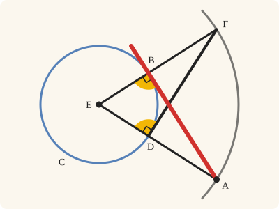
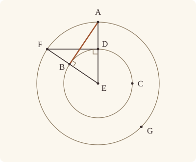

<!-- Generated by scripts/render.py. Do not edit by hand. -->

[Book III](index.md) · [← III.16](16.md) · [III.18 →](18.md)

# Book III, Proposition 17

*A straight line touching a given circle, from a given point*

[Euclid's proof](#euclids-proof) · [In Lean](#in-lean) · [What it rests on](#what-it-rests-on) · [Mishnah](#mishnah)

> From a given point to draw a straight line touching a given circle.

**In Lean:** ✅ proved, as Euclid states it · Euclid's argument

<p align="center"></p>

<p align="center"><em>Draw a circle about the centre through the given point. Where the straight line to it crosses the given circle (blue), a perpendicular (black) reaches the new circle; turned over, that triangle gives the touching line (red) its right angle (yellow).</em></p>

## Euclid's proof

<p align="center"></p>

<p align="center"><em>Drawn for one case: A outside the circle, as in Heath's figure.</em></p>

Let A be the given point, and BCD the given circle;

thus it is required to draw from the point A a straight line touching the circle BCD.

For let the centre E of the circle be taken; [III. 1]

let AE be joined, and with centre E and distance EA let the circle AFG be described;

from D let DF be drawn at right angles to EA,

and let EF, AB be joined;

I say that AB has been drawn from the point A touching the circle BCD.

For, since E is the centre of the circles BCD, AFG,

EA is equal to EF, and ED to EB;

therefore the two sides AE, EB are equal to the two sides FE, ED;

and they contain a common angle, the angle at E;

therefore the base DF is equal to the base AB,

and the triangle DEF is equal to the triangle BEA,

and the remaining angles to the remaining angles; [I. 4]

therefore the angle EDF is equal to the angle EBA.

But the angle EDF is right;

therefore the angle EBA is also right.

Now EB is a radius;

and the straight line drawn at right angles to the diameter of a circle, from its extremity, touches the circle; [III. 16, Por.]

therefore AB touches the circle BCD.

Therefore from the given point A the straight line AB has been drawn touching the circle BCD.

Q. E. F.

## In Lean

| | |
|---|---|
| Proof | ✅ Proved, and its companion `Prop17.general` ([III.17 general](17.md#general)) |
| Statement | The whole enunciation. `Prop17` draws AB touching at B from A outside; `Prop17.general` takes any A not within, returning a touching line AX whose contact may be A. |
| Argument | Euclid's. Euclid's A is outside the circle. `Prop17.general` takes A on the circle too, a case Euclid leaves out, Heath explains, because III.16's porism so directly indicates it (vol. 2, p. 44): AX drawn at right angles to the radius EA at A (I.11) touches by that porism. The construction is not on Euclid's page. The companion returns a straight line named by A and X; its point of contact is not returned beside X (`Touches.contact` reads it off). From a point within no straight line touches (`Prop17.inside`), so not being within is the condition for a solution. |
| Reviewed | The statement and every passage of the argument read against Heath's text, at commit [`3888f1b86`](https://github.com/dodecaplex-co/stoicheia/commit/3888f1b86) ([the record](../../review/III/17.toml)) |

From [`Elements/BookIII/Prop17.lean`](../../Elements/BookIII/Prop17.lean). Euclid's sentences are the `--` comments, and our own notes are in `/- … -/`; the lines under each sentence are the Lean that carries it out. The list below marks where a lemma does a step Euclid takes for granted and where several sentences share one step; the `/- … -/` notes in the listing explain smaller adjustments.

**How the Lean follows the text**

- **Done by `Prop1.of_circle`.** "For let the centre E of the circle be taken…" Euclid takes the centre E, and Heath's reference is III.1; the Lean takes it by III.1 too: `Prop1.of_circle` takes two points of the circle, the ends of a straight line drawn through it at random, and runs III.1 on them, its construction and its proof that the point found is the centre; the proof keeps the centre alone, as Euclid does. `Prop17.general` takes its centre in the same way when A is on the circle.
- **Done by `Tacit.line_circle_between`.** "let AE be joined, and with centre E…" Euclid joins AE and treats its meeting D with BCD as available. The Lean puts E within BCD by `Tacit.centre_inside` (System E, Generalities 3), proved in `Elements/Figure/RuleBase.lean`, gets D between E and A from `Tacit.line_circle_between`, the rule we assume as System E, Intersections 4, and describes AFG by Postulate 3.
- **Done by `BookI.Prop11`.** "from D let DF be drawn at right angles to EA…" Euclid draws DF perpendicular to EA; the Lean uses I.11, for which Heath prints no reference here. `InsideCircle.of_between_centre` puts D within AFG, and `Tacit.line_circle_beyond`, the rule we assume as System E, Intersections 5, takes F on AFG beyond D from the point first supplied by I.11.
- **Done by `Tacit.line_circle_between`.** "and let EF, AB be joined…" Euclid's joining EF presupposes its meeting B with BCD. The Lean compares the radii to put F outside BCD by `outside_of_len_gt`, puts E within BCD by `Tacit.centre_inside` (System E, Generalities 3), proved as above, then gets B between E and F from `Tacit.line_circle_between`, the rule we assume as System E, Intersections 4.
- **Carried together, by `BookI.Prop4`.** "therefore the base DF is equal to the base AB…" Euclid's three conclusions about the base, triangle and remaining angles come together from I.4. The Lean calls `BookI.Prop4` once and retains the angle equality needed in the next sentence.
- **Done by `Tacit.adjacent_eq_of_right`.** "But the angle EDF is right…" Euclid recalls the right angle at D, but the Lean's point F lies beyond D from the point first drawn by I.11. `Tacit.adjacent_eq_of_right`, proved from I.13 and Common Notion 3, transfers the right angle to DF; Heath prints no reference to I.13 here.

```lean
/-- From a given point to draw a straight line touching a given circle. -/
theorem Prop17 {A : Point} {BCD : Circle} (hA : OutsideCircle A BCD) :
    ∃ B : Point, OnCircle B BCD ∧ Touches A B BCD := by
  -- Let A be the given point, and BCD the given circle;
  -- thus it is required to draw from the point A a straight line touching the circle BCD.
  -- For let the centre E of the circle be taken; [III. 1]
  /- The centre is found by III.1's construction, on a straight line drawn through the
     circle at random (`Prop1.of_circle`), as Euclid finds it. The proof keeps the centre
     alone, which is what Euclid takes from III.1. -/
  obtain ⟨-, -, E, -, -, -, -, -, hE, -⟩ := Prop1.of_circle BCD
  -- let AE be joined, and with centre E and distance EA let the circle AFG be described;
  have hEA : E ≠ A := fun e => hA.1 (e ▸ centre_inside hE)
  obtain ⟨L, hE_L, hA_L⟩ := Postulate1 E A hEA
  obtain ⟨D, hD, hD_L, hEDA⟩ := line_circle_between (centre_inside hE) hE_L hA hA_L
  obtain ⟨AFG, hE_AFG, hA_AFG⟩ := Postulate3 E A hEA
  -- from D let DF be drawn at right angles to EA,
  /- I.11 draws the perpendicular through D. Its point F' need not be on AFG, so we take F
     where the perpendicular, produced beyond D, meets that circle. -/
  have hED : E ≠ D := (ne_of_centre_of_on hE hD).symm
  obtain ⟨Q, hQ, -⟩ := exists_off_line hEA []
  obtain ⟨F', hF'Q, hF'⟩ := BookI.Prop11 hEA ⟨L, hE_L, hA_L, hD_L⟩ hQ
  have hF'_L : ¬ OnLine F' L := hF'Q.triangle.off_line hE_L hA_L
  have hEDF' : ∠ E D F' = ∟ := hF' E ⟨L, hE_L, hA_L, hE_L⟩ hED
  have hDF' : D ≠ F' := fun e => hF'_L (e ▸ hD_L)
  obtain ⟨N, hD_N, hF'_N⟩ := Postulate1 D F' hDF'
  have hD_in : InsideCircle D AFG :=
    InsideCircle.of_between_centre hE_AFG hA_AFG hEDA
  obtain ⟨F, hF, hF_N, hFDF'⟩ :=
    line_circle_beyond hD_in hD_N hF'_N hDF'.symm
  have hE_N : ¬ OnLine E N := fun h =>
    hF'_L ((line_unique hED h hD_N hE_L hD_L) ▸ hF'_N)
  have hF_L : ¬ OnLine F L := fun h =>
    hF'_L ((line_unique (ne_of_between hFDF').symm hD_N hF_N hD_L h) ▸ hF'_N)
  -- and let EF, AB be joined;
  /- F is farther from E than D is, so EF leaves BCD at B between E and F. -/
  have hEF : E ≠ F := fun e => hE_N (e ▸ hF_N)
  have hED_EF : ‖E D‖ < ‖E F‖ := by
    rw [← Definition15 hE_AFG hA_AFG hF]
    exact len_lt_of_inside hE_AFG hA_AFG hD_in
  have hF_out : OutsideCircle F BCD := outside_of_len_gt hE hD hED_EF
  obtain ⟨M, hE_M, hF_M⟩ := Postulate1 E F hEF
  obtain ⟨B, hB, hB_M, hEBF⟩ :=
    line_circle_between (centre_inside hE) hE_M hF_out hF_M
  have hB_L : ¬ OnLine B L := fun h =>
    hF_L ((line_unique (ne_of_between hEBF) hE_M hB_M hE_L h) ▸ hF_M)
  have hEAB : Triangle E A B := Triangle.of_line hE_L hA_L hEA hB_L
  have hEFD : Triangle E F D := (Triangle.of_line hE_L hD_L hED hF_L).acb
  obtain ⟨K, hA_K, hB_K⟩ := Postulate1 A B hEAB.ne₂₃
  -- I say that AB has been drawn from the point A touching the circle BCD.
  -- For, since E is the centre of the circles BCD, AFG,
  -- EA is equal to EF, and ED to EB;
  have hEAEF : ‖E A‖ = ‖E F‖ := Definition15 hE_AFG hA_AFG hF
  have hEDEB : ‖E D‖ = ‖E B‖ := Definition15 hE hD hB
  -- therefore the two sides AE, EB are equal to the two sides FE, ED;
  have hEB_ED : ‖E B‖ = ‖E D‖ := hEDEB.symm
  -- and they contain a common angle, the angle at E;
  have hcommon : ∠ A E B = ∠ F E D := by
    rw [angle_onRay_right (OnRay.of_between hEBF) hEA.symm,
      angle_symm hEA.symm hEF.symm,
      angle_onRay_right (OnRay.of_between hEDA) hEF.symm]
  -- therefore the base DF is equal to the base AB,
  -- and the triangle DEF is equal to the triangle BEA,
  -- and the remaining angles to the remaining angles; [I. 4]
  obtain ⟨-, -, -, hEBA_EDF⟩ := BookI.Prop4 hEAB hEFD hEAEF hEB_ED hcommon
  -- therefore the angle EDF is equal to the angle EBA.
  have hEDF_EBA : ∠ E D F = ∠ E B A := hEBA_EDF.symm
  -- But the angle EDF is right;
  /- F lies on the other side of D from F'; the angle adjacent to a right angle
     is right (I.13, `adjacent_eq_of_right`). -/
  have hEDF : ∠ E D F = ∟ := by
    have hF'DE : ∠ F' D E = ∟ := by
      rw [angle_symm hDF'.symm hED]
      exact hEDF'
    rw [← adjacent_eq_of_right hF'_N hF_N (between_symm hFDF') hE_N hF'DE, hF'DE]
  -- therefore the angle EBA is also right.
  have hEBA : ∠ E B A = ∟ := hEDF_EBA.symm.trans hEDF
  -- Now EB is a radius;
  -- and the straight line drawn at right angles to the diameter of a circle, from its
  -- extremity, touches the circle; [III. 16, Por.]
  have hBA : Touches B A BCD := Prop16.porism hE hB hEAB.acb hEBA
  -- therefore AB touches the circle BCD.
  have hAB : Touches A B BCD :=
    hBA.of_collinear ⟨K, hB_K, hA_K, hA_K⟩ ⟨K, hB_K, hA_K, hB_K⟩ hEAB.ne₂₃
  -- Therefore from the given point A the straight line AB has been drawn touching the circle
  -- BCD.
  exact ⟨B, hB, hAB⟩
  -- Q. E. F.
```

<a name="general"></a>

<details><summary>After the theorem, its companion, <code>Prop17.general</code> and one lemma beside the proposition, <code>Prop17.inside</code> (50 lines)</summary>

```lean
/-- **III.17, general** (companion of III.17). Given a circle BCD and a point
A not within it, there is a point X such that the straight line AX touches the circle: it
meets the circle, and does not cut it. A may be outside the circle, and then the point of
contact is another point (Euclid's case, `Prop17`); or on it, and then the point of
contact is A itself: the proof draws AX at right angles to the radius EA (I.11), and it
touches by III.16's porism. Euclid leaves that case out, Heath explains, because III.16's
porism so directly indicates its construction (vol. 2, p. 44); the construction is not on
Euclid's page. -/
theorem Prop17.general {A : Point} {BCD : Circle}
    (hA : ¬ InsideCircle A BCD) :
    ∃ X : Point, Touches A X BCD := by
  by_cases hon : OnCircle A BCD
  · /- A is on the circle. Its centre E, found by III.1's construction as in `Prop17`
       (`Prop1.of_circle`), is within it, so E is not A. -/
    obtain ⟨-, -, E, -, -, -, -, -, hE, -⟩ := Prop1.of_circle BCD
    have hEA : E ≠ A := (ne_of_centre_of_on hE hon).symm
    obtain ⟨L, hE_L, hA_L⟩ := Postulate1 E A hEA
    /- Choose Q off EA, then draw AX at right angles to EA on Q's side by I.11. -/
    obtain ⟨Q, hQ, -⟩ := exists_off_line hEA []
    obtain ⟨X, hXQ, hX⟩ := BookI.Prop11 hEA ⟨L, hE_L, hA_L, hA_L⟩ hQ
    have hEAX : ∠ E A X = ∟ := hX E ⟨L, hE_L, hA_L, hE_L⟩ hEA
    /- X is off EA, since it lies on Q's side; AX touches the circle by III.16's porism. -/
    exact ⟨X, Prop16.porism hE hon hXQ.triangle hEAX⟩
  · /- A is outside the circle, so III.17 gives its point of contact B. -/
    obtain ⟨B, -, hB⟩ := Prop17 ⟨hA, hon⟩
    exact ⟨B, hB⟩

/-- **III.17, from a point within** (a lemma beside III.17). From a point A within the
circle BCD, no point X makes the straight line AX touch the circle, since a straight line
through a point within a circle cuts it (`Touches.not_inside`). So a point not within it is
exactly the condition under which `Prop17.general` draws a straight line touching it. -/
theorem Prop17.inside {A : Point} {BCD : Circle} (hA : InsideCircle A BCD) :
    ¬ ∃ X : Point, Touches A X BCD := by
  rintro ⟨X, hAX⟩
  /- A lies on AX, and no point of a straight line that touches a circle lies within it. -/
  obtain ⟨L, hA_L, hX_L⟩ := Postulate1 A X hAX.1
  exact hAX.not_inside ⟨L, hA_L, hX_L, hA_L⟩ hA

/-- The check: the statement of `Prop17` follows from `Prop17.general` (checked by Lean).
A is outside the circle, so the point where AX meets the circle is not A, and the straight
line it names with A is AX. -/
example : type_of% @Elements.BookIII.Prop17 := by
  intro A BCD hA
  obtain ⟨X, hAX, hX⟩ := Prop17.general hA.1
  obtain ⟨L, hA_L, hX_L⟩ := Postulate1 A X hAX
  obtain ⟨⟨B, hB_L, hB⟩, -⟩ := hX L hA_L hX_L
  have hAB : A ≠ B := fun e => hA.2 (e ▸ hB)
  refine ⟨B, hB, hAB, fun M hA_M hB_M => ?_⟩
  obtain rfl : L = M := line_unique hAB hA_L hB_L hA_M hB_M
  exact hX L hA_L hX_L
```

</details>

## What it rests on

| | Proposition | `Prop17.general` |
|---|---|---|
| Heath's references | [I.4](../I/04.md), [III.1](01.md), [III.16 Por.](16.md#porism) | none |
| Lean cites | [I.4](../I/04.md), [I.11](../I/11.md), [I.13](../I/13.md), [III.1 of_circle](01.md#of_circle), [III.16 Por.](16.md#porism) | [I.11](../I/11.md), [III.1 of_circle](01.md#of_circle), [III.16 Por.](16.md#porism), [III.17](17.md) |
| Postulates | 1, 2, 3, 4 | 1, 2, 3, 4 |
| Definitions taken as axioms | Def. I.15 | Def. I.15 |
| Common Notions | 1, 2, 3, 4, 5 | 1, 2, 3, 4, 5 |
| Tacit rules | 38 (listed below) | 38 (listed below) |
| Its own Lean calls | Postulates 1 and 3; Def. I.15; 5 tacit rules | Postulate 1 |
| Through lemmas | Postulate 2; 20 tacit rules | Postulates 2 and 3; Def. I.15; 22 tacit rules |

Some of these come in through lemmas [shared](../../CERTIFICATE.md#shared-steps) by many proofs: [`Tacit.adjacent_eq_of_right`](../../Elements/BookI/Prop13.lean#L188) (I.13).

_Postulates, definitions, Common Notions and tacit rules: all that each proof rests on, counting those of the propositions it cites. The last two rows say which of the postulates, definitions and tacit rules its own Lean calls, in the proof or a helper written for it, and which it does not call but reaches through lemmas, of Book Zero or shared (a proposition it cites may rest on these too); the rest come in only through the propositions it cites or the Common Notions._

<details><summary>The 38 tacit rules beneath this proof, counting those of the propositions it cites</summary>

_(used here) marks a rule this proof's own Lean calls, in the proof or a helper written for it; (through …) marks one its own Lean does not call but reaches through the lemmas named, of [Book Zero](../../Elements/Figure) or shared, though a proposition it cites may rest on it too; and a rule with no mark comes in only through a proposition it cites or a Common Notion. The names in brackets are System E's: an Intersection rule says when straight lines and circles must meet, and an Intersections rule takes a point where they do (see [Book I's introduction](../I/index.md))._

**Reading the figure**

- [`between_cases`](../../Elements/Foundations/Tacit/Diagram.lean#L54) (through [`exists_off_line`](../../Elements/Figure/Rectangles.lean#L40)): Of three different points on a straight line, one is between the other two. (Between 6)
- [`between_symm`](../../Elements/Foundations/Tacit/Diagram.lean#L47) (used here): If B is between A and C, it is between C and A. (Between 1)
- [`circles_meet`](../../Elements/Foundations/Tacit/Diagram.lean#L91) (through [`OnRay.of_between`](../../Elements/Figure/Rays.lean#L34) and [`exists_off_line`](../../Elements/Figure/Rectangles.lean#L40)): If each circle passes through a point inside the other, the circles cut one another. This is the step Euclid takes for granted in I.1. (Intersection 5)
- [`circles_meet_same_side`](../../Elements/Foundations/Tacit/Constructions.lean#L79) (through [`OnRay.of_between`](../../Elements/Figure/Rays.lean#L34) and [`exists_off_line`](../../Elements/Figure/Rectangles.lean#L40)): Two circles that cut one another do so on each side of the straight line through their centres. (Intersections 8)
- [`exists_centre`](../../Elements/Foundations/Tacit/Constructions.lean#L57): Every circle has a centre. A rule of our own, not one of System E's: its content is Euclid's Definitions I.15 and I.16.
- [`exists_point`](../../Elements/Foundations/Tacit/Constructions.lean#L35) (through [`Triangle.ne₂₃`](../../Elements/Figure/Triangles.lean#L29)): Let a point be taken. (Points 1)
- [`exists_point_inside_circle`](../../Elements/Foundations/Tacit/Constructions.lean#L42) (through [`InsideCircle.of_between_centre`](../../Elements/Figure/Incidence.lean#L238), [`OnRay.of_between`](../../Elements/Figure/Rays.lean#L34), [`Tacit.centre_inside`](../../Elements/Figure/RuleBase.lean#L56) and 1 other lemma): Let a point be taken inside the circle α. (Points 8)
- [`exists_point_on_line`](../../Elements/Foundations/Tacit/Constructions.lean#L38) (through [`OnRay.of_between`](../../Elements/Figure/Rays.lean#L34) and [`exists_off_line`](../../Elements/Figure/Rectangles.lean#L40)): Let a point be taken on the straight line L. (Points 2)
- [`line_circle_between`](../../Elements/Foundations/Tacit/Constructions.lean#L67) (used here): A straight line through a point B inside a circle, heading out to a point C outside it, cuts the circle between B and C. (Intersections 4)
- [`line_circle_beyond`](../../Elements/Foundations/Tacit/Constructions.lean#L73) (used here): A straight line through a point B inside a circle, produced beyond B away from C, cuts the circle there. (Intersections 5)
- [`line_unique`](../../Elements/Foundations/Tacit/Diagram.lean#L41) (used here): Two points determine a straight line. (Generalities 1)
- [`lines_meet_of_opposite_sides`](../../Elements/Foundations/Tacit/Diagram.lean#L86): A straight line joining points on opposite sides of L crosses L. (Intersection 1)
- [`not_between_of_between`](../../Elements/Foundations/Tacit/Diagram.lean#L50) (through [`InsideCircle.of_between_centre`](../../Elements/Figure/Incidence.lean#L238), [`OnRay.of_between`](../../Elements/Figure/Rays.lean#L34), [`Tacit.adjacent_eq_of_right`](../../Elements/BookI/Prop13.lean#L188) and 6 other lemmas): If B is between A and C, then A is not between B and C. (Between 1)
- [`not_on_line_of_same_side`](../../Elements/Foundations/Tacit/Diagram.lean#L60) (through [`OnRay.of_between`](../../Elements/Figure/Rays.lean#L34), [`SameSideOf.triangle`](../../Elements/Figure/Sides.lean#L61) and [`exists_off_line`](../../Elements/Figure/Rectangles.lean#L40)): Points on one side of a straight line are not on it. (Same side 3)
- [`pasch2`](../../Elements/Foundations/Tacit/Diagram.lean#L71) (through [`OnRay.of_between`](../../Elements/Figure/Rays.lean#L34) and [`exists_off_line`](../../Elements/Figure/Rectangles.lean#L40)): If B is between A and C, A is on L and B is off it, then B and C are on the same side of L: a straight line that leaves L at A does not cross it again. (Pasch 2)
- [`same_side_trans`](../../Elements/Foundations/Tacit/Diagram.lean#L64) (through [`OnRay.of_between`](../../Elements/Figure/Rays.lean#L34) and [`exists_off_line`](../../Elements/Figure/Rectangles.lean#L40)): Two points on the same side of a straight line as a third point are on the same side as each other. (Same side 4)

**Lengths, angles and areas**

- [`angle_add_of_inside`](../../Elements/Foundations/Tacit/Transfer.lean#L47): If D lies within the angle BAC, then BAC is made up of BAD and DAC. (Diagram-angle 2)
- [`angle_eq_of_same_rays`](../../Elements/Foundations/Tacit/Transfer.lean#L54) (through [`angle_onRay_right`](../../Elements/Figure/Angles.lean#L49)): The angle doesn't change if its arms are traced through other points on the same rays. (Diagram-angle 4)
- [`angle_symm`](../../Elements/Foundations/Tacit/Metric.lean#L30) (used here): The angle ABC is the angle CBA. (Metric 4)
- [`area_add_of_between`](../../Elements/Foundations/Tacit/Transfer.lean#L70): Cutting a triangle in two from a vertex adds up. (Diagram-area 2)
- [`area_congruent`](../../Elements/Foundations/Tacit/Metric.lean#L44): Triangles equal in all their sides and angles are equal in area. Euclid uses this without comment once he has shown two triangles congruent. (Metric 9)
- [`area_degenerate`](../../Elements/Foundations/Tacit/Metric.lean#L36): A "triangle" with a repeated corner has no area. (Metric 6)
- [`area_eq_zero_of_on_line`](../../Elements/Foundations/Tacit/Transfer.lean#L62): A "triangle" whose corners lie on one straight line has no area. (Diagram-area 1)
- [`area_rotate`](../../Elements/Foundations/Tacit/Metric.lean#L39): The triangle ABC is the triangle CAB. (Metric 8)
- [`len_add_of_between`](../../Elements/Foundations/Tacit/Transfer.lean#L27) (through [`InsideCircle.of_between_centre`](../../Elements/Figure/Incidence.lean#L238), [`OnRay.of_between`](../../Elements/Figure/Rays.lean#L34), [`Tacit.adjacent_eq_of_right`](../../Elements/BookI/Prop13.lean#L188) and 5 other lemmas): If B is between A and C, then AB and BC together make up AC. (Diagram-segment 1)
- [`len_self`](../../Elements/Foundations/Tacit/Metric.lean#L24) (through [`InsideCircle.of_between_centre`](../../Elements/Figure/Incidence.lean#L238), [`OnRay.of_between`](../../Elements/Figure/Rays.lean#L34), [`Tacit.adjacent_eq_of_right`](../../Elements/BookI/Prop13.lean#L188) and 6 other lemmas): The "straight line" from a point to itself has no length. (Metric 1)
- [`len_symm`](../../Elements/Foundations/Tacit/Metric.lean#L27) (through [`InsideCircle.of_between_centre`](../../Elements/Figure/Incidence.lean#L238), [`OnRay.of_between`](../../Elements/Figure/Rays.lean#L34), [`Tacit.centre_inside`](../../Elements/Figure/RuleBase.lean#L56) and 1 other lemma): The straight line AB is the straight line BA. (Metric 3)
- [`radius_ne_zero`](../../Elements/Foundations/Tacit/Metric.lean#L62) (through [`InsideCircle.of_between_centre`](../../Elements/Figure/Incidence.lean#L238), [`OnRay.of_between`](../../Elements/Figure/Rays.lean#L34), [`Tacit.adjacent_eq_of_right`](../../Elements/BookI/Prop13.lean#L188) and 6 other lemmas): A circle's radius is not nothing: the straight line from the centre to a point on the circle has some length. A rule of our own, not one of System E's: every circle is drawn with a centre and a distance (Postulate 3).
- [`same_ray_of_angle_eq_zero`](../../Elements/Foundations/Tacit/Transfer.lean#L42): If the angle BAC is nothing, C lies on the ray from A through B. (Diagram-angle 1)

**Superposition**

- [`superposition`](../../Elements/Foundations/Tacit/Superposition.lean#L52): **Superposition.** A hypothetical placement of a triangle on a given ray and side permits a restricted derivation of metric equalities about the figure already given. The derivation introduces no further objects, cites each geometric law it uses, and exports no symbol of the placement.

**Rules of magnitude**

- [`add_assoc`](../../Elements/Foundations/Tacit/Magnitudes.lean#L23): Adding three magnitudes in a row, it makes no difference whether the first two or the last two are added first. (System E §3.5)
- [`add_comm`](../../Elements/Foundations/Tacit/Magnitudes.lean#L26) (through [`InsideCircle.of_between_centre`](../../Elements/Figure/Incidence.lean#L238), [`OnRay.of_between`](../../Elements/Figure/Rays.lean#L34), [`Tacit.adjacent_eq_of_right`](../../Elements/BookI/Prop13.lean#L188) and 3 other lemmas): The order of adding does not matter. (System E §3.5)
- [`add_lt_add_right`](../../Elements/Foundations/Tacit/Magnitudes.lean#L45): Adding the same thing to both sides keeps "less than". (System E §3.5)
- [`add_zero`](../../Elements/Foundations/Tacit/Magnitudes.lean#L29): Adding nothing changes nothing. (System E §3.5)
- [`lt_irrefl`](../../Elements/Foundations/Tacit/Magnitudes.lean#L32) (through [`InsideCircle.of_between_centre`](../../Elements/Figure/Incidence.lean#L238), [`OnRay.of_between`](../../Elements/Figure/Rays.lean#L34), [`Tacit.centre_inside`](../../Elements/Figure/RuleBase.lean#L56) and 2 other lemmas): No magnitude is less than itself. (System E §3.5)
- [`lt_trans`](../../Elements/Foundations/Tacit/Magnitudes.lean#L35) (through [`InsideCircle.of_between_centre`](../../Elements/Figure/Incidence.lean#L238), [`OnRay.of_between`](../../Elements/Figure/Rays.lean#L34), [`Tacit.centre_inside`](../../Elements/Figure/RuleBase.lean#L56) and 2 other lemmas): What is less than the less is less still. (System E §3.5)
- [`lt_trichotomy`](../../Elements/Foundations/Tacit/Magnitudes.lean#L39) (through [`InsideCircle.of_between_centre`](../../Elements/Figure/Incidence.lean#L238), [`OnRay.of_between`](../../Elements/Figure/Rays.lean#L34), [`Tacit.adjacent_eq_of_right`](../../Elements/BookI/Prop13.lean#L188) and 5 other lemmas): Of two magnitudes, one is less, or they are equal, or the other is less. (System E §3.5)
- [`not_lt_zero`](../../Elements/Foundations/Tacit/Magnitudes.lean#L42) (through [`InsideCircle.of_between_centre`](../../Elements/Figure/Incidence.lean#L238), [`OnRay.of_between`](../../Elements/Figure/Rays.lean#L34), [`Tacit.adjacent_eq_of_right`](../../Elements/BookI/Prop13.lean#L188) and 5 other lemmas): Nothing is less than zero. (System E §3.5)

</details>

## Mishnah

_Our commentary: why Euclid's proof, and ours, look as they do._

**A second circle finds the point of contact.** III.16's porism draws a straight line touching a circle at a point of its circumference. Here the given point A is outside, and the point of contact has to be found. Euclid makes the right angle where it is easy, at D on the straight line EA, and lets the larger circle carry it round: the triangles DEF and BEA are equal, so the angle at B is right too, and the porism makes AB touch.

**Meeting is not yet touching.** Heath points out that Euclid's Greek keeps two verbs apart, ἅπτεσθαι and ἐφάπτεσθαι, "the former meaning 'to *meet*' and the latter 'to *touch*.' The distinction was generally observed by Greek geometers from Euclid onwards" (vol. 2, p. 2). The construction puts it to work. EA meets the given circle at D and passes within it, while AB meets it at B and stays outside.

Taking F on the other side of EA gives a second straight line touching from A, and Heath reports Heron's observation that the two are "equal in length and equally inclined to the straight line joining the external point to the centre" (vol. 2, p. 44). Euclid's construction needs A outside the circle, and our main theorem asks for it. A point on the circumference Euclid leaves out, Heath explains, because the construction is "so directly indicated by III. 16, Por. as to be scarcely worth a separate statement" (vol. 2, p. 44). The companion `Prop17.general` takes that point too: the straight line at right angles to the radius at A touches by the porism, A itself being the point of contact.

**The modern way.** Put E at the origin and $\mathrm{A} = (d, 0)$, and let the radius be $r$, with $0 \lt r \lt d$. Euclid's D is $(r, 0)$ and his F is $(r, \sqrt{d^2 - r^2})$, and B, where EF crosses the circle, is the fraction $r/d$ of the way from E to F: $\mathrm{B} = (r^2/d, (r/d)\sqrt{d^2 - r^2})$. Then $\overrightarrow{\mathrm{EB}} \cdot \overrightarrow{\mathrm{AB}} = r^2 - r^2 = 0$, so EB is at right angles to AB, whose length is $\sqrt{d^2 - r^2}$.

## Further reading

- John Casey, whose *First Six Books* our README thanks, wrote [*A Sequel to the First Six Books of the Elements of Euclid*](https://archive.org/details/sequeltofirstsix00caserich) (1886, free online) in Dublin for readers who had finished Euclid, adding the propositions Euclid left out, proved in his manner. Its Book III, Section I, Prop. 1 (p. 29) proves Heron's observation, that the two straight lines touching from A are equal, in a few lines by I.47.
- Put A's coordinates into the circle's equation and out comes d² − r², the square on the straight line touching from A: so S. L. Loney's [*The Elements of Coordinate Geometry*](https://archive.org/details/elementsofcoordi00lone) (1895, free online) finds it, in ch. VIII, Art. 168 (p. 142) (also on [III.10](10.md)).
- Tom Davis's ["Inversion in a Circle"](http://www.geometer.org/mathcircles/inversion.pdf) (2011, free online), one of the friendly handouts he wrote for math circles for high-school students, shows inversion mostly in pictures, and in §2, "Basic Definition of Inversion" (p. 2), puts a straight line touching from an outside point to work, finding the inverse of that point in the circle.

[Book III](index.md) · [← III.16](16.md) · [III.18 →](18.md)

---

<sub>Euclid's text: T. L. Heath, *The Thirteen Books of Euclid's Elements*, vol. 2 (Cambridge, 1908), p. 43; [scan leaf n55](https://archive.org/details/thirteenbookseu00heibgoog/page/n55); [figure on n55](https://archive.org/details/thirteenbookseu00heibgoog/page/n55). Public domain.</sub>

<sub>The tacit rules follow the System E of Jeremy Avigad, Edward Dean and John Mumma, read alongside LeanEuclid (Logan Murphy, Kaiyu Yang, Jialiang Sun, Zhaoyu Li, Anima Anandkumar and Xujie Si).</sub>
