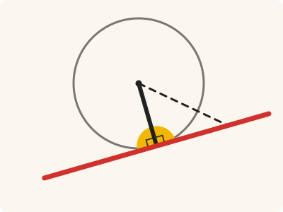
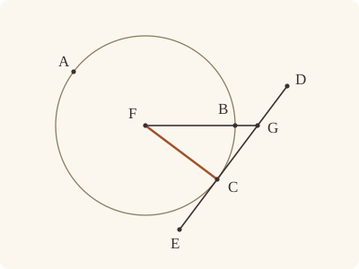

<!-- Generated by scripts/render.py. Do not edit by hand. -->

[Book III](index.md) · [← III.17](17.md) · [III.19 →](19.md)

# Book III, Proposition 18

*The straight line from the centre is perpendicular to the tangent*

[Euclid's proof](#euclids-proof) · [In Lean](#in-lean) · [What it rests on](#what-it-rests-on) · [Mishnah](#mishnah)

> If a straight line touch a circle, and a straight line be joined from the centre to the point of contact, the straight line so joined will be perpendicular to the tangent.

**In Lean:** ✅ proved, as Euclid states it · Euclid's argument

<p align="center"></p>

<p align="center"><em>Join the centre to the point where the red straight line touches: the black radius stands at right angles to it (yellow). Any other straight line (dashed) from the centre to the red ends outside the circle, and is longer.</em></p>

## Euclid's proof

<p align="center"></p>

<p align="center"><em>Drawn for one case: the radius FC to the point of contact C, as in the main theorem; the angles its companions compare are drawn in III.16's figure. The figure shows the impossible supposition with G distinct from C: FG is supposed perpendicular to DE, but the perpendicular in the drawn geometry is FC.</em></p>

For let a straight line DE touch the circle ABC at the point C, let the centre F of the circle ABC be taken, and let FC be joined from F to C;

I say that FC is perpendicular to DE.

For, if not, let FG be drawn from F perpendicular to DE.

Then, since the angle FGC is right,

the angle FCG is acute; [I. 17]

and the greater angle is subtended by the greater side; [I. 19]

therefore FC is greater than FG.

But FC is equal to FB;

therefore FB is also greater than FG,

the less than the greater: which is impossible.

Therefore FG is not perpendicular to DE.

Similarly we can prove that neither is any other straight line except FC;

therefore FC is perpendicular to DE.

Therefore etc.

Q. E. D.

## In Lean

| | |
|---|---|
| Proof | ✅ Proved, and its companions `Prop18.contact_locallyEqual` ([III.18 contact_locallyEqual](18.md#contact_locallyEqual)), `Prop18.contact_lt` ([III.18 contact_lt](18.md#contact_lt)), `Prop18.semicircle_gt` ([III.18 semicircle_gt](18.md#semicircle_gt)) and `Prop18.acute` ([III.18 acute](18.md#acute)) |
| Statement | The whole enunciation. For any straight line touching a circle, `Prop18.contact_lt` and `Prop18.semicircle_gt` compare III.16's two angles with acute angles; `Prop18.acute` with any. |
| Argument | Euclid's. `Prop18` follows Euclid, with the centre F given; F is off DE, for it is within the circle and no point of DE is. The companions follow in Euclid's order and cite nothing later than III.18. Let AE touch the circle at A, and AB be the diameter through A: III.18 puts AE at right angles to AB (`Prop18.diameter`), so AE is III.16's straight line and III.16's two parts hold for it (`Prop18.parts`); III.16's comparisons then hold for AE, cited from III.16's own steps (`Prop16.horn_lt`, `Prop16.semicircle_gt`), which follow Euclid's reductio from its second part, as III.16's record declares. `Prop18.contact_locallyEqual` and `Prop18.contact_lt` take the centre from `Tacit.exists_centre`, a rule we assume; `Prop18.semicircle_gt` and `Prop18.acute` keep the centre D, through which the diameter is drawn, and `Prop18.acute` places every acute angle at A by I.23. |
| Representation | The angle of the semicircle and the angle of contact are mixed angles (`MixedAngle`), read and compared near A as in III.16. An angle of contact is as Euclid draws it (`MixedAngle.WellFormed`) when A is on the circle, AE touches it there, and a point B off AE names a branch of the circumference, the ray AB passing within the circle. Every such B is on the diameter's side of AE (`Prop18.branch`), and near A every such B names the same region, the angle of contact of III.16's figure (`Prop18.contact_locallyEqual`). No addition, ratio or motion of mixed angles is claimed. |
| Reviewed | The statement and every passage of the argument read against Heath's text, at commit [`c803fb9a2`](https://github.com/dodecaplex-co/stoicheia/commit/c803fb9a2) ([the record](../../review/III/18.toml)) |

From [`Elements/BookIII/Prop18.lean`](../../Elements/BookIII/Prop18.lean). Euclid's sentences are the `--` comments, and our own notes are in `/- … -/`; the lines under each sentence are the Lean that carries it out. The list below marks where a lemma does a step Euclid takes for granted, where several sentences share one step and where the statement already gives a step; the `/- … -/` notes in the listing explain smaller adjustments.

**How the Lean follows the text**

- **Already given.** "For let a straight line DE touch the circle ABC at the point C…" The statement gives the tangent DE, the contact C and the centre F; the radius FC is named by its ends.
- **Done by `BookI.Prop12`.** "For, if not, let FG be drawn from F perpendicular to DE." Euclid draws FG perpendicular to DE; the Lean uses I.12, for which Heath prints no reference here. Beneath the setting-out, the Lean first proves F off DE with `Touches.not_inside` and `Tacit.centre_inside` (System E, Generalities 3), proved in `Elements/Figure/RuleBase.lean`.
- **Done by `Tacit.line_circle_between`.** "But FC is equal to FB…" Euclid reads B on FG between F and G and takes FC equal to FB. The Lean proves G outside the circle using `Touches.not_inside` and the definition of touching, puts F within it by the proved rule `Tacit.centre_inside` (System E, Generalities 3) and takes B by `Tacit.line_circle_between` (System E, Intersections 4), a rule we assume, and equates the radii by `Definition15`, Euclid's definition of a circle, which we also assume as a rule.
- **Done by `len_lt_of_between`.** "the less than the greater: which is impossible." Euclid reads FB as less than FG because B lies between F and G. The Lean obtains that strict inequality from `len_lt_of_between`, using length addition and Common Notion 5, and contradicts the inequality just proved.
- **Carried together.** "Therefore FG is not perpendicular to DE." The reductio shows that the foot G of the perpendicular from F is C itself, so FC is that perpendicular, and no other straight line is left to prove.

```lean
/-- If a straight line touch a circle, and a straight line be joined from the centre to the point of
contact, the straight line so joined will be perpendicular to the tangent. -/
theorem Prop18 {C D E F : Point} {ABC : Circle} (hF : Centre F ABC) (hC : OnCircle C ABC)
    (hDE : Touches D E ABC) (hCDE : Collinear D E C) :
    ∀ P : Point, Collinear D E P → P ≠ C → ∠ F C P = ∟ := by
  -- For let a straight line DE touch the circle ABC at the point C, let the centre F of the
  -- circle ABC be taken, and let FC be joined from F to C;
  /- The centre is within the circle, and no point of DE is, so F is off DE. -/
  have hF_DE : ¬ Collinear D E F := fun h => hDE.not_inside h (centre_inside hF)
  obtain ⟨L, hD_L, hE_L⟩ := Postulate1 D E hDE.1
  have hC_L : OnLine C L := by
    obtain ⟨M, hD_M, hE_M, hC_M⟩ := hCDE
    exact (line_unique hDE.1 hD_M hE_M hD_L hE_L) ▸ hC_M
  have hF_L : ¬ OnLine F L := fun h => hF_DE ⟨L, hD_L, hE_L, h⟩
  -- I say that FC is perpendicular to DE.
  -- For, if not, let FG be drawn from F perpendicular to DE.
  obtain ⟨G, hG, hFG⟩ := BookI.Prop12 hDE.1 hF_DE
  have hG_L : OnLine G L := by
    obtain ⟨M, hD_M, hE_M, hG_M⟩ := hG
    exact (line_unique hDE.1 hD_M hE_M hD_L hE_L) ▸ hG_M
  have hGC : G = C := Classical.byContradiction fun hGC => by
    -- Then, since the angle FGC is right,
    have hFGC : ∠ F G C = ∟ := hFG C hCDE (Ne.symm hGC)
    -- the angle FCG is acute; [I. 17]
    have hT : Triangle F G C := (Triangle.of_line hG_L hC_L hGC hF_L).bca.bca
    have hacute : ∠ G C F < ∟ := by
      have h17 := (BookI.Prop17 hT).1
      rw [hFGC] at h17
      exact Magnitude.lt_of_add_lt_add_left h17
    -- and the greater angle is subtended by the greater side; [I. 19]
    -- therefore FC is greater than FG.
    have hFG_FC : ‖F G‖ < ‖F C‖ := BookI.Prop19 hT (by rw [hFGC]; exact hacute)
    -- But FC is equal to FB;
    /- B is where FG leaves the circle, for G is outside it: DE has no point within
       the circle (`Touches.not_inside`), and meets it at C alone. -/
    have hG_out : OutsideCircle G ABC :=
      ⟨hDE.not_inside hG, fun hG_on =>
        (hDE.2 L hD_L hE_L).2 ⟨C, G, Ne.symm hGC, hC_L, hC, hG_L, hG_on⟩⟩
    obtain ⟨M, hF_M, hG_M⟩ := Postulate1 F G (fun e => hF_L (e ▸ hG_L))
    obtain ⟨B, hB, -, hFBG⟩ := line_circle_between (centre_inside hF) hF_M hG_out hG_M
    have hFC_FB : ‖F C‖ = ‖F B‖ := Definition15 hF hC hB
    -- therefore FB is also greater than FG,
    have hFG_FB : ‖F G‖ < ‖F B‖ := hFC_FB ▸ hFG_FC
    -- the less than the greater: which is impossible.
    exact lt_irrefl _ (lt_trans hFG_FB (len_lt_of_between hFBG))
  -- Therefore FG is not perpendicular to DE.
  -- Similarly we can prove that neither is any other straight line except FC;
  -- therefore FC is perpendicular to DE.
  subst hGC
  exact hFG
  -- Therefore etc.
  -- Q. E. D.
```

<a name="contact_locallyEqual"></a><a name="contact_lt"></a><a name="semicircle_gt"></a><a name="acute"></a>

<details><summary>After the theorem, its companions, <code>Prop18.contact_locallyEqual</code>, <code>Prop18.contact_lt</code>, <code>Prop18.semicircle_gt</code> and <code>Prop18.acute</code>; and three lemmas for its own proofs, <code>Prop18.diameter</code>, <code>Prop18.parts</code> and <code>Prop18.branch</code> (181 lines)</summary>

```lean
/-! ## The angle of contact in general, after III.18

III.16 compares two angles contained by a straight line and a circumference with
rectilineal angles. In its figure, where the straight line AE is drawn at right angles to the
diameter AB from its extremity A, "the angle of the semicircle is greater, and the remaining
angle less, than any acute rectilineal angle". III.18 says that a straight line touching a
circle is perpendicular to the straight line joined from the centre to the point of contact.
So, after III.18, every touching straight line is III.16's, and III.16's angle of contact,
with its comparisons, belongs to every one of them. The declarations below state that:

* `Prop18.diameter` and `Prop18.parts`: let AE touch the circle about D at A, and let AD be
  produced beyond the centre to B, so that AB lies along the diameter through the point of
  contact. By III.18, AE is at right angles to AB, which is III.16's figure, and III.16's two
  parts hold for AE.
* `Prop18.branch`, the section's one helper: let AE touch the circle about D at A; a point B′
  that names a branch of the angle of contact along AE is on the diameter's side of AE, and
  near A the angle of contact it names is the diameter's.
* `Prop18.contact_locallyEqual`: the angle of contact, read near A, does not depend on the
  straight line from A into the circle that names its branch of the circumference.
* `Prop18.contact_lt`, `Prop18.semicircle_gt` and `Prop18.acute`: the angle of contact is
  less than every acute rectilineal angle placed at A along AE on the circle's side, and the
  angle of the semicircle greater than every acute rectilineal angle placed along the
  diameter on E's side; and every acute rectilineal angle can be so placed [I. 23]. For the
  angle of the semicircle, the touching straight line AE only names the side of AB, and the
  angle of the semicircle does not depend on it: on any side of the diameter its comparison
  follows from III.16, with the perpendicular to AB at A drawn on that side by I.11.

III.16's companions (`Prop16.semicircle`, `Prop16.remaining` and `Prop16.acute`) prove its
comparisons in III.16's figure, where AE is drawn at right angles to the diameter; the
declarations below, which use the words and facts of the mixed angles, prove the angle of
contact's comparisons for a touching straight line in general. The route is Euclid's order:
III.18 makes the touching straight line III.16's, and III.16's comparisons do the rest.
Nothing later is cited. Those comparisons follow Euclid's reductio, in III.16's steps
(`Prop16.semicircle_gt`, `Prop16.horn_lt`): an acute angle that failed the comparison would
leave its straight line with no point within the circle, interposed between the touching
straight line and the circumference, which III.16's second part forbids; and a straight line
with a point within the circle puts, near A, the acute angle within the angle of the
semicircle, with room to spare, and the angle of contact within the acute angle.

Nothing here rests on Circle 2 or Circle 3. All but `Prop18.diameter` and `Prop18.parts` rest
on the rule that every circle has a centre (`Tacit.exists_centre`), through III.2 and the
steps they cite, and `Prop18.contact_locallyEqual` and `Prop18.contact_lt` take their centre
from it. The steps of III.16's comparisons that these statements need are cited from
`Elements/Figure/Regions.lean`, `Elements/BookIII/MixedAngles.lean` and
`Elements/BookIII/Prop16.lean`. In place of Circle 2 and Circle 3, they argue by III.2
(`InsideCircle.of_between`), and `exists_onRay_inside` by comparing radii
(`inside_of_len_lt`).
-/

/-! ### After III.18: every touching straight line is III.16's

Let the straight line AE touch the circle ABC, about D, at A, and let AD be produced beyond
the centre to B, so that AB is the diameter through the point of contact (a point B beyond D
is all III.16 asks of its diameter). III.18 puts AE at right angles to AB; so AE is the
straight line of III.16, and III.16's two parts and its comparisons hold for it. -/

/-- **The touching straight line is at right angles to the diameter** [III. 18]. Let AE touch
the circle ABC, about D, at A, and let B be a point beyond the centre on AD produced. Then E
is off the straight line AB, and the angle BAE is right: AE is "the straight line drawn at
right angles to the diameter of a circle from its extremity" of III.16. -/
theorem Prop18.diameter {A B D E : Point} {ABC : Circle} (hD : Centre D ABC)
    (hA : OnCircle A ABC) (hAE : Touches A E ABC) (hADB : Between A D B) :
    ¬ Collinear A B E ∧ ∠ B A E = ∟ := by
  obtain ⟨L, hA_L, hE_L⟩ := Postulate1 A E hAE.1
  /- The centre is within the circle, and no point of AE is (`Touches.not_inside`), so D is
     off AE. -/
  have hD_L : ¬ OnLine D L := fun h => hAE.not_inside ⟨L, hA_L, hE_L, h⟩ (centre_inside hD)
  /- III.18, with Heath's F, C, DE as our D, A, AE: the radius DA is perpendicular to AE. -/
  have hDAE : ∠ D A E = ∟ :=
    Prop18 hD hA hAE ⟨L, hA_L, hE_L, hA_L⟩ E ⟨L, hA_L, hE_L, hE_L⟩ hAE.1.symm
  have hDray : OnRay D A B := OnRay.of_between hADB
  obtain ⟨M, hA_M, hD_M⟩ := Postulate1 A D hDray.2.1.symm
  have hB_M : OnLine B M := on_line_of_between hADB hA_M hD_M
  have hE_M : ¬ OnLine E M := fun h => hD_L (line_unique hAE.1 hA_M h hA_L hE_L ▸ hD_M)
  exact ⟨Triangle.of_line hA_M hB_M (ne_of_between_ends hADB) hE_M,
    (angle_onRay_left hDray hAE.1.symm).symm.trans hDAE⟩

/-- **III.16's two parts hold for every touching straight line** [III. 18, III. 16]. In the
figure of `Prop18.diameter`, every point of AE but A is without the circle, and every other
straight line through A falls within it. -/
theorem Prop18.parts {A B D E : Point} {ABC : Circle} (hD : Centre D ABC)
    (hA : OnCircle A ABC) (hAE : Touches A E ABC) (hADB : Between A D B) :
    Prop16.Outside A E ABC ∧ Prop16.FallsWithin A E ABC :=
  have h := Prop18.diameter hD hA hAE hADB
  Prop16 hD hA hADB h.1 h.2

/-- Let AE touch the circle about D at A, and AB be the diameter through A: **every straight
line from A into the circle names the diameter's angle of contact.** The touching is carried
by the hypothesis that the angle of contact named by B′ is as Euclid draws it
(`MixedAngle.WellFormed`): A is on the circle, AE touches it there, and B′, off AE, names a
branch, the ray AB′ passing within the circle. Then B′ is on B's side of AE, the side the
whole circle is on, and near A the angle of contact named by B′ is the one named by the
diameter (`Prop16.horn_locallyEqual`). [III. 18, III. 16] -/
theorem Prop18.branch {A B B' D E : Point} {ABC : Circle} (hD : Centre D ABC)
    (hADB : Between A D B) (hm : (MixedAngle.ofContact A E ABC B').WellFormed) :
    SameSideOf B' B A E ∧
      LocallyEqual A (MixedAngle.ofContact A E ABC B).region
        (MixedAngle.ofContact A E ABC B').region := by
  obtain ⟨hA, hAE, ⟨K, hK, hKα⟩, -⟩ := hm
  have hE := (Prop18.diameter hD hA hAE hADB).1
  obtain ⟨hout, hin⟩ := Prop18.parts hD hA hAE hADB
  have hB' : SameSideOf B' B A E :=
    SameSideOf.of_onRay hK.symm (Prop16.inside_sameSideOf hD hA hADB hE hout hKα)
  exact ⟨hB', Prop16.horn_locallyEqual hD hA hADB hE hout hin hB'⟩

/-- **The angle of contact does not depend on the straight line that names its branch.** Let
AE touch a circle at A, and let D be its centre (`Tacit.exists_centre`). Any two angles of
contact along AE, each with its branch
named by a straight line from A into the circle, are equal near A: each is, near A, the
angle of contact of III.16's figure, named by the diameter through A. -/
theorem Prop18.contact_locallyEqual {A B B' E : Point} {ABC : Circle}
    (hm : (MixedAngle.ofContact A E ABC B).WellFormed)
    (hm' : (MixedAngle.ofContact A E ABC B').WellFormed) :
    LocallyEqual A (MixedAngle.ofContact A E ABC B).region
      (MixedAngle.ofContact A E ABC B').region := by
  obtain ⟨D, hD⟩ := exists_centre ABC
  /- The diameter through A: AD produced beyond the centre. -/
  obtain ⟨B₀, hADB₀⟩ := produce (ne_of_centre_of_on hD hm.1)
  exact (Prop18.branch hD hADB₀ hm).2.symm.trans (Prop18.branch hD hADB₀ hm').2

/-- **The angle of contact is less than any acute rectilineal angle**, for every straight line
touching a circle. Let AE touch a circle at A, let D be its centre (`Tacit.exists_centre`),
and let B name the branch of the angle of contact by a straight line from A into the circle.
For every acute angle EAF placed at A
along AE, on the circle's side, the angle of contact falls short of it. By III.18 the
diameter AB₀ through A is at right angles to AE, and III.16's remaining angle, named by B₀,
falls short of EAF (`Prop16.horn_lt`); the angle named by B is the same near A
(`Prop18.branch`). -/
theorem Prop18.contact_lt {A B E F : Point} {ABC : Circle}
    (hm : (MixedAngle.ofContact A E ABC B).WellFormed) (hF : SameSideOf F B A E)
    (hEAF : ∠ E A F < ∟) : (MixedAngle.ofContact A E ABC B).FallsShort E F := by
  obtain ⟨D, hD⟩ := exists_centre ABC
  /- The diameter through A: AD produced beyond the centre to B₀. -/
  obtain ⟨B₀, hADB₀⟩ := produce (ne_of_centre_of_on hD hm.1)
  obtain ⟨hE, hB₀AE⟩ := Prop18.diameter hD hm.1 hm.2.1 hADB₀
  obtain ⟨hout, hin⟩ := Prop18.parts hD hm.1 hm.2.1 hADB₀
  obtain ⟨hBB₀, heq⟩ := Prop18.branch hD hADB₀ hm
  have h := Prop16.horn_lt hD hm.1 hADB₀ hE hB₀AE hout hin (hF.trans hBB₀) hEAF
  obtain ⟨γ₀, hγ₀, hwithin⟩ := heq.1
  exact ⟨h.1, h.2.1.mono_near hγ₀ hwithin, LocallyLess.congr_left heq h.2.2⟩

/-- **The angle of the semicircle is greater than any acute rectilineal angle**, on the side
of the diameter that a touching straight line names. Let AE touch the circle ABC, about D, at
A, and AB be the diameter through A. For every acute angle BAF placed at A along AB, on E's
side, the angle of the semicircle, contained by the straight line BA and the circumference on
E's side, exceeds it: by III.18 this is III.16's figure (`Prop16.semicircle_gt`). The
touching straight line AE only names the side of AB. The angle of the semicircle does not
depend on it, and on any side of the diameter the comparison follows from III.16, with the
perpendicular to AB at A drawn on that side by I.11. III.16's companion `Prop16.semicircle`
states that form, with AE at right angles to AB. -/
theorem Prop18.semicircle_gt {A B D E F : Point} {ABC : Circle} (hD : Centre D ABC)
    (hA : OnCircle A ABC) (hAE : Touches A E ABC) (hADB : Between A D B)
    (hF : SameSideOf F E A B) (hBAF : ∠ B A F < ∟) :
    (MixedAngle.ofSegment A B ABC E).Exceeds B F := by
  obtain ⟨hE, hBAE⟩ := Prop18.diameter hD hA hAE hADB
  obtain ⟨hout, hin⟩ := Prop18.parts hD hA hAE hADB
  exact Prop16.semicircle_gt hD hA hADB hE hBAE hout hin hF hBAF

/-- **III.16's last clause, for every straight line touching a circle.** Let AE touch the
circle ABC, about D, at A, and AB be the diameter through A; for the angle of the semicircle,
AE only names the side of AB (`Prop18.semicircle_gt`). The angle of the semicircle and
the angle of contact are angles as Euclid draws them, and every acute rectilineal angle XYZ
can be placed at A [I. 23]: along AB on E's side, where the angle of the semicircle exceeds
it, and along AE on the circle's side, where the angle of contact falls short of it. Once
III.18 makes AE III.16's straight line (`Prop18.diameter`), the placing and the comparisons
are III.16's own, cited from its companion `Prop16.acute`. -/
theorem Prop18.acute {A B D E X Y Z : Point} {ABC : Circle} (hD : Centre D ABC)
    (hA : OnCircle A ABC) (hAE : Touches A E ABC) (hADB : Between A D B)
    (hXYZ : Triangle X Y Z) (hacute : ∠ X Y Z < ∟) :
    (MixedAngle.ofSegment A B ABC E).WellFormed ∧
      (MixedAngle.ofContact A E ABC B).WellFormed ∧
      (∃ F : Point, SameSideOf F E A B ∧ ∠ B A F = ∠ X Y Z ∧
        (MixedAngle.ofSegment A B ABC E).Exceeds B F) ∧
      ∃ F : Point, SameSideOf F B A E ∧ ∠ E A F = ∠ X Y Z ∧
        (MixedAngle.ofContact A E ABC B).FallsShort E F := by
  obtain ⟨hE, hBAE⟩ := Prop18.diameter hD hA hAE hADB
  have hABE : Triangle A B E := hE
  have hm : (MixedAngle.ofContact A E ABC B).WellFormed :=
    ⟨hA, hAE, ⟨D, OnRay.of_between hADB, centre_inside hD⟩, hABE.acb⟩
  exact ⟨Prop16.semicircle_wellFormed hD hA hADB hE, hm,
    Prop16.acute hD hA hADB hE hBAE hXYZ hacute⟩
```

</details>

## What it rests on

| | Proposition | `Prop18.acute` | `Prop18.contact_locallyEqual` | `Prop18.contact_lt` | `Prop18.semicircle_gt` |
|---|---|---|---|---|---|
| Heath's references | [I.17](../I/17.md), [I.19](../I/19.md) | none | none | none | none |
| Lean cites | [I.12](../I/12.md), [I.17](../I/17.md), [I.19](../I/19.md) | [III.16 acute](16.md#acute), [III.18](18.md) | [I.12](../I/12.md), [I.17](../I/17.md), [I.19](../I/19.md), [III.2](02.md), [III.16](16.md), [III.18](18.md) | [I.12](../I/12.md), [I.17](../I/17.md), [I.19](../I/19.md), [I.20](../I/20.md), [III.2](02.md), [III.16](16.md), [III.18](18.md) | [I.12](../I/12.md), [I.17](../I/17.md), [I.19](../I/19.md), [I.20](../I/20.md), [III.2](02.md), [III.16](16.md), [III.18](18.md) |
| Postulates | 1, 2, 3, 4 | 1, 2, 3, 4 | 1, 2, 3, 4 | 1, 2, 3, 4 | 1, 2, 3, 4 |
| Definitions taken as axioms | Def. I.15 | Def. I.15 | Def. I.15 | Def. I.15 | Def. I.15 |
| Common Notions | 1, 2, 3, 4, 5 | 1, 2, 3, 4, 5 | 1, 2, 3, 4, 5 | 1, 2, 3, 4, 5 | 1, 2, 3, 4, 5 |
| Tacit rules | 37 (listed below) | 38 (listed below) | 38 (listed below) | 38 (listed below) | 38 (listed below) |
| Its own Lean calls | Postulate 1; Def. I.15; 4 tacit rules | Postulate 1; 1 tacit rule | Postulate 1; 2 tacit rules | Postulate 1; 2 tacit rules | Postulate 1; 1 tacit rule |
| Through lemmas | Postulate 3; 13 tacit rules | Postulate 3; Def. I.15; 21 tacit rules | Postulates 2 and 3; Def. I.15; 28 tacit rules | Postulates 2 and 3; Def. I.15; 30 tacit rules | Postulates 2 and 3; Def. I.15; 30 tacit rules |

Some of these come in through lemmas [shared](../../CERTIFICATE.md#shared-steps) by many proofs: [`Prop16.horn_lt`](../../Elements/BookIII/Prop16.lean#L573), [`Prop16.semicircle_gt`](../../Elements/BookIII/Prop16.lean#L528) (I.12, I.17, I.19, I.20, III.2); [`Prop16.horn_locallyEqual`](../../Elements/BookIII/Prop16.lean#L389) (I.12, I.17, I.19, III.2); [`LocallyLess.congr_left`](../../Elements/BookIII/MixedAngles.lean#L307), [`NearVertexOpen.mono_near`](../../Elements/BookIII/MixedAngles.lean#L230) (I.20); [`Prop16.inside_sameSideOf`](../../Elements/BookIII/Prop16.lean#L255) (III.2).

_Postulates, definitions, Common Notions and tacit rules: all that each proof rests on, counting those of the propositions it cites. The last two rows say which of the postulates, definitions and tacit rules its own Lean calls, in the proof or a helper written for it, and which it does not call but reaches through lemmas, of Book Zero or shared (a proposition it cites may rest on these too); the rest come in only through the propositions it cites or the Common Notions._

<details><summary>The 37 tacit rules beneath this proof, counting those of the propositions it cites, and 1 more beneath <code>Prop18.acute</code></summary>

_(used here) marks a rule this proof's own Lean calls, in the proof or a helper written for it; (through …) marks one its own Lean does not call but reaches through the lemmas named, of [Book Zero](../../Elements/Figure) or shared, though a proposition it cites may rest on it too; and a rule with no mark comes in only through a proposition it cites or a Common Notion. The names in brackets are System E's: an Intersection rule says when straight lines and circles must meet, and an Intersections rule takes a point where they do (see [Book I's introduction](../I/index.md))._

**Reading the figure**

- [`between_cases`](../../Elements/Foundations/Tacit/Diagram.lean#L54): Of three different points on a straight line, one is between the other two. (Between 6)
- [`between_symm`](../../Elements/Foundations/Tacit/Diagram.lean#L47) (through [`len_lt_of_between`](../../Elements/Figure/Lengths.lean#L92)): If B is between A and C, it is between C and A. (Between 1)
- [`circles_meet`](../../Elements/Foundations/Tacit/Diagram.lean#L91): If each circle passes through a point inside the other, the circles cut one another. This is the step Euclid takes for granted in I.1. (Intersection 5)
- [`circles_meet_same_side`](../../Elements/Foundations/Tacit/Constructions.lean#L79): Two circles that cut one another do so on each side of the straight line through their centres. (Intersections 8)
- [`exists_centre`](../../Elements/Foundations/Tacit/Constructions.lean#L57) (`Prop18.acute`): Every circle has a centre. A rule of our own, not one of System E's: its content is Euclid's Definitions I.15 and I.16.
- [`exists_point`](../../Elements/Foundations/Tacit/Constructions.lean#L35): Let a point be taken. (Points 1)
- [`exists_point_inside_circle`](../../Elements/Foundations/Tacit/Constructions.lean#L42) (through [`Tacit.centre_inside`](../../Elements/Figure/RuleBase.lean#L56)): Let a point be taken inside the circle α. (Points 8)
- [`exists_point_on_line`](../../Elements/Foundations/Tacit/Constructions.lean#L38) (through [`Touches.not_inside`](../../Elements/Figure/OnCircles.lean#L123)): Let a point be taken on the straight line L. (Points 2)
- [`line_circle_between`](../../Elements/Foundations/Tacit/Constructions.lean#L67) (used here): A straight line through a point B inside a circle, heading out to a point C outside it, cuts the circle between B and C. (Intersections 4)
- [`line_circle_beyond`](../../Elements/Foundations/Tacit/Constructions.lean#L73) (through [`Tacit.centre_inside`](../../Elements/Figure/RuleBase.lean#L56) and [`Touches.not_inside`](../../Elements/Figure/OnCircles.lean#L123)): A straight line through a point B inside a circle, produced beyond B away from C, cuts the circle there. (Intersections 5)
- [`line_unique`](../../Elements/Foundations/Tacit/Diagram.lean#L41) (used here): Two points determine a straight line. (Generalities 1)
- [`lines_meet_of_opposite_sides`](../../Elements/Foundations/Tacit/Diagram.lean#L86): A straight line joining points on opposite sides of L crosses L. (Intersection 1)
- [`not_between_of_between`](../../Elements/Foundations/Tacit/Diagram.lean#L50) (through [`Tacit.centre_inside`](../../Elements/Figure/RuleBase.lean#L56), [`Touches.not_inside`](../../Elements/Figure/OnCircles.lean#L123) and [`len_lt_of_between`](../../Elements/Figure/Lengths.lean#L92)): If B is between A and C, then A is not between B and C. (Between 1)
- [`not_on_line_of_same_side`](../../Elements/Foundations/Tacit/Diagram.lean#L60): Points on one side of a straight line are not on it. (Same side 3)
- [`pasch2`](../../Elements/Foundations/Tacit/Diagram.lean#L71): If B is between A and C, A is on L and B is off it, then B and C are on the same side of L: a straight line that leaves L at A does not cross it again. (Pasch 2)
- [`same_side_trans`](../../Elements/Foundations/Tacit/Diagram.lean#L64): Two points on the same side of a straight line as a third point are on the same side as each other. (Same side 4)

**Lengths, angles and areas**

- [`angle_add_of_inside`](../../Elements/Foundations/Tacit/Transfer.lean#L47): If D lies within the angle BAC, then BAC is made up of BAD and DAC. (Diagram-angle 2)
- [`angle_eq_of_same_rays`](../../Elements/Foundations/Tacit/Transfer.lean#L54): The angle doesn't change if its arms are traced through other points on the same rays. (Diagram-angle 4)
- [`angle_symm`](../../Elements/Foundations/Tacit/Metric.lean#L30): The angle ABC is the angle CBA. (Metric 4)
- [`area_add_of_between`](../../Elements/Foundations/Tacit/Transfer.lean#L70): Cutting a triangle in two from a vertex adds up. (Diagram-area 2)
- [`area_congruent`](../../Elements/Foundations/Tacit/Metric.lean#L44): Triangles equal in all their sides and angles are equal in area. Euclid uses this without comment once he has shown two triangles congruent. (Metric 9)
- [`area_degenerate`](../../Elements/Foundations/Tacit/Metric.lean#L36): A "triangle" with a repeated corner has no area. (Metric 6)
- [`area_eq_zero_of_on_line`](../../Elements/Foundations/Tacit/Transfer.lean#L62): A "triangle" whose corners lie on one straight line has no area. (Diagram-area 1)
- [`area_rotate`](../../Elements/Foundations/Tacit/Metric.lean#L39): The triangle ABC is the triangle CAB. (Metric 8)
- [`len_add_of_between`](../../Elements/Foundations/Tacit/Transfer.lean#L27) (through [`Tacit.centre_inside`](../../Elements/Figure/RuleBase.lean#L56), [`Touches.not_inside`](../../Elements/Figure/OnCircles.lean#L123) and [`len_lt_of_between`](../../Elements/Figure/Lengths.lean#L92)): If B is between A and C, then AB and BC together make up AC. (Diagram-segment 1)
- [`len_self`](../../Elements/Foundations/Tacit/Metric.lean#L24) (through [`Tacit.centre_inside`](../../Elements/Figure/RuleBase.lean#L56) and [`Touches.not_inside`](../../Elements/Figure/OnCircles.lean#L123)): The "straight line" from a point to itself has no length. (Metric 1)
- [`len_symm`](../../Elements/Foundations/Tacit/Metric.lean#L27) (through [`Tacit.centre_inside`](../../Elements/Figure/RuleBase.lean#L56)): The straight line AB is the straight line BA. (Metric 3)
- [`radius_ne_zero`](../../Elements/Foundations/Tacit/Metric.lean#L62) (through [`Tacit.centre_inside`](../../Elements/Figure/RuleBase.lean#L56), [`Touches.not_inside`](../../Elements/Figure/OnCircles.lean#L123) and [`len_lt_of_between`](../../Elements/Figure/Lengths.lean#L92)): A circle's radius is not nothing: the straight line from the centre to a point on the circle has some length. A rule of our own, not one of System E's: every circle is drawn with a centre and a distance (Postulate 3).
- [`same_ray_of_angle_eq_zero`](../../Elements/Foundations/Tacit/Transfer.lean#L42): If the angle BAC is nothing, C lies on the ray from A through B. (Diagram-angle 1)

**Superposition**

- [`superposition`](../../Elements/Foundations/Tacit/Superposition.lean#L52): **Superposition.** A hypothetical placement of a triangle on a given ray and side permits a restricted derivation of metric equalities about the figure already given. The derivation introduces no further objects, cites each geometric law it uses, and exports no symbol of the placement.

**Rules of magnitude**

- [`add_assoc`](../../Elements/Foundations/Tacit/Magnitudes.lean#L23): Adding three magnitudes in a row, it makes no difference whether the first two or the last two are added first. (System E §3.5)
- [`add_comm`](../../Elements/Foundations/Tacit/Magnitudes.lean#L26) (through [`Magnitude.lt_of_add_lt_add_left`](../../Elements/Figure/Lengths.lean#L61), [`Tacit.centre_inside`](../../Elements/Figure/RuleBase.lean#L56) and [`Touches.not_inside`](../../Elements/Figure/OnCircles.lean#L123)): The order of adding does not matter. (System E §3.5)
- [`add_lt_add_right`](../../Elements/Foundations/Tacit/Magnitudes.lean#L45) (through [`Magnitude.lt_of_add_lt_add_left`](../../Elements/Figure/Lengths.lean#L61)): Adding the same thing to both sides keeps "less than". (System E §3.5)
- [`add_zero`](../../Elements/Foundations/Tacit/Magnitudes.lean#L29): Adding nothing changes nothing. (System E §3.5)
- [`lt_irrefl`](../../Elements/Foundations/Tacit/Magnitudes.lean#L32) (used here): No magnitude is less than itself. (System E §3.5)
- [`lt_trans`](../../Elements/Foundations/Tacit/Magnitudes.lean#L35) (used here): What is less than the less is less still. (System E §3.5)
- [`lt_trichotomy`](../../Elements/Foundations/Tacit/Magnitudes.lean#L39) (through [`Magnitude.lt_of_add_lt_add_left`](../../Elements/Figure/Lengths.lean#L61), [`Tacit.centre_inside`](../../Elements/Figure/RuleBase.lean#L56), [`Touches.not_inside`](../../Elements/Figure/OnCircles.lean#L123) and 1 other lemma): Of two magnitudes, one is less, or they are equal, or the other is less. (System E §3.5)
- [`not_lt_zero`](../../Elements/Foundations/Tacit/Magnitudes.lean#L42) (through [`Tacit.centre_inside`](../../Elements/Figure/RuleBase.lean#L56), [`Touches.not_inside`](../../Elements/Figure/OnCircles.lean#L123) and [`len_lt_of_between`](../../Elements/Figure/Lengths.lean#L92)): Nothing is less than zero. (System E §3.5)

</details>

## Mishnah

_Our commentary: why Euclid's proof, and ours, look as they do._

Euclid shows that FC is perpendicular to DE by showing that no other straight line from F is. If FG were perpendicular, the right angle at G would make FC greater than FG (I.17, I.19); but FC is equal to FB, and FB is only part of FG.

Heath reads III.18 and III.19 together: "Just as III. 3 contains two *partial* converses of the Porism to III. 1, so the present proposition and the next give two partial converses of the corollary to III. 16" (vol. 2, p. 45). The pattern is III.3's, with new things: a straight line touching the circle, a straight line from the centre to the point of contact, and right angles there. III.18 gets the right angles, and III.19 the straight line through the centre. Heath's note on the enunciation gives the Greek for "the tangent", ἡ ἐφαπτομένη (vol. 2, p. 45), a participle that names the straight line by what it does: touching.

**G lies outside the circle.** Euclid's figure takes it so, with B on FG between F and G, where FG leaves the circle. We prove it. G cannot be within, since no point of a straight line that touches is within; and it cannot be on the circle, or DE would meet the circle at both C and G, and so cut it. With G outside, we find B with `line_circle_between`: a straight line from a point within a circle to a point outside crosses it between them.

**Every touching straight line is III.16's.** III.16 compares two angles contained by a straight line and a circumference, the angle of the semicircle and the horn-like angle of contact, with rectilineal angles, for the straight line drawn at right angles to the diameter from its extremity. III.18 shows that every straight line touching a circle is that straight line, for the diameter through the point of contact stands at right angles to it. So the companions after the proof give III.16's angles to every touching straight line. Near the point of contact the angle of contact is the same, whatever straight line into the circle names its side of the circumference (`Prop18.contact_locallyEqual`); it is less than every acute rectilineal angle, and the angle of the semicircle greater (`Prop18.contact_lt`, `Prop18.semicircle_gt`); and every acute rectilineal angle can be placed there to be compared, by I.23. The order is Euclid's, III.18 and then III.16, and nothing later is cited. As in III.16, the comparisons follow Euclid's reductio from its second part, that no straight line can be interposed between the touching straight line and the circumference.

**The modern way.** Write the straight line DE as the points $\mathrm{C} + t\mathbf{v}$, with $\mathbf{v} \ne \mathbf{0}$. The foot of the perpendicular from F is the point of it nearest F, at $t = -\overrightarrow{\mathrm{FC}} \cdot \mathbf{v}/|\mathbf{v}|^2$. If DE touches, none of its points is within the circle, so none is nearer F than C; the foot is C itself, $t = 0$, and $\overrightarrow{\mathrm{FC}} \cdot \mathbf{v} = 0$.

## Further reading

- To write down the equation of a tangent, S. L. Loney takes its right angle with the radius from "Euclid in his Book III", in ch. VIII, Art. 148 (p. 125), of [*The Elements of Coordinate Geometry*](https://archive.org/details/elementsofcoordi00lone) (1895, free online) (also on [III.10](10.md)).
- The inner product that finds the foot of the perpendicular in the modern way has its own section, §4.4, "The inner product" (from p. 74), in John Stillwell's [*The Four Pillars of Geometry*](https://doi.org/10.1007/0-387-29052-4) (2005) (also on [III.2](02.md)).

[Book III](index.md) · [← III.17](17.md) · [III.19 →](19.md)

---

<sub>Euclid's text: T. L. Heath, *The Thirteen Books of Euclid's Elements*, vol. 2 (Cambridge, 1908), p. 44; [scan leaf n56](https://archive.org/details/thirteenbookseu00heibgoog/page/n56); [figure on n56](https://archive.org/details/thirteenbookseu00heibgoog/page/n56). Public domain.</sub>

<sub>The tacit rules follow the System E of Jeremy Avigad, Edward Dean and John Mumma, read alongside LeanEuclid (Logan Murphy, Kaiyu Yang, Jialiang Sun, Zhaoyu Li, Anima Anandkumar and Xujie Si).</sub>
