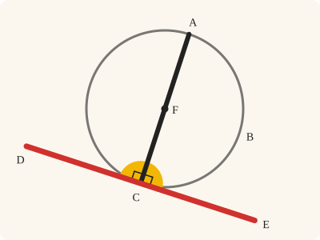
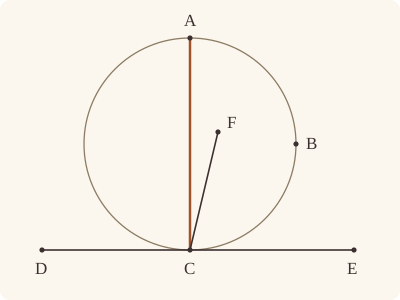

<!-- Generated by scripts/render.py. Do not edit by hand. -->

[Book III](index.md) · [← III.18](18.md) · [III.20 →](20.md)

# Book III, Proposition 19

*The centre is on the straight line at right angles to the tangent*

[Euclid's proof](#euclids-proof) · [In Lean](#in-lean) · [What it rests on](#what-it-rests-on) · [Mishnah](#mishnah)

> If a straight line touch a circle, and from the point of contact a straight line be drawn at right angles to the tangent, the centre of the circle will be on the straight line so drawn.

**In Lean:** ✅ proved, as Euclid states it · Euclid's argument

<p align="center"></p>

<p align="center"><em>Where DE (red) touches the circle at C, draw CA (black) at right angles to it (yellow): it runs through the centre F, where the conclusion puts it. Heath's F is a centre supposed off CA, which the proof rules out.</em></p>

## Euclid's proof

<p align="center"></p>

<p align="center"><em>Drawn for one case: A on the circumference and F inside angle ACE, as in Heath's figure. Like Heath's, this figure draws the impossible supposition: F, off CA, as the centre of the circle ABC.</em></p>

For let a straight line DE touch the circle ABC at the point C, and from C let CA be drawn at right angles to DE;

I say that the centre of the circle is on AC.

For suppose it is not, but, if possible, let F be the centre,

and let CF be joined.

Since a straight line DE touches the circle ABC,

and FC has been joined from the centre to the point of contact,

FC is perpendicular to DE; [III. 18]

therefore the angle FCE is right.

But the angle ACE is also right;

therefore the angle FCE is equal to the angle ACE,

the less to the greater: which is impossible.

Therefore F is not the centre of the circle ABC.

Similarly we can prove that neither is any other point except a point on AC.

Therefore etc.

Q. E. D.

## In Lean

| | |
|---|---|
| Proof | ✅ Proved |
| Statement | The whole enunciation. A may be any point off DE with CA at right angles to DE: it need not be on the circle, and may lie across DE from the centre. |
| Argument | Euclid's. |
| Reviewed | The statement and every passage of the argument read against Heath's text, at commit [`e00da4b4`](https://github.com/jackChallis/stoicheia/commit/e00da4b4) ([the record](../../review/III/19.toml)) |

From [`Elements/BookIII/Prop19.lean`](../../Elements/BookIII/Prop19.lean). Euclid's sentences are the `--` comments, and our own notes are in `/- … -/`; the lines under each sentence are the Lean that carries it out. The list below marks where a lemma does a step Euclid takes for granted, where several sentences share one step and where the statement already gives a step; the `/- … -/` notes in the listing explain smaller adjustments.

**How the Lean follows the text**

- **Already given.** "For let a straight line DE touch the circle ABC at the point C…" The statement gives DE touching at C and CA at right angles to it. For Euclid's E in the angle names, the Lean uses E unless C is E, when it uses D.
- **Done by `Touches.not_inside`.** "and let CF be joined." Euclid joins CF with F off the tangent, as the figure shows. The Lean proves F off DE by `Touches.not_inside` and `Tacit.centre_inside` (System E, Generalities 3), proved in `Elements/Figure/RuleBase.lean`; CF itself is named by its ends.
- **Already given.** "But the angle ACE is also right…" CA is perpendicular to DE by hypothesis, so its angle with the chosen point of DE is right.
- **Done by `Prop1.perpendicular`.** "the less to the greater: which is impossible." At C only one straight line is at right angles to DE, which Euclid takes for granted here as in III.1; it puts F on CA on whichever side of DE A lies. When A and F lie on opposite sides of DE, the Lean produces AC beyond C by Postulate 2 and makes the adjacent angle right by I.13 and Common Notion 3; Heath prints no reference to I.13 here.
- **Carried together.** "Therefore F is not the centre of the circle ABC." The reductio is made for any point F off AC, so one argument gives this sentence and Euclid's "similarly" for every other point.

```lean
/-- If a straight line touch a circle, and from the point of contact a straight line be drawn at
right angles to the tangent, the centre of the circle will be on the straight line so drawn. -/
theorem Prop19 {A C D E : Point} {ABC : Circle} (hC : OnCircle C ABC) (hDE : Touches D E ABC)
    (hCDE : Collinear D E C) (hA : ¬ Collinear D E A)
    (hCA : ∀ P : Point, Collinear D E P → P ≠ C → ∠ A C P = ∟) :
    ∀ F : Point, Centre F ABC → Collinear A C F := by
  -- For let a straight line DE touch the circle ABC at the point C, and from C let CA be drawn
  -- at right angles to DE;
  obtain ⟨L, hD_L, hE_L⟩ := Postulate1 D E hDE.1
  have hC_L : OnLine C L := by
    obtain ⟨M, h1, h2, h3⟩ := hCDE
    exact (line_unique hDE.1 h1 h2 hD_L hE_L) ▸ h3
  have hA_L : ¬ OnLine A L := fun h => hA ⟨L, hD_L, hE_L, h⟩
  /- Euclid's E, in the angles FCE and ACE, is a point of DE other than C. Here it is
     `E₁`: E itself, or D when C is E. -/
  obtain ⟨E₁, hE₁_L, hE₁C⟩ : ∃ E₁ : Point, OnLine E₁ L ∧ E₁ ≠ C := by
    by_cases hCE : C = E
    · exact ⟨D, hD_L, fun e => hDE.1 (e.trans hCE)⟩
    · exact ⟨E, hE_L, Ne.symm hCE⟩
  -- I say that the centre of the circle is on AC.
  intro F hF
  -- For suppose it is not, but, if possible, let F be the centre,
  refine Classical.byContradiction fun hF_AC => ?_
  -- and let CF be joined.
  have hF_L : ¬ OnLine F L := fun h => hDE.not_inside ⟨L, hD_L, hE_L, h⟩ (centre_inside hF)
  -- Since a straight line DE touches the circle ABC,
  -- and FC has been joined from the centre to the point of contact,
  -- FC is perpendicular to DE; [III. 18]
  have h18 := Prop18 hF hC hDE hCDE
  -- therefore the angle FCE is right.
  have hFCE : ∠ F C E₁ = ∟ := h18 E₁ ⟨L, hD_L, hE_L, hE₁_L⟩ hE₁C
  -- But the angle ACE is also right;
  have hACE : ∠ A C E₁ = ∟ := hCA E₁ ⟨L, hD_L, hE_L, hE₁_L⟩ hE₁C
  -- therefore the angle FCE is equal to the angle ACE,
  have hFCE_ACE : ∠ F C E₁ = ∠ A C E₁ := hFCE.trans hACE.symm
  -- the less to the greater: which is impossible.
  /- At C only one straight line is at right angles to DE, as in III.1
     (`Prop1.perpendicular`), so F lies on CA, on whichever side of DE it falls. -/
  have hFC : F ≠ C := fun e => hF_L (e ▸ hC_L)
  have hAC : A ≠ C := fun e => hA_L (e ▸ hC_L)
  have hE₁CA : ∠ E₁ C A = ∟ := by rw [angle_symm hE₁C hAC]; exact hACE
  have hE₁CF : ∠ E₁ C F = ∟ := by rw [angle_symm hE₁C hFC, hFCE_ACE]; exact hACE
  obtain ⟨N, hC_N, hA_N, hF_N⟩ := Prop1.perpendicular (Triangle.of_line hE₁_L hC_L hE₁C hA_L)
    (Triangle.of_line hE₁_L hC_L hE₁C hF_L) hE₁CA hE₁CF
  exact hF_AC ⟨N, hA_N, hC_N, hF_N⟩
  -- Therefore F is not the centre of the circle ABC.
  -- Similarly we can prove that neither is any other point except a point on AC.
  -- Therefore etc.
  -- Q. E. D.
```

## What it rests on

| | |
|---|---|
| Heath's references | [III.18](18.md) |
| Lean cites | [I.13](../I/13.md), [III.18](18.md) |
| Postulates | 1, 2, 3, 4 |
| Definitions taken as axioms | Def. I.15 |
| Common Notions | 1, 2, 3, 4, 5 |
| Tacit rules | 37 (listed below) |
| Its own Lean calls | Postulate 1; 2 tacit rules |
| Through lemmas | Postulates 2 and 3; Def. I.15; 26 tacit rules |

Some of these come in through lemmas [shared](../../CERTIFICATE.md#shared-steps) by many proofs: [`Prop1.perpendicular`](../../Elements/BookIII/Prop01.lean#L77) (I.13).

_Postulates, definitions, Common Notions and tacit rules: all that this proof rests on, counting those of the propositions it cites. The last two rows say which of the postulates, definitions and tacit rules its own Lean calls, in the proof or a helper written for it, and which it does not call but reaches through lemmas, of Book Zero or shared (a proposition it cites may rest on these too); the rest come in only through the propositions it cites or the Common Notions._

<details><summary>The 37 tacit rules beneath this proof, counting those of the propositions it cites</summary>

_(used here) marks a rule this proof's own Lean calls, in the proof or a helper written for it; (through …) marks one its own Lean does not call but reaches through the lemmas named, of [Book Zero](../../Elements/Figure) or shared, though a proposition it cites may rest on it too; and a rule with no mark comes in only through a proposition it cites or a Common Notion. The names in brackets are System E's: an Intersection rule says when straight lines and circles must meet, and an Intersections rule takes a point where they do (see [Book I's introduction](../I/index.md))._

**Reading the figure**

- [`between_cases`](../../Elements/Foundations/Tacit/Diagram.lean#L54) (through [`Prop1.perpendicular`](../../Elements/BookIII/Prop01.lean#L77)): Of three different points on a straight line, one is between the other two. (Between 6)
- [`between_symm`](../../Elements/Foundations/Tacit/Diagram.lean#L47) (through [`Prop1.perpendicular`](../../Elements/BookIII/Prop01.lean#L77)): If B is between A and C, it is between C and A. (Between 1)
- [`circles_meet`](../../Elements/Foundations/Tacit/Diagram.lean#L94) (through [`Prop1.perpendicular`](../../Elements/BookIII/Prop01.lean#L77)): If each circle passes through a point inside the other, the circles cut one another. This is the step Euclid takes for granted in I.1. (Intersection 5)
- [`circles_meet_same_side`](../../Elements/Foundations/Tacit/Constructions.lean#L79) (through [`Prop1.perpendicular`](../../Elements/BookIII/Prop01.lean#L77)): Two circles that cut one another do so on each side of the straight line through their centres. (Intersections 8)
- [`exists_point`](../../Elements/Foundations/Tacit/Constructions.lean#L35) (through [`Prop1.perpendicular`](../../Elements/BookIII/Prop01.lean#L77)): Let a point be taken. (Points 1)
- [`exists_point_inside_circle`](../../Elements/Foundations/Tacit/Constructions.lean#L42) (through [`Prop1.perpendicular`](../../Elements/BookIII/Prop01.lean#L77) and [`Tacit.centre_inside`](../../Elements/Figure/RuleBase.lean#L56)): Let a point be taken inside the circle α. (Points 8)
- [`exists_point_on_line`](../../Elements/Foundations/Tacit/Constructions.lean#L38) (through [`Prop1.perpendicular`](../../Elements/BookIII/Prop01.lean#L77) and [`Touches.not_inside`](../../Elements/Figure/OnCircles.lean#L123)): Let a point be taken on the straight line L. (Points 2)
- [`line_circle_between`](../../Elements/Foundations/Tacit/Constructions.lean#L67) (through [`Prop1.perpendicular`](../../Elements/BookIII/Prop01.lean#L77) and [`Tacit.centre_inside`](../../Elements/Figure/RuleBase.lean#L56)): A straight line through a point B inside a circle, heading out to a point C outside it, cuts the circle between B and C. (Intersections 4)
- [`line_circle_beyond`](../../Elements/Foundations/Tacit/Constructions.lean#L73) (through [`Prop1.perpendicular`](../../Elements/BookIII/Prop01.lean#L77), [`Tacit.centre_inside`](../../Elements/Figure/RuleBase.lean#L56) and [`Touches.not_inside`](../../Elements/Figure/OnCircles.lean#L123)): A straight line through a point B inside a circle, produced beyond B away from C, cuts the circle there. (Intersections 5)
- [`line_unique`](../../Elements/Foundations/Tacit/Diagram.lean#L41) (used here): Two points determine a straight line. (Generalities 1)
- [`lines_meet_of_opposite_sides`](../../Elements/Foundations/Tacit/Diagram.lean#L89) (through [`Prop1.perpendicular`](../../Elements/BookIII/Prop01.lean#L77)): A straight line joining points on opposite sides of L crosses L. (Intersection 1)
- [`not_between_of_between`](../../Elements/Foundations/Tacit/Diagram.lean#L50) (through [`Prop1.perpendicular`](../../Elements/BookIII/Prop01.lean#L77), [`Tacit.centre_inside`](../../Elements/Figure/RuleBase.lean#L56) and [`Touches.not_inside`](../../Elements/Figure/OnCircles.lean#L123)): If B is between A and C, then A is not between B and C. (Between 1)
- [`not_on_line_of_same_side`](../../Elements/Foundations/Tacit/Diagram.lean#L60) (through [`Prop1.perpendicular`](../../Elements/BookIII/Prop01.lean#L77)): Points on one side of a straight line are not on it. (Same side 3)
- [`pasch2`](../../Elements/Foundations/Tacit/Diagram.lean#L71) (through [`Prop1.perpendicular`](../../Elements/BookIII/Prop01.lean#L77)): If B is between A and C, A is on L and B is off it, then B and C are on the same side of L: a straight line that leaves L at A does not cross it again. (Pasch 2)
- [`same_side_trans`](../../Elements/Foundations/Tacit/Diagram.lean#L64) (through [`Prop1.perpendicular`](../../Elements/BookIII/Prop01.lean#L77)): Two points on the same side of a straight line as a third point are on the same side as each other. (Same side 4)

**Lengths, angles and areas**

- [`angle_add_of_inside`](../../Elements/Foundations/Tacit/Transfer.lean#L47) (through [`Prop1.perpendicular`](../../Elements/BookIII/Prop01.lean#L77)): If D lies within the angle BAC, then BAC is made up of BAD and DAC. (Diagram-angle 2)
- [`angle_eq_of_same_rays`](../../Elements/Foundations/Tacit/Transfer.lean#L54): The angle doesn't change if its arms are traced through other points on the same rays. (Diagram-angle 4)
- [`angle_symm`](../../Elements/Foundations/Tacit/Metric.lean#L30) (used here): The angle ABC is the angle CBA. (Metric 4)
- [`area_add_of_between`](../../Elements/Foundations/Tacit/Transfer.lean#L70): Cutting a triangle in two from a vertex adds up. (Diagram-area 2)
- [`area_congruent`](../../Elements/Foundations/Tacit/Metric.lean#L44): Triangles equal in all their sides and angles are equal in area. Euclid uses this without comment once he has shown two triangles congruent. (Metric 9)
- [`area_degenerate`](../../Elements/Foundations/Tacit/Metric.lean#L36): A "triangle" with a repeated corner has no area. (Metric 6)
- [`area_eq_zero_of_on_line`](../../Elements/Foundations/Tacit/Transfer.lean#L62): A "triangle" whose corners lie on one straight line has no area. (Diagram-area 1)
- [`area_rotate`](../../Elements/Foundations/Tacit/Metric.lean#L39): The triangle ABC is the triangle CAB. (Metric 8)
- [`len_add_of_between`](../../Elements/Foundations/Tacit/Transfer.lean#L27) (through [`Prop1.perpendicular`](../../Elements/BookIII/Prop01.lean#L77), [`Tacit.centre_inside`](../../Elements/Figure/RuleBase.lean#L56) and [`Touches.not_inside`](../../Elements/Figure/OnCircles.lean#L123)): If B is between A and C, then AB and BC together make up AC. (Diagram-segment 1)
- [`len_self`](../../Elements/Foundations/Tacit/Metric.lean#L24) (through [`Prop1.perpendicular`](../../Elements/BookIII/Prop01.lean#L77), [`Tacit.centre_inside`](../../Elements/Figure/RuleBase.lean#L56) and [`Touches.not_inside`](../../Elements/Figure/OnCircles.lean#L123)): The "straight line" from a point to itself has no length. (Metric 1)
- [`len_symm`](../../Elements/Foundations/Tacit/Metric.lean#L27) (through [`Prop1.perpendicular`](../../Elements/BookIII/Prop01.lean#L77) and [`Tacit.centre_inside`](../../Elements/Figure/RuleBase.lean#L56)): The straight line AB is the straight line BA. (Metric 3)
- [`radius_ne_zero`](../../Elements/Foundations/Tacit/Metric.lean#L62) (through [`Prop1.perpendicular`](../../Elements/BookIII/Prop01.lean#L77), [`Tacit.centre_inside`](../../Elements/Figure/RuleBase.lean#L56) and [`Touches.not_inside`](../../Elements/Figure/OnCircles.lean#L123)): A circle's radius is not nothing: the straight line from the centre to a point on the circle has some length. A rule of our own, not one of System E's: every circle is drawn with a centre and a distance (Postulate 3).
- [`same_ray_of_angle_eq_zero`](../../Elements/Foundations/Tacit/Transfer.lean#L42) (through [`Prop1.perpendicular`](../../Elements/BookIII/Prop01.lean#L77)): If the angle BAC is nothing, C lies on the ray from A through B. (Diagram-angle 1)

**Superposition**

- [`superposition`](../../Elements/Foundations/Tacit/Superposition.lean#L48): **Superposition.** A hypothetical placement of a triangle on a given ray and side permits a restricted derivation of metric equalities about the figure already given. The derivation introduces no further objects, cites each geometric law it uses, and exports no symbol of the placement.

**Laws of magnitude**

- [`add_assoc`](../../Elements/Foundations/Tacit/Magnitudes.lean#L23): Adding three magnitudes in a row, it makes no difference whether the first two or the last two are added first. (System E §3.5)
- [`add_comm`](../../Elements/Foundations/Tacit/Magnitudes.lean#L26) (through [`Prop1.perpendicular`](../../Elements/BookIII/Prop01.lean#L77), [`Tacit.centre_inside`](../../Elements/Figure/RuleBase.lean#L56) and [`Touches.not_inside`](../../Elements/Figure/OnCircles.lean#L123)): The order of adding does not matter. (System E §3.5)
- [`add_lt_add_right`](../../Elements/Foundations/Tacit/Magnitudes.lean#L45) (through [`Prop1.perpendicular`](../../Elements/BookIII/Prop01.lean#L77)): Adding the same thing to both sides keeps "less than". (System E §3.5)
- [`add_zero`](../../Elements/Foundations/Tacit/Magnitudes.lean#L29): Adding nothing changes nothing. (System E §3.5)
- [`lt_irrefl`](../../Elements/Foundations/Tacit/Magnitudes.lean#L32) (through [`Prop1.perpendicular`](../../Elements/BookIII/Prop01.lean#L77) and [`Tacit.centre_inside`](../../Elements/Figure/RuleBase.lean#L56)): No magnitude is less than itself. (System E §3.5)
- [`lt_trans`](../../Elements/Foundations/Tacit/Magnitudes.lean#L35) (through [`Prop1.perpendicular`](../../Elements/BookIII/Prop01.lean#L77) and [`Tacit.centre_inside`](../../Elements/Figure/RuleBase.lean#L56)): What is less than the less is less still. (System E §3.5)
- [`lt_trichotomy`](../../Elements/Foundations/Tacit/Magnitudes.lean#L39) (through [`Prop1.perpendicular`](../../Elements/BookIII/Prop01.lean#L77), [`Tacit.centre_inside`](../../Elements/Figure/RuleBase.lean#L56) and [`Touches.not_inside`](../../Elements/Figure/OnCircles.lean#L123)): Of two magnitudes, one is less, or they are equal, or the other is less. (System E §3.5)
- [`not_lt_zero`](../../Elements/Foundations/Tacit/Magnitudes.lean#L42) (through [`Prop1.perpendicular`](../../Elements/BookIII/Prop01.lean#L77), [`Tacit.centre_inside`](../../Elements/Figure/RuleBase.lean#L56) and [`Touches.not_inside`](../../Elements/Figure/OnCircles.lean#L123)): Nothing is less than zero. (System E §3.5)

</details>

## Mishnah

_Our commentary: what Euclid assumes, what Lean made us say out loud, and how the result looks by modern means._

**The centre has nowhere else to go.** Euclid turns III.18 into a way of finding where the centre lies. CA is drawn at right angles to DE at C; were the centre a point F off CA, the straight line FC would make a second right angle with DE, by III.18. But two straight lines from C on one side of DE cannot both be at right angles to it: the angle FCE would be equal to the angle ACE, "the less to the greater".

Heath goes on counting after III.18: "We may also regard III. 19 as a partial converse of III. 18" (vol. 2, p. 45). This time the three things are passing through the centre, passing through the point of contact, and standing at right angles to the tangent. A straight line with the first two has the third (III.18); one with the last two has the first (III.19). The pairing left over is a converse Euclid does not state: "a straight line drawn through the centre perpendicular to the tangent passes through the point of contact" (Heath, vol. 2, p. 46).

**Any A off DE will do.** Our statement asks less of A than Heath's figure does: CA must be at right angles to DE, but A need not be on the circle, and so it may lie on the other side of DE from the centre. Then AC produced beyond C makes a right angle on F's side, and at C only one straight line is at right angles to DE, as in III.1. That is Euclid's "the less to the greater".

## Further reading

- C. Stanley Ogilvy's [*Excursions in Geometry*](https://store.doverpublications.com/products/9780486265308) (1990; first published 1969), a pleasantly written little book for readers who liked school geometry and wanted more, puts the right angle at the point of contact to work on circles that cut at right angles: each radius to a crossing touches the other circle "because a tangent is always perpendicular to the radius at the point of contact" (ch. 2, "Coaxial families", Theorem 7, pp. 18–19).
- Heath counts the converses of III.18 and III.19; why proving a statement does not prove its converse is explained in Daniel J. Velleman's [*How to Prove It*](https://doi.org/10.1017/9781108539890) (2019) (also on [III.4](04.md)).

[Book III](index.md) · [← III.18](18.md) · [III.20 →](20.md)

---

<sub>Euclid's text: T. L. Heath, *The Thirteen Books of Euclid's Elements*, vol. 2 (Cambridge, 1908), p. 45; [scan leaf n57](https://archive.org/details/thirteenbookseu00heibgoog/page/n57); [figure on n57](https://archive.org/details/thirteenbookseu00heibgoog/page/n57). Public domain.</sub>

<sub>The tacit rules follow the System E of Jeremy Avigad, Edward Dean and John Mumma, read alongside LeanEuclid (Logan Murphy, Kaiyu Yang, Jialiang Sun, Zhaoyu Li, Anima Anandkumar and Xujie Si).</sub>
