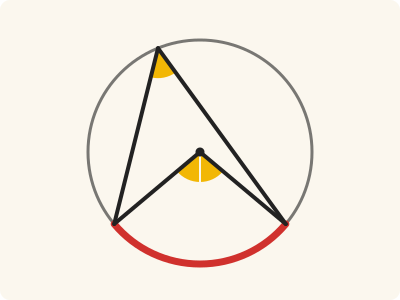
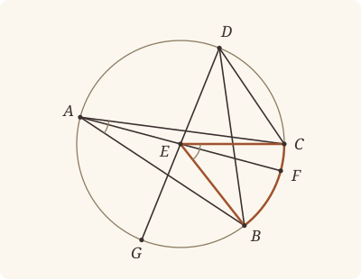

<!-- Generated by scripts/render.py. Do not edit by hand. -->

[Book III](index.md) · [← III.19](19.md) · [III.21 →](21.md)

# Book III, Proposition 20

*The angle at the centre is double of that at the circumference*

[Euclid's proof](#euclids-proof) · [In Lean](#in-lean) · [What it rests on](#what-it-rests-on) · [Mishnah](#mishnah)

> In a circle the angle at the centre is double of the angle at the circumference, when the angles have the same circumference as base.

**In Lean:** ✅ proved, as Euclid states it · Euclid's argument

<p align="center"></p>

<p align="center"><em>On the same circumference BC (red), the angle BEC at the centre E is twice the angle BAC at the circumference: two yellow angles to one.</em></p>

## Euclid's proof

<p align="center"></p>

<p align="center"><em>Drawn for one case: E within the angle BAC and outside the angle BDC.</em></p>

Let ABC be a circle, let the angle BEC be an angle at its centre, and the angle BAC an angle at the circumference, and let them have the same circumference BC as base;

I say that the angle BEC is double of the angle BAC.

For let AE be joined and drawn through to F.

Then, since EA is equal to EB,

the angle EAB is also equal to the angle EBA; [I. 5]

therefore the angles EAB, EBA are double of the angle EAB.

But the angle BEF is equal to the angles EAB, EBA; [I. 32]

therefore the angle BEF is also double of the angle EAB.

For the same reason

the angle FEC is also double of the angle EAC.

Therefore the whole angle BEC is double of the whole angle BAC.

Again let another straight line be inflected, and let there be another angle BDC; let DE be joined and produced to G.

Similarly then we can prove that the angle GEC is double of the angle EDC,

of which the angle GEB is double of the angle EDB;

therefore the angle BEC which remains is double of the angle BDC.

Therefore etc.

Q. E. D.

## In Lean

| | |
|---|---|
| Proof | ✅ Proved, and its companions `Prop20.special` ([III.20 special](20.md#special)) and `Prop20.circumference` ([III.20 circumference](20.md#circumference)) |
| Statement | The whole enunciation. The angle at the centre on BC, of any size, our reading after Heath; III.20 special has E on A's side and the angle BEC, as III.20 had before. |
| Argument | Euclid's. Euclid's own proof, for the angle at the centre of any size: the diameter AEF, the isosceles triangles and I.32, then the sum of BEF and FEC in his first figure, which now takes the centre within the angle BAC on A's side of BC, on BC or beyond it, or their difference in his second. That BEF and FEC make up the angle at the centre wherever the centre lies is `angleAtCentre.diameter`, which cites I.13 and III.2; Heath's references for III.20 give neither. `Prop20.special` follows from III.20 by `angleAtCentre.within`, and `Prop20.circumference` from it, III.2 and the definition of the measure. |
| Representation | The angle at the centre standing on the circumference BKC is `angleAtCentre`: a diameter AEF, A and F on opposite sides of BC and F on K's side, divides it into the angles BEF and FEC, as in Euclid's first figure, and it is the two together, so it may be two right angles or more. That reading is ours, made after Heath's notes; Euclid's angles at the centre are less than two right angles. It depends on neither the diameter, nor the centre, nor the point naming the side, and it is the angle BEC when the centre lies on A's side of BC (`angleAtCentre.within`), two right angles when the centre is on BC, and greater when the centre lies beyond BC. `Prop20.circumference` shows that our measure of a circumference, twice the angle standing on it, is its angle at the centre. |
| Reviewed | The statement and every passage of the argument read against Heath's text, at commit [`689ab169f`](https://github.com/jackChallis/stoicheia/commit/689ab169f) ([the record](../../review/III/20.toml)) |

From [`Elements/BookIII/Prop20.lean`](../../Elements/BookIII/Prop20.lean). Euclid's sentences are the `--` comments, and our own notes are in `/- … -/`; the lines under each sentence are the Lean that carries it out. The list below marks where a lemma does a step Euclid takes for granted, where several sentences share one step and where the Lean takes a case Euclid's figure leaves aside; the `/- … -/` notes in the listing explain smaller adjustments.

**How the Lean follows the text**

- **Done by `Tacit.exists_centre`.** "Let ABC be a circle…" The statement names no centre, for the angle at the centre is the circle's. Under Euclid's setting-out the Lean takes the centre E by `Tacit.exists_centre`, a rule we assume from Definitions I.15 and I.16.
- **Done by `Tacit.line_circle_beyond`.** "For let AE be joined and drawn through to F." Euclid draws AE through to F on the circle. The Lean names AE by Postulate 1 and finds F beyond E by `Tacit.line_circle_beyond`, the rule we assume as System E, Intersections 5, using `Tacit.centre_inside` (System E, Generalities 3), proved in `Elements/Figure/RuleBase.lean`.
- **Done by `Definition15`.** "Then, since EA is equal to EB…" Euclid takes the radii EA and EB to be equal without giving a reason. The Lean obtains their equality from `Definition15`, Euclid's definition of a circle, which we assume as a rule.
- **Carried together.** "For the same reason…" Euclid gives the same reason at C without writing out the isosceles-triangle argument. The Lean proves that argument once over any letters, under the preceding sentences, and applies it to AEC as well as AEB.
- **Done by `angleAtCentre.diameter`.** "Therefore the whole angle BEC is double of the whole angle BAC." Euclid reads off his figure that AE falls within the angle BAC and that BEF and FEC make up the angle at the centre. The Lean finds X between B and C on AE by `crossbar`, puts X within the circle by III.2, for which Heath gives no reference here, and so between A and F by `Tacit.between_of_inside_chord` (System E, Circle 1), proved after III.2, so that F lies across BC from A; then `angleAtCentre.diameter` makes BEF and FEC the angle at the centre standing on BC, whether E lies on A's side of BC, on BC or beyond it, and `angle_add_of_between` makes BAE and EAC the angle BAC.
- **Done by `Tacit.line_circle_beyond`.** "let DE be joined and produced to G." Euclid draws DE through to G on the circle. As for F, the Lean names DE by Postulate 1 and finds G beyond E by `Tacit.line_circle_beyond`, the rule we assume as System E, Intersections 5, with E inside by `Tacit.centre_inside` (System E, Generalities 3), proved as above.
- **Carried together.** "Similarly then we can prove that the angle GEC is double of the angle EDC…" Euclid invokes the same isosceles-triangle argument for GEC and GEB without writing it out. The Lean applies the same argument, proved above over any letters, to DEC and DEB.
- **Done by `angle_add_of_within`.** "therefore the angle BEC which remains is double of the angle BDC." Euclid reads DB within EDC and EB within GEC, then subtracts the smaller double. Beneath the construction of G, `OppositeSides.exists_between` finds Y between E and C, `InsideCircle.of_between_centre` puts Y inside the circle, and `Tacit.between_of_inside_chord`, System E's Circle 1, proved after III.2, puts Y between D and B; the Lean then puts B on C's side of EG by two uses of `Tacit.pasch2` (System E, Pasch 2), a rule we assume, and on G's side of EC using the proved rule `Tacit.pasch3` (System E, Pasch 3), splits the angles by `angle_add_of_between` and `angle_add_of_within`, and subtracts by Common Notion 3.
- **A further case.** "Therefore etc." Euclid leaves out E on AB or on AC (Heath, vol. 2, p. 49); the Lean puts E between A and B or between A and C using `Tacit.between_of_inside_chord` (System E, Circle 1), proved after III.2, and the proved rule `Tacit.centre_inside` (System E, Generalities 3), so that the angle at the centre is the angle BEC (`angleAtCentre.within`), then uses his argument for one isosceles triangle. In all other positions the Lean sorts E by the sides of AB and AC: within BAC it adds the doubles as in Euclid's first argument; outside BAC the centre lies on A's side of BC (`Prop20.across_side`), the angle at the centre is the angle BEC, and the Lean applies his second argument, by subtraction, to A in place of D, exchanging B and C when E lies across AC from B.

<details><summary>Before the theorem, 13 lemmas: <code>sameSideOf_beyond</code>, <code>diameter_cases</code>, <code>diameter_within</code>, <code>diameter_beyond</code>, <code>diameter_eq</code>, <code>angleAtCentre.diameter</code>, <code>angleAtCentre.congr</code>, <code>angleAtCentre.within</code>, <code>angleAtCentre.semicircle</code>, <code>angleAtCentre.reflex</code>, <code>angleAtCentre.reflex_gt</code>, <code>angleAtCentre.size</code> and <code>Prop20.across_side</code> (252 lines)</summary>

```lean
variable {A B C E F K : Point} {α : Circle}

/-- If E lies between A and F, and A and E are on opposite sides of BC, then F is on
E's side: AE crosses BC, and EF does not cross it again. -/
private theorem sameSideOf_beyond (hAEF : Between A E F) (hAE : OppositeSidesOf A E B C) :
    SameSideOf F E B C := by
  obtain ⟨L, hB_L, hC_L⟩ := Postulate1 B C hAE.1
  have h := hAE.oppositeSides hB_L hC_L
  obtain ⟨X, hX_L, hAXE⟩ := h.exists_between
  have hXEF : Between X E F := between_inner hAXE hAEF
  exact (SameSideOf.of_line hAE.1 hB_L hC_L (pasch2 hXEF hX_L h.2.1)).symm

/-- **Where the centre lies, and what the diameter's two angles make.** Let AEF be a
diameter, A and F on opposite sides of BC, F on K's side. AF crosses BC at a point X
within the circle [III. 2], and so between B and C; the centre E is on A's side of X, at
X, or on F's side. On A's side, the angles BEF, FEC make up the angle BEC; at X, E is on
BC and they are two right angles [I. 13]; on F's side, with the angle BEC they make four
right angles, for each with the angle it makes with EA is two right angles [I. 13], and
EA falls within the angle BEC. [I. 13, III. 2] -/
private theorem diameter_cases (hE : Centre E α) (hB : OnCircle B α) (hC : OnCircle C α)
    (hA : OnCircle A α) (hF : OnCircle F α) (hAEF : Between A E F)
    (hAK : OppositeSidesOf A K B C) (hFK : SameSideOf F K B C) :
    (OppositeSidesOf E K B C ∧ ∠ B E F + ∠ F E C = ∠ B E C) ∨
    (Between B E C ∧ ∠ B E F + ∠ F E C = ∟ + ∟) ∨
    (SameSideOf E K B C ∧ ∠ B E F + ∠ F E C + ∠ B E C = ∟ + ∟ + (∟ + ∟)) := by
  have hBC : B ≠ C := hAK.1
  obtain ⟨L, hB_L, hC_L⟩ := Postulate1 B C hBC
  have hAF_L : OppositeSides A F L := (hFK.trans_opposite hAK.symm).symm.oppositeSides hB_L hC_L
  have hA_L : ¬ OnLine A L := hAF_L.1
  /- AF crosses BC at X, within the circle, and so between B and C. -/
  obtain ⟨X, hX_L, hAXF⟩ := hAF_L.exists_between
  have hBXC : Between B X C :=
    between_of_inside_chord hX_L hB_L hC_L (Prop2 hA hF X hAXF) hB hC hBC
  have hBE : B ≠ E := ne_of_centre_of_on hE hB
  have hCE : C ≠ E := ne_of_centre_of_on hE hC
  have hAE : A ≠ E := ne_of_between hAEF
  have hAX : A ≠ X := ne_of_between hAXF
  obtain ⟨N, hA_N, hF_N⟩ := Postulate1 A F (ne_of_between_ends hAEF)
  have hE_N : OnLine E N := on_line_of_between_ends hAEF hA_N hF_N
  have hX_N : OnLine X N := on_line_of_between_ends hAXF hA_N hF_N
  by_cases hEX : E = X
  · /- E is on BC. -/
    subst hEX
    exact Or.inr (Or.inl ⟨hBXC, BookI.Prop13 hBXC hFK.triangle⟩)
  rcases between_cases hAE hEX hAX hA_N hE_N hX_N with hAEX | hEAX | hAXE
  · /- E is on A's side of BC, and X on the ray from E through F. -/
    have hE_L : ¬ OnLine E L := fun h => hA_L (on_line_of_between (between_symm hAEX) hX_L h)
    have hEK : OppositeSidesOf E K B C :=
      (SameSideOf.of_line hBC hB_L hC_L (pasch2 (between_symm hAEX) hX_L hE_L)).trans_opposite hAK
    have hXray : OnRay X E F := OnRay.of_between (between_inner hAEX hAXF)
    refine Or.inl ⟨hEK, ?_⟩
    rw [angle_add_of_between hEK.triangle hBXC, angle_onRay_right hXray hBE,
      angle_onRay_left hXray hCE]
  · exact absurd hEAX (OnRay.not_between (OnRay.of_between hAEF) (OnRay.of_between hAXF))
  · /- E is on F's side of BC, and X on the ray from E through A. -/
    have hE_L : ¬ OnLine E L := fun h => hA_L (on_line_of_between (between_symm hAXE) h hX_L)
    have hEK : SameSideOf E K B C :=
      (SameSideOf.of_line hBC hB_L hC_L (pasch2 (between_inner hAXE hAEF) hX_L hE_L)).trans hFK
    have hXray : OnRay X E A := OnRay.of_between (between_symm hAXE)
    /- B and C are off the diameter AF, which meets BC only at X. -/
    have hB_N : ¬ OnLine B N := fun h =>
      hA_L (line_unique (ne_of_between hBXC) h hX_N hB_L hX_L ▸ hA_N)
    have hC_N : ¬ OnLine C N := fun h =>
      hA_L (line_unique (ne_of_between (between_symm hBXC)) h hX_N hC_L hX_L ▸ hA_N)
    have hAFB : Triangle A F B := Triangle.of_line hA_N hF_N (ne_of_between_ends hAEF) hB_N
    have hAFC : Triangle A F C := Triangle.of_line hA_N hF_N (ne_of_between_ends hAEF) hC_N
    have h13 : ∟ + ∟ + (∟ + ∟) = ∠ A E B + ∠ B E F + (∠ A E C + ∠ C E F) := by
      rw [BookI.Prop13 hAEF hAFB, BookI.Prop13 hAEF hAFC]
    refine Or.inr (Or.inr ⟨hEK, ?_⟩)
    rw [h13, angle_add_of_between hEK.triangle hBXC, angle_onRay_right hXray hBE,
      angle_onRay_left hXray hCE, angle_symm hBE hAE, angle_symm (ne_of_between (between_symm hAEF)) hCE]
    ac_rfl

/-- The centre on the other side of BC from K: the diameter's angles make up BEC. -/
private theorem diameter_within (hE : Centre E α) (hB : OnCircle B α) (hC : OnCircle C α)
    (hA : OnCircle A α) (hF : OnCircle F α) (hAEF : Between A E F)
    (hAK : OppositeSidesOf A K B C) (hFK : SameSideOf F K B C) (hEK : OppositeSidesOf E K B C) :
    ∠ B E F + ∠ F E C = ∠ B E C := by
  obtain ⟨L, hB_L, hC_L⟩ := Postulate1 B C hAK.1
  rcases diameter_cases hE hB hC hA hF hAEF hAK hFK with ⟨-, h⟩ | ⟨h, -⟩ | ⟨h, -⟩
  · exact h
  · exact absurd (on_line_of_between_ends h hB_L hC_L) (hEK.triangle.off_line hB_L hC_L)
  · exact absurd (h.sameSide hB_L hC_L) (hEK.oppositeSides hB_L hC_L).2.2

/-- The centre on K's side of BC: with BEC, the diameter's angles make four right angles. -/
private theorem diameter_beyond (hE : Centre E α) (hB : OnCircle B α) (hC : OnCircle C α)
    (hA : OnCircle A α) (hF : OnCircle F α) (hAEF : Between A E F)
    (hAK : OppositeSidesOf A K B C) (hFK : SameSideOf F K B C) (hEK : SameSideOf E K B C) :
    ∠ B E F + ∠ F E C + ∠ B E C = ∟ + ∟ + (∟ + ∟) := by
  obtain ⟨L, hB_L, hC_L⟩ := Postulate1 B C hAK.1
  rcases diameter_cases hE hB hC hA hF hAEF hAK hFK with ⟨h, -⟩ | ⟨h, -⟩ | ⟨-, h⟩
  · exact absurd (hEK.sameSide hB_L hC_L) (h.oppositeSides hB_L hC_L).2.2
  · exact absurd (on_line_of_between_ends h hB_L hC_L) (hEK.triangle.off_line hB_L hC_L)
  · exact h

/-- **Any such diameter gives the same angle.** Two diameters through the centre E, each
with its ends on opposite sides of BC, divide the angle at the centre into angles whose
sums are equal: both are the angle BEC, or both two right angles, or both what with the
angle BEC makes four right angles, as E lies. [I. 13, III. 2, C.N. 3] -/
private theorem diameter_eq {A' F' : Point} (hE : Centre E α) (hB : OnCircle B α)
    (hC : OnCircle C α) (hA : OnCircle A α) (hF : OnCircle F α) (hAEF : Between A E F)
    (hAK : OppositeSidesOf A K B C) (hFK : SameSideOf F K B C) (hA' : OnCircle A' α)
    (hF' : OnCircle F' α) (hA'EF' : Between A' E F') (hA'K : OppositeSidesOf A' K B C)
    (hF'K : SameSideOf F' K B C) :
    ∠ B E F + ∠ F E C = ∠ B E F' + ∠ F' E C := by
  rcases diameter_cases hE hB hC hA hF hAEF hAK hFK with ⟨h, e⟩ | ⟨h, e⟩ | ⟨h, e⟩
  · rw [e, diameter_within hE hB hC hA' hF' hA'EF' hA'K hF'K h]
  · rw [e, BookI.Prop13 h hF'K.triangle]
  · exact CommonNotion3 (e.trans (diameter_beyond hE hB hC hA' hF' hA'EF' hA'K hF'K h).symm) rfl

/-- **The angle at the centre is made up of the angles of any such diameter.** For the
centre E, and any diameter AEF with A and F on opposite sides of BC, F on K's side, the
angle at the centre standing on the circumference BKC is the angles BEF, FEC together.
Lean's choice took some centre and some such diameter; the centre is E, for a circle has
one centre (`centre_unique`), and the diameter makes no difference (above).
[I. 13, III. 2] -/
theorem angleAtCentre.diameter (hE : Centre E α) (hB : OnCircle B α) (hC : OnCircle C α)
    (hA : OnCircle A α) (hF : OnCircle F α) (hAEF : Between A E F)
    (hAK : OppositeSidesOf A K B C) (hFK : SameSideOf F K B C) :
    angleAtCentre α B K C = ∠ B E F + ∠ F E C := by
  obtain ⟨E', A', F', hE', hA', hF', hA'E'F', hA'K, hF'K, hx⟩ := Classical.epsilon_spec
    (p := fun x => ∃ E A F : Point, Centre E α ∧ OnCircle A α ∧ OnCircle F α ∧
      Between A E F ∧ OppositeSidesOf A K B C ∧ SameSideOf F K B C ∧
      x = ∠ B E F + ∠ F E C)
    ⟨_, E, A, F, hE, hA, hF, hAEF, hAK, hFK, rfl⟩
  obtain rfl := centre_unique hE' hE
  unfold angleAtCentre
  rw [hx]
  exact diameter_eq hE hB hC hA' hF' hA'E'F' hA'K hF'K hA hF hAEF hAK hFK

/-- **The circumference BKC is the circumference BK'C**, for any K' on K's side of BC, and
so is the angle at the centre standing on it: the diameters that measure them are the
same diameters. -/
theorem angleAtCentre.congr {K' : Point} (hK : SameSideOf K K' B C) :
    angleAtCentre α B K C = angleAtCentre α B K' C := by
  unfold angleAtCentre
  congr 1
  funext x
  apply propext
  constructor
  · rintro ⟨E, A, F, hE, hA, hF, hAEF, hAK, hFK, rfl⟩
    exact ⟨E, A, F, hE, hA, hF, hAEF, (hK.symm.trans_opposite hAK.symm).symm, hFK.trans hK, rfl⟩
  · rintro ⟨E, A, F, hE, hA, hF, hAEF, hAK', hFK', rfl⟩
    exact ⟨E, A, F, hE, hA, hF, hAEF, (hK.trans_opposite hAK'.symm).symm, hFK'.trans hK.symm, rfl⟩

/-- **The angle at the centre, the centre on the other side of BC from K,** is the angle
BEC itself: less than two right angles, as Euclid's angles at the centre are. A point P of
the circumference BKC (`Prop2.sameSide`, from III.2) and the diameter through it, ending
at Q on the centre's side, divide it into BEP and PEC. [I. 13, III. 2] -/
theorem angleAtCentre.within (hE : Centre E α) (hB : OnCircle B α) (hC : OnCircle C α)
    (hEK : OppositeSidesOf E K B C) : angleAtCentre α B K C = ∠ B E C := by
  obtain ⟨P, hP, hPK⟩ := Prop2.sameSide hB hC hEK.symm.triangle
  have hPE : P ≠ E := ne_of_centre_of_on hE hP
  obtain ⟨N, hP_N, hE_N⟩ := Postulate1 P E hPE
  obtain ⟨Q, hQ, -, hQEP⟩ := line_circle_beyond (centre_inside hE) hE_N hP_N hPE
  have hQK : OppositeSidesOf Q K B C :=
    (sameSideOf_beyond (between_symm hQEP) (hPK.trans_opposite hEK.symm)).trans_opposite hEK
  rw [angleAtCentre.diameter hE hB hC hQ hP hQEP hQK hPK]
  exact diameter_within hE hB hC hQ hP hQEP hQK hPK hEK

/-- **The angle at the centre, the centre on BC,** standing on a semicircle, is two right
angles: the diameter through a point A of the other circumference (`Prop2.oppositeSide`,
from III.2) makes with BC two angles equal to two right angles. [I. 13, III. 2] -/
theorem angleAtCentre.semicircle (hE : Centre E α) (hB : OnCircle B α) (hC : OnCircle C α)
    (hBEC : Between B E C) (hK : Triangle B C K) : angleAtCentre α B K C = ∟ + ∟ := by
  obtain ⟨A, hA, hAK⟩ := Prop2.oppositeSide hB hC hK
  have hAE : A ≠ E := ne_of_centre_of_on hE hA
  obtain ⟨N, hA_N, hE_N⟩ := Postulate1 A E hAE
  obtain ⟨F, hF, -, hFEA⟩ := line_circle_beyond (centre_inside hE) hE_N hA_N hAE
  have hAEF : Between A E F := between_symm hFEA
  obtain ⟨L, hB_L, hC_L⟩ := Postulate1 B C hK.ne₁₂
  have hE_L : OnLine E L := on_line_of_between_ends hBEC hB_L hC_L
  have hA_L : ¬ OnLine A L := hAK.triangle.off_line hB_L hC_L
  have hF_L : ¬ OnLine F L := fun h => hA_L (on_line_of_between hFEA h hE_L)
  have hFK : SameSideOf F K B C :=
    OppositeSidesOf.sameSideOf
      (OppositeSidesOf.of_line hK.ne₁₂ hB_L hC_L ⟨hA_L, hF_L, pasch3 hAEF hE_L⟩) hAK
  rw [angleAtCentre.diameter hE hB hC hA hF hAEF hAK hFK]
  exact BookI.Prop13 hBEC hFK.triangle

/-- **The angle at the centre, the centre on K's side of BC,** standing on a circumference
greater than a semicircle, is the angle that with the angle BEC makes four right angles:
the diameter AEF divides it into BEF and FEC; BEF with AEB, and FEC with AEC, are each
two right angles [I. 13], and AEB, AEC make up BEC, for EA falls within the angle BEC.
The diameter from a point A of the other circumference (`Prop2.oppositeSide`, from
III.2) ends on K's side. [I. 13, III. 2] -/
theorem angleAtCentre.reflex (hE : Centre E α) (hB : OnCircle B α) (hC : OnCircle C α)
    (hEK : SameSideOf E K B C) :
    angleAtCentre α B K C + ∠ B E C = ∟ + ∟ + (∟ + ∟) := by
  obtain ⟨A, hA, hAK⟩ := Prop2.oppositeSide hB hC hEK.symm.triangle
  have hAE : A ≠ E := ne_of_centre_of_on hE hA
  obtain ⟨N, hA_N, hE_N⟩ := Postulate1 A E hAE
  obtain ⟨F, hF, -, hFEA⟩ := line_circle_beyond (centre_inside hE) hE_N hA_N hAE
  have hAEF : Between A E F := between_symm hFEA
  have hFK : SameSideOf F K B C :=
    (sameSideOf_beyond hAEF (hEK.trans_opposite hAK.symm).symm).trans hEK
  rw [angleAtCentre.diameter hE hB hC hA hF hAEF hAK hFK]
  exact diameter_beyond hE hB hC hA hF hAEF hAK hFK hEK

/-- **The angle at the centre, the centre on K's side of BC, is greater than two right
angles.** With the angle BEC it makes four right angles (`angleAtCentre.reflex`), and the
angle BEC, an angle of a triangle, is less than two, as I.13's
`Prop13.angle_lt_two_right` proves. [I. 13, III. 2] -/
theorem angleAtCentre.reflex_gt (hE : Centre E α) (hB : OnCircle B α) (hC : OnCircle C α)
    (hEK : SameSideOf E K B C) : ∟ + ∟ < angleAtCentre α B K C := by
  have hlt :=
    add_lt_add_right (∟ + ∟) (BookI.Prop13.angle_lt_two_right hEK.triangle.acb)
  rw [← angleAtCentre.reflex hE hB hC hEK, add_comm (∠ B E C)] at hlt
  exact Magnitude.lt_of_add_lt_add_right hlt

/-- **The angle at the centre against two right angles.** As the centre E lies on the
other side of BC from K, on BC, or on K's side, the angle at the centre standing on the
circumference BKC is less than two right angles (the angle BEC), two right angles, or
greater. The centre on the straight line BC is between B and C, for it is within the
circle (Circle 1). [I. 13, III. 2] -/
theorem angleAtCentre.size (hE : Centre E α) (hB : OnCircle B α) (hC : OnCircle C α)
    (hK : Triangle B C K) :
    (OppositeSidesOf E K B C ∧ angleAtCentre α B K C < ∟ + ∟) ∨
    (Between B E C ∧ angleAtCentre α B K C = ∟ + ∟) ∨
    (SameSideOf E K B C ∧ ∟ + ∟ < angleAtCentre α B K C) := by
  obtain ⟨N, hB_N, hC_N⟩ := Postulate1 B C hK.ne₁₂
  by_cases hE_N : OnLine E N
  · have hBEC : Between B E C :=
      between_of_inside_chord hE_N hB_N hC_N (centre_inside hE) hB hC hK.ne₁₂
    exact Or.inr (Or.inl ⟨hBEC, angleAtCentre.semicircle hE hB hC hBEC hK⟩)
  by_cases hs : SameSide E K N
  · have hEK : SameSideOf E K B C := SameSideOf.of_line hK.ne₁₂ hB_N hC_N hs
    exact Or.inr (Or.inr ⟨hEK, angleAtCentre.reflex_gt hE hB hC hEK⟩)
  · have hEK : OppositeSidesOf E K B C :=
      OppositeSidesOf.of_line hK.ne₁₂ hB_N hC_N ⟨hE_N, hK.off_line hB_N hC_N, hs⟩
    refine Or.inl ⟨hEK, ?_⟩
    rw [angleAtCentre.within hE hB hC hEK]
    exact BookI.Prop13.angle_lt_two_right hEK.triangle.acb

/-- **The centre in Euclid's second figure.** When the centre E and the point C lie on
opposite sides of DB, E lies on D's side of BC, so that the angle at the centre is the
angle BEC (`angleAtCentre.within`). EC crosses DB at a point within the circle, between
the centre and C, and so between D and B; that point is on D's side of BC, and so is E.
Euclid reads it off his figure. -/
theorem Prop20.across_side {B C D E : Point} {ABC : Circle} (hE : Centre E ABC)
    (hB : OnCircle B ABC) (hC : OnCircle C ABC) (hD : OnCircle D ABC) (hBCD : Triangle B C D)
    (hEC : OppositeSidesOf E C D B) : SameSideOf E D B C := by
  have hDB : D ≠ B := hEC.1
  obtain ⟨L, hD_L, hB_L⟩ := Postulate1 D B hDB
  obtain ⟨Y, hY_L, hEYC⟩ := (hEC.2 L hD_L hB_L).exists_between
  have hY_in : InsideCircle Y ABC := InsideCircle.of_between_centre hE hC hEYC
  have hDYB : Between D Y B := between_of_inside_chord hY_L hD_L hB_L hY_in hD hB hDB
  obtain ⟨N, hB_N, hC_N⟩ := Postulate1 B C hBCD.ne₁₂
  have hD_N : ¬ OnLine D N := hBCD.off_line hB_N hC_N
  have hY_N : ¬ OnLine Y N := fun h => hD_N (on_line_of_between (between_symm hDYB) hB_N h)
  exact SameSideOf.of_line hBCD.ne₁₂ hB_N hC_N
    (same_side_trans (pasch2 (between_symm hEYC) hC_N hY_N) (pasch2 (between_symm hDYB) hB_N hY_N))
```

</details>

```lean
/-- In a circle the angle at the centre is double of the angle at the circumference, when the angles
have the same circumference as base. -/
theorem Prop20 {A B C K : Point} {ABC : Circle} (hA : OnCircle A ABC)
    (hB : OnCircle B ABC) (hC : OnCircle C ABC) (hAK : OppositeSidesOf A K B C) :
    angleAtCentre ABC B K C = ∠ B A C + ∠ B A C := by
  -- Let ABC be a circle, let the angle BEC be an angle at its centre, and the angle BAC an
  -- angle at the circumference, and let them have the same circumference BC as base;
  -- I say that the angle BEC is double of the angle BAC.
  /- The point K names the circumference BC on which both angles stand, on the other side of
     BC from A. "The angle BEC" at the centre is the angle standing on it, `angleAtCentre`:
     the angle BEC itself when E is on A's side of BC, two right angles when E is on BC, and
     more when E lies beyond BC (`angleAtCentre.size`). -/
  obtain ⟨E, hE⟩ := exists_centre ABC
  have hBCA : Triangle B C A := hAK.triangle
  have hAE : A ≠ E := ne_of_centre_of_on hE hA
  have hAB : A ≠ B := hBCA.ne₁₃.symm
  have hAC : A ≠ C := hBCA.ne₂₃.symm
  -- For let AE be joined and drawn through to F.
  obtain ⟨AE, hA_AE, hE_AE⟩ := Postulate1 A E hAE
  obtain ⟨F, hF, hF_AE, hFEA⟩ := line_circle_beyond (centre_inside hE) hE_AE hA_AE hAE
  have hAEF : Between A E F := between_symm hFEA
  /- We write Euclid's isosceles-triangle argument once, for any letters, and use it again
     at C and at D. -/
  have double : ∀ {A B F : Point}, OnCircle A ABC → OnCircle B ABC → Between A E F →
      Triangle A E B → ∠ B E F = ∠ E A B + ∠ E A B := by
    intro A B F hA hB hAEF hAEB
    -- Then, since EA is equal to EB,
    have hEAEB : ‖E A‖ = ‖E B‖ := Definition15 hE hA hB
    -- the angle EAB is also equal to the angle EBA; [I. 5]
    have h5 : ∠ E A B = ∠ E B A := BookI.Prop5.base hAEB.bac hEAEB
    -- therefore the angles EAB, EBA are double of the angle EAB.
    have hdouble : ∠ E A B + ∠ E B A = ∠ E A B + ∠ E A B := by rw [← h5]
    -- But the angle BEF is equal to the angles EAB, EBA; [I. 32]
    have h32 : ∠ B E F = ∠ E A B + ∠ E B A := by
      rw [(BookI.Prop32 hAEB.cab hAEF).1, angle_symm hAEB.ne₁₃.symm hAEB.ne₁₂.symm]
      ac_rfl
    -- therefore the angle BEF is also double of the angle EAB.
    exact h32.trans hdouble
  have whole : SameSideOf E C A B → SameSideOf E B A C →
      angleAtCentre ABC B K C = ∠ B A C + ∠ B A C := by
    intro hEC hEB
    have hAEB : Triangle A E B := hEC.triangle.acb
    have hAEC : Triangle A E C := hEB.triangle.acb
    have hFEB : ∠ B E F = ∠ E A B + ∠ E A B := double hA hB hAEF hAEB
    -- For the same reason
    -- the angle FEC is also double of the angle EAC.
    have hFEC : ∠ C E F = ∠ E A C + ∠ E A C := double hA hC hAEF hAEC
    -- Therefore the whole angle BEC is double of the whole angle BAC.
    /- The straight line AF crosses BC at X, between B and C (`crossbar`). X is within the
       circle [III. 2], and so between A and F, and F lies across BC from A. So the angles
       BEF and FEC make up the whole angle at the centre (`angleAtCentre.diameter`), and AX
       divides the angle BAC into BAE and EAC. Euclid's first figure has E on A's side of
       BC; the same sentences now also cover E on BC, and E beyond it, where the angle at
       the centre is greater than two right angles (`angleAtCentre.reflex_gt`), the cases
       his angles at the centre could not reach. -/
    obtain ⟨X, hBXC, hX⟩ := crossbar hEC hEB
    have hAXF : Between A X F :=
      between_of_inside_chord (hX.onLine hA_AE hE_AE) hA_AE hF_AE (Prop2 hB hC X hBXC)
        hA hF (ne_of_between_ends hAEF)
    obtain ⟨N, hB_N, hC_N⟩ := Postulate1 B C hBCA.ne₁₂
    have hX_N : OnLine X N := on_line_of_between_ends hBXC hB_N hC_N
    have hA_N : ¬ OnLine A N := hBCA.off_line hB_N hC_N
    have hF_N : ¬ OnLine F N := fun h => hA_N (on_line_of_between (between_symm hAXF) h hX_N)
    have hFK : SameSideOf F K B C :=
      OppositeSidesOf.sameSideOf
        (OppositeSidesOf.of_line hBCA.ne₁₂ hB_N hC_N ⟨hA_N, hF_N, pasch3 hAXF hX_N⟩) hAK
    rw [angleAtCentre.diameter hE hB hC hA hF hAEF hAK hFK, angle_add_of_between hBCA hBXC,
      angle_onRay_right hX hAB.symm, angle_onRay_left hX hAC.symm,
      angle_symm (ne_of_between (between_symm hAEF)) (ne_of_centre_of_on hE hC), hFEB, hFEC,
      angle_symm hAE.symm hAB.symm]
    ac_rfl
  -- Again let another straight line be inflected, and let there be another angle BDC; let DE
  -- be joined and produced to G.
  have across : ∀ {B C D : Point}, OnCircle B ABC → OnCircle C ABC → OnCircle D ABC →
      OppositeSidesOf E C D B → ∠ B E C = ∠ B D C + ∠ B D C := by
    intro B C D hB hC hD hEC
    have hDE : D ≠ E := ne_of_centre_of_on hE hD
    obtain ⟨DE, hD_DE, hE_DE⟩ := Postulate1 D E hDE
    obtain ⟨G, -, -, hGED⟩ := line_circle_beyond (centre_inside hE) hE_DE hD_DE hDE
    have hDEG : Between D E G := between_symm hGED
    have hDB : D ≠ B := hEC.1
    obtain ⟨L, hD_L, hB_L⟩ := Postulate1 D B hDB
    obtain ⟨Y, hY_L, hEYC⟩ := (hEC.2 L hD_L hB_L).exists_between
    have hY_in : InsideCircle Y ABC :=
      InsideCircle.of_between_centre hE hC hEYC
    have hDYB : Between D Y B := between_of_inside_chord hY_L hD_L hB_L hY_in hD hB hDB
    have hDBE : Triangle D B E := hEC.triangle
    have hDBC : Triangle D B C := hEC.symm.triangle
    have hDY : D ≠ Y := ne_of_between hDYB
    have hECD : Triangle E C D := by
      rintro ⟨K, hE_K, hC_K, hD_K⟩
      have hY_K : OnLine Y K := on_line_of_between_ends hEYC hE_K hC_K
      exact hDBC.off_line hD_L hB_L ((line_unique hDY hD_K hY_K hD_L hY_L) ▸ hC_K)
    have hDEC : Triangle D E C := hECD.cab
    have hDEB : Triangle D E B := hDBE.acb
    -- Similarly then we can prove that the angle GEC is double of the angle EDC,
    have hGEC : ∠ C E G = ∠ E D C + ∠ E D C := double hD hC hDEG hDEC
    -- of which the angle GEB is double of the angle EDB;
    have hGEB : ∠ B E G = ∠ E D B + ∠ E D B := double hD hB hDEG hDEB
    -- therefore the angle BEC which remains is double of the angle BDC.
    /- B lies within the angle EDC, and within the angle GEC. -/
    have hsplitD : ∠ E D C = ∠ E D B + ∠ B D C := by
      rw [angle_add_of_between hECD hEYC, angle_onRay_right (OnRay.of_between hDYB) hDEC.ne₁₂.symm,
        angle_onRay_left (OnRay.of_between hDYB) hDBC.ne₁₃.symm]
    obtain ⟨K, hE_K, hG_K⟩ := Postulate1 E G (ne_of_between (between_symm hDEG)).symm
    have hD_K : OnLine D K := on_line_of_between (between_symm hDEG) hG_K hE_K
    have hY_K : ¬ OnLine Y K := fun hY_K =>
      hDBE.off_line hD_L hB_L ((line_unique hDY hD_K hY_K hD_L hY_L) ▸ hE_K)
    have hBC_EG : SameSideOf B C E G :=
      SameSideOf.of_line (ne_of_between (between_symm hDEG)).symm hE_K hG_K
        (same_side_trans (pasch2 hDYB hD_K hY_K) (pasch2 hEYC hE_K hY_K))
    have hBG_EC : SameSideOf B G E C := by
      have hDG : OppositeSidesOf D G E C := (OppositeSidesOf.of_between hECD.bac hDEG).swap
      obtain ⟨P, hE_P, hC_P⟩ := Postulate1 E C hECD.ne₁₂
      have hY_P : OnLine Y P := on_line_of_between_ends hEYC hE_P hC_P
      have hD_P : ¬ OnLine D P := hECD.off_line hE_P hC_P
      have hB_P : ¬ OnLine B P := fun hB_P =>
        hD_P (on_line_of_between (between_symm hDYB) hB_P hY_P)
      have hDB : OppositeSidesOf D B E C :=
        OppositeSidesOf.of_line hECD.ne₁₂ hE_P hC_P ⟨hD_P, hB_P, pasch3 hDYB hY_P⟩
      exact OppositeSidesOf.sameSideOf hDB hDG
    have hsplitE : ∠ G E C = ∠ G E B + ∠ B E C := angle_add_of_within hBC_EG hBG_EC
    have h := hsplitE
    rw [angle_symm (ne_of_between (between_symm hDEG)) hDEC.ne₂₃.symm, hGEC,
      angle_symm (ne_of_between (between_symm hDEG)) hDEB.ne₂₃.symm, hGEB, hsplitD] at h
    apply CommonNotion3 (c := ∠ E D B + ∠ E D B) (d := ∠ E D B + ∠ E D B) _ rfl
    rw [add_comm, ← h]
    ac_rfl
  -- Therefore etc.
  /- Now we find which of Euclid's figures we are in: E is on AB or on AC, within the
     angle BAC (on A's side of BC, on BC, or beyond it), or outside it. -/
  obtain ⟨L, hA_L, hB_L⟩ := Postulate1 A B hAB
  obtain ⟨M, hA_M, hC_M⟩ := Postulate1 A C hAC
  obtain ⟨N, hB_N, hC_N⟩ := Postulate1 B C hBCA.ne₁₂
  have hC_L : ¬ OnLine C L := hBCA.cab.off_line hA_L hB_L
  have hB_M : ¬ OnLine B M := hBCA.cab.acb.off_line hA_M hC_M
  have hA_N : ¬ OnLine A N := hBCA.off_line hB_N hC_N
  by_cases hE_L : OnLine E L
  · /- E is on AB, the case Euclid leaves out. E lies between A and B, on A's side of BC, so
       the angle at the centre is the angle BEC, which is the angle FEC. -/
    have hAEB : Between A E B := between_of_inside_chord hE_L hA_L hB_L (centre_inside hE) hA hB hAB
    have hAEC : Triangle A E C := Triangle.of_line hA_L hE_L hAE hC_L
    have hE_N : ¬ OnLine E N := fun h => hA_N (on_line_of_between (between_symm hAEB) hB_N h)
    rw [angleAtCentre.within hE hB hC ((SameSideOf.of_line hBCA.ne₁₂ hB_N hC_N
        (pasch2 (between_symm hAEB) hB_N hE_N)).trans_opposite hAK),
      angle_onRay_left (OnRay.of_between_between hAEF hAEB) hAEC.ne₂₃.symm,
      angle_symm (ne_of_between (between_symm hAEF)) hAEC.ne₂₃.symm, double hA hC hAEF hAEC,
      angle_onRay_left (OnRay.of_between hAEB) hAC.symm]
  by_cases hE_M : OnLine E M
  · /- E is on AC: the same, with B and C exchanged. -/
    have hAEC : Between A E C := between_of_inside_chord hE_M hA_M hC_M (centre_inside hE) hA hC hAC
    have hAEB : Triangle A E B := Triangle.of_line hA_M hE_M hAE hB_M
    have hE_N : ¬ OnLine E N := fun h => hA_N (on_line_of_between (between_symm hAEC) hC_N h)
    rw [angleAtCentre.within hE hB hC ((SameSideOf.of_line hBCA.ne₁₂ hB_N hC_N
        (pasch2 (between_symm hAEC) hC_N hE_N)).trans_opposite hAK),
      angle_symm (ne_of_centre_of_on hE hB) (ne_of_centre_of_on hE hC),
      angle_onRay_left (OnRay.of_between_between hAEF hAEC) hAEB.ne₂₃.symm,
      angle_symm (ne_of_between (between_symm hAEF)) hAEB.ne₂₃.symm, double hA hB hAEF hAEB,
      angle_onRay_left (OnRay.of_between hAEC) hAB.symm, angle_symm hAC.symm hAB.symm]
  by_cases hs1 : SameSide E C L
  · by_cases hs2 : SameSide E B M
    · exact whole (SameSideOf.of_line hAB hA_L hB_L hs1) (SameSideOf.of_line hAC hA_M hC_M hs2)
    · /- Euclid's second figure, with B and C exchanged: the centre is on A's side of BC. -/
      have hEB : OppositeSidesOf E B A C := OppositeSidesOf.of_line hAC hA_M hC_M ⟨hE_M, hB_M, hs2⟩
      rw [angleAtCentre.within hE hB hC
          ((Prop20.across_side hE hC hB hA hBCA.bac hEB).swap.trans_opposite hAK),
        angle_symm (ne_of_centre_of_on hE hB) (ne_of_centre_of_on hE hC), across hC hB hA hEB,
        angle_symm hAC.symm hAB.symm]
  · /- Euclid's second figure: the centre is on A's side of BC. -/
    have hEC : OppositeSidesOf E C A B := OppositeSidesOf.of_line hAB hA_L hB_L ⟨hE_L, hC_L, hs1⟩
    rw [angleAtCentre.within hE hB hC ((Prop20.across_side hE hB hC hA hBCA hEC).trans_opposite hAK)]
    exact across hB hC hA hEC
  -- Q. E. D.
```

<a name="special"></a><a name="circumference"></a>

<details><summary>After the theorem, its companions, <code>Prop20.special</code> and <code>Prop20.circumference</code> (25 lines)</summary>

```lean
/-- **III.20, the centre on A's side of BC.** Then the angle BEC is double of the angle
BAC: the angle at the centre standing on the circumference on the other side is the angle
BEC itself (`angleAtCentre.within`), less than two right angles, as Euclid's angles at
the centre are. It follows from the general statement, for the propositions that ask
only for the angle BEC. -/
theorem Prop20.special {A B C E : Point} {ABC : Circle} (hE : Centre E ABC) (hA : OnCircle A ABC)
    (hB : OnCircle B ABC) (hC : OnCircle C ABC) (hEA : SameSideOf E A B C) :
    ∠ B E C = ∠ B A C + ∠ B A C := by
  obtain ⟨K, hK, -⟩ := exists_oppositeSidesOf hEA.symm.triangle []
  rw [← angleAtCentre.within hE hB hC (hEA.trans_opposite hK.symm), Prop20 hA hB hC hK.symm]

/-- **The circumference is its angle at the centre.** Our measure of the circumference
BKC, `circumference`, is twice the angle at some point of the circle on the other side of
BC. That is the angle at the centre standing on it, in every case: less than a
semicircle, a semicircle, or greater. Of III.20–III.22 it needs III.20 alone, where
`Circumference.eq` needs III.21; `Circumference.centre`, for the circumference beyond
which the centre lies, is a case of it. [III. 2, III. 20] -/
theorem Prop20.circumference (hB : OnCircle B α) (hC : OnCircle C α)
    (hK : Triangle B C K) : circumference α B K C = angleAtCentre α B K C := by
  obtain ⟨A₀, hA₀, hA₀K⟩ := Prop2.oppositeSide hB hC hK
  obtain ⟨A, hA, hAK, hx⟩ := Classical.epsilon_spec
    (p := fun x => ∃ A : Point, OnCircle A α ∧ OppositeSidesOf A K B C ∧
      x = ∠ B A C + ∠ B A C) ⟨_, A₀, hA₀, hA₀K, rfl⟩
  unfold Elements.circumference
  rw [hx, Prop20 hA hB hC hAK]
```

</details>

## What it rests on

| | Proposition | `Prop20.circumference` | `Prop20.special` |
|---|---|---|---|
| Heath's references | [I.5](../I/05.md), [I.32](../I/32.md) | none | none |
| Lean cites | [I.5](../I/05.md), [I.13](../I/13.md), [I.32](../I/32.md), [III.2](02.md) | [III.2](02.md), [III.20](20.md) | [I.13](../I/13.md), [III.2](02.md), [III.20](20.md) |
| Postulates | 1, 2, 3, 4, 5 | 1, 2, 3, 4, 5 | 1, 2, 3, 4, 5 |
| Definitions taken as axioms | Def. I.15 | Def. I.15 | Def. I.15 |
| Common Notions | 1, 2, 3, 4, 5 | 1, 2, 3, 4, 5 | 1, 2, 3, 4, 5 |
| Tacit rules | 38 (listed below) | 38 (listed below) | 38 (listed below) |
| Its own Lean calls | Postulate 1; Def. I.15; 8 tacit rules | none | none |
| Through lemmas | Postulates 2 and 3; 23 tacit rules | Postulates 1 and 3; Def. I.15; 27 tacit rules | Postulates 1, 2 and 3; Def. I.15; 31 tacit rules |

Some of these come in through lemmas [shared](../../CERTIFICATE.md#shared-steps) by many proofs: [`BookI.Prop5.base`](../../Elements/BookI/Helpers.lean#L27) (I.5); [`angleAtCentre.diameter`](../../Elements/BookIII/Prop20.lean#L175), [`angleAtCentre.within`](../../Elements/BookIII/Prop20.lean#L208) (I.13, III.2); [`Prop2.oppositeSide`](../../Elements/BookIII/Prop02.lean#L152), [`Tacit.between_of_inside_chord`](../../Elements/BookIII/Prop02.lean#L194) (III.2).

_Postulates, definitions, Common Notions and tacit rules: all that each proof rests on, counting those of the propositions it cites. The last two rows say which of the postulates, definitions and tacit rules its own Lean calls, in the proof or a helper written for it, and which it does not call but reaches through lemmas, of Book Zero or shared (a proposition it cites may rest on these too); the rest come in only through the propositions it cites or the Common Notions._

<details><summary>The 38 tacit rules beneath this proof, counting those of the propositions it cites</summary>

_(used here) marks a rule this proof's own Lean calls, in the proof or a helper written for it; (through …) marks one its own Lean does not call but reaches through the lemmas named, of [Book Zero](../../Elements/Figure) or shared, though a proposition it cites may rest on it too; and a rule with no mark comes in only through a proposition it cites or a Common Notion. The names in brackets are System E's: an Intersection rule says when straight lines and circles must meet, and an Intersections rule takes a point where they do (see [Book I's introduction](../I/index.md))._

**Reading the figure**

- [`between_cases`](../../Elements/Foundations/Tacit/Diagram.lean#L54) (through [`OnRay.of_between_between`](../../Elements/Figure/Rays.lean#L88), [`OppositeSides.exists_between`](../../Elements/Figure/Sides.lean#L119), [`OppositeSidesOf.sameSideOf`](../../Elements/Figure/Sides.lean#L129) and 4 other lemmas): Of three different points on a straight line, one is between the other two. (Between 6)
- [`between_symm`](../../Elements/Foundations/Tacit/Diagram.lean#L47) (used here): If B is between A and C, it is between C and A. (Between 1)
- [`circles_meet`](../../Elements/Foundations/Tacit/Diagram.lean#L91) (through [`OnRay.of_between`](../../Elements/Figure/Rays.lean#L34), [`OnRay.of_between_between`](../../Elements/Figure/Rays.lean#L88), [`OppositeSides.exists_between`](../../Elements/Figure/Sides.lean#L119) and 12 other lemmas): If each circle passes through a point inside the other, the circles cut one another. This is the step Euclid takes for granted in I.1. (Intersection 5)
- [`circles_meet_same_side`](../../Elements/Foundations/Tacit/Constructions.lean#L79) (through [`OnRay.of_between`](../../Elements/Figure/Rays.lean#L34), [`OnRay.of_between_between`](../../Elements/Figure/Rays.lean#L88), [`OppositeSides.exists_between`](../../Elements/Figure/Sides.lean#L119) and 12 other lemmas): Two circles that cut one another do so on each side of the straight line through their centres. (Intersections 8)
- [`exists_centre`](../../Elements/Foundations/Tacit/Constructions.lean#L57) (used here): Every circle has a centre. A rule of our own, not one of System E's: its content is Euclid's Definitions I.15 and I.16.
- [`exists_point`](../../Elements/Foundations/Tacit/Constructions.lean#L35) (through [`BookI.Prop5.base`](../../Elements/BookI/Helpers.lean#L27), [`OppositeSidesOf.of_between`](../../Elements/Figure/Sides.lean#L100), [`Triangle.ne₁₂`](../../Elements/Figure/Triangles.lean#L22) and 4 other lemmas): Let a point be taken. (Points 1)
- [`exists_point_inside_circle`](../../Elements/Foundations/Tacit/Constructions.lean#L42) (through [`InsideCircle.of_between_centre`](../../Elements/Figure/Incidence.lean#L238), [`OnRay.of_between`](../../Elements/Figure/Rays.lean#L34), [`OnRay.of_between_between`](../../Elements/Figure/Rays.lean#L88) and 14 other lemmas): Let a point be taken inside the circle α. (Points 8)
- [`exists_point_on_line`](../../Elements/Foundations/Tacit/Constructions.lean#L38) (through [`OnRay.of_between`](../../Elements/Figure/Rays.lean#L34), [`OnRay.of_between_between`](../../Elements/Figure/Rays.lean#L88), [`OppositeSides.exists_between`](../../Elements/Figure/Sides.lean#L119) and 12 other lemmas): Let a point be taken on the straight line L. (Points 2)
- [`line_circle_between`](../../Elements/Foundations/Tacit/Constructions.lean#L67) (through [`InsideCircle.of_between_centre`](../../Elements/Figure/Incidence.lean#L238), [`OnRay.of_between`](../../Elements/Figure/Rays.lean#L34), [`OnRay.of_between_between`](../../Elements/Figure/Rays.lean#L88) and 14 other lemmas): A straight line through a point B inside a circle, heading out to a point C outside it, cuts the circle between B and C. (Intersections 4)
- [`line_circle_beyond`](../../Elements/Foundations/Tacit/Constructions.lean#L73) (used here): A straight line through a point B inside a circle, produced beyond B away from C, cuts the circle there. (Intersections 5)
- [`line_unique`](../../Elements/Foundations/Tacit/Diagram.lean#L41) (used here): Two points determine a straight line. (Generalities 1)
- [`lines_meet_of_opposite_sides`](../../Elements/Foundations/Tacit/Diagram.lean#L86) (through [`OppositeSides.exists_between`](../../Elements/Figure/Sides.lean#L119), [`OppositeSidesOf.sameSideOf`](../../Elements/Figure/Sides.lean#L129), [`angleAtCentre.diameter`](../../Elements/BookIII/Prop20.lean#L175) and 2 other lemmas): A straight line joining points on opposite sides of L crosses L. (Intersection 1)
- [`not_between_of_between`](../../Elements/Foundations/Tacit/Diagram.lean#L50) (through [`InsideCircle.of_between_centre`](../../Elements/Figure/Incidence.lean#L238), [`OnRay.of_between`](../../Elements/Figure/Rays.lean#L34), [`OnRay.of_between_between`](../../Elements/Figure/Rays.lean#L88) and 18 other lemmas): If B is between A and C, then A is not between B and C. (Between 1)
- [`not_on_line_of_same_side`](../../Elements/Foundations/Tacit/Diagram.lean#L60) (through [`OnRay.of_between`](../../Elements/Figure/Rays.lean#L34), [`OnRay.of_between_between`](../../Elements/Figure/Rays.lean#L88), [`OppositeSides.exists_between`](../../Elements/Figure/Sides.lean#L119) and 14 other lemmas): Points on one side of a straight line are not on it. (Same side 3)
- [`pasch2`](../../Elements/Foundations/Tacit/Diagram.lean#L71) (used here): If B is between A and C, A is on L and B is off it, then B and C are on the same side of L: a straight line that leaves L at A does not cross it again. (Pasch 2)
- [`same_side_trans`](../../Elements/Foundations/Tacit/Diagram.lean#L64) (used here): Two points on the same side of a straight line as a third point are on the same side as each other. (Same side 4)

**Lengths, angles and areas**

- [`angle_add_of_inside`](../../Elements/Foundations/Tacit/Transfer.lean#L47) (through [`OppositeSidesOf.of_between`](../../Elements/Figure/Sides.lean#L100), [`OppositeSidesOf.sameSideOf`](../../Elements/Figure/Sides.lean#L129), [`Tacit.pasch3`](../../Elements/Figure/RuleBase.lean#L225) and 5 other lemmas): If D lies within the angle BAC, then BAC is made up of BAD and DAC. (Diagram-angle 2)
- [`angle_eq_of_same_rays`](../../Elements/Foundations/Tacit/Transfer.lean#L54) (through [`angleAtCentre.diameter`](../../Elements/BookIII/Prop20.lean#L175), [`angleAtCentre.within`](../../Elements/BookIII/Prop20.lean#L208), [`angle_onRay_left`](../../Elements/Figure/Angles.lean#L42) and 1 other lemma): The angle doesn't change if its arms are traced through other points on the same rays. (Diagram-angle 4)
- [`angle_symm`](../../Elements/Foundations/Tacit/Metric.lean#L30) (used here): The angle ABC is the angle CBA. (Metric 4)
- [`area_add_of_between`](../../Elements/Foundations/Tacit/Transfer.lean#L70): Cutting a triangle in two from a vertex adds up. (Diagram-area 2)
- [`area_congruent`](../../Elements/Foundations/Tacit/Metric.lean#L44): Triangles equal in all their sides and angles are equal in area. Euclid uses this without comment once he has shown two triangles congruent. (Metric 9)
- [`area_degenerate`](../../Elements/Foundations/Tacit/Metric.lean#L36): A "triangle" with a repeated corner has no area. (Metric 6)
- [`area_eq_zero_of_on_line`](../../Elements/Foundations/Tacit/Transfer.lean#L62): A "triangle" whose corners lie on one straight line has no area. (Diagram-area 1)
- [`area_rotate`](../../Elements/Foundations/Tacit/Metric.lean#L39): The triangle ABC is the triangle CAB. (Metric 8)
- [`len_add_of_between`](../../Elements/Foundations/Tacit/Transfer.lean#L27) (through [`InsideCircle.of_between_centre`](../../Elements/Figure/Incidence.lean#L238), [`OnRay.of_between`](../../Elements/Figure/Rays.lean#L34), [`OnRay.of_between_between`](../../Elements/Figure/Rays.lean#L88) and 17 other lemmas): If B is between A and C, then AB and BC together make up AC. (Diagram-segment 1)
- [`len_self`](../../Elements/Foundations/Tacit/Metric.lean#L24) (through [`InsideCircle.of_between_centre`](../../Elements/Figure/Incidence.lean#L238), [`OnRay.of_between`](../../Elements/Figure/Rays.lean#L34), [`OnRay.of_between_between`](../../Elements/Figure/Rays.lean#L88) and 18 other lemmas): The "straight line" from a point to itself has no length. (Metric 1)
- [`len_symm`](../../Elements/Foundations/Tacit/Metric.lean#L27) (through [`InsideCircle.of_between_centre`](../../Elements/Figure/Incidence.lean#L238), [`OnRay.of_between`](../../Elements/Figure/Rays.lean#L34), [`OnRay.of_between_between`](../../Elements/Figure/Rays.lean#L88) and 14 other lemmas): The straight line AB is the straight line BA. (Metric 3)
- [`radius_ne_zero`](../../Elements/Foundations/Tacit/Metric.lean#L62) (through [`InsideCircle.of_between_centre`](../../Elements/Figure/Incidence.lean#L238), [`OnRay.of_between`](../../Elements/Figure/Rays.lean#L34), [`OnRay.of_between_between`](../../Elements/Figure/Rays.lean#L88) and 18 other lemmas): A circle's radius is not nothing: the straight line from the centre to a point on the circle has some length. A rule of our own, not one of System E's: every circle is drawn with a centre and a distance (Postulate 3).
- [`same_ray_of_angle_eq_zero`](../../Elements/Foundations/Tacit/Transfer.lean#L42) (through [`OppositeSidesOf.of_between`](../../Elements/Figure/Sides.lean#L100), [`OppositeSidesOf.sameSideOf`](../../Elements/Figure/Sides.lean#L129), [`Tacit.pasch3`](../../Elements/Figure/RuleBase.lean#L225) and 2 other lemmas): If the angle BAC is nothing, C lies on the ray from A through B. (Diagram-angle 1)

**Superposition**

- [`superposition`](../../Elements/Foundations/Tacit/Superposition.lean#L52): **Superposition.** A hypothetical placement of a triangle on a given ray and side permits a restricted derivation of metric equalities about the figure already given. The derivation introduces no further objects, cites each geometric law it uses, and exports no symbol of the placement.

**Rules of magnitude**

- [`add_assoc`](../../Elements/Foundations/Tacit/Magnitudes.lean#L23) (through [`Magnitude.instAssociative`](../../Elements/Figure/Areas.lean#L36), [`Tacit.between_of_inside_chord`](../../Elements/BookIII/Prop02.lean#L194), [`angleAtCentre.diameter`](../../Elements/BookIII/Prop20.lean#L175) and 1 other lemma): Adding three magnitudes in a row, it makes no difference whether the first two or the last two are added first. (System E §3.5)
- [`add_comm`](../../Elements/Foundations/Tacit/Magnitudes.lean#L26) (used here): The order of adding does not matter. (System E §3.5)
- [`add_lt_add_right`](../../Elements/Foundations/Tacit/Magnitudes.lean#L45) (through [`OnRay.of_between_between`](../../Elements/Figure/Rays.lean#L88), [`OppositeSidesOf.sameSideOf`](../../Elements/Figure/Sides.lean#L129), [`angleAtCentre.diameter`](../../Elements/BookIII/Prop20.lean#L175) and 1 other lemma): Adding the same thing to both sides keeps "less than". (System E §3.5)
- [`add_zero`](../../Elements/Foundations/Tacit/Magnitudes.lean#L29): Adding nothing changes nothing. (System E §3.5)
- [`lt_irrefl`](../../Elements/Foundations/Tacit/Magnitudes.lean#L32) (through [`InsideCircle.of_between_centre`](../../Elements/Figure/Incidence.lean#L238), [`OnRay.of_between`](../../Elements/Figure/Rays.lean#L34), [`OnRay.of_between_between`](../../Elements/Figure/Rays.lean#L88) and 14 other lemmas): No magnitude is less than itself. (System E §3.5)
- [`lt_trans`](../../Elements/Foundations/Tacit/Magnitudes.lean#L35) (through [`InsideCircle.of_between_centre`](../../Elements/Figure/Incidence.lean#L238), [`OnRay.of_between`](../../Elements/Figure/Rays.lean#L34), [`OnRay.of_between_between`](../../Elements/Figure/Rays.lean#L88) and 14 other lemmas): What is less than the less is less still. (System E §3.5)
- [`lt_trichotomy`](../../Elements/Foundations/Tacit/Magnitudes.lean#L39) (through [`InsideCircle.of_between_centre`](../../Elements/Figure/Incidence.lean#L238), [`OnRay.of_between`](../../Elements/Figure/Rays.lean#L34), [`OnRay.of_between_between`](../../Elements/Figure/Rays.lean#L88) and 17 other lemmas): Of two magnitudes, one is less, or they are equal, or the other is less. (System E §3.5)
- [`not_lt_zero`](../../Elements/Foundations/Tacit/Magnitudes.lean#L42) (through [`InsideCircle.of_between_centre`](../../Elements/Figure/Incidence.lean#L238), [`OnRay.of_between`](../../Elements/Figure/Rays.lean#L34), [`OnRay.of_between_between`](../../Elements/Figure/Rays.lean#L88) and 17 other lemmas): Nothing is less than zero. (System E §3.5)

</details>

## Mishnah

_Our commentary: why Euclid's proof, and ours, look as they do._

**Double, whether added or taken away.** At A the centre lies within the angle BAC, and Euclid adds two doubles; at D it lies outside the angle BDC, and he takes one from the other. Each double comes from one isosceles triangle. In EAB the angles at A and B are equal (I.5), and with AE drawn through to F, the exterior angle BEF is both together (I.32), so double of EAB.

**Can an angle be greater than two right angles?** Heath reports from an-Nairīzī that Heron took the proposition on to a segment less than a semicircle. Take the angle BEC from four right angles, and what is left, the angle at the centre on the other side, is double of the angle in that segment; so III.21 holds in every segment (Heath, vol. 2, p. 47). To Euclid an angle greater than two right angles was no angle: "Euclid had no idea of III. 20 applying *in terms* … to the case where the angle at the circumference, or the angle in the segment, is *obtuse*" (Heath, vol. 2, p. 48). Our III.20 reaches Heron's case all the same. Its angle at the centre is the angle standing on the circumference BC, made up, as in Euclid's first figure, of the angles BEF and FEC (`angleAtCentre`), so it may be two right angles or more: where E lies beyond BC, it is what is left when the angle BEC is taken from four right angles. That reading is ours, made after Heath's notes, not Euclid's. Where E lies on A's side of BC it is the angle BEC, and the companion `Prop20.special` keeps that statement, the one III.20 had before, for the propositions that cite it.

**A shoemaker's knife.** Two straight lines from the centre and the circumference they cut off make a sector (Definition III.10), and a scholiast says that the shoemaker's knife gave it its Greek name (Heath, vol. 2, p. 5). Heath quotes a wider definition, which he thinks is Heron's: "There are two varieties of sectors; the one kind have the angular vertices at the centres, the other at the circumferences" (vol. 2, p. 5). III.20 sets the two kinds side by side, and the angle at the centre is double.

**"Properly left out."** Euclid leaves out the case where AB or AC passes through the centre, and Heath approves: "Euclid's proof gives so obviously the means of proving this that it is properly left out" (vol. 2, p. 49). We write it out all the same, with one isosceles triangle. And we prove what Euclid reads off his figure: at A, that AE produced crosses BC between B and C (`crossbar`), so that BEF and FEC make up the angle at the centre, wherever E lies within the angle BAC; at D, that B lies within the angle GEC, so that the angle BEC "remains".

**The modern way.** With the centre E at 0 and radius 1, let B, C and A be cos θ + i sin θ for θ = β, γ and α, where β < γ < α < β + 2π. Then (C − A)/(B − A) is a positive multiple of cos ½(γ − β) + i sin ½(γ − β), so the angle BAC is half of γ − β, the angle at the centre standing on the circumference from B to C away from A, of any size: the angle BEC when γ − β < π.

## Further reading

- Alexander Ostermann and Gerhard Wanner's [*Geometry by Its History*](https://doi.org/10.1007/978-3-642-29163-0) (2012) proves III.20 as Theorem 1.4 in §1.3, "Properties of Angles" (pp. 7–8). Its §2.2, "Book III. Properties of Circles and Angles" (pp. 39–41), sets III.20 beside III.22, III.31, III.35 and III.36 (also on [III.15](15.md)).
- Angles become the arguments of complex numbers in Tristan Needham's [*Visual Complex Analysis*](https://doi.org/10.1093/oso/9780192868916.001.0001) (2023), ch. 1, "Geometry and Complex Arithmetic": a book of pictures in which multiplying is turning and stretching, as in the modern way.
- For Heron, "the first one who is known to have given the general case", followed by Tartaglia and Clavius, David Eugene Smith's [*The Teaching of Geometry*](https://www.gutenberg.org/ebooks/37681) (1911, free online), ch. XV (p. 209) (also on [III.14](14.md)).

[Book III](index.md) · [← III.19](19.md) · [III.21 →](21.md)

---

<sub>Euclid's text: T. L. Heath, *The Thirteen Books of Euclid's Elements*, vol. 2 (Cambridge, 1908), pp. 46–47; [scan leaves n58–n59](https://archive.org/details/thirteenbookseu00heibgoog/page/n58); [figure on n58](https://archive.org/details/thirteenbookseu00heibgoog/page/n58). Public domain.</sub>

<sub>The tacit rules follow the System E of Jeremy Avigad, Edward Dean and John Mumma, read alongside LeanEuclid (Logan Murphy, Kaiyu Yang, Jialiang Sun, Zhaoyu Li, Anima Anandkumar and Xujie Si).</sub>
