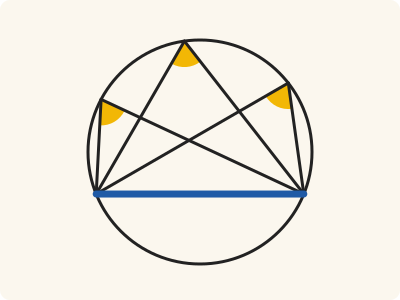
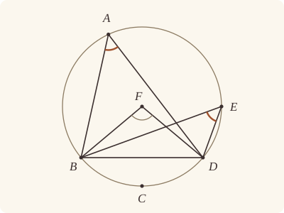

<!-- Generated by scripts/render.py. Do not edit by hand. -->

[Book III](index.md) · [← III.20](20.md) · [III.22 →](22.md)

# Book III, Proposition 21

*Angles in the same segment are equal*

[Euclid's proof](#euclids-proof) · [In Lean](#in-lean) · [What it rests on](#what-it-rests-on) · [Mishnah](#mishnah)

> In a circle the angles in the same segment are equal to one another.

**In Lean:** ✅ proved, as Euclid states it · Euclid's argument, with one step changed

<p align="center"></p>

<p align="center"><em>Slide the corner anywhere along the segment BAED, as from A to E: the angle standing on the blue straight line BD stays the same (yellow).</em></p>

## Euclid's proof

<p align="center"></p>

<p align="center"><em>Drawn for one case: the segment BAED greater than a semicircle, with F on A's and E's side of BD.</em></p>

Let ABCD be a circle, and let the angles BAD, BED be angles in the same segment BAED;

I say that the angles BAD, BED are equal to one another.

For let the centre of the circle ABCD be taken, and let it be F; let BF, FD be joined.

Now, since the angle BFD is at the centre,

and the angle BAD at the circumference,

and they have the same circumference BCD as base,

therefore the angle BFD is double of the angle BAD. [III. 20]

For the same reason

the angle BFD is also double of the angle BED;

therefore the angle BAD is equal to the angle BED.

Therefore etc.

Q. E. D.

## In Lean

| | |
|---|---|
| Proof | ✅ Proved |
| Statement | The whole enunciation. The angles at any two points of one segment are equal, in a segment of any size. |
| Argument | Euclid's, with one step changed. Euclid's argument for a segment greater than a semicircle, where it works; for the semicircle and the less segment, Simson's completion (Heath, vol. 2, pp. 49–50): AF drawn through the centre to C, and Euclid's case twice. |
| Reviewed | The statement and every passage of the argument read against Heath's text, at commit [`e00da4b4`](https://github.com/jackChallis/stoicheia/commit/e00da4b4) ([the record](../../review/III/21.toml)) |

From [`Elements/BookIII/Prop21.lean`](../../Elements/BookIII/Prop21.lean). Euclid's sentences are the `--` comments, and our own notes are in `/- … -/`; the lines under each sentence are the Lean that carries it out. The list below marks where a lemma does a step Euclid takes for granted, where the statement already gives a step and where a step is argued another way; the `/- … -/` notes in the listing explain smaller adjustments.

**How the Lean follows the text**

- **Done by `Tacit.exists_centre`.** "For let the centre of the circle ABCD be taken…" Euclid takes the centre F without a reference from Heath here. The Lean obtains F from `Tacit.exists_centre`, a rule we assume from Definitions I.15 and I.16, not a proved lemma or a rule of System E.
- **Already given.** "let BF, FD be joined." The angle BFD is named by its three points, so joining BF and FD needs no further construction in the Lean.
- **Done by `Magnitude.eq_of_add_self_eq`.** "therefore the angle BAD is equal to the angle BED." Euclid infers that BAD and BED are equal because both are halves of BFD. `Magnitude.eq_of_add_self_eq` proves that equal doubles have equal halves by ruling out either strict inequality.
- **Argued another way.** "Therefore etc." For a segment equal to or less than a semicircle, the Lean uses Simson's completion: produce AF to C by `Tacit.line_circle_beyond` (System E, Intersections 5), a rule we assume, with F within the circle by `Tacit.centre_inside` (System E, Generalities 3), proved in `Elements/Figure/RuleBase.lean`, and put C across BD from A and E: when F is on BD, `Tacit.pasch3` (System E, Pasch 3), also proved there, separates A and C; when F is beyond BD, `OppositeSides.exists_between` finds X on BD between A and F using the assumed rule `Tacit.lines_meet_of_opposite_sides` (System E, Intersection 1) and `Tacit.pasch4` (System E, Pasch 4), also proved there, `between_inner` puts F between X and C by sorting the orders with the assumed rule `Tacit.between_cases` (System E, Between 6), and `Tacit.pasch2` (System E, Pasch 2) puts F and C on the same side of BD, opposite A and E, Pasch 2 being assumed. The Lean then finds the crossings Y of AC and Z of EC with BD by `OppositeSides.exists_between`, puts them within the circle by III.2, for which Heath prints no reference here, and between B and D by `Tacit.between_of_inside_chord`, the rule we assume as System E, Circle 1, so `angle_add_of_between` splits both angles; from the crossings Y and Z, four applications of `SameSideOf.of_cross` use Pasch 2 to put A and E on D's side of BC and on B's side of DC, the same-segment placings Simson reads off his figure; in both positions of F, Pasch 2 also puts F on A's side of BC and DC because F lies between C and A, so the Lean applies Euclid's greater-segment argument, proved above from III.20, to both new chords and adds the equal angles; Heath prints no further reference here.

```lean
/-- In a circle the angles in the same segment are equal to one another. -/
theorem Prop21 {A B D E : Point} {ABCD : Circle}
    (hA : OnCircle A ABCD) (hB : OnCircle B ABCD) (hD : OnCircle D ABCD)
    (hE : OnCircle E ABCD) (hAE : SameSideOf A E B D) :
    ∠ B A D = ∠ B E D := by
  -- Let ABCD be a circle, and let the angles BAD, BED be angles in the same segment BAED;
  -- I say that the angles BAD, BED are equal to one another.
  -- For let the centre of the circle ABCD be taken, and let it be F; let BF, FD be joined.
  obtain ⟨F, hF⟩ := exists_centre ABCD
  have greater : ∀ {A B D E : Point}, OnCircle A ABCD → OnCircle B ABCD → OnCircle D ABCD →
      OnCircle E ABCD → SameSideOf F A B D → SameSideOf A E B D → ∠ B A D = ∠ B E D := by
    intro A B D E hA hB hD hE hFA hAE
    -- Now, since the angle BFD is at the centre,
    -- and the angle BAD at the circumference,
    -- and they have the same circumference BCD as base,
    -- therefore the angle BFD is double of the angle BAD. [III. 20]
    have h₁ : ∠ B F D = ∠ B A D + ∠ B A D := Prop20 hF hA hB hD hFA
    -- For the same reason
    -- the angle BFD is also double of the angle BED;
    have h₂ : ∠ B F D = ∠ B E D + ∠ B E D := Prop20 hF hE hB hD (hFA.trans hAE)
    -- therefore the angle BAD is equal to the angle BED.
    exact Magnitude.eq_of_add_self_eq (h₁.symm.trans h₂)
  -- Therefore etc.
  have hBD : B ≠ D := hAE.1
  obtain ⟨L, hB_L, hD_L⟩ := Postulate1 B D hBD
  have hA_L : ¬ OnLine A L := hAE.triangle.off_line hB_L hD_L
  by_cases hFA : SameSide F A L
  · exact greater hA hB hD hE (SameSideOf.of_line hBD hB_L hD_L hFA) hAE
  /- This is Robert Simson's completion (Heath, vol. 2, pp. 49–50), for a segment equal to
     or less than a semicircle. We produce AF to C on the circle and join CE; the segments
     on BC and CD contain the centre, so Euclid's case applies to each. -/
  have hAF : A ≠ F := ne_of_centre_of_on hF hA
  obtain ⟨N, hA_N, hF_N⟩ := Postulate1 A F hAF
  obtain ⟨C, hC, hC_N, hCFA⟩ := line_circle_beyond (centre_inside hF) hF_N hA_N hAF
  /- C is on the other side of BD from A, whether F is on BD or beyond it. -/
  have hAC_L : OppositeSides A C L := by
    by_cases hF_L : OnLine F L
    · have hC_L : ¬ OnLine C L := fun hC_L =>
        hA_L ((line_unique (ne_of_between hCFA) hC_N hF_N hC_L hF_L) ▸ hA_N)
      exact ⟨hA_L, hC_L, pasch3 (between_symm hCFA) hF_L⟩
    · obtain ⟨X, hX_L, hAXF⟩ := (show OppositeSides A F L from
        ⟨hA_L, hF_L, fun h => hFA (same_side_symm h)⟩).exists_between
      have hXFC : Between X F C := between_inner hAXF (between_symm hCFA)
      have hFC : SameSide F C L := pasch2 hXFC hX_L hF_L
      exact ⟨hA_L, not_on_line_of_same_side (same_side_symm hFC),
        fun h => hFA (same_side_trans (same_side_symm hFC) (same_side_symm h))⟩
  have hEC_L : OppositeSides E C L := by
    have hAE_L : SameSide A E L := hAE.sameSide hB_L hD_L
    exact ⟨not_on_line_of_same_side (same_side_symm hAE_L), hAC_L.2.1,
      fun h => hAC_L.2.2 (same_side_trans (same_side_symm hAE_L) h)⟩
  /- AC and EC cross BD within the circle, and so between B and D. The points of crossing, Y
     and Z, have no letters in Heath. -/
  obtain ⟨Y, hY_L, hAYC⟩ := hAC_L.exists_between
  obtain ⟨Z, hZ_L, hEZC⟩ := hEC_L.exists_between
  have hBYD : Between B Y D :=
    between_of_inside_chord hY_L hB_L hD_L
      (Prop2 hA hC Y hAYC) hB hD hBD
  have hBZD : Between B Z D :=
    between_of_inside_chord hZ_L hB_L hD_L
      (Prop2 hE hC Z hEZC) hB hD hBD
  have hBDA : Triangle B D A := Triangle.of_line hB_L hD_L hBD hA_L
  have hBDE : Triangle B D E := Triangle.of_line hB_L hD_L hBD hEC_L.1
  have hBDC : Triangle B D C := Triangle.of_line hB_L hD_L hBD hAC_L.2.1
  /- AC and EC divide the two angles into the pairs BAC, CAD and BEC, CED. -/
  have hsplitA : ∠ B A D = ∠ B A C + ∠ C A D := by
    rw [angle_add_of_between hBDA hBYD, angle_onRay_right (OnRay.of_between hAYC) hBDA.ne₁₃,
      angle_onRay_left (OnRay.of_between hAYC) hBDA.ne₂₃]
  have hsplitE : ∠ B E D = ∠ B E C + ∠ C E D := by
    rw [angle_add_of_between hBDE hBZD, angle_onRay_right (OnRay.of_between hEZC) hBDE.ne₁₃,
      angle_onRay_left (OnRay.of_between hEZC) hBDE.ne₂₃]
  /- A and E lie on one side of BC, as D does, and on one side of DC, as B does. -/
  have hBC : B ≠ C := hBDC.ne₁₃
  have hDC : D ≠ C := hBDC.ne₂₃
  have hA_BC : SameSideOf D A B C :=
    SameSideOf.of_cross hBYD (between_symm hAYC) hBDC.acb
  have hE_BC : SameSideOf D E B C :=
    SameSideOf.of_cross hBZD (between_symm hEZC) hBDC.acb
  have hA_DC : SameSideOf B A D C :=
    SameSideOf.of_cross (between_symm hBYD) (between_symm hAYC) hBDC.bac.acb
  have hE_DC : SameSideOf B E D C :=
    SameSideOf.of_cross (between_symm hBZD) (between_symm hEZC) hBDC.bac.acb
  /- F, between C and A, lies on A's side of both straight lines. -/
  have hF_side : ∀ {P : Point}, P ≠ C → Triangle P C A → SameSideOf F A P C := by
    intro P hPC hPCA
    obtain ⟨K, hP_K, hC_K⟩ := Postulate1 P C hPC
    have hA_K : ¬ OnLine A K := hPCA.off_line hP_K hC_K
    have hF_K : ¬ OnLine F K := fun hF_K =>
      hA_K ((line_unique (ne_of_between hCFA) hC_N hF_N hC_K hF_K) ▸ hA_N)
    exact SameSideOf.of_line hPC hP_K hC_K (pasch2 hCFA hC_K hF_K)
  /- The two pairs are equal by Euclid's case, and their sums are equal. -/
  have h₁ : ∠ B A C = ∠ B E C :=
    greater hA hB hC hE (hF_side hBC hA_BC.symm.triangle) (hA_BC.symm.trans hE_BC)
  have h₂ : ∠ D A C = ∠ D E C :=
    greater hA hD hC hE (hF_side hDC hA_DC.symm.triangle) (hA_DC.symm.trans hE_DC)
  have hCA : C ≠ A := by
    intro e; subst e; exact hAC_L.2.2 (same_side_refl hA_L)
  have hCE : C ≠ E := by
    intro e; subst e; exact hEC_L.2.2 (same_side_refl hEC_L.1)
  rw [hsplitA, hsplitE, h₁, angle_symm hCA hBDA.ne₂₃, h₂, angle_symm hBDE.ne₂₃ hCE]
  -- Q. E. D.
```

## What it rests on

| | |
|---|---|
| Heath's references | [III.20](20.md) |
| Lean cites | [III.2](02.md), [III.20](20.md) |
| Postulates | 1, 2, 3, 4, 5 |
| Definitions taken as axioms | Def. I.15 |
| Common Notions | 1, 2, 3, 4, 5 |
| Tacit rules | 39 (listed below) |
| Its own Lean calls | Postulate 1; 9 tacit rules |
| Through lemmas | Postulates 2 and 3; Def. I.15; 23 tacit rules |

_Postulates, definitions, Common Notions and tacit rules: all that this proof rests on, counting those of the propositions it cites. The last two rows say which of the postulates, definitions and tacit rules its own Lean calls, in the proof or a helper written for it, and which it does not call but reaches through lemmas, of Book Zero or shared (a proposition it cites may rest on these too); the rest come in only through the propositions it cites or the Common Notions._

<details><summary>The 39 tacit rules beneath this proof, counting those of the propositions it cites</summary>

_(used here) marks a rule this proof's own Lean calls, in the proof or a helper written for it; (through …) marks one its own Lean does not call but reaches through the lemmas named, of [Book Zero](../../Elements/Figure) or shared, though a proposition it cites may rest on it too; and a rule with no mark comes in only through a proposition it cites or a Common Notion. The names in brackets are System E's: an Intersection rule says when straight lines and circles must meet, and an Intersections rule takes a point where they do (see [Book I's introduction](../I/index.md))._

**Reading the figure**

- [`between_cases`](../../Elements/Foundations/Tacit/Diagram.lean#L54) (through [`OppositeSides.exists_between`](../../Elements/Figure/Sides.lean#L119) and [`between_inner`](../../Elements/Figure/Lines.lean#L44)): Of three different points on a straight line, one is between the other two. (Between 6)
- [`between_of_inside_chord`](../../Elements/Foundations/Tacit/Diagram.lean#L81) (used here): A straight line through a point inside a circle has that point between the points where it meets the circle. (Circle 1)
- [`between_symm`](../../Elements/Foundations/Tacit/Diagram.lean#L47) (used here): If B is between A and C, it is between C and A. (Between 1)
- [`circles_meet`](../../Elements/Foundations/Tacit/Diagram.lean#L94) (through [`OnRay.of_between`](../../Elements/Figure/Rays.lean#L34), [`OppositeSides.exists_between`](../../Elements/Figure/Sides.lean#L119), [`SameSideOf.of_cross`](../../Elements/Figure/Parallelograms.lean#L165) and 7 other lemmas): If each circle passes through a point inside the other, the circles cut one another. This is the step Euclid takes for granted in I.1. (Intersection 5)
- [`circles_meet_same_side`](../../Elements/Foundations/Tacit/Constructions.lean#L79) (through [`OnRay.of_between`](../../Elements/Figure/Rays.lean#L34), [`OppositeSides.exists_between`](../../Elements/Figure/Sides.lean#L119), [`SameSideOf.of_cross`](../../Elements/Figure/Parallelograms.lean#L165) and 7 other lemmas): Two circles that cut one another do so on each side of the straight line through their centres. (Intersections 8)
- [`exists_centre`](../../Elements/Foundations/Tacit/Constructions.lean#L57) (used here): Every circle has a centre. A rule of our own, not one of System E's: its content is Euclid's Definitions I.15 and I.16.
- [`exists_point`](../../Elements/Foundations/Tacit/Constructions.lean#L35) (through [`OnRay.of_between`](../../Elements/Figure/Rays.lean#L34), [`SameSideOf.of_cross`](../../Elements/Figure/Parallelograms.lean#L165), [`Triangle.ne₁₃`](../../Elements/Figure/Triangles.lean#L36) and 6 other lemmas): Let a point be taken. (Points 1)
- [`exists_point_inside_circle`](../../Elements/Foundations/Tacit/Constructions.lean#L42) (through [`OnRay.of_between`](../../Elements/Figure/Rays.lean#L34), [`OppositeSides.exists_between`](../../Elements/Figure/Sides.lean#L119), [`SameSideOf.of_cross`](../../Elements/Figure/Parallelograms.lean#L165) and 11 other lemmas): Let a point be taken inside the circle α. (Points 8)
- [`exists_point_on_line`](../../Elements/Foundations/Tacit/Constructions.lean#L38) (through [`OnRay.of_between`](../../Elements/Figure/Rays.lean#L34), [`OppositeSides.exists_between`](../../Elements/Figure/Sides.lean#L119), [`SameSideOf.of_cross`](../../Elements/Figure/Parallelograms.lean#L165) and 7 other lemmas): Let a point be taken on the straight line L. (Points 2)
- [`line_circle_between`](../../Elements/Foundations/Tacit/Constructions.lean#L67) (through [`OnRay.of_between`](../../Elements/Figure/Rays.lean#L34), [`OppositeSides.exists_between`](../../Elements/Figure/Sides.lean#L119), [`SameSideOf.of_cross`](../../Elements/Figure/Parallelograms.lean#L165) and 11 other lemmas): A straight line through a point B inside a circle, heading out to a point C outside it, cuts the circle between B and C. (Intersections 4)
- [`line_circle_beyond`](../../Elements/Foundations/Tacit/Constructions.lean#L73) (used here): A straight line through a point B inside a circle, produced beyond B away from C, cuts the circle there. (Intersections 5)
- [`line_unique`](../../Elements/Foundations/Tacit/Diagram.lean#L41) (used here): Two points determine a straight line. (Generalities 1)
- [`lines_meet_of_opposite_sides`](../../Elements/Foundations/Tacit/Diagram.lean#L89) (through [`OppositeSides.exists_between`](../../Elements/Figure/Sides.lean#L119)): A straight line joining points on opposite sides of L crosses L. (Intersection 1)
- [`not_between_of_between`](../../Elements/Foundations/Tacit/Diagram.lean#L50) (through [`OnRay.of_between`](../../Elements/Figure/Rays.lean#L34), [`OppositeSides.exists_between`](../../Elements/Figure/Sides.lean#L119), [`SameSideOf.of_cross`](../../Elements/Figure/Parallelograms.lean#L165) and 12 other lemmas): If B is between A and C, then A is not between B and C. (Between 1)
- [`not_on_line_of_same_side`](../../Elements/Foundations/Tacit/Diagram.lean#L60) (used here): Points on one side of a straight line are not on it. (Same side 3)
- [`pasch2`](../../Elements/Foundations/Tacit/Diagram.lean#L71) (used here): If B is between A and C, A is on L and B is off it, then B and C are on the same side of L: a straight line that leaves L at A does not cross it again. (Pasch 2)
- [`same_side_trans`](../../Elements/Foundations/Tacit/Diagram.lean#L64) (used here): Two points on the same side of a straight line as a third point are on the same side as each other. (Same side 4)

**Lengths, angles and areas**

- [`angle_add_of_inside`](../../Elements/Foundations/Tacit/Transfer.lean#L47) (through [`Tacit.pasch3`](../../Elements/Figure/RuleBase.lean#L219) and [`angle_add_of_between`](../../Elements/Figure/Angles.lean#L85)): If D lies within the angle BAC, then BAC is made up of BAD and DAC. (Diagram-angle 2)
- [`angle_eq_of_same_rays`](../../Elements/Foundations/Tacit/Transfer.lean#L54) (through [`angle_onRay_left`](../../Elements/Figure/Angles.lean#L42) and [`angle_onRay_right`](../../Elements/Figure/Angles.lean#L49)): The angle doesn't change if its arms are traced through other points on the same rays. (Diagram-angle 4)
- [`angle_symm`](../../Elements/Foundations/Tacit/Metric.lean#L27) (used here): The angle ABC is the angle CBA. (Metric 4)
- [`area_add_of_between`](../../Elements/Foundations/Tacit/Transfer.lean#L70): Cutting a triangle in two from a vertex adds up. (Diagram-area 2)
- [`area_congruent`](../../Elements/Foundations/Tacit/Metric.lean#L41): Triangles equal in all their sides and angles are equal in area. Euclid uses this without comment once he has shown two triangles congruent. (Metric 9)
- [`area_degenerate`](../../Elements/Foundations/Tacit/Metric.lean#L33): A "triangle" with a repeated corner has no area. (Metric 6)
- [`area_eq_zero_of_on_line`](../../Elements/Foundations/Tacit/Transfer.lean#L62): A "triangle" whose corners lie on one straight line has no area. (Diagram-area 1)
- [`area_rotate`](../../Elements/Foundations/Tacit/Metric.lean#L36): The triangle ABC is the triangle CAB. (Metric 8)
- [`circle_eq`](../../Elements/Foundations/Tacit/Transfer.lean#L30) (through [`OnRay.of_between`](../../Elements/Figure/Rays.lean#L34), [`OppositeSides.exists_between`](../../Elements/Figure/Sides.lean#L119), [`SameSideOf.of_cross`](../../Elements/Figure/Parallelograms.lean#L165) and 11 other lemmas): A circle is fixed by its centre and its radius. (Diagram-segment 2)
- [`len_add_of_between`](../../Elements/Foundations/Tacit/Transfer.lean#L27) (through [`OnRay.of_between`](../../Elements/Figure/Rays.lean#L34), [`OppositeSides.exists_between`](../../Elements/Figure/Sides.lean#L119), [`SameSideOf.of_cross`](../../Elements/Figure/Parallelograms.lean#L165) and 11 other lemmas): If B is between A and C, then AB and BC together make up AC. (Diagram-segment 1)
- [`len_self`](../../Elements/Foundations/Tacit/Metric.lean#L21) (through [`OnRay.of_between`](../../Elements/Figure/Rays.lean#L34), [`OppositeSides.exists_between`](../../Elements/Figure/Sides.lean#L119), [`SameSideOf.of_cross`](../../Elements/Figure/Parallelograms.lean#L165) and 11 other lemmas): The "straight line" from a point to itself has no length. (Metric 1)
- [`len_symm`](../../Elements/Foundations/Tacit/Metric.lean#L24) (through [`OnRay.of_between`](../../Elements/Figure/Rays.lean#L34), [`OppositeSides.exists_between`](../../Elements/Figure/Sides.lean#L119), [`SameSideOf.of_cross`](../../Elements/Figure/Parallelograms.lean#L165) and 11 other lemmas): The straight line AB is the straight line BA. (Metric 3)
- [`same_ray_of_angle_eq_zero`](../../Elements/Foundations/Tacit/Transfer.lean#L42) (through [`Tacit.pasch3`](../../Elements/Figure/RuleBase.lean#L219)): If the angle BAC is nothing, C lies on the ray from A through B. (Diagram-angle 1)

**Superposition**

- [`superposition`](../../Elements/Foundations/Tacit/Superposition.lean#L52): **Superposition.** A hypothetical placement of a triangle on a given ray and side permits a restricted derivation of metric equalities about the figure already given. The derivation introduces no further objects, cites each geometric law it uses, and exports no symbol of the placement.

**Laws of magnitude**

- [`add_assoc`](../../Elements/Foundations/Tacit/Magnitudes.lean#L23) (through [`between_inner`](../../Elements/Figure/Lines.lean#L44)): Adding three magnitudes in a row, it makes no difference whether the first two or the last two are added first. (System E §3.5)
- [`add_comm`](../../Elements/Foundations/Tacit/Magnitudes.lean#L26) (through [`Magnitude.eq_of_add_self_eq`](../../Elements/Figure/Areas.lean#L55), [`OnRay.of_between`](../../Elements/Figure/Rays.lean#L34), [`OppositeSides.exists_between`](../../Elements/Figure/Sides.lean#L119) and 12 other lemmas): The order of adding does not matter. (System E §3.5)
- [`add_lt_add_right`](../../Elements/Foundations/Tacit/Magnitudes.lean#L45) (through [`Magnitude.eq_of_add_self_eq`](../../Elements/Figure/Areas.lean#L55) and [`between_inner`](../../Elements/Figure/Lines.lean#L44)): Adding the same thing to both sides keeps "less than". (System E §3.5)
- [`add_zero`](../../Elements/Foundations/Tacit/Magnitudes.lean#L29): Adding nothing changes nothing. (System E §3.5)
- [`lt_irrefl`](../../Elements/Foundations/Tacit/Magnitudes.lean#L32) (through [`Magnitude.eq_of_add_self_eq`](../../Elements/Figure/Areas.lean#L55), [`OnRay.of_between`](../../Elements/Figure/Rays.lean#L34), [`OppositeSides.exists_between`](../../Elements/Figure/Sides.lean#L119) and 12 other lemmas): No magnitude is less than itself. (System E §3.5)
- [`lt_trans`](../../Elements/Foundations/Tacit/Magnitudes.lean#L35) (through [`Magnitude.eq_of_add_self_eq`](../../Elements/Figure/Areas.lean#L55), [`OnRay.of_between`](../../Elements/Figure/Rays.lean#L34), [`OppositeSides.exists_between`](../../Elements/Figure/Sides.lean#L119) and 12 other lemmas): What is less than the less is less still. (System E §3.5)
- [`lt_trichotomy`](../../Elements/Foundations/Tacit/Magnitudes.lean#L39) (through [`Magnitude.eq_of_add_self_eq`](../../Elements/Figure/Areas.lean#L55), [`OnRay.of_between`](../../Elements/Figure/Rays.lean#L34), [`OppositeSides.exists_between`](../../Elements/Figure/Sides.lean#L119) and 12 other lemmas): Of two magnitudes, one is less, or they are equal, or the other is less. (System E §3.5)
- [`not_lt_zero`](../../Elements/Foundations/Tacit/Magnitudes.lean#L42) (through [`OnRay.of_between`](../../Elements/Figure/Rays.lean#L34), [`OppositeSides.exists_between`](../../Elements/Figure/Sides.lean#L119), [`SameSideOf.of_cross`](../../Elements/Figure/Parallelograms.lean#L165) and 11 other lemmas): Nothing is less than zero. (System E §3.5)

</details>

## Mishnah

_Our commentary: what Euclid assumes, what Lean made us say out loud, and how the result looks by modern means._

**Wherever the point is taken.** By III.20 the angle BFD at the centre is double of the angle BAD, and double of BED as well, so BAD and BED are equal, halves of one angle, by the little argument met under I.37. So the angle in a segment is the same wherever its point is taken, and that is what lets Definition III.11 call segments similar by their angles.

**Must the segment contain the centre?** Heath answers that Euclid's proof needs it: "Under the restriction that the 'angle at the centre' used in III. 20 must be less than two right angles, Euclid's proof of this proposition only applies to the case of a segment greater than a semicircle, and the case of a segment equal to or less than a semicircle has to be considered separately. The simplest proof, of many, seems to be that of Simson" (vol. 2, p. 49).

**Robert Simson makes two greater segments.** Draw AF through the centre to C, and join CE. Heath gives Simson's next step: "Therefore the segment BADC is greater than a semicircle, and the angles in it BAC, BEC are equal, by the first case" (vol. 2, p. 50). In the same way CAD is equal to CED, and the two pairs make up BAD and BED. This C is Simson's, the end of a diameter; in Euclid's figure C only names the circle. We keep Euclid's proof where it works and give Simson's for the rest.

**The crossings must fall between B and D.** Simson takes for granted that AC and EC divide the angles BAD and BED, and we prove it. Each crosses BD at a point within the circle, so between B and D (`between_of_inside_chord`), and the angles split into the pairs he compares. So our III.21 holds in every segment, a semicircle too.

**The modern way.** In complex numbers the angle BAD is the size of the argument of (D − A)/(B − A). So III.21 says that for A and E on one circle through B and D, on one side of BD, the cross-ratio ((D − A)/(B − A)) / ((D − E)/(B − E)) is a positive real number; four points lie on one circle or one straight line exactly when it is real.

## Further reading

- Julian Lowell Coolidge's preface to [*A Treatise on the Circle and the Sphere*](https://archive.org/details/cu31924001508955) (1916, free online), p. 3, explains why Postulate 5 lies under every fact about circumferences: had Euclid taken Lobachevsky's or Riemann's assumption instead, "he would have been unable to prove that all angles inscribed in the same circular arc are equal". This great old treatise is wholly about the circle and the sphere, scholarly but rewarding to dip into.
- For the cross-ratio of the modern way, real when four points lie on one circle, Dan Pedoe's [*Circles: A Mathematical View*](https://doi.org/10.1090/spec/012) (1995), ch. III, §5, "The cross-ratio of four complex numbers" (pp. 47–49), a small, concise book given wholly to the circle, gentle in its opening Chapter 0 and more demanding later.
- The second case is "wanting in the Greek", says Robert Simson's note on III.21 (p. 366), which draws a simpler proof from the first: [*The Elements of Euclid*](https://archive.org/details/bim_eighteenth-century_elements-english-sele_euclid_1756_0) (1756, free online) (also on [III.1](01.md)).

[Book III](index.md) · [← III.20](20.md) · [III.22 →](22.md)

---

<sub>Euclid's text: T. L. Heath, *The Thirteen Books of Euclid's Elements*, vol. 2 (Cambridge, 1908), p. 49; [scan leaf n61](https://archive.org/details/thirteenbookseu00heibgoog/page/n61); [figure on n61](https://archive.org/details/thirteenbookseu00heibgoog/page/n61). Public domain.</sub>

<sub>The tacit rules follow the System E of Jeremy Avigad, Edward Dean and John Mumma, read alongside LeanEuclid (Logan Murphy, Kaiyu Yang, Jialiang Sun, Zhaoyu Li, Anima Anandkumar and Xujie Si).</sub>
