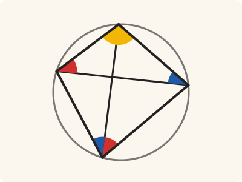
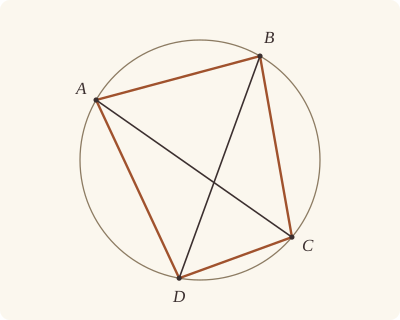

<!-- Generated by scripts/render.py. Do not edit by hand. -->

[Book III](index.md) · [← III.21](21.md) · [III.23 →](23.md)

# Book III, Proposition 22

*Opposite angles of quadrilaterals in circles equal two right angles*

[Euclid's proof](#euclids-proof) · [In Lean](#in-lean) · [What it rests on](#what-it-rests-on) · [Mishnah](#mishnah)

> The opposite angles of quadrilaterals in circles are equal to two right angles.

**In Lean:** ✅ proved, as Euclid states it · Euclid's argument

<p align="center"></p>

<p align="center"><em>Split the angle ADC (red, blue): its parts equal the angles CAB and ACB of the triangle ABC, standing on the same circumferences. With the angle ABC (yellow) they make the triangle's three, so opposite angles make two right angles.</em></p>

## Euclid's proof

<p align="center"></p>

Let ABCD be a circle, and let ABCD be a quadrilateral in it;

I say that the opposite angles are equal to two right angles.

Let AC, BD be joined.

Then, since in any triangle the three angles are equal to two right angles, [I. 32]

the three angles CAB, ABC, BCA of the triangle ABC are equal to two right angles.

But the angle CAB is equal to the angle BDC, for they are in the same segment BADC; [III. 21]

and the angle ACB is equal to the angle ADB, for they are in the same segment ADCB;

therefore the whole angle ADC is equal to the angles BAC, ACB.

Let the angle ABC be added to each;

therefore the angles ABC, BAC, ACB are equal to the angles ABC, ADC.

But the angles ABC, BAC, ACB are equal to two right angles;

therefore the angles ABC, ADC are also equal to two right angles.

Similarly we can prove that the angles BAD, DCB are also equal to two right angles.

Therefore etc.

Q. E. D.

## In Lean

| | |
|---|---|
| Proof | ✅ Proved |
| Statement | The whole enunciation. Both pairs of opposite angles of ABCD make two right angles. |
| Argument | Euclid's. |
| Reviewed | The statement and every passage of the argument read against Heath's text, at commit [`689ab169f`](https://github.com/jackChallis/stoicheia/commit/689ab169f) ([the record](../../review/III/22.toml)) |

From [`Elements/BookIII/Prop22.lean`](../../Elements/BookIII/Prop22.lean). Euclid's sentences are the `--` comments, and our own notes are in `/- … -/`; the lines under each sentence are the Lean that carries it out. The list below marks where a lemma does a step Euclid takes for granted and where several sentences share one step; the `/- … -/` notes in the listing explain smaller adjustments.

**How the Lean follows the text**

- **Done by `OppositeSides.exists_between`.** "Let AC, BD be joined." Euclid joins the diagonals and reads their crossing from the figure; `OppositeSides.exists_between` finds X between A and C on BD. The Lean puts X within the circle by III.2, for which Heath prints no reference here, then between B and D by `Tacit.between_of_inside_chord`, System E's Circle 1, which is also proved from III.2.
- **Done by `angle_add_of_between`.** "therefore the whole angle ADC is equal to the angles BAC, ACB." Euclid reads DB within the angle ADC and adds its two parts. `angle_add_of_between` uses the crossing X found beneath the joining sentence to split ADC at DX, and the ray from D through X is DB.
- **Carried together.** "Similarly we can prove that the angles BAD, DCB…" Euclid leaves the other pair of opposite angles to the same argument without writing it out. The Lean proves it once over any letters and applies it to ABCD and BCDA, using `Prop2.triangle` to supply the triangles in each application.

```lean
/-- The opposite angles of quadrilaterals in circles are equal to two right angles. -/
theorem Prop22 {A B C D : Point} {ABCD : Circle}
    (hA : OnCircle A ABCD) (hB : OnCircle B ABCD) (hC : OnCircle C ABCD)
    (hD : OnCircle D ABCD) (hAC : OppositeSidesOf A C B D) :
    ∠ A B C + ∠ A D C = ∟ + ∟ ∧ ∠ B A D + ∠ D C B = ∟ + ∟ := by
  -- Let ABCD be a circle, and let ABCD be a quadrilateral in it;
  have hBDA : Triangle B D A := hAC.triangle
  have hBDC : Triangle B D C := hAC.symm.triangle
  -- I say that the opposite angles are equal to two right angles.
  -- Let AC, BD be joined.
  /- BD separates A from C, so AC crosses the straight line BD at a point X. X is within
     the circle (III.2), so it lies between B and D (System E, Circle 1), as in III.21:
     AC and BD cut one another. -/
  have hBD : B ≠ D := hAC.1
  obtain ⟨L, hB_L, hD_L⟩ := Postulate1 B D hBD
  obtain ⟨X, hX_L, hAXC⟩ := (hAC.2 L hB_L hD_L).exists_between
  have hBXD : Between B X D := between_of_inside_chord hX_L hB_L hD_L
    (Prop2 hA hC X hAXC) hB hD hBD
  have hAC' : A ≠ C := ne_of_between_ends hAXC
  /- Euclid proves it for the angles at B and D and says "similarly" for those at A and C,
     so we write his argument once, for any quadrilateral in the circle whose straight lines
     AC, BD cut one another, and use it twice. -/
  have half : ∀ {A B C D X : Point}, OnCircle A ABCD → OnCircle B ABCD → OnCircle C ABCD →
      OnCircle D ABCD → Between A X C → Between B X D → Triangle A B C → Triangle B C D →
      Triangle A C D → ∠ A B C + ∠ A D C = ∟ + ∟ := by
    intro A B C D X hA hB hC hD hAXC hBXD hABC hBCD hACD
    -- Then, since in any triangle the three angles are equal to two right angles, [I. 32]
    -- the three angles CAB, ABC, BCA of the triangle ABC are equal to two right angles.
    obtain ⟨E, hBCE⟩ := produce hABC.ne₂₃
    have h32 : ∠ A B C + ∠ B C A + ∠ C A B = ∟ + ∟ := (BookI.Prop32 hABC hBCE).2
    -- But the angle CAB is equal to the angle BDC, for they are in the same segment
    -- BADC; [III. 21]
    have h₁ : ∠ C A B = ∠ B D C := by
      rw [angle_symm hABC.ne₁₃.symm hABC.ne₁₂.symm]
      exact Prop21 hA hB hC hD (SameSideOf.of_cross hBXD (between_symm hAXC) hBCD).symm
    -- and the angle ACB is equal to the angle ADB, for they are in the same segment ADCB;
    have h₂ : ∠ A C B = ∠ A D B := Prop21 hC hA hB hD (SameSideOf.of_cross hAXC hBXD hABC)
    -- therefore the whole angle ADC is equal to the angles BAC, ACB.
    have hX : OnRay X D B := OnRay.of_between (between_symm hBXD)
    have h₃ : ∠ A D C = ∠ B A C + ∠ A C B := by
      rw [angle_add_of_between hACD hAXC, angle_onRay_right hX hACD.ne₁₃,
        angle_onRay_left hX hACD.ne₂₃, ← h₁, ← h₂, angle_symm hABC.ne₁₃.symm hABC.ne₁₂.symm]
      ac_rfl
    -- Let the angle ABC be added to each;
    -- therefore the angles ABC, BAC, ACB are equal to the angles ABC, ADC.
    have h₄ : ∠ A B C + ∠ B A C + ∠ A C B = ∠ A B C + ∠ A D C := by
      rw [h₃]; ac_rfl
    -- But the angles ABC, BAC, ACB are equal to two right angles;
    have h₅ : ∠ A B C + ∠ B A C + ∠ A C B = ∟ + ∟ := by
      rw [← h32, angle_symm hABC.ne₁₃.symm hABC.ne₁₂.symm,
        angle_symm hABC.ne₂₃ hABC.ne₁₃]
      ac_rfl
    -- therefore the angles ABC, ADC are also equal to two right angles.
    exact h₄ ▸ h₅
  /- The argument serves first in Euclid's own figure, for the angles ABC, ADC. Three
     points of the circle make a triangle (`Prop2.triangle`). -/
  have hB_D : ∠ A B C + ∠ A D C = ∟ + ∟ := half hA hB hC hD hAXC hBXD
    (Prop2.triangle hA hB hC hBDA.ne₁₃.symm hBDC.ne₁₃ hAC')
    (Prop2.triangle hB hC hD hBDC.ne₁₃ hBDC.ne₂₃.symm hBD)
    (Prop2.triangle hA hC hD hAC' hBDC.ne₂₃.symm hBDA.ne₂₃.symm)
  -- Similarly we can prove that the angles BAD, DCB are also equal to two right angles.
  /- The same argument serves in the quadrilateral BCDA, whose straight lines BD, CA cut
     one another at the same point, for its angles BCD, BAD. -/
  have hA_C : ∠ B A D + ∠ D C B = ∟ + ∟ := by
    rw [add_comm, angle_symm hBDC.ne₂₃ hBDC.ne₁₃]
    exact half hB hC hD hA hBXD (between_symm hAXC)
      (Prop2.triangle hB hC hD hBDC.ne₁₃ hBDC.ne₂₃.symm hBD)
      (Prop2.triangle hC hD hA hBDC.ne₂₃.symm hBDA.ne₂₃ hAC'.symm)
      (Prop2.triangle hB hD hA hBD hBDA.ne₂₃ hBDA.ne₁₃)
  -- Therefore etc.
  exact ⟨hB_D, hA_C⟩
  -- Q. E. D.
```

## What it rests on

| | |
|---|---|
| Heath's references | [I.32](../I/32.md), [III.21](21.md) |
| Lean cites | [I.32](../I/32.md), [III.2](02.md), [III.21](21.md) |
| Postulates | 1, 2, 3, 4, 5 |
| Definitions taken as axioms | Def. I.15 |
| Common Notions | 1, 2, 3, 4, 5 |
| Tacit rules | 38 (listed below) |
| Its own Lean calls | Postulate 1; 3 tacit rules |
| Through lemmas | Postulates 2 and 3; Def. I.15; 26 tacit rules |

Some of these come in through lemmas [shared](../../CERTIFICATE.md#shared-steps) by many proofs: [`Prop2.triangle`](../../Elements/BookIII/Prop02.lean#L139), [`Tacit.between_of_inside_chord`](../../Elements/BookIII/Prop02.lean#L194) (III.2).

_Postulates, definitions, Common Notions and tacit rules: all that this proof rests on, counting those of the propositions it cites. The last two rows say which of the postulates, definitions and tacit rules its own Lean calls, in the proof or a helper written for it, and which it does not call but reaches through lemmas, of Book Zero or shared (a proposition it cites may rest on these too); the rest come in only through the propositions it cites or the Common Notions._

<details><summary>The 38 tacit rules beneath this proof, counting those of the propositions it cites</summary>

_(used here) marks a rule this proof's own Lean calls, in the proof or a helper written for it; (through …) marks one its own Lean does not call but reaches through the lemmas named, of [Book Zero](../../Elements/Figure) or shared, though a proposition it cites may rest on it too; and a rule with no mark comes in only through a proposition it cites or a Common Notion. The names in brackets are System E's: an Intersection rule says when straight lines and circles must meet, and an Intersections rule takes a point where they do (see [Book I's introduction](../I/index.md))._

**Reading the figure**

- [`between_cases`](../../Elements/Foundations/Tacit/Diagram.lean#L54) (through [`OppositeSides.exists_between`](../../Elements/Figure/Sides.lean#L119), [`Prop2.triangle`](../../Elements/BookIII/Prop02.lean#L139) and [`Tacit.between_of_inside_chord`](../../Elements/BookIII/Prop02.lean#L194)): Of three different points on a straight line, one is between the other two. (Between 6)
- [`between_symm`](../../Elements/Foundations/Tacit/Diagram.lean#L47) (used here): If B is between A and C, it is between C and A. (Between 1)
- [`circles_meet`](../../Elements/Foundations/Tacit/Diagram.lean#L91) (through [`OnRay.of_between`](../../Elements/Figure/Rays.lean#L34), [`OppositeSides.exists_between`](../../Elements/Figure/Sides.lean#L119), [`OppositeSidesOf.symm`](../../Elements/Figure/Sides.lean#L87) and 4 other lemmas): If each circle passes through a point inside the other, the circles cut one another. This is the step Euclid takes for granted in I.1. (Intersection 5)
- [`circles_meet_same_side`](../../Elements/Foundations/Tacit/Constructions.lean#L79) (through [`OnRay.of_between`](../../Elements/Figure/Rays.lean#L34), [`OppositeSides.exists_between`](../../Elements/Figure/Sides.lean#L119), [`OppositeSidesOf.symm`](../../Elements/Figure/Sides.lean#L87) and 4 other lemmas): Two circles that cut one another do so on each side of the straight line through their centres. (Intersections 8)
- [`exists_centre`](../../Elements/Foundations/Tacit/Constructions.lean#L57) (through [`Prop2.triangle`](../../Elements/BookIII/Prop02.lean#L139) and [`Tacit.between_of_inside_chord`](../../Elements/BookIII/Prop02.lean#L194)): Every circle has a centre. A rule of our own, not one of System E's: its content is Euclid's Definitions I.15 and I.16.
- [`exists_point`](../../Elements/Foundations/Tacit/Constructions.lean#L35) (through [`SameSideOf.of_cross`](../../Elements/Figure/Parallelograms.lean#L165), [`Triangle.ne₁₂`](../../Elements/Figure/Triangles.lean#L22), [`Triangle.ne₁₃`](../../Elements/Figure/Triangles.lean#L36) and 1 other lemma): Let a point be taken. (Points 1)
- [`exists_point_inside_circle`](../../Elements/Foundations/Tacit/Constructions.lean#L42) (through [`OnRay.of_between`](../../Elements/Figure/Rays.lean#L34), [`OppositeSides.exists_between`](../../Elements/Figure/Sides.lean#L119), [`OppositeSidesOf.symm`](../../Elements/Figure/Sides.lean#L87) and 4 other lemmas): Let a point be taken inside the circle α. (Points 8)
- [`exists_point_on_line`](../../Elements/Foundations/Tacit/Constructions.lean#L38) (through [`OnRay.of_between`](../../Elements/Figure/Rays.lean#L34), [`OppositeSides.exists_between`](../../Elements/Figure/Sides.lean#L119), [`OppositeSidesOf.symm`](../../Elements/Figure/Sides.lean#L87) and 4 other lemmas): Let a point be taken on the straight line L. (Points 2)
- [`line_circle_between`](../../Elements/Foundations/Tacit/Constructions.lean#L67) (through [`OnRay.of_between`](../../Elements/Figure/Rays.lean#L34), [`OppositeSides.exists_between`](../../Elements/Figure/Sides.lean#L119), [`OppositeSidesOf.symm`](../../Elements/Figure/Sides.lean#L87) and 4 other lemmas): A straight line through a point B inside a circle, heading out to a point C outside it, cuts the circle between B and C. (Intersections 4)
- [`line_circle_beyond`](../../Elements/Foundations/Tacit/Constructions.lean#L73) (through [`OnRay.of_between`](../../Elements/Figure/Rays.lean#L34), [`OppositeSides.exists_between`](../../Elements/Figure/Sides.lean#L119), [`OppositeSidesOf.symm`](../../Elements/Figure/Sides.lean#L87) and 5 other lemmas): A straight line through a point B inside a circle, produced beyond B away from C, cuts the circle there. (Intersections 5)
- [`line_unique`](../../Elements/Foundations/Tacit/Diagram.lean#L41) (through [`OppositeSides.exists_between`](../../Elements/Figure/Sides.lean#L119), [`SameSideOf.of_cross`](../../Elements/Figure/Parallelograms.lean#L165) and [`angle_add_of_between`](../../Elements/Figure/Angles.lean#L85)): Two points determine a straight line. (Generalities 1)
- [`lines_meet_of_opposite_sides`](../../Elements/Foundations/Tacit/Diagram.lean#L86) (through [`OppositeSides.exists_between`](../../Elements/Figure/Sides.lean#L119)): A straight line joining points on opposite sides of L crosses L. (Intersection 1)
- [`not_between_of_between`](../../Elements/Foundations/Tacit/Diagram.lean#L50) (through [`OnRay.of_between`](../../Elements/Figure/Rays.lean#L34), [`OppositeSides.exists_between`](../../Elements/Figure/Sides.lean#L119), [`OppositeSidesOf.symm`](../../Elements/Figure/Sides.lean#L87) and 8 other lemmas): If B is between A and C, then A is not between B and C. (Between 1)
- [`not_on_line_of_same_side`](../../Elements/Foundations/Tacit/Diagram.lean#L60) (through [`OnRay.of_between`](../../Elements/Figure/Rays.lean#L34), [`OppositeSides.exists_between`](../../Elements/Figure/Sides.lean#L119), [`OppositeSidesOf.symm`](../../Elements/Figure/Sides.lean#L87) and 4 other lemmas): Points on one side of a straight line are not on it. (Same side 3)
- [`pasch2`](../../Elements/Foundations/Tacit/Diagram.lean#L71) (through [`OnRay.of_between`](../../Elements/Figure/Rays.lean#L34), [`OppositeSides.exists_between`](../../Elements/Figure/Sides.lean#L119), [`SameSideOf.of_cross`](../../Elements/Figure/Parallelograms.lean#L165) and 2 other lemmas): If B is between A and C, A is on L and B is off it, then B and C are on the same side of L: a straight line that leaves L at A does not cross it again. (Pasch 2)
- [`same_side_trans`](../../Elements/Foundations/Tacit/Diagram.lean#L64) (through [`OnRay.of_between`](../../Elements/Figure/Rays.lean#L34), [`OppositeSides.exists_between`](../../Elements/Figure/Sides.lean#L119), [`OppositeSidesOf.symm`](../../Elements/Figure/Sides.lean#L87) and 4 other lemmas): Two points on the same side of a straight line as a third point are on the same side as each other. (Same side 4)

**Lengths, angles and areas**

- [`angle_add_of_inside`](../../Elements/Foundations/Tacit/Transfer.lean#L47) (through [`angle_add_of_between`](../../Elements/Figure/Angles.lean#L85)): If D lies within the angle BAC, then BAC is made up of BAD and DAC. (Diagram-angle 2)
- [`angle_eq_of_same_rays`](../../Elements/Foundations/Tacit/Transfer.lean#L54) (through [`angle_onRay_left`](../../Elements/Figure/Angles.lean#L42) and [`angle_onRay_right`](../../Elements/Figure/Angles.lean#L49)): The angle doesn't change if its arms are traced through other points on the same rays. (Diagram-angle 4)
- [`angle_symm`](../../Elements/Foundations/Tacit/Metric.lean#L30) (used here): The angle ABC is the angle CBA. (Metric 4)
- [`area_add_of_between`](../../Elements/Foundations/Tacit/Transfer.lean#L70): Cutting a triangle in two from a vertex adds up. (Diagram-area 2)
- [`area_congruent`](../../Elements/Foundations/Tacit/Metric.lean#L44): Triangles equal in all their sides and angles are equal in area. Euclid uses this without comment once he has shown two triangles congruent. (Metric 9)
- [`area_degenerate`](../../Elements/Foundations/Tacit/Metric.lean#L36): A "triangle" with a repeated corner has no area. (Metric 6)
- [`area_eq_zero_of_on_line`](../../Elements/Foundations/Tacit/Transfer.lean#L62): A "triangle" whose corners lie on one straight line has no area. (Diagram-area 1)
- [`area_rotate`](../../Elements/Foundations/Tacit/Metric.lean#L39): The triangle ABC is the triangle CAB. (Metric 8)
- [`len_add_of_between`](../../Elements/Foundations/Tacit/Transfer.lean#L27) (through [`OnRay.of_between`](../../Elements/Figure/Rays.lean#L34), [`OppositeSides.exists_between`](../../Elements/Figure/Sides.lean#L119), [`OppositeSidesOf.symm`](../../Elements/Figure/Sides.lean#L87) and 8 other lemmas): If B is between A and C, then AB and BC together make up AC. (Diagram-segment 1)
- [`len_self`](../../Elements/Foundations/Tacit/Metric.lean#L24) (through [`OnRay.of_between`](../../Elements/Figure/Rays.lean#L34), [`OppositeSides.exists_between`](../../Elements/Figure/Sides.lean#L119), [`OppositeSidesOf.symm`](../../Elements/Figure/Sides.lean#L87) and 8 other lemmas): The "straight line" from a point to itself has no length. (Metric 1)
- [`len_symm`](../../Elements/Foundations/Tacit/Metric.lean#L27) (through [`OnRay.of_between`](../../Elements/Figure/Rays.lean#L34), [`OppositeSides.exists_between`](../../Elements/Figure/Sides.lean#L119), [`OppositeSidesOf.symm`](../../Elements/Figure/Sides.lean#L87) and 4 other lemmas): The straight line AB is the straight line BA. (Metric 3)
- [`radius_ne_zero`](../../Elements/Foundations/Tacit/Metric.lean#L62) (through [`OnRay.of_between`](../../Elements/Figure/Rays.lean#L34), [`OppositeSides.exists_between`](../../Elements/Figure/Sides.lean#L119), [`OppositeSidesOf.symm`](../../Elements/Figure/Sides.lean#L87) and 8 other lemmas): A circle's radius is not nothing: the straight line from the centre to a point on the circle has some length. A rule of our own, not one of System E's: every circle is drawn with a centre and a distance (Postulate 3).
- [`same_ray_of_angle_eq_zero`](../../Elements/Foundations/Tacit/Transfer.lean#L42): If the angle BAC is nothing, C lies on the ray from A through B. (Diagram-angle 1)

**Superposition**

- [`superposition`](../../Elements/Foundations/Tacit/Superposition.lean#L52): **Superposition.** A hypothetical placement of a triangle on a given ray and side permits a restricted derivation of metric equalities about the figure already given. The derivation introduces no further objects, cites each geometric law it uses, and exports no symbol of the placement.

**Rules of magnitude**

- [`add_assoc`](../../Elements/Foundations/Tacit/Magnitudes.lean#L23) (through [`Magnitude.instAssociative`](../../Elements/Figure/Areas.lean#L36) and [`Tacit.between_of_inside_chord`](../../Elements/BookIII/Prop02.lean#L194)): Adding three magnitudes in a row, it makes no difference whether the first two or the last two are added first. (System E §3.5)
- [`add_comm`](../../Elements/Foundations/Tacit/Magnitudes.lean#L26) (used here): The order of adding does not matter. (System E §3.5)
- [`add_lt_add_right`](../../Elements/Foundations/Tacit/Magnitudes.lean#L45): Adding the same thing to both sides keeps "less than". (System E §3.5)
- [`add_zero`](../../Elements/Foundations/Tacit/Magnitudes.lean#L29): Adding nothing changes nothing. (System E §3.5)
- [`lt_irrefl`](../../Elements/Foundations/Tacit/Magnitudes.lean#L32) (through [`OnRay.of_between`](../../Elements/Figure/Rays.lean#L34), [`OppositeSides.exists_between`](../../Elements/Figure/Sides.lean#L119), [`OppositeSidesOf.symm`](../../Elements/Figure/Sides.lean#L87) and 5 other lemmas): No magnitude is less than itself. (System E §3.5)
- [`lt_trans`](../../Elements/Foundations/Tacit/Magnitudes.lean#L35) (through [`OnRay.of_between`](../../Elements/Figure/Rays.lean#L34), [`OppositeSides.exists_between`](../../Elements/Figure/Sides.lean#L119), [`OppositeSidesOf.symm`](../../Elements/Figure/Sides.lean#L87) and 4 other lemmas): What is less than the less is less still. (System E §3.5)
- [`lt_trichotomy`](../../Elements/Foundations/Tacit/Magnitudes.lean#L39) (through [`OnRay.of_between`](../../Elements/Figure/Rays.lean#L34), [`OppositeSides.exists_between`](../../Elements/Figure/Sides.lean#L119), [`OppositeSidesOf.symm`](../../Elements/Figure/Sides.lean#L87) and 8 other lemmas): Of two magnitudes, one is less, or they are equal, or the other is less. (System E §3.5)
- [`not_lt_zero`](../../Elements/Foundations/Tacit/Magnitudes.lean#L42) (through [`OnRay.of_between`](../../Elements/Figure/Rays.lean#L34), [`OppositeSides.exists_between`](../../Elements/Figure/Sides.lean#L119), [`OppositeSidesOf.symm`](../../Elements/Figure/Sides.lean#L87) and 8 other lemmas): Nothing is less than zero. (System E §3.5)

</details>

## Mishnah

_Our commentary: why Euclid's proof, and ours, look as they do._

**"Equal to two right angles."** Euclid takes the three angles of the triangle ABC, which make two right angles (I.32), and moves two of them to D. CAB is equal to BDC, and ACB to ADB, each pair in one segment (III.21), so the angle ADC is BAC and ACB together. Add ABC to each, and the opposite angles at B and D make two right angles. One of those segments may be less than a semicircle, which is why III.21 must hold in every segment, Robert Simson's case of the less segment included.

**Can the angles give us the circle?** Heath takes up the converse after Isaac Todhunter: "As Todhunter remarks, the converse of this proposition is true and very important: *if two opposite angles of a quadrilateral be together equal to two right angles, a circle may be circumscribed about the quadrilateral*" (vol. 2, p. 52). Heath would circumscribe a circle about the triangle ABC, by the method of III.9 or by IV.5, and prove by *reductio ad absurdum* that it passes through D. So the angles alone tell when four points lie on one circle.

We fix the order of the four corners by putting A and C on opposite sides of BD. As in III.21, we prove that AC and BD cut one another, putting DB within the angle ADC so that its two parts add up.

**The modern way.** In a quadrilateral ABCD in a circle, the angles at B and D stand on the two arcs into which A and C cut the circle, together 2π, and each is half its arc, so ∠ABC + ∠ADC = π; conversely, a convex quadrilateral whose opposite angles add to π has a circle through its corners. The first half is Heron's proof, which Heath gives under III.20, not Euclid's.

## Further reading

- Isaac Todhunter's notes on III.20 and III.22 (pp. 275–277) give the converse Heath takes from him, "true and very important", and III.22 as an immediate consequence of the angles at the centre making four right angles: [*The Elements of Euclid*](https://archive.org/details/todhuntereuclid00todhrich) (1872, free online) (also on [III.3](03.md)).
- For both halves of the modern way, opposite angles making two right angles and the converse that puts four points on one circle, Dan Pedoe's [*Circles: A Mathematical View*](https://doi.org/10.1090/spec/012) (1995), Chapter 0, new in this edition, which retells Book III's circle theorems with only paper, pencil, compass and ruler.
- Ptolemy's theorem carries the quadrilateral in a circle further. Its proof in the *Almagest* uses III.21 twice; Ivor Thomas gives it in Greek and English, with patient notes, in [*Selections Illustrating the History of Greek Mathematics*, vol. II](https://www.hup.harvard.edu/books/9780674993990) (1941), ch. XXI, "Trigonometry", 2 (b) (iv), "Ptolemy's theorem" (pp. 422–425).

[Book III](index.md) · [← III.21](21.md) · [III.23 →](23.md)

---

<sub>Euclid's text: T. L. Heath, *The Thirteen Books of Euclid's Elements*, vol. 2 (Cambridge, 1908), pp. 51–52; [scan leaves n63–n64](https://archive.org/details/thirteenbookseu00heibgoog/page/n63); [figure on n64](https://archive.org/details/thirteenbookseu00heibgoog/page/n64). Public domain.</sub>

<sub>The tacit rules follow the System E of Jeremy Avigad, Edward Dean and John Mumma, read alongside LeanEuclid (Logan Murphy, Kaiyu Yang, Jialiang Sun, Zhaoyu Li, Anima Anandkumar and Xujie Si).</sub>
