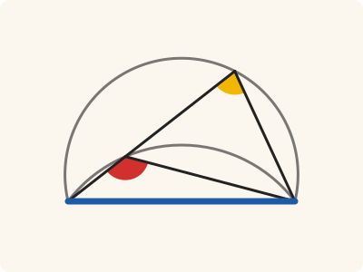
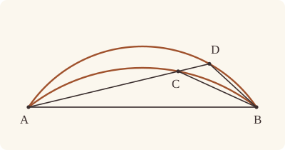

<!-- Generated by scripts/render.py. Do not edit by hand. -->

[Book III](index.md) · [← III.22](22.md) · [III.24 →](24.md)

# Book III, Proposition 23

*Similar segments on the same straight line cannot be unequal*

[Euclid's proof](#euclids-proof) · [In Lean](#in-lean) · [What it rests on](#what-it-rests-on) · [Mishnah](#mishnah)

> On the same straight line there cannot be constructed two similar and unequal segments of circles on the same side.

**In Lean:** ✅ proved, as Euclid states it · Euclid's argument

<p align="center"></p>

<p align="center"><em>Draw two different segments ACB, ADB on the same straight line AB (blue), on the same side: the angle ACB in the inner one (red) is always greater than ADB (yellow). So two segments there with equal angles coincide.</em></p>

## Euclid's proof

<p align="center"></p>

<p align="center"><em>Drawn for one case: the segment ACB within ADB, as in Heath's figure. Like Heath's, this figure draws the impossible supposition: two similar and unequal segments, ACB and ADB, on the same side of AB.</em></p>

For, if possible, on the same straight line AB let two similar and unequal segments of circles ACB, ADB be constructed on the same side;

let ACD be drawn through, and let CB, DB be joined.

Then, since the segment ACB is similar to the segment ADB,

and similar segments of circles are those which admit equal angles, [III. Def. 11]

the angle ACB is equal to the angle ADB, the exterior to the interior: which is impossible. [I. 16]

Therefore etc.

Q. E. D.

## In Lean

| | |
|---|---|
| Proof | ✅ Proved, and its companion `Prop23.point` ([III.23 point](23.md#point)) |
| Statement | The whole enunciation. Stated as an equality: two circles through A and B with similar segments on one side of AB are one circle; `Prop23.point` says it point by point. |
| Argument | Euclid's. The companion `Prop23.point` goes through a point M between A and B, within the circle [III. 2]: a point on the circle subtends the angle in the segment [III. 21]; one outside it, or within it, subtends a less, or a greater, angle, through a point Q where MP meets the circle [I. 21, III. 21], with `Prop23.insideTriangle_of_between` for the step read off the figure. |
| Representation | Each segment is given as its circle, the straight line AB and a point C or D on one side, and each circle comes with a centre, which III.10 and III.21 need. |
| Reviewed | The statement and the argument read against Heath's text, for every departure from Euclid, at commit [`7f4fba99`](https://github.com/jackChallis/stoicheia/commit/7f4fba99) ([the record](../../review/III/23.toml)) |

From [`Elements/BookIII/Prop23.lean`](../../Elements/BookIII/Prop23.lean). Euclid's sentences are the `--` comments, and our own notes are in `/- … -/`; the lines under each sentence are the Lean that carries it out. The list below marks where a lemma does a step Euclid takes for granted; the `/- … -/` notes in the listing explain smaller adjustments.

**How the Lean follows the text**

- **Done by `Prop10`.** "let ACD be drawn through, and let CB, DB be joined." Simson's preliminary (Heath, vol. 2, p. 53): by III.10 the circles meet only at A and B, so one segment falls within the other; III.21 carries the angle to where AC drawn through meets the other circle.

```lean
/-- On the same straight line there cannot be constructed two similar and unequal segments of
circles on the same side. -/
theorem Prop23 {A B C D : Point} {ACB ADB : Circle} (hACB : ∃ O : Point, Centre O ACB)
    (hADB : ∃ O : Point, Centre O ADB) (hA₁ : OnCircle A ACB) (hB₁ : OnCircle B ACB)
    (hC : OnCircle C ACB) (hA₂ : OnCircle A ADB) (hB₂ : OnCircle B ADB)
    (hD : OnCircle D ADB) (hCD : SameSideOf C D A B) (hsim : ∠ A C B = ∠ A D B) :
    ACB = ADB := by
  -- For, if possible, on the same straight line AB let two similar and unequal segments of
  -- circles ACB, ADB be constructed on the same side;
  refine Classical.byContradiction fun hne => ?_
  have hABC : Triangle A B C := hCD.triangle
  have hAB : A ≠ B := hCD.1
  obtain ⟨AB, hA_AB, hB_AB⟩ := Postulate1 A B hAB
  have hC_AB : ¬ OnLine C AB := hABC.off_line hA_AB hB_AB
  -- let ACD be drawn through, and let CB, DB be joined.
  /- This is Robert Simson's preliminary. The circles meet at A and B, so not at C [III.
     10], and C is within the circle ADB or outside it. If within, AC drawn through meets
     ADB at D₀; if outside, the segments are the other way about: MC, from a point M between
     A and B, meets ADB at D₁ within ACB, and AD₁ drawn through meets ACB at C₀. Either way
     a point P of one segment lies within the other, and AP drawn through meets it at Q,
     where III.21 carries the angle. -/
  have hC₂ : ¬ OnCircle C ADB := fun hC₂ =>
    hne (Prop10 hACB hADB hA₁ hA₂ hB₁ hB₂ hC hC₂ hAB hABC.ne₁₃ hABC.ne₂₃)
  obtain ⟨P, Q, hAPQ, hP_AB, hangles⟩ : ∃ P Q : Point, Between A P Q ∧ ¬ OnLine P AB ∧
      ((∠ A P B = ∠ A C B ∧ ∠ A Q B = ∠ A D B) ∨
        (∠ A P B = ∠ A D B ∧ ∠ A Q B = ∠ A C B)) := by
    by_cases hin : InsideCircle C ADB
    · obtain ⟨AC, hA_AC, hC_AC⟩ := Postulate1 A C hABC.ne₁₃
      obtain ⟨D₀, hD₀, -, hD₀CA⟩ := line_circle_beyond hin hC_AC hA_AC hABC.ne₁₃
      have hD₀C : SameSideOf D₀ C A B :=
        SameSideOf.of_onRay (OnRay.of_beyond (between_symm hD₀CA))
          (SameSideOf.of_line hAB hA_AB hB_AB (same_side_refl hC_AB))
      exact ⟨C, D₀, between_symm hD₀CA, hC_AB,
        Or.inl ⟨rfl, (Prop21 hADB hD hA₂ hB₂ hD₀ (hCD.symm.trans hD₀C.symm)).symm⟩⟩
    · obtain ⟨M, hM_AB, hAMB, -⟩ := exists_point_between hA_AB hB_AB hAB []
      have hM₁ : InsideCircle M ACB := Prop2 hACB hA₁ hB₁ M hAMB
      have hM₂ : InsideCircle M ADB := Prop2 hADB hA₂ hB₂ M hAMB
      have hMC : M ≠ C := fun h => hC_AB (h ▸ hM_AB)
      obtain ⟨MC, hM_MC, hC_MC⟩ := Postulate1 M C hMC
      obtain ⟨D₁, hD₁, hD₁_MC, hMD₁C⟩ := line_circle_between hM₂ hM_MC ⟨hin, hC₂⟩ hC_MC
      have hD₁_in : InsideCircle D₁ ACB := Prop2.within hACB (Or.inl hM₁) (Or.inr hC) hMD₁C
      have hD₁_AB : ¬ OnLine D₁ AB := fun h =>
        hC_AB (line_unique (ne_of_between hMD₁C) hM_MC hD₁_MC hM_AB h ▸ hC_MC)
      have hD₁C : SameSideOf D₁ C A B :=
        SameSideOf.of_line hAB hA_AB hB_AB (pasch2 hMD₁C hM_AB hD₁_AB)
      have hAD₁ : A ≠ D₁ := fun h => hD₁_AB (h ▸ hA_AB)
      obtain ⟨AD₁, hA_AD₁, hD₁_AD₁⟩ := Postulate1 A D₁ hAD₁
      obtain ⟨C₀, hC₀, -, hC₀D₁A⟩ := line_circle_beyond hD₁_in hD₁_AD₁ hA_AD₁ hAD₁
      have hC₀D₁ : SameSideOf C₀ D₁ A B :=
        SameSideOf.of_onRay (OnRay.of_beyond (between_symm hC₀D₁A))
          (SameSideOf.of_line hAB hA_AB hB_AB (same_side_refl hD₁_AB))
      exact ⟨D₁, C₀, between_symm hC₀D₁A, hD₁_AB, Or.inr
        ⟨(Prop21 hADB hD hA₂ hB₂ hD₁ (hCD.symm.trans hD₁C.symm)).symm,
         (Prop21 hACB hC hA₁ hB₁ hC₀ (hD₁C.symm.trans hC₀D₁.symm)).symm⟩⟩
  -- Then, since the segment ACB is similar to the segment ADB,
  -- and similar segments of circles are those which admit equal angles, [III. Def. 11]
  have hPQ : ∠ A P B = ∠ A Q B := by
    rcases hangles with ⟨h₁, h₂⟩ | ⟨h₁, h₂⟩
    · rw [h₁, h₂]; exact hsim
    · rw [h₁, h₂]; exact hsim.symm
  -- the angle ACB is equal to the angle ADB, the exterior to the interior: which is
  -- impossible. [I. 16]
  obtain ⟨AP, hA_AP, hP_AP⟩ := Postulate1 A P (ne_of_between hAPQ)
  have hQ_AP : OnLine Q AP := on_line_of_between hAPQ hA_AP hP_AP
  have hB_AP : ¬ OnLine B AP := fun h =>
    hP_AB (line_unique hAB hA_AP h hA_AB hB_AB ▸ hP_AP)
  have hQPB : Triangle Q P B :=
    Triangle.of_line hQ_AP hP_AP (ne_of_between (between_symm hAPQ)) hB_AP
  have h16 := (BookI.Prop16 hQPB.cab (between_symm hAPQ)).1
  rw [angle_onRay_left (OnRay.of_between (between_symm hAPQ)) hQPB.ne₁₃.symm,
    angle_symm hQPB.ne₂₃.symm (ne_of_between hAPQ), ← hPQ] at h16
  exact lt_irrefl _ h16
  -- Therefore etc.
  -- Q. E. D.
```

<a name="point"></a>

<details><summary>After the theorem, its companion, <code>Prop23.point</code> and one lemma for its own proofs, <code>Prop23.insideTriangle_of_between</code> (97 lines)</summary>

```lean
/-- If M lies between A and B, and Q between M and the opposite corner P, then Q
lies within the triangle PAB. This supplies the interior point for I.21 in each
circle case: Q lies on P's side of AB, A's side of BP, and B's side of PA. -/
theorem Prop23.insideTriangle_of_between {A B M P Q : Point} (hABP : Triangle A B P)
    (hAMB : Between A M B) (hMQP : Between M Q P) : InsideTriangle Q P A B := by
  /- For either end X of the base, with Y the other: M is on X's side of YP, and the
     ray from P through M keeps Q on that side too. -/
  have side : ∀ {X Y : Point}, Triangle X Y P → Between X M Y → SameSideOf Q X Y P := by
    intro X Y hXYP hXMY
    obtain ⟨K, hY_K, hP_K⟩ := Postulate1 Y P hXYP.ne₂₃
    have hM_K : ¬ OnLine M K := fun hM_K =>
      hXYP.bca.off_line hY_K hP_K (on_line_of_between (between_symm hXMY) hY_K hM_K)
    have hMX : SameSideOf M X P Y :=
      SameSideOf.of_line hXYP.ne₂₃.symm hP_K hY_K
        (pasch2 (between_symm hXMY) hY_K hM_K)
    exact (SameSideOf.of_onRay (OnRay.of_between (between_symm hMQP)) hMX).swap
  refine ⟨?_, side hABP hAMB, (side hABP.bac (between_symm hAMB)).swap⟩
  /- MQ leaves AB at M, so Q and P are on the same side of AB. -/
  refine ⟨hABP.ne₁₂, fun L hA_L hB_L => ?_⟩
  have hM_L : OnLine M L := on_line_of_between_ends hAMB hA_L hB_L
  have hQ_L : ¬ OnLine Q L := fun hQ_L =>
    hABP.off_line hA_L hB_L (on_line_of_between hMQP hM_L hQ_L)
  exact pasch2 hMQP hM_L hQ_L

/-- **On the circle, by the angle.** Let A, B, E be points of a circle with a centre, and P a
point on E's side of AB. Then P is on the circle exactly when the angle APB is equal to the
angle AEB, and P is within the circle exactly when the angle APB is greater than the angle
AEB.

Proved through a point M between A and B, which is within the circle [III. 2]. On the circle,
the angles in the same segment are equal [III. 21]. Outside it, the finite straight line PM
meets the circle at a point Q, which is within the triangle ABP, so the angle AQB is greater
than the angle APB [I. 21]. Within it, MP produced beyond P meets the circle at a point Q,
and P is within the triangle ABQ, so the angle APB is greater than the angle AQB [I. 21]. In
both, Q is on E's side of AB, and the angle AQB is equal to the angle AEB [III. 21]. (A plan
that draws AP on fails when AP touches the circle at A.)

A companion of III.23 ("III.23 point"): its content, point by point. III.24 cites it. -/
theorem Prop23.point {A B E P : Point} {α : Circle} (hα : ∃ O : Point, Centre O α)
    (hA : OnCircle A α) (hB : OnCircle B α) (hE : OnCircle E α) (hPE : SameSideOf P E A B) :
    (OnCircle P α ↔ ∠ A P B = ∠ A E B) ∧ (InsideCircle P α ↔ ∠ A E B < ∠ A P B) := by
  /- Take M between A and B. It is within the circle [III. 2]. -/
  obtain ⟨L, hA_L, hB_L⟩ := Postulate1 A B hPE.1
  obtain ⟨M, hM_L, hAMB, -⟩ := exists_point_between hA_L hB_L hPE.1 []
  have hM_in : InsideCircle M α := Prop2 hα hA hB M hAMB
  have hP_L : ¬ OnLine P L := hPE.triangle.off_line hA_L hB_L
  have hMP : M ≠ P := fun e => hP_L (e ▸ hM_L)
  obtain ⟨N, hM_N, hP_N⟩ := Postulate1 M P hMP
  /- On the circle, APB and AEB are angles in the same segment [III. 21]. -/
  have on_angle (hP_on : OnCircle P α) : ∠ A P B = ∠ A E B :=
    Prop21 hα hP_on hA hB hE hPE
  /- Outside, PM meets the circle at Q between M and P. Q lies within the triangle
     PAB, so the angle AQB is greater than the angle APB [I. 21]. -/
  have outside_angle (hP_out : OutsideCircle P α) : ∠ A P B < ∠ A E B := by
    obtain ⟨Q, hQ_on, -, hMQP⟩ := line_circle_between hM_in hM_N hP_out hP_N
    have hQ_in : InsideTriangle Q P A B :=
      Prop23.insideTriangle_of_between hPE.triangle hAMB hMQP
    have hangle : ∠ A P B < ∠ A Q B := (BookI.Prop21 hPE.triangle.cab hQ_in).2
    /- Q is on E's side of AB, so the angle AQB is equal to the angle AEB [III. 21]. -/
    have hQE : SameSideOf Q E A B := hQ_in.1.trans hPE
    rw [Prop21 hα hQ_on hA hB hE hQE] at hangle
    exact hangle
  /- Within, MP produced beyond P meets the circle at Q. Q is on P's side of AB, and so
     on E's; P lies within the triangle QAB, so the angle APB is greater than the angle
     AQB [I. 21]. -/
  have inside_angle (hP_in : InsideCircle P α) : ∠ A E B < ∠ A P B := by
    obtain ⟨Q, hQ_on, -, hQPM⟩ := line_circle_beyond hP_in hP_N hM_N hMP
    have hPQ : SameSideOf P Q A B :=
      SameSideOf.of_line hPE.1 hA_L hB_L (pasch2 (between_symm hQPM) hM_L hP_L)
    have hQE : SameSideOf Q E A B := hPQ.symm.trans hPE
    have hP_triangle : InsideTriangle P Q A B :=
      Prop23.insideTriangle_of_between hQE.triangle hAMB (between_symm hQPM)
    have hangle : ∠ A Q B < ∠ A P B := (BookI.Prop21 hQE.triangle.cab hP_triangle).2
    /- The angle AQB is again equal to the angle AEB [III. 21]. -/
    rw [Prop21 hα hQ_on hA hB hE hQE] at hangle
    exact hangle
  /- P is within the circle, on it, or outside it. Equal angles rule out within and
     outside, and a greater angle rules out on and outside, since no angle is less than
     itself. -/
  refine ⟨⟨on_angle, ?_⟩, ⟨inside_angle, ?_⟩⟩
  · intro heq
    apply Classical.byContradiction
    intro hP_not_on
    by_cases hP_in : InsideCircle P α
    · have hlt := inside_angle hP_in
      rw [heq] at hlt
      exact lt_irrefl _ hlt
    · have hlt := outside_angle ⟨hP_in, hP_not_on⟩
      rw [heq] at hlt
      exact lt_irrefl _ hlt
  · intro hlt
    apply Classical.byContradiction
    intro hP_not_in
    by_cases hP_on : OnCircle P α
    · rw [on_angle hP_on] at hlt
      exact lt_irrefl _ hlt
    · exact lt_irrefl _ (lt_trans hlt (outside_angle ⟨hP_not_in, hP_on⟩))
```

</details>

## What it rests on

| | Proposition | `Prop23.point` |
|---|---|---|
| Heath's references | [I.16](../I/16.md); Def. III.11 | none |
| Lean cites | [I.16](../I/16.md), [III.2](02.md), [III.10](10.md), [III.21](21.md) | [I.21](../I/21.md), [III.2](02.md), [III.21](21.md) |
| Postulates | 1, 2, 3, 4, 5 | 1, 2, 3, 4, 5 |
| Definitions taken as axioms | Def. I.15 | Def. I.15 |
| Common Notions | 1, 2, 3, 4, 5 | 1, 2, 3, 4, 5 |
| Tacit rules | 57 (listed below) | 56 (listed below) |
| Its own Lean calls | Postulate 1; 11 tacit rules | Postulate 1; 9 tacit rules |
| Through lemmas | 10 tacit rules | 10 tacit rules |

Some of these come in through lemmas [shared](../../CERTIFICATE.md#shared-steps) by many proofs: [`Prop2.within`](../../Elements/BookIII/Prop02.lean#L116) (III.2).

_Postulates, definitions, Common Notions and tacit rules: all that each proof rests on, counting those of the propositions it cites. The last two rows say which of the postulates, definitions and tacit rules its own Lean calls, in the proof or a helper written for it, and which it does not call but reaches through lemmas, of Book Zero or shared (a proposition it cites may rest on these too); the rest come in only through the propositions it cites or the Common Notions._

_Euclid's Def. III.11 is said in Lean by the equal angles in the segments, a definition rather than an assumption, so the row of definitions taken as axioms does not count it._

<details><summary>The 57 tacit rules beneath this proof, counting those of the propositions it cites</summary>

_(used here) marks a rule this proof's own Lean calls, in the proof or a helper written for it; (through …) marks one its own Lean does not call but reaches through the lemmas named, of [Book Zero](../../Elements/Figure) or shared, though a proposition it cites may rest on it too; and a rule with no mark comes in only through a proposition it cites or a Common Notion. The names in brackets are System E's: an Intersection rule says when straight lines and circles must meet, and an Intersections rule takes a point where they do (see [Book I's introduction](../I/index.md))._

**Reading the figure**

- [`between_cases`](../../Elements/Foundations/Tacit/Diagram.lean#L73): Of three different points on a straight line, one is between the other two. (Between 6)
- [`between_of_between_left`](../../Elements/Foundations/Tacit/Diagram.lean#L65) (through [`Prop2.within`](../../Elements/BookIII/Prop02.lean#L116)): If B is between A and C, and D is between A and B, then D is between A and C. (Between 4)
- [`between_of_between_right`](../../Elements/Foundations/Tacit/Diagram.lean#L69): If B is between A and C, and C is between B and D, then B is between A and D. (Between 5)
- [`between_of_inside_chord`](../../Elements/Foundations/Tacit/Diagram.lean#L146): A straight line through a point inside a circle has that point between the points where it meets the circle. (Circle 1)
- [`between_symm`](../../Elements/Foundations/Tacit/Diagram.lean#L42) (used here): If B is between A and C, it is between C and A. (Between 1)
- [`centre_inside`](../../Elements/Foundations/Tacit/Diagram.lean#L34): The centre of a circle is inside it. (Generalities 3)
- [`circles_meet`](../../Elements/Foundations/Tacit/Diagram.lean#L176): If each circle passes through a point inside the other, the circles cut one another. This is the step Euclid takes for granted in I.1. (Intersection 5)
- [`circles_meet_of_on_inside_outside`](../../Elements/Foundations/Tacit/Diagram.lean#L170): Two circles cut one another if the first passes through a point A inside the second, and a point B outside the second is inside or on the first. (Intersection 4, in LeanEuclid's corrected form)
- [`circles_meet_same_side`](../../Elements/Foundations/Tacit/Constructions.lean#L94): Two circles that cut one another do so on each side of the straight line through their centres. (Intersections 8)
- [`exists_point`](../../Elements/Foundations/Tacit/Constructions.lean#L29) (through [`Triangle.ne₁₃`](../../Elements/Figure/Triangles.lean#L36) and [`Triangle.ne₂₃`](../../Elements/Figure/Triangles.lean#L29)): Let a point be taken. (Points 1)
- [`exists_point_between`](../../Elements/Foundations/Tacit/Constructions.lean#L41) (used here): Let a point be taken between B and C. (Points 3)
- [`exists_point_opposite_side`](../../Elements/Foundations/Tacit/Constructions.lean#L49): Let a point be taken on the other side of L from B. (Points 6)
- [`exists_point_same_side`](../../Elements/Foundations/Tacit/Constructions.lean#L45): Let a point be taken on the same side of L as B. (Points 5)
- [`inside_not_on`](../../Elements/Foundations/Tacit/Diagram.lean#L37): A point inside a circle is not on it. (Generalities 4)
- [`line_circle_between`](../../Elements/Foundations/Tacit/Constructions.lean#L82) (used here): A straight line through a point B inside a circle, heading out to a point C outside it, cuts the circle between B and C. (Intersections 4)
- [`line_circle_beyond`](../../Elements/Foundations/Tacit/Constructions.lean#L88) (used here): A straight line through a point B inside a circle, produced beyond B away from C, cuts the circle there. (Intersections 5)
- [`line_unique`](../../Elements/Foundations/Tacit/Diagram.lean#L30) (used here): Two points determine a straight line. (Generalities 1)
- [`lines_meet_of_opposite_sides`](../../Elements/Foundations/Tacit/Diagram.lean#L159): A straight line joining points on opposite sides of L crosses L. (Intersection 1)
- [`ne_of_between`](../../Elements/Foundations/Tacit/Diagram.lean#L45) (used here): A point between two others differs from the first. (Between 1)
- [`ne_of_between_ends`](../../Elements/Foundations/Tacit/Diagram.lean#L48) (through [`OnRay.of_between`](../../Elements/Figure/Rays.lean#L32), [`OnRay.of_beyond`](../../Elements/Figure/Rays.lean#L39), [`Prop2.within`](../../Elements/BookIII/Prop02.lean#L116) and 1 other lemma): The ends of a finite straight line differ. (Between 1)
- [`not_between_of_between`](../../Elements/Foundations/Tacit/Diagram.lean#L51) (through [`OnRay.of_between`](../../Elements/Figure/Rays.lean#L32) and [`OnRay.of_beyond`](../../Elements/Figure/Rays.lean#L39)): If B is between A and C, then A is not between B and C. (Between 1)
- [`not_between_of_between_between`](../../Elements/Foundations/Tacit/Diagram.lean#L78): If B is between A and C, and also between A and D, then B is not between C and D: C and D lie on the same side of B. (Between 7)
- [`not_on_line_of_same_side`](../../Elements/Foundations/Tacit/Diagram.lean#L91) (through [`SameSideOf.of_onRay`](../../Elements/Figure/Angles.lean#L165) and [`SameSideOf.triangle`](../../Elements/Figure/Sides.lean#L59)): Points on one side of a straight line are not on it. (Same side 3)
- [`on_line_of_between`](../../Elements/Foundations/Tacit/Diagram.lean#L55) (used here): A straight line through A and B, with B between A and C, passes through C. (Between 2)
- [`on_line_of_between_ends`](../../Elements/Foundations/Tacit/Diagram.lean#L60) (through [`OnRay.of_between`](../../Elements/Figure/Rays.lean#L32)): A straight line through A and C passes through every point between them. (Between 3)
- [`pasch2`](../../Elements/Foundations/Tacit/Diagram.lean#L110) (used here): If B is between A and C, A is on L and B is off it, then B and C are on the same side of L: a straight line that leaves L at A does not cross it again. (Pasch 2)
- [`pasch3`](../../Elements/Foundations/Tacit/Diagram.lean#L113): A straight line through a point between A and C separates them. (Pasch 3)
- [`pasch4`](../../Elements/Foundations/Tacit/Diagram.lean#L118) (through [`SameSideOf.of_onRay`](../../Elements/Figure/Angles.lean#L165)): If two different straight lines L and M meet at B, and A and C are points of M, different from each other and from B, that are not on the same side of L, then B is between A and C. (Pasch 4)
- [`same_side_or`](../../Elements/Foundations/Tacit/Diagram.lean#L98): A straight line has only two sides. (Same side 5)
- [`same_side_refl`](../../Elements/Foundations/Tacit/Diagram.lean#L84) (used here): A point off a straight line is on the same side of it as itself. (Same side 1)
- [`same_side_symm`](../../Elements/Foundations/Tacit/Diagram.lean#L88) (through [`SameSideOf.of_onRay`](../../Elements/Figure/Angles.lean#L165), [`SameSideOf.symm`](../../Elements/Figure/Sides.lean#L49) and [`SameSideOf.trans`](../../Elements/Figure/Sides.lean#L53)): If A is on the same side of a straight line as B, then B is on the same side as A. (Same side 2)
- [`same_side_trans`](../../Elements/Foundations/Tacit/Diagram.lean#L95) (through [`SameSideOf.of_onRay`](../../Elements/Figure/Angles.lean#L165) and [`SameSideOf.trans`](../../Elements/Figure/Sides.lean#L53)): Two points on the same side of a straight line as a third point are on the same side as each other. (Same side 4)
- [`triple_incidence1`](../../Elements/Foundations/Tacit/Diagram.lean#L130): Take B on L, C on M and D on N, three straight lines through A. If C lies within the angle BAD (on D's side of L and on B's side of N), then B and D are not on the same side of M: the straight line AC separates them. (Triple incidence 1)
- [`triple_incidence2`](../../Elements/Foundations/Tacit/Diagram.lean#L138): Take B on L, C on M and D on N, three straight lines through A, with B other than A and D off M. If C and D are on the same side of L, and B and D are not on the same side of M, then B and C are on the same side of N: C lies within the angle BAD. (Triple incidence 2)

**Lengths, angles and areas**

- [`angle_add_of_inside`](../../Elements/Foundations/Tacit/Transfer.lean#L55): If D lies within the angle BAC, then BAC is made up of BAD and DAC. (Diagram-angle 2)
- [`angle_eq_of_same_rays`](../../Elements/Foundations/Tacit/Transfer.lean#L62) (through [`angle_onRay_left`](../../Elements/Figure/Angles.lean#L40)): The angle doesn't change if its arms are traced through other points on the same rays. (Diagram-angle 4)
- [`angle_symm`](../../Elements/Foundations/Tacit/Metric.lean#L26) (used here): The angle ABC is the angle CBA. (Metric 4)
- [`area_congruent`](../../Elements/Foundations/Tacit/Metric.lean#L43): Triangles equal in all their sides and angles are equal in area. Euclid uses this without comment once he has shown two triangles congruent. (Metric 9)
- [`area_rotate`](../../Elements/Foundations/Tacit/Metric.lean#L35): The triangle ABC is the triangle CAB. (Metric 8)
- [`area_swap`](../../Elements/Foundations/Tacit/Metric.lean#L38): The triangle ABC is the triangle ACB. (Metric 8)
- [`circle_eq`](../../Elements/Foundations/Tacit/Transfer.lean#L25): A circle is fixed by its centre and its radius. (Diagram-segment 2)
- [`eq_of_len_eq_zero`](../../Elements/Foundations/Tacit/Metric.lean#L17): A finite straight line with distinct ends has length. (Metric 1)
- [`inside_of_len_lt`](../../Elements/Foundations/Tacit/Transfer.lean#L34): A point nearer the centre than the circumference is inside. (Diagram-segment 4)
- [`len_add_of_between`](../../Elements/Foundations/Tacit/Transfer.lean#L22): If B is between A and C, then AB and BC together make up AC. (Diagram-segment 1)
- [`len_lt_of_inside`](../../Elements/Foundations/Tacit/Transfer.lean#L38): A point inside is nearer the centre than the circumference. (Diagram-segment 4)
- [`len_self`](../../Elements/Foundations/Tacit/Metric.lean#L20): The "straight line" from a point to itself has no length. (Metric 1)
- [`len_symm`](../../Elements/Foundations/Tacit/Metric.lean#L23): The straight line AB is the straight line BA. (Metric 3)
- [`same_ray_of_angle_eq_zero`](../../Elements/Foundations/Tacit/Transfer.lean#L50): If the angle BAC is nothing, C lies on the ray from A through B. (Diagram-angle 1)

**Superposition**

- [`superposition`](../../Elements/Foundations/Tacit/Superposition.lean#L48): **Superposition.** A hypothetical placement of a triangle on a given ray and side permits a restricted derivation of metric equalities about the figure already given. The derivation introduces no further objects, cites each geometric law it uses, and exports no symbol of the placement.

**Laws of magnitude**

- [`add_assoc`](../../Elements/Foundations/Tacit/Magnitudes.lean#L23): Adding three magnitudes in a row, it makes no difference whether the first two or the last two are added first. (System E §3.5)
- [`add_comm`](../../Elements/Foundations/Tacit/Magnitudes.lean#L26): The order of adding does not matter. (System E §3.5)
- [`add_lt_add_right`](../../Elements/Foundations/Tacit/Magnitudes.lean#L45): Adding the same thing to both sides keeps "less than". (System E §3.5)
- [`add_zero`](../../Elements/Foundations/Tacit/Magnitudes.lean#L29): Adding nothing changes nothing. (System E §3.5)
- [`lt_irrefl`](../../Elements/Foundations/Tacit/Magnitudes.lean#L32) (used here): No magnitude is less than itself. (System E §3.5)
- [`lt_trans`](../../Elements/Foundations/Tacit/Magnitudes.lean#L35): What is less than the less is less still. (System E §3.5)
- [`lt_trichotomy`](../../Elements/Foundations/Tacit/Magnitudes.lean#L39): Of two magnitudes, one is less, or they are equal, or the other is less. (System E §3.5)
- [`not_lt_zero`](../../Elements/Foundations/Tacit/Magnitudes.lean#L42): Nothing is less than zero. (System E §3.5)

</details>

## Mishnah

_Our commentary: what Euclid assumes, what Lean made us say out loud, and how the result looks by modern means._

**The exterior cannot equal the interior.** Similar segments would make two angles equal that I.16 makes unequal. Drawing AC through to D, Euclid makes ACB the exterior angle of the triangle DCB, and ADB the interior and opposite one. Euclid's "cannot be constructed" is the phrase of I.7, Heath observes (vol. 2, p. 53), and both impossibilities become equalities in our statements: in I.7 the two points are one, and here the two circles are one. A companion says it point by point, for III.24 to use: on one side of AB, a point is on the circle exactly when AB subtends at it the angle in the segment, and within it exactly when the angle is greater (`Prop23.point`).

**Similar before similarity.** Augustus De Morgan, Heath reports, calls "similar" in "similar segments" an anticipation, since similarity of form is meant, and adds "that the definition is a theorem, or would be if 'similar' had taken its final meaning" (vol. 2, p. 5). Similar figures wait for Book VI. We take the definition as Euclid gives it, equal angles at one point of each segment, and III.21 makes the angle the same at every point of each.

**Which segment lies within?** Euclid draws ACB inside ADB without a word. Robert Simson observes, and Heath agrees, that the remark Euclid makes in III.24, that the circles cannot meet again, "is an equally necessary preliminary to III. 23, in order that we may be justified in drawing the segments as being one inside the other" (vol. 2, p. 53). Our proof begins as Simson's does: the circles meet at A and B, so not at C (III.10), and C is within ADB or outside it. D may lie anywhere on its segment, and III.21 carries its angle to where AC drawn through meets ADB, or, with the segments the other way about, carries both angles. Then I.16 does Euclid's work.

**"Not coinciding with one another."** Simson puts these words for Euclid's "unequal" (Heath, vol. 2, p. 53). Christopher Clavius and the other early editors add that similar segments on opposite sides of one straight line are equal too: turn one about the base until it lies on the other's side. The statement keeps to the case Euclid proves, for on opposite sides the segments may lie in different circles.

**The modern way.** The points P on one side of AB from which it is seen under a given angle, those for which (B − P)/(A − P) has that argument, fill a single arc of a single circle through A and B. So two segments on AB, on one side and admitting equal angles, lie on one circle and coincide.

## Further reading

- For the locus of the modern way, that triangles "on the same base and on the same side of it, with equal vertical angles" have their vertices on one segment of a circle, which Todhunter calls very important, Isaac Todhunter's [*The Elements of Euclid*](https://archive.org/details/todhuntereuclid00todhrich) (1872, free online), his note on III.21 (p. 276) (also on [III.3](03.md)).
- For the test the modern way uses for points on one circle, worked with complex numbers, Titu Andreescu and Dorin Andrica's [*Complex Numbers from A to ... Z*](https://doi.org/10.1007/978-0-8176-8415-0) (2014), §3.2, "Conditions for Collinearity, Orthogonality, and Concyclicity" (pp. 70–73), a problem book that assumes nothing about complex numbers and then turns them on geometry.

[Book III](index.md) · [← III.22](22.md) · [III.24 →](24.md)

---

<sub>Euclid's text: T. L. Heath, *The Thirteen Books of Euclid's Elements*, vol. 2 (Cambridge, 1908), pp. 52–53; [scan leaves n64–n65](https://archive.org/details/thirteenbookseu00heibgoog/page/n64); [figure on n64](https://archive.org/details/thirteenbookseu00heibgoog/page/n64). Public domain.</sub>

<sub>The tacit rules follow the System E of Jeremy Avigad, Edward Dean and John Mumma, read alongside LeanEuclid (Logan Murphy, Kaiyu Yang, Jialiang Sun, Zhaoyu Li, Anima Anandkumar and Xujie Si).</sub>
