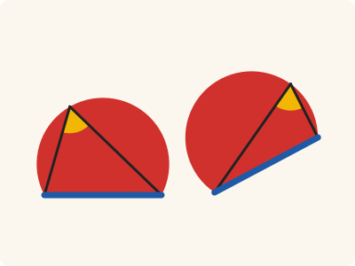
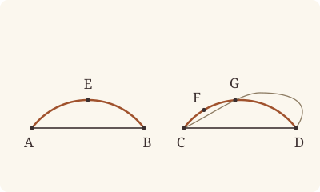

<!-- Generated by scripts/render.py. Do not edit by hand. -->

[Book III](index.md) · [← III.23](23.md) · [III.25 →](25.md)

# Book III, Proposition 24

*Similar segments on equal straight lines are equal*

[Euclid's proof](#euclids-proof) · [In Lean](#in-lean) · [What it rests on](#what-it-rests-on) · [Mishnah](#mishnah)

> Similar segments of circles on equal straight lines are equal to one another.

**In Lean:** ✅ proved, as Euclid states it, in our measure of circumferences · Euclid's argument

<p align="center"></p>

<p align="center"><em>Lay the segment AEB on CFD, A on C and B on D: with equal bases AB, CD (blue) and equal angles AEB, CFD in them (yellow), the two fit exactly, and are equal (red).</em></p>

## Euclid's proof

<p align="center"></p>

<p align="center"><em>Drawn for one case: segments less than semicircles, as in Heath's figure. Like Heath's, this figure draws the last supposition the text refutes: the segment falling awry, as CGD, so that a circle would cut a circle at more points than two. The figure at a glance draws another case: both segments greater than semicircles, with acute angles at E and F.</em></p>

For let AEB, CFD be similar segments of circles on equal straight lines AB, CD;

I say that the segment AEB is equal to the segment CFD.

For, if the segment AEB be applied to CFD, and if the point A be placed on C and the straight line AB on CD,

the point B will also coincide with the point D, because AB is equal to CD;

and, AB coinciding with CD,

the segment AEB will also coincide with CFD.

For, if the straight line AB coincide with CD but the segment AEB do not coincide with CFD,

it will either fall within it, or outside it;

or it will fall awry, as CGD, and a circle cuts a circle at more points than two: which is impossible. [III. 10]

Therefore, if the straight line AB be applied to CD, the segment AEB will not fail to coincide with CFD also;

therefore it will coincide with it and will be equal to it.

Therefore etc.

Q. E. D.

## In Lean

| | |
|---|---|
| Proof | ✅ Proved, and its companions `Prop24.equalCircles` ([III.24 equalCircles](24.md#equalCircles)) and `Prop24.equalMeasure` ([III.24 equalMeasure](24.md#equalMeasure)) |
| Statement | The whole enunciation. With its companions: `Prop24` lays one segment on the other, `Prop24.equalCircles` gives equal circles and measures, `Prop24.equalMeasure` equal measures. |
| Argument | Euclid's. Euclid's application of one segment to the other is kept (`placement`: A on C, AB on CD, B on D), and so is his reductio. The applied segment is a segment of a circle through C and D, the moved circle (`Prop24.moved`); supposing it is not CFD, the image of E is neither within CFD nor outside it, by III.23's companion `Prop23.point`, so it is a third point common to the two circles, and III.10 makes them one. Euclid divides the cases by how the whole segment falls; the Lean takes them at the image of E. The companion `Prop24.equalCircles` keeps the proof by the radii (III.20, III.22, `Prop24.isosceles`), shown on the page as the alternative. |
| Representation | A segment is its circle, the ends of its base and a point naming its side (`Arc`). "Equal" segments are read through Common Notion 4 as segments that coincide (`Arc.Congruent`): one map puts A on C and B on D, the segment on the segment and the circumference on the circumference, keeping every distance between their points; no magnitude of a segment is defined. The main theorem says nothing of a measure. Its companions measure circumferences by the angle standing on them, taken twice, a measure with no radius in it, and the measure clause of `Prop24.equalCircles` follows from the equal angles at E and F alone; the equal bases are needed for its equal circles, as for the congruence. |
| Reviewed | The statement and every passage of the argument read against Heath's text, at commit [`c803fb9a2`](https://github.com/jackChallis/stoicheia/commit/c803fb9a2) ([the record](../../review/III/24.toml)) |

From [`Elements/BookIII/Prop24.lean`](../../Elements/BookIII/Prop24.lean). Euclid's sentences are the `--` comments, and our own notes are in `/- … -/`; the lines under each sentence are the Lean that carries it out. The list below marks where a lemma does a step Euclid takes for granted and where several sentences share one step; the `/- … -/` notes in the listing explain smaller adjustments.

**How the Lean follows the text**

- **Done by `placement`.** "For, if the segment AEB be applied to CFD…" The application is `placement`: on the equal straight lines AB, CD, the side of AB where E is, with AB itself, is carried onto the side of CD where F is, with CD, keeping every distance, A going to C and B to D. No motion is assumed beyond I.4 and I.8: I.22 finds each point's place, or I.3 and I.2 on the straight line AB, I.7 and I.20 make it the only one, and I.8 and I.4 keep every distance, with I.20's order of points on AB; Heath prints no reference here for any of them.
- **Carried together, by `placement`.** "the point B will also coincide with the point D…" Carried by the placement under the sentence before, which puts B on D because AB is equal to CD, and every point of AB on the point of CD as far from C and from D as it was from A and from B: AB coincides with CD.
- **Done by `Prop24.moved`.** "the segment AEB will also coincide with CFD." The sentences after it show the coincidence; the Lean begins with a step Euclid takes for granted in them, that the applied segment is a segment of a circle on CD. `Prop24.moved` draws that circle, the moved circle, about the place of the centre of AEB, which it takes from `Tacit.exists_centre`, through C [Post. 3], and shows that the application carries the circle AEB onto it: each point of E's side of AB, or of AB, is as far from the centre's place as it was from the centre, and so on the one circle or within it as it was on the other or within it (Definition I.15, with System E's Diagram-segments 3 and 4, proved in `Elements/Figure/RuleBase.lean` and `Elements/Figure/Incidence.lean`). A centre across AB from E is placed by applying its own side of AB to the other side of CD (`Prop24.across`), by I.8, I.13 and I.14; Heath prints no reference here for any of them.
- **Done by `Prop23.point`.** "it will either fall within it, or outside it…" Euclid leaves these two cases to a tacit reference to III.23 (Heath, vol. 2, p. 54). The Lean takes them at one point of the applied circumference, the image of E: CD subtends there the angle that AB subtends at E, by I.8, for which Heath prints no reference here, and so the angle at F. By III.23's companion `Prop23.point`, which uses I.21, III.2 and III.21, a point on F's side of CD is within the circle CFD exactly when CD subtends a greater angle there than at F, and on it exactly when the angle is the same; so the image of E is neither within CFD nor outside it, and under the next sentence it is the third common point that III.10 forbids.

<details><summary>Before the theorem, three lemmas: <code>Prop24.chord_cases</code>, <code>Prop24.across</code> and <code>Prop24.moved</code> (182 lines)</summary>

```lean
/-- **A straight line in a circle, along its own line.** For two different points A, B of a
circle, and a point P of the straight line AB: P is on the circle exactly when
it is A or B, and within the circle exactly when it lies between them. `Prop24.image` uses
it, after the theorem, to keep the image of a point of an arc off its base; in the theorem the
points of the base are settled, as the rest are, by their distances from the centre's place
(`Prop24.moved`). A point between A and B is within the circle by III.2, and so no third
point of the straight line is on the circle (`Prop2.triangle`); a point within the circle on
AB lies between A and B by System E's Circle 1 (`between_of_inside_chord`). [III. 2] -/
theorem Prop24.chord_cases {A B P : Point} {α : Circle} (hA : OnCircle A α) (hB : OnCircle B α)
    (hAB : A ≠ B) (hP : Collinear A B P) :
    (OnCircle P α ↔ P = A ∨ P = B) ∧ (InsideCircle P α ↔ Between A P B) := by
  refine ⟨⟨fun hPα => Classical.byContradiction fun hne => ?_, ?_⟩,
    ⟨fun hin => ?_, fun h => Prop2 hA hB P h⟩⟩
  · exact Prop2.triangle hA hB hPα hAB (fun e => hne (Or.inr e.symm))
      (fun e => hne (Or.inl e.symm)) hP
  · rintro (h | h)
    · rw [h]; exact hA
    · rw [h]; exact hB
  · obtain ⟨L, hA_L, hB_L, hP_L⟩ := hP
    exact between_of_inside_chord hP_L hA_L hB_L hin hA hB hAB

/-- **A point across the base has a place too.** Let a map place E's side of AB, with AB
itself, on F's side of CD, with CD, as the application does: A on C, B on D, every distance
kept, each point as far from C and D as it was from A and B. A point M across AB from E is
not placed by it; but the application of M's side of AB to the other side of CD places it
(`placement`), at a point as far from the image of each point P of E's side, or of AB, as M
is from P. Euclid applies the whole segment, its circle with it, and takes this for granted.

On AB the two applications agree, a point of CD being fixed by its distances from C and D
(`Placement.unique`). For P off AB, the finite straight line MP crosses AB at a point X, and
K, an end of AB other than X, is off MP. The triangles MXK and PXK keep their sides, so the
angles at X are kept [I. 8]; the angles MXK, KXP are together two right angles [I. 13], so
the images of M and P lie on one straight line through the image of X, which is between
them [I. 14], and the images are as far apart as MX and XP together, which is MP. -/
theorem Prop24.across {A B C D E F M : Point} {f : Point → Point}
    (hF : ¬ Collinear C D F) (hAB : ‖A B‖ = ‖C D‖)
    (hplace : Places f (OnSideOrLine · E A B) (OnSideOrLine · F C D))
    (hf : ∀ P : Point, OnSideOrLine P E A B → ‖C (f P)‖ = ‖A P‖ ∧ ‖D (f P)‖ = ‖B P‖ ∧
      (SameSideOf P E A B ↔ SameSideOf (f P) F C D) ∧ (Between A P B ↔ Between C (f P) D))
    (hM : OppositeSidesOf M E A B) :
    ∃ O : Point, ∀ P : Point, OnSideOrLine P E A B → ‖O (f P)‖ = ‖M P‖ := by
  have hABM : Triangle A B M := hM.triangle
  have hCDF : Triangle C D F := hF
  obtain ⟨L, hA_L, hB_L⟩ := Postulate1 A B hABM.ne₁₂
  obtain ⟨N, hC_N, hD_N⟩ := Postulate1 C D hCDF.ne₁₂
  obtain ⟨Y, hY, -⟩ := exists_oppositeSidesOf hCDF []
  /- M's side of AB is applied to Y's side of CD, the other side from F. -/
  obtain ⟨g, -, -, ⟨hginto, -, hgdist⟩, hg⟩ := placement hABM hY.triangle hAB
  have hMM : OnSideOrLine M M A B := Or.inl (sameSideOf_self hABM)
  /- On AB the two applications agree. -/
  have hsame : ∀ X : Point, OnLine X L → g X = f X ∧ Collinear C D (f X) := by
    intro X hX_L
    have hX : Collinear A B X := ⟨L, hA_L, hB_L, hX_L⟩
    obtain ⟨g₁, g₂, gside, -⟩ := hg X (Or.inr hX)
    obtain ⟨f₁, f₂, fside, -⟩ := hf X (Or.inr hX)
    have hgX : Collinear C D (g X) := by
      rcases hginto X (Or.inr hX) with h | h
      · exact absurd hX (gside.mpr h).triangle
      · exact h
    have hfX : Collinear C D (f X) := by
      rcases hplace.1 X (Or.inr hX) with h | h
      · exact absurd hX (fside.mpr h).triangle
      · exact h
    exact ⟨Placement.unique hF (Or.inr hgX) (Or.inr hfX) (g₁.trans f₁.symm)
      (g₂.trans f₂.symm), hfX⟩
  refine ⟨g M, fun P hP => ?_⟩
  rcases hP with hPE | hPl
  case inr =>
    /- P on AB: the application of M's side places it too. -/
    obtain ⟨L', hA_L', hB_L', hP_L'⟩ := hPl
    have hP_L : OnLine P L := line_unique hABM.ne₁₂ hA_L' hB_L' hA_L hB_L ▸ hP_L'
    rw [← (hsame P hP_L).1]
    exact hgdist M P hMM (Or.inr ⟨L, hA_L, hB_L, hP_L⟩)
  /- P on E's side: MP crosses AB at X. -/
  have hMP : OppositeSidesOf M P A B := (hPE.trans_opposite hM.symm).symm
  obtain ⟨X, hX_L, hMXP⟩ := OppositeSides.exists_between (hMP.oppositeSides hA_L hB_L)
  have hM_L : ¬ OnLine M L := hABM.off_line hA_L hB_L
  have hP_L : ¬ OnLine P L := hPE.triangle.off_line hA_L hB_L
  /- K, an end of AB other than X. -/
  obtain ⟨K, hK_L, hKX⟩ : ∃ K : Point, OnLine K L ∧ K ≠ X := by
    by_cases hXA : X = A
    · exact ⟨B, hB_L, fun e => hABM.ne₁₂ (hXA.symm.trans e.symm)⟩
    · exact ⟨A, hA_L, Ne.symm hXA⟩
  have hXcol : Collinear A B X := ⟨L, hA_L, hB_L, hX_L⟩
  have hKcol : Collinear A B K := ⟨L, hA_L, hB_L, hK_L⟩
  obtain ⟨hgX, hX'⟩ := hsame X hX_L
  obtain ⟨hgK, hK'⟩ := hsame K hK_L
  /- The images: X′, K′ on CD, M′ on Y's side, P′ on F's side. -/
  have hM'Y : SameSideOf (g M) Y C D := ((hg M hMM).2.2.1).mp (sameSideOf_self hABM)
  have hP'F : SameSideOf (f P) F C D := ((hf P (Or.inl hPE)).2.2.1).mp hPE
  have hM'P' : OppositeSidesOf (g M) (f P) C D :=
    (hP'F.trans_opposite (hM'Y.trans_opposite hY).symm).symm
  have hX'_N : OnLine (f X) N := onLine_of_collinear hCDF.ne₁₂ hX' hC_N hD_N
  have hK'_N : OnLine (f K) N := onLine_of_collinear hCDF.ne₁₂ hK' hC_N hD_N
  /- The sides of the triangles MXK and PXK, and of their images. -/
  have dXM : ‖X M‖ = ‖(f X) (g M)‖ := by
    rw [← hgX]; exact (hgdist X M (Or.inr hXcol) hMM).symm
  have dXK : ‖X K‖ = ‖(f X) (f K)‖ :=
    (hplace.2.2 X K (Or.inr hXcol) (Or.inr hKcol)).symm
  have dMK : ‖M K‖ = ‖(g M) (f K)‖ := by
    rw [← hgK]; exact (hgdist M K hMM (Or.inr hKcol)).symm
  have dXP : ‖X P‖ = ‖(f X) (f P)‖ :=
    (hplace.2.2 X P (Or.inr hXcol) (Or.inl hPE)).symm
  have dPK : ‖P K‖ = ‖(f P) (f K)‖ :=
    (hplace.2.2 P K (Or.inl hPE) (Or.inr hKcol)).symm
  have hX'K' : f X ≠ f K := fun e => len_ne_zero hKX.symm (dXK.trans (by rw [e, len_self]))
  have hM'_N : ¬ OnLine (g M) N := hM'Y.triangle.off_line hC_N hD_N
  have hP'_N : ¬ OnLine (f P) N := hP'F.triangle.off_line hC_N hD_N
  /- The angles at X are kept [I. 8]. -/
  have aM : ∠ M X K = ∠ (g M) (f X) (f K) :=
    BookI.Prop8 (Triangle.of_line hX_L hK_L hKX.symm hM_L).acb
      (Triangle.of_line hX'_N hK'_N hX'K' hM'_N).acb dXM dXK dMK
  have aP : ∠ P X K = ∠ (f P) (f X) (f K) :=
    BookI.Prop8 (Triangle.of_line hX_L hK_L hKX.symm hP_L).acb
      (Triangle.of_line hX'_N hK'_N hX'K' hP'_N).acb dXP dXK dPK
  /- The angles MXK, KXP are two right angles [I. 13]; K is off MP, which meets AB at X
     alone. -/
  have hK_MP : ¬ Collinear M P K := by
    rintro ⟨Q, hM_Q, hP_Q, hK_Q⟩
    have hX_Q : OnLine X Q := on_line_of_between_ends hMXP hM_Q hP_Q
    exact hM_L (line_unique hKX hK_Q hX_Q hK_L hX_L ▸ hM_Q)
  have h13 := BookI.Prop13 hMXP hK_MP
  rw [aM, angle_symm hKX (ne_of_between (between_symm hMXP)), aP] at h13
  /- So the images of M and P are on one straight line through the image of X, which is
     between them [I. 14]. -/
  have hM'X' : g M ≠ f X := fun e => hM'_N (e ▸ hX'_N)
  have hP'X' : f P ≠ f X := fun e => hP'_N (e ▸ hX'_N)
  have h14 : Between (g M) (f X) (f P) :=
    BookI.Prop14 (OppositeSidesOf.of_line hX'K'.symm hK'_N hX'_N
      (hM'P'.oppositeSides hC_N hD_N))
      (by rw [angle_symm hX'K'.symm hM'X', angle_symm hX'K'.symm hP'X']; exact h13)
  rw [← len_add_of_between h14, len_symm (g M) (f X), ← dXM, ← dXP, len_symm X M]
  exact len_add_of_between hMXP

/-- **The applied segment is a segment of a circle.** When the segment AEB is applied to CD,
A on C and B on D, as the application does (`placement`), there is a circle through C and D,
the moved circle, onto which it carries the circle AEB: a point on E's side of AB, or on AB,
is on the circle AEB, or within it, exactly when its image is on the moved circle, or within
it. Euclid takes this for granted when he says that the applied segment, if it does not
coincide with CFD, falls within it, outside it, or awry: the applied figure is still a
segment of a circle on CD.

The moved circle is drawn about the place of the centre of AEB [Post. 3], through C. The
centre's place is as far from the image of each point as the centre is from the point: its
image, when the centre is on E's side of AB or on AB, and otherwise its place across CD
(`Prop24.across`). So each point is as far from the centre's place, compared with C, as it was
from the centre, compared with A, and is on or within the one circle as it was on or within
the other (Definition I.15 and System E's Diagram-segments 3 and 4). -/
theorem Prop24.moved {A B C D E F : Point} {AEB : Circle} {f : Point → Point}
    (hA : OnCircle A AEB) (hB : OnCircle B AEB) (hE : ¬ Collinear A B E)
    (hF : ¬ Collinear C D F) (hAB : ‖A B‖ = ‖C D‖) (hAC : f A = C) (hBD : f B = D)
    (hplace : Places f (OnSideOrLine · E A B) (OnSideOrLine · F C D))
    (hf : ∀ P : Point, OnSideOrLine P E A B → ‖C (f P)‖ = ‖A P‖ ∧ ‖D (f P)‖ = ‖B P‖ ∧
      (SameSideOf P E A B ↔ SameSideOf (f P) F C D) ∧ (Between A P B ↔ Between C (f P) D)) :
    ∃ Γ : Circle, OnCircle C Γ ∧ OnCircle D Γ ∧ ∀ P : Point, OnSideOrLine P E A B →
      (OnCircle P AEB ↔ OnCircle (f P) Γ) ∧ (InsideCircle P AEB ↔ InsideCircle (f P) Γ) := by
  have hABE : Triangle A B E := hE
  obtain ⟨M, hM⟩ := exists_centre AEB
  /- The centre's place, O. -/
  obtain ⟨O, hO⟩ : ∃ O : Point, ∀ P : Point, OnSideOrLine P E A B → ‖O (f P)‖ = ‖M P‖ := by
    by_cases hME : OnSideOrLine M E A B
    · exact ⟨f M, fun P hP => hplace.2.2 M P hME hP⟩
    · exact Prop24.across hF hAB hplace hf
        (oppositeSidesOf_of_not_sameSideOf (fun h => hME (Or.inr h)) (sameSideOf_self hABE)
          (fun h => hME (Or.inl h)))
  obtain ⟨L, hA_L, hB_L⟩ := Postulate1 A B hABE.ne₁₂
  have hA' : OnSideOrLine A E A B := Or.inr ⟨L, hA_L, hB_L, hA_L⟩
  have hB' : OnSideOrLine B E A B := Or.inr ⟨L, hA_L, hB_L, hB_L⟩
  have hOC : ‖O C‖ = ‖M A‖ := hAC ▸ hO A hA'
  have hOC_ne : O ≠ C := fun e => len_ne_zero (ne_of_centre_of_on hM hA).symm
    (hOC.symm.trans (by rw [e, len_self]))
  obtain ⟨Γ, hOΓ, hCΓ⟩ := Postulate3 O C hOC_ne
  have hmove : ∀ P : Point, OnSideOrLine P E A B →
      (OnCircle P AEB ↔ OnCircle (f P) Γ) ∧ (InsideCircle P AEB ↔ InsideCircle (f P) Γ) := by
    intro P hP
    have hd : ‖O (f P)‖ = ‖M P‖ := hO P hP
    refine ⟨⟨fun h => ?_, fun h => ?_⟩, ⟨fun h => ?_, fun h => ?_⟩⟩
    · exact on_circle_of_len_eq hOΓ hCΓ (by rw [hd, Definition15 hM h hA, hOC])
    · exact on_circle_of_len_eq hM hA (by rw [← hd, Definition15 hOΓ h hCΓ, hOC])
    · exact inside_of_len_lt hOΓ hCΓ (by rw [hd, hOC]; exact len_lt_of_inside hM hA h)
    · exact inside_of_len_lt hM hA (by rw [← hd, ← hOC]; exact len_lt_of_inside hOΓ hCΓ h)
  exact ⟨Γ, hCΓ, hBD ▸ (hmove B hB').1.mp hB, hmove⟩
```

</details>

```lean
/-- Similar segments of circles on equal straight lines are equal to one another. -/
theorem Prop24 {A B C D E F : Point} {AEB CFD : Circle} (hA : OnCircle A AEB)
    (hB : OnCircle B AEB) (hE : OnCircle E AEB) (hC : OnCircle C CFD) (hD : OnCircle D CFD)
    (hF : OnCircle F CFD) (hE_AB : ¬ Collinear A B E) (hF_CD : ¬ Collinear C D F)
    (hAB : ‖A B‖ = ‖C D‖) (hsim : ∠ A E B = ∠ C F D) :
    Arc.Congruent ⟨AEB, A, B, E⟩ ⟨CFD, C, D, F⟩ := by
  -- For let AEB, CFD be similar segments of circles on equal straight lines AB, CD;
  have hC_D : C ≠ D := (show Triangle C D F from hF_CD).ne₁₂
  -- I say that the segment AEB is equal to the segment CFD.
  -- For, if the segment AEB be applied to CFD, and if the point A be placed on C and the
  -- straight line AB on CD,
  /- The application is `placement`: E's side of AB, with AB itself, is carried onto F's side
     of CD, with CD, keeping every distance, and A goes to C. -/
  obtain ⟨f, hAC, hBD, ⟨hinto, honto, hdist⟩, hf⟩ := placement hE_AB hF_CD hAB
  -- the point B will also coincide with the point D, because AB is equal to CD;
  -- and, AB coinciding with CD,
  /- The placement on the equal straight lines AB, CD puts B on D, and every point of AB on a
     point of CD, as far from C and D as it was from A and B. -/
  -- the segment AEB will also coincide with CFD.
  /- The claim is shown by the sentences that follow. The Lean begins with what Euclid takes
     for granted in them: the applied segment is a segment of a circle through C and D, the
     moved circle Γ, onto which the application carries the circle AEB, each point of E's
     side of AB, or of AB, on Γ or within it exactly as it was on AEB or within it
     (`Prop24.moved`). -/
  obtain ⟨Γ, hCΓ, hDΓ, hmove⟩ :=
    Prop24.moved hA hB hE_AB hF_CD hAB hAC hBD ⟨hinto, honto, hdist⟩ hf
  -- For, if the straight line AB coincide with CD but the segment AEB do not coincide with
  -- CFD,
  /- The segment AEB fails to coincide with CFD when the moved circle is not CFD: suppose
     so. -/
  have hΓ : Γ = CFD := by
    refine Classical.byContradiction fun hne => ?_
    -- it will either fall within it, or outside it;
    /- Euclid leaves these two cases to a tacit reference to III.23 (Heath, vol. 2, p. 54).
       Take the image of E, a point of the applied circumference on F's side of CD. Its
       distances from C and D are those of E from A and B, so CD subtends at it the angle
       that AB subtends at E [I. 8], which is the angle at F, the segments being similar.
       By III.23's companion (`Prop23.point`), a point on F's side of CD within the circle
       CFD sees CD under a greater angle than F does, and one seeing it under the angle at F
       is on the circle: so the image of E falls neither within CFD nor outside it. -/
    have hEE : SameSideOf E E A B := sameSideOf_self hE_AB
    obtain ⟨h₁, h₂, hside, -⟩ := hf E (Or.inl hEE)
    have hE'F : SameSideOf (f E) F C D := hside.mp hEE
    have hang : ∠ C (f E) D = ∠ C F D := by
      rw [← hsim]
      exact (BookI.Prop8 hEE.triangle.cab hE'F.triangle.cab
        (by rw [len_symm E A, ← h₁, len_symm C (f E)])
        (by rw [len_symm E B, ← h₂, len_symm D (f E)]) hAB).symm
    obtain ⟨on₂, in₂⟩ := Prop23.point hC hD hF hE'F
    have hwithin : ¬ InsideCircle (f E) CFD := fun h => lt_irrefl _ (hang ▸ in₂.1 h)
    have houtside : ¬ OutsideCircle (f E) CFD := fun h => h.2 (on₂.2 hang)
    -- or it will fall awry, as CGD, and a circle cuts a circle at more points than two: which is
    -- impossible. [III. 10]
    /- So the image of E is on CFD, and it is on the moved circle, as E is on AEB. With C and
       D it is a third point common to two circles supposed different, which III.10 forbids:
       three common points make them one circle. -/
    have hon : OnCircle (f E) CFD := Classical.byContradiction fun h => houtside ⟨hwithin, h⟩
    have hEΓ : OnCircle (f E) Γ := (hmove E (Or.inl hEE)).1.mp hE
    exact hne (Prop10 hCΓ hC hDΓ hD hEΓ hon hC_D hE'F.triangle.ne₁₃ hE'F.triangle.ne₂₃)
  -- Therefore, if the straight line AB be applied to CD, the segment AEB will not fail to
  -- coincide with CFD also;
  /- The moved circle is CFD: every point of E's side of AB, or of AB, is on the circle AEB,
     or within it, exactly when its image is on CFD, or within it. -/
  rw [hΓ] at hmove
  -- therefore it will coincide with it and will be equal to it.
  /- One map puts A on C and B on D, the segment AEB on the segment CFD and the arc on the
     arc, keeping every distance between their points: the segments coincide, and are equal
     [C.N. 4]. -/
  refine ⟨f, hAC, hBD, ⟨?_, ?_, ?_⟩, ⟨?_, ?_, ?_⟩⟩
  · rintro P ⟨hio, hP⟩
    refine ⟨?_, hinto P hP⟩
    rcases hio with h | h
    · exact Or.inl ((hmove P hP).2.mp h)
    · exact Or.inr ((hmove P hP).1.mp h)
  · rintro Q ⟨hio, hQ⟩
    obtain ⟨P, hP, rfl⟩ := honto Q hQ
    refine ⟨P, ⟨?_, hP⟩, rfl⟩
    rcases hio with h | h
    · exact Or.inl ((hmove P hP).2.mpr h)
    · exact Or.inr ((hmove P hP).1.mpr h)
  · intro P Q hP hQ
    exact hdist P Q hP.2 hQ.2
  · rintro P ⟨hon, hP⟩
    exact ⟨(hmove P hP).1.mp hon, hinto P hP⟩
  · rintro Q ⟨hon, hQ⟩
    obtain ⟨P, hP, rfl⟩ := honto Q hQ
    exact ⟨P, ⟨(hmove P hP).1.mpr hon, hP⟩, rfl⟩
  · intro P Q hP hQ
    exact hdist P Q hP.2 hQ.2
  -- Therefore etc.
  -- Q. E. D.
```

<a name="equalCircles"></a><a name="equalMeasure"></a>

<details><summary>After the theorem, its companions, <code>Prop24.equalCircles</code> and <code>Prop24.equalMeasure</code>; two more theorems later propositions use, <code>Prop24.angle_type</code> and <code>Prop24.image</code>; and two lemmas for its own proofs, <code>Prop24.half_lt</code> and <code>Prop24.isosceles</code> (209 lines)</summary>

```lean
/-- The halves of unequal things are unequal, the less to the less: if `a` and `a` together
are less than `b` and `b` together, then `a` is less than `b`. Were `a` equal to `b`, or
greater, the doubles would be equal, or the greater. -/
theorem Prop24.half_lt {k : Kind} {a b : Magnitude k} (h : a + a < b + b) : a < b := by
  rcases lt_trichotomy a b with h' | h' | h'
  · exact h'
  · subst h'; exact absurd h (lt_irrefl _)
  · exact absurd (lt_trans h (Magnitude.add_self_lt_add_self h')) (lt_irrefl _)

/-- The angle in a segment is acute, right or obtuse as the centre lies on its side of
the base, on the base, or beyond it. -/
theorem Prop24.angle_type {X Y Z M : Point} {α : Circle} (hM : Centre M α) (hX : OnCircle X α)
    (hY : OnCircle Y α) (hZ : OnCircle Z α) (hXYZ : Triangle X Y Z) :
    (SameSideOf M Z X Y ∧ ∠ X Z Y < ∟) ∨ (Between X M Y ∧ ∠ X Z Y = ∟) ∨
      (OppositeSidesOf M Z X Y ∧ ∟ < ∠ X Z Y) := by
  obtain ⟨W, -, hWZ⟩ := Prop2.oppositeSide hX hY hXYZ
  have hm : circumference α X W Y = ∠ X Z Y + ∠ X Z Y := Circumference.eq hZ hX hY hWZ.symm
  obtain ⟨L, hX_L, hY_L⟩ := Postulate1 X Y hXYZ.ne₁₂
  by_cases hM_L : OnLine M L
  · have hXMY := between_of_inside_chord hM_L hX_L hY_L (centre_inside hM) hX hY hXYZ.ne₁₂
    have hs := Circumference.semicircle hM hX hY hXMY hWZ.triangle
    rw [hm] at hs
    exact Or.inr (Or.inl ⟨hXMY, Magnitude.eq_of_add_self_eq hs⟩)
  by_cases hs : SameSide M Z L
  · have hMZ : SameSideOf M Z X Y := SameSideOf.of_line hXYZ.ne₁₂ hX_L hY_L hs
    have hlt := Circumference.lt_semicircle hM hX hY (hMZ.trans_opposite hWZ.symm)
    rw [hm] at hlt
    exact Or.inl ⟨hMZ, Prop24.half_lt hlt⟩
  · have hMZ : OppositeSidesOf M Z X Y :=
      OppositeSidesOf.of_line hXYZ.ne₁₂ hX_L hY_L ⟨hM_L, hXYZ.off_line hX_L hY_L, hs⟩
    have hgt := Circumference.gt_semicircle hM hX hY (OppositeSidesOf.sameSideOf hMZ.symm hWZ.symm)
    rw [hm] at hgt
    exact Or.inr (Or.inr ⟨hMZ, Prop24.half_lt hgt⟩)

/-- Isosceles triangles on equal bases with equal angles at the vertex have equal sides. The
angles at the base are equal by I.5, the three angles make two right angles by I.32, and two
angles and the side between them give the equal sides by I.26. -/
theorem Prop24.isosceles {A B G C D H : Point} (hABG : Triangle A B G) (hCDH : Triangle C D H)
    (hG : ‖G A‖ = ‖G B‖) (hH : ‖H C‖ = ‖H D‖) (hAB : ‖A B‖ = ‖C D‖)
    (hang : ∠ A G B = ∠ C H D) : ‖G A‖ = ‖H C‖ := by
  have b₁ : ∠ G A B = ∠ G B A := BookI.Prop5.base hABG.cab hG
  have b₂ : ∠ H C D = ∠ H D C := BookI.Prop5.base hCDH.cab hH
  obtain ⟨P, hBGP⟩ := produce hABG.ne₂₃
  obtain ⟨-, s₁⟩ := BookI.Prop32 hABG hBGP
  obtain ⟨Q, hDHQ⟩ := produce hCDH.ne₂₃
  obtain ⟨-, s₂⟩ := BookI.Prop32 hCDH hDHQ
  have t₁ : ∠ G A B + ∠ G A B + ∠ A G B = ∟ + ∟ := by
    rw [← s₁, angle_symm hABG.ne₁₂ hABG.ne₂₃.symm, ← b₁, angle_symm hABG.ne₂₃ hABG.ne₁₃]
    ac_rfl
  have t₂ : ∠ H C D + ∠ H C D + ∠ C H D = ∟ + ∟ := by
    rw [← s₂, angle_symm hCDH.ne₁₂ hCDH.ne₂₃.symm, ← b₂, angle_symm hCDH.ne₂₃ hCDH.ne₁₃]
    ac_rfl
  have hA : ∠ G A B = ∠ H C D :=
    Magnitude.eq_of_add_self_eq (CommonNotion3 (by rw [t₁, t₂]) hang)
  have hB : ∠ A B G = ∠ C D H := by
    rw [angle_symm hABG.ne₁₂ hABG.ne₂₃.symm, ← b₁, hA, b₂, angle_symm hCDH.ne₂₃.symm hCDH.ne₁₂]
  exact (BookI.Prop26 hABG.cab hCDH.cab hA hB (Or.inl hAB)).1

/-- **III.24, the circles and the measures** (companion of III.24, "III.24 equalCircles").
Similar segments on equal straight lines lie in equal circles, and their circumferences are
equal in measure. This is the proof by the radii (the angles at the centres, III.20 and
III.22, and isosceles triangles on the equal bases, `Prop24.isosceles`), an alternative to
Euclid's application of one segment to the other, and labelled so on the page, with
Euclid's text in full under the main proof. The measures follow from the equal angles
alone; the equal bases are needed for the circles. `Arc.congruent_iff` cites it for the
equal circles. -/
theorem Prop24.equalCircles {A B C D E F : Point} {AEB CFD : Circle} (hA : OnCircle A AEB)
    (hB : OnCircle B AEB) (hE : OnCircle E AEB) (hC : OnCircle C CFD) (hD : OnCircle D CFD)
    (hF : OnCircle F CFD) (hE_AB : ¬ Collinear A B E) (hF_CD : ¬ Collinear C D F)
    (hAB : ‖A B‖ = ‖C D‖) (hsim : ∠ A E B = ∠ C F D) :
    EqualCircles AEB CFD ∧ circumference AEB A E B = circumference CFD C F D := by
  obtain ⟨M, hM⟩ := exists_centre AEB
  obtain ⟨N, hN⟩ := exists_centre CFD
  have hABE : Triangle A B E := hE_AB
  have hCDF : Triangle C D F := hF_CD
  obtain ⟨X, hX, hXE⟩ := Prop2.oppositeSide hA hB hABE
  obtain ⟨Y, hY, hYF⟩ := Prop2.oppositeSide hC hD hCDF
  /- We compare the circles by their radii MA, NC, from the centres M, N. -/
  have hMA : ‖M A‖ = ‖M B‖ := Definition15 hM hA hB
  have hNC : ‖N C‖ = ‖N D‖ := Definition15 hN hC hD
  /- On the equal bases AB, CD, equal angles at the centres make the radii equal, by III.20
     and `Prop24.isosceles`; and so do two diameters, each the double of a radius. -/
  have central : ∀ {P Q : Point}, OnCircle P AEB → OnCircle Q CFD → SameSideOf M P A B →
      SameSideOf N Q C D → ∠ A P B = ∠ C Q D → ‖M A‖ = ‖N C‖ := by
    intro P Q hP hQ hMP hNQ hPQ
    exact Prop24.isosceles hMP.triangle hNQ.triangle hMA hNC hAB (by
      rw [Prop20.special hM hP hA hB hMP, Prop20.special hN hQ hC hD hNQ, hPQ])
  have diam : Between A M B → Between C N D → ‖M A‖ = ‖N C‖ := by
    intro hAMB hCND
    have d₁ : ‖A B‖ = ‖M A‖ + ‖M A‖ := by
      rw [← len_add_of_between hAMB, len_symm A M, ← hMA]
    have d₂ : ‖C D‖ = ‖N C‖ + ‖N C‖ := by
      rw [← len_add_of_between hCND, len_symm C N, ← hNC]
    exact Magnitude.eq_of_add_self_eq (d₁.symm.trans (hAB.trans d₂))
  /- The segments on the other sides of AB, CD, at X and Y, are similar too: the angle in
     each makes two right angles with the angle at E or F [III. 22]. -/
  have q₁ : ∠ A E B + ∠ A X B = ∟ + ∟ := by
    have := (Prop22 hE hA hX hB hXE.symm).2
    rwa [angle_symm hXE.triangle.ne₂₃ hXE.triangle.ne₁₃] at this
  have q₂ : ∠ C F D + ∠ C Y D = ∟ + ∟ := by
    have := (Prop22 hF hC hY hD hYF.symm).2
    rwa [angle_symm hYF.triangle.ne₂₃ hYF.triangle.ne₁₃] at this
  have hXY : ∠ A X B = ∠ C Y D := by
    apply CommonNotion3 (c := ∠ A E B) (d := ∠ C F D) _ hsim
    rw [add_comm (∠ A X B), q₁, add_comm (∠ C Y D), q₂]
  /- The circles are equal. The equal angles at E, F are both less than a right angle,
     both right, or both greater, so the centres lie alike: on the sides of E and F, on the
     bases, or beyond them, where X and Y serve. -/
  have hrad : ‖M A‖ = ‖N C‖ := by
    rcases Prop24.angle_type hM hA hB hE hABE with ⟨hME, hlt⟩ | ⟨hAMB, hrt⟩ | ⟨hME, hgt⟩ <;>
      rcases Prop24.angle_type hN hC hD hF hCDF with ⟨hNF, hlt'⟩ | ⟨hCND, hrt'⟩ | ⟨hNF, hgt'⟩
    · exact central hE hF hME hNF hsim
    · rw [hsim, hrt'] at hlt; exact absurd hlt (lt_irrefl _)
    · rw [hsim] at hlt; exact absurd (lt_trans hlt hgt') (lt_irrefl _)
    · rw [← hsim, hrt] at hlt'; exact absurd hlt' (lt_irrefl _)
    · exact diam hAMB hCND
    · rw [← hsim, hrt] at hgt'; exact absurd hgt' (lt_irrefl _)
    · rw [hsim] at hgt; exact absurd (lt_trans hlt' hgt) (lt_irrefl _)
    · rw [hsim, hrt'] at hgt; exact absurd hgt (lt_irrefl _)
    · exact central hX hY (OppositeSidesOf.sameSideOf hME.symm hXE.symm)
        (OppositeSidesOf.sameSideOf hNF.symm hYF.symm) hXY
  /- The equal radii MA, NC make the circles equal (Definition III.1). -/
  refine ⟨⟨M, N, A, C, hM, hN, hA, hC, hrad⟩, ?_⟩
  /- Each circumference, with the one on the other side of its base, which is twice the
     angle at E or F, makes up the whole circle; so the remainders are equal [C.N. 3]. -/
  have w₁ := Circumference.whole hA hB hXE
  have w₂ := Circumference.whole hC hD hYF
  rw [Circumference.eq hE hA hB hXE.symm] at w₁
  rw [Circumference.eq hF hC hD hYF.symm, ← hsim] at w₂
  exact CommonNotion3 (w₁.trans w₂.symm) rfl

/-- **A point of the arc, and its image.** In two congruent drawn segments, the map carries a
point P of the first arc, off its base, to a point Q of the second arc, off its base, and the
bases are equal. The map keeps the base and the distances from P to its ends, so the triangles
on the bases with vertices P and Q have their three sides equal, and the base subtends equal
angles at P and Q [I. 8]: the segments are similar (Definition III.11). Q is off the base, for
a point of the circle on the base is one of its ends (`Prop24.chord_cases`), and were Q an end,
P would be the corresponding end, being as far from it. `Prop24.equalMeasure` and
`Arc.congruent_iff` both take this step from a congruence. -/
theorem Prop24.image {a b : Arc} (ha : a.Drawn) (hb : b.Drawn)
    (h : Arc.Congruent a b) {P : Point} (hP : OnCircle P a.circle)
    (hPK : SameSideOf P a.K a.B a.C) :
    ‖a.B a.C‖ = ‖b.B b.C‖ ∧ ∃ Q : Point, OnCircle Q b.circle ∧
      SameSideOf Q b.K b.B b.C ∧ ∠ a.B P a.C = ∠ b.B Q b.C := by
  obtain ⟨hB, hC, -⟩ := ha
  obtain ⟨hD, hE, hL⟩ := hb
  obtain ⟨f, hfB, hfC, -, hinto, -, hdist⟩ := h
  /- The ends of the base are points of the arc, and so is P. -/
  obtain ⟨M, hB_M, hC_M⟩ := Postulate1 a.B a.C hPK.triangle.ne₁₂
  have hBa : OnArc a.B a := ⟨hB, Or.inr ⟨M, hB_M, hC_M, hB_M⟩⟩
  have hCa : OnArc a.C a := ⟨hC, Or.inr ⟨M, hB_M, hC_M, hC_M⟩⟩
  have hPa : OnArc P a := ⟨hP, Or.inl hPK⟩
  /- The map keeps the base, and the distances from P to its ends. -/
  have hBC : ‖a.B a.C‖ = ‖b.B b.C‖ := by
    rw [← hfB, ← hfC]; exact (hdist a.B a.C hBa hCa).symm
  have hPB : ‖P a.B‖ = ‖(f P) b.B‖ := by
    rw [← hfB]; exact (hdist P a.B hPa hBa).symm
  have hPC : ‖P a.C‖ = ‖(f P) b.C‖ := by
    rw [← hfC]; exact (hdist P a.C hPa hCa).symm
  /- The image of P is a point of the second arc, and off its base: there it would be an end
     (`Prop24.chord_cases`), and P, as far from the corresponding end as its image is, would
     be that end. -/
  obtain ⟨hQ, hQside⟩ := hinto P hPa
  have hQBC : ¬ Collinear b.B b.C (f P) := by
    intro hcol
    rcases (Prop24.chord_cases hD hE (show Triangle b.B b.C b.K from hL).ne₁₂ hcol).1.mp hQ with
      hQB | hQC
    · rw [hQB, len_self] at hPB
      exact len_ne_zero hPK.triangle.ne₁₃.symm hPB
    · rw [hQC, len_self] at hPC
      exact len_ne_zero hPK.triangle.ne₂₃.symm hPC
  have hQL : SameSideOf (f P) b.K b.B b.C := hQside.resolve_right hQBC
  /- The triangles on the bases with vertices P and its image have their three sides equal,
     so the angles at P and its image are equal [I. 8]. -/
  exact ⟨hBC, f P, hQ, hQL, BookI.Prop8 hPK.triangle.cab hQL.triangle.cab hPB hPC hBC⟩

/-- **Congruent segments have equal circumferences** (companion of III.24, "III.24
equalMeasure"). If two drawn segments are congruent, their circumferences are equal in
measure. III.26 cites it after III.24, where Euclid passes from the equal segments to the
equal circumferences [III. 24]; nothing before III.26 says it otherwise, for `Arc.congruent_iff`
comes after III.29.

Proved: take a point P of the first arc off its base (`Prop2.sameSide`, by III.2); its
image is a point of the second arc, off its base (it is neither end, being as far from each
as P is, and `Prop24.chord_cases`); the congruence keeps the distances from P to the ends, so the
angle at P is the angle at its image [I. 8] (these steps are `Prop24.image`); the
circumference on the other side of each base is twice that angle (`Circumference.eq`), and
with it each circumference makes up the whole circle (`Circumference.whole`); so the
circumferences are equal [C.N. 3]. -/
theorem Prop24.equalMeasure {a b : Arc} (ha : a.Drawn) (hb : b.Drawn)
    (h : Arc.Congruent a b) : a.measure = b.measure := by
  obtain ⟨hB, hC, hK⟩ := id ha
  obtain ⟨hD, hE, hL⟩ := id hb
  /- Take a point P of the first arc off its base. Its image Q is a point of the second arc,
     off its base, and the bases subtend equal angles at P and Q (`Prop24.image`). -/
  obtain ⟨P, hP, hPK⟩ := Prop2.sameSide hB hC hK
  obtain ⟨-, Q, hQ, hQL, hPQ⟩ := Prop24.image ha hb h hP hPK
  /- The circumferences on the other sides of the bases, named by points X and Y there, are
     twice those equal angles (`Circumference.eq`), and so are equal. -/
  obtain ⟨X, hXK, -⟩ := exists_oppositeSidesOf (show Triangle a.B a.C a.K from hK) []
  obtain ⟨Y, hYL, -⟩ := exists_oppositeSidesOf (show Triangle b.B b.C b.K from hL) []
  have hXY : circumference a.circle a.B X a.C = circumference b.circle b.B Y b.C := by
    rw [Circumference.eq hP hB hC (hPK.trans_opposite hXK.symm),
      Circumference.eq hQ hD hE (hQL.trans_opposite hYL.symm), hPQ]
  /- Each given circumference, with the one on the other side of its base, makes up the
     whole circle (`Circumference.whole`); the remainders of the equal wholes are equal
     [C.N. 3]. -/
  exact CommonNotion3 ((Circumference.whole hB hC hXK).trans
    (Circumference.whole hD hE hYL).symm) hXY
```

</details>

## What it rests on

| | Proposition | `Prop24.equalCircles` | `Prop24.equalMeasure` |
|---|---|---|---|
| Heath's references | [III.10](10.md) | none | none |
| Lean cites | [I.2](../I/02.md), [I.3](../I/03.md), [I.4](../I/04.md), [I.7](../I/07.md), [I.8](../I/08.md), [I.13](../I/13.md), [I.14](../I/14.md), [I.20](../I/20.md), [I.22](../I/22.md), [III.10](10.md), [III.23 point](23.md#point) | [I.5](../I/05.md), [I.26](../I/26.md), [I.32](../I/32.md), [III.2](02.md), [III.20 special](20.md#special), [III.21](21.md), [III.22](22.md) | [I.8](../I/08.md), [III.2](02.md), [III.21](21.md), [III.22](22.md) |
| Postulates | 1, 2, 3, 4, 5 | 1, 2, 3, 4, 5 | 1, 2, 3, 4, 5 |
| Definitions taken as axioms | Def. I.15 | Def. I.15 | Def. I.15 |
| Common Notions | 1, 2, 3, 4, 5 | 1, 2, 3, 4, 5 | 1, 2, 3, 4, 5 |
| Tacit rules | 39 (listed below) | 38 (listed below) | 38 (listed below) |
| Its own Lean calls | Postulates 1 and 3; Def. I.15; 8 tacit rules | Postulate 1; Def. I.15; 8 tacit rules | Postulate 1; 1 tacit rule |
| Through lemmas | Postulate 2; 24 tacit rules | Postulates 2 and 3; 23 tacit rules | Postulates 2 and 3; Def. I.15; 29 tacit rules |

Some of these come in through lemmas [shared](../../CERTIFICATE.md#shared-steps) by many proofs: [`placement`](../../Elements/BookIII/Placement.lean#L136) (I.2, I.3, I.4, I.7, I.8, I.20, I.22); [`BookI.Prop5.base`](../../Elements/BookI/Helpers.lean#L27) (I.5); [`Circumference.semicircle`](../../Elements/BookIII/Circumferences.lean#L109) (I.5, I.32, III.2); [`Placement.unique`](../../Elements/BookIII/Placement.lean#L63) (I.7, I.20); [`Circumference.lt_semicircle`](../../Elements/BookIII/Circumferences.lean#L149) (I.32, III.2, III.20 special, III.21); [`Circumference.gt_semicircle`](../../Elements/BookIII/Circumferences.lean#L164) (I.32, III.2, III.20 special, III.21, III.22); [`Prop2.oppositeSide`](../../Elements/BookIII/Prop02.lean#L152), [`Prop2.sameSide`](../../Elements/BookIII/Prop02.lean#L173), [`Prop2.triangle`](../../Elements/BookIII/Prop02.lean#L139), [`Tacit.between_of_inside_chord`](../../Elements/BookIII/Prop02.lean#L194) (III.2); [`Circumference.whole`](../../Elements/BookIII/Circumferences.lean#L85) (III.2, III.21, III.22); [`Circumference.eq`](../../Elements/BookIII/Circumferences.lean#L51) (III.21).

_Postulates, definitions, Common Notions and tacit rules: all that each proof rests on, counting those of the propositions it cites. The last two rows say which of the postulates, definitions and tacit rules its own Lean calls, in the proof or a helper written for it, and which it does not call but reaches through lemmas, of Book Zero or shared (a proposition it cites may rest on these too); the rest come in only through the propositions it cites or the Common Notions._

<details><summary>The 39 tacit rules beneath this proof, counting those of the propositions it cites</summary>

_(used here) marks a rule this proof's own Lean calls, in the proof or a helper written for it; (through …) marks one its own Lean does not call but reaches through the lemmas named, of [Book Zero](../../Elements/Figure) or shared, though a proposition it cites may rest on it too; and a rule with no mark comes in only through a proposition it cites or a Common Notion. The names in brackets are System E's: an Intersection rule says when straight lines and circles must meet, and an Intersections rule takes a point where they do (see [Book I's introduction](../I/index.md))._

**Reading the figure**

- [`between_cases`](../../Elements/Foundations/Tacit/Diagram.lean#L54) (through [`OppositeSides.exists_between`](../../Elements/Figure/Sides.lean#L119), [`Placement.unique`](../../Elements/BookIII/Placement.lean#L63) and [`placement`](../../Elements/BookIII/Placement.lean#L136)): Of three different points on a straight line, one is between the other two. (Between 6)
- [`between_symm`](../../Elements/Foundations/Tacit/Diagram.lean#L47) (used here): If B is between A and C, it is between C and A. (Between 1)
- [`circles_meet`](../../Elements/Foundations/Tacit/Diagram.lean#L91) (through [`OppositeSides.exists_between`](../../Elements/Figure/Sides.lean#L119), [`OppositeSidesOf.symm`](../../Elements/Figure/Sides.lean#L87), [`Placement.unique`](../../Elements/BookIII/Placement.lean#L63) and 5 other lemmas): If each circle passes through a point inside the other, the circles cut one another. This is the step Euclid takes for granted in I.1. (Intersection 5)
- [`circles_meet_same_side`](../../Elements/Foundations/Tacit/Constructions.lean#L79) (through [`OppositeSides.exists_between`](../../Elements/Figure/Sides.lean#L119), [`OppositeSidesOf.symm`](../../Elements/Figure/Sides.lean#L87), [`Placement.unique`](../../Elements/BookIII/Placement.lean#L63) and 5 other lemmas): Two circles that cut one another do so on each side of the straight line through their centres. (Intersections 8)
- [`exists_centre`](../../Elements/Foundations/Tacit/Constructions.lean#L57) (used here): Every circle has a centre. A rule of our own, not one of System E's: its content is Euclid's Definitions I.15 and I.16.
- [`exists_point`](../../Elements/Foundations/Tacit/Constructions.lean#L35) (through [`Placement.unique`](../../Elements/BookIII/Placement.lean#L63), [`Triangle.ne₁₂`](../../Elements/Figure/Triangles.lean#L22), [`Triangle.ne₁₃`](../../Elements/Figure/Triangles.lean#L36) and 5 other lemmas): Let a point be taken. (Points 1)
- [`exists_point_inside_circle`](../../Elements/Foundations/Tacit/Constructions.lean#L42) (through [`OppositeSides.exists_between`](../../Elements/Figure/Sides.lean#L119), [`OppositeSidesOf.symm`](../../Elements/Figure/Sides.lean#L87), [`Placement.unique`](../../Elements/BookIII/Placement.lean#L63) and 7 other lemmas): Let a point be taken inside the circle α. (Points 8)
- [`exists_point_on_line`](../../Elements/Foundations/Tacit/Constructions.lean#L38) (through [`OppositeSides.exists_between`](../../Elements/Figure/Sides.lean#L119), [`OppositeSidesOf.symm`](../../Elements/Figure/Sides.lean#L87), [`Placement.unique`](../../Elements/BookIII/Placement.lean#L63) and 5 other lemmas): Let a point be taken on the straight line L. (Points 2)
- [`line_circle_between`](../../Elements/Foundations/Tacit/Constructions.lean#L67) (through [`OppositeSides.exists_between`](../../Elements/Figure/Sides.lean#L119), [`OppositeSidesOf.symm`](../../Elements/Figure/Sides.lean#L87), [`Placement.unique`](../../Elements/BookIII/Placement.lean#L63) and 7 other lemmas): A straight line through a point B inside a circle, heading out to a point C outside it, cuts the circle between B and C. (Intersections 4)
- [`line_circle_beyond`](../../Elements/Foundations/Tacit/Constructions.lean#L73) (through [`OppositeSides.exists_between`](../../Elements/Figure/Sides.lean#L119), [`OppositeSidesOf.symm`](../../Elements/Figure/Sides.lean#L87), [`Placement.unique`](../../Elements/BookIII/Placement.lean#L63) and 8 other lemmas): A straight line through a point B inside a circle, produced beyond B away from C, cuts the circle there. (Intersections 5)
- [`line_unique`](../../Elements/Foundations/Tacit/Diagram.lean#L41) (used here): Two points determine a straight line. (Generalities 1)
- [`lines_meet_of_opposite_sides`](../../Elements/Foundations/Tacit/Diagram.lean#L86) (through [`OppositeSides.exists_between`](../../Elements/Figure/Sides.lean#L119) and [`placement`](../../Elements/BookIII/Placement.lean#L136)): A straight line joining points on opposite sides of L crosses L. (Intersection 1)
- [`not_between_of_between`](../../Elements/Foundations/Tacit/Diagram.lean#L50) (through [`OppositeSides.exists_between`](../../Elements/Figure/Sides.lean#L119), [`OppositeSidesOf.symm`](../../Elements/Figure/Sides.lean#L87), [`Placement.unique`](../../Elements/BookIII/Placement.lean#L63) and 9 other lemmas): If B is between A and C, then A is not between B and C. (Between 1)
- [`not_on_line_of_same_side`](../../Elements/Foundations/Tacit/Diagram.lean#L60) (through [`OppositeSides.exists_between`](../../Elements/Figure/Sides.lean#L119), [`OppositeSidesOf.symm`](../../Elements/Figure/Sides.lean#L87), [`Placement.unique`](../../Elements/BookIII/Placement.lean#L63) and 7 other lemmas): Points on one side of a straight line are not on it. (Same side 3)
- [`pasch2`](../../Elements/Foundations/Tacit/Diagram.lean#L71) (through [`OppositeSides.exists_between`](../../Elements/Figure/Sides.lean#L119), [`Placement.unique`](../../Elements/BookIII/Placement.lean#L63), [`Tacit.on_line_of_between_ends`](../../Elements/Figure/RuleBase.lean#L153) and 3 other lemmas): If B is between A and C, A is on L and B is off it, then B and C are on the same side of L: a straight line that leaves L at A does not cross it again. (Pasch 2)
- [`same_side_trans`](../../Elements/Foundations/Tacit/Diagram.lean#L64) (through [`OppositeSides.exists_between`](../../Elements/Figure/Sides.lean#L119), [`OppositeSidesOf.symm`](../../Elements/Figure/Sides.lean#L87), [`Placement.unique`](../../Elements/BookIII/Placement.lean#L63) and 6 other lemmas): Two points on the same side of a straight line as a third point are on the same side as each other. (Same side 4)

**Lengths, angles and areas**

- [`angle_add_of_inside`](../../Elements/Foundations/Tacit/Transfer.lean#L47) (through [`exists_oppositeSidesOf`](../../Elements/Figure/Sides.lean#L179) and [`placement`](../../Elements/BookIII/Placement.lean#L136)): If D lies within the angle BAC, then BAC is made up of BAD and DAC. (Diagram-angle 2)
- [`angle_eq_of_same_rays`](../../Elements/Foundations/Tacit/Transfer.lean#L54) (through [`placement`](../../Elements/BookIII/Placement.lean#L136)): The angle doesn't change if its arms are traced through other points on the same rays. (Diagram-angle 4)
- [`angle_symm`](../../Elements/Foundations/Tacit/Metric.lean#L30) (used here): The angle ABC is the angle CBA. (Metric 4)
- [`area_add_of_between`](../../Elements/Foundations/Tacit/Transfer.lean#L70): Cutting a triangle in two from a vertex adds up. (Diagram-area 2)
- [`area_congruent`](../../Elements/Foundations/Tacit/Metric.lean#L44): Triangles equal in all their sides and angles are equal in area. Euclid uses this without comment once he has shown two triangles congruent. (Metric 9)
- [`area_degenerate`](../../Elements/Foundations/Tacit/Metric.lean#L36): A "triangle" with a repeated corner has no area. (Metric 6)
- [`area_eq_zero_of_on_line`](../../Elements/Foundations/Tacit/Transfer.lean#L62): A "triangle" whose corners lie on one straight line has no area. (Diagram-area 1)
- [`area_rotate`](../../Elements/Foundations/Tacit/Metric.lean#L39): The triangle ABC is the triangle CAB. (Metric 8)
- [`circle_eq`](../../Elements/Foundations/Tacit/Transfer.lean#L30): A circle is fixed by its centre and its radius. (Diagram-segment 2)
- [`len_add_of_between`](../../Elements/Foundations/Tacit/Transfer.lean#L27) (used here): If B is between A and C, then AB and BC together make up AC. (Diagram-segment 1)
- [`len_self`](../../Elements/Foundations/Tacit/Metric.lean#L24) (used here): The "straight line" from a point to itself has no length. (Metric 1)
- [`len_symm`](../../Elements/Foundations/Tacit/Metric.lean#L27) (used here): The straight line AB is the straight line BA. (Metric 3)
- [`radius_ne_zero`](../../Elements/Foundations/Tacit/Metric.lean#L62) (through [`OppositeSides.exists_between`](../../Elements/Figure/Sides.lean#L119), [`OppositeSidesOf.symm`](../../Elements/Figure/Sides.lean#L87), [`Placement.unique`](../../Elements/BookIII/Placement.lean#L63) and 10 other lemmas): A circle's radius is not nothing: the straight line from the centre to a point on the circle has some length. A rule of our own, not one of System E's: every circle is drawn with a centre and a distance (Postulate 3).
- [`same_ray_of_angle_eq_zero`](../../Elements/Foundations/Tacit/Transfer.lean#L42) (through [`exists_oppositeSidesOf`](../../Elements/Figure/Sides.lean#L179) and [`placement`](../../Elements/BookIII/Placement.lean#L136)): If the angle BAC is nothing, C lies on the ray from A through B. (Diagram-angle 1)

**Superposition**

- [`superposition`](../../Elements/Foundations/Tacit/Superposition.lean#L52): **Superposition.** A hypothetical placement of a triangle on a given ray and side permits a restricted derivation of metric equalities about the figure already given. The derivation introduces no further objects, cites each geometric law it uses, and exports no symbol of the placement.

**Laws of magnitude**

- [`add_assoc`](../../Elements/Foundations/Tacit/Magnitudes.lean#L23) (through [`Placement.unique`](../../Elements/BookIII/Placement.lean#L63) and [`placement`](../../Elements/BookIII/Placement.lean#L136)): Adding three magnitudes in a row, it makes no difference whether the first two or the last two are added first. (System E §3.5)
- [`add_comm`](../../Elements/Foundations/Tacit/Magnitudes.lean#L26) (through [`OppositeSides.exists_between`](../../Elements/Figure/Sides.lean#L119), [`OppositeSidesOf.symm`](../../Elements/Figure/Sides.lean#L87), [`Placement.unique`](../../Elements/BookIII/Placement.lean#L63) and 7 other lemmas): The order of adding does not matter. (System E §3.5)
- [`add_lt_add_right`](../../Elements/Foundations/Tacit/Magnitudes.lean#L45) (through [`Placement.unique`](../../Elements/BookIII/Placement.lean#L63) and [`placement`](../../Elements/BookIII/Placement.lean#L136)): Adding the same thing to both sides keeps "less than". (System E §3.5)
- [`add_zero`](../../Elements/Foundations/Tacit/Magnitudes.lean#L29) (through [`Placement.unique`](../../Elements/BookIII/Placement.lean#L63) and [`placement`](../../Elements/BookIII/Placement.lean#L136)): Adding nothing changes nothing. (System E §3.5)
- [`lt_irrefl`](../../Elements/Foundations/Tacit/Magnitudes.lean#L32) (used here): No magnitude is less than itself. (System E §3.5)
- [`lt_trans`](../../Elements/Foundations/Tacit/Magnitudes.lean#L35) (through [`OppositeSides.exists_between`](../../Elements/Figure/Sides.lean#L119), [`OppositeSidesOf.symm`](../../Elements/Figure/Sides.lean#L87), [`Placement.unique`](../../Elements/BookIII/Placement.lean#L63) and 7 other lemmas): What is less than the less is less still. (System E §3.5)
- [`lt_trichotomy`](../../Elements/Foundations/Tacit/Magnitudes.lean#L39) (through [`OppositeSides.exists_between`](../../Elements/Figure/Sides.lean#L119), [`OppositeSidesOf.symm`](../../Elements/Figure/Sides.lean#L87), [`Placement.unique`](../../Elements/BookIII/Placement.lean#L63) and 8 other lemmas): Of two magnitudes, one is less, or they are equal, or the other is less. (System E §3.5)
- [`not_lt_zero`](../../Elements/Foundations/Tacit/Magnitudes.lean#L42) (through [`OppositeSides.exists_between`](../../Elements/Figure/Sides.lean#L119), [`OppositeSidesOf.symm`](../../Elements/Figure/Sides.lean#L87), [`Placement.unique`](../../Elements/BookIII/Placement.lean#L63) and 8 other lemmas): Nothing is less than zero. (System E §3.5)

</details>

## Mishnah

_Our commentary: what Euclid assumes, what Lean made us say out loud, and how the result looks by modern means._

**"If the segment AEB be applied to CFD."** Euclid lays the segment AEB on CFD, A on C and AB along CD. The equal bases bring B onto D, and the equal angles in the segments must then bring the circumferences together. Superposition is a method Euclid uses as little as he can, Heath remarks in his note on Definition III.1, and here he needs it. Our statement says what he says, "equal" read through Common Notion 4 as coinciding: one map puts A on C, B on D, segment on segment and circumference on circumference, keeping every distance (`Arc.Congruent`).

**A segment laid down by I.4 and I.8.** Our rules move no figure but in I.4 and I.8, so the application is proved. Each point on E's side of AB, or on AB, goes to the point on F's side of CD, or on CD, as far from C as it was from A and from D as it was from B. I.22 finds that point, or I.3 on the base; I.7 and I.20 make it the only one; and I.8 with I.4 keeps every distance (`placement`).

**Within, outside, or awry?** If the bases fit and the segments do not, one falls within the other, outside it, or across it. Heath puts a semicolon after "outside it", where the Greek has a comma, so that III.10 answers only the third: "The first two hypotheses are disposed of by a *tacit* reference to the preceding proposition III. 23" (vol. 2, p. 54). Our proof follows him. The applied segment is a segment of a circle through C and D, drawn about the place of the centre of AEB; Euclid takes that for granted, and we prove it, since our application carries only E's side of AB. Suppose that circle is not CFD. The image of E sees CD as E sees AB (I.8), under the angle at F; and on F's side of CD a point is on the circle CFD exactly when CD subtends the angle at F there, within it when the angle is greater (`Prop23.point`). So the image of E falls neither within CFD nor outside it, and the two circles share C, D and the image of E: by III.10 they are one circle.

**Equal radii, the other way.** Beside Euclid's proof stands one by the radii (`Prop24.equalCircles`): the equal angles at E and F place both centres alike. If the segments are semicircles, the equal bases are diameters, each twice a radius; otherwise III.20, with III.22 for the segments on the other side, gives equal angles at the centres, on equal bases, and so equal radii. It proves less, the circles equal and the circumferences equal in our measure, twice the angle standing on each; the equal angles alone give those measures, for the measure carries no radius.

**The modern way.** The rigid motion taking A to C, B to D and E's side of AB to F's side of CD keeps every angle, so it carries the points that see AB under the segment's angle θ onto those that see CD under θ: the arc AEB onto the arc CFD. It is Euclid's route, his application made a motion. The proof by the radii has its modern form too: a segment on a straight line of length c, with the angle θ in it, lies in a circle of radius c/(2 sin θ), by the law of sines.

## Further reading

- The radius c/(2 sin θ) of the modern way follows from the extended law of sines, explained in §3.1, "The Extended Law of Sines" (p. 43), of Evan Chen's [*Euclidean Geometry in Mathematical Olympiads*](https://doi.org/10.5948/9781614444114) (2016). Written for olympiad students, it is more demanding than most books here, but a lively modern course in Book III's ideas.
- For what Hippocrates of Chios did with similar segments, which are to one another as the squares on their bases, and the first lune he squared with them, J. J. O'Connor and E. F. Robertson's ["Hippocrates of Chios"](https://mathshistory.st-andrews.ac.uk/Biographies/Hippocrates/) (free online), a short, clear page on the first geometer known to have written *Elements*, which draws that lune, on a right-angled isosceles triangle in a semicircle, for you to follow.

[Book III](index.md) · [← III.23](23.md) · [III.25 →](25.md)

---

<sub>Euclid's text: T. L. Heath, *The Thirteen Books of Euclid's Elements*, vol. 2 (Cambridge, 1908), pp. 53–54; [scan leaves n65–n66](https://archive.org/details/thirteenbookseu00heibgoog/page/n65); [figure on n66](https://archive.org/details/thirteenbookseu00heibgoog/page/n66). Public domain.</sub>

<sub>The tacit rules follow the System E of Jeremy Avigad, Edward Dean and John Mumma, read alongside LeanEuclid (Logan Murphy, Kaiyu Yang, Jialiang Sun, Zhaoyu Li, Anima Anandkumar and Xujie Si).</sub>
