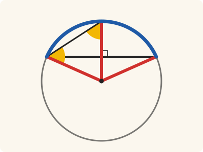
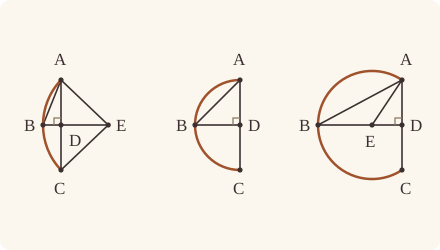

<!-- Generated by scripts/render.py. Do not edit by hand. -->

[Book III](index.md) · [← III.24](24.md) · [III.26 →](26.md)

# Book III, Proposition 25

*The complete circle of a given segment*

[Euclid's proof](#euclids-proof) · [In Lean](#in-lean) · [What it rests on](#what-it-rests-on) · [Mishnah](#mishnah)

> Given a segment of a circle, to describe the complete circle of which it is a segment.

**In Lean:** ✅ proved, as Euclid states it, in our measure of circumferences · Euclid's argument

<p align="center"></p>

<p align="center"><em>To complete the circle of the segment ABC (blue), halve AC at D at right angles and copy the angle ABD at A (yellow). Here ABD is greater than BAD, so AE meets BD produced at the centre E, equally far (red) from A, B and C.</em></p>

## Euclid's proof

<p align="center"></p>

<p align="center"><em>Drawn for every case: the angle ABD greater than, equal to and less than the angle BAD, from left to right, as in Heath's three figures; the centre falls across AC from B, at D, and on B's side of AC.</em></p>

Let ABC be the given segment of a circle;

thus it is required to describe the complete circle belonging to the segment ABC, that is, of which it is a segment.

For let AC be bisected at D, let DB be drawn from the point D at right angles to AC, and let AB be joined;

the angle ABD is then greater than, equal to, or less than the angle BAD.

First let it be greater;

and on the straight line BA, and at the point A on it, let the angle BAE be constructed equal to the angle ABD; let DB be drawn through to E, and let EC be joined.

Then, since the angle ABE is equal to the angle BAE,

the straight line EB is also equal to EA. [I. 6]

And, since AD is equal to DC,

and DE is common,

the two sides AD, DE are equal to the two sides CD, DE respectively;

and the angle ADE is equal to the angle CDE, for each is right;

therefore the base AE is equal to the base CE.

But AE was proved equal to BE;

therefore BE is also equal to CE;

therefore the three straight lines AE, EB, EC are equal to one another.

Therefore the circle drawn with centre E and distance one of the straight lines AE, EB, EC will also pass through the remaining points and will have been completed. [III. 9]

Therefore, given a segment of a circle, the complete circle has been described.

And it is manifest that the segment ABC is less than a semicircle, because the centre E happens to be outside it.

Similarly, even if the angle ABD be equal to the angle BAD,

AD being equal to each of the two BD, DC,

the three straight lines DA, DB, DC will be equal to one another,

D will be the centre of the completed circle,

and ABC will clearly be a semicircle.

But, if the angle ABD be less than the angle BAD,

and if we construct, on the straight line BA and at the point A on it, an angle equal to the angle ABD, the centre will fall on DB within the segment ABC, and the segment ABC will clearly be greater than a semicircle.

Therefore, given a segment of a circle, the complete circle has been described.

Q. E. F.

## In Lean

| | |
|---|---|
| Proof | ✅ Proved, and its companions `Prop25.complete` ([III.25 complete](25.md#complete)), `Prop25.kind` ([III.25 kind](25.md#kind)) and `Prop25.of_circle` ([III.25 of_circle](25.md#of_circle)) |
| Statement | The whole enunciation. `Prop25` constructs a circle; `Prop25.complete` identifies it with the segment's; `Prop25.kind` classifies the arc; `Prop25.of_circle` takes its circle. |
| Argument | Euclid's. The core is Euclid's construction, in his three cases. His step "[III. 9]", that the circle described is the one the segment came from, is the companion `Prop25.complete`, by III.9 and `circle_eq`. `Prop25.of_circle` runs the core on the arc of a given circle, the meeting fact coming from `Prop25.meets` [III. 2]. The core puts B and C on its circle by `Tacit.on_circle_of_len_eq` (System E, Diagram-segment 3), proved in `Elements/Figure/RuleBase.lean`. The completion uses two assumed rules: `Tacit.exists_centre`, from Definitions I.15 and I.16 and not a rule of System E, and `Tacit.circle_eq` (System E, Diagram-segment 2). |
| Representation | The core is given the base AC, a point P on the segment's side and the segment's points as a predicate S, with the fact Euclid reads off the figure: a straight line drawn from within the base towards P's side meets the segment. It never sees a circle or a centre, and describes its circle with centre E (Postulate 3). The companions are given the segment as the arc of a circle, the ends of its base and a point naming its side (`Arc`), and `Prop25.complete` shows that the core's circle is that circle, so the pair says all that Heath's enunciation says. `Prop25.kind` also compares the arc's circumference with two right angles; the measure is twice the angle standing on it and carries no radius. |
| Reviewed | The statement and every passage of the argument read against Heath's text, at commit [`509c9f200`](https://github.com/dodecaplex-co/stoicheia/commit/509c9f200) ([the record](../../review/III/25.toml)) |

From [`Elements/BookIII/Prop25.lean`](../../Elements/BookIII/Prop25.lean). Euclid's sentences are the `--` comments, and our own notes are in `/- … -/`; the lines under each sentence are the Lean that carries it out. The list below marks where a lemma does a step Euclid takes for granted and where two companions are proved as theorems of their own; the `/- … -/` notes in the listing explain smaller adjustments.

**How the Lean follows the text**

- **Done by `BookI.Prop10`.** "For let AC be bisected at D…" Euclid bisects AC and draws DB at right angles without references from Heath here; the Lean uses I.10 (`BookI.Prop10`) and I.11 (`BookI.Prop11`), then the given meeting fact supplies B. For an arc of a circle, `Prop25.meets` proves that fact by III.2 and `Tacit.line_circle_beyond`, the rule we assume as System E, Intersections 5.
- **Done by `Tacit.lt_trichotomy`.** "the angle ABD is then greater than, equal to, or less than the angle BAD." Euclid takes the three possible comparisons of ABD and BAD for granted. The Lean splits them by `Tacit.lt_trichotomy`, a rule we assume about magnitudes (System E §3.5), not a proved lemma.
- **Done by `BookI.Prop23`.** "and on the straight line BA, and at the point A on it…" Euclid constructs BAE equal to ABD without a reference from Heath here. The Lean uses I.23 (`BookI.Prop23`) on the ray from A through B, on D's side of AB.
- **Done by `Postulate5`.** "let DB be drawn through to E…" Euclid takes for granted that AE meets DB drawn through; Postulate 5 gives it, the angles BAE, ABD being less than two right angles, since ABD is acute (I.17, for which Heath prints no reference here). Postulate 5 is a rule we assume (System E §3.6, diagram-angle transfer rule 5); its side condition puts E on D's side of AB, so `OnRay.of_sameSideOf` excludes B between D and E, the equality BAE = ABD excludes E = D, and `Tacit.between_cases` (the rule we assume as System E, Between 6) leaves D between B and E once `angle_lt_of_between` excludes E between B and D.
- **Done by `Tacit.adjacent_eq_of_right`.** "and the angle ADE is equal to the angle CDE…" Euclid takes ADE and CDE to be right, without a reference from Heath here. The Lean obtains both from the constructed right angle ADB by `Tacit.adjacent_eq_of_right`, now proved from I.13 and Common Notion 3.
- **Done by `BookI.Prop4`.** "therefore the base AE is equal to the base CE." Euclid infers AE equal to CE from the two equal sides and the equal included angles, without a reference from Heath here. The Lean applies I.4 (`BookI.Prop4`) to DAE and DCE.
- **Proved separately, as `Prop25.complete`.** "Therefore the circle drawn with centre E and distance one of the straight lines…" The core describes the circle with centre E through A (Postulate 3), and B and C are on it, EB and EC being equal to EA. That it is the circle of the given segment, Euclid's [III. 9], is proved as its own theorem, the companion `Prop25.complete`, for each of the three cases. It takes a centre of the constructed circle from the rule internally; the construction still returns its centre E, which `Prop25.kind` uses.
- **Proved separately, as `Prop25.kind`.** "And it is manifest that the segment ABC is less than a semicircle…" The core puts E across AC from B by `Tacit.pasch3` (System E, Pasch 3), proved in `Elements/Figure/RuleBase.lean`; `Prop25.kind` proves `Arc.Less` and that the circumference measures less than two right angles, using I.32, III.2, III.20 and III.21, for which Heath prints no references here. `Prop25.complete` identifies the constructed circle with the given arc's circle, transporting both conclusions to that arc.
- **Proved separately, as `Prop25.complete`.** "D will be the centre of the completed circle…" Euclid leaves this completion to the same argument without writing it out. The core draws the circle about D by Postulate 3, and `Prop25.complete` identifies it with the given circle by III.9, for which Heath prints no reference here.
- **Proved separately, as `Prop25.kind`.** "and ABC will clearly be a semicircle." `Prop25.kind` proves `Arc.Semicircle` and that the circumference measures two right angles, since E is D, between A and C, using I.5, I.32 and III.2, for which Heath prints no references here. `Prop25.complete` identifies the constructed circle with the given arc's circle, transporting both conclusions to that arc.
- **Done by `BookI.Prop23`.** "and if we construct, on the straight line BA…" Euclid refers to the first case's argument without writing it out (Heath, vol. 2, p. 56); the core copies the angle by I.23 (`BookI.Prop23`), places its ray within BAD by `BookI.Prop24.within`, finds E between B and D by `crossbar`, and makes EA, EB and EC equal by I.6 and I.4, with the adjacent right angle supplied by `Tacit.adjacent_eq_of_right` (I.13), then draws the circle by Postulate 3; Heath prints no references here. The assumed rule `Tacit.pasch2` (System E, Pasch 2) puts E on B's side of AC; `Prop25.kind` supplies only the resulting `Arc.Greater` classification and measure above two right angles, using I.32, III.2, III.20, III.21 and III.22, and `Prop25.complete` identifies the constructed circle with the given arc's circle by III.9, transporting both conclusions to that arc, again without references from Heath here.

```lean
/-- Given a segment of a circle, to describe the complete circle of which it is a segment. -/
theorem Prop25 {A C P : Point} {S : Point → Prop} (hP : ¬ Collinear A C P)
    (hmeet : ∀ X Y : Point, Between A X C → SameSideOf Y P A C →
      ∃ B : Point, S B ∧ OnRay B X Y) :
    ∃ (B D E : Point) (γ : Circle), S B ∧ SameSideOf B P A C ∧ Between A D C ∧
      ‖A D‖ = ‖D C‖ ∧ ∠ A D B = ∟ ∧ Centre E γ ∧ OnCircle A γ ∧ OnCircle B γ ∧
      OnCircle C γ ∧ Collinear D B E ∧
      (∠ B A D < ∠ A B D → OppositeSidesOf E B A C) ∧ (∠ A B D = ∠ B A D → E = D) ∧
      (∠ A B D < ∠ B A D → SameSideOf E B A C) := by
  -- Let ABC be the given segment of a circle;
  have hAC : A ≠ C := (show Triangle A C P from hP).ne₁₂
  -- thus it is required to describe the complete circle belonging to the segment ABC, that is,
  -- of which it is a segment.
  -- For let AC be bisected at D, let DB be drawn from the point D at right angles to AC, and
  -- let AB be joined;
  obtain ⟨D, hADC, hAD⟩ := BookI.Prop10 hAC
  obtain ⟨L, hA_L, hC_L⟩ := Postulate1 A C hAC
  have hD_L : OnLine D L := on_line_of_between_ends hADC hA_L hC_L
  obtain ⟨X, hXP, hX⟩ := BookI.Prop11 hAC ⟨L, hA_L, hC_L, hD_L⟩ hP
  /- The perpendicular meets the segment's circumference: the meeting fact, for D within the
     base and X on P's side, gives B, a point of S on the ray from D through X. -/
  obtain ⟨B, hB, hBray⟩ := hmeet D X hADC hXP
  have hAD' : A ≠ D := ne_of_between hADC
  have hCD' : C ≠ D := ne_of_between (between_symm hADC)
  /- The ray from D through X lies on P's side of AC, so B, on it, is on that side too. -/
  have hBP_DA : SameSideOf B P D A := SameSideOf.of_onRay hBray
    (SameSideOf.of_line hAD'.symm hD_L hA_L (hXP.sameSide hA_L hC_L))
  have hBP : SameSideOf B P A C :=
    SameSideOf.of_line hAC hA_L hC_L (hBP_DA.sameSide hD_L hA_L)
  have hB_L : ¬ OnLine B L := hBP.triangle.off_line hA_L hC_L
  have hBD : B ≠ D := hBray.2.1
  obtain ⟨N, hD_N, hX_N⟩ := Postulate1 D X hBray.1
  have hB_N : OnLine B N := hBray.onLine hD_N hX_N
  have hADB : ∠ A D B = ∟ := by
    rw [angle_onRay_right hBray hAD']
    exact hX A ⟨L, hA_L, hC_L, hA_L⟩ hAD'
  have hABD : Triangle A B D := (Triangle.of_line hA_L hD_L hAD' hB_L).acb
  have hAB : A ≠ B := hABD.ne₁₂
  have hA_N : ¬ OnLine A N := fun hA_N => hB_L ((line_unique hAD' hA_N hD_N hA_L hD_L) ▸ hB_N)
  -- the angle ABD is then greater than, equal to, or less than the angle BAD.
  rcases lt_trichotomy (∠ B A D) (∠ A B D) with h | h | h
  -- First let it be greater;
  -- and on the straight line BA, and at the point A on it, let the angle BAE be constructed
  -- equal to the angle ABD; let DB be drawn through to E, and let EC be joined.
  · obtain ⟨G, F, hF, hGD, hGAF⟩ := BookI.Prop23 hAB hABD hABD
    have hGA : G ≠ A := hGD.triangle.ne₁₃.symm
    have hBAG : ∠ B A G = ∠ A B D :=
      (angle_onRay_left hF hGA).symm.trans ((angle_symm hF.2.1 hGA).trans hGAF)
    obtain ⟨M, hA_M, hB_M⟩ := Postulate1 A B hAB
    obtain ⟨K, hA_K, hG_K⟩ := Postulate1 A G hGA.symm
    /- Postulate 5 makes AG and DB produced meet, for the angles GAB, ABD are less than two
       right angles, ABD being less than a right angle [I. 17]. -/
    have hABD_lt : ∠ A B D < ∟ := by
      have h17 := (BookI.Prop17 hABD).1
      rw [angle_symm hBD hAD', hADB] at h17
      exact Magnitude.lt_of_add_lt_add_right h17
    obtain ⟨E, hE_K, hE_N, hEG⟩ := Postulate5 hG_K hA_K hA_M hB_M hB_N hD_N hAB
      (hGD.sameSide hA_M hB_M)
      (by rw [angle_symm hGA hAB.symm, hBAG]; exact Magnitude.add_self_lt_add_self hABD_lt)
    have hEG' : SameSideOf E G A B := SameSideOf.of_line hAB hA_M hB_M hEG
    have hED' : SameSideOf E D A B := hEG'.trans hGD
    have hEA : E ≠ A := hEG'.triangle.ne₁₃.symm
    have hEB : E ≠ B := hEG'.triangle.ne₂₃.symm
    have hEray : OnRay E A G := OnRay.of_sameSideOf hEG' ⟨K, hA_K, hG_K, hE_K⟩ hEA
    have hBAE : ∠ B A E = ∠ A B D := (angle_onRay_right hEray hAB.symm).trans hBAG
    have hEray' : OnRay E B D := OnRay.of_sameSideOf hED'.swap ⟨N, hB_N, hD_N, hE_N⟩ hEB
    /- E is beyond D: were it D, or between B and D, the angle BAE would not be greater than
       BAD. -/
    have hED : E ≠ D := fun e => by rw [e] at hBAE; rw [hBAE] at h; exact lt_irrefl _ h
    have hBDE : Between B D E := by
      rcases between_cases hBD hED.symm hEB.symm hB_N hD_N hE_N with h' | h' | h'
      · exact h'
      · exact absurd (between_symm h') hEray'.2.2.2
      · have hlt := angle_lt_of_between (V := A) (Triangle.of_line hD_N hB_N hBD.symm hA_N)
          (between_symm h')
        rw [angle_symm hEA hAB.symm, angle_symm hAD'.symm hAB.symm, hBAE] at hlt
        exact absurd (lt_trans hlt h) (lt_irrefl _)
    -- Then, since the angle ABE is equal to the angle BAE,
    have hABE : ∠ A B E = ∠ B A E := by
      rw [angle_onRay_right hEray' hAB, hBAE]
    -- the straight line EB is also equal to EA. [I. 6]
    have hEBA : Triangle E B A := (Triangle.of_line hB_N hE_N hEB.symm hA_N).bac
    have hEB_EA : ‖E B‖ = ‖E A‖ := BookI.Prop6 hEBA (by
      rw [angle_symm hEB hAB, hABE, angle_symm hAB.symm hEA])
    -- And, since AD is equal to DC,
    have hDA_DC : ‖D A‖ = ‖D C‖ := (len_symm D A).trans hAD
    -- and DE is common,
    have hDE : ‖D E‖ = ‖D E‖ := rfl
    -- the two sides AD, DE are equal to the two sides CD, DE respectively;
    -- and the angle ADE is equal to the angle CDE, for each is right;
    have hADE : ∠ A D E = ∟ := by
      rw [← adjacent_eq_of_right hB_N hE_N hBDE hA_N (by rw [angle_symm hBD hAD']; exact hADB),
        angle_symm hBD hAD', hADB]
    have hE_L : ¬ OnLine E L := fun hE_L =>
      hB_L ((line_unique hED hE_N hD_N hE_L hD_L) ▸ hB_N)
    have hCDE : ∠ C D E = ∟ := by
      rw [angle_symm hCD' hED, ← adjacent_eq_of_right hA_L hC_L hADC hE_L hADE, hADE]
    -- therefore the base AE is equal to the base CE.
    have hAE : ‖A E‖ = ‖C E‖ :=
      (BookI.Prop4 (Triangle.of_line hD_L hA_L hAD'.symm hE_L)
        (Triangle.of_line hD_L hC_L hCD'.symm hE_L) hDA_DC hDE
        (hADE.trans hCDE.symm)).1
    -- But AE was proved equal to BE;
    have h1 : ‖E A‖ = ‖E B‖ := hEB_EA.symm
    -- therefore BE is also equal to CE;
    have h2 : ‖E B‖ = ‖E C‖ := by rw [hEB_EA, len_symm E A, hAE, len_symm C E]
    -- therefore the three straight lines AE, EB, EC are equal to one another.
    -- Therefore the circle drawn with centre E and distance one of the straight lines AE, EB, EC
    -- will also pass through the remaining points and will have been completed. [III. 9]
    /- Postulate 3 describes the circle γ with centre E through A; EB and EC are equal to
       EA, so B and C are on it too. That γ is the given circle, Heath's [III. 9] step, is
       carried by `Prop25.complete`. -/
    obtain ⟨γ, hE, hAγ⟩ := Postulate3 E A hEA
    have hBγ : OnCircle B γ := on_circle_of_len_eq hE hAγ h1.symm
    have hCγ : OnCircle C γ := on_circle_of_len_eq hE hAγ (h1.trans h2).symm
    -- Therefore, given a segment of a circle, the complete circle has been described.
    -- And it is manifest that the segment ABC is less than a semicircle, because the centre E
    -- happens to be outside it.
    have hEB_AC : OppositeSidesOf E B A C :=
      OppositeSidesOf.of_line hAC hA_L hC_L ⟨hE_L, hB_L, pasch3 (between_symm hBDE) hD_L⟩
    exact ⟨B, D, E, γ, hB, hBP, hADC, hAD, hADB, hE, hAγ, hBγ, hCγ,
      ⟨N, hD_N, hB_N, hE_N⟩, fun _ => hEB_AC,
      fun h' => absurd (h'.symm ▸ h) (lt_irrefl _),
      fun h' => absurd (lt_trans h h') (lt_irrefl _)⟩
  -- Similarly, even if the angle ABD be equal to the angle BAD,
  -- AD being equal to each of the two BD, DC,
  · have hDA_DB : ‖D A‖ = ‖D B‖ := BookI.Prop6 (Triangle.of_line hD_L hA_L hAD'.symm hB_L) (by
      rw [angle_symm hAD'.symm hAB.symm, h, angle_symm hAB hBD.symm])
    -- the three straight lines DA, DB, DC will be equal to one another,
    have hDB_DC : ‖D B‖ = ‖D C‖ := by rw [← hDA_DB, len_symm D A, hAD]
    -- D will be the centre of the completed circle,
    /- Postulate 3 describes the circle γ with centre D through A; DB and DC are equal to
       DA, so B and C are on it too. Heath gives no reference here: that γ is the given
       circle is III.9's step, as in the first case, and `Prop25.complete` carries it. -/
    obtain ⟨γ, hD, hAγ⟩ := Postulate3 D A hAD'.symm
    have hBγ : OnCircle B γ := on_circle_of_len_eq hD hAγ hDA_DB.symm
    have hCγ : OnCircle C γ := on_circle_of_len_eq hD hAγ (hDA_DB.trans hDB_DC).symm
    -- and ABC will clearly be a semicircle.
    exact ⟨B, D, D, γ, hB, hBP, hADC, hAD, hADB, hD, hAγ, hBγ, hCγ,
      ⟨N, hD_N, hB_N, hD_N⟩,
      fun h' => absurd (h ▸ h') (lt_irrefl _), fun _ => rfl,
      fun h' => absurd (h ▸ h') (lt_irrefl _)⟩
  -- But, if the angle ABD be less than the angle BAD,
  -- and if we construct, on the straight line BA and at the point A on it, an angle equal to
  -- the angle ABD, the centre will fall on DB within the segment ABC, and the segment ABC will
  -- clearly be greater than a semicircle.
  · obtain ⟨G, F, hF, hGD, hGAF⟩ := BookI.Prop23 hAB hABD hABD
    have hGA : G ≠ A := hGD.triangle.ne₁₃.symm
    have hBAG : ∠ B A G = ∠ A B D :=
      (angle_onRay_left hF hGA).symm.trans ((angle_symm hF.2.1 hGA).trans hGAF)
    /- The straight line AG falls within the angle BAD, and crosses BD at E. -/
    have hGB : SameSideOf G B A D := BookI.Prop24.within hGD.symm (by rw [hBAG]; exact h)
    obtain ⟨E, hBED, hEray⟩ := crossbar hGD hGB
    have hBAE : ∠ B A E = ∠ A B D := (angle_onRay_right hEray hAB.symm).trans hBAG
    have hE_N : OnLine E N := on_line_of_between_ends hBED hB_N hD_N
    have hED : E ≠ D := (ne_of_between (between_symm hBED)).symm
    have hEB : E ≠ B := (ne_of_between hBED).symm
    have hEA : E ≠ A := fun e => hA_N (e ▸ hE_N)
    /- As in the first case, EB is equal to EA [I. 6]. -/
    have hABE : ∠ A B E = ∠ B A E := by
      rw [angle_onRay_right (OnRay.of_between hBED) hAB, hBAE]
    have hEBA : Triangle E B A := (Triangle.of_line hB_N hE_N hEB.symm hA_N).bac
    have hEB_EA : ‖E B‖ = ‖E A‖ := BookI.Prop6 hEBA (by
      rw [angle_symm hEB hAB, hABE, angle_symm hAB.symm hEA])
    /- AE is equal to CE, for the angles at D are right [I. 4]. -/
    have hADE : ∠ A D E = ∟ := by
      rw [angle_onRay_right (OnRay.of_between (between_symm hBED)) hAD']; exact hADB
    have hE_L : ¬ OnLine E L := fun hE_L =>
      hB_L ((line_unique hED hE_N hD_N hE_L hD_L) ▸ hB_N)
    have hCDE : ∠ C D E = ∟ := by
      rw [angle_symm hCD' hED, ← adjacent_eq_of_right hA_L hC_L hADC hE_L hADE, hADE]
    have hAE : ‖A E‖ = ‖C E‖ :=
      (BookI.Prop4 (Triangle.of_line hD_L hA_L hAD'.symm hE_L)
        (Triangle.of_line hD_L hC_L hCD'.symm hE_L) (by rw [len_symm D A, hAD]) rfl
        (hADE.trans hCDE.symm)).1
    /- So the three straight lines AE, EB, EC are equal. -/
    have h1 : ‖E A‖ = ‖E B‖ := hEB_EA.symm
    have h2 : ‖E B‖ = ‖E C‖ := by rw [hEB_EA, len_symm E A, hAE, len_symm C E]
    /- Postulate 3 describes the circle γ with centre E through A; EB and EC are equal to
       EA, so B and C are on it too. Heath gives no reference here: that γ is the given
       circle is III.9's step, as in the first case, and `Prop25.complete` carries it. -/
    obtain ⟨γ, hE, hAγ⟩ := Postulate3 E A hEA
    have hBγ : OnCircle B γ := on_circle_of_len_eq hE hAγ h1.symm
    have hCγ : OnCircle C γ := on_circle_of_len_eq hE hAγ (h1.trans h2).symm
    /- E lies between B and D, and so on B's side of AC. -/
    have hEB_AC : SameSideOf E B A C :=
      SameSideOf.of_line hAC hA_L hC_L (pasch2 (between_symm hBED) hD_L hE_L)
    -- Therefore, given a segment of a circle, the complete circle has been described.
    exact ⟨B, D, E, γ, hB, hBP, hADC, hAD, hADB, hE, hAγ, hBγ, hCγ,
      ⟨N, hD_N, hB_N, hE_N⟩,
      fun h' => absurd (lt_trans h h') (lt_irrefl _),
      fun h' => absurd (h' ▸ h) (lt_irrefl _), fun _ => hEB_AC⟩
  -- Q. E. F.
```

<a name="complete"></a><a name="kind"></a><a name="of_circle"></a>

<details><summary>After the theorem, its companions, <code>Prop25.complete</code>, <code>Prop25.kind</code> and <code>Prop25.of_circle</code>; and one lemma for its own proofs, <code>Prop25.meets</code> (143 lines)</summary>

```lean
/-- **III.25's circle is the segment's circle.** Let A, C be points of a circle α,
and B a point of its arc on P's side of AC (B on P's side). Any circle γ
through A, B and C is α, and every point of the arc AC on P's side is on γ.

A companion of III.25 ("III.25 complete"): its correctness argument, kept apart from the
construction core. It carries Heath's "of which it is a segment", and Euclid's step
"[III. 9]": the rule gives a centre E of γ; A, B and C are three points of α on γ,
so EA, EB, EC are equal, E is the centre of α, and one centre with one radius makes one
circle (`circle_eq`). [III. 9] -/
theorem Prop25.complete {A C P B : Point} {α γ : Circle} (hA : OnCircle A α)
    (hC : OnCircle C α) (hB : OnArc B ⟨α, A, C, P⟩) (hBP : SameSideOf B P A C)
    (hAγ : OnCircle A γ) (hBγ : OnCircle B γ) (hCγ : OnCircle C γ) :
    γ = α ∧ ∀ X : Point, OnArc X ⟨α, A, C, P⟩ → OnCircle X γ := by
  obtain ⟨E, hE⟩ := exists_centre γ
  /- B is on P's side of AC, so off the straight line AC: A, B and C are three different
     points of α. They are on γ too, so EA, EB and EC are equal, being radii of γ
     [I. Def. 15], and E is the centre of α [III. 9]. -/
  have hABC : Triangle A B C := hBP.triangle.acb
  have hEα : Centre E α := Prop9 hA hB.1 hC hABC.ne₁₂ hABC.ne₂₃ hABC.ne₁₃
    (Definition15 hE hAγ hBγ) (Definition15 hE hBγ hCγ)
  /- So γ and α have one centre, E, and one radius, EA: they are one circle. -/
  have hγ : γ = α := circle_eq hE hEα hAγ hA rfl
  /- Every point of the arc is on α, and so on γ. -/
  refine ⟨hγ, ?_⟩
  intro X hX
  rw [hγ]
  exact hX.1

/-- The centre's position in III.25 determines whether the segment is less than a
semicircle, a semicircle or greater, and how its circumference compares with two right angles.
B is on P's side of AC, and D lies between A and C. The construction's three conclusions
place E across AC from B, at D, or on B's side. `Prop25.complete` identifies the constructed
circle with the given segment's circle, carrying these conclusions to that segment.
[I. 5, I. 32, III. 2, III. 20, III. 21, III. 22] -/
theorem Prop25.kind {A B C D E P : Point} {γ : Circle}
    (hBP : SameSideOf B P A C) (hADC : Between A D C)
    (hE : Centre E γ) (hAγ : OnCircle A γ) (hCγ : OnCircle C γ)
    (hless : ∠ B A D < ∠ A B D → OppositeSidesOf E B A C)
    (hequal : ∠ A B D = ∠ B A D → E = D)
    (hgreater : ∠ A B D < ∠ B A D → SameSideOf E B A C) :
    Arc.Drawn ⟨γ, A, C, P⟩ ∧
      (∠ B A D < ∠ A B D →
        Arc.Less ⟨γ, A, C, P⟩ ∧
          circumference γ A P C < ∟ + ∟) ∧
      (∠ A B D = ∠ B A D →
        Arc.Semicircle ⟨γ, A, C, P⟩ ∧
          circumference γ A P C = ∟ + ∟) ∧
      (∠ A B D < ∠ B A D →
        Arc.Greater ⟨γ, A, C, P⟩ ∧
          ∟ + ∟ < circumference γ A P C) := by
  /- B and P are on the same side of AC, so P is off AC and the arc is drawn. -/
  have hP : Triangle A C P := hBP.symm.triangle
  refine ⟨⟨hAγ, hCγ, hP⟩, ?_, ?_, ?_⟩
  · intro h
    /- E is opposite B across AC, hence opposite P. -/
    have hEP : OppositeSidesOf E P A C := (hBP.symm.trans_opposite (hless h).symm).symm
    exact ⟨⟨E, hE, hEP⟩, Circumference.lt_semicircle hE hAγ hCγ hEP⟩
  · intro h
    /- E is D, between A and C, so AC is a diameter. -/
    have hAEC : Between A E C := by rw [hequal h]; exact hADC
    obtain ⟨L, hA_L, hE_L, hC_L⟩ := collinear_of_between hAEC
    exact ⟨⟨E, hE, ⟨L, hA_L, hC_L, hE_L⟩⟩,
      Circumference.semicircle hE hAγ hCγ hAEC hP⟩
  · intro h
    /- E is on B's side of AC, hence on P's side. -/
    have hEP : SameSideOf E P A C := (hgreater h).trans hBP
    exact ⟨⟨E, hE, hEP⟩, Circumference.gt_semicircle hE hAγ hCγ hEP⟩

/-- **A straight line from within the base meets the arc.** For a drawn arc, a ray from a point
X between the ends of the base, through a point Y on the arc's side, meets the arc. It is the
meeting fact that III.25's construction core reads off the segment it is given, for the
segment of a circle. Brief 0006 planned it for Book Zero, as `Arc.meets`; it rests on III.2,
and Book Zero cites no proposition, so it is here, beside the one proof that uses it.

Proved: X is within the circle [III. 2], so the straight line XY, produced beyond X backwards
and then forwards, meets the circle on Y's side (Intersections 5, with Pasch 3 for the side).
[III. 2] -/
theorem Prop25.meets {a : Arc} (ha : a.Drawn) {X Y : Point} (hX : Between a.B X a.C)
    (hY : SameSideOf Y a.K a.B a.C) : ∃ Q : Point, OnArc Q a ∧ OnRay Q X Y := by
  /- X lies within the circle, since it is between the ends of the base [III. 2], and Y is
     off the straight line BC. -/
  have hX_in : InsideCircle X a.circle := Prop2 ha.1 ha.2.1 X hX
  obtain ⟨L, hB_L, hC_L⟩ := Postulate1 a.B a.C hY.1
  have hX_L : OnLine X L := on_line_of_between_ends hX hB_L hC_L
  have hY_L : ¬ OnLine Y L := hY.triangle.off_line hB_L hC_L
  have hXY : X ≠ Y := fun e => hY_L (e ▸ hX_L)
  /- Draw XY, and produce it backwards, beyond X away from Y, to meet the circle at A
     (Intersections 5). -/
  obtain ⟨N, hX_N, hY_N⟩ := Postulate1 X Y hXY
  obtain ⟨A, hA, hA_N, hAXY⟩ := line_circle_beyond hX_in hX_N hY_N hXY.symm
  /- A is off BC: otherwise XY and BC would share A and X, and Y would lie on BC. So BC,
     through X, separates A from Y (Pasch 3). -/
  have hAX : A ≠ X := fun e => inside_not_on hX_in (e ▸ hA)
  have hA_L : ¬ OnLine A L := fun hA_L =>
    hY_L ((line_unique hAX hA_N hX_N hA_L hX_L) ▸ hY_N)
  have hAY : OppositeSidesOf A Y a.B a.C :=
    OppositeSidesOf.of_line hY.1 hB_L hC_L ⟨hA_L, hY_L, pasch3 hAXY hX_L⟩
  /- Produce AX forwards, beyond X, to meet the circle at Q (Intersections 5). Q is off
     BC for the same reason. -/
  obtain ⟨Q, hQ, hQ_N, hQXA⟩ := line_circle_beyond hX_in hX_N hA_N hAX
  have hQX : Q ≠ X := fun e => inside_not_on hX_in (e ▸ hQ)
  have hQ_L : ¬ OnLine Q L := fun hQ_L =>
    hY_L ((line_unique hQX hQ_N hX_N hQ_L hX_L) ▸ hY_N)
  /- BC separates Q from A too (Pasch 3), so Q is on Y's side, hence on K's side. -/
  have hQA : OppositeSidesOf Q A a.B a.C :=
    OppositeSidesOf.of_line hY.1 hB_L hC_L ⟨hQ_L, hA_L, pasch3 hQXA hX_L⟩
  have hQY : SameSideOf Q Y a.B a.C := hQA.symm.sameSideOf hAY
  /- Q lies on the arc and on XY. X cannot lie between Q and Y, since they are on one
     side of BC (Pasch 3); so Q lies on the ray from X through Y. -/
  exact ⟨Q, ⟨hQ, Or.inl (hQY.trans hY)⟩,
    hXY, hQX, ⟨N, hX_N, hY_N, hQ_N⟩,
    fun hQXY => pasch3 hQXY hX_L (hQY.sameSide hB_L hC_L)⟩

/-- **III.25, handed the whole circle** (companion of III.25, "III.25 of_circle"). Handed
the circle ABC, the core run on the points of its arc on P's side (which meet every
straight line from within the base, by `Prop25.meets`) finds a circle that is ABC itself
(`Prop25.complete`), so its centre E is the centre of ABC. This is III.25's statement
before brief 0006 restated it, with the centre-existence hypothesis removed (the `example`
below checks it against that statement); it retains its certificate. Proved from the core,
`Prop25.meets` and `Prop25.complete`, it checks that the pieces fit. -/
theorem Prop25.of_circle {A C : Point} {ABC : Circle} (hA : OnCircle A ABC)
    (hC : OnCircle C ABC) :
    ∀ P : Point, ¬ Collinear A C P → ∃ B D E : Point, OnCircle B ABC ∧ SameSideOf B P A C ∧
      Between A D C ∧ ‖A D‖ = ‖D C‖ ∧ ∠ A D B = ∟ ∧ Centre E ABC ∧ Collinear D B E ∧
      (∠ B A D < ∠ A B D → OppositeSidesOf E B A C) ∧ (∠ A B D = ∠ B A D → E = D) ∧
      (∠ A B D < ∠ B A D → SameSideOf E B A C) := by
  intro P hP
  have ha : Arc.Drawn ⟨ABC, A, C, P⟩ := ⟨hA, hC, hP⟩
  obtain ⟨B, D, E, γ, hSB, hBP, hADC, hAD, hADB, hE, hAγ, hBγ, hCγ, hDBE, k₁, k₂, k₃⟩ :=
    Prop25 (S := (OnArc · ⟨ABC, A, C, P⟩)) hP (fun _ _ hX hY => Prop25.meets ha hX hY)
  obtain ⟨hγ, -⟩ := Prop25.complete hA hC hSB hBP hAγ hBγ hCγ
  rw [hγ] at hE
  exact ⟨B, D, E, hSB.1, hBP, hADC, hAD, hADB, hE, hDBE, k₁, k₂, k₃⟩

/-- The check: III.25's statement before brief 0006 restated it, with its centre-existence
hypothesis, follows from `Prop25.of_circle` (checked by Lean). -/
example : ∀ {A C : Point} {ABC : Circle}, (∃ E : Point, Centre E ABC) →
    OnCircle A ABC → OnCircle C ABC →
    ∀ P : Point, ¬ Collinear A C P → ∃ B D E : Point, OnCircle B ABC ∧ SameSideOf B P A C ∧
      Between A D C ∧ ‖A D‖ = ‖D C‖ ∧ ∠ A D B = ∟ ∧ Centre E ABC ∧ Collinear D B E ∧
      (∠ B A D < ∠ A B D → OppositeSidesOf E B A C) ∧ (∠ A B D = ∠ B A D → E = D) ∧
      (∠ A B D < ∠ B A D → SameSideOf E B A C) :=
  fun _ hA hC => Prop25.of_circle hA hC
```

</details>

## What it rests on

| | Proposition | `Prop25.complete` | `Prop25.kind` | `Prop25.of_circle` |
|---|---|---|---|---|
| Heath's references | [I.6](../I/06.md), [III.9](09.md) | none | none | none |
| Lean cites | [I.4](../I/04.md), [I.6](../I/06.md), [I.10](../I/10.md), [I.11](../I/11.md), [I.13](../I/13.md), [I.17](../I/17.md), [I.23](../I/23.md) | [III.9](09.md) | [I.5](../I/05.md), [I.32](../I/32.md), [III.2](02.md), [III.20 special](20.md#special), [III.21](21.md), [III.22](22.md) | [III.2](02.md), [III.25](25.md), [III.25 complete](25.md#complete) |
| Postulates | 1, 2, 3, 4, 5 | 1, 2, 3, 4 | 1, 2, 3, 4, 5 | 1, 2, 3, 4, 5 |
| Definitions taken as axioms | Def. I.15 | Def. I.15 | Def. I.15 | Def. I.15 |
| Common Notions | 1, 2, 3, 4, 5 | 1, 2, 3, 4, 5 | 1, 2, 3, 4, 5 | 1, 2, 3, 4, 5 |
| Tacit rules | 38 (listed below) | 39 (listed below) | 38 (listed below) | 40 (listed below) |
| Its own Lean calls | Postulates 1, 3 and 5; 9 tacit rules | Def. I.15; 2 tacit rules | none | Postulate 1; 2 tacit rules |
| Through lemmas | Postulate 2; Def. I.15; 20 tacit rules | Postulate 1; 2 tacit rules | Postulates 1, 2 and 3; Def. I.15; 31 tacit rules | Postulates 2 and 3; Def. I.15; 25 tacit rules |

Some of these come in through lemmas [shared](../../CERTIFICATE.md#shared-steps) by many proofs: [`Circumference.semicircle`](../../Elements/BookIII/Circumferences.lean#L109) (I.5, I.32, III.2); [`Tacit.adjacent_eq_of_right`](../../Elements/BookI/Prop13.lean#L188) (I.13); [`Circumference.lt_semicircle`](../../Elements/BookIII/Circumferences.lean#L149) (I.32, III.2, III.20 special, III.21); [`Circumference.gt_semicircle`](../../Elements/BookIII/Circumferences.lean#L164) (I.32, III.2, III.20 special, III.21, III.22).

_Postulates, definitions, Common Notions and tacit rules: all that each proof rests on, counting those of the propositions it cites. The last two rows say which of the postulates, definitions and tacit rules its own Lean calls, in the proof or a helper written for it, and which it does not call but reaches through lemmas, of Book Zero or shared (a proposition it cites may rest on these too); the rest come in only through the propositions it cites or the Common Notions._

<details><summary>The 38 tacit rules beneath this proof, counting those of the propositions it cites, and 2 more beneath <code>Prop25.complete</code></summary>

_(used here) marks a rule this proof's own Lean calls, in the proof or a helper written for it; (through …) marks one its own Lean does not call but reaches through the lemmas named, of [Book Zero](../../Elements/Figure) or shared, though a proposition it cites may rest on it too; and a rule with no mark comes in only through a proposition it cites or a Common Notion. The names in brackets are System E's: an Intersection rule says when straight lines and circles must meet, and an Intersections rule takes a point where they do (see [Book I's introduction](../I/index.md))._

**Reading the figure**

- [`between_cases`](../../Elements/Foundations/Tacit/Diagram.lean#L54) (used here): Of three different points on a straight line, one is between the other two. (Between 6)
- [`between_symm`](../../Elements/Foundations/Tacit/Diagram.lean#L47) (used here): If B is between A and C, it is between C and A. (Between 1)
- [`circles_meet`](../../Elements/Foundations/Tacit/Diagram.lean#L91) (through [`BookI.Prop24.within`](../../Elements/BookI/Prop24.lean#L35), [`OnRay.of_between`](../../Elements/Figure/Rays.lean#L34), [`OnRay.of_sameSideOf`](../../Elements/Figure/Angles.lean#L188) and 7 other lemmas): If each circle passes through a point inside the other, the circles cut one another. This is the step Euclid takes for granted in I.1. (Intersection 5)
- [`circles_meet_same_side`](../../Elements/Foundations/Tacit/Constructions.lean#L79) (through [`BookI.Prop24.within`](../../Elements/BookI/Prop24.lean#L35), [`OnRay.of_between`](../../Elements/Figure/Rays.lean#L34), [`OnRay.of_sameSideOf`](../../Elements/Figure/Angles.lean#L188) and 7 other lemmas): Two circles that cut one another do so on each side of the straight line through their centres. (Intersections 8)
- [`exists_centre`](../../Elements/Foundations/Tacit/Constructions.lean#L57) (`Prop25.complete`): Every circle has a centre. A rule of our own, not one of System E's: its content is Euclid's Definitions I.15 and I.16.
- [`exists_point`](../../Elements/Foundations/Tacit/Constructions.lean#L35) (through [`BookI.Prop24.within`](../../Elements/BookI/Prop24.lean#L35), [`Triangle.ne₁₂`](../../Elements/Figure/Triangles.lean#L22), [`Triangle.ne₁₃`](../../Elements/Figure/Triangles.lean#L36) and 3 other lemmas): Let a point be taken. (Points 1)
- [`exists_point_inside_circle`](../../Elements/Foundations/Tacit/Constructions.lean#L42) (through [`BookI.Prop24.within`](../../Elements/BookI/Prop24.lean#L35), [`OnRay.of_between`](../../Elements/Figure/Rays.lean#L34), [`OnRay.of_sameSideOf`](../../Elements/Figure/Angles.lean#L188) and 8 other lemmas): Let a point be taken inside the circle α. (Points 8)
- [`exists_point_on_line`](../../Elements/Foundations/Tacit/Constructions.lean#L38) (through [`BookI.Prop24.within`](../../Elements/BookI/Prop24.lean#L35), [`OnRay.of_between`](../../Elements/Figure/Rays.lean#L34), [`OnRay.of_sameSideOf`](../../Elements/Figure/Angles.lean#L188) and 7 other lemmas): Let a point be taken on the straight line L. (Points 2)
- [`line_circle_between`](../../Elements/Foundations/Tacit/Constructions.lean#L67) (through [`BookI.Prop24.within`](../../Elements/BookI/Prop24.lean#L35), [`OnRay.of_between`](../../Elements/Figure/Rays.lean#L34), [`OnRay.of_sameSideOf`](../../Elements/Figure/Angles.lean#L188) and 8 other lemmas): A straight line through a point B inside a circle, heading out to a point C outside it, cuts the circle between B and C. (Intersections 4)
- [`line_circle_beyond`](../../Elements/Foundations/Tacit/Constructions.lean#L73) (through [`BookI.Prop24.within`](../../Elements/BookI/Prop24.lean#L35), [`OnRay.of_between`](../../Elements/Figure/Rays.lean#L34), [`OnRay.of_sameSideOf`](../../Elements/Figure/Angles.lean#L188) and 8 other lemmas): A straight line through a point B inside a circle, produced beyond B away from C, cuts the circle there. (Intersections 5)
- [`line_unique`](../../Elements/Foundations/Tacit/Diagram.lean#L41) (used here): Two points determine a straight line. (Generalities 1)
- [`lines_meet_of_opposite_sides`](../../Elements/Foundations/Tacit/Diagram.lean#L86) (through [`BookI.Prop24.within`](../../Elements/BookI/Prop24.lean#L35) and [`crossbar`](../../Elements/Figure/Angles.lean#L132)): A straight line joining points on opposite sides of L crosses L. (Intersection 1)
- [`not_between_of_between`](../../Elements/Foundations/Tacit/Diagram.lean#L50) (through [`BookI.Prop24.within`](../../Elements/BookI/Prop24.lean#L35), [`OnRay.of_between`](../../Elements/Figure/Rays.lean#L34), [`OnRay.of_sameSideOf`](../../Elements/Figure/Angles.lean#L188) and 12 other lemmas): If B is between A and C, then A is not between B and C. (Between 1)
- [`not_on_line_of_same_side`](../../Elements/Foundations/Tacit/Diagram.lean#L60) (through [`BookI.Prop24.within`](../../Elements/BookI/Prop24.lean#L35), [`OnRay.of_between`](../../Elements/Figure/Rays.lean#L34), [`OnRay.of_sameSideOf`](../../Elements/Figure/Angles.lean#L188) and 8 other lemmas): Points on one side of a straight line are not on it. (Same side 3)
- [`pasch2`](../../Elements/Foundations/Tacit/Diagram.lean#L71) (used here): If B is between A and C, A is on L and B is off it, then B and C are on the same side of L: a straight line that leaves L at A does not cross it again. (Pasch 2)
- [`same_side_trans`](../../Elements/Foundations/Tacit/Diagram.lean#L64) (through [`BookI.Prop24.within`](../../Elements/BookI/Prop24.lean#L35), [`OnRay.of_between`](../../Elements/Figure/Rays.lean#L34), [`OnRay.of_sameSideOf`](../../Elements/Figure/Angles.lean#L188) and 7 other lemmas): Two points on the same side of a straight line as a third point are on the same side as each other. (Same side 4)

**Lengths, angles and areas**

- [`angle_add_of_inside`](../../Elements/Foundations/Tacit/Transfer.lean#L47) (through [`BookI.Prop24.within`](../../Elements/BookI/Prop24.lean#L35), [`OnRay.of_sameSideOf`](../../Elements/Figure/Angles.lean#L188), [`Tacit.pasch3`](../../Elements/Figure/RuleBase.lean#L225) and 2 other lemmas): If D lies within the angle BAC, then BAC is made up of BAD and DAC. (Diagram-angle 2)
- [`angle_eq_of_same_rays`](../../Elements/Foundations/Tacit/Transfer.lean#L54) (through [`BookI.Prop24.within`](../../Elements/BookI/Prop24.lean#L35), [`angle_onRay_left`](../../Elements/Figure/Angles.lean#L42) and [`angle_onRay_right`](../../Elements/Figure/Angles.lean#L49)): The angle doesn't change if its arms are traced through other points on the same rays. (Diagram-angle 4)
- [`angle_symm`](../../Elements/Foundations/Tacit/Metric.lean#L30) (used here): The angle ABC is the angle CBA. (Metric 4)
- [`area_add_of_between`](../../Elements/Foundations/Tacit/Transfer.lean#L70): Cutting a triangle in two from a vertex adds up. (Diagram-area 2)
- [`area_congruent`](../../Elements/Foundations/Tacit/Metric.lean#L44): Triangles equal in all their sides and angles are equal in area. Euclid uses this without comment once he has shown two triangles congruent. (Metric 9)
- [`area_degenerate`](../../Elements/Foundations/Tacit/Metric.lean#L36): A "triangle" with a repeated corner has no area. (Metric 6)
- [`area_eq_zero_of_on_line`](../../Elements/Foundations/Tacit/Transfer.lean#L62): A "triangle" whose corners lie on one straight line has no area. (Diagram-area 1)
- [`area_rotate`](../../Elements/Foundations/Tacit/Metric.lean#L39): The triangle ABC is the triangle CAB. (Metric 8)
- [`circle_eq`](../../Elements/Foundations/Tacit/Transfer.lean#L30) (`Prop25.complete`): A circle is fixed by its centre and its radius. (Diagram-segment 2)
- [`len_add_of_between`](../../Elements/Foundations/Tacit/Transfer.lean#L27) (through [`BookI.Prop24.within`](../../Elements/BookI/Prop24.lean#L35), [`OnRay.of_between`](../../Elements/Figure/Rays.lean#L34), [`OnRay.of_sameSideOf`](../../Elements/Figure/Angles.lean#L188) and 11 other lemmas): If B is between A and C, then AB and BC together make up AC. (Diagram-segment 1)
- [`len_self`](../../Elements/Foundations/Tacit/Metric.lean#L24) (through [`BookI.Prop24.within`](../../Elements/BookI/Prop24.lean#L35), [`OnRay.of_between`](../../Elements/Figure/Rays.lean#L34), [`OnRay.of_sameSideOf`](../../Elements/Figure/Angles.lean#L188) and 11 other lemmas): The "straight line" from a point to itself has no length. (Metric 1)
- [`len_symm`](../../Elements/Foundations/Tacit/Metric.lean#L27) (used here): The straight line AB is the straight line BA. (Metric 3)
- [`on_line_of_area_eq_zero`](../../Elements/Foundations/Tacit/Transfer.lean#L66): A triangle with no area has its corners on one straight line. (Diagram-area 1)
- [`radius_ne_zero`](../../Elements/Foundations/Tacit/Metric.lean#L62) (through [`BookI.Prop24.within`](../../Elements/BookI/Prop24.lean#L35), [`OnRay.of_between`](../../Elements/Figure/Rays.lean#L34), [`OnRay.of_sameSideOf`](../../Elements/Figure/Angles.lean#L188) and 11 other lemmas): A circle's radius is not nothing: the straight line from the centre to a point on the circle has some length. A rule of our own, not one of System E's: every circle is drawn with a centre and a distance (Postulate 3).
- [`same_ray_of_angle_eq_zero`](../../Elements/Foundations/Tacit/Transfer.lean#L42) (through [`BookI.Prop24.within`](../../Elements/BookI/Prop24.lean#L35), [`OnRay.of_sameSideOf`](../../Elements/Figure/Angles.lean#L188), [`Tacit.pasch3`](../../Elements/Figure/RuleBase.lean#L225) and 2 other lemmas): If the angle BAC is nothing, C lies on the ray from A through B. (Diagram-angle 1)

**Superposition**

- [`superposition`](../../Elements/Foundations/Tacit/Superposition.lean#L52): **Superposition.** A hypothetical placement of a triangle on a given ray and side permits a restricted derivation of metric equalities about the figure already given. The derivation introduces no further objects, cites each geometric law it uses, and exports no symbol of the placement.

**Laws of magnitude**

- [`add_assoc`](../../Elements/Foundations/Tacit/Magnitudes.lean#L23): Adding three magnitudes in a row, it makes no difference whether the first two or the last two are added first. (System E §3.5)
- [`add_comm`](../../Elements/Foundations/Tacit/Magnitudes.lean#L26) (through [`BookI.Prop24.within`](../../Elements/BookI/Prop24.lean#L35), [`Magnitude.add_self_lt_add_self`](../../Elements/Figure/Areas.lean#L46), [`OnRay.of_between`](../../Elements/Figure/Rays.lean#L34) and 12 other lemmas): The order of adding does not matter. (System E §3.5)
- [`add_lt_add_right`](../../Elements/Foundations/Tacit/Magnitudes.lean#L45) (through [`BookI.Prop24.within`](../../Elements/BookI/Prop24.lean#L35), [`Magnitude.add_self_lt_add_self`](../../Elements/Figure/Areas.lean#L46) and [`Magnitude.lt_of_add_lt_add_right`](../../Elements/Figure/Lengths.lean#L51)): Adding the same thing to both sides keeps "less than". (System E §3.5)
- [`add_zero`](../../Elements/Foundations/Tacit/Magnitudes.lean#L29): Adding nothing changes nothing. (System E §3.5)
- [`lt_irrefl`](../../Elements/Foundations/Tacit/Magnitudes.lean#L32) (used here): No magnitude is less than itself. (System E §3.5)
- [`lt_trans`](../../Elements/Foundations/Tacit/Magnitudes.lean#L35) (used here): What is less than the less is less still. (System E §3.5)
- [`lt_trichotomy`](../../Elements/Foundations/Tacit/Magnitudes.lean#L39) (used here): Of two magnitudes, one is less, or they are equal, or the other is less. (System E §3.5)
- [`not_lt_zero`](../../Elements/Foundations/Tacit/Magnitudes.lean#L42) (through [`BookI.Prop24.within`](../../Elements/BookI/Prop24.lean#L35), [`OnRay.of_between`](../../Elements/Figure/Rays.lean#L34), [`OnRay.of_sameSideOf`](../../Elements/Figure/Angles.lean#L188) and 11 other lemmas): Nothing is less than zero. (System E §3.5)

</details>

## Mishnah

_Our commentary: what Euclid assumes, what Lean made us say out loud, and how the result looks by modern means._

**Where will the centre fall?** Given only a piece of a circle, Euclid finds its centre and completes it. III.1's way is not open: there the straight line at right angles is halved between two points of the circumference, and here DB meets the segment's circumference only at B. So Euclid constructs at A an angle equal to the angle ABD, and which of the angles ABD, BAD is the greater says where the centre falls: beyond AC, at D, or within the segment, as the segment is less than a semicircle, a semicircle, or greater.

**"Will also pass through the remaining points."** Heath explains why Euclid says it: "it is still desirable to state … that 'the circle drawn with centre E and distance one of the straight lines AE, EB, EC *will also pass through the remaining points of the segment*' [III. 9], in order to show that part of the circle described actually coincides with the given segment" (vol. 2, p. 56). Our statement keeps the two apart. Its construction is given only the segment: the ends A and C of its base, a point to name its side, and its points, with the one fact Euclid reads off his figure, that a straight line drawn from within the base towards the segment meets it. It never sees a circle or a centre, and describes its own circle about E. That this is the circle the segment came from, passing through the rest of its points, is the step for which Heath's reference is III.9, and the companion `Prop25.complete` proves it, by III.9, for a segment of any circle. The two together say what the enunciation says. Handed the whole circle, the construction finds its centre (`Prop25.of_circle`).

**"Produce BD, if necessary."** Robert Simson takes the semicircle first and the other two cases together, telling us to "produce BD, if necessary", which Heath finds "a little shorter than Euclid's procedure" (vol. 2, p. 56). H. M. Taylor bisects AC at right angles and then AB, and his two straight lines cross at Euclid's E.

**Why must AE meet DB?** Euclid takes the meeting for granted, and we prove it. In the first case Postulate 5 is the reason: the angle ABD is less than a right angle (I.17), so the angles BAE, ABD together are less than two right angles. In the third case AE crosses BD between B and D. Even B needs a word: the construction is given that DB meets the segment, and for a segment of a circle it does, since D is within the circle (III.2).

**The modern way.** With D at the origin, A = (−a, 0), C = (a, 0) and B = (0, b), for positive a and b, the centre is E = (0, (b² − a²)/2b) and the radius (a² + b²)/2b. So E lies beyond AC, at D, or on B's side as b is less than, equal to or greater than a: Euclid's three cases.

## Further reading

- A civil engineer can find the centre of a running track or a railway curve "if we know any part of its arc", David Eugene Smith explains in [*The Teaching of Geometry*](https://www.gutenberg.org/ebooks/37681) (1911, free online), ch. XV (p. 202): take two straight lines in the circle and bisect them at right angles, as H. M. Taylor completes the segment (also on [III.14](14.md)).
- H. S. M. Coxeter's [*Introduction to Geometry*](https://www.wiley-vch.de/de/fachgebiete/mathematik-und-statistik/introduction-to-geometry-978-0-471-50458-0) (1989 reprint of the 1969 second edition) develops the coordinates of the modern way in ch. 8, "Coordinates": a classic by a great geometer, with short, lively chapters.

[Book III](index.md) · [← III.24](24.md) · [III.26 →](26.md)

---

<sub>Euclid's text: T. L. Heath, *The Thirteen Books of Euclid's Elements*, vol. 2 (Cambridge, 1908), pp. 54–56; [scan leaves n66–n68](https://archive.org/details/thirteenbookseu00heibgoog/page/n66); figures on [n67](https://archive.org/details/thirteenbookseu00heibgoog/page/n67) and [n68](https://archive.org/details/thirteenbookseu00heibgoog/page/n68). Public domain.</sub>

<sub>The tacit rules follow the System E of Jeremy Avigad, Edward Dean and John Mumma, read alongside LeanEuclid (Logan Murphy, Kaiyu Yang, Jialiang Sun, Zhaoyu Li, Anima Anandkumar and Xujie Si).</sub>
