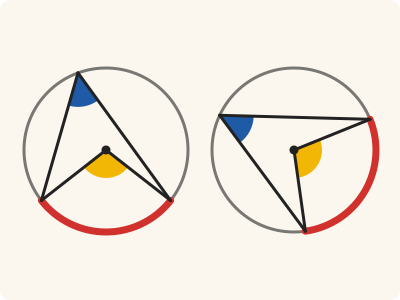
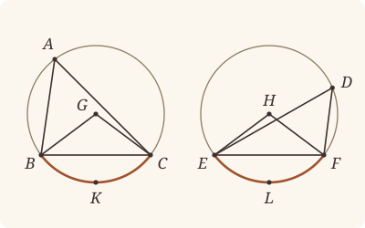

<!-- Generated by scripts/render.py. Do not edit by hand. -->

[Book III](index.md) · [← III.25](25.md) · [III.27 →](27.md)

# Book III, Proposition 26

*Equal angles stand on equal circumferences*

[Euclid's proof](#euclids-proof) · [In Lean](#in-lean) · [What it rests on](#what-it-rests-on) · [Mishnah](#mishnah)

> In equal circles equal angles stand on equal circumferences, whether they stand at the centres or at the circumferences.

**In Lean:** ✅ proved, as Euclid states it, in our measure of circumferences · Euclid's argument, with one step changed

<p align="center"></p>

<p align="center"><em>Give the equal circles ABC, DEF equal angles, at the centres G, H (yellow) or at the circumferences, at A and D (blue): the circumferences BKC, ELF they stand on come out equal (red).</em></p>

## Euclid's proof

<p align="center"></p>

<p align="center"><em>Drawn for one case: acute angles at A and D, with BKC and ELF less than semicircles.</em></p>

Let ABC, DEF be equal circles, and in them let there be equal angles, namely at the centres the angles BGC, EHF, and at the circumferences the angles BAC, EDF;

I say that the circumference BKC is equal to the circumference ELF.

For let BC, EF be joined.

Now, since the circles ABC, DEF are equal,

the radii are equal.

Thus the two straight lines BG, GC are equal to the two straight lines EH, HF;

and the angle at G is equal to the angle at H;

therefore the base BC is equal to the base EF. [I. 4]

And, since the angle at A is equal to the angle at D,

the segment BAC is similar to the segment EDF; [III. Def. 11]

and they are upon equal straight lines.

But similar segments of circles on equal straight lines are equal to one another; [III. 24]

therefore the segment BAC is equal to EDF.

But the whole circle ABC is also equal to the whole circle DEF;

therefore the circumference BKC which remains is equal to the circumference ELF.

Therefore etc.

Q. E. D.

## In Lean

| | |
|---|---|
| Proof | ✅ Proved |
| Statement | The whole enunciation. Euclid's two cases, each stated on its own, with equal circumferences read as equal in measure and congruent, which says more than Heath's words. |
| Argument | Euclid's, with one step changed. Euclid's one argument for angles of every size: equal angles at the circumferences give equal angles at the centres, their doubles (III.20), the bases are equal by I.4, the segments by III.24, and the remainders are equal in measure by his subtraction. The angles at the centres may be two right angles or more (`angleAtCentre`), a reading that is ours, made after Heath's notes, and not Euclid's; III.20 cites I.13 and III.2 for it, which Heath's references for III.20 do not give. One division into cases stays, at I.4: where the angles at the centres are two right angles, BC and EF are diameters, and where they are greater, I.4 takes the angles BGC, EHF that remain of four right angles. The congruence of the remainders comes from III.22 and III.24 in place of Euclid's subtraction, since a congruence cannot be subtracted. |
| Representation | "Equal circumferences" is read as equal in measure and congruent (`Arc.Congruent`), the congruence through Common Notion 4, as circumferences that coincide. So "in equal circles" does real work: in unequal circles equal angles give equal measures, but no congruence. The centres G and H are given, as the enunciation speaks of angles at the centres. The clause given at the centres speaks of the angles BGC, EHF themselves, less than two right angles, as Euclid's are, and so asks that G lie across BC from K, and H across EF from L, where those angles stand on BKC and ELF; within the proof the angles at the centres standing on BKC and ELF are of any size (`angleAtCentre`). |
| Reviewed | The statement and every passage of the argument read against Heath's text, at commit [`90238039b`](https://github.com/jackChallis/stoicheia/commit/90238039b) ([the record](../../review/III/26.toml)) |

From [`Elements/BookIII/Prop26.lean`](../../Elements/BookIII/Prop26.lean). Euclid's sentences are the `--` comments, and our own notes are in `/- … -/`; the lines under each sentence are the Lean that carries it out. The list below marks where a lemma does a step Euclid takes for granted, where the Lean takes a case Euclid's figure leaves aside and where a step is argued another way; the `/- … -/` notes in the listing explain smaller adjustments.

**How the Lean follows the text**

- **Done by `Prop26.alike`.** "and the angle at G is equal to the angle at H…" Euclid's figure has the centres on A's and D's sides, where the angles at G and H are angles of the triangles GBC, HEF. The Lean shows that equal angles at the centres lie alike, both less than two right angles, both two right angles, or both greater, so that G and H lie alike (`Prop26.alike`, by `angleAtCentre.size`); this tells which case of I.4 follows.
- **A further case.** "therefore the base BC is equal to the base EF." In Euclid's figure I.4 gives the bases from the angles BGC, EHF (`angleAtCentre.within`). Two cases his figure leaves aside are taken as well: where the angles at the centres are two right angles, G is on BC and H on EF, there are no triangles for I.4, and BC and EF are diameters, each two radii (`Tacit.len_add_of_between`, System E, Diagram-segment 1, a rule we assume); where they are greater, the angles BGC, EHF are what remains of four right angles (`angleAtCentre.reflex`), equal by Common Notion 3, and I.4 applies to them.
- **Done by `Prop24.equalMeasure`.** "therefore the segment BAC is equal to EDF." III.24 makes the segments BAC, EDF congruent, and its companion `Prop24.equalMeasure` gives what Euclid takes with them: their circumferences are equal in measure. That companion uses I.8, III.2, III.21 and III.22, for which Heath prints no references here, to compare angles at corresponding points and subtract their doubles from the whole circles.
- **Done by `Circumference.whole`.** "But the whole circle ABC is also equal to the whole circle DEF…" Euclid subtracts the equal segment circumferences from the equal whole circles. `Circumference.whole` proves that the two circumferences cut off by each chord together measure four right angles, using III.2, III.21 and III.22, for which Heath gives no references here.
- **Argued another way.** "therefore the circumference BKC which remains is equal to the circumference ELF." The remainders BKC, ELF are equal in measure by Euclid's subtraction [C.N. 3]. Their congruence cannot come by subtraction: `Prop2.sameSide` (III.2) supplies points of the remaining segments, III.22 makes their angles supplementary to the equal angles at A and D, and III.24 makes the similar segments congruent, with `Arc.Congruent.congr_side` transferring the result to K and L; Heath prints no references here.
- **Done by `Prop20`.** "Therefore etc." Our statement takes Euclid's two pairs of equal angles one at a time, and under his closing words III.20, for which Heath gives no reference here, supplies the other pair: given at the centres, the angles at the centres standing on BKC, ELF are the angles BGC, EHF themselves (`angleAtCentre.within`), and the angles at A and D are their halves; given at the circumferences, the angles at the centres are their doubles.

<details><summary>Before the theorem, one lemma: <code>Prop26.alike</code> (24 lines)</summary>

```lean
/-- **Equal angles at the centres lie alike.** If the angle at the centre G standing on
the circumference BKC is equal to the angle at the centre H standing on ELF, then G and H
lie alike: both on the other sides of BC and EF from K and L, both on BC and EF, or both
on K's and L's sides. For an angle at the centre is less than two right angles, two right
angles, or greater, as its centre lies (`angleAtCentre.size`). Euclid's figure draws the
first; this is the step that tells us which case we are in: I.4 on the angles at the
centres, no triangles at all, or I.4 on what remains of four right angles. -/
theorem Prop26.alike {B C E F G H K L : Point} {α β : Circle} (hG : Centre G α)
    (hB : OnCircle B α) (hC : OnCircle C α) (hK : Triangle B C K) (hH : Centre H β)
    (hE : OnCircle E β) (hF : OnCircle F β) (hL : Triangle E F L)
    (h : angleAtCentre α B K C = angleAtCentre β E L F) :
    (OppositeSidesOf G K B C ∧ OppositeSidesOf H L E F) ∨ (Between B G C ∧ Between E H F) ∨
      (SameSideOf G K B C ∧ SameSideOf H L E F) := by
  rcases angleAtCentre.size hG hB hC hK with ⟨hG', h₁⟩ | ⟨hG', h₁⟩ | ⟨hG', h₁⟩ <;>
    rcases angleAtCentre.size hH hE hF hL with ⟨hH', h₂⟩ | ⟨hH', h₂⟩ | ⟨hH', h₂⟩
  · exact Or.inl ⟨hG', hH'⟩
  · rw [h, h₂] at h₁; exact absurd h₁ (lt_irrefl _)
  · rw [h] at h₁; exact absurd (lt_trans h₁ h₂) (lt_irrefl _)
  · rw [← h, h₁] at h₂; exact absurd h₂ (lt_irrefl _)
  · exact Or.inr (Or.inl ⟨hG', hH'⟩)
  · rw [← h, h₁] at h₂; exact absurd h₂ (lt_irrefl _)
  · rw [h] at h₁; exact absurd (lt_trans h₁ h₂) (lt_irrefl _)
  · rw [h, h₂] at h₁; exact absurd h₁ (lt_irrefl _)
  · exact Or.inr (Or.inr ⟨hG', hH'⟩)
```

</details>

```lean
/-- In equal circles equal angles stand on equal circumferences, whether they stand at the centres
or at the circumferences. -/
theorem Prop26 {A B C D E F G H K L : Point} {ABC DEF : Circle} (hcircles : EqualCircles ABC DEF)
    (hG : Centre G ABC) (hH : Centre H DEF) (hA : OnCircle A ABC) (hB : OnCircle B ABC)
    (hC : OnCircle C ABC) (hD : OnCircle D DEF) (hE : OnCircle E DEF)
    (hF : OnCircle F DEF) (hAK : OppositeSidesOf A K B C) (hDL : OppositeSidesOf D L E F) :
    (OppositeSidesOf G K B C → OppositeSidesOf H L E F → ∠ B G C = ∠ E H F →
      circumference ABC B K C = circumference DEF E L F ∧
        Arc.Congruent ⟨ABC, B, C, K⟩ ⟨DEF, E, F, L⟩) ∧
    (∠ B A C = ∠ E D F →
      circumference ABC B K C = circumference DEF E L F ∧
        Arc.Congruent ⟨ABC, B, C, K⟩ ⟨DEF, E, F, L⟩) := by
  -- Let ABC, DEF be equal circles, and in them let there be equal angles, namely at the
  -- centres the angles BGC, EHF, and at the circumferences the angles BAC, EDF;
  -- I say that the circumference BKC is equal to the circumference ELF.
  /- As Euclid sets it out, we take both pairs of equal angles together. "The angles BGC,
     EHF" at the centres are the angles at the centres standing on the circumferences BKC
     and ELF (`angleAtCentre`), of any size: if Euclid's proof is to cover all cases, Heath
     says, "it requires us to take cognisance of 'angles at the centre' which are equal to
     or greater than two right angles" (vol. 2, p. 57). Our statement gives one pair at a
     time, and the other comes from III.20 at the end, under "Therefore etc." -/
  have euclid : angleAtCentre ABC B K C = angleAtCentre DEF E L F → ∠ B A C = ∠ E D F →
      circumference ABC B K C = circumference DEF E L F ∧
        Arc.Congruent ⟨ABC, B, C, K⟩ ⟨DEF, E, F, L⟩ := by
    intro hGH hAD
    -- For let BC, EF be joined.
    have hBCA : Triangle B C A := hAK.triangle
    have hEFD : Triangle E F D := hDL.triangle
    -- Now, since the circles ABC, DEF are equal,
    -- the radii are equal.
    have hGB : ‖G B‖ = ‖H E‖ := hcircles.radii hG hH hB hE
    have hGC : ‖G C‖ = ‖H F‖ := hcircles.radii hG hH hC hF
    -- Thus the two straight lines BG, GC are equal to the two straight lines EH, HF;
    -- and the angle at G is equal to the angle at H;
    /- "Thus …" gathers the radii just found, which I.4 uses below. The angles at G and
       H, being equal, are alike: both less than two right angles, both two right angles,
       or both greater, and so G and H lie alike (`Prop26.alike`). Euclid's figure has the
       first. -/
    have halike := Prop26.alike hG hB hC hAK.symm.triangle hH hE hF hDL.symm.triangle hGH
    -- therefore the base BC is equal to the base EF. [I. 4]
    have hBC : ‖B C‖ = ‖E F‖ := by
      rcases halike with ⟨hGK, hHL⟩ | ⟨hBGC, hEHF⟩ | ⟨hGK, hHL⟩
      · /- Euclid's figure: the angles at the centres are the angles BGC, EHF of the
           triangles GBC, HEF (`angleAtCentre.within`), and I.4 gives the bases. -/
        have hang : ∠ B G C = ∠ E H F := by
          rw [← angleAtCentre.within hG hB hC hGK, ← angleAtCentre.within hH hE hF hHL]
          exact hGH
        exact (BookI.Prop4 hGK.triangle.cab hHL.triangle.cab hGB hGC hang).1
      · /- A case Euclid's figure leaves aside: the angles at the centres are two right
           angles, G is on BC and H on EF, and there are no triangles for I.4. BC and EF
           are diameters, each two radii, and so equal. -/
        rw [← len_add_of_between hBGC, ← len_add_of_between hEHF, len_symm B G, hGB, hGC,
          len_symm E H]
      · /- A case Euclid's figure leaves aside: the angles at the centres are greater than
           two right angles, and G and H lie beyond BC and EF. The angles BGC, EHF of the
           triangles GBC, HEF are what remains when the angles at the centres are taken
           from four right angles (`angleAtCentre.reflex`), and so are equal [C.N. 3];
           I.4 applies to them. -/
        have hang : ∠ B G C = ∠ E H F :=
          CommonNotion3
            (by rw [add_comm (∠ B G C), angleAtCentre.reflex hG hB hC hGK,
              add_comm (∠ E H F), angleAtCentre.reflex hH hE hF hHL]) hGH
        exact (BookI.Prop4 hGK.triangle.cab hHL.triangle.cab hGB hGC hang).1
    -- And, since the angle at A is equal to the angle at D,
    -- the segment BAC is similar to the segment EDF; [III. Def. 11]
    -- and they are upon equal straight lines.
    -- But similar segments of circles on equal straight lines are equal to one
    -- another; [III. 24]
    -- therefore the segment BAC is equal to EDF.
    have seg : Arc.Congruent ⟨ABC, B, C, A⟩ ⟨DEF, E, F, D⟩ :=
      Prop24 hB hC hA hE hF hD hBCA hEFD hBC hAD
    /- So their circumferences are equal in measure (`Prop24.equalMeasure`). -/
    have hBAC : circumference ABC B A C = circumference DEF E D F :=
      Prop24.equalMeasure (a := ⟨ABC, B, C, A⟩) (b := ⟨DEF, E, F, D⟩)
        ⟨hB, hC, hBCA⟩
        ⟨hE, hF, hEFD⟩ seg
    -- But the whole circle ABC is also equal to the whole circle DEF;
    have w₁ := Circumference.whole hB hC hAK
    have w₂ := Circumference.whole hE hF hDL
    -- therefore the circumference BKC which remains is equal to the circumference ELF.
    have hKL : circumference ABC B K C = circumference DEF E L F :=
      CommonNotion3 (w₁.trans w₂.symm) hBAC
    /- Their congruence cannot come by subtraction, and comes from III.24 itself. At points
       X, Y of the circles on the sides of K and L, the angles make two right angles with
       the equal angles at A and D [III. 22], so they are equal, and the remaining segments
       are similar; on the equal bases BC, EF they are congruent [III. 24]. Only the side
       names a segment, so they are the segments on the sides of K and L
       (`Arc.Congruent.congr_side`). -/
    obtain ⟨X, hX, hXK⟩ := Prop2.sameSide hB hC hAK.symm.triangle
    obtain ⟨Y, hY, hYL⟩ := Prop2.sameSide hE hF hDL.symm.triangle
    have hXA : OppositeSidesOf X A B C := hXK.trans_opposite hAK.symm
    have hYD : OppositeSidesOf Y D E F := hYL.trans_opposite hDL.symm
    have hAX : ∠ B A C + ∠ B X C = ∟ + ∟ := by
      have hAX := (Prop22 hA hB hX hC hXA.symm).2
      rwa [angle_symm hXA.triangle.ne₂₃ hXA.triangle.ne₁₃] at hAX
    have hDY : ∠ E D F + ∠ E Y F = ∟ + ∟ := by
      have hDY := (Prop22 hD hE hY hF hYD.symm).2
      rwa [angle_symm hYD.triangle.ne₂₃ hYD.triangle.ne₁₃] at hDY
    have hXY : ∠ B X C = ∠ E Y F :=
      CommonNotion3 (c := ∠ B A C) (d := ∠ E D F)
        (by rw [add_comm (∠ B X C), hAX, add_comm (∠ E Y F), hDY]) hAD
    have hBXC := Prop24 hB hC hX hE hF hY
      hXK.triangle hYL.triangle hBC hXY
    exact ⟨hKL, hBXC.congr_side hXK hYL⟩
  -- Therefore etc.
  /- Our statement takes the two pairs of equal angles one at a time, as the enunciation's
     "whether they stand at the centres or at the circumferences" does, and III.20 gives
     the other pair: each angle at the centre is double of the angle at the circumference
     standing on the same circumference, whatever its size. Given at the centres, the
     circumferences BKC, ELF are less than semicircles, and the angles at the centres are
     the angles BGC, EHF themselves (`angleAtCentre.within`); the angles at A and D are
     their halves, and so equal. Given at the circumferences, the angles at the centres
     are their doubles, and so equal. -/
  have h₁ : angleAtCentre ABC B K C = ∠ B A C + ∠ B A C :=
    Prop20 hA hB hC hAK
  have h₂ : angleAtCentre DEF E L F = ∠ E D F + ∠ E D F :=
    Prop20 hD hE hF hDL
  refine ⟨fun hGK hHL h => ?_, fun h => euclid (by rw [h₁, h₂, h]) h⟩
  have hGH : angleAtCentre ABC B K C = angleAtCentre DEF E L F := by
    rw [angleAtCentre.within hG hB hC hGK, angleAtCentre.within hH hE hF hHL, h]
  exact euclid hGH (Magnitude.eq_of_add_self_eq (h₁.symm.trans (hGH.trans h₂)))
  -- Q. E. D.
```

<details><summary>After the theorem, more Lean (11 lines)</summary>

```lean
/-- The check: the equal measures alone, in each clause, follow from `Prop26` by the first
conjunct of each (checked by Lean). -/
example {A B C D E F G H K L : Point} {ABC DEF : Circle} (hcircles : EqualCircles ABC DEF)
    (hG : Centre G ABC) (hH : Centre H DEF) (hA : OnCircle A ABC) (hB : OnCircle B ABC)
    (hC : OnCircle C ABC) (hD : OnCircle D DEF) (hE : OnCircle E DEF)
    (hF : OnCircle F DEF) (hAK : OppositeSidesOf A K B C) (hDL : OppositeSidesOf D L E F) :
    (OppositeSidesOf G K B C → OppositeSidesOf H L E F → ∠ B G C = ∠ E H F →
      circumference ABC B K C = circumference DEF E L F) ∧
    (∠ B A C = ∠ E D F → circumference ABC B K C = circumference DEF E L F) :=
  ⟨fun hGK hHL h => ((Prop26 hcircles hG hH hA hB hC hD hE hF hAK hDL).1 hGK hHL h).1,
    fun h => ((Prop26 hcircles hG hH hA hB hC hD hE hF hAK hDL).2 h).1⟩
```

</details>

## What it rests on

| | |
|---|---|
| Heath's references | [I.4](../I/04.md), [III.24](24.md); Def. III.11 |
| Lean cites | [I.4](../I/04.md), [I.13](../I/13.md), [III.2](02.md), [III.20](20.md), [III.21](21.md), [III.22](22.md), [III.24](24.md), [III.24 equalMeasure](24.md#equalMeasure) |
| Postulates | 1, 2, 3, 4, 5 |
| Definitions taken as axioms | Def. I.15 |
| Common Notions | 1, 2, 3, 4, 5 |
| Tacit rules | 40 (listed below) |
| Its own Lean calls | 6 tacit rules |
| Through lemmas | Postulates 1, 2 and 3; Def. I.15; 25 tacit rules |

Some of these come in through lemmas [shared](../../CERTIFICATE.md#shared-steps) by many proofs: [`angleAtCentre.reflex`](../../Elements/BookIII/Prop20.lean#L245), [`angleAtCentre.size`](../../Elements/BookIII/Prop20.lean#L274), [`angleAtCentre.within`](../../Elements/BookIII/Prop20.lean#L208) (I.13, III.2); [`Prop2.sameSide`](../../Elements/BookIII/Prop02.lean#L171) (III.2); [`Circumference.whole`](../../Elements/BookIII/Circumferences.lean#L85) (III.2, III.21, III.22).

_Postulates, definitions, Common Notions and tacit rules: all that this proof rests on, counting those of the propositions it cites. The last two rows say which of the postulates, definitions and tacit rules its own Lean calls, in the proof or a helper written for it, and which it does not call but reaches through lemmas, of Book Zero or shared (a proposition it cites may rest on these too); the rest come in only through the propositions it cites or the Common Notions._

_Euclid's Def. III.11 is said in Lean by the equal angles in the segments, a definition rather than an assumption, so the row of definitions taken as axioms does not count it._

<details><summary>The 40 tacit rules beneath this proof, counting those of the propositions it cites</summary>

_(used here) marks a rule this proof's own Lean calls, in the proof or a helper written for it; (through …) marks one its own Lean does not call but reaches through the lemmas named, of [Book Zero](../../Elements/Figure) or shared, though a proposition it cites may rest on it too; and a rule with no mark comes in only through a proposition it cites or a Common Notion. The names in brackets are System E's: an Intersection rule says when straight lines and circles must meet, and an Intersections rule takes a point where they do (see [Book I's introduction](../I/index.md))._

**Reading the figure**

- [`between_cases`](../../Elements/Foundations/Tacit/Diagram.lean#L54) (through [`Circumference.whole`](../../Elements/BookIII/Circumferences.lean#L85), [`Prop2.sameSide`](../../Elements/BookIII/Prop02.lean#L171), [`angleAtCentre.reflex`](../../Elements/BookIII/Prop20.lean#L245) and 2 other lemmas): Of three different points on a straight line, one is between the other two. (Between 6)
- [`between_of_inside_chord`](../../Elements/Foundations/Tacit/Diagram.lean#L81) (through [`Circumference.whole`](../../Elements/BookIII/Circumferences.lean#L85), [`EqualCircles.radii`](../../Elements/Figure/OnCircles.lean#L94), [`Prop2.sameSide`](../../Elements/BookIII/Prop02.lean#L171) and 3 other lemmas): A straight line through a point inside a circle has that point between the points where it meets the circle. (Circle 1)
- [`between_symm`](../../Elements/Foundations/Tacit/Diagram.lean#L47) (through [`Circumference.whole`](../../Elements/BookIII/Circumferences.lean#L85), [`EqualCircles.radii`](../../Elements/Figure/OnCircles.lean#L94), [`Prop2.sameSide`](../../Elements/BookIII/Prop02.lean#L171) and 3 other lemmas): If B is between A and C, it is between C and A. (Between 1)
- [`circles_meet`](../../Elements/Foundations/Tacit/Diagram.lean#L94) (through [`Arc.Congruent.congr_side`](../../Elements/Figure/Chords.lean#L39), [`Circumference.whole`](../../Elements/BookIII/Circumferences.lean#L85), [`OppositeSidesOf.symm`](../../Elements/Figure/Sides.lean#L87) and 4 other lemmas): If each circle passes through a point inside the other, the circles cut one another. This is the step Euclid takes for granted in I.1. (Intersection 5)
- [`circles_meet_same_side`](../../Elements/Foundations/Tacit/Constructions.lean#L79) (through [`Arc.Congruent.congr_side`](../../Elements/Figure/Chords.lean#L39), [`Circumference.whole`](../../Elements/BookIII/Circumferences.lean#L85), [`OppositeSidesOf.symm`](../../Elements/Figure/Sides.lean#L87) and 4 other lemmas): Two circles that cut one another do so on each side of the straight line through their centres. (Intersections 8)
- [`exists_centre`](../../Elements/Foundations/Tacit/Constructions.lean#L57): Every circle has a centre. A rule of our own, not one of System E's: its content is Euclid's Definitions I.15 and I.16.
- [`exists_point`](../../Elements/Foundations/Tacit/Constructions.lean#L35) (through [`Circumference.whole`](../../Elements/BookIII/Circumferences.lean#L85), [`Prop2.sameSide`](../../Elements/BookIII/Prop02.lean#L171), [`Triangle.ne₁₃`](../../Elements/Figure/Triangles.lean#L36) and 4 other lemmas): Let a point be taken. (Points 1)
- [`exists_point_inside_circle`](../../Elements/Foundations/Tacit/Constructions.lean#L42) (through [`Arc.Congruent.congr_side`](../../Elements/Figure/Chords.lean#L39), [`Circumference.whole`](../../Elements/BookIII/Circumferences.lean#L85), [`EqualCircles.radii`](../../Elements/Figure/OnCircles.lean#L94) and 5 other lemmas): Let a point be taken inside the circle α. (Points 8)
- [`exists_point_on_line`](../../Elements/Foundations/Tacit/Constructions.lean#L38) (through [`Arc.Congruent.congr_side`](../../Elements/Figure/Chords.lean#L39), [`Circumference.whole`](../../Elements/BookIII/Circumferences.lean#L85), [`OppositeSidesOf.symm`](../../Elements/Figure/Sides.lean#L87) and 4 other lemmas): Let a point be taken on the straight line L. (Points 2)
- [`line_circle_between`](../../Elements/Foundations/Tacit/Constructions.lean#L67) (through [`Arc.Congruent.congr_side`](../../Elements/Figure/Chords.lean#L39), [`Circumference.whole`](../../Elements/BookIII/Circumferences.lean#L85), [`EqualCircles.radii`](../../Elements/Figure/OnCircles.lean#L94) and 5 other lemmas): A straight line through a point B inside a circle, heading out to a point C outside it, cuts the circle between B and C. (Intersections 4)
- [`line_circle_beyond`](../../Elements/Foundations/Tacit/Constructions.lean#L73) (through [`Arc.Congruent.congr_side`](../../Elements/Figure/Chords.lean#L39), [`Circumference.whole`](../../Elements/BookIII/Circumferences.lean#L85), [`EqualCircles.radii`](../../Elements/Figure/OnCircles.lean#L94) and 5 other lemmas): A straight line through a point B inside a circle, produced beyond B away from C, cuts the circle there. (Intersections 5)
- [`line_unique`](../../Elements/Foundations/Tacit/Diagram.lean#L41) (through [`Circumference.whole`](../../Elements/BookIII/Circumferences.lean#L85), [`Prop2.sameSide`](../../Elements/BookIII/Prop02.lean#L171), [`angleAtCentre.reflex`](../../Elements/BookIII/Prop20.lean#L245) and 2 other lemmas): Two points determine a straight line. (Generalities 1)
- [`lines_meet_of_opposite_sides`](../../Elements/Foundations/Tacit/Diagram.lean#L89) (through [`Circumference.whole`](../../Elements/BookIII/Circumferences.lean#L85), [`Prop2.sameSide`](../../Elements/BookIII/Prop02.lean#L171), [`angleAtCentre.reflex`](../../Elements/BookIII/Prop20.lean#L245) and 2 other lemmas): A straight line joining points on opposite sides of L crosses L. (Intersection 1)
- [`not_between_of_between`](../../Elements/Foundations/Tacit/Diagram.lean#L50) (through [`Arc.Congruent.congr_side`](../../Elements/Figure/Chords.lean#L39), [`Circumference.whole`](../../Elements/BookIII/Circumferences.lean#L85), [`EqualCircles.radii`](../../Elements/Figure/OnCircles.lean#L94) and 5 other lemmas): If B is between A and C, then A is not between B and C. (Between 1)
- [`not_on_line_of_same_side`](../../Elements/Foundations/Tacit/Diagram.lean#L60) (through [`Arc.Congruent.congr_side`](../../Elements/Figure/Chords.lean#L39), [`Circumference.whole`](../../Elements/BookIII/Circumferences.lean#L85), [`OppositeSidesOf.symm`](../../Elements/Figure/Sides.lean#L87) and 6 other lemmas): Points on one side of a straight line are not on it. (Same side 3)
- [`pasch2`](../../Elements/Foundations/Tacit/Diagram.lean#L71) (through [`Circumference.whole`](../../Elements/BookIII/Circumferences.lean#L85), [`Prop2.sameSide`](../../Elements/BookIII/Prop02.lean#L171), [`angleAtCentre.reflex`](../../Elements/BookIII/Prop20.lean#L245) and 2 other lemmas): If B is between A and C, A is on L and B is off it, then B and C are on the same side of L: a straight line that leaves L at A does not cross it again. (Pasch 2)
- [`same_side_trans`](../../Elements/Foundations/Tacit/Diagram.lean#L64) (through [`Arc.Congruent.congr_side`](../../Elements/Figure/Chords.lean#L39), [`Circumference.whole`](../../Elements/BookIII/Circumferences.lean#L85), [`OppositeSidesOf.symm`](../../Elements/Figure/Sides.lean#L87) and 5 other lemmas): Two points on the same side of a straight line as a third point are on the same side as each other. (Same side 4)

**Lengths, angles and areas**

- [`angle_add_of_inside`](../../Elements/Foundations/Tacit/Transfer.lean#L47) (through [`Circumference.whole`](../../Elements/BookIII/Circumferences.lean#L85), [`Prop2.sameSide`](../../Elements/BookIII/Prop02.lean#L171), [`angleAtCentre.reflex`](../../Elements/BookIII/Prop20.lean#L245) and 2 other lemmas): If D lies within the angle BAC, then BAC is made up of BAD and DAC. (Diagram-angle 2)
- [`angle_eq_of_same_rays`](../../Elements/Foundations/Tacit/Transfer.lean#L54) (through [`angleAtCentre.reflex`](../../Elements/BookIII/Prop20.lean#L245), [`angleAtCentre.size`](../../Elements/BookIII/Prop20.lean#L274) and [`angleAtCentre.within`](../../Elements/BookIII/Prop20.lean#L208)): The angle doesn't change if its arms are traced through other points on the same rays. (Diagram-angle 4)
- [`angle_symm`](../../Elements/Foundations/Tacit/Metric.lean#L30) (used here): The angle ABC is the angle CBA. (Metric 4)
- [`area_add_of_between`](../../Elements/Foundations/Tacit/Transfer.lean#L70): Cutting a triangle in two from a vertex adds up. (Diagram-area 2)
- [`area_congruent`](../../Elements/Foundations/Tacit/Metric.lean#L44): Triangles equal in all their sides and angles are equal in area. Euclid uses this without comment once he has shown two triangles congruent. (Metric 9)
- [`area_degenerate`](../../Elements/Foundations/Tacit/Metric.lean#L36): A "triangle" with a repeated corner has no area. (Metric 6)
- [`area_eq_zero_of_on_line`](../../Elements/Foundations/Tacit/Transfer.lean#L62): A "triangle" whose corners lie on one straight line has no area. (Diagram-area 1)
- [`area_rotate`](../../Elements/Foundations/Tacit/Metric.lean#L39): The triangle ABC is the triangle CAB. (Metric 8)
- [`circle_eq`](../../Elements/Foundations/Tacit/Transfer.lean#L30): A circle is fixed by its centre and its radius. (Diagram-segment 2)
- [`len_add_of_between`](../../Elements/Foundations/Tacit/Transfer.lean#L27) (used here): If B is between A and C, then AB and BC together make up AC. (Diagram-segment 1)
- [`len_self`](../../Elements/Foundations/Tacit/Metric.lean#L24) (through [`Arc.Congruent.congr_side`](../../Elements/Figure/Chords.lean#L39), [`Circumference.whole`](../../Elements/BookIII/Circumferences.lean#L85), [`EqualCircles.radii`](../../Elements/Figure/OnCircles.lean#L94) and 5 other lemmas): The "straight line" from a point to itself has no length. (Metric 1)
- [`len_symm`](../../Elements/Foundations/Tacit/Metric.lean#L27) (used here): The straight line AB is the straight line BA. (Metric 3)
- [`radius_ne_zero`](../../Elements/Foundations/Tacit/Metric.lean#L62) (through [`Arc.Congruent.congr_side`](../../Elements/Figure/Chords.lean#L39), [`Circumference.whole`](../../Elements/BookIII/Circumferences.lean#L85), [`EqualCircles.radii`](../../Elements/Figure/OnCircles.lean#L94) and 5 other lemmas): A circle's radius is not nothing: the straight line from the centre to a point on the circle has some length. A rule of our own, not one of System E's: every circle is drawn with a centre and a distance (Postulate 3).
- [`same_ray_of_angle_eq_zero`](../../Elements/Foundations/Tacit/Transfer.lean#L42) (through [`Circumference.whole`](../../Elements/BookIII/Circumferences.lean#L85), [`Prop2.sameSide`](../../Elements/BookIII/Prop02.lean#L171), [`angleAtCentre.reflex`](../../Elements/BookIII/Prop20.lean#L245) and 2 other lemmas): If the angle BAC is nothing, C lies on the ray from A through B. (Diagram-angle 1)

**Superposition**

- [`superposition`](../../Elements/Foundations/Tacit/Superposition.lean#L52): **Superposition.** A hypothetical placement of a triangle on a given ray and side permits a restricted derivation of metric equalities about the figure already given. The derivation introduces no further objects, cites each geometric law it uses, and exports no symbol of the placement.

**Laws of magnitude**

- [`add_assoc`](../../Elements/Foundations/Tacit/Magnitudes.lean#L23) (through [`Circumference.whole`](../../Elements/BookIII/Circumferences.lean#L85), [`Prop2.sameSide`](../../Elements/BookIII/Prop02.lean#L171), [`angleAtCentre.reflex`](../../Elements/BookIII/Prop20.lean#L245) and 2 other lemmas): Adding three magnitudes in a row, it makes no difference whether the first two or the last two are added first. (System E §3.5)
- [`add_comm`](../../Elements/Foundations/Tacit/Magnitudes.lean#L26) (used here): The order of adding does not matter. (System E §3.5)
- [`add_lt_add_right`](../../Elements/Foundations/Tacit/Magnitudes.lean#L45) (through [`Circumference.whole`](../../Elements/BookIII/Circumferences.lean#L85), [`EqualCircles.radii`](../../Elements/Figure/OnCircles.lean#L94), [`Magnitude.eq_of_add_self_eq`](../../Elements/Figure/Areas.lean#L55) and 4 other lemmas): Adding the same thing to both sides keeps "less than". (System E §3.5)
- [`add_zero`](../../Elements/Foundations/Tacit/Magnitudes.lean#L29): Adding nothing changes nothing. (System E §3.5)
- [`lt_irrefl`](../../Elements/Foundations/Tacit/Magnitudes.lean#L32) (used here): No magnitude is less than itself. (System E §3.5)
- [`lt_trans`](../../Elements/Foundations/Tacit/Magnitudes.lean#L35) (used here): What is less than the less is less still. (System E §3.5)
- [`lt_trichotomy`](../../Elements/Foundations/Tacit/Magnitudes.lean#L39) (through [`Arc.Congruent.congr_side`](../../Elements/Figure/Chords.lean#L39), [`Circumference.whole`](../../Elements/BookIII/Circumferences.lean#L85), [`EqualCircles.radii`](../../Elements/Figure/OnCircles.lean#L94) and 6 other lemmas): Of two magnitudes, one is less, or they are equal, or the other is less. (System E §3.5)
- [`not_lt_zero`](../../Elements/Foundations/Tacit/Magnitudes.lean#L42) (through [`Arc.Congruent.congr_side`](../../Elements/Figure/Chords.lean#L39), [`Circumference.whole`](../../Elements/BookIII/Circumferences.lean#L85), [`EqualCircles.radii`](../../Elements/Figure/OnCircles.lean#L94) and 5 other lemmas): Nothing is less than zero. (System E §3.5)

</details>

## Mishnah

_Our commentary: what Euclid assumes, what Lean made us say out loud, and how the result looks by modern means._

**"The circumference BKC which remains."** Euclid has just shown, in III.24, when two segments are equal, and here he puts it to work. The circumference BKC is what remains when the segment BAC is taken from the whole circle, so equal segments in equal circles leave equal circumferences. We read "equal circumferences" as equal in measure and congruent, which says more than Heath's words. The measures go Euclid's way, whole minus part. A congruence cannot be subtracted, so that of the remainders comes from III.24 again: the remaining segments are similar, their angles making two right angles with the equal angles at A and D (III.22).

**Where do the equal circles do their work?** In Euclid's proof, at once, in "the radii are equal": with the equal angles at G and H, I.4 makes BC equal to EF, and III.24 then has its similar segments on equal straight lines. In unequal circles the same angles stand on unequal straight lines, and the segments, though similar, are not equal. Our statement needs them too: a circumference is measured by twice an angle, which carries no radius, so equal angles give equal measures in any two circles, but congruent circumferences only in equal ones. It takes Euclid's two cases one at a time, so where the angles are given at the centres, III.20 halves them for A and D.

**An angle too large for the figure.** Heath writes: "As in III. 21, if Euclid's proof is to cover all cases, it requires us to take cognisance of 'angles at the centre' which are equal to or greater than two right angles. Otherwise we must deal separately with the cases where the angle at the circumference is equal to or greater than a right angle" (vol. 2, p. 57). Our proof takes that cognisance. Within it the angle at the centre standing on BKC may be two right angles or more (`angleAtCentre`), a reading made after Heath's notes and not Euclid's, and III.20 makes it double of the angle at A, whatever its size. So Euclid's one argument serves every case, with one division at I.4: where the angles at the centres are two right angles, BC and EF are diameters, each two radii; where they are greater, I.4 takes the angles BGC, EHF that remain of four right angles. Our clause given at the centres still speaks of the angles BGC, EHF themselves, less than two right angles, as Euclid's are, and so asks that G lie across BC from K, and H across EF from L, where those angles stand on BKC and ELF.

**The modern way.** In radians, an arc whose angle at the centre is θ, in a circle of radius r, has length rθ, and every angle at the circumference standing on it is θ/2. So in circles of equal radius, equal angles at the centres, or at the circumferences, cut off arcs of equal length, and a rigid motion carries the one onto the other.

## Further reading

- For Euclid joining two of our theorems in one, "thus making the proposition doubly hard for a beginner", where our statement takes his cases one at a time, David Eugene Smith's [*The Teaching of Geometry*](https://www.gutenberg.org/ebooks/37681) (1911, free online), ch. XV (p. 201) (also on [III.14](14.md)).
- Eli Maor's warm, story-filled history [*Trigonometric Delights*](https://press.princeton.edu/books/paperback/9780691202198/trigonometric-delights) (2020 paperback; first published 1998) explains the radian of the modern way, in which an angle at the centre is the length of the circumference it stands on divided by the radius.

[Book III](index.md) · [← III.25](25.md) · [III.27 →](27.md)

---

<sub>Euclid's text: T. L. Heath, *The Thirteen Books of Euclid's Elements*, vol. 2 (Cambridge, 1908), pp. 56–57; [scan leaves n68–n69](https://archive.org/details/thirteenbookseu00heibgoog/page/n68); [figure on n69](https://archive.org/details/thirteenbookseu00heibgoog/page/n69). Public domain.</sub>

<sub>The tacit rules follow the System E of Jeremy Avigad, Edward Dean and John Mumma, read alongside LeanEuclid (Logan Murphy, Kaiyu Yang, Jialiang Sun, Zhaoyu Li, Anima Anandkumar and Xujie Si).</sub>
