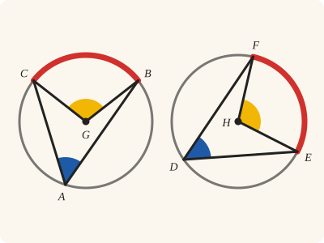
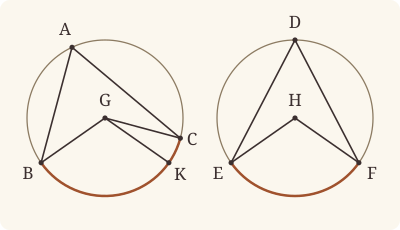

<!-- Generated by scripts/render.py. Do not edit by hand. -->

[Book III](index.md) · [← III.26](26.md) · [III.28 →](28.md)

# Book III, Proposition 27

*Angles standing on equal circumferences are equal*

[Euclid's proof](#euclids-proof) · [In Lean](#in-lean) · [What it rests on](#what-it-rests-on) · [Mishnah](#mishnah)

> In equal circles angles standing on equal circumferences are equal to one another, whether they stand at the centres or at the circumferences.

**In Lean:** ✅ proved, as Euclid states it, in our measure of circumferences · Euclid's argument, with one step changed

<p align="center"></p>

<p align="center"><em>Turn III.26 round: in the equal circles ABC, DEF, stand angles on the equal circumferences BC, EF (red), and they come out equal, at the centres G, H (yellow) and at the circumferences, at A and D (blue).</em></p>

## Euclid's proof

<p align="center"></p>

<p align="center"><em>Drawn for one case: acute angles at the circumferences. Euclid's figure draws the impossible supposition that BGC is greater than EHF, with BGK equal to EHF.</em></p>

For in equal circles ABC, DEF, on equal circumferences BC, EF, let the angles BGC, EHF stand at the centres G, H, and the angles BAC, EDF at the circumferences;

I say that the angle BGC is equal to the angle EHF,

and the angle BAC is equal to the angle EDF.

For, if the angle BGC is unequal to the angle EHF,

one of them is greater.

Let the angle BGC be greater; and on the straight line BG, and at the point G on it, let the angle BGK be constructed equal to the angle EHF. [I. 23]

Now equal angles stand on equal circumferences, when they are at the centres; [III. 26]

therefore the circumference BK is equal to the circumference EF.

But EF is equal to BC;

therefore BK is also equal to BC, the less to the greater: which is impossible.

Therefore the angle BGC is not unequal to the angle EHF;

therefore it is equal to it.

And the angle at A is half of the angle BGC,

and the angle at D half of the angle EHF; [III. 20]

therefore the angle at A is also equal to the angle at D.

Therefore etc.

Q. E. D.

## In Lean

| | |
|---|---|
| Proof | ✅ Proved |
| Statement | The whole enunciation. Angles at the circumferences of any size, and at the centres where they stand on BC; since our measure carries no radius, it holds in any two circles. |
| Argument | Euclid's, with one step changed. Euclid's reductio for the angles at the centres, and his halving by III.20 where the angles at the circumferences are acute; where they are obtuse, his argument runs on the circumferences that remain, as in III.26, and III.22 gives back the angles at A and D; where they are right, each is an angle in a semicircle, read off the measure of the circumference (`Prop24.angle_type`). |
| Representation | "In equal circles" is kept from Euclid, and the proof uses it through III.26 as he does; but the circumferences are measured by angles, so the statement would hold without it. The centres G and H are given, as the enunciation speaks of angles at the centres. |
| Reviewed | The statement and every passage of the argument read against Heath's text, at commit [`e00da4b4`](https://github.com/jackChallis/stoicheia/commit/e00da4b4) ([the record](../../review/III/27.toml)) |

From [`Elements/BookIII/Prop27.lean`](../../Elements/BookIII/Prop27.lean). Euclid's sentences are the `--` comments, and our own notes are in `/- … -/`; the lines under each sentence are the Lean that carries it out. The list below marks where a lemma does a step Euclid takes for granted, where the Lean takes a case Euclid's figure leaves aside and where a step is argued another way; the `/- … -/` notes in the listing explain smaller adjustments.

**How the Lean follows the text**

- **Done by `OnRay.exists_len_eq`.** "and on the straight line BG, and at the point G on it…" Euclid constructs BGK by I.23 and takes K on the circle; I.23 in the Lean gives only the direction of GK. `OnRay.exists_len_eq` takes GK equal to GB, using Postulate 3 and `Tacit.centre_inside` (System E, Generalities 3), proved in `Elements/Figure/RuleBase.lean`, and `Tacit.line_circle_beyond` (System E, Intersections 5), a rule we assume, and `Tacit.on_circle_of_len_eq` (System E, Diagram-segment 3), also proved there, puts K on ABC.
- **Done by `Prop2.sameSide`.** "Now equal angles stand on equal circumferences…" Euclid applies III.26 to the equal central angles. The Lean first takes a point of each circle on its centre's side of the chord by `Prop2.sameSide` (III.2, for which Heath gives no reference here), supplying the points at the circumferences that III.26 also asks for.
- **Done by `Circumference.centre`.** "therefore BK is also equal to BC…" Euclid reads BK as less than BC and rules out their equality. `Circumference.centre` turns that equality into equality of BGK and BGC, contradicting BGK equal to the smaller angle EHF; the lemma uses III.2, III.20 and III.21, for which Heath gives no references here.
- **A further case.** "Therefore the angle BGC is not unequal to the angle EHF…" Euclid supposes BGC greater than EHF; the Lean proves the reductio once over any letters and applies it again with the circles exchanged to rule out EHF greater than BGC. The Lean concludes that BGC equals EHF by `Tacit.lt_trichotomy`, a rule we assume about magnitudes (System E §3.5), not a proof: of two unequal angles, one is greater.
- **Argued another way.** "therefore the angle at A is also equal to the angle at D." Euclid infers that the angles at A and D are equal because they are halves of equal angles, which holds where they are acute, as in his figure; the Lean writes his reductio and halving once, for any points of the circles on the centres' sides, and `Magnitude.eq_of_add_self_eq` proves that equal doubles have equal halves by ruling out either strict inequality. `Prop27.sides` puts the centres alike in both circles; where the angles at A and D are obtuse, the Lean takes points X, Y on the centres' sides by `Prop2.sameSide`, makes the circumferences that remain equal by `Circumference.whole` and Common Notion 3, makes the angles at X and Y equal by Euclid's argument, and by III.22 leaves those at A and D as what remains of two right angles; where they are right, the centres lie on BC and EF, with no angle at the centre to halve, and `Prop24.angle_type` reads each angle off the measure as an angle in a semicircle; Heath prints no reference here for I.5, I.32, III.2, III.21 or III.22, which these use.

<details><summary>Before the theorem, one lemma: <code>Prop27.sides</code> (46 lines)</summary>

```lean
/-- **Equal circumferences put the centres alike.** When the circumferences on which the
angles BAC, EDF stand are equal, the centres G, H lie both on the sides of A and D, or both
on BC and EF, or both beyond BC and EF from A and D. Euclid's figure has the first, in both
circles. Named by points Q, R beyond BC and EF from A and D, the circumferences are less
than semicircles when the centres lie on the sides of A and D, semicircles when the centres
are on BC and EF, and greater when the centres lie beyond BC and EF from A and D
(`Circumference.lt_semicircle`, `Circumference.semicircle`, `Circumference.gt_semicircle`);
so centres placed differently would make the equal circumferences unequal. The cases are sorted as in III.26 (`Prop24.angle_type`).
[I. 5, I. 32, III. 2, III. 20, III. 21, III. 22] -/
theorem Prop27.sides {A B C D E F G H : Point} {ABC DEF : Circle} (hG : Centre G ABC)
    (hH : Centre H DEF) (hA : OnCircle A ABC) (hB : OnCircle B ABC) (hC : OnCircle C ABC)
    (hD : OnCircle D DEF) (hE : OnCircle E DEF) (hF : OnCircle F DEF)
    (hBCA : Triangle B C A) (hEFD : Triangle E F D)
    (heq : standing ABC B A C = standing DEF E D F) :
    (SameSideOf G A B C ∧ SameSideOf H D E F) ∨ (Between B G C ∧ Between E H F) ∨
      (OppositeSidesOf G A B C ∧ OppositeSidesOf H D E F) := by
  obtain ⟨Q, hQA, -⟩ := exists_oppositeSidesOf hBCA []
  obtain ⟨R, hRD, -⟩ := exists_oppositeSidesOf hEFD []
  have hBC : circumference ABC B Q C = circumference DEF E R F := by
    rw [← standing_eq_circumference hQA.symm, ← standing_eq_circumference hRD.symm]
    exact heq
  /- The size of the circumference BC, as G falls; and of EF, as H falls. -/
  have lt₁ : SameSideOf G A B C → circumference DEF E R F < ∟ + ∟ := fun h => by
    rw [← hBC]; exact Circumference.lt_semicircle hG hB hC (h.trans_opposite hQA.symm)
  have eq₁ : Between B G C → circumference DEF E R F = ∟ + ∟ := fun h => by
    rw [← hBC]; exact Circumference.semicircle hG hB hC h hQA.triangle
  have gt₁ : OppositeSidesOf G A B C → ∟ + ∟ < circumference DEF E R F := fun h => by
    rw [← hBC]
    exact Circumference.gt_semicircle hG hB hC (OppositeSidesOf.sameSideOf h.symm hQA.symm)
  have lt₂ : SameSideOf H D E F → circumference DEF E R F < ∟ + ∟ := fun h =>
    Circumference.lt_semicircle hH hE hF (h.trans_opposite hRD.symm)
  have eq₂ : Between E H F → circumference DEF E R F = ∟ + ∟ := fun h =>
    Circumference.semicircle hH hE hF h hRD.triangle
  have gt₂ : OppositeSidesOf H D E F → ∟ + ∟ < circumference DEF E R F := fun h =>
    Circumference.gt_semicircle hH hE hF (OppositeSidesOf.sameSideOf h.symm hRD.symm)
  rcases Prop24.angle_type hG hB hC hA hBCA with ⟨hGA, -⟩ | ⟨hBGC, -⟩ | ⟨hGA, -⟩ <;>
    rcases Prop24.angle_type hH hE hF hD hEFD with ⟨hHD, -⟩ | ⟨hEHF, -⟩ | ⟨hHD, -⟩
  · exact Or.inl ⟨hGA, hHD⟩
  · have h := lt₁ hGA; rw [eq₂ hEHF] at h; exact absurd h (lt_irrefl _)
  · exact absurd (lt_trans (lt₁ hGA) (gt₂ hHD)) (lt_irrefl _)
  · have h := lt₂ hHD; rw [eq₁ hBGC] at h; exact absurd h (lt_irrefl _)
  · exact Or.inr (Or.inl ⟨hBGC, hEHF⟩)
  · have h := gt₂ hHD; rw [eq₁ hBGC] at h; exact absurd h (lt_irrefl _)
  · exact absurd (lt_trans (lt₂ hHD) (gt₁ hGA)) (lt_irrefl _)
  · have h := gt₁ hGA; rw [eq₂ hEHF] at h; exact absurd h (lt_irrefl _)
  · exact Or.inr (Or.inr ⟨hGA, hHD⟩)
```

</details>

```lean
/-- In equal circles angles standing on equal circumferences are equal to one another, whether they
stand at the centres or at the circumferences. -/
theorem Prop27 {A B C D E F G H : Point} {ABC DEF : Circle} (hcircles : EqualCircles ABC DEF)
    (hG : Centre G ABC) (hH : Centre H DEF) (hA : OnCircle A ABC) (hB : OnCircle B ABC)
    (hC : OnCircle C ABC) (hD : OnCircle D DEF) (hE : OnCircle E DEF)
    (hF : OnCircle F DEF) (hBAC : Triangle B A C) (hEDF : Triangle E D F)
    (heq : standing ABC B A C = standing DEF E D F) :
    ∠ B A C = ∠ E D F ∧
      (SameSideOf G A B C → SameSideOf H D E F → ∠ B G C = ∠ E H F) := by
  -- For in equal circles ABC, DEF, on equal circumferences BC, EF, let the angles BGC, EHF
  -- stand at the centres G, H, and the angles BAC, EDF at the circumferences;
  -- I say that the angle BGC is equal to the angle EHF,
  -- and the angle BAC is equal to the angle EDF.
  /- In Euclid's figure the centres lie on the sides of A and D, and the angles at A and D
     are acute. We write his argument once, for any points A, D of the circles on the
     centres' sides whose angles stand on equal circumferences: it runs at A and D
     themselves, and again, below, where the angles at A and D are obtuse. -/
  have euclid : ∀ {A D : Point}, OnCircle A ABC → OnCircle D DEF → SameSideOf G A B C →
      SameSideOf H D E F → standing ABC B A C = standing DEF E D F →
      ∠ B G C = ∠ E H F ∧ ∠ B A C = ∠ E D F := by
    intro A D hA hD hGA hHD heq
    /- We name the circumferences BC, EF by points Q, R beyond them, across BC from A and
       across EF from D; the centres lie on the sides of A and D. -/
    obtain ⟨Q, hQA, -⟩ := exists_oppositeSidesOf hGA.symm.triangle []
    obtain ⟨R, hRD, -⟩ := exists_oppositeSidesOf hHD.symm.triangle []
    have hBC : circumference ABC B Q C = circumference DEF E R F := by
      rw [← standing_eq_circumference hQA.symm, ← standing_eq_circumference hRD.symm]
      exact heq
    have hGQ : OppositeSidesOf G Q B C := hGA.trans_opposite hQA.symm
    have hHR : OppositeSidesOf H R E F := hHD.trans_opposite hRD.symm
    -- For, if the angle BGC is unequal to the angle EHF,
    -- one of them is greater.
    /- Either circle may have the greater angle. As in I.26, we write the reductio once and
       use it with the circles named either way round. -/
    have greater : ∀ {B C E F G H Q R : Point} {ABC DEF : Circle}, EqualCircles ABC DEF →
        Centre G ABC → Centre H DEF → OnCircle B ABC → OnCircle C ABC → OnCircle E DEF →
        OnCircle F DEF → OppositeSidesOf G Q B C → OppositeSidesOf H R E F →
        circumference ABC B Q C = circumference DEF E R F → ∠ E H F < ∠ B G C → False := by
      intro B C E F G H Q R ABC DEF hcircles hG hH hB hC hE hF hGQ hHR hBC hlt
      -- Let the angle BGC be greater; and on the straight line BG, and at the point G on it, let
      -- the angle BGK be constructed equal to the angle EHF. [I. 23]
      have hGB : G ≠ B := (ne_of_centre_of_on hG hB).symm
      obtain ⟨K', B', hB', hK'C, hK'GB'⟩ := BookI.Prop23 hGB hHR.triangle.acb hGQ.triangle.cab
      /- I.23 gives only the direction of GK. We take K on that ray at the distance GB
         from G, and System E, Diagram-segment 3, puts it on the given circle. -/
      have hK'G : K' ≠ G := hK'C.triangle.ne₁₃.symm
      obtain ⟨K, hK_ray, hGK⟩ := OnRay.exists_len_eq hGB hK'G.symm
      have hK : OnCircle K ABC := on_circle_of_len_eq hG hB hGK
      have hBGK : ∠ B G K = ∠ E H F := by
        rw [angle_onRay_right hK_ray hGB.symm, ← angle_onRay_left hB' hK'G]
        exact (angle_symm hB'.2.1 hK'G).trans hK'GB'
      have hGBK : Triangle G B K := (SameSideOf.of_onRay hK_ray hK'C).triangle
      -- Now equal angles stand on equal circumferences, when they are at the centres; [III. 26]
      /- For III.26 we name the circumference BK by a point P beyond it, and take a point of
         each circle on the centre's side. -/
      obtain ⟨P, hPG, -⟩ := exists_oppositeSidesOf hGBK.bca []
      obtain ⟨X, hX, hXG⟩ := Prop2.sameSide hB hK hGBK.bca
      obtain ⟨Y, hY, hYH⟩ := Prop2.sameSide hE hF hHR.triangle
      -- therefore the circumference BK is equal to the circumference EF.
      /- III.26 gives BK and EF equal in measure and congruent; the comparison with BC
         below is by measure, so we take the measures. -/
      have hBK : circumference ABC B P K = circumference DEF E R F :=
        ((Prop26 hcircles hG hH hX hB hK hY hE hF (hXG.trans_opposite hPG.symm)
          (hYH.trans_opposite hHR)).1 hPG.symm hHR hBGK).1
      -- But EF is equal to BC;
      have hEF_BC := hBC.symm
      -- therefore BK is also equal to BC, the less to the greater: which is impossible.
      /- Euclid takes BK to be less than BC as a part of it. We measure BK and BC by their
         angles at G (`Circumference.centre`): BK is the less because the angle BGK, equal
         to EHF, is less than BGC. -/
      have h := hBK.trans hEF_BC
      rw [Circumference.centre hG hB hK hPG.symm, Circumference.centre hG hB hC hGQ,
        hBGK] at h
      rw [h] at hlt
      exact lt_irrefl _ hlt
    -- Therefore the angle BGC is not unequal to the angle EHF;
    -- therefore it is equal to it.
    have centres : ∠ B G C = ∠ E H F := by
      rcases lt_trichotomy (∠ B G C) (∠ E H F) with h | h | h
      · exact (greater hcircles.symm hH hG hE hF hB hC hHR hGQ hBC.symm h).elim
      · exact h
      · exact (greater hcircles hG hH hB hC hE hF hGQ hHR hBC h).elim
    -- And the angle at A is half of the angle BGC,
    have h20A := Prop20 hG hA hB hC hGA
    -- and the angle at D half of the angle EHF; [III. 20]
    have h20D := Prop20 hH hD hE hF hHD
    -- therefore the angle at A is also equal to the angle at D.
    exact ⟨centres, Magnitude.eq_of_add_self_eq (h20A.symm.trans (centres.trans h20D))⟩
  /- Euclid's halving holds where the angles at A and D are acute. The right and obtuse
     cases are taken separately, as Heath notes on III.26, and under III.27 he writes that
     "the remarks about the method of treating the different cases apply here also"
     (vol. 2, p. 59). Equal circumferences put the centres alike (`Prop27.sides`), and we
     take the three cases in turn, as III.26 does. -/
  have hAD : ∠ B A C = ∠ E D F := by
    rcases Prop27.sides hG hH hA hB hC hD hE hF hBAC.acb hEDF.acb heq with
      ⟨hGA, hHD⟩ | ⟨hBGC, hEHF⟩ | ⟨hGA, hHD⟩
    · /- The angles at A and D are acute, as in Euclid's figure, and his argument gives them
         equal. -/
      exact (euclid hA hD hGA hHD heq).2
    · /- The angles at A and D are right, a case Euclid's figure leaves aside. The centres
         lie on BC and EF, and our angles are never straight, so there is no angle BGC here
         for III.20 to halve. Each angle at A and D is an angle in a semicircle, and right
         (`Prop24.angle_type`, whose other two cases would put the centre off BC or EF); the
         two are each the one right angle, and so equal. This case still rests on the
         measure of the circumference: `Prop24.angle_type` reads the right angle off it, the
         semicircle being two right angles (`Circumference.semicircle`) and the angle in it
         half of that (`Circumference.eq`). -/
      have hrt : ∠ B A C = ∟ := by
        rcases Prop24.angle_type hG hB hC hA hBAC.acb with ⟨hGA, -⟩ | ⟨-, h⟩ | ⟨hGA, -⟩
        · exact (hGA.triangle.acb (collinear_of_between hBGC)).elim
        · exact h
        · exact (hGA.triangle.acb (collinear_of_between hBGC)).elim
      have hrt' : ∠ E D F = ∟ := by
        rcases Prop24.angle_type hH hE hF hD hEDF.acb with ⟨hHD, -⟩ | ⟨-, h⟩ | ⟨hHD, -⟩
        · exact (hHD.triangle.acb (collinear_of_between hEHF)).elim
        · exact h
        · exact (hHD.triangle.acb (collinear_of_between hEHF)).elim
      rw [hrt, hrt']
    · /- The angles at A and D are obtuse, the other case Euclid's figure leaves aside: the
         centres lie beyond BC and EF from A and D. We pass to the circumferences that
         remain, BAC and EDF, as III.26 passes to "the circumference BKC which remains", and
         to the angles BXC, EYF standing on them at points X, Y of the circles on the
         centres' sides. -/
      obtain ⟨X, hX, hXG⟩ := Prop2.sameSide hB hC hGA.triangle
      obtain ⟨Y, hY, hYH⟩ := Prop2.sameSide hE hF hHD.triangle
      have hXA : OppositeSidesOf X A B C := hXG.trans_opposite hGA
      have hYD : OppositeSidesOf Y D E F := hYH.trans_opposite hHD
      /- X and Y lie on the circumferences BC, EF, and the whole circles are four right
         angles each (`Circumference.whole`); so the circumferences BAC, EDF which remain
         are equal [C.N. 3]. -/
      have hst : standing ABC B X C = standing DEF E Y F := by
        have w₁ := Circumference.whole hB hC hXA.symm
        have w₂ := Circumference.whole hE hF hYD.symm
        rw [standing_eq_circumference hXA, standing_eq_circumference hYD]
        refine CommonNotion3 (c := circumference ABC B X C) (d := circumference DEF E Y F)
          ?_ ?_
        · rw [add_comm (circumference ABC B A C), w₁, add_comm (circumference DEF E D F), w₂]
        · rw [← standing_eq_circumference hXA.symm, ← standing_eq_circumference hYD.symm]
          exact heq
      /- The angles at X and Y are acute, the centres lying on their sides, and Euclid's
         argument above makes them equal. -/
      have hXY : ∠ B X C = ∠ E Y F := (euclid hX hY hXG.symm hYH.symm hst).2
      /- The angles at A and X are opposite angles of the quadrilateral ABXC in the circle,
         and those at D and Y of DEYF, so each pair is two right angles [III. 22]; when the
         equal angles at X and Y are taken away, the angles at A and D which remain are
         equal [C.N. 3]. -/
      have q₁ : ∠ B A C + ∠ B X C = ∟ + ∟ := by
        have := (Prop22 hA hB hX hC hXA.symm).2
        rwa [angle_symm hXA.triangle.ne₂₃ hXA.triangle.ne₁₃] at this
      have q₂ : ∠ E D F + ∠ E Y F = ∟ + ∟ := by
        have := (Prop22 hD hE hY hF hYD.symm).2
        rwa [angle_symm hYD.triangle.ne₂₃ hYD.triangle.ne₁₃] at this
      exact CommonNotion3 (c := ∠ B X C) (d := ∠ E Y F) (by rw [q₁, q₂]) hXY
  -- Therefore etc.
  exact ⟨hAD, fun hGA hHD => (euclid hA hD hGA hHD heq).1⟩
  -- Q. E. D.
```

## What it rests on

| | |
|---|---|
| Heath's references | [I.23](../I/23.md), [III.20](20.md), [III.26](26.md) |
| Lean cites | [I.5](../I/05.md), [I.23](../I/23.md), [I.32](../I/32.md), [III.2](02.md), [III.20](20.md), [III.21](21.md), [III.22](22.md), [III.26](26.md) |
| Postulates | 1, 2, 3, 4, 5 |
| Definitions taken as axioms | Def. I.15 |
| Common Notions | 1, 2, 3, 4, 5 |
| Tacit rules | 39 (listed below) |
| Its own Lean calls | 5 tacit rules |
| Through lemmas | Postulates 1, 2 and 3; Def. I.15; 26 tacit rules |

Some of these come in through lemmas [shared](../../CERTIFICATE.md#shared-steps) by many proofs: [`Circumference.semicircle`](../../Elements/BookIII/Circumferences.lean#L109) (I.5, I.32, III.2); [`Prop24.angle_type`](../../Elements/BookIII/Prop24.lean#L191) (I.5, I.32, III.2, III.20, III.21, III.22); [`Circumference.lt_semicircle`](../../Elements/BookIII/Circumferences.lean#L149) (I.32, III.2, III.20, III.21); [`Circumference.gt_semicircle`](../../Elements/BookIII/Circumferences.lean#L164) (I.32, III.2, III.20, III.21, III.22); [`Prop2.sameSide`](../../Elements/BookIII/Prop02.lean#L171) (III.2); [`Circumference.centre`](../../Elements/BookIII/Circumferences.lean#L75) (III.2, III.20, III.21); [`Circumference.whole`](../../Elements/BookIII/Circumferences.lean#L85) (III.2, III.21, III.22).

_Postulates, definitions, Common Notions and tacit rules: all that this proof rests on, counting those of the propositions it cites. The last two rows say which of the postulates, definitions and tacit rules its own Lean calls, in the proof or a helper written for it, and which it does not call but reaches through lemmas, of Book Zero or shared (a proposition it cites may rest on these too); the rest come in only through the propositions it cites or the Common Notions._

<details><summary>The 39 tacit rules beneath this proof, counting those of the propositions it cites</summary>

_(used here) marks a rule this proof's own Lean calls, in the proof or a helper written for it; (through …) marks one its own Lean does not call but reaches through the lemmas named, of [Book Zero](../../Elements/Figure) or shared, though a proposition it cites may rest on it too; and a rule with no mark comes in only through a proposition it cites or a Common Notion. The names in brackets are System E's: an Intersection rule says when straight lines and circles must meet, and an Intersections rule takes a point where they do (see [Book I's introduction](../I/index.md))._

**Reading the figure**

- [`between_cases`](../../Elements/Foundations/Tacit/Diagram.lean#L54) (through [`Circumference.centre`](../../Elements/BookIII/Circumferences.lean#L75), [`Circumference.gt_semicircle`](../../Elements/BookIII/Circumferences.lean#L164), [`Circumference.lt_semicircle`](../../Elements/BookIII/Circumferences.lean#L149) and 8 other lemmas): Of three different points on a straight line, one is between the other two. (Between 6)
- [`between_of_inside_chord`](../../Elements/Foundations/Tacit/Diagram.lean#L81) (through [`Circumference.centre`](../../Elements/BookIII/Circumferences.lean#L75), [`Circumference.gt_semicircle`](../../Elements/BookIII/Circumferences.lean#L164), [`Circumference.lt_semicircle`](../../Elements/BookIII/Circumferences.lean#L149) and 16 other lemmas): A straight line through a point inside a circle has that point between the points where it meets the circle. (Circle 1)
- [`between_symm`](../../Elements/Foundations/Tacit/Diagram.lean#L47) (through [`Circumference.centre`](../../Elements/BookIII/Circumferences.lean#L75), [`Circumference.gt_semicircle`](../../Elements/BookIII/Circumferences.lean#L164), [`Circumference.lt_semicircle`](../../Elements/BookIII/Circumferences.lean#L149) and 11 other lemmas): If B is between A and C, it is between C and A. (Between 1)
- [`circles_meet`](../../Elements/Foundations/Tacit/Diagram.lean#L94) (through [`Circumference.centre`](../../Elements/BookIII/Circumferences.lean#L75), [`Circumference.gt_semicircle`](../../Elements/BookIII/Circumferences.lean#L164), [`Circumference.lt_semicircle`](../../Elements/BookIII/Circumferences.lean#L149) and 12 other lemmas): If each circle passes through a point inside the other, the circles cut one another. This is the step Euclid takes for granted in I.1. (Intersection 5)
- [`circles_meet_same_side`](../../Elements/Foundations/Tacit/Constructions.lean#L79) (through [`Circumference.centre`](../../Elements/BookIII/Circumferences.lean#L75), [`Circumference.gt_semicircle`](../../Elements/BookIII/Circumferences.lean#L164), [`Circumference.lt_semicircle`](../../Elements/BookIII/Circumferences.lean#L149) and 12 other lemmas): Two circles that cut one another do so on each side of the straight line through their centres. (Intersections 8)
- [`exists_centre`](../../Elements/Foundations/Tacit/Constructions.lean#L57): Every circle has a centre. A rule of our own, not one of System E's: its content is Euclid's Definitions I.15 and I.16.
- [`exists_point`](../../Elements/Foundations/Tacit/Constructions.lean#L35) (through [`Circumference.centre`](../../Elements/BookIII/Circumferences.lean#L75), [`Circumference.gt_semicircle`](../../Elements/BookIII/Circumferences.lean#L164), [`Circumference.lt_semicircle`](../../Elements/BookIII/Circumferences.lean#L149) and 14 other lemmas): Let a point be taken. (Points 1)
- [`exists_point_inside_circle`](../../Elements/Foundations/Tacit/Constructions.lean#L42) (through [`Circumference.centre`](../../Elements/BookIII/Circumferences.lean#L75), [`Circumference.gt_semicircle`](../../Elements/BookIII/Circumferences.lean#L164), [`Circumference.lt_semicircle`](../../Elements/BookIII/Circumferences.lean#L149) and 16 other lemmas): Let a point be taken inside the circle α. (Points 8)
- [`exists_point_on_line`](../../Elements/Foundations/Tacit/Constructions.lean#L38) (through [`Circumference.centre`](../../Elements/BookIII/Circumferences.lean#L75), [`Circumference.gt_semicircle`](../../Elements/BookIII/Circumferences.lean#L164), [`Circumference.lt_semicircle`](../../Elements/BookIII/Circumferences.lean#L149) and 12 other lemmas): Let a point be taken on the straight line L. (Points 2)
- [`line_circle_between`](../../Elements/Foundations/Tacit/Constructions.lean#L67) (through [`Circumference.centre`](../../Elements/BookIII/Circumferences.lean#L75), [`Circumference.gt_semicircle`](../../Elements/BookIII/Circumferences.lean#L164), [`Circumference.lt_semicircle`](../../Elements/BookIII/Circumferences.lean#L149) and 15 other lemmas): A straight line through a point B inside a circle, heading out to a point C outside it, cuts the circle between B and C. (Intersections 4)
- [`line_circle_beyond`](../../Elements/Foundations/Tacit/Constructions.lean#L73) (through [`Circumference.centre`](../../Elements/BookIII/Circumferences.lean#L75), [`Circumference.gt_semicircle`](../../Elements/BookIII/Circumferences.lean#L164), [`Circumference.lt_semicircle`](../../Elements/BookIII/Circumferences.lean#L149) and 16 other lemmas): A straight line through a point B inside a circle, produced beyond B away from C, cuts the circle there. (Intersections 5)
- [`line_unique`](../../Elements/Foundations/Tacit/Diagram.lean#L41) (through [`Circumference.centre`](../../Elements/BookIII/Circumferences.lean#L75), [`Circumference.gt_semicircle`](../../Elements/BookIII/Circumferences.lean#L164), [`Circumference.lt_semicircle`](../../Elements/BookIII/Circumferences.lean#L149) and 9 other lemmas): Two points determine a straight line. (Generalities 1)
- [`lines_meet_of_opposite_sides`](../../Elements/Foundations/Tacit/Diagram.lean#L89) (through [`Circumference.centre`](../../Elements/BookIII/Circumferences.lean#L75), [`Circumference.gt_semicircle`](../../Elements/BookIII/Circumferences.lean#L164), [`Circumference.lt_semicircle`](../../Elements/BookIII/Circumferences.lean#L149) and 5 other lemmas): A straight line joining points on opposite sides of L crosses L. (Intersection 1)
- [`not_between_of_between`](../../Elements/Foundations/Tacit/Diagram.lean#L50) (through [`Circumference.centre`](../../Elements/BookIII/Circumferences.lean#L75), [`Circumference.gt_semicircle`](../../Elements/BookIII/Circumferences.lean#L164), [`Circumference.lt_semicircle`](../../Elements/BookIII/Circumferences.lean#L149) and 16 other lemmas): If B is between A and C, then A is not between B and C. (Between 1)
- [`not_on_line_of_same_side`](../../Elements/Foundations/Tacit/Diagram.lean#L60) (through [`Circumference.centre`](../../Elements/BookIII/Circumferences.lean#L75), [`Circumference.gt_semicircle`](../../Elements/BookIII/Circumferences.lean#L164), [`Circumference.lt_semicircle`](../../Elements/BookIII/Circumferences.lean#L149) and 14 other lemmas): Points on one side of a straight line are not on it. (Same side 3)
- [`pasch2`](../../Elements/Foundations/Tacit/Diagram.lean#L71) (through [`Circumference.centre`](../../Elements/BookIII/Circumferences.lean#L75), [`Circumference.gt_semicircle`](../../Elements/BookIII/Circumferences.lean#L164), [`Circumference.lt_semicircle`](../../Elements/BookIII/Circumferences.lean#L149) and 10 other lemmas): If B is between A and C, A is on L and B is off it, then B and C are on the same side of L: a straight line that leaves L at A does not cross it again. (Pasch 2)
- [`same_side_trans`](../../Elements/Foundations/Tacit/Diagram.lean#L64) (through [`Circumference.centre`](../../Elements/BookIII/Circumferences.lean#L75), [`Circumference.gt_semicircle`](../../Elements/BookIII/Circumferences.lean#L164), [`Circumference.lt_semicircle`](../../Elements/BookIII/Circumferences.lean#L149) and 13 other lemmas): Two points on the same side of a straight line as a third point are on the same side as each other. (Same side 4)

**Lengths, angles and areas**

- [`angle_add_of_inside`](../../Elements/Foundations/Tacit/Transfer.lean#L47) (through [`Circumference.centre`](../../Elements/BookIII/Circumferences.lean#L75), [`Circumference.gt_semicircle`](../../Elements/BookIII/Circumferences.lean#L164), [`Circumference.lt_semicircle`](../../Elements/BookIII/Circumferences.lean#L149) and 7 other lemmas): If D lies within the angle BAC, then BAC is made up of BAD and DAC. (Diagram-angle 2)
- [`angle_eq_of_same_rays`](../../Elements/Foundations/Tacit/Transfer.lean#L54) (through [`Circumference.semicircle`](../../Elements/BookIII/Circumferences.lean#L109), [`Prop24.angle_type`](../../Elements/BookIII/Prop24.lean#L191), [`angle_onRay_left`](../../Elements/Figure/Angles.lean#L42) and 1 other lemma): The angle doesn't change if its arms are traced through other points on the same rays. (Diagram-angle 4)
- [`angle_symm`](../../Elements/Foundations/Tacit/Metric.lean#L27) (used here): The angle ABC is the angle CBA. (Metric 4)
- [`area_add_of_between`](../../Elements/Foundations/Tacit/Transfer.lean#L70): Cutting a triangle in two from a vertex adds up. (Diagram-area 2)
- [`area_congruent`](../../Elements/Foundations/Tacit/Metric.lean#L41): Triangles equal in all their sides and angles are equal in area. Euclid uses this without comment once he has shown two triangles congruent. (Metric 9)
- [`area_degenerate`](../../Elements/Foundations/Tacit/Metric.lean#L33): A "triangle" with a repeated corner has no area. (Metric 6)
- [`area_eq_zero_of_on_line`](../../Elements/Foundations/Tacit/Transfer.lean#L62): A "triangle" whose corners lie on one straight line has no area. (Diagram-area 1)
- [`area_rotate`](../../Elements/Foundations/Tacit/Metric.lean#L36): The triangle ABC is the triangle CAB. (Metric 8)
- [`circle_eq`](../../Elements/Foundations/Tacit/Transfer.lean#L30) (through [`Circumference.centre`](../../Elements/BookIII/Circumferences.lean#L75), [`Circumference.gt_semicircle`](../../Elements/BookIII/Circumferences.lean#L164), [`Circumference.lt_semicircle`](../../Elements/BookIII/Circumferences.lean#L149) and 16 other lemmas): A circle is fixed by its centre and its radius. (Diagram-segment 2)
- [`len_add_of_between`](../../Elements/Foundations/Tacit/Transfer.lean#L27) (through [`Circumference.centre`](../../Elements/BookIII/Circumferences.lean#L75), [`Circumference.gt_semicircle`](../../Elements/BookIII/Circumferences.lean#L164), [`Circumference.lt_semicircle`](../../Elements/BookIII/Circumferences.lean#L149) and 16 other lemmas): If B is between A and C, then AB and BC together make up AC. (Diagram-segment 1)
- [`len_self`](../../Elements/Foundations/Tacit/Metric.lean#L21) (through [`Circumference.centre`](../../Elements/BookIII/Circumferences.lean#L75), [`Circumference.gt_semicircle`](../../Elements/BookIII/Circumferences.lean#L164), [`Circumference.lt_semicircle`](../../Elements/BookIII/Circumferences.lean#L149) and 16 other lemmas): The "straight line" from a point to itself has no length. (Metric 1)
- [`len_symm`](../../Elements/Foundations/Tacit/Metric.lean#L24) (through [`Circumference.centre`](../../Elements/BookIII/Circumferences.lean#L75), [`Circumference.gt_semicircle`](../../Elements/BookIII/Circumferences.lean#L164), [`Circumference.lt_semicircle`](../../Elements/BookIII/Circumferences.lean#L149) and 16 other lemmas): The straight line AB is the straight line BA. (Metric 3)
- [`same_ray_of_angle_eq_zero`](../../Elements/Foundations/Tacit/Transfer.lean#L42) (through [`Circumference.centre`](../../Elements/BookIII/Circumferences.lean#L75), [`Circumference.gt_semicircle`](../../Elements/BookIII/Circumferences.lean#L164), [`Circumference.lt_semicircle`](../../Elements/BookIII/Circumferences.lean#L149) and 7 other lemmas): If the angle BAC is nothing, C lies on the ray from A through B. (Diagram-angle 1)

**Superposition**

- [`superposition`](../../Elements/Foundations/Tacit/Superposition.lean#L48): **Superposition.** A hypothetical placement of a triangle on a given ray and side permits a restricted derivation of metric equalities about the figure already given. The derivation introduces no further objects, cites each geometric law it uses, and exports no symbol of the placement.

**Rules of magnitude**

- [`add_assoc`](../../Elements/Foundations/Tacit/Magnitudes.lean#L23) (through [`Circumference.centre`](../../Elements/BookIII/Circumferences.lean#L75), [`Circumference.gt_semicircle`](../../Elements/BookIII/Circumferences.lean#L164), [`Circumference.lt_semicircle`](../../Elements/BookIII/Circumferences.lean#L149) and 4 other lemmas): Adding three magnitudes in a row, it makes no difference whether the first two or the last two are added first. (System E §3.5)
- [`add_comm`](../../Elements/Foundations/Tacit/Magnitudes.lean#L26) (used here): The order of adding does not matter. (System E §3.5)
- [`add_lt_add_right`](../../Elements/Foundations/Tacit/Magnitudes.lean#L45) (through [`Circumference.centre`](../../Elements/BookIII/Circumferences.lean#L75), [`Circumference.gt_semicircle`](../../Elements/BookIII/Circumferences.lean#L164), [`Circumference.lt_semicircle`](../../Elements/BookIII/Circumferences.lean#L149) and 7 other lemmas): Adding the same thing to both sides keeps "less than". (System E §3.5)
- [`add_zero`](../../Elements/Foundations/Tacit/Magnitudes.lean#L29): Adding nothing changes nothing. (System E §3.5)
- [`lt_irrefl`](../../Elements/Foundations/Tacit/Magnitudes.lean#L32) (used here): No magnitude is less than itself. (System E §3.5)
- [`lt_trans`](../../Elements/Foundations/Tacit/Magnitudes.lean#L35) (used here): What is less than the less is less still. (System E §3.5)
- [`lt_trichotomy`](../../Elements/Foundations/Tacit/Magnitudes.lean#L39) (used here): Of two magnitudes, one is less, or they are equal, or the other is less. (System E §3.5)
- [`not_lt_zero`](../../Elements/Foundations/Tacit/Magnitudes.lean#L42) (through [`Circumference.centre`](../../Elements/BookIII/Circumferences.lean#L75), [`Circumference.gt_semicircle`](../../Elements/BookIII/Circumferences.lean#L164), [`Circumference.lt_semicircle`](../../Elements/BookIII/Circumferences.lean#L149) and 16 other lemmas): Nothing is less than zero. (System E §3.5)

</details>

## Mishnah

_Our commentary: why Euclid's proof, and ours, look as they do._

**A circumference equal to its own part.** Euclid argues by *reductio ad absurdum*. Were the angle BGC greater than EHF, the angle BGK made equal to EHF within it would stand, by III.26, on a circumference BK equal to EF, and so to BC: the less equal to the greater. Our figure draws the impossible case, with BGC the greater, so that K has somewhere to fall.

**The converse inherits the cases.** Heath writes: "This proposition is the converse of the preceding one, and the remarks about the method of treating the different cases apply here also" (vol. 2, p. 59). Among those remarks, under III.26, is Dionysius Lardner's way with a right or obtuse angle: bisect it, and work with the halves. Euclid's last step halves the angles at the centres by III.20, which works only when the angles at the circumference are acute. Our statement still asks for every size, since IV.11 needs obtuse angles, and our proof treats an obtuse angle as we do in III.26: it passes to the circumferences that remain, on which acute angles stand, Euclid's own argument makes those equal, and III.22 gives back the angles at A and D, each what remains of two right angles. Where the angles are right, the centres lie on BC and EF, and there is no angle at the centre to halve: each is an angle in a semicircle, and only there are the angles at A and D read off our measure of circumferences.

**Where does K fall?** I.23 gives the angle BGK, but not where its side GK meets the circumference. We take GK equal to the radius GB, and the proved Diagram-segment 3 puts K on the circle (`on_circle_of_len_eq`): the circle drawn about G through K by Postulate 3 is the given circle, since the centre and radius agree. The measure then turns Euclid's impossibility back into angles: BK equal to BC would make the less angle BGK equal to the greater, BGC.

**The modern way.** A rigid motion of the plane carries any arc onto any arc of the same length in a circle of the same radius, and keeps every angle, so equal arcs subtend equal angles at the centres and, since the angles in one segment are all equal, at the circumferences too. It is not Euclid's route, which runs through III.26.

## Further reading

- Motions carry a circumference onto any equal circumference in Jacques Hadamard's [*Lessons in Geometry, I: Plane Geometry*](https://doi.org/10.1090/mbk/057) (2008), Book II, ch. VI, "On the Motion of Figures" (p. 99), the motions behind the modern way (also on [III.13](13.md)).
- In Felix Klein's ["A comparative review of recent researches in geometry"](https://arxiv.org/abs/0807.3161) (1893, free online), a geometry is known by the motions it allows. His Erlangen Programme of 1872 gives a setting for the rigid motions of the modern way.

[Book III](index.md) · [← III.26](26.md) · [III.28 →](28.md)

---

<sub>Euclid's text: T. L. Heath, *The Thirteen Books of Euclid's Elements*, vol. 2 (Cambridge, 1908), pp. 58–59; [scan leaves n70–n71](https://archive.org/details/thirteenbookseu00heibgoog/page/n70); [figure on n70](https://archive.org/details/thirteenbookseu00heibgoog/page/n70). Public domain.</sub>

<sub>The tacit rules follow the System E of Jeremy Avigad, Edward Dean and John Mumma, read alongside LeanEuclid (Logan Murphy, Kaiyu Yang, Jialiang Sun, Zhaoyu Li, Anima Anandkumar and Xujie Si).</sub>
