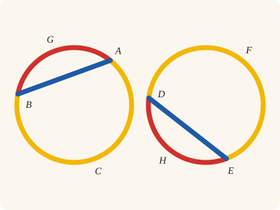
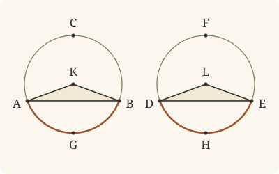

<!-- Generated by scripts/render.py. Do not edit by hand. -->

[Book III](index.md) · [← III.27](27.md) · [III.29 →](29.md)

# Book III, Proposition 28

*Equal straight lines cut off equal circumferences*

[Euclid's proof](#euclids-proof) · [In Lean](#in-lean) · [What it rests on](#what-it-rests-on) · [Mishnah](#mishnah)

> In equal circles equal straight lines cut off equal circumferences, the greater equal to the greater and the less to the less.

**In Lean:** ✅ proved, as Euclid states it, in our measure of circumferences · Euclid's argument, with two steps changed

<p align="center"></p>

<p align="center"><em>Draw the equal straight lines AB, DE (blue) in equal circles: they cut off equal circumferences, the less AGB, DHE equal (red) and the greater ACB, DFE equal (yellow).</em></p>

## Euclid's proof

<p align="center"></p>

<p align="center"><em>Drawn for one case: non-diameter chords, with K on C's side of AB and L on F's side of DE.</em></p>

Let ABC, DEF be equal circles, and in the circles let AB, DE be equal straight lines cutting off ACB, DFE as greater circumferences and AGB, DHE as lesser;

I say that the greater circumference ACB is equal to the greater circumference DFE, and the less circumference AGB to DHE.

For let the centres K, L of the circles be taken, and let AK, KB, DL, LE be joined.

Now, since the circles are equal,

the radii are also equal;

therefore the two sides AK, KB are equal to the two sides DL, LE;

and the base AB is equal to the base DE;

therefore the angle AKB is equal to the angle DLE. [I. 8]

But equal angles stand on equal circumferences, when they are at the centres; [III. 26]

therefore the circumference AGB is equal to DHE.

And the whole circle ABC is also equal to the whole circle DEF;

therefore the circumference ACB which remains is also equal to the circumference DFE which remains.

Therefore etc.

Q. E. D.

## In Lean

| | |
|---|---|
| Proof | ✅ Proved |
| Statement | The whole enunciation. Equal circumferences read as equal in measure and congruent; "the greater" taken as no less, so two diameters, cutting off four semicircles, are covered. |
| Argument | Euclid's, with two steps changed. For non-diameters, Euclid's argument for the measures: the angles at the centres are equal [I. 8], the less circumferences equal by III.26, the greater as the remainders. The greater circumferences' congruence cannot come by subtraction, and comes from III.24 applied to the greater segments, whose angles are the halves of the equal angles at the centres [III. 20]. For diameters, the measures are those of semicircles, and congruence follows from Prop28.right and III.24. The route stays so for this release, a deliberate limitation: for straight lines that are not diameters the measures follow Euclid's subtraction, while the greater circumferences' congruence is proved separately, by III.24, and the case of diameters keeps its own proof; a theory of arc magnitudes of their own is left for a later release. |
| Representation | "Equal circumferences" is read as in III.26, equal in measure and congruent (`Arc.Congruent`), which says more than Heath's words. The equal circles do real work: equal straight lines in unequal circles cut off unequal measures, and no congruent circumferences. |
| Reviewed | The statement and every passage of the argument read against Heath's text, at commit [`1c21c147b`](https://github.com/jackChallis/stoicheia/commit/1c21c147b) ([the record](../../review/III/28.toml)) |

From [`Elements/BookIII/Prop28.lean`](../../Elements/BookIII/Prop28.lean). Euclid's sentences are the `--` comments, and our own notes are in `/- … -/`; the lines under each sentence are the Lean that carries it out. The list below marks where a lemma does a step Euclid takes for granted, where the statement already gives a step and where a step is argued another way; the `/- … -/` notes in the listing explain smaller adjustments.

**How the Lean follows the text**

- **Already given.** "For let the centres K, L of the circles be taken…" Euclid takes K and L as centres and joins the radii. The hypothesis that the circles are equal supplies both centres through `EqualCircles`, and the radii are named by their ends.
- **Argued another way.** "the radii are also equal…" Euclid's figure has the centre K off AB, on C's side. If K is on AB, AB and DE are diameters and the four circumferences semicircles; the angle at the centre of each semicircle is two right angles (`angleAtCentre.semicircle`), but the proof obtains congruence from the right angle in each semicircle (`Prop28.right`) and III.24; `Prop28.beyond` shows K is not on G's side; `Prop28.sides` sorts the positions, `Prop28.diameter` uses I.20, and `Prop28.right` through `Prop24.angle_type`, `Prop28.beyond`, `Circumference.semicircle` and `Prop2.sameSide` use I.5, I.32, III.2, III.20, III.21 and III.22, for which, as for I.20 and III.24, Heath prints no references here; the placing of the centres between the diameter's ends uses `Tacit.centre_inside` (System E, Generalities 3), proved in `Elements/Figure/RuleBase.lean`, and `Tacit.between_of_inside_chord` (System E, Circle 1), proved after III.2, and the sum of the radii uses `Tacit.len_add_of_between` (System E, Diagram-segment 1), a rule we assume.
- **Done by `Prop2.oppositeSide`.** "But equal angles stand on equal circumferences…" Euclid applies III.26 to the equal central angles. Since C and F name sides and need not be on their circles, the Lean takes points X and Y there by `Prop2.oppositeSide` (III.2, for which Heath prints no reference here), supplying the points at the circumferences that III.26 also asks for.
- **Done by `Circumference.whole`.** "And the whole circle ABC is also equal to the whole circle DEF…" Euclid subtracts the equal lesser circumferences from the equal whole circles. `Circumference.whole` proves that the two circumferences cut off by each chord together measure four right angles, using III.2, III.21 and III.22, for which Heath prints no references here.
- **Argued another way.** "therefore the circumference ACB which remains…" The greater circumferences are equal in measure as the remainders [C.N. 3]; their congruence comes from III.24, the angles AXB, DYE at points of the greater circumferences being the halves of the equal angles AKB, DLE at the centres [III. 20], so that the greater segments are similar; Heath prints no reference here for III.20 or III.24, called as `Prop20.special` and `Prop24`, and `Magnitude.eq_of_add_self_eq` supplies the equality of the halves.

<details><summary>Before the theorem, four lemmas: <code>Prop28.sides</code>, <code>Prop28.diameter</code>, <code>Prop28.beyond</code> and <code>Prop28.right</code> (50 lines)</summary>

```lean
/-- A point K lies on C's side of the straight line AB, on AB, or on the other side, for
a straight line has two sides. Here K is the centre. -/
theorem Prop28.sides {A B C K : Point} (hABC : Triangle A B C) :
    SameSideOf K C A B ∨ Collinear A B K ∨ OppositeSidesOf K C A B := by
  obtain ⟨L, hA, hB⟩ := Postulate1 A B hABC.ne₁₂
  have hC : ¬ OnLine C L := hABC.off_line hA hB
  by_cases hK : OnLine K L
  · exact Or.inr (Or.inl ⟨L, hA, hB, hK⟩)
  by_cases hs : SameSide K C L
  · exact Or.inl (SameSideOf.of_line hABC.ne₁₂ hA hB hs)
  · exact Or.inr (Or.inr (OppositeSidesOf.of_line hABC.ne₁₂ hA hB ⟨hK, hC, hs⟩))

/-- In equal circles, a straight line equal to a diameter of the one is a diameter of the
other: else, with the radii to its ends, it would be less than two radii. [I. 20] -/
theorem Prop28.diameter {A B D E K L : Point} {α β : Circle} (hK : Centre K α) (hL : Centre L β)
    (hA : OnCircle A α) (hB : OnCircle B α) (hD : OnCircle D β) (hE : OnCircle E β)
    (hr : ‖K A‖ = ‖L D‖) (hAKB : Between A K B) (hAB : ‖A B‖ = ‖D E‖) (hDE : D ≠ E) :
    Between D L E := by
  have hAB' : ‖A B‖ = ‖K A‖ + ‖K A‖ := by
    rw [← len_add_of_between hAKB, len_symm A K, Definition15 hK hB hA]
  by_cases hcol : Collinear D E L
  · obtain ⟨M, hD_M, hE_M, hL_M⟩ := hcol
    exact between_of_inside_chord hL_M hD_M hE_M (centre_inside hL) hD hE hDE
  · have h20 := (BookI.Prop20 (show Triangle D E L from hcol).cab).1
    rw [← hAB, hAB', len_symm D L, hr, Definition15 hL hE hD] at h20
    exact absurd h20 (lt_irrefl _)

/-- The centre does not lie on the side of the less circumference: the circumference
beyond the centre is less than a semicircle, and the one on its side greater. -/
theorem Prop28.beyond {X Y P Q M : Point} {α : Circle} (hM : Centre M α) (hX : OnCircle X α)
    (hY : OnCircle Y α) (hPQ : OppositeSidesOf P Q X Y)
    (hle : circumference α X Q Y ≤ circumference α X P Y) : ¬ SameSideOf M Q X Y := fun hMQ =>
  hle (lt_trans (Circumference.lt_semicircle hM hX hY (hMQ.trans_opposite hPQ.symm))
    (Circumference.gt_semicircle hM hX hY hMQ))

/-- In a semicircle the angle is right: for a diameter AB of a circle, through its centre K,
and a point X of the circle off AB, the angle AXB is a right angle. Of the three cases of
`Prop24.angle_type`, the acute and the obtuse put the centre off AB, so only the right angle
is left. Euclid proves this in III.31; III.28's case with AB through the centre, which his
figure leaves aside, needs it first. -/
theorem Prop28.right {A B X K : Point} {α : Circle} (hK : Centre K α)
    (hA : OnCircle A α) (hB : OnCircle B α) (hX : OnCircle X α)
    (hAKB : Between A K B) (hABX : Triangle A B X) : ∠ A X B = ∟ := by
  have hKAB : Collinear A B K := by
    obtain ⟨M, hA_M, hK_M, hB_M⟩ := collinear_of_between hAKB
    exact ⟨M, hA_M, hB_M, hK_M⟩
  rcases Prop24.angle_type hK hA hB hX hABX with ⟨hKX, -⟩ | ⟨-, hright⟩ | ⟨hKX, -⟩
  · exact False.elim (hKX.triangle hKAB)
  · exact hright
  · exact False.elim (hKX.triangle hKAB)
```

</details>

```lean
/-- In equal circles equal straight lines cut off equal circumferences, the greater equal to the
greater and the less to the less. -/
theorem Prop28 {A B C D E F G H : Point} {ABC DEF : Circle} (hcircles : EqualCircles ABC DEF)
    (hA : OnCircle A ABC) (hB : OnCircle B ABC) (hD : OnCircle D DEF) (hE : OnCircle E DEF)
    (hCG : OppositeSidesOf C G A B) (hFH : OppositeSidesOf F H D E) (hAB : ‖A B‖ = ‖D E‖)
    (hABC : circumference ABC A G B ≤ circumference ABC A C B)
    (hDEF : circumference DEF D H E ≤ circumference DEF D F E) :
    (circumference ABC A C B = circumference DEF D F E ∧
        Arc.Congruent ⟨ABC, A, B, C⟩ ⟨DEF, D, E, F⟩) ∧
      (circumference ABC A G B = circumference DEF D H E ∧
        Arc.Congruent ⟨ABC, A, B, G⟩ ⟨DEF, D, E, H⟩) := by
  -- Let ABC, DEF be equal circles, and in the circles let AB, DE be equal straight lines
  -- cutting off ACB, DFE as greater circumferences and AGB, DHE as lesser;
  -- I say that the greater circumference ACB is equal to the greater circumference DFE, and
  -- the less circumference AGB to DHE.
  -- For let the centres K, L of the circles be taken, and let AK, KB, DL, LE be joined.
  obtain ⟨K, L, -, -, hK, hL, -⟩ := id hcircles
  -- Now, since the circles are equal,
  -- the radii are also equal;
  have hr : ‖K A‖ = ‖L D‖ := hcircles.radii hK hL hA hD
  have hrB : ‖K B‖ = ‖L E‖ := hcircles.radii hK hL hB hE
  /- Euclid's figure has K beyond the less circumference AGB, on C's side of AB. If K is
     on AB, then AB is a diameter, and so is DE (`Prop28.diameter`), and the four
     circumferences are semicircles; and K is not on G's side (`Prop28.beyond`). -/
  rcases Prop28.sides (K := K) hCG.triangle with hKC | ⟨M, hA_M, hB_M, hK_M⟩ | hKC
  rotate_left
  · have hAKB := between_of_inside_chord hK_M hA_M hB_M (centre_inside hK) hA hB hCG.1
    have hDLE := Prop28.diameter hK hL hA hB hD hE hr hAKB hAB hFH.1
    /- Here the angle at the centre is two right angles (`angleAtCentre.semicircle`). We
       obtain congruence from the right angles in the semicircles (`Prop28.right`): the
       segments on matching sides are similar and, on the equal diameters, congruent
       [III. 24]. -/
    have hcongr : ∀ {P Q : Point}, Triangle A B P → Triangle D E Q →
        Arc.Congruent ⟨ABC, A, B, P⟩ ⟨DEF, D, E, Q⟩ := by
      intro P Q hABP hDEQ
      obtain ⟨X, hX, hXP⟩ := Prop2.sameSide hA hB hABP
      obtain ⟨Y, hY, hYQ⟩ := Prop2.sameSide hD hE hDEQ
      have hXrt : ∠ A X B = ∟ := Prop28.right hK hA hB hX hAKB hXP.triangle
      have hYrt : ∠ D Y E = ∟ := Prop28.right hL hD hE hY hDLE hYQ.triangle
      have hXY := Prop24 hA hB hX hD hE hY
        hXP.triangle hYQ.triangle hAB (hXrt.trans hYrt.symm)
      exact hXY.congr_side hXP hYQ
    refine ⟨⟨?_, hcongr hCG.triangle hFH.triangle⟩,
      ⟨?_, hcongr hCG.symm.triangle hFH.symm.triangle⟩⟩
    · rw [Circumference.semicircle hK hA hB hAKB hCG.triangle,
        Circumference.semicircle hL hD hE hDLE hFH.triangle]
    · rw [Circumference.semicircle hK hA hB hAKB hCG.symm.triangle,
        Circumference.semicircle hL hD hE hDLE hFH.symm.triangle]
  · exact absurd (OppositeSidesOf.sameSideOf hKC.symm hCG) (Prop28.beyond hK hA hB hCG hABC)
  /- Likewise L is on F's side of DE. Were L on DE, AB would be a diameter too, through
     K, which is off AB. -/
  rcases Prop28.sides (K := L) hFH.triangle with hLF | ⟨M, hD_M, hE_M, hL_M⟩ | hLF
  rotate_left
  · have hDLE := between_of_inside_chord hL_M hD_M hE_M (centre_inside hL) hD hE hFH.1
    have hAKB := Prop28.diameter hL hK hD hE hA hB hr.symm hDLE hAB.symm hCG.1
    exact False.elim (hKC.triangle.acb (collinear_of_between hAKB))
  · exact absurd (OppositeSidesOf.sameSideOf hLF.symm hFH) (Prop28.beyond hL hD hE hFH hDEF)
  have hKG : OppositeSidesOf K G A B := hKC.trans_opposite hCG
  have hLH : OppositeSidesOf L H D E := hLF.trans_opposite hFH
  -- therefore the two sides AK, KB are equal to the two sides DL, LE;
  -- and the base AB is equal to the base DE;
  -- therefore the angle AKB is equal to the angle DLE. [I. 8]
  have hAKB : ∠ A K B = ∠ D L E := BookI.Prop8 hKG.triangle.cab hLH.triangle.cab hr hrB hAB
  -- But equal angles stand on equal circumferences, when they are at the centres; [III. 26]
  /- C and F name sides, not necessarily points of the circles, so we take a point of each
     circle on that side for III.26. -/
  obtain ⟨X, hX, hXG⟩ := Prop2.oppositeSide hA hB hCG.symm.triangle
  obtain ⟨Y, hY, hYH⟩ := Prop2.oppositeSide hD hE hFH.symm.triangle
  -- therefore the circumference AGB is equal to DHE.
  have hless : circumference ABC A G B = circumference DEF D H E ∧
      Arc.Congruent ⟨ABC, A, B, G⟩ ⟨DEF, D, E, H⟩ :=
    (Prop26 hcircles hK hL hX hA hB hY hD hE hXG hYH).1 hKG hLH hAKB
  -- And the whole circle ABC is also equal to the whole circle DEF;
  have hw₁ := Circumference.whole hA hB hCG.symm
  have hw₂ := Circumference.whole hD hE hFH.symm
  -- therefore the circumference ACB which remains is also equal to the circumference DFE which
  -- remains.
  have hgreater : circumference ABC A C B = circumference DEF D F E :=
    CommonNotion3 (hw₁.trans hw₂.symm) hless.1
  /- The congruence of the greater circumferences cannot come by subtraction. X and Y lie on
     the greater arcs, and the angles AXB, DYE are the halves of the equal angles AKB, DLE at
     the centres [III. 20]; so the greater segments are similar, and on the equal straight
     lines AB, DE they are congruent [III. 24], named by C and F
     (`Arc.Congruent.congr_side`). -/
  have hKX : SameSideOf K X A B := OppositeSidesOf.sameSideOf hKG.symm hXG.symm
  have hLY : SameSideOf L Y D E := OppositeSidesOf.sameSideOf hLH.symm hYH.symm
  have hXY : ∠ A X B = ∠ D Y E := Magnitude.eq_of_add_self_eq
    ((Prop20.special hK hX hA hB hKX).symm.trans
      (hAKB.trans (Prop20.special hL hY hD hE hLY)))
  have hAXB := Prop24 hA hB hX hD hE hY
    hXG.triangle hYH.triangle hAB hXY
  have hACB : Arc.Congruent ⟨ABC, A, B, C⟩ ⟨DEF, D, E, F⟩ :=
    hAXB.congr_side (OppositeSidesOf.sameSideOf hXG.symm hCG.symm)
      (OppositeSidesOf.sameSideOf hYH.symm hFH.symm)
  -- Therefore etc.
  exact ⟨⟨hgreater, hACB⟩, hless⟩
  -- Q. E. D.
```

<details><summary>After the theorem, more Lean (11 lines)</summary>

```lean
/-- The check: the equal measures alone follow from `Prop28` by the first conjunct of each of
its clauses (checked by Lean). -/
example {A B C D E F G H : Point} {ABC DEF : Circle} (hcircles : EqualCircles ABC DEF)
    (hA : OnCircle A ABC) (hB : OnCircle B ABC) (hD : OnCircle D DEF) (hE : OnCircle E DEF)
    (hCG : OppositeSidesOf C G A B) (hFH : OppositeSidesOf F H D E) (hAB : ‖A B‖ = ‖D E‖)
    (hABC : circumference ABC A G B ≤ circumference ABC A C B)
    (hDEF : circumference DEF D H E ≤ circumference DEF D F E) :
    circumference ABC A C B = circumference DEF D F E ∧
      circumference ABC A G B = circumference DEF D H E :=
  ⟨(Prop28 hcircles hA hB hD hE hCG hFH hAB hABC hDEF).1.1,
    (Prop28 hcircles hA hB hD hE hCG hFH hAB hABC hDEF).2.1⟩
```

</details>

## What it rests on

| | |
|---|---|
| Heath's references | [I.8](../I/08.md), [III.26](26.md) |
| Lean cites | [I.5](../I/05.md), [I.8](../I/08.md), [I.20](../I/20.md), [I.32](../I/32.md), [III.2](02.md), [III.20 special](20.md#special), [III.21](21.md), [III.22](22.md), [III.24](24.md), [III.26](26.md) |
| Postulates | 1, 2, 3, 4, 5 |
| Definitions taken as axioms | Def. I.15 |
| Common Notions | 1, 2, 3, 4, 5 |
| Tacit rules | 39 (listed below) |
| Its own Lean calls | Postulate 1; Def. I.15; 4 tacit rules |
| Through lemmas | Postulates 2 and 3; 27 tacit rules |

Some of these come in through lemmas [shared](../../CERTIFICATE.md#shared-steps) by many proofs: [`Circumference.semicircle`](../../Elements/BookIII/Circumferences.lean#L109) (I.5, I.32, III.2); [`Prop24.angle_type`](../../Elements/BookIII/Prop24.lean#L339) (I.5, I.32, III.2, III.20 special, III.21, III.22); [`Circumference.lt_semicircle`](../../Elements/BookIII/Circumferences.lean#L149) (I.32, III.2, III.20 special, III.21); [`Circumference.gt_semicircle`](../../Elements/BookIII/Circumferences.lean#L164) (I.32, III.2, III.20 special, III.21, III.22); [`Prop2.oppositeSide`](../../Elements/BookIII/Prop02.lean#L152), [`Prop2.sameSide`](../../Elements/BookIII/Prop02.lean#L173), [`Tacit.between_of_inside_chord`](../../Elements/BookIII/Prop02.lean#L194) (III.2); [`Circumference.whole`](../../Elements/BookIII/Circumferences.lean#L85) (III.2, III.21, III.22).

_Postulates, definitions, Common Notions and tacit rules: all that this proof rests on, counting those of the propositions it cites. The last two rows say which of the postulates, definitions and tacit rules its own Lean calls, in the proof or a helper written for it, and which it does not call but reaches through lemmas, of Book Zero or shared (a proposition it cites may rest on these too); the rest come in only through the propositions it cites or the Common Notions._

<details><summary>The 39 tacit rules beneath this proof, counting those of the propositions it cites</summary>

_(used here) marks a rule this proof's own Lean calls, in the proof or a helper written for it; (through …) marks one its own Lean does not call but reaches through the lemmas named, of [Book Zero](../../Elements/Figure) or shared, though a proposition it cites may rest on it too; and a rule with no mark comes in only through a proposition it cites or a Common Notion. The names in brackets are System E's: an Intersection rule says when straight lines and circles must meet, and an Intersections rule takes a point where they do (see [Book I's introduction](../I/index.md))._

**Reading the figure**

- [`between_cases`](../../Elements/Foundations/Tacit/Diagram.lean#L54) (through [`Circumference.gt_semicircle`](../../Elements/BookIII/Circumferences.lean#L164), [`Circumference.lt_semicircle`](../../Elements/BookIII/Circumferences.lean#L149), [`Circumference.semicircle`](../../Elements/BookIII/Circumferences.lean#L109) and 6 other lemmas): Of three different points on a straight line, one is between the other two. (Between 6)
- [`between_symm`](../../Elements/Foundations/Tacit/Diagram.lean#L47) (through [`Circumference.gt_semicircle`](../../Elements/BookIII/Circumferences.lean#L164), [`Circumference.lt_semicircle`](../../Elements/BookIII/Circumferences.lean#L149), [`Circumference.semicircle`](../../Elements/BookIII/Circumferences.lean#L109) and 7 other lemmas): If B is between A and C, it is between C and A. (Between 1)
- [`circles_meet`](../../Elements/Foundations/Tacit/Diagram.lean#L91) (through [`Arc.Congruent.congr_side`](../../Elements/Figure/Chords.lean#L39), [`Circumference.gt_semicircle`](../../Elements/BookIII/Circumferences.lean#L164), [`Circumference.lt_semicircle`](../../Elements/BookIII/Circumferences.lean#L149) and 9 other lemmas): If each circle passes through a point inside the other, the circles cut one another. This is the step Euclid takes for granted in I.1. (Intersection 5)
- [`circles_meet_same_side`](../../Elements/Foundations/Tacit/Constructions.lean#L79) (through [`Arc.Congruent.congr_side`](../../Elements/Figure/Chords.lean#L39), [`Circumference.gt_semicircle`](../../Elements/BookIII/Circumferences.lean#L164), [`Circumference.lt_semicircle`](../../Elements/BookIII/Circumferences.lean#L149) and 9 other lemmas): Two circles that cut one another do so on each side of the straight line through their centres. (Intersections 8)
- [`exists_centre`](../../Elements/Foundations/Tacit/Constructions.lean#L57) (through [`Circumference.gt_semicircle`](../../Elements/BookIII/Circumferences.lean#L164), [`Circumference.lt_semicircle`](../../Elements/BookIII/Circumferences.lean#L149), [`Circumference.semicircle`](../../Elements/BookIII/Circumferences.lean#L109) and 5 other lemmas): Every circle has a centre. A rule of our own, not one of System E's: its content is Euclid's Definitions I.15 and I.16.
- [`exists_point`](../../Elements/Foundations/Tacit/Constructions.lean#L35) (through [`Circumference.gt_semicircle`](../../Elements/BookIII/Circumferences.lean#L164), [`Circumference.lt_semicircle`](../../Elements/BookIII/Circumferences.lean#L149), [`Circumference.semicircle`](../../Elements/BookIII/Circumferences.lean#L109) and 5 other lemmas): Let a point be taken. (Points 1)
- [`exists_point_inside_circle`](../../Elements/Foundations/Tacit/Constructions.lean#L42) (through [`Arc.Congruent.congr_side`](../../Elements/Figure/Chords.lean#L39), [`Circumference.gt_semicircle`](../../Elements/BookIII/Circumferences.lean#L164), [`Circumference.lt_semicircle`](../../Elements/BookIII/Circumferences.lean#L149) and 11 other lemmas): Let a point be taken inside the circle α. (Points 8)
- [`exists_point_on_line`](../../Elements/Foundations/Tacit/Constructions.lean#L38) (through [`Arc.Congruent.congr_side`](../../Elements/Figure/Chords.lean#L39), [`Circumference.gt_semicircle`](../../Elements/BookIII/Circumferences.lean#L164), [`Circumference.lt_semicircle`](../../Elements/BookIII/Circumferences.lean#L149) and 9 other lemmas): Let a point be taken on the straight line L. (Points 2)
- [`line_circle_between`](../../Elements/Foundations/Tacit/Constructions.lean#L67) (through [`Arc.Congruent.congr_side`](../../Elements/Figure/Chords.lean#L39), [`Circumference.gt_semicircle`](../../Elements/BookIII/Circumferences.lean#L164), [`Circumference.lt_semicircle`](../../Elements/BookIII/Circumferences.lean#L149) and 11 other lemmas): A straight line through a point B inside a circle, heading out to a point C outside it, cuts the circle between B and C. (Intersections 4)
- [`line_circle_beyond`](../../Elements/Foundations/Tacit/Constructions.lean#L73) (through [`Arc.Congruent.congr_side`](../../Elements/Figure/Chords.lean#L39), [`Circumference.gt_semicircle`](../../Elements/BookIII/Circumferences.lean#L164), [`Circumference.lt_semicircle`](../../Elements/BookIII/Circumferences.lean#L149) and 11 other lemmas): A straight line through a point B inside a circle, produced beyond B away from C, cuts the circle there. (Intersections 5)
- [`line_unique`](../../Elements/Foundations/Tacit/Diagram.lean#L41) (through [`Circumference.gt_semicircle`](../../Elements/BookIII/Circumferences.lean#L164), [`Circumference.lt_semicircle`](../../Elements/BookIII/Circumferences.lean#L149), [`Circumference.semicircle`](../../Elements/BookIII/Circumferences.lean#L109) and 7 other lemmas): Two points determine a straight line. (Generalities 1)
- [`lines_meet_of_opposite_sides`](../../Elements/Foundations/Tacit/Diagram.lean#L86) (through [`Circumference.gt_semicircle`](../../Elements/BookIII/Circumferences.lean#L164), [`Circumference.lt_semicircle`](../../Elements/BookIII/Circumferences.lean#L149), [`Circumference.whole`](../../Elements/BookIII/Circumferences.lean#L85) and 3 other lemmas): A straight line joining points on opposite sides of L crosses L. (Intersection 1)
- [`not_between_of_between`](../../Elements/Foundations/Tacit/Diagram.lean#L50) (through [`Arc.Congruent.congr_side`](../../Elements/Figure/Chords.lean#L39), [`Circumference.gt_semicircle`](../../Elements/BookIII/Circumferences.lean#L164), [`Circumference.lt_semicircle`](../../Elements/BookIII/Circumferences.lean#L149) and 11 other lemmas): If B is between A and C, then A is not between B and C. (Between 1)
- [`not_on_line_of_same_side`](../../Elements/Foundations/Tacit/Diagram.lean#L60) (through [`Arc.Congruent.congr_side`](../../Elements/Figure/Chords.lean#L39), [`Circumference.gt_semicircle`](../../Elements/BookIII/Circumferences.lean#L164), [`Circumference.lt_semicircle`](../../Elements/BookIII/Circumferences.lean#L149) and 11 other lemmas): Points on one side of a straight line are not on it. (Same side 3)
- [`pasch2`](../../Elements/Foundations/Tacit/Diagram.lean#L71) (through [`Circumference.gt_semicircle`](../../Elements/BookIII/Circumferences.lean#L164), [`Circumference.lt_semicircle`](../../Elements/BookIII/Circumferences.lean#L149), [`Circumference.semicircle`](../../Elements/BookIII/Circumferences.lean#L109) and 7 other lemmas): If B is between A and C, A is on L and B is off it, then B and C are on the same side of L: a straight line that leaves L at A does not cross it again. (Pasch 2)
- [`same_side_trans`](../../Elements/Foundations/Tacit/Diagram.lean#L64) (through [`Arc.Congruent.congr_side`](../../Elements/Figure/Chords.lean#L39), [`Circumference.gt_semicircle`](../../Elements/BookIII/Circumferences.lean#L164), [`Circumference.lt_semicircle`](../../Elements/BookIII/Circumferences.lean#L149) and 10 other lemmas): Two points on the same side of a straight line as a third point are on the same side as each other. (Same side 4)

**Lengths, angles and areas**

- [`angle_add_of_inside`](../../Elements/Foundations/Tacit/Transfer.lean#L47) (through [`Circumference.gt_semicircle`](../../Elements/BookIII/Circumferences.lean#L164), [`Circumference.lt_semicircle`](../../Elements/BookIII/Circumferences.lean#L149), [`Circumference.semicircle`](../../Elements/BookIII/Circumferences.lean#L109) and 5 other lemmas): If D lies within the angle BAC, then BAC is made up of BAD and DAC. (Diagram-angle 2)
- [`angle_eq_of_same_rays`](../../Elements/Foundations/Tacit/Transfer.lean#L54) (through [`Circumference.semicircle`](../../Elements/BookIII/Circumferences.lean#L109) and [`Prop24.angle_type`](../../Elements/BookIII/Prop24.lean#L339)): The angle doesn't change if its arms are traced through other points on the same rays. (Diagram-angle 4)
- [`angle_symm`](../../Elements/Foundations/Tacit/Metric.lean#L30) (through [`Circumference.gt_semicircle`](../../Elements/BookIII/Circumferences.lean#L164), [`Circumference.lt_semicircle`](../../Elements/BookIII/Circumferences.lean#L149), [`Circumference.semicircle`](../../Elements/BookIII/Circumferences.lean#L109) and 2 other lemmas): The angle ABC is the angle CBA. (Metric 4)
- [`area_add_of_between`](../../Elements/Foundations/Tacit/Transfer.lean#L70): Cutting a triangle in two from a vertex adds up. (Diagram-area 2)
- [`area_congruent`](../../Elements/Foundations/Tacit/Metric.lean#L44): Triangles equal in all their sides and angles are equal in area. Euclid uses this without comment once he has shown two triangles congruent. (Metric 9)
- [`area_degenerate`](../../Elements/Foundations/Tacit/Metric.lean#L36): A "triangle" with a repeated corner has no area. (Metric 6)
- [`area_eq_zero_of_on_line`](../../Elements/Foundations/Tacit/Transfer.lean#L62): A "triangle" whose corners lie on one straight line has no area. (Diagram-area 1)
- [`area_rotate`](../../Elements/Foundations/Tacit/Metric.lean#L39): The triangle ABC is the triangle CAB. (Metric 8)
- [`circle_eq`](../../Elements/Foundations/Tacit/Transfer.lean#L30): A circle is fixed by its centre and its radius. (Diagram-segment 2)
- [`len_add_of_between`](../../Elements/Foundations/Tacit/Transfer.lean#L27) (used here): If B is between A and C, then AB and BC together make up AC. (Diagram-segment 1)
- [`len_self`](../../Elements/Foundations/Tacit/Metric.lean#L24) (through [`Arc.Congruent.congr_side`](../../Elements/Figure/Chords.lean#L39), [`Circumference.gt_semicircle`](../../Elements/BookIII/Circumferences.lean#L164), [`Circumference.lt_semicircle`](../../Elements/BookIII/Circumferences.lean#L149) and 11 other lemmas): The "straight line" from a point to itself has no length. (Metric 1)
- [`len_symm`](../../Elements/Foundations/Tacit/Metric.lean#L27) (used here): The straight line AB is the straight line BA. (Metric 3)
- [`radius_ne_zero`](../../Elements/Foundations/Tacit/Metric.lean#L62) (through [`Arc.Congruent.congr_side`](../../Elements/Figure/Chords.lean#L39), [`Circumference.gt_semicircle`](../../Elements/BookIII/Circumferences.lean#L164), [`Circumference.lt_semicircle`](../../Elements/BookIII/Circumferences.lean#L149) and 11 other lemmas): A circle's radius is not nothing: the straight line from the centre to a point on the circle has some length. A rule of our own, not one of System E's: every circle is drawn with a centre and a distance (Postulate 3).
- [`same_ray_of_angle_eq_zero`](../../Elements/Foundations/Tacit/Transfer.lean#L42) (through [`Circumference.gt_semicircle`](../../Elements/BookIII/Circumferences.lean#L164), [`Circumference.lt_semicircle`](../../Elements/BookIII/Circumferences.lean#L149), [`Circumference.semicircle`](../../Elements/BookIII/Circumferences.lean#L109) and 5 other lemmas): If the angle BAC is nothing, C lies on the ray from A through B. (Diagram-angle 1)

**Superposition**

- [`superposition`](../../Elements/Foundations/Tacit/Superposition.lean#L52): **Superposition.** A hypothetical placement of a triangle on a given ray and side permits a restricted derivation of metric equalities about the figure already given. The derivation introduces no further objects, cites each geometric law it uses, and exports no symbol of the placement.

**Laws of magnitude**

- [`add_assoc`](../../Elements/Foundations/Tacit/Magnitudes.lean#L23) (through [`Circumference.gt_semicircle`](../../Elements/BookIII/Circumferences.lean#L164), [`Circumference.lt_semicircle`](../../Elements/BookIII/Circumferences.lean#L149), [`Circumference.semicircle`](../../Elements/BookIII/Circumferences.lean#L109) and 5 other lemmas): Adding three magnitudes in a row, it makes no difference whether the first two or the last two are added first. (System E §3.5)
- [`add_comm`](../../Elements/Foundations/Tacit/Magnitudes.lean#L26) (through [`Arc.Congruent.congr_side`](../../Elements/Figure/Chords.lean#L39), [`Circumference.gt_semicircle`](../../Elements/BookIII/Circumferences.lean#L164), [`Circumference.lt_semicircle`](../../Elements/BookIII/Circumferences.lean#L149) and 12 other lemmas): The order of adding does not matter. (System E §3.5)
- [`add_lt_add_right`](../../Elements/Foundations/Tacit/Magnitudes.lean#L45) (through [`Circumference.gt_semicircle`](../../Elements/BookIII/Circumferences.lean#L164), [`Circumference.lt_semicircle`](../../Elements/BookIII/Circumferences.lean#L149), [`Circumference.whole`](../../Elements/BookIII/Circumferences.lean#L85) and 4 other lemmas): Adding the same thing to both sides keeps "less than". (System E §3.5)
- [`add_zero`](../../Elements/Foundations/Tacit/Magnitudes.lean#L29): Adding nothing changes nothing. (System E §3.5)
- [`lt_irrefl`](../../Elements/Foundations/Tacit/Magnitudes.lean#L32) (used here): No magnitude is less than itself. (System E §3.5)
- [`lt_trans`](../../Elements/Foundations/Tacit/Magnitudes.lean#L35) (used here): What is less than the less is less still. (System E §3.5)
- [`lt_trichotomy`](../../Elements/Foundations/Tacit/Magnitudes.lean#L39) (through [`Arc.Congruent.congr_side`](../../Elements/Figure/Chords.lean#L39), [`Circumference.gt_semicircle`](../../Elements/BookIII/Circumferences.lean#L164), [`Circumference.lt_semicircle`](../../Elements/BookIII/Circumferences.lean#L149) and 12 other lemmas): Of two magnitudes, one is less, or they are equal, or the other is less. (System E §3.5)
- [`not_lt_zero`](../../Elements/Foundations/Tacit/Magnitudes.lean#L42) (through [`Arc.Congruent.congr_side`](../../Elements/Figure/Chords.lean#L39), [`Circumference.gt_semicircle`](../../Elements/BookIII/Circumferences.lean#L164), [`Circumference.lt_semicircle`](../../Elements/BookIII/Circumferences.lean#L149) and 11 other lemmas): Nothing is less than zero. (System E §3.5)

</details>

## Mishnah

_Our commentary: what Euclid assumes, what Lean made us say out loud, and how the result looks by modern means._

**"The greater equal to the greater."** Euclid joins the ends of each equal straight line to its circle's centre. Equal circles give equal radii, so the triangles AKB, DLE have their three sides equal, and I.8 makes the angles at the centres equal. III.26 then settles the less circumferences, equal in measure and congruent, for we read equal circumferences as both, as there. The greater need no second pair of angles to be equal in measure: they are what remains when equal parts are taken from equal wholes, the same subtraction that closed III.26. Their congruence cannot be subtracted, and comes from III.24: the angles in the greater segments are the halves of the equal angles at the centres (III.20).

**What if AB passes through K?** Heath writes: "Euclid's proof does not in terms cover the particular case in which the chord in one circle passes through its centre; but indeed this was scarcely worth giving, as the proof can easily be supplied" (vol. 2, p. 60). He supplies it: the other straight line must then be a diameter too, since every other straight line in a circle is less than its diameter (III.15), and the four circumferences are semicircles. Greater and less no longer tell the two sides apart, but our statement asks of "the greater" only that it be no less, so we count this case in. The angle at the centre of each semicircle is two right angles (`angleAtCentre.semicircle`); the proof obtains congruence from the right angle in each semicircle (`Prop28.right`) and III.24.

**Which side holds the centre?** Euclid's triangles need K on C's side of AB, and his figure puts it there without a word. The reason is in the circumferences: the one on the centre's side is greater than a semicircle, and the other less, so the centre cannot lie on the side of the less (`Prop28.beyond`). That leaves Euclid's triangles, or diameters. For diameters the Lean cites I.20 where Heath cites III.15: a straight line not through the centre is less than the two radii to its ends, which is how III.15 proves the diameter greatest (`Prop28.diameter`). The same step rules out a diameter in one circle with a straight line that is not one in the other.

**The modern way.** Two points a distance c apart on a circle of radius r cut it into arcs of lengths 2r·arcsin(c/(2r)) and 2πr − 2r·arcsin(c/(2r)), which depend only on c and r. So in circles of equal radius, equal straight lines cut off equal arcs, the less equal to the less and the greater to the greater, and a rigid motion carries each onto its fellow.

## Further reading

- Ptolemy built a table pairing each circumference with the straight line that cuts it off, as III.28 pairs them, and Asger Aaboe's [*Episodes from the Early History of Mathematics*](https://doi.org/10.5948/UPO9780883859285) (1964) shows how he built and used it: ch. 4, "Ptolemy's Construction of a Trigonometric Table" (pp. 101–126), in a slim classic of the New Mathematical Library.
- For how the Greeks' straight lines in a circle became our sines, Eli Maor's [*Trigonometric Delights*](https://press.princeton.edu/books/paperback/9780691202198/trigonometric-delights) (2020 paperback; first published 1998), ch. 2, "Chords" (also on [III.26](26.md)).

[Book III](index.md) · [← III.27](27.md) · [III.29 →](29.md)

---

<sub>Euclid's text: T. L. Heath, *The Thirteen Books of Euclid's Elements*, vol. 2 (Cambridge, 1908), pp. 59–60; [scan leaves n71–n72](https://archive.org/details/thirteenbookseu00heibgoog/page/n71); [figure on n71](https://archive.org/details/thirteenbookseu00heibgoog/page/n71). Public domain.</sub>

<sub>The tacit rules follow the System E of Jeremy Avigad, Edward Dean and John Mumma, read alongside LeanEuclid (Logan Murphy, Kaiyu Yang, Jialiang Sun, Zhaoyu Li, Anima Anandkumar and Xujie Si).</sub>
