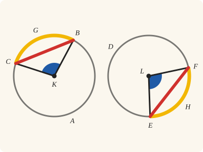
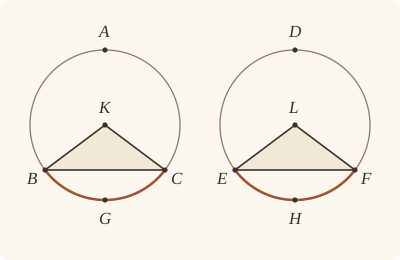

<!-- Generated by scripts/render.py. Do not edit by hand. -->

[Book III](index.md) · [← III.28](28.md) · [III.30 →](30.md)

# Book III, Proposition 29

*Equal circumferences are subtended by equal straight lines*

[Euclid's proof](#euclids-proof) · [In Lean](#in-lean) · [What it rests on](#what-it-rests-on) · [Mishnah](#mishnah)

> In equal circles equal circumferences are subtended by equal straight lines.

**In Lean:** ✅ proved, as Euclid states it, in our measure of circumferences · Euclid's argument, with two steps changed

<p align="center"></p>

<p align="center"><em>Cut off the equal circumferences BGC, EHF (yellow) in the equal circles ABC, DEF: the angles BKC, ELF at the centres K, L are equal (blue), and so are the straight lines BC, EF (red).</em></p>

## Euclid's proof

<p align="center"></p>

<p align="center"><em>Drawn for one case: circumferences BGC and EHF less than semicircles, with K and L beyond BC and EF from G and H.</em></p>

Let ABC, DEF be equal circles, and in them let equal circumferences BGC, EHF be cut off; and let the straight lines BC, EF be joined;

I say that BC is equal to EF.

For let the centres of the circles be taken, and let them be K, L; let BK, KC, EL, LF be joined.

Now, since the circumference BGC is equal to the circumference EHF,

the angle BKC is also equal to the angle ELF. [III. 27]

And, since the circles ABC, DEF are equal,

the radii are also equal;

therefore the two sides BK, KC are equal to the two sides EL, LF; and they contain equal angles;

therefore the base BC is equal to the base EF. [I. 4]

Therefore etc.

Q. E. D.

## In Lean

| | |
|---|---|
| Proof | ✅ Proved, and its companion `Prop29.of_congruent` ([III.29 of_congruent](29.md#of_congruent)) |
| Statement | The whole enunciation. Equal circumferences of any size, less than a semicircle, a semicircle or greater, by the angle measure; `Prop29.of_congruent` takes them to be congruent. |
| Argument | Euclid's, with two steps changed. Euclid's argument where the circumferences are less than semicircles; when they are semicircles, BC and EF are diameters, and when greater, his argument runs on the circumferences that remain. The route stays so for this release, a deliberate limitation. Semicircles give diameters, which make no triangles for I.4, so the proof adds the equal radii instead; for greater circumferences the rectilineal angles at the centres stand on the less circumferences that remain, so III.27 is applied to those before I.4. A theory of arc magnitudes of their own is left for a later release, and would not by itself remove the case of semicircles. The companion `Prop29.of_congruent` passes from congruent circumferences to equal measures by III.24's companion `Prop24.equalMeasure`, and then applies `Prop29`, so its route is the one above. |
| Representation | Equal circumferences are equal measures, which in equal circles is what Euclid means; in `Prop29` the equal circles do real work, giving I.4 its equal radii. In `Prop29.of_congruent` the circumferences are congruent, and the map that lays one on the other keeps the distance between their ends, so the congruence already gives the equal straight lines (`Prop24.image`), and the equal circles with them (`Prop24.equalCircles`): in that companion alone the hypothesis is redundant, kept as Euclid's setting and used along the same route, for the radii of I.4. |
| Reviewed | The statement and every passage of the argument read against Heath's text, at commit [`1c21c147b`](https://github.com/jackChallis/stoicheia/commit/1c21c147b) ([the record](../../review/III/29.toml)) |

From [`Elements/BookIII/Prop29.lean`](../../Elements/BookIII/Prop29.lean). Euclid's sentences are the `--` comments, and our own notes are in `/- … -/`; the lines under each sentence are the Lean that carries it out. The list below marks where a lemma does a step Euclid takes for granted and where a step is argued another way; the `/- … -/` notes in the listing explain smaller adjustments.

**How the Lean follows the text**

- **Done by `Prop2.oppositeSide`.** "and let the straight lines BC, EF be joined…" Euclid's figure puts A and D on the circles beyond BC and EF from G and H. The Lean supplies those points by `Prop2.oppositeSide` (III.2, for which Heath prints no reference here), to give III.27 points at the circumferences as well as the centres.
- **Argued another way.** "For let the centres of the circles be taken…" The given equal circles supply K and L, as the [introduction](index.md) explains. When K lies on BC, `Circumference.semicircle` makes BGC a semicircle and `Prop29.size` makes EHF one too. BC and EF are diameters, each twice the equal radius, so the Lean adds the radii by `Tacit.len_add_of_between` instead of applying III.27 and I.4.
- **Argued another way.** "Now, since the circumference BGC is equal to the circumference EHF…" `Prop29.size` puts both circumferences in the same size case. For circumferences greater than semicircles, `Circumference.whole` gives equal wholes, so Common Notion 3 leaves equal remainders BAC and EDF. `Prop2.sameSide` supplies the points at the circumferences needed to apply III.27 to those remainders.

<details><summary>Before the theorem, one lemma: <code>Prop29.size</code> (18 lines)</summary>

```lean
/-- As the straight line XY cuts off the circumference XZY, the centre M lies beyond it,
and the circumference is less than a semicircle; or on XY, and it is a semicircle; or on
Z's side, and it is greater. Euclid's figure has the first, and the proof takes all
three. [I. 5, I. 32, III. 20, III. 21, III. 22] -/
theorem Prop29.size {X Y Z M : Point} {α : Circle} (hM : Centre M α) (hX : OnCircle X α)
    (hY : OnCircle Y α) (hXYZ : Triangle X Y Z) :
    (OppositeSidesOf M Z X Y ∧ circumference α X Z Y < ∟ + ∟) ∨
      (Between X M Y ∧ circumference α X Z Y = ∟ + ∟) ∨
      (SameSideOf M Z X Y ∧ ∟ + ∟ < circumference α X Z Y) := by
  obtain ⟨N, hX_N, hY_N⟩ := Postulate1 X Y hXYZ.ne₁₂
  by_cases hM_N : OnLine M N
  · have hXMY := between_of_inside_chord hM_N hX_N hY_N (centre_inside hM) hX hY hXYZ.ne₁₂
    exact Or.inr (Or.inl ⟨hXMY, Circumference.semicircle hM hX hY hXMY hXYZ⟩)
  by_cases hs : SameSide M Z N
  · have h := SameSideOf.of_line hXYZ.ne₁₂ hX_N hY_N hs
    exact Or.inr (Or.inr ⟨h, Circumference.gt_semicircle hM hX hY h⟩)
  · have h := OppositeSidesOf.of_line hXYZ.ne₁₂ hX_N hY_N ⟨hM_N, hXYZ.off_line hX_N hY_N, hs⟩
    exact Or.inl ⟨h, Circumference.lt_semicircle hM hX hY h⟩
```

</details>

```lean
/-- In equal circles equal circumferences are subtended by equal straight lines. -/
theorem Prop29 {B C E F G H : Point} {ABC DEF : Circle} (hcircles : EqualCircles ABC DEF)
    (hB : OnCircle B ABC) (hC : OnCircle C ABC) (hE : OnCircle E DEF) (hF : OnCircle F DEF)
    (hG : ¬ Collinear B C G) (hH : ¬ Collinear E F H)
    (heq : circumference ABC B G C = circumference DEF E H F) :
    ‖B C‖ = ‖E F‖ := by
  -- Let ABC, DEF be equal circles, and in them let equal circumferences BGC, EHF be cut off;
  -- and let the straight lines BC, EF be joined;
  have hBCG : Triangle B C G := hG
  have hEFH : Triangle E F H := hH
  /- A and D are points of the circles beyond BC and EF from G and H, as Heath draws
     them. -/
  obtain ⟨A, hA, hAG⟩ := Prop2.oppositeSide hB hC hBCG
  obtain ⟨D, hD, hDH⟩ := Prop2.oppositeSide hE hF hEFH
  -- I say that BC is equal to EF.
  -- For let the centres of the circles be taken, and let them be K, L; let BK, KC, EL, LF be
  -- joined.
  obtain ⟨K, L, -, -, hK, hL, -, -, -⟩ := id hcircles
  /- Euclid's figure has each centre off its straight line. When K is on BC, BGC and EHF are
     semicircles, and BC, EF are diameters of equal circles. -/
  by_cases hKBC : Collinear B C K
  · obtain ⟨N, hB_N, hC_N, hK_N⟩ := hKBC
    have hBKC := between_of_inside_chord hK_N hB_N hC_N (centre_inside hK) hB hC hBCG.ne₁₂
    have hsemi := Circumference.semicircle hK hB hC hBKC hBCG
    rcases Prop29.size hL hE hF hEFH with ⟨-, hlt'⟩ | ⟨hELF, -⟩ | ⟨-, hgt'⟩
    · exact absurd (heq ▸ hsemi ▸ hlt') (lt_irrefl _)
    · rw [← len_add_of_between hBKC, ← len_add_of_between hELF, len_symm B K,
        hcircles.radii hK hL hB hE, hcircles.radii hK hL hC hF, len_symm E L]
    · exact absurd (heq ▸ hsemi ▸ hgt') (lt_irrefl _)
  -- Now, since the circumference BGC is equal to the circumference EHF,
  /- Otherwise the angle BKC stands on BGC, as in Euclid's figure, or on BAC, the
     circumference which remains; the remainders are equal, since the wholes are
     (`Circumference.whole`) [C.N. 3], and L falls as K does. For III.27 we take a point X,
     Y of each circle on the centre's side. -/
  obtain ⟨X, Y, hX, hY, hKX, hLY, hst⟩ : ∃ X Y : Point, OnCircle X ABC ∧ OnCircle Y DEF ∧
      SameSideOf K X B C ∧ SameSideOf L Y E F ∧ standing ABC B X C = standing DEF E Y F := by
    rcases Prop29.size hK hB hC hBCG with ⟨hKG, hlt⟩ | ⟨hBKC, -⟩ | ⟨hKG, hgt⟩
    · rcases Prop29.size hL hE hF hEFH with ⟨hLH, -⟩ | ⟨-, hsemi'⟩ | ⟨-, hgt'⟩
      · refine ⟨A, D, hA, hD, OppositeSidesOf.sameSideOf hKG.symm hAG.symm,
          OppositeSidesOf.sameSideOf hLH.symm hDH.symm, ?_⟩
        rw [standing_eq_circumference hAG, standing_eq_circumference hDH, heq]
      · exact absurd (hsemi' ▸ heq ▸ hlt) (lt_irrefl _)
      · exact absurd (lt_trans (heq ▸ hlt) hgt') (lt_irrefl _)
    · exact absurd (collinear_of_between hBKC) (fun h => hKBC (by
        obtain ⟨N, h1, h2, h3⟩ := h; exact ⟨N, h1, h3, h2⟩))
    · rcases Prop29.size hL hE hF hEFH with ⟨-, hlt'⟩ | ⟨-, hsemi'⟩ | ⟨hLH, -⟩
      · exact absurd (lt_trans hlt' (heq ▸ hgt)) (lt_irrefl _)
      · exact absurd (hsemi' ▸ heq ▸ hgt) (lt_irrefl _)
      · obtain ⟨X, hX, hXG⟩ := Prop2.sameSide hB hC hBCG
        obtain ⟨Y, hY, hYH⟩ := Prop2.sameSide hE hF hEFH
        refine ⟨X, Y, hX, hY, hKG.trans hXG.symm, hLH.trans hYH.symm, ?_⟩
        rw [standing_eq_circumference (hXG.trans_opposite hAG.symm),
          standing_eq_circumference (hYH.trans_opposite hDH.symm)]
        have hw₁ := Circumference.whole hB hC hAG
        have hw₂ := Circumference.whole hE hF hDH
        refine CommonNotion3 (c := circumference ABC B G C) (d := circumference DEF E H F) ?_ heq
        calc
          _ = circumference ABC B G C + circumference ABC B A C := by ac_rfl
          _ = circumference DEF E H F + circumference DEF E D F := hw₁.trans hw₂.symm
          _ = _ := by ac_rfl
  -- the angle BKC is also equal to the angle ELF. [III. 27]
  have hBKC : ∠ B K C = ∠ E L F :=
    (Prop27 hcircles hK hL hX hB hC hY hE hF hKX.symm.triangle.acb hLY.symm.triangle.acb
      hst).2 hKX hLY
  -- And, since the circles ABC, DEF are equal,
  -- the radii are also equal;
  have hrB : ‖K B‖ = ‖L E‖ := hcircles.radii hK hL hB hE
  have hrC : ‖K C‖ = ‖L F‖ := hcircles.radii hK hL hC hF
  -- therefore the two sides BK, KC are equal to the two sides EL, LF; and they contain equal
  -- angles;
  -- therefore the base BC is equal to the base EF. [I. 4]
  exact (BookI.Prop4 hKX.triangle.cab hLY.triangle.cab hrB hrC hBKC).1
  -- Therefore etc.
  -- Q. E. D.
```

<a name="of_congruent"></a>

<details><summary>After the theorem, its companion, <code>Prop29.of_congruent</code> (22 lines)</summary>

```lean
/-- **III.29 with congruent circumferences** (companion of III.29, "III.29 of_congruent").
In equal circles congruent circumferences are subtended by equal straight lines. We read
the congruence as III.28 concludes it (`Arc.Congruent`, Common Notion 4); `Prop29` reads
equal circumferences as equal in measure.

The map that makes the circumferences coincide keeps the distance between their ends, so
the congruence already gives the equal straight lines (`Prop24.image`). This proof passes
instead through equal measures (`Prop24.equalMeasure`) and `Prop29`, keeping that proof's
argument through III.27 and I.4, with its own treatment of semicircles and greater
circumferences. Congruence of these drawn arcs also implies that the circles are equal; the
hypothesis keeps Euclid's setting. -/
theorem Prop29.of_congruent {B C E F G H : Point} {ABC DEF : Circle}
    (hcircles : EqualCircles ABC DEF)
    (hB : OnCircle B ABC) (hC : OnCircle C ABC) (hE : OnCircle E DEF) (hF : OnCircle F DEF)
    (hG : ¬ Collinear B C G) (hH : ¬ Collinear E F H)
    (hcong : Arc.Congruent ⟨ABC, B, C, G⟩ ⟨DEF, E, F, H⟩) :
    ‖B C‖ = ‖E F‖ := by
  /- The congruent circumferences BGC, EHF are equal in measure (`Prop24.equalMeasure`),
     and III.29 gives the equal straight lines. -/
  exact Prop29 hcircles hB hC hE hF hG hH
    (Prop24.equalMeasure (a := ⟨ABC, B, C, G⟩) (b := ⟨DEF, E, F, H⟩)
      ⟨hB, hC, hG⟩ ⟨hE, hF, hH⟩ hcong)
```

</details>

## What it rests on

| | Proposition | `Prop29.of_congruent` |
|---|---|---|
| Heath's references | [I.4](../I/04.md), [III.27](27.md) | none |
| Lean cites | [I.4](../I/04.md), [I.5](../I/05.md), [I.32](../I/32.md), [III.2](02.md), [III.20 special](20.md#special), [III.21](21.md), [III.22](22.md), [III.27](27.md) | [III.24 equalMeasure](24.md#equalMeasure), [III.29](29.md) |
| Postulates | 1, 2, 3, 4, 5 | 1, 2, 3, 4, 5 |
| Definitions taken as axioms | Def. I.15 | Def. I.15 |
| Common Notions | 1, 2, 3, 4, 5 | 1, 2, 3, 4, 5 |
| Tacit rules | 39 (listed below) | 39 (listed below) |
| Its own Lean calls | Postulate 1; 4 tacit rules | none |
| Through lemmas | Postulates 2 and 3; Def. I.15; 27 tacit rules | none |

Some of these come in through lemmas [shared](../../CERTIFICATE.md#shared-steps) by many proofs: [`Circumference.semicircle`](../../Elements/BookIII/Circumferences.lean#L109) (I.5, I.32, III.2); [`Circumference.lt_semicircle`](../../Elements/BookIII/Circumferences.lean#L149) (I.32, III.2, III.20 special, III.21); [`Circumference.gt_semicircle`](../../Elements/BookIII/Circumferences.lean#L164) (I.32, III.2, III.20 special, III.21, III.22); [`Prop2.oppositeSide`](../../Elements/BookIII/Prop02.lean#L152), [`Prop2.sameSide`](../../Elements/BookIII/Prop02.lean#L173), [`Tacit.between_of_inside_chord`](../../Elements/BookIII/Prop02.lean#L194) (III.2); [`Circumference.whole`](../../Elements/BookIII/Circumferences.lean#L85) (III.2, III.21, III.22).

_Postulates, definitions, Common Notions and tacit rules: all that each proof rests on, counting those of the propositions it cites. The last two rows say which of the postulates, definitions and tacit rules its own Lean calls, in the proof or a helper written for it, and which it does not call but reaches through lemmas, of Book Zero or shared (a proposition it cites may rest on these too); the rest come in only through the propositions it cites or the Common Notions._

<details><summary>The 39 tacit rules beneath this proof, counting those of the propositions it cites</summary>

_(used here) marks a rule this proof's own Lean calls, in the proof or a helper written for it; (through …) marks one its own Lean does not call but reaches through the lemmas named, of [Book Zero](../../Elements/Figure) or shared, though a proposition it cites may rest on it too; and a rule with no mark comes in only through a proposition it cites or a Common Notion. The names in brackets are System E's: an Intersection rule says when straight lines and circles must meet, and an Intersections rule takes a point where they do (see [Book I's introduction](../I/index.md))._

**Reading the figure**

- [`between_cases`](../../Elements/Foundations/Tacit/Diagram.lean#L54) (through [`Circumference.gt_semicircle`](../../Elements/BookIII/Circumferences.lean#L164), [`Circumference.lt_semicircle`](../../Elements/BookIII/Circumferences.lean#L149), [`Circumference.semicircle`](../../Elements/BookIII/Circumferences.lean#L109) and 6 other lemmas): Of three different points on a straight line, one is between the other two. (Between 6)
- [`between_symm`](../../Elements/Foundations/Tacit/Diagram.lean#L47) (through [`Circumference.gt_semicircle`](../../Elements/BookIII/Circumferences.lean#L164), [`Circumference.lt_semicircle`](../../Elements/BookIII/Circumferences.lean#L149), [`Circumference.semicircle`](../../Elements/BookIII/Circumferences.lean#L109) and 7 other lemmas): If B is between A and C, it is between C and A. (Between 1)
- [`circles_meet`](../../Elements/Foundations/Tacit/Diagram.lean#L91) (through [`Circumference.gt_semicircle`](../../Elements/BookIII/Circumferences.lean#L164), [`Circumference.lt_semicircle`](../../Elements/BookIII/Circumferences.lean#L149), [`Circumference.semicircle`](../../Elements/BookIII/Circumferences.lean#L109) and 10 other lemmas): If each circle passes through a point inside the other, the circles cut one another. This is the step Euclid takes for granted in I.1. (Intersection 5)
- [`circles_meet_same_side`](../../Elements/Foundations/Tacit/Constructions.lean#L79) (through [`Circumference.gt_semicircle`](../../Elements/BookIII/Circumferences.lean#L164), [`Circumference.lt_semicircle`](../../Elements/BookIII/Circumferences.lean#L149), [`Circumference.semicircle`](../../Elements/BookIII/Circumferences.lean#L109) and 10 other lemmas): Two circles that cut one another do so on each side of the straight line through their centres. (Intersections 8)
- [`exists_centre`](../../Elements/Foundations/Tacit/Constructions.lean#L57) (through [`Circumference.gt_semicircle`](../../Elements/BookIII/Circumferences.lean#L164), [`Circumference.lt_semicircle`](../../Elements/BookIII/Circumferences.lean#L149), [`Circumference.semicircle`](../../Elements/BookIII/Circumferences.lean#L109) and 4 other lemmas): Every circle has a centre. A rule of our own, not one of System E's: its content is Euclid's Definitions I.15 and I.16.
- [`exists_point`](../../Elements/Foundations/Tacit/Constructions.lean#L35) (through [`Circumference.gt_semicircle`](../../Elements/BookIII/Circumferences.lean#L164), [`Circumference.lt_semicircle`](../../Elements/BookIII/Circumferences.lean#L149), [`Circumference.semicircle`](../../Elements/BookIII/Circumferences.lean#L109) and 4 other lemmas): Let a point be taken. (Points 1)
- [`exists_point_inside_circle`](../../Elements/Foundations/Tacit/Constructions.lean#L42) (through [`Circumference.gt_semicircle`](../../Elements/BookIII/Circumferences.lean#L164), [`Circumference.lt_semicircle`](../../Elements/BookIII/Circumferences.lean#L149), [`Circumference.semicircle`](../../Elements/BookIII/Circumferences.lean#L109) and 12 other lemmas): Let a point be taken inside the circle α. (Points 8)
- [`exists_point_on_line`](../../Elements/Foundations/Tacit/Constructions.lean#L38) (through [`Circumference.gt_semicircle`](../../Elements/BookIII/Circumferences.lean#L164), [`Circumference.lt_semicircle`](../../Elements/BookIII/Circumferences.lean#L149), [`Circumference.semicircle`](../../Elements/BookIII/Circumferences.lean#L109) and 10 other lemmas): Let a point be taken on the straight line L. (Points 2)
- [`line_circle_between`](../../Elements/Foundations/Tacit/Constructions.lean#L67) (through [`Circumference.gt_semicircle`](../../Elements/BookIII/Circumferences.lean#L164), [`Circumference.lt_semicircle`](../../Elements/BookIII/Circumferences.lean#L149), [`Circumference.semicircle`](../../Elements/BookIII/Circumferences.lean#L109) and 12 other lemmas): A straight line through a point B inside a circle, heading out to a point C outside it, cuts the circle between B and C. (Intersections 4)
- [`line_circle_beyond`](../../Elements/Foundations/Tacit/Constructions.lean#L73) (through [`Circumference.gt_semicircle`](../../Elements/BookIII/Circumferences.lean#L164), [`Circumference.lt_semicircle`](../../Elements/BookIII/Circumferences.lean#L149), [`Circumference.semicircle`](../../Elements/BookIII/Circumferences.lean#L109) and 12 other lemmas): A straight line through a point B inside a circle, produced beyond B away from C, cuts the circle there. (Intersections 5)
- [`line_unique`](../../Elements/Foundations/Tacit/Diagram.lean#L41) (through [`Circumference.gt_semicircle`](../../Elements/BookIII/Circumferences.lean#L164), [`Circumference.lt_semicircle`](../../Elements/BookIII/Circumferences.lean#L149), [`Circumference.semicircle`](../../Elements/BookIII/Circumferences.lean#L109) and 7 other lemmas): Two points determine a straight line. (Generalities 1)
- [`lines_meet_of_opposite_sides`](../../Elements/Foundations/Tacit/Diagram.lean#L86) (through [`Circumference.gt_semicircle`](../../Elements/BookIII/Circumferences.lean#L164), [`Circumference.lt_semicircle`](../../Elements/BookIII/Circumferences.lean#L149), [`Circumference.whole`](../../Elements/BookIII/Circumferences.lean#L85) and 3 other lemmas): A straight line joining points on opposite sides of L crosses L. (Intersection 1)
- [`not_between_of_between`](../../Elements/Foundations/Tacit/Diagram.lean#L50) (through [`Circumference.gt_semicircle`](../../Elements/BookIII/Circumferences.lean#L164), [`Circumference.lt_semicircle`](../../Elements/BookIII/Circumferences.lean#L149), [`Circumference.semicircle`](../../Elements/BookIII/Circumferences.lean#L109) and 12 other lemmas): If B is between A and C, then A is not between B and C. (Between 1)
- [`not_on_line_of_same_side`](../../Elements/Foundations/Tacit/Diagram.lean#L60) (through [`Circumference.gt_semicircle`](../../Elements/BookIII/Circumferences.lean#L164), [`Circumference.lt_semicircle`](../../Elements/BookIII/Circumferences.lean#L149), [`Circumference.semicircle`](../../Elements/BookIII/Circumferences.lean#L109) and 12 other lemmas): Points on one side of a straight line are not on it. (Same side 3)
- [`pasch2`](../../Elements/Foundations/Tacit/Diagram.lean#L71) (through [`Circumference.gt_semicircle`](../../Elements/BookIII/Circumferences.lean#L164), [`Circumference.lt_semicircle`](../../Elements/BookIII/Circumferences.lean#L149), [`Circumference.semicircle`](../../Elements/BookIII/Circumferences.lean#L109) and 7 other lemmas): If B is between A and C, A is on L and B is off it, then B and C are on the same side of L: a straight line that leaves L at A does not cross it again. (Pasch 2)
- [`same_side_trans`](../../Elements/Foundations/Tacit/Diagram.lean#L64) (through [`Circumference.gt_semicircle`](../../Elements/BookIII/Circumferences.lean#L164), [`Circumference.lt_semicircle`](../../Elements/BookIII/Circumferences.lean#L149), [`Circumference.semicircle`](../../Elements/BookIII/Circumferences.lean#L109) and 11 other lemmas): Two points on the same side of a straight line as a third point are on the same side as each other. (Same side 4)

**Lengths, angles and areas**

- [`angle_add_of_inside`](../../Elements/Foundations/Tacit/Transfer.lean#L47) (through [`Circumference.gt_semicircle`](../../Elements/BookIII/Circumferences.lean#L164), [`Circumference.lt_semicircle`](../../Elements/BookIII/Circumferences.lean#L149), [`Circumference.semicircle`](../../Elements/BookIII/Circumferences.lean#L109) and 5 other lemmas): If D lies within the angle BAC, then BAC is made up of BAD and DAC. (Diagram-angle 2)
- [`angle_eq_of_same_rays`](../../Elements/Foundations/Tacit/Transfer.lean#L54) (through [`Circumference.semicircle`](../../Elements/BookIII/Circumferences.lean#L109)): The angle doesn't change if its arms are traced through other points on the same rays. (Diagram-angle 4)
- [`angle_symm`](../../Elements/Foundations/Tacit/Metric.lean#L30) (through [`Circumference.gt_semicircle`](../../Elements/BookIII/Circumferences.lean#L164), [`Circumference.lt_semicircle`](../../Elements/BookIII/Circumferences.lean#L149), [`Circumference.semicircle`](../../Elements/BookIII/Circumferences.lean#L109) and 1 other lemma): The angle ABC is the angle CBA. (Metric 4)
- [`area_add_of_between`](../../Elements/Foundations/Tacit/Transfer.lean#L70): Cutting a triangle in two from a vertex adds up. (Diagram-area 2)
- [`area_congruent`](../../Elements/Foundations/Tacit/Metric.lean#L44): Triangles equal in all their sides and angles are equal in area. Euclid uses this without comment once he has shown two triangles congruent. (Metric 9)
- [`area_degenerate`](../../Elements/Foundations/Tacit/Metric.lean#L36): A "triangle" with a repeated corner has no area. (Metric 6)
- [`area_eq_zero_of_on_line`](../../Elements/Foundations/Tacit/Transfer.lean#L62): A "triangle" whose corners lie on one straight line has no area. (Diagram-area 1)
- [`area_rotate`](../../Elements/Foundations/Tacit/Metric.lean#L39): The triangle ABC is the triangle CAB. (Metric 8)
- [`circle_eq`](../../Elements/Foundations/Tacit/Transfer.lean#L30): A circle is fixed by its centre and its radius. (Diagram-segment 2)
- [`len_add_of_between`](../../Elements/Foundations/Tacit/Transfer.lean#L27) (used here): If B is between A and C, then AB and BC together make up AC. (Diagram-segment 1)
- [`len_self`](../../Elements/Foundations/Tacit/Metric.lean#L24) (through [`Circumference.gt_semicircle`](../../Elements/BookIII/Circumferences.lean#L164), [`Circumference.lt_semicircle`](../../Elements/BookIII/Circumferences.lean#L149), [`Circumference.semicircle`](../../Elements/BookIII/Circumferences.lean#L109) and 12 other lemmas): The "straight line" from a point to itself has no length. (Metric 1)
- [`len_symm`](../../Elements/Foundations/Tacit/Metric.lean#L27) (used here): The straight line AB is the straight line BA. (Metric 3)
- [`radius_ne_zero`](../../Elements/Foundations/Tacit/Metric.lean#L62) (through [`Circumference.gt_semicircle`](../../Elements/BookIII/Circumferences.lean#L164), [`Circumference.lt_semicircle`](../../Elements/BookIII/Circumferences.lean#L149), [`Circumference.semicircle`](../../Elements/BookIII/Circumferences.lean#L109) and 12 other lemmas): A circle's radius is not nothing: the straight line from the centre to a point on the circle has some length. A rule of our own, not one of System E's: every circle is drawn with a centre and a distance (Postulate 3).
- [`same_ray_of_angle_eq_zero`](../../Elements/Foundations/Tacit/Transfer.lean#L42) (through [`Circumference.gt_semicircle`](../../Elements/BookIII/Circumferences.lean#L164), [`Circumference.lt_semicircle`](../../Elements/BookIII/Circumferences.lean#L149), [`Circumference.semicircle`](../../Elements/BookIII/Circumferences.lean#L109) and 5 other lemmas): If the angle BAC is nothing, C lies on the ray from A through B. (Diagram-angle 1)

**Superposition**

- [`superposition`](../../Elements/Foundations/Tacit/Superposition.lean#L52): **Superposition.** A hypothetical placement of a triangle on a given ray and side permits a restricted derivation of metric equalities about the figure already given. The derivation introduces no further objects, cites each geometric law it uses, and exports no symbol of the placement.

**Laws of magnitude**

- [`add_assoc`](../../Elements/Foundations/Tacit/Magnitudes.lean#L23) (through [`Circumference.gt_semicircle`](../../Elements/BookIII/Circumferences.lean#L164), [`Circumference.lt_semicircle`](../../Elements/BookIII/Circumferences.lean#L149), [`Circumference.semicircle`](../../Elements/BookIII/Circumferences.lean#L109) and 5 other lemmas): Adding three magnitudes in a row, it makes no difference whether the first two or the last two are added first. (System E §3.5)
- [`add_comm`](../../Elements/Foundations/Tacit/Magnitudes.lean#L26) (through [`Circumference.gt_semicircle`](../../Elements/BookIII/Circumferences.lean#L164), [`Circumference.lt_semicircle`](../../Elements/BookIII/Circumferences.lean#L149), [`Circumference.semicircle`](../../Elements/BookIII/Circumferences.lean#L109) and 13 other lemmas): The order of adding does not matter. (System E §3.5)
- [`add_lt_add_right`](../../Elements/Foundations/Tacit/Magnitudes.lean#L45) (through [`Circumference.gt_semicircle`](../../Elements/BookIII/Circumferences.lean#L164), [`Circumference.lt_semicircle`](../../Elements/BookIII/Circumferences.lean#L149), [`Circumference.whole`](../../Elements/BookIII/Circumferences.lean#L85) and 3 other lemmas): Adding the same thing to both sides keeps "less than". (System E §3.5)
- [`add_zero`](../../Elements/Foundations/Tacit/Magnitudes.lean#L29): Adding nothing changes nothing. (System E §3.5)
- [`lt_irrefl`](../../Elements/Foundations/Tacit/Magnitudes.lean#L32) (used here): No magnitude is less than itself. (System E §3.5)
- [`lt_trans`](../../Elements/Foundations/Tacit/Magnitudes.lean#L35) (used here): What is less than the less is less still. (System E §3.5)
- [`lt_trichotomy`](../../Elements/Foundations/Tacit/Magnitudes.lean#L39) (through [`Circumference.gt_semicircle`](../../Elements/BookIII/Circumferences.lean#L164), [`Circumference.lt_semicircle`](../../Elements/BookIII/Circumferences.lean#L149), [`Circumference.semicircle`](../../Elements/BookIII/Circumferences.lean#L109) and 12 other lemmas): Of two magnitudes, one is less, or they are equal, or the other is less. (System E §3.5)
- [`not_lt_zero`](../../Elements/Foundations/Tacit/Magnitudes.lean#L42) (through [`Circumference.gt_semicircle`](../../Elements/BookIII/Circumferences.lean#L164), [`Circumference.lt_semicircle`](../../Elements/BookIII/Circumferences.lean#L149), [`Circumference.semicircle`](../../Elements/BookIII/Circumferences.lean#L109) and 12 other lemmas): Nothing is less than zero. (System E §3.5)

</details>

## Mishnah

_Our commentary: what Euclid assumes, what Lean made us say out loud, and how the result looks by modern means._

Equal angles alone give no equal lengths, and Euclid needs the radii. III.28 went from equal straight lines to equal circumferences, and here he comes back: equal circumferences give equal angles at the centres (III.27), the equal circles give equal sides about them, and I.4 makes the bases BC, EF equal.

The case of semicircles, Heath says, "is even easier than the corresponding case of III. 28 itself" (vol. 2, p. 61). When BC passes through the centre K, BGC is a semicircle, and so is the equal circumference EHF. Both straight lines are then diameters, each two equal radii, and we need no triangles.

**Which circumference does the angle see?** Euclid's figure puts K beyond BC from G, so that the angle BKC stands on BGC. K may also lie on G's side, where BGC is greater than a semicircle (`Prop29.size`), and then the angle BKC stands on BAC, the circumference that remains. So we take the equal circumferences from the equal circles (`Circumference.whole`), and Euclid's argument runs on BAC and EDF. Equal circumferences are both less than a semicircle, both semicircles or both greater, so L falls as K does.

Heath adds that III.26–III.29 "are of course equally true if the *same* circle is taken instead of *two equal* circles" (vol. 2, p. 61). Our two circles may be one (`EqualCircles.refl`), for a circle's radii are equal to one another. Nothing in the proof needs two circles, though the figure draws two.

**What does congruence leave for III.29 to do?** In `Prop29.of_congruent` we take the circumferences as III.28 concludes them, congruent. The map that lays one on the other carries B to E and C to F and keeps the distance between them, so the equal straight lines already follow, and equal circles with them, which leaves Euclid's "in equal circles" redundant there. We keep III.29's argument all the same, once III.24's companion has made the measures equal, and the equal circles still give I.4 its radii.

**The modern way.** Put the centre K at 0 in the complex plane, and let the radius be $r$. The arc whose angle at the centre is $\theta$, with $0 \lt \theta \lt 2\pi$, runs from B to B turned through $\theta$, that is, to $\mathrm{B}e^{i\theta}$. So the straight line joining its ends has length $|\mathrm{B}e^{i\theta} - \mathrm{B}| = r|e^{i\theta} - 1| = 2r\sin(\theta/2)$, which depends only on $r$ and $\theta$: in equal circles, equal arcs have equal straight lines joining their ends, arcs greater than a semicircle included.

## Further reading

- Turning B through θ by one multiplication, as the modern way does, is the subject of §4.7, "Rotations, matrices, and complex numbers" (from p. 83), of John Stillwell's [*The Four Pillars of Geometry*](https://doi.org/10.1007/0-387-29052-4) (2005) (also on [III.2](02.md)).
- In his remarks on Book III (p. 11), Augustus De Morgan asks that III.26 to III.29 be read as one statement, "In equal circles either of the five pairs, arcs, chords, angles at the centre, angles at the circumference, or sectors, being equal, the other four pairs are equal": ["Short Supplementary Remarks on the First Six Books of Euclid's Elements"](https://archive.org/details/sim_british-almanac-companion_1849) (1849, free online) (also on [III.7](07.md)).

[Book III](index.md) · [← III.28](28.md) · [III.30 →](30.md)

---

<sub>Euclid's text: T. L. Heath, *The Thirteen Books of Euclid's Elements*, vol. 2 (Cambridge, 1908), p. 60; [scan leaf n72](https://archive.org/details/thirteenbookseu00heibgoog/page/n72); [figure on n72](https://archive.org/details/thirteenbookseu00heibgoog/page/n72). Public domain.</sub>

<sub>The tacit rules follow the System E of Jeremy Avigad, Edward Dean and John Mumma, read alongside LeanEuclid (Logan Murphy, Kaiyu Yang, Jialiang Sun, Zhaoyu Li, Anima Anandkumar and Xujie Si).</sub>
