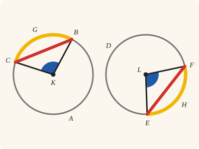
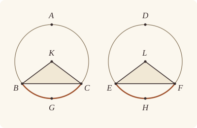

<!-- Generated by scripts/render.py. Do not edit by hand. -->

[Book III](index.md) · [← III.28](28.md) · [III.30 →](30.md)

# Book III, Proposition 29

*Equal circumferences are subtended by equal straight lines*

[Euclid's proof](#euclids-proof) · [In Lean](#in-lean) · [What it rests on](#what-it-rests-on) · [Mishnah](#mishnah)

> In equal circles equal circumferences are subtended by equal straight lines.

**In Lean:** ✅ proved, as Euclid states it, with a companion in our measure of circumferences · Euclid's argument, with one step changed

<p align="center"></p>

<p align="center"><em>Cut off the equal circumferences BGC, EHF (yellow) in the equal circles ABC, DEF: the angles BKC, ELF at the centres K, L are equal (blue), and so are the straight lines BC, EF (red).</em></p>

## Euclid's proof

<p align="center"></p>

<p align="center"><em>Drawn for one case: circumferences BGC and EHF less than semicircles, with K and L beyond BC and EF from G and H.</em></p>

Let ABC, DEF be equal circles, and in them let equal circumferences BGC, EHF be cut off; and let the straight lines BC, EF be joined;

I say that BC is equal to EF.

For let the centres of the circles be taken, and let them be K, L; let BK, KC, EL, LF be joined.

Now, since the circumference BGC is equal to the circumference EHF,

the angle BKC is also equal to the angle ELF. [III. 27]

And, since the circles ABC, DEF are equal,

the radii are also equal;

therefore the two sides BK, KC are equal to the two sides EL, LF; and they contain equal angles;

therefore the base BC is equal to the base EF. [I. 4]

Therefore etc.

Q. E. D.

## In Lean

| | |
|---|---|
| Proof | ✅ Proved, and its companion `Prop29.of_measure` ([III.29 of_measure](29.md#of_measure)) |
| Statement | The whole enunciation. Equal circumferences that coincide in `Prop29`, equal in measure in `Prop29.of_measure`; of any size, less than a semicircle, a semicircle or greater. |
| Argument | Euclid's, with one step changed. For lesser circumferences, III.27 gives equal angles at the centres, and equal radii and I.4 give equal bases. The edition's own route for greater circumferences rests on the subtraction that ends Euclid's III.28: equal whole circles leave equal circumferences after equal circumferences are taken away (Heath, vol. 2, p. 60). In both proofs, under the base passage, this subtraction (Common Notion 3) gives equal lesser remainders; `standing_eq_circumference` expresses their measures as standing measures for `Prop27.of_measure`, and I.4 gives BC = EF. At Euclid's sentence on the equality of BKC and ELF, `Prop27` gives the main proof its conditional equality of the angles at the centres for the lesser case; the companion uses `Prop27.of_measure`. Under the base passage, `Prop29` obtains equal measures by `Prop24.equalMeasure`; `Prop29.of_measure` has them as its hypothesis, and both proofs use `Prop29.matchSizes` to match the cases. For semicircles the Lean makes each diameter a sum of two equal radii. The split into cases by the size of the circumference rests on III.20's special case, III.21 and III.22, and the greater case's passage to the remaining circumferences on III.21 and III.22; III.29's own proof cites III.20 in no other form and turns no angle at the centre past two right angles. |
| Representation | Euclid's equal circumferences are read through Common Notion 4 as circumferences that coincide (`Arc.Congruent`), as III.28 concludes them. `Prop29` uses `Prop24.equalMeasure` for the size split and subtraction, `Prop27` for the lesser case, and `Prop27.of_measure` on the greater case's remainders. `Prop29.of_measure` starts from equal measures and uses `Prop27.of_measure` in both non-diameter cases. The agreement of the congruence and measure readings in equal circles is proved after III.29 (`Arc.congruent_iff`, `Arc.measure_eq_iff`). `Prop24.image` and `Prop24.equalCircles` show that the main congruence hypothesis gives equal straight lines and circles; the proof uses the equal circles for the radii. In the measure companion equal circles are necessary: equal measures in unequal circles need not cut off equal straight lines. |
| Reviewed | The statement and every passage of the argument read against Heath's text, at commit [`01b11b819821e68a387b16117e33dcbfe71c6880`](https://github.com/dodecaplex-co/stoicheia/commit/01b11b819821e68a387b16117e33dcbfe71c6880) ([the record](../../review/III/29.toml)) |

From [`Elements/BookIII/Prop29.lean`](../../Elements/BookIII/Prop29.lean). Euclid's sentences are the `--` comments, and our own notes are in `/- … -/`; the lines under each sentence are the Lean that carries it out. The list below marks where a lemma does a step Euclid takes for granted, where the statement already gives a step and where a step is argued another way; the `/- … -/` notes in the listing explain smaller adjustments.

**How the Lean follows the text**

- **Done by `Prop2.oppositeSide`.** "and let the straight lines BC, EF be joined…" Euclid's figure puts A and D on the circles beyond BC and EF from G and H. The Lean supplies those points by `Prop2.oppositeSide` (III.2, for which Heath prints no reference here), to give III.27 points at the circumferences as well as the centres.
- **Already given.** "For let the centres of the circles be taken…" The hypothesis that the circles are equal supplies K and L through `EqualCircles`; the radii are named by their ends.
- **Already given.** "Now, since the circumference BGC is equal to the circumference EHF…" The circumferences BGC, EHF are given as circumferences that coincide, and III.27, as `Prop27` states it, takes them so at the next clause, so no step stands between. The companion `Prop29.of_measure` first makes its given equal measures those of the circumferences on which the angles at A and D stand (`standing_eq_circumference`), as `Prop27.of_measure` takes them.
- **Argued another way, by `Prop29.matchSizes`.** "therefore the base BC is equal to the base EF." Both proofs call `Prop29.matchSizes` with equal measures obtained by `Prop24.equalMeasure` in the main proof and given in the companion. Both use III.27 and I.4 for lesser circumferences, `Prop27.of_measure` and I.4 on the equal lesser remainders for greater circumferences by the edition's own route from III.28's closing subtraction, and the Lean adds two equal radii for each semicircle diameter.

<details><summary>Before the theorem, two lemmas: <code>Prop29.size</code> and <code>Prop29.matchSizes</code> (40 lines)</summary>

```lean
/-- As the straight line XY cuts off the circumference XZY, the centre M lies beyond it,
and the circumference is less than a semicircle; or on XY, and it is a semicircle; or on
Z's side, and it is greater. Euclid's figure has the first, and the proof takes all
three. [I. 5, I. 32, III. 20, III. 21, III. 22] -/
theorem Prop29.size {X Y Z M : Point} {α : Circle} (hM : Centre M α) (hX : OnCircle X α)
    (hY : OnCircle Y α) (hXYZ : Triangle X Y Z) :
    (OppositeSidesOf M Z X Y ∧ circumference α X Z Y < ∟ + ∟) ∨
      (Between X M Y ∧ circumference α X Z Y = ∟ + ∟) ∨
      (SameSideOf M Z X Y ∧ ∟ + ∟ < circumference α X Z Y) := by
  obtain ⟨N, hX_N, hY_N⟩ := Postulate1 X Y hXYZ.ne₁₂
  by_cases hM_N : OnLine M N
  · have hXMY := between_of_inside_chord hM_N hX_N hY_N (centre_inside hM) hX hY hXYZ.ne₁₂
    exact Or.inr (Or.inl ⟨hXMY, Circumference.semicircle hM hX hY hXMY hXYZ⟩)
  by_cases hs : SameSide M Z N
  · have h := SameSideOf.of_line hXYZ.ne₁₂ hX_N hY_N hs
    exact Or.inr (Or.inr ⟨h, Circumference.gt_semicircle hM hX hY h⟩)
  · have h := OppositeSidesOf.of_line hXYZ.ne₁₂ hX_N hY_N ⟨hM_N, hXYZ.off_line hX_N hY_N, hs⟩
    exact Or.inl ⟨h, Circumference.lt_semicircle hM hX hY h⟩

/-- Equal circumference measures put the two centres alike with respect to BC and EF. -/
theorem Prop29.matchSizes {B C E F G H K L : Point} {ABC DEF : Circle}
    (hK : Centre K ABC) (hL : Centre L DEF)
    (hB : OnCircle B ABC) (hC : OnCircle C ABC)
    (hE : OnCircle E DEF) (hF : OnCircle F DEF)
    (hG : ¬ Collinear B C G) (hH : ¬ Collinear E F H)
    (heq : circumference ABC B G C = circumference DEF E H F) :
    (OppositeSidesOf K G B C ∧ OppositeSidesOf L H E F) ∨
    (Between B K C ∧ Between E L F) ∨
    (SameSideOf K G B C ∧ SameSideOf L H E F) := by
  rcases Prop29.size hK hB hC hG with ⟨hk, h₁⟩ | ⟨hk, h₁⟩ | ⟨hk, h₁⟩ <;>
    rcases Prop29.size hL hE hF hH with ⟨hl, h₂⟩ | ⟨hl, h₂⟩ | ⟨hl, h₂⟩
  · exact Or.inl ⟨hk, hl⟩
  · rw [heq, h₂] at h₁; exact False.elim ((lt_irrefl _) h₁)
  · rw [heq] at h₁; exact False.elim ((lt_irrefl _) (lt_trans h₁ h₂))
  · rw [← heq, h₁] at h₂; exact False.elim ((lt_irrefl _) h₂)
  · exact Or.inr (Or.inl ⟨hk, hl⟩)
  · rw [← heq, h₁] at h₂; exact False.elim ((lt_irrefl _) h₂)
  · rw [heq] at h₁; exact False.elim ((lt_irrefl _) (lt_trans h₂ h₁))
  · rw [heq, h₂] at h₁; exact False.elim ((lt_irrefl _) h₁)
  · exact Or.inr (Or.inr ⟨hk, hl⟩)
```

</details>

```lean
/-- In equal circles equal circumferences are subtended by equal straight lines. -/
theorem Prop29 {B C E F G H : Point} {ABC DEF : Circle}
    (hcircles : EqualCircles ABC DEF)
    (hB : OnCircle B ABC) (hC : OnCircle C ABC) (hE : OnCircle E DEF) (hF : OnCircle F DEF)
    (hG : ¬ Collinear B C G) (hH : ¬ Collinear E F H)
    (hcong : Arc.Congruent ⟨ABC, B, C, G⟩ ⟨DEF, E, F, H⟩) :
    ‖B C‖ = ‖E F‖ := by
  -- Let ABC, DEF be equal circles, and in them let equal circumferences BGC, EHF be cut off;
  -- and let the straight lines BC, EF be joined;
  /- A and D are points of the circles beyond BC and EF from G and H, as Heath draws
     them. -/
  obtain ⟨A, hA, hAG⟩ := Prop2.oppositeSide hB hC hG
  obtain ⟨D, hD, hDH⟩ := Prop2.oppositeSide hE hF hH
  -- I say that BC is equal to EF.
  -- For let the centres of the circles be taken, and let them be K, L; let BK, KC, EL, LF be
  -- joined.
  obtain ⟨K, L, -, -, hK, hL, -⟩ := id hcircles
  -- Now, since the circumference BGC is equal to the circumference EHF,
  -- the angle BKC is also equal to the angle ELF. [III. 27]
  /- III.27 takes the given coinciding circumferences for the lesser case; below,
     III.24 also gives equal measures for the size split and the remainders. -/
  have hangles := Prop27 hcircles hK hL hA hB hC hD hE hF hAG hDH hcong
  /- Equal circumference measures put the centres alike: across BC and EF from G and H,
     on BC and EF, or on G's and H's sides. -/
  -- And, since the circles ABC, DEF are equal,
  -- the radii are also equal;
  have hrB : ‖K B‖ = ‖L E‖ := hcircles.radii hK hL hB hE
  have hrC : ‖K C‖ = ‖L F‖ := hcircles.radii hK hL hC hF
  -- therefore the two sides BK, KC are equal to the two sides EL, LF; and they contain equal
  -- angles;
  -- therefore the base BC is equal to the base EF. [I. 4]
  /- Equal measures align the sizes. Diameters are sums of equal radii; greater
     circumferences leave equal lesser remainders, where III.27 and I.4 apply. -/
  have heq : circumference ABC B G C = circumference DEF E H F :=
    Prop24.equalMeasure (a := ⟨ABC, B, C, G⟩) (b := ⟨DEF, E, F, H⟩)
      ⟨hB, hC, hG⟩ ⟨hE, hF, hH⟩ hcong
  rcases Prop29.matchSizes hK hL hB hC hE hF hG hH heq with
    ⟨hKG, hLH⟩ | ⟨hBKC, hELF⟩ | ⟨hKG, hLH⟩
  · have hBKC : ∠ B K C = ∠ E L F := hangles.2
      (OppositeSidesOf.sameSideOf hKG.symm hAG.symm)
      (OppositeSidesOf.sameSideOf hLH.symm hDH.symm)
    exact (BookI.Prop4 hKG.triangle.cab hLH.triangle.cab hrB hrC hBKC).1
  · rw [← len_add_of_between hBKC, ← len_add_of_between hELF,
      len_symm B K, len_symm E L, hrB, hrC]
  · have hw₁ := Circumference.whole hB hC hAG.symm
    have hw₂ := Circumference.whole hE hF hDH.symm
    have hwholes : circumference ABC B A C + circumference ABC B G C =
        circumference DEF E D F + circumference DEF E H F := hw₁.trans hw₂.symm
    have hrem : circumference ABC B A C = circumference DEF E D F :=
      CommonNotion3 hwholes heq
    obtain ⟨P, hP, hPK⟩ := Prop2.sameSide hB hC hKG.triangle
    obtain ⟨Q, hQ, hQL⟩ := Prop2.sameSide hE hF hLH.triangle
    have hPA : OppositeSidesOf P A B C := hPK.trans_opposite (hKG.trans_opposite hAG.symm)
    have hQD : OppositeSidesOf Q D E F := hQL.trans_opposite (hLH.trans_opposite hDH.symm)
    have hremaining : standing ABC B P C = standing DEF E Q F := by
      rw [standing_eq_circumference hPA, standing_eq_circumference hQD]
      exact hrem
    have hless := Prop27.of_measure hcircles hK hL hP hB hC hQ hE hF
      hPA.triangle.acb hQD.triangle.acb hremaining
    exact (BookI.Prop4 hKG.triangle.cab hLH.triangle.cab hrB hrC
      (hless.2 hPK.symm hQL.symm)).1
  -- Therefore etc.
  -- Q. E. D.
```

<a name="of_measure"></a>

<details><summary>After the theorem, its companion, <code>Prop29.of_measure</code> (60 lines)</summary>

```lean
/-- **III.29 with circumferences equal in measure** (companion of III.29,
"III.29 of_measure"). In equal circles circumferences equal in measure are subtended by equal
straight lines. Equal circumferences are read here as equal in measure, each twice the angle
standing on it (`circumference`); `Prop29` reads them through Common Notion 4 as
circumferences that coincide (`Arc.Congruent`), as III.28 concludes them. `Arc.measure_eq_iff`,
after III.29, cites this form.

Proved with III.27's measure form: first express the given measures as those on which
the angles at A and D stand (`standing_eq_circumference`). Equal measures put the centres
alike (`Prop29.matchSizes`). In the lesser case III.27 gives the angles for I.4; in the
greater case subtract from the whole circle's measure, then apply III.27 and I.4 to the
lesser remainders. For semicircles the diameters are sums of equal radii. Equal circles
are needed here: equal measures in unequal circles need not give equal straight lines. -/
theorem Prop29.of_measure {B C E F G H : Point} {ABC DEF : Circle}
    (hcircles : EqualCircles ABC DEF)
    (hB : OnCircle B ABC) (hC : OnCircle C ABC) (hE : OnCircle E DEF) (hF : OnCircle F DEF)
    (hG : ¬ Collinear B C G) (hH : ¬ Collinear E F H)
    (heq : circumference ABC B G C = circumference DEF E H F) :
    ‖B C‖ = ‖E F‖ := by
  /- Take points on the opposite circumferences and the centres, as in the main proof. -/
  obtain ⟨A, hA, hAG⟩ := Prop2.oppositeSide hB hC hG
  obtain ⟨D, hD, hDH⟩ := Prop2.oppositeSide hE hF hH
  obtain ⟨K, L, -, -, hK, hL, -⟩ := id hcircles
  /- The given circumference measures are those on which the angles at A and D stand;
     III.27's measure form gives their angles. -/
  have hstanding : standing ABC B A C = standing DEF E D F := by
    rw [standing_eq_circumference hAG, standing_eq_circumference hDH]
    exact heq
  have hangles := Prop27.of_measure hcircles hK hL hA hB hC hD hE hF
    hAG.triangle.acb hDH.triangle.acb hstanding
  /- The radii of the equal circles are equal. -/
  have hrB : ‖K B‖ = ‖L E‖ := hcircles.radii hK hL hB hE
  have hrC : ‖K C‖ = ‖L F‖ := hcircles.radii hK hL hC hF
  /- Match the circumference sizes, then use I.4 directly or on the lesser remainders;
     diameters are sums of equal radii. -/
  rcases Prop29.matchSizes hK hL hB hC hE hF hG hH heq with
    ⟨hKG, hLH⟩ | ⟨hBKC, hELF⟩ | ⟨hKG, hLH⟩
  · have hBKC : ∠ B K C = ∠ E L F := hangles.2
      (OppositeSidesOf.sameSideOf hKG.symm hAG.symm)
      (OppositeSidesOf.sameSideOf hLH.symm hDH.symm)
    exact (BookI.Prop4 hKG.triangle.cab hLH.triangle.cab hrB hrC hBKC).1
  · rw [← len_add_of_between hBKC, ← len_add_of_between hELF,
      len_symm B K, len_symm E L, hrB, hrC]
  · have hw₁ := Circumference.whole hB hC hAG.symm
    have hw₂ := Circumference.whole hE hF hDH.symm
    have hwholes : circumference ABC B A C + circumference ABC B G C =
        circumference DEF E D F + circumference DEF E H F := hw₁.trans hw₂.symm
    have hrem : circumference ABC B A C = circumference DEF E D F :=
      CommonNotion3 hwholes heq
    obtain ⟨P, hP, hPK⟩ := Prop2.sameSide hB hC hKG.triangle
    obtain ⟨Q, hQ, hQL⟩ := Prop2.sameSide hE hF hLH.triangle
    have hPA : OppositeSidesOf P A B C := hPK.trans_opposite (hKG.trans_opposite hAG.symm)
    have hQD : OppositeSidesOf Q D E F := hQL.trans_opposite (hLH.trans_opposite hDH.symm)
    have hremaining : standing ABC B P C = standing DEF E Q F := by
      rw [standing_eq_circumference hPA, standing_eq_circumference hQD]
      exact hrem
    have hless := Prop27.of_measure hcircles hK hL hP hB hC hQ hE hF
      hPA.triangle.acb hQD.triangle.acb hremaining
    exact (BookI.Prop4 hKG.triangle.cab hLH.triangle.cab hrB hrC
      (hless.2 hPK.symm hQL.symm)).1
```

</details>

## What it rests on

| | Proposition | `Prop29.of_measure` |
|---|---|---|
| Heath's references | [I.4](../I/04.md), [III.27](27.md) | none |
| Lean cites | [I.4](../I/04.md), [I.5](../I/05.md), [I.32](../I/32.md), [III.2](02.md), [III.20 special](20.md#special), [III.21](21.md), [III.22](22.md), [III.24 equalMeasure](24.md#equalMeasure), [III.27](27.md), [III.27 of_measure](27.md#of_measure) | [I.4](../I/04.md), [I.5](../I/05.md), [I.32](../I/32.md), [III.2](02.md), [III.20 special](20.md#special), [III.21](21.md), [III.22](22.md), [III.27 of_measure](27.md#of_measure) |
| Postulates | 1, 2, 3, 4, 5 | 1, 2, 3, 4, 5 |
| Definitions taken as axioms | Def. I.15 | Def. I.15 |
| Common Notions | 1, 2, 3, 4, 5 | 1, 2, 3, 4, 5 |
| Tacit rules | 39 (listed below) | 39 (listed below) |
| Its own Lean calls | Postulate 1; 4 tacit rules | Postulate 1; 4 tacit rules |
| Through lemmas | Postulates 2 and 3; Def. I.15; 27 tacit rules | Postulates 2 and 3; Def. I.15; 27 tacit rules |

Some of these come in through lemmas [shared](../../CERTIFICATE.md#shared-steps) by many proofs: [`Circumference.semicircle`](../../Elements/BookIII/Circumferences.lean#L109) (I.5, I.32, III.2); [`Circumference.lt_semicircle`](../../Elements/BookIII/Circumferences.lean#L149) (I.32, III.2, III.20 special, III.21); [`Circumference.gt_semicircle`](../../Elements/BookIII/Circumferences.lean#L164) (I.32, III.2, III.20 special, III.21, III.22); [`Prop2.oppositeSide`](../../Elements/BookIII/Prop02.lean#L152), [`Prop2.sameSide`](../../Elements/BookIII/Prop02.lean#L173), [`Tacit.between_of_inside_chord`](../../Elements/BookIII/Prop02.lean#L194) (III.2); [`Circumference.whole`](../../Elements/BookIII/Circumferences.lean#L85) (III.2, III.21, III.22).

_Postulates, definitions, Common Notions and tacit rules: all that each proof rests on, counting those of the propositions it cites. The last two rows say which of the postulates, definitions and tacit rules its own Lean calls, in the proof or a helper written for it, and which it does not call but reaches through lemmas, of Book Zero or shared (a proposition it cites may rest on these too); the rest come in only through the propositions it cites or the Common Notions._

<details><summary>The 39 tacit rules beneath this proof, counting those of the propositions it cites</summary>

_(used here) marks a rule this proof's own Lean calls, in the proof or a helper written for it; (through …) marks one its own Lean does not call but reaches through the lemmas named, of [Book Zero](../../Elements/Figure) or shared, though a proposition it cites may rest on it too; and a rule with no mark comes in only through a proposition it cites or a Common Notion. The names in brackets are System E's: an Intersection rule says when straight lines and circles must meet, and an Intersections rule takes a point where they do (see [Book I's introduction](../I/index.md))._

**Reading the figure**

- [`between_cases`](../../Elements/Foundations/Tacit/Diagram.lean#L54) (through [`Circumference.gt_semicircle`](../../Elements/BookIII/Circumferences.lean#L164), [`Circumference.lt_semicircle`](../../Elements/BookIII/Circumferences.lean#L149), [`Circumference.semicircle`](../../Elements/BookIII/Circumferences.lean#L109) and 6 other lemmas): Of three different points on a straight line, one is between the other two. (Between 6)
- [`between_symm`](../../Elements/Foundations/Tacit/Diagram.lean#L47) (through [`Circumference.gt_semicircle`](../../Elements/BookIII/Circumferences.lean#L164), [`Circumference.lt_semicircle`](../../Elements/BookIII/Circumferences.lean#L149), [`Circumference.semicircle`](../../Elements/BookIII/Circumferences.lean#L109) and 7 other lemmas): If B is between A and C, it is between C and A. (Between 1)
- [`circles_meet`](../../Elements/Foundations/Tacit/Diagram.lean#L91) (through [`Circumference.gt_semicircle`](../../Elements/BookIII/Circumferences.lean#L164), [`Circumference.lt_semicircle`](../../Elements/BookIII/Circumferences.lean#L149), [`Circumference.semicircle`](../../Elements/BookIII/Circumferences.lean#L109) and 8 other lemmas): If each circle passes through a point inside the other, the circles cut one another. This is the step Euclid takes for granted in I.1. (Intersection 5)
- [`circles_meet_same_side`](../../Elements/Foundations/Tacit/Constructions.lean#L79) (through [`Circumference.gt_semicircle`](../../Elements/BookIII/Circumferences.lean#L164), [`Circumference.lt_semicircle`](../../Elements/BookIII/Circumferences.lean#L149), [`Circumference.semicircle`](../../Elements/BookIII/Circumferences.lean#L109) and 8 other lemmas): Two circles that cut one another do so on each side of the straight line through their centres. (Intersections 8)
- [`exists_centre`](../../Elements/Foundations/Tacit/Constructions.lean#L57) (through [`Circumference.gt_semicircle`](../../Elements/BookIII/Circumferences.lean#L164), [`Circumference.lt_semicircle`](../../Elements/BookIII/Circumferences.lean#L149), [`Circumference.semicircle`](../../Elements/BookIII/Circumferences.lean#L109) and 4 other lemmas): Every circle has a centre. A rule of our own, not one of System E's: its content is Euclid's Definitions I.15 and I.16.
- [`exists_point`](../../Elements/Foundations/Tacit/Constructions.lean#L35) (through [`Circumference.gt_semicircle`](../../Elements/BookIII/Circumferences.lean#L164), [`Circumference.lt_semicircle`](../../Elements/BookIII/Circumferences.lean#L149), [`Circumference.semicircle`](../../Elements/BookIII/Circumferences.lean#L109) and 4 other lemmas): Let a point be taken. (Points 1)
- [`exists_point_inside_circle`](../../Elements/Foundations/Tacit/Constructions.lean#L42) (through [`Circumference.gt_semicircle`](../../Elements/BookIII/Circumferences.lean#L164), [`Circumference.lt_semicircle`](../../Elements/BookIII/Circumferences.lean#L149), [`Circumference.semicircle`](../../Elements/BookIII/Circumferences.lean#L109) and 10 other lemmas): Let a point be taken inside the circle α. (Points 8)
- [`exists_point_on_line`](../../Elements/Foundations/Tacit/Constructions.lean#L38) (through [`Circumference.gt_semicircle`](../../Elements/BookIII/Circumferences.lean#L164), [`Circumference.lt_semicircle`](../../Elements/BookIII/Circumferences.lean#L149), [`Circumference.semicircle`](../../Elements/BookIII/Circumferences.lean#L109) and 8 other lemmas): Let a point be taken on the straight line L. (Points 2)
- [`line_circle_between`](../../Elements/Foundations/Tacit/Constructions.lean#L67) (through [`Circumference.gt_semicircle`](../../Elements/BookIII/Circumferences.lean#L164), [`Circumference.lt_semicircle`](../../Elements/BookIII/Circumferences.lean#L149), [`Circumference.semicircle`](../../Elements/BookIII/Circumferences.lean#L109) and 10 other lemmas): A straight line through a point B inside a circle, heading out to a point C outside it, cuts the circle between B and C. (Intersections 4)
- [`line_circle_beyond`](../../Elements/Foundations/Tacit/Constructions.lean#L73) (through [`Circumference.gt_semicircle`](../../Elements/BookIII/Circumferences.lean#L164), [`Circumference.lt_semicircle`](../../Elements/BookIII/Circumferences.lean#L149), [`Circumference.semicircle`](../../Elements/BookIII/Circumferences.lean#L109) and 10 other lemmas): A straight line through a point B inside a circle, produced beyond B away from C, cuts the circle there. (Intersections 5)
- [`line_unique`](../../Elements/Foundations/Tacit/Diagram.lean#L41) (through [`Circumference.gt_semicircle`](../../Elements/BookIII/Circumferences.lean#L164), [`Circumference.lt_semicircle`](../../Elements/BookIII/Circumferences.lean#L149), [`Circumference.semicircle`](../../Elements/BookIII/Circumferences.lean#L109) and 7 other lemmas): Two points determine a straight line. (Generalities 1)
- [`lines_meet_of_opposite_sides`](../../Elements/Foundations/Tacit/Diagram.lean#L86) (through [`Circumference.gt_semicircle`](../../Elements/BookIII/Circumferences.lean#L164), [`Circumference.lt_semicircle`](../../Elements/BookIII/Circumferences.lean#L149), [`Circumference.whole`](../../Elements/BookIII/Circumferences.lean#L85) and 3 other lemmas): A straight line joining points on opposite sides of L crosses L. (Intersection 1)
- [`not_between_of_between`](../../Elements/Foundations/Tacit/Diagram.lean#L50) (through [`Circumference.gt_semicircle`](../../Elements/BookIII/Circumferences.lean#L164), [`Circumference.lt_semicircle`](../../Elements/BookIII/Circumferences.lean#L149), [`Circumference.semicircle`](../../Elements/BookIII/Circumferences.lean#L109) and 10 other lemmas): If B is between A and C, then A is not between B and C. (Between 1)
- [`not_on_line_of_same_side`](../../Elements/Foundations/Tacit/Diagram.lean#L60) (through [`Circumference.gt_semicircle`](../../Elements/BookIII/Circumferences.lean#L164), [`Circumference.lt_semicircle`](../../Elements/BookIII/Circumferences.lean#L149), [`Circumference.semicircle`](../../Elements/BookIII/Circumferences.lean#L109) and 10 other lemmas): Points on one side of a straight line are not on it. (Same side 3)
- [`pasch2`](../../Elements/Foundations/Tacit/Diagram.lean#L71) (through [`Circumference.gt_semicircle`](../../Elements/BookIII/Circumferences.lean#L164), [`Circumference.lt_semicircle`](../../Elements/BookIII/Circumferences.lean#L149), [`Circumference.semicircle`](../../Elements/BookIII/Circumferences.lean#L109) and 6 other lemmas): If B is between A and C, A is on L and B is off it, then B and C are on the same side of L: a straight line that leaves L at A does not cross it again. (Pasch 2)
- [`same_side_trans`](../../Elements/Foundations/Tacit/Diagram.lean#L64) (through [`Circumference.gt_semicircle`](../../Elements/BookIII/Circumferences.lean#L164), [`Circumference.lt_semicircle`](../../Elements/BookIII/Circumferences.lean#L149), [`Circumference.semicircle`](../../Elements/BookIII/Circumferences.lean#L109) and 9 other lemmas): Two points on the same side of a straight line as a third point are on the same side as each other. (Same side 4)

**Lengths, angles and areas**

- [`angle_add_of_inside`](../../Elements/Foundations/Tacit/Transfer.lean#L47) (through [`Circumference.gt_semicircle`](../../Elements/BookIII/Circumferences.lean#L164), [`Circumference.lt_semicircle`](../../Elements/BookIII/Circumferences.lean#L149), [`Circumference.semicircle`](../../Elements/BookIII/Circumferences.lean#L109) and 5 other lemmas): If D lies within the angle BAC, then BAC is made up of BAD and DAC. (Diagram-angle 2)
- [`angle_eq_of_same_rays`](../../Elements/Foundations/Tacit/Transfer.lean#L54) (through [`Circumference.semicircle`](../../Elements/BookIII/Circumferences.lean#L109)): The angle doesn't change if its arms are traced through other points on the same rays. (Diagram-angle 4)
- [`angle_symm`](../../Elements/Foundations/Tacit/Metric.lean#L30) (through [`Circumference.gt_semicircle`](../../Elements/BookIII/Circumferences.lean#L164), [`Circumference.lt_semicircle`](../../Elements/BookIII/Circumferences.lean#L149), [`Circumference.semicircle`](../../Elements/BookIII/Circumferences.lean#L109) and 1 other lemma): The angle ABC is the angle CBA. (Metric 4)
- [`area_add_of_between`](../../Elements/Foundations/Tacit/Transfer.lean#L70): Cutting a triangle in two from a vertex adds up. (Diagram-area 2)
- [`area_congruent`](../../Elements/Foundations/Tacit/Metric.lean#L44): Triangles equal in all their sides and angles are equal in area. Euclid uses this without comment once he has shown two triangles congruent. (Metric 9)
- [`area_degenerate`](../../Elements/Foundations/Tacit/Metric.lean#L36): A "triangle" with a repeated corner has no area. (Metric 6)
- [`area_eq_zero_of_on_line`](../../Elements/Foundations/Tacit/Transfer.lean#L62): A "triangle" whose corners lie on one straight line has no area. (Diagram-area 1)
- [`area_rotate`](../../Elements/Foundations/Tacit/Metric.lean#L39): The triangle ABC is the triangle CAB. (Metric 8)
- [`circle_eq`](../../Elements/Foundations/Tacit/Transfer.lean#L30): A circle is fixed by its centre and its radius. (Diagram-segment 2)
- [`len_add_of_between`](../../Elements/Foundations/Tacit/Transfer.lean#L27) (used here): If B is between A and C, then AB and BC together make up AC. (Diagram-segment 1)
- [`len_self`](../../Elements/Foundations/Tacit/Metric.lean#L24) (through [`Circumference.gt_semicircle`](../../Elements/BookIII/Circumferences.lean#L164), [`Circumference.lt_semicircle`](../../Elements/BookIII/Circumferences.lean#L149), [`Circumference.semicircle`](../../Elements/BookIII/Circumferences.lean#L109) and 10 other lemmas): The "straight line" from a point to itself has no length. (Metric 1)
- [`len_symm`](../../Elements/Foundations/Tacit/Metric.lean#L27) (used here): The straight line AB is the straight line BA. (Metric 3)
- [`radius_ne_zero`](../../Elements/Foundations/Tacit/Metric.lean#L62) (through [`Circumference.gt_semicircle`](../../Elements/BookIII/Circumferences.lean#L164), [`Circumference.lt_semicircle`](../../Elements/BookIII/Circumferences.lean#L149), [`Circumference.semicircle`](../../Elements/BookIII/Circumferences.lean#L109) and 10 other lemmas): A circle's radius is not nothing: the straight line from the centre to a point on the circle has some length. A rule of our own, not one of System E's: every circle is drawn with a centre and a distance (Postulate 3).
- [`same_ray_of_angle_eq_zero`](../../Elements/Foundations/Tacit/Transfer.lean#L42) (through [`Circumference.gt_semicircle`](../../Elements/BookIII/Circumferences.lean#L164), [`Circumference.lt_semicircle`](../../Elements/BookIII/Circumferences.lean#L149), [`Circumference.semicircle`](../../Elements/BookIII/Circumferences.lean#L109) and 5 other lemmas): If the angle BAC is nothing, C lies on the ray from A through B. (Diagram-angle 1)

**Superposition**

- [`superposition`](../../Elements/Foundations/Tacit/Superposition.lean#L52): **Superposition.** A hypothetical placement of a triangle on a given ray and side permits a restricted derivation of metric equalities about the figure already given. The derivation introduces no further objects, cites each geometric law it uses, and exports no symbol of the placement.

**Rules of magnitude**

- [`add_assoc`](../../Elements/Foundations/Tacit/Magnitudes.lean#L23) (through [`Circumference.gt_semicircle`](../../Elements/BookIII/Circumferences.lean#L164), [`Circumference.lt_semicircle`](../../Elements/BookIII/Circumferences.lean#L149), [`Circumference.semicircle`](../../Elements/BookIII/Circumferences.lean#L109) and 4 other lemmas): Adding three magnitudes in a row, it makes no difference whether the first two or the last two are added first. (System E §3.5)
- [`add_comm`](../../Elements/Foundations/Tacit/Magnitudes.lean#L26) (through [`Circumference.gt_semicircle`](../../Elements/BookIII/Circumferences.lean#L164), [`Circumference.lt_semicircle`](../../Elements/BookIII/Circumferences.lean#L149), [`Circumference.semicircle`](../../Elements/BookIII/Circumferences.lean#L109) and 10 other lemmas): The order of adding does not matter. (System E §3.5)
- [`add_lt_add_right`](../../Elements/Foundations/Tacit/Magnitudes.lean#L45) (through [`Circumference.gt_semicircle`](../../Elements/BookIII/Circumferences.lean#L164), [`Circumference.lt_semicircle`](../../Elements/BookIII/Circumferences.lean#L149), [`Circumference.whole`](../../Elements/BookIII/Circumferences.lean#L85) and 3 other lemmas): Adding the same thing to both sides keeps "less than". (System E §3.5)
- [`add_zero`](../../Elements/Foundations/Tacit/Magnitudes.lean#L29): Adding nothing changes nothing. (System E §3.5)
- [`lt_irrefl`](../../Elements/Foundations/Tacit/Magnitudes.lean#L32) (used here): No magnitude is less than itself. (System E §3.5)
- [`lt_trans`](../../Elements/Foundations/Tacit/Magnitudes.lean#L35) (used here): What is less than the less is less still. (System E §3.5)
- [`lt_trichotomy`](../../Elements/Foundations/Tacit/Magnitudes.lean#L39) (through [`Circumference.gt_semicircle`](../../Elements/BookIII/Circumferences.lean#L164), [`Circumference.lt_semicircle`](../../Elements/BookIII/Circumferences.lean#L149), [`Circumference.semicircle`](../../Elements/BookIII/Circumferences.lean#L109) and 10 other lemmas): Of two magnitudes, one is less, or they are equal, or the other is less. (System E §3.5)
- [`not_lt_zero`](../../Elements/Foundations/Tacit/Magnitudes.lean#L42) (through [`Circumference.gt_semicircle`](../../Elements/BookIII/Circumferences.lean#L164), [`Circumference.lt_semicircle`](../../Elements/BookIII/Circumferences.lean#L149), [`Circumference.semicircle`](../../Elements/BookIII/Circumferences.lean#L109) and 10 other lemmas): Nothing is less than zero. (System E §3.5)

</details>

## Mishnah

_Our commentary: why Euclid's proof, and ours, look as they do._

**What does congruence leave for III.29 to do?** III.28 went from equal straight lines to equal circumferences, and our statement of it concludes that they coincide: one placed on the other, end on end and every distance kept, so that by Common Notion 4 they are equal. `Prop29` states III.29 with circumferences BGC, EHF that coincide so. Read that way, little is left: the placing that lays BGC on EHF carries B to E and C to F and keeps the distance between them, so BC is already equal to EF. The circles are equal too, and there "in equal circles" adds nothing to what is given. Euclid comes back by another road, and we keep it.

Equal angles alone give no equal lengths. In Euclid's lesser case, III.27 gives equal angles at the centres, equal circles give equal radii, and I.4 gives equal bases. For the greater circumferences we give the edition's own argument on the lesser ones, bounded by the same straight lines. Its basis is the last step of Euclid's III.28, where taking equal circumferences from equal whole circles leaves equal circumferences (Heath, vol. 2, p. 60); here Common Notion 3 gives the equal lesser measures. The measure companion needs equal circles: equal measures in unequal circles can have unequal straight lines; congruence fixes the distance between the ends.

The case of semicircles, Heath says, "is even easier than the corresponding case of III. 28 itself" (vol. 2, p. 61). When BC passes through the centre K, BGC is a semicircle, and so is the equal circumference EHF. Both straight lines are then diameters, and equal circles have equal diameters, the fact from which Heath completes that case of III.28 (vol. 2, p. 60). Ours are each two equal radii, and we need no triangles.

**Which circumference does the angle see?** When K lies on G's side of BC, BGC is greater than a semicircle and the triangle angle BKC belongs to the lesser remainder BAC. To pass to the lesser circumferences BAC and EDF, we use the subtraction from equal whole circles at the end of Euclid's III.28: taking BGC and EHF leaves equal measures by Common Notion 3. Points of the circles on K's and L's sides supply standing angles on those remainders. III.27 gives the equal triangle angles, and I.4 gives BC = EF.

Heath adds that III.26–III.29 "are of course equally true if the *same* circle is taken instead of *two equal* circles" (vol. 2, p. 61). Our two circles may be one (`EqualCircles.refl`), for a circle's radii are equal to one another. Nothing in the proof needs two circles, though the figure draws two.

**The modern way.** Put the centre K at 0 in the complex plane, and let the radius be $r$. The arc whose angle at the centre is $\theta$, with $0 \lt \theta \lt 2\pi$, runs from B to B turned through $\theta$, that is, to $\mathrm{B}e^{i\theta}$. So the straight line joining its ends has length $|\mathrm{B}e^{i\theta} - \mathrm{B}| = r|e^{i\theta} - 1| = 2r\sin(\theta/2)$, which depends only on $r$ and $\theta$: in equal circles, equal arcs have equal straight lines joining their ends, arcs greater than a semicircle included.

## Further reading

- Turning B through θ by one multiplication, as the modern way does, is the subject of §4.7, "Rotations, matrices, and complex numbers" (from p. 83), of John Stillwell's [*The Four Pillars of Geometry*](https://doi.org/10.1007/0-387-29052-4) (2005) (also on [III.2](02.md)).
- In his remarks on Book III (p. 11), Augustus De Morgan asks that III.26 to III.29 be read as one statement, "In equal circles either of the five pairs, arcs, chords, angles at the centre, angles at the circumference, or sectors, being equal, the other four pairs are equal": ["Short Supplementary Remarks on the First Six Books of Euclid's Elements"](https://archive.org/details/sim_british-almanac-companion_1849) (1849, free online) (also on [III.7](07.md)).

[Book III](index.md) · [← III.28](28.md) · [III.30 →](30.md)

---

<sub>Euclid's text: T. L. Heath, *The Thirteen Books of Euclid's Elements*, vol. 2 (Cambridge, 1908), p. 60; [scan leaf n72](https://archive.org/details/thirteenbookseu00heibgoog/page/n72); [figure on n72](https://archive.org/details/thirteenbookseu00heibgoog/page/n72). Public domain.</sub>

<sub>The tacit rules follow the System E of Jeremy Avigad, Edward Dean and John Mumma, read alongside LeanEuclid (Logan Murphy, Kaiyu Yang, Jialiang Sun, Zhaoyu Li, Anima Anandkumar and Xujie Si).</sub>
