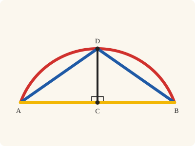
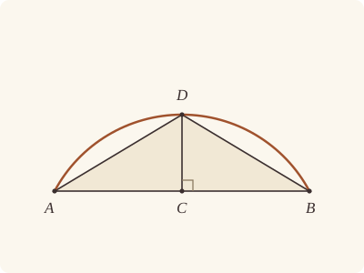

<!-- Generated by scripts/render.py. Do not edit by hand. -->

[Book III](index.md) · [← III.29](29.md) · [III.31 →](31.md)

# Book III, Proposition 30

*A given circumference, bisected*

[Euclid's proof](#euclids-proof) · [In Lean](#in-lean) · [What it rests on](#what-it-rests-on) · [Mishnah](#mishnah)

> To bisect a given circumference.

**In Lean:** ✅ proved, as Euclid states it, in our measure of circumferences · Euclid's argument

<p align="center"></p>

<p align="center"><em>Join AB (yellow), halve it at C and draw CD (black) at right angles. The straight lines DA, DB (blue) are equal, so they cut off equal circumferences AD, DB (red): D halves the circumference ADB.</em></p>

## Euclid's proof

<p align="center"></p>

<p align="center"><em>Drawn for one case: the given circumference ADB less than a semicircle.</em></p>

Let ADB be the given circumference;

thus it is required to bisect the circumference ADB.

Let AB be joined and bisected at C; from the point C let CD be drawn at right angles to the straight line AB, and let AD, DB be joined.

Then, since AC is equal to CB,

and CD is common,

the two sides AC, CD are equal to the two sides BC, CD;

and the angle ACD is equal to the angle BCD, for each is right;

therefore the base AD is equal to the base DB. [I. 4]

But equal straight lines cut off equal circumferences, the greater equal to the greater, and the less to the less; [III. 28]

and each of the circumferences AD, DB is less than a semicircle;

therefore the circumference AD is equal to the circumference DB.

Therefore the given circumference has been bisected at the point D.

Q. E. F.

## In Lean

| | |
|---|---|
| Proof | ✅ Proved, and its companion `Prop30.halves` ([III.30 halves](30.md#halves)) |
| Statement | The whole enunciation. `Prop30` finds D, bisecting the given circumference in measure; `Prop30.halves` shows the halves congruent, adding to it, covering it and meeting only at D. |
| Argument | Euclid's. `Prop30` follows Euclid. The companion `Prop30.halves` is handed D with III.30's conclusions alone, which keep inside the proof the equal straight lines AD, DB that I.4 gives; so it recovers them, a step Euclid does not take: the equal measures are twice the angles ABD, DAB, which are therefore equal, and DA is equal to DB (I.6). The halves are then III.28's less circumferences, each less than a semicircle (I.17), and so congruent; they add to the given circumference (`Circumference.add`), and divide it point by point, ends included, by III.2. |
| Representation | The given circumference is put as a given segment is: its circle, the straight line AB and a point P on its side. Its halves are equal measures in one circle, by III.28. The companion takes each half as a circumference of that circle (`Arc`), named by points Q and R on their sides. |
| Reviewed | The statement and every passage of the argument read against Heath's text, at commit [`7b71d1782`](https://github.com/dodecaplex-co/stoicheia/commit/7b71d1782) ([the record](../../review/III/30.toml)) |

From [`Elements/BookIII/Prop30.lean`](../../Elements/BookIII/Prop30.lean). Euclid's sentences are the `--` comments, and our own notes are in `/- … -/`; the lines under each sentence are the Lean that carries it out. The list below marks where a lemma does a step Euclid takes for granted and where a companion is proved as a theorem of its own; the `/- … -/` notes in the listing explain smaller adjustments.

**How the Lean follows the text**

- **Done by `BookI.Prop10`.** "Let AB be joined and bisected at C…" Euclid bisects AB without a printed reference here. The Lean obtains C and the equal halves AC, CB by I.10.
- **Done by `BookI.Prop11`.** "from the point C let CD be drawn at right angles…" Euclid draws CD perpendicular to AB and reads its meeting with the given circumference from the figure. The Lean draws the perpendicular by I.11 and puts C within the circle by III.2, neither referenced by Heath here. `Tacit.line_circle_beyond`, a rule we assume, finds D beyond C, and `Tacit.pasch3` puts it on the required side.
- **Done by `BookI.Prop17`.** "and each of the circumferences AD, DB is less than a semicircle…" Euclid takes both circumferences to be less than semicircles; the Lean uses I.17 on the equal base angles supplied by I.4 above, with no reference to I.17 printed by Heath here. `Circumference.standing` measures each circumference by twice its angle, using III.21, and `Circumference.whole` shows the circumference on the other side greater, using III.2, III.21 and III.22, none referenced by Heath here.
- **Proved separately, as `Prop30.halves`.** "Therefore the given circumference has been bisected at the point D." `Prop30.halves` supplies congruence by III.28 and addition by `Circumference.add`. For the division point by point, `Prop30.not_within` and `Prop30.not_vertical` exclude a point of the circle within triangle ADB or in an angle vertical to one of its angles: III.2 would put a point of the circumference within the circle. `Prop30.on_chord` accounts for the ends, also by III.2. Thus the halves cover the given circumference and share only D, ends included.

```lean
/-- To bisect a given circumference. -/
theorem Prop30 {A B : Point} {ADB : Circle} (hA : OnCircle A ADB) (hB : OnCircle B ADB) :
    ∀ P : Point, ¬ Collinear A B P → ∃ D : Point, OnCircle D ADB ∧ SameSideOf D P A B ∧
      standing ADB A B D = standing ADB D A B := by
  -- Let ADB be the given circumference;
  /- The given circumference is the one on P's side of AB. -/
  intro P hP
  have hABP : Triangle A B P := hP
  have hAB : A ≠ B := hABP.ne₁₂
  -- thus it is required to bisect the circumference ADB.
  -- Let AB be joined and bisected at C; from the point C let CD be drawn at right angles to
  -- the straight line AB, and let AD, DB be joined.
  obtain ⟨L, hA_L, hB_L⟩ := Postulate1 A B hAB
  obtain ⟨C, hACB, hAC⟩ := BookI.Prop10 hAB
  have hC_L : OnLine C L := on_line_of_between_ends hACB hA_L hB_L
  obtain ⟨X, hXP, hX⟩ := BookI.Prop11 hAB ⟨L, hA_L, hB_L, hC_L⟩ hP
  /- CX meets the circumference on P's side at D. C is within the circle
     by III.2, so when XC is produced beyond C to Y, the straight line meets
     the circle at D, beyond C from Y, on X's side (`line_circle_beyond`). -/
  have hC_in : InsideCircle C ADB := Prop2 hA hB C hACB
  have hX_L : ¬ OnLine X L := hXP.triangle.off_line hA_L hB_L
  have hCX : C ≠ X := fun e => hX_L (e ▸ hC_L)
  obtain ⟨N, hC_N, hX_N⟩ := Postulate1 C X hCX
  obtain ⟨Y, hY_N, hXCY, -⟩ := Postulate2 hX_N hC_N hCX.symm []
  obtain ⟨D, hD, hD_N, hDCY⟩ :=
    line_circle_beyond hC_in hC_N hY_N (ne_of_between (between_symm hXCY))
  have hDC : D ≠ C := fun e => inside_not_on hC_in (e ▸ hD)
  have hD_L : ¬ OnLine D L := fun hD_L =>
    hX_L ((line_unique hDC hD_N hC_N hD_L hC_L) ▸ hX_N)
  have hY_L : ¬ OnLine Y L := fun hY_L =>
    hX_L ((line_unique (ne_of_between (between_symm hXCY)) hY_N hC_N hY_L hC_L) ▸ hX_N)
  have hDX : SameSide D X L := same_side_of_opposite_sides
    ⟨hY_L, hD_L, fun h => pasch3 hDCY hC_L (same_side_symm h)⟩
    ⟨hY_L, hX_L, fun h => pasch3 hXCY hC_L (same_side_symm h)⟩
  have hDP : SameSideOf D P A B := (SameSideOf.of_line hAB hA_L hB_L hDX).trans hXP
  refine ⟨D, hD, hDP, ?_⟩
  have hABD : Triangle A B D := Triangle.of_line hA_L hB_L hAB hD_L
  -- Then, since AC is equal to CB,
  have hCA : ‖C A‖ = ‖C B‖ := by rw [len_symm C A, hAC]
  -- and CD is common,
  have hCD : ‖C D‖ = ‖C D‖ := rfl
  -- the two sides AC, CD are equal to the two sides BC, CD;
  -- and the angle ACD is equal to the angle BCD, for each is right;
  have hDray : OnRay D C X := OnRay.of_between_between (between_symm hXCY) (between_symm hDCY)
  have hACD : ∠ A C D = ∟ := by
    rw [angle_onRay_right hDray (ne_of_between hACB)]
    exact hX A ⟨L, hA_L, hB_L, hA_L⟩ (ne_of_between hACB)
  have hBCD : ∠ B C D = ∟ := by
    rw [angle_onRay_right hDray (ne_of_between (between_symm hACB))]
    exact hX B ⟨L, hA_L, hB_L, hB_L⟩ (ne_of_between (between_symm hACB))
  -- therefore the base AD is equal to the base DB. [I. 4]
  have hCAD : Triangle C A D := Triangle.of_line hC_L hA_L (ne_of_between hACB).symm hD_L
  have hCBD : Triangle C B D :=
    Triangle.of_line hC_L hB_L (ne_of_between (between_symm hACB)).symm hD_L
  obtain ⟨hAD, -, hA₁, -⟩ := BookI.Prop4 hCAD hCBD hCA hCD (hACD.trans hBCD.symm)
  have hAD' : ‖A D‖ = ‖D B‖ := by rw [hAD, len_symm B D]
  -- But equal straight lines cut off equal circumferences, the greater equal to the greater,
  -- and the less to the less; [III. 28]
  /- We use III.28 in one circle, which is equal to itself (`EqualCircles.refl`), and name
     the less circumferences by points Q, R beyond AD from B and beyond DB from A. -/
  obtain ⟨Q, hQB, -⟩ := exists_oppositeSidesOf hABD.acb []
  obtain ⟨R, hRA, -⟩ := exists_oppositeSidesOf hABD.cba []
  have h28 := Prop28 (EqualCircles.refl ADB) hA hD hD hB hQB.symm hRA.symm hAD'
  -- and each of the circumferences AD, DB is less than a semicircle;
  /- They are measured at B and A (`Circumference.standing`), by the angles ABD, DAB.
     These are equal, for I.4 gave them, C being on AB, and two of them are less than two
     right angles [I. 17]. -/
  have hbase : ∠ D A B = ∠ A B D := by
    rw [angle_symm hABD.ne₁₃.symm hAB.symm, ← angle_onRay_left (OnRay.of_between hACB) hABD.ne₁₃.symm, hA₁,
      angle_onRay_left (OnRay.of_between (between_symm hACB)) hABD.ne₂₃.symm]
  have h17 := (BookI.Prop17 hABD).2.2
  rw [hbase] at h17
  have hAQD : circumference ADB A Q D < ∟ + ∟ := by
    rw [← standing_eq_circumference hQB.symm, Circumference.standing hB hA hD hABD.acb]
    exact h17
  have hDRB : circumference ADB D R B < ∟ + ∟ := by
    rw [← standing_eq_circumference hRA.symm, Circumference.standing hA hD hB hABD.cba, hbase]
    exact h17
  /- So the circumferences ABD, DAB on the other sides are greater, for the two on each
     straight line make up the circle (`Circumference.whole`). -/
  have not_greater : ∀ {x y : Angle}, x < ∟ + ∟ → x + y = ∟ + ∟ + (∟ + ∟) → x ≤ y := by
    intro x y hx hxy hyx
    have h1 := add_lt_add_right y hx
    have h2 := add_lt_add_right (∟ + ∟) (lt_trans hyx hx)
    rw [add_comm y] at h2
    exact lt_irrefl _ (hxy ▸ lt_trans h1 h2)
  have hw₁ := Circumference.whole hA hD hQB.symm
  have hw₂ := Circumference.whole hD hB hRA.symm
  -- therefore the circumference AD is equal to the circumference DB.
  have hADDB := (h28 (not_greater hAQD hw₁) (not_greater hDRB hw₂)).2.1
  -- Therefore the given circumference has been bisected at the point D.
  rw [standing_eq_circumference hQB.symm, standing_eq_circumference hRA.symm]
  exact hADDB
  -- Q. E. F.
```

<a name="halves"></a>

<details><summary>After the theorem, its companion, <code>Prop30.halves</code>; and three lemmas for its own proofs, <code>Prop30.on_chord</code>, <code>Prop30.not_within</code> and <code>Prop30.not_vertical</code> (202 lines)</summary>

```lean
/-- A point X of a circle on the straight line joining two others, U and V, is U or V:
three points of a circle are not on one straight line. [III. 2] -/
theorem Prop30.on_chord {U V X : Point} {α : Circle} (hU : OnCircle U α) (hV : OnCircle V α)
    (hX : OnCircle X α) (hUV : U ≠ V) (h : Collinear U V X) : X = U ∨ X = V := by
  by_cases hXU : X = U
  · exact Or.inl hXU
  by_cases hXV : X = V
  · exact Or.inr hXV
  exact absurd h (Prop2.triangle hU hV hX hUV (Ne.symm hXV) (Ne.symm hXU))

/-- No point X of a circle lies within the triangle of three others, A, B and D: on D's side
of AB, on B's side of AD and on A's side of DB. For then the straight line DX would separate
A from B (System E, Triple incidence 1), and meet AB at a point E between them, within the
circle [III. 2]. On DX, E is not between D and X, which are on one side of AB (Pasch 3); so
X lies between D and E, or D between X and E, and that point would be within the circle
(`Prop2.within`), not on it. [III. 2] -/
theorem Prop30.not_within {A B D X : Point} {α : Circle} (hA : OnCircle A α)
    (hB : OnCircle B α) (hD : OnCircle D α) (hX : OnCircle X α) (hXD : SameSideOf X D A B)
    (hXB : SameSideOf X B A D) (hXA : SameSideOf X A D B) : False := by
  obtain ⟨L, hA_L, hB_L⟩ := Postulate1 A B hXD.1
  obtain ⟨K, hA_K, hD_K⟩ := Postulate1 A D hXB.1
  obtain ⟨N, hD_N, hB_N⟩ := Postulate1 D B hXA.1
  have hX_K : ¬ OnLine X K := not_on_line_of_same_side (hXB.sameSide hA_K hD_K)
  have hX_N : ¬ OnLine X N := not_on_line_of_same_side (hXA.sameSide hD_N hB_N)
  have hDX : D ≠ X := fun e => hX_K (e ▸ hD_K)
  obtain ⟨M, hD_M, hX_M⟩ := Postulate1 D X hDX
  /- The straight line DX separates A from B, X lying within the angle ADB. -/
  have hAB_M : ¬ SameSide A B M :=
    triple_incidence1 hD_K hD_M hD_N hA_K hX_M hB_N (hXB.sameSide hA_K hD_K)
      (same_side_symm (hXA.sameSide hD_N hB_N))
  have hA_M : ¬ OnLine A M := fun h => hX_K (line_unique hXB.1 h hD_M hA_K hD_K ▸ hX_M)
  have hB_M : ¬ OnLine B M := fun h => hX_N (line_unique hXA.1 hD_M h hD_N hB_N ▸ hX_M)
  obtain ⟨E, hE_M, hAEB⟩ := OppositeSides.exists_between ⟨hA_M, hB_M, hAB_M⟩
  have hE_in : InsideCircle E α := Prop2 hA hB E hAEB
  have hE_L : OnLine E L := on_line_of_between_ends hAEB hA_L hB_L
  have hDX_L : SameSide D X L := same_side_symm (hXD.sameSide hA_L hB_L)
  have hDE : D ≠ E := fun e => not_on_line_of_same_side hDX_L (e ▸ hE_L)
  have hXE : X ≠ E := fun e => not_on_line_of_same_side (same_side_symm hDX_L) (e ▸ hE_L)
  rcases between_cases hDX hXE hDE hD_M hX_M hE_M with h | h | h
  · exact inside_not_on (Prop2.within (Or.inr hD) (Or.inl hE_in) h) hX
  · exact inside_not_on (Prop2.within (Or.inr hX) (Or.inl hE_in) h) hD
  · exact pasch3 h hE_L hDX_L

/-- No point X of a circle lies in the angle vertical to the angle UVW of three others: across
VU from W and across VW from U. For XW would cross VU at a point M within the circle
[III. 2], on X's side of VW (Pasch 2), and so across VW from U. Then MU would cross VW, and
the straight lines VU, VW meet only at V; so V would lie between M and U, and be within the
circle (`Prop2.within`), not on it. [III. 2] -/
theorem Prop30.not_vertical {U V W X : Point} {α : Circle} (hU : OnCircle U α)
    (hV : OnCircle V α) (hW : OnCircle W α) (hX : OnCircle X α)
    (hXW : OppositeSidesOf X W V U) (hXU : OppositeSidesOf X U V W) : False := by
  obtain ⟨L, hV_L, hU_L⟩ := Postulate1 V U hXW.1
  obtain ⟨N, hV_N, hW_N⟩ := Postulate1 V W hXU.1
  have hXU_N : OppositeSides X U N := hXU.oppositeSides hV_N hW_N
  obtain ⟨M, hM_L, hXMW⟩ := (hXW.oppositeSides hV_L hU_L).exists_between
  have hM_in : InsideCircle M α := Prop2 hX hW M hXMW
  have hM_N : ¬ OnLine M N := fun h => hXU_N.1 (on_line_of_between (between_symm hXMW) hW_N h)
  have hMX : SameSide M X N := pasch2 (between_symm hXMW) hW_N hM_N
  have hMU_N : OppositeSides M U N :=
    ⟨hM_N, hXU_N.2.1, fun h => hXU_N.2.2 (same_side_trans hMX h)⟩
  obtain ⟨V', hV'_N, hMV'U⟩ := hMU_N.exists_between
  have hV'_L : OnLine V' L := on_line_of_between_ends hMV'U hM_L hU_L
  have hV' : V' = V := Classical.byContradiction fun hne =>
    hXU_N.2.1 (line_unique hne hV'_L hV_L hV'_N hV_N ▸ hU_L)
  rw [hV'] at hMV'U
  exact inside_not_on (Prop2.within (Or.inl hM_in) (Or.inr hU) hMV'U) hV

/-- **III.30's halves** (companion of III.30, "III.30 halves"). Let D be a point of the
circle ADB on P's side of AB, with the circumferences standing at B and at A equal, as
III.30 finds it. Then the circumference AD away from B, named by Q, and the circumference DB
away from A, named by R, are drawn and congruent; together they make up the given
circumference AB on P's side; every point of it lies on one or the other; and the two share
only D, ends included.

III.30's statement gives the equal measures, not the equal straight lines AD, DB that its
proof finds by I.4, so they are recovered here: the equal measures are twice the angles
ABD, DAB (`Circumference.standing`), so those angles are equal, and DA is equal to DB
[I. 6]. Each circumference is less than a semicircle [I. 17], so III.28's congruence of the
less circumferences applies. They add by `Circumference.add`, and the division point by
point follows from III.2 (`Prop30.on_chord`, `Prop30.not_within`, `Prop30.not_vertical`).
[I. 6, I. 17, III. 2, III. 28] -/
theorem Prop30.halves {A B D P : Point} {ADB : Circle}
    (hA : OnCircle A ADB) (hB : OnCircle B ADB)
    (hD : OnCircle D ADB) (hDP : SameSideOf D P A B)
    (hequal : standing ADB A B D = standing ADB D A B) :
    ∃ Q R : Point,
      OppositeSidesOf Q B A D ∧ OppositeSidesOf R A D B ∧
      Arc.Drawn ⟨ADB, A, D, Q⟩ ∧ Arc.Drawn ⟨ADB, D, B, R⟩ ∧
      Arc.Congruent ⟨ADB, A, D, Q⟩ ⟨ADB, D, B, R⟩ ∧
      circumference ADB A Q D + circumference ADB D R B =
        circumference ADB A P B ∧
      (∀ X : Point, OnArc X ⟨ADB, A, B, P⟩ ↔
        OnArc X ⟨ADB, A, D, Q⟩ ∨ OnArc X ⟨ADB, D, B, R⟩) ∧
      (∀ X : Point,
        (OnArc X ⟨ADB, A, D, Q⟩ ∧ OnArc X ⟨ADB, D, B, R⟩) ↔
          X = D) := by
  have hABD : Triangle A B D := hDP.triangle
  have hAB : A ≠ B := hABD.ne₁₂
  have hAD : A ≠ D := hABD.ne₁₃
  have hDB : D ≠ B := hABD.ne₂₃.symm
  obtain ⟨K, hA_K, hD_K⟩ := Postulate1 A D hAD
  obtain ⟨N, hD_N, hB_N⟩ := Postulate1 D B hDB
  /- A point is not across a straight line from itself. -/
  have hne : ∀ {U V W Z : Point}, OppositeSidesOf U V W Z → U ≠ V := by
    rintro U V W Z h rfl
    obtain ⟨L, hW, hZ⟩ := Postulate1 W Z h.1
    exact (h.oppositeSides hW hZ).2.2 (same_side_refl (h.oppositeSides hW hZ).1)
  /- Q names the side of AD away from B, and R the side of DB away from A, as in III.30. -/
  obtain ⟨Q, hQB, -⟩ := exists_oppositeSidesOf hABD.acb []
  obtain ⟨R, hRA, -⟩ := exists_oppositeSidesOf hABD.cba []
  refine ⟨Q, R, hQB, hRA, ⟨hA, hD, hQB.triangle⟩, ⟨hD, hB, hRA.triangle⟩, ?_,
    Circumference.add hA hD hB hDP hQB hRA, ?_, ?_⟩
  · /- The equal circumferences standing at B and at A are twice the angles ABD, DAB, so
       those angles are equal. -/
    have hbase : ∠ A B D = ∠ D A B := by
      have h := hequal
      rw [Circumference.standing hB hA hD hABD.acb,
        Circumference.standing hA hD hB hABD.cba] at h
      exact Magnitude.eq_of_add_self_eq h
    /- So DA is equal to DB. [I. 6] -/
    have hDA : ‖D A‖ = ‖D B‖ := BookI.Prop6 hABD.cab (by
      rw [angle_symm hDB hAB]
      exact hbase.symm)
    have hAD' : ‖A D‖ = ‖D B‖ := by rw [len_symm A D, hDA]
    /- Each circumference is less than a semicircle, measured at B and at A by the equal
       angles ABD, DAB, two angles of the triangle ABD. [I. 17] -/
    have h17 := (BookI.Prop17 hABD).2.2
    rw [← hbase] at h17
    have hAQD : circumference ADB A Q D < ∟ + ∟ := by
      rw [← standing_eq_circumference hQB.symm, Circumference.standing hB hA hD hABD.acb]
      exact h17
    have hDRB : circumference ADB D R B < ∟ + ∟ := by
      rw [← standing_eq_circumference hRA.symm, Circumference.standing hA hD hB hABD.cba,
        ← hbase]
      exact h17
    have not_greater : ∀ {x y : Angle}, x < ∟ + ∟ → x + y = ∟ + ∟ + (∟ + ∟) → x ≤ y := by
      intro x y hx hxy hyx
      have h1 := add_lt_add_right y hx
      have h2 := add_lt_add_right (∟ + ∟) (lt_trans hyx hx)
      rw [add_comm y] at h2
      exact lt_irrefl _ (hxy ▸ lt_trans h1 h2)
    /- So they are III.28's less circumferences on the equal straight lines AD, DB. -/
    exact (Prop28 (EqualCircles.refl ADB) hA hD hD hB hQB.symm hRA.symm hAD'
      (not_greater hAQD (Circumference.whole hA hD hQB.symm))
      (not_greater hDRB (Circumference.whole hD hB hRA.symm))).2.2
  · intro X
    constructor
    · /- A point of the given circumference on neither half would lie within the triangle
         ABD. -/
      rintro ⟨hX, hXP⟩
      rcases Prop28.sides (K := X) hQB.triangle with hXQ | hXAD | hXQ
      · exact Or.inl ⟨hX, Or.inl hXQ⟩
      · exact Or.inl ⟨hX, Or.inr hXAD⟩
      rcases Prop28.sides (K := X) hRA.triangle with hXR | hXDB | hXR
      · exact Or.inr ⟨hX, Or.inl hXR⟩
      · exact Or.inr ⟨hX, Or.inr hXDB⟩
      have hXB : SameSideOf X B A D := OppositeSidesOf.sameSideOf hXQ.symm hQB
      have hXA : SameSideOf X A D B := OppositeSidesOf.sameSideOf hXR.symm hRA
      exfalso
      rcases hXP with hXP | hXAB
      · exact Prop30.not_within hA hB hD hX (hXP.trans hDP.symm) hXB hXA
      · exact Prop2.triangle hA hB hX hAB hXA.triangle.ne₂₃ hXQ.triangle.ne₁₃ hXAB
    · /- A point of either half across AB from D would lie in the angle vertical to DAB or
         to DBA. -/
      rintro (⟨hX, hXQ⟩ | ⟨hX, hXR⟩)
      · refine ⟨hX, ?_⟩
        rcases Prop28.sides (K := X) hABD with hXD | hXAB | hXD
        · exact Or.inl (hXD.trans hDP)
        · exact Or.inr hXAB
        exfalso
        rcases hXQ with hXQ | hXAD
        · exact Prop30.not_vertical hB hA hD hX hXD (hXQ.trans_opposite hQB)
        · exact Prop2.triangle hA hD hX hAD (hne hXD).symm hXD.triangle.ne₁₃ hXAD
      · refine ⟨hX, ?_⟩
        rcases Prop28.sides (K := X) hABD with hXD | hXAB | hXD
        · exact Or.inl (hXD.trans hDP)
        · exact Or.inr hXAB
        exfalso
        rcases hXR with hXR | hXDB
        · exact Prop30.not_vertical hA hB hD hX hXD.swap (hXR.trans_opposite hRA).swap
        · exact Prop2.triangle hD hB hX hDB hXD.triangle.ne₂₃ (hne hXD).symm hXDB
  · intro X
    constructor
    · /- A point on both halves other than D would be one of the ends A, B, or lie in the
         angle vertical to ADB. -/
      rintro ⟨⟨hX, hXQ⟩, ⟨-, hXR⟩⟩
      rcases hXQ with hXQ | hXAD
      · rcases hXR with hXR | hXDB
        · exact (Prop30.not_vertical hA hD hB hX (hXQ.trans_opposite hQB).swap
            (hXR.trans_opposite hRA)).elim
        · rcases Prop30.on_chord hD hB hX hDB hXDB with h | h
          · exact h
          · rw [h] at hXQ
            exact absurd rfl (hne (hXQ.trans_opposite hQB))
      · rcases Prop30.on_chord hA hD hX hAD hXAD with h | h
        · rw [h] at hXR
          rcases hXR with hXR | hXDB
          · exact absurd rfl (hne (hXR.trans_opposite hRA))
          · exact absurd hXDB hABD.cba
        · exact h
    · rintro rfl
      exact ⟨⟨hD, Or.inr ⟨K, hA_K, hD_K, hD_K⟩⟩, ⟨hD, Or.inr ⟨N, hD_N, hB_N, hD_N⟩⟩⟩
```

</details>

## What it rests on

| | Proposition | `Prop30.halves` |
|---|---|---|
| Heath's references | [I.4](../I/04.md), [III.28](28.md) | none |
| Lean cites | [I.4](../I/04.md), [I.10](../I/10.md), [I.11](../I/11.md), [I.17](../I/17.md), [III.2](02.md), [III.21](21.md), [III.22](22.md), [III.28](28.md) | [I.6](../I/06.md), [I.17](../I/17.md), [I.32](../I/32.md), [III.2](02.md), [III.21](21.md), [III.22](22.md), [III.28](28.md) |
| Postulates | 1, 2, 3, 4, 5 | 1, 2, 3, 4, 5 |
| Definitions taken as axioms | Def. I.15 | Def. I.15 |
| Common Notions | 1, 2, 3, 4, 5 | 1, 2, 3, 4, 5 |
| Tacit rules | 39 (listed below) | 40 (listed below) |
| Its own Lean calls | Postulates 1 and 2; 9 tacit rules | Postulate 1; 12 tacit rules |
| Through lemmas | Postulate 3; Def. I.15; 22 tacit rules | Postulates 2 and 3; Def. I.15; 18 tacit rules |

Some of these come in through lemmas [shared](../../CERTIFICATE.md#shared-steps) by many proofs: [`Circumference.add`](../../Elements/BookIII/Circumferences.lean#L184) (I.32, III.2, III.21, III.22); [`Prop2.triangle`](../../Elements/BookIII/Prop02.lean#L137), [`Prop2.within`](../../Elements/BookIII/Prop02.lean#L117) (III.2); [`Circumference.whole`](../../Elements/BookIII/Circumferences.lean#L85) (III.2, III.21, III.22); [`Circumference.standing`](../../Elements/BookIII/Circumferences.lean#L63) (III.21).

_Postulates, definitions, Common Notions and tacit rules: all that each proof rests on, counting those of the propositions it cites. The last two rows say which of the postulates, definitions and tacit rules its own Lean calls, in the proof or a helper written for it, and which it does not call but reaches through lemmas, of Book Zero or shared (a proposition it cites may rest on these too); the rest come in only through the propositions it cites or the Common Notions._

<details><summary>The 39 tacit rules beneath this proof, counting those of the propositions it cites, and 1 more beneath <code>Prop30.halves</code></summary>

_(used here) marks a rule this proof's own Lean calls, in the proof or a helper written for it; (through …) marks one its own Lean does not call but reaches through the lemmas named, of [Book Zero](../../Elements/Figure) or shared, though a proposition it cites may rest on it too; and a rule with no mark comes in only through a proposition it cites or a Common Notion. The names in brackets are System E's: an Intersection rule says when straight lines and circles must meet, and an Intersections rule takes a point where they do (see [Book I's introduction](../I/index.md))._

**Reading the figure**

- [`between_cases`](../../Elements/Foundations/Tacit/Diagram.lean#L54) (through [`Circumference.whole`](../../Elements/BookIII/Circumferences.lean#L85), [`EqualCircles.refl`](../../Elements/Figure/OnCircles.lean#L114), [`OnRay.of_between_between`](../../Elements/Figure/Rays.lean#L88) and 2 other lemmas): Of three different points on a straight line, one is between the other two. (Between 6)
- [`between_symm`](../../Elements/Foundations/Tacit/Diagram.lean#L47) (used here): If B is between A and C, it is between C and A. (Between 1)
- [`circles_meet`](../../Elements/Foundations/Tacit/Diagram.lean#L91) (through [`Circumference.standing`](../../Elements/BookIII/Circumferences.lean#L63), [`Circumference.whole`](../../Elements/BookIII/Circumferences.lean#L85), [`EqualCircles.refl`](../../Elements/Figure/OnCircles.lean#L114) and 10 other lemmas): If each circle passes through a point inside the other, the circles cut one another. This is the step Euclid takes for granted in I.1. (Intersection 5)
- [`circles_meet_same_side`](../../Elements/Foundations/Tacit/Constructions.lean#L79) (through [`Circumference.standing`](../../Elements/BookIII/Circumferences.lean#L63), [`Circumference.whole`](../../Elements/BookIII/Circumferences.lean#L85), [`EqualCircles.refl`](../../Elements/Figure/OnCircles.lean#L114) and 10 other lemmas): Two circles that cut one another do so on each side of the straight line through their centres. (Intersections 8)
- [`exists_centre`](../../Elements/Foundations/Tacit/Constructions.lean#L57) (through [`Circumference.whole`](../../Elements/BookIII/Circumferences.lean#L85), [`EqualCircles.refl`](../../Elements/Figure/OnCircles.lean#L114) and [`Tacit.inside_not_on`](../../Elements/Figure/RuleBase.lean#L249)): Every circle has a centre. A rule of our own, not one of System E's: its content is Euclid's Definitions I.15 and I.16.
- [`exists_point`](../../Elements/Foundations/Tacit/Constructions.lean#L35) (through [`Circumference.standing`](../../Elements/BookIII/Circumferences.lean#L63), [`Circumference.whole`](../../Elements/BookIII/Circumferences.lean#L85), [`EqualCircles.refl`](../../Elements/Figure/OnCircles.lean#L114) and 4 other lemmas): Let a point be taken. (Points 1)
- [`exists_point_inside_circle`](../../Elements/Foundations/Tacit/Constructions.lean#L42) (through [`Circumference.standing`](../../Elements/BookIII/Circumferences.lean#L63), [`Circumference.whole`](../../Elements/BookIII/Circumferences.lean#L85), [`EqualCircles.refl`](../../Elements/Figure/OnCircles.lean#L114) and 10 other lemmas): Let a point be taken inside the circle α. (Points 8)
- [`exists_point_on_line`](../../Elements/Foundations/Tacit/Constructions.lean#L38) (through [`Circumference.standing`](../../Elements/BookIII/Circumferences.lean#L63), [`Circumference.whole`](../../Elements/BookIII/Circumferences.lean#L85), [`EqualCircles.refl`](../../Elements/Figure/OnCircles.lean#L114) and 10 other lemmas): Let a point be taken on the straight line L. (Points 2)
- [`line_circle_between`](../../Elements/Foundations/Tacit/Constructions.lean#L67) (through [`Circumference.standing`](../../Elements/BookIII/Circumferences.lean#L63), [`Circumference.whole`](../../Elements/BookIII/Circumferences.lean#L85), [`EqualCircles.refl`](../../Elements/Figure/OnCircles.lean#L114) and 10 other lemmas): A straight line through a point B inside a circle, heading out to a point C outside it, cuts the circle between B and C. (Intersections 4)
- [`line_circle_beyond`](../../Elements/Foundations/Tacit/Constructions.lean#L73) (used here): A straight line through a point B inside a circle, produced beyond B away from C, cuts the circle there. (Intersections 5)
- [`line_unique`](../../Elements/Foundations/Tacit/Diagram.lean#L41) (used here): Two points determine a straight line. (Generalities 1)
- [`lines_meet_of_opposite_sides`](../../Elements/Foundations/Tacit/Diagram.lean#L86) (through [`Circumference.whole`](../../Elements/BookIII/Circumferences.lean#L85), [`same_side_of_opposite_sides`](../../Elements/Figure/Sides.lean#L113) and [`standing_eq_circumference`](../../Elements/Figure/OnCircles.lean#L54)): A straight line joining points on opposite sides of L crosses L. (Intersection 1)
- [`not_between_of_between`](../../Elements/Foundations/Tacit/Diagram.lean#L50) (through [`Circumference.standing`](../../Elements/BookIII/Circumferences.lean#L63), [`Circumference.whole`](../../Elements/BookIII/Circumferences.lean#L85), [`EqualCircles.refl`](../../Elements/Figure/OnCircles.lean#L114) and 14 other lemmas): If B is between A and C, then A is not between B and C. (Between 1)
- [`not_on_line_of_same_side`](../../Elements/Foundations/Tacit/Diagram.lean#L60) (through [`Circumference.standing`](../../Elements/BookIII/Circumferences.lean#L63), [`Circumference.whole`](../../Elements/BookIII/Circumferences.lean#L85), [`EqualCircles.refl`](../../Elements/Figure/OnCircles.lean#L114) and 11 other lemmas): Points on one side of a straight line are not on it. (Same side 3)
- [`pasch2`](../../Elements/Foundations/Tacit/Diagram.lean#L71) (through [`Circumference.standing`](../../Elements/BookIII/Circumferences.lean#L63), [`Circumference.whole`](../../Elements/BookIII/Circumferences.lean#L85), [`EqualCircles.refl`](../../Elements/Figure/OnCircles.lean#L114) and 7 other lemmas): If B is between A and C, A is on L and B is off it, then B and C are on the same side of L: a straight line that leaves L at A does not cross it again. (Pasch 2)
- [`same_side_trans`](../../Elements/Foundations/Tacit/Diagram.lean#L64) (through [`Circumference.standing`](../../Elements/BookIII/Circumferences.lean#L63), [`Circumference.whole`](../../Elements/BookIII/Circumferences.lean#L85), [`EqualCircles.refl`](../../Elements/Figure/OnCircles.lean#L114) and 10 other lemmas): Two points on the same side of a straight line as a third point are on the same side as each other. (Same side 4)

**Lengths, angles and areas**

- [`angle_add_of_inside`](../../Elements/Foundations/Tacit/Transfer.lean#L47) (through [`Circumference.whole`](../../Elements/BookIII/Circumferences.lean#L85), [`Tacit.pasch3`](../../Elements/Figure/RuleBase.lean#L225), [`exists_oppositeSidesOf`](../../Elements/Figure/Sides.lean#L179) and 2 other lemmas): If D lies within the angle BAC, then BAC is made up of BAD and DAC. (Diagram-angle 2)
- [`angle_eq_of_same_rays`](../../Elements/Foundations/Tacit/Transfer.lean#L54) (through [`angle_onRay_left`](../../Elements/Figure/Angles.lean#L42) and [`angle_onRay_right`](../../Elements/Figure/Angles.lean#L49)): The angle doesn't change if its arms are traced through other points on the same rays. (Diagram-angle 4)
- [`angle_symm`](../../Elements/Foundations/Tacit/Metric.lean#L30) (used here): The angle ABC is the angle CBA. (Metric 4)
- [`area_add_of_between`](../../Elements/Foundations/Tacit/Transfer.lean#L70): Cutting a triangle in two from a vertex adds up. (Diagram-area 2)
- [`area_congruent`](../../Elements/Foundations/Tacit/Metric.lean#L44): Triangles equal in all their sides and angles are equal in area. Euclid uses this without comment once he has shown two triangles congruent. (Metric 9)
- [`area_degenerate`](../../Elements/Foundations/Tacit/Metric.lean#L36): A "triangle" with a repeated corner has no area. (Metric 6)
- [`area_eq_zero_of_on_line`](../../Elements/Foundations/Tacit/Transfer.lean#L62): A "triangle" whose corners lie on one straight line has no area. (Diagram-area 1)
- [`area_rotate`](../../Elements/Foundations/Tacit/Metric.lean#L39): The triangle ABC is the triangle CAB. (Metric 8)
- [`circle_eq`](../../Elements/Foundations/Tacit/Transfer.lean#L30): A circle is fixed by its centre and its radius. (Diagram-segment 2)
- [`len_add_of_between`](../../Elements/Foundations/Tacit/Transfer.lean#L27) (through [`Circumference.standing`](../../Elements/BookIII/Circumferences.lean#L63), [`Circumference.whole`](../../Elements/BookIII/Circumferences.lean#L85), [`EqualCircles.refl`](../../Elements/Figure/OnCircles.lean#L114) and 13 other lemmas): If B is between A and C, then AB and BC together make up AC. (Diagram-segment 1)
- [`len_self`](../../Elements/Foundations/Tacit/Metric.lean#L24) (through [`Circumference.standing`](../../Elements/BookIII/Circumferences.lean#L63), [`Circumference.whole`](../../Elements/BookIII/Circumferences.lean#L85), [`EqualCircles.refl`](../../Elements/Figure/OnCircles.lean#L114) and 13 other lemmas): The "straight line" from a point to itself has no length. (Metric 1)
- [`len_symm`](../../Elements/Foundations/Tacit/Metric.lean#L27) (used here): The straight line AB is the straight line BA. (Metric 3)
- [`on_line_of_area_eq_zero`](../../Elements/Foundations/Tacit/Transfer.lean#L66) (`Prop30.halves`): A triangle with no area has its corners on one straight line. (Diagram-area 1)
- [`radius_ne_zero`](../../Elements/Foundations/Tacit/Metric.lean#L62) (through [`Circumference.standing`](../../Elements/BookIII/Circumferences.lean#L63), [`Circumference.whole`](../../Elements/BookIII/Circumferences.lean#L85), [`EqualCircles.refl`](../../Elements/Figure/OnCircles.lean#L114) and 13 other lemmas): A circle's radius is not nothing: the straight line from the centre to a point on the circle has some length. A rule of our own, not one of System E's: every circle is drawn with a centre and a distance (Postulate 3).
- [`same_ray_of_angle_eq_zero`](../../Elements/Foundations/Tacit/Transfer.lean#L42) (through [`Circumference.whole`](../../Elements/BookIII/Circumferences.lean#L85), [`Tacit.pasch3`](../../Elements/Figure/RuleBase.lean#L225), [`exists_oppositeSidesOf`](../../Elements/Figure/Sides.lean#L179) and 2 other lemmas): If the angle BAC is nothing, C lies on the ray from A through B. (Diagram-angle 1)

**Superposition**

- [`superposition`](../../Elements/Foundations/Tacit/Superposition.lean#L52): **Superposition.** A hypothetical placement of a triangle on a given ray and side permits a restricted derivation of metric equalities about the figure already given. The derivation introduces no further objects, cites each geometric law it uses, and exports no symbol of the placement.

**Rules of magnitude**

- [`add_assoc`](../../Elements/Foundations/Tacit/Magnitudes.lean#L23) (through [`Circumference.whole`](../../Elements/BookIII/Circumferences.lean#L85)): Adding three magnitudes in a row, it makes no difference whether the first two or the last two are added first. (System E §3.5)
- [`add_comm`](../../Elements/Foundations/Tacit/Magnitudes.lean#L26) (used here): The order of adding does not matter. (System E §3.5)
- [`add_lt_add_right`](../../Elements/Foundations/Tacit/Magnitudes.lean#L45) (used here): Adding the same thing to both sides keeps "less than". (System E §3.5)
- [`add_zero`](../../Elements/Foundations/Tacit/Magnitudes.lean#L29): Adding nothing changes nothing. (System E §3.5)
- [`lt_irrefl`](../../Elements/Foundations/Tacit/Magnitudes.lean#L32) (used here): No magnitude is less than itself. (System E §3.5)
- [`lt_trans`](../../Elements/Foundations/Tacit/Magnitudes.lean#L35) (used here): What is less than the less is less still. (System E §3.5)
- [`lt_trichotomy`](../../Elements/Foundations/Tacit/Magnitudes.lean#L39) (through [`Circumference.standing`](../../Elements/BookIII/Circumferences.lean#L63), [`Circumference.whole`](../../Elements/BookIII/Circumferences.lean#L85), [`EqualCircles.refl`](../../Elements/Figure/OnCircles.lean#L114) and 13 other lemmas): Of two magnitudes, one is less, or they are equal, or the other is less. (System E §3.5)
- [`not_lt_zero`](../../Elements/Foundations/Tacit/Magnitudes.lean#L42) (through [`Circumference.standing`](../../Elements/BookIII/Circumferences.lean#L63), [`Circumference.whole`](../../Elements/BookIII/Circumferences.lean#L85), [`EqualCircles.refl`](../../Elements/Figure/OnCircles.lean#L114) and 13 other lemmas): Nothing is less than zero. (System E §3.5)

</details>

## Mishnah

_Our commentary: why Euclid's proof, and ours, look as they do._

**Euclid never looks for the centre.** To bisect a circumference he works on the straight line AB that joins its ends: he bisects AB at C and draws CD at right angles to it. Heath gives no reference for either step: they are I.10 and I.11. The triangles ACD, BCD then have equal sides about right angles, so AD is equal to DB, and equal straight lines cut off equal circumferences. Book I's ruler and compass do all the work, and we use III.28, said of equal circles, in one circle, as Heath allows under III.29.

**"Less than a semicircle."** Euclid says this of the circumferences AD and DB and gives no reason, yet III.28 needs it: a straight line cuts off two circumferences, and III.28 pairs the less with the less. The reason is already at hand from I.4: the angles DAB, ABD at the base of the triangle ADB are equal, and by I.17 two of them make less than two right angles, so each is less than one. Measured by twice those angles, AD and DB are each less than a semicircle, and the circumferences that remain are greater.

We are given the circle, the straight line AB and a point on the side of the given circumference, and the proof must put D on that side. C lies between two points of the circle, so it is within it (III.2); and a straight line through a point within a circle meets the circle on each side of that point (System E, Intersections 5). So CD, drawn from C towards the given circumference, meets it at D, just where Euclid's figure shows it.

Our statement bisects the circumference in measure; the companion `Prop30.halves` shows that the two halves are congruent, make up the given circumference together, and meet only at D. It is handed III.30's conclusions alone, so it finds AD equal to DB afresh, from the equal angles at A and B (I.6).

**A fifteenth of the circle.** Book IV ends by using it. In IV.16 Euclid fits into a circle the side of an equilateral triangle and the side of an equilateral pentagon from one point, which leaves between them a circumference of two fifteenths of the circle. He bisects it by III.30, and the straight line from the point of division to either end is the side of his equilateral and equiangular fifteen-angled figure.

**The modern way.** With the circle as the unit circle in the complex plane, the two square roots of the product of A and B are the midpoints of the two arcs that A and B cut off, and the one on the given arc bisects it.

## Further reading

- Richard Courant and Herbert Robbins' [*What Is Mathematics?*](https://openlibrary.org/books/OL815900M) (1996) explains why ruler and compass, which bisect any circumference, cannot in general trisect one, in ch. III, "Geometrical Constructions. The Algebra of Number Fields": a much-loved classic for curious readers.
- Multiplying complex numbers adds their angles, which is why the square roots of the modern way halve a circumference. Titu Andreescu and Dorin Andrica show the multiplication in [*Complex Numbers from A to ... Z*](https://doi.org/10.1007/978-0-8176-8415-0) (2014), §2.1.4, "Geometric Interpretation of Multiplication" (p. 41) (also on [III.23](23.md)).
- For the fifteen-angled figure of IV.16 and its sequel, Gauss's regular 17-gon, Felix Klein's [*Famous Problems of Elementary Geometry*](https://archive.org/details/famousproblemsof00kleiiala) (1897, free online), about eighty friendly pages on what ruler and compass can and cannot do.

[Book III](index.md) · [← III.29](29.md) · [III.31 →](31.md)

---

<sub>Euclid's text: T. L. Heath, *The Thirteen Books of Euclid's Elements*, vol. 2 (Cambridge, 1908), p. 61; [scan leaf n73](https://archive.org/details/thirteenbookseu00heibgoog/page/n73); [figure on n73](https://archive.org/details/thirteenbookseu00heibgoog/page/n73). Public domain.</sub>

<sub>The tacit rules follow the System E of Jeremy Avigad, Edward Dean and John Mumma, read alongside LeanEuclid (Logan Murphy, Kaiyu Yang, Jialiang Sun, Zhaoyu Li, Anima Anandkumar and Xujie Si).</sub>
