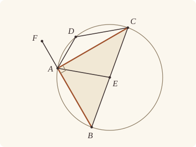

<!-- Generated by scripts/render.py. Do not edit by hand. -->

[Book III](index.md) · [← III.30](30.md) · [III.32 →](32.md)

# Book III, Proposition 31

*The angle in the semicircle is right*

[Euclid's proof](#euclids-proof) · [In Lean](#in-lean) · [What it rests on](#what-it-rests-on) · [Mishnah](#mishnah)

> In a circle the angle in the semicircle is right, that in a greater segment less than a right angle, and that in a less segment greater than a right angle; and further the angle of the greater segment is greater than a right angle, and the angle of the less segment less than a right angle.

**In Lean:** ✅ proved, as Euclid states it · Euclid's argument

<p align="center"></p>

<p align="center"><em>The equal radii EA, EB, EC (blue) cut the triangle ABC into two with equal sides, so the angle BAC equals the angles at B and C together (red and yellow). All three make two right angles: BAC is right.</em></p>

## Euclid's proof

<p align="center"></p>

Let ABCD be a circle, let BC be its diameter, and E its centre, and let BA, AC, AD, DC be joined;

I say that the angle BAC in the semicircle BAC is right,

the angle ABC in the segment ABC greater than the semicircle is less than a right angle,

and the angle ADC in the segment ADC less than the semicircle is greater than a right angle.

Let AE be joined, and let BA be carried through to F.

Then, since BE is equal to EA,

the angle ABE is also equal to the angle BAE. [I. 5]

Again, since CE is equal to EA,

the angle ACE is also equal to the angle CAE. [I. 5]

Therefore the whole angle BAC is equal to the two angles ABC, ACB.

But the angle FAC exterior to the triangle ABC is also equal to the two angles ABC, ACB; [I. 32]

therefore the angle BAC is also equal to the angle FAC;

therefore each is right; [I. Def. 10]

therefore the angle BAC in the semicircle BAC is right.

Next, since in the triangle ABC the two angles ABC, BAC are less than two right angles, [I. 17]

and the angle BAC is a right angle,

the angle ABC is less than a right angle;

and it is the angle in the segment ABC greater than the semicircle.

Next, since ABCD is a quadrilateral in a circle,

and the opposite angles of quadrilaterals in circles are equal to two right angles, [III. 22]

while the angle ABC is less than a right angle,

therefore the angle ADC which remains is greater than a right angle;

and it is the angle in the segment ADC less than the semicircle.

I say further that the angle of the greater segment, namely that contained by the circumference ABC and the straight line AC, is greater than a right angle;

and the angle of the less segment, namely that contained by the circumference ADC and the straight line AC, is less than a right angle.

This is at once manifest.

For, since the angle contained by the straight lines BA, AC is right,

the angle contained by the circumference ABC and the straight line AC is greater than a right angle.

Again, since the angle contained by the straight lines AC, AF is right,

the angle contained by the straight line CA and the circumference ADC is less than a right angle.

Therefore etc.

Q. E. D.

## In Lean

| | |
|---|---|
| Proof | ✅ Proved, and its companions `Prop31.greater` ([III.31 greater](31.md#greater)) and `Prop31.less` ([III.31 less](31.md#less)) |
| Statement | The whole enunciation. The angles in the segments, at every point; its companions, the angles of the segments at either end of any straight line in the circle not through the centre. |
| Argument | Euclid's. |
| Representation | An angle contained by a straight line and a circumference is a mixed angle (`MixedAngle`), read as the region it opens near its vertex: the angle of a segment is the points within the circle on the segment's side of AC. It is greater than a right angle placed at A along AC, on that side, when near A the right angle lies within it with whole small circles to spare, and less the other way about; the companions prove that the named points give the angles Euclid draws (`MixedAngle.WellFormed`), and claim no addition, ratio or motion of mixed angles. A point is in the greater segment ABC when it is on B's side of AC, and in the less segment when it is on the other side. The centre E is given, as Euclid's setting-out names it. |
| Reviewed | The statement and the argument read against Heath's text, for every departure from Euclid, at commit [`e707d55`](https://github.com/jackChallis/stoicheia/commit/e707d55) ([the record](../../review/III/31.toml)) |

From [`Elements/BookIII/Prop31.lean`](../../Elements/BookIII/Prop31.lean). Euclid's sentences are the `--` comments, and our own notes are in `/- … -/`; the lines under each sentence are the Lean that carries it out. The list below marks where a lemma does a step Euclid takes for granted and where the Lean takes a case Euclid's figure leaves aside; the `/- … -/` notes in the listing explain smaller adjustments.

**How the Lean follows the text**

- **A further case.** "and it is the angle in the segment ADC less than the semicircle." Euclid shows the angle in the greater segment less than a right angle at B alone, by I.17. Our statement says it of every point of that segment, so the Lean adds a step here: with a point D of the less segment, III.22 makes the two angles together equal to two right angles, and the angle at D is greater than a right angle.
- **Done by `Prop31.greater`.** "I say further that the angle of the greater segment…" What Euclid calls manifest, that near A the right angle BAC lies within the circle and so within the angle of the greater segment, is proved after the theorem, by the companion, for every straight line in the circle not through the centre, at either end; his figure is the case in which B is the far end of the diameter through C.
- **Done by `Prop31.less`.** "Again, since the angle contained by the straight lines AC, AF is right…" Likewise, that the less segment lies wholly within the right angle CAF is proved after the theorem, by the companion. The `exact` beneath these sentences returns only the claims of the statement.

```lean
/-- In a circle the angle in the semicircle is right, that in a greater segment less than a right
angle, and that in a less segment greater than a right angle; and further the angle of the
greater segment is greater than a right angle, and the angle of the less segment less than a
right angle. -/
theorem Prop31 {A B C E : Point} {ABCD : Circle} (hE : Centre E ABCD) (hA : OnCircle A ABCD)
    (hB : OnCircle B ABCD) (hC : OnCircle C ABCD) (hBEC : Between B E C) (hAB : A ≠ B)
    (hAC : A ≠ C) :
    ∠ B A C = ∟ ∧
      (∀ X : Point, OnCircle X ABCD → SameSideOf X B A C → ∠ A X C < ∟) ∧
      ∀ D : Point, OnCircle D ABCD → OppositeSidesOf B D A C → ∟ < ∠ A D C := by
  -- Let ABCD be a circle, let BC be its diameter, and E its centre, and let BA, AC, AD, DC be
  -- joined;
  have hABC : Triangle A B C :=
    Prop2.triangle ⟨E, hE⟩ hA hB hC hAB (ne_of_between_ends hBEC) hAC
  -- I say that the angle BAC in the semicircle BAC is right,
  -- the angle ABC in the segment ABC greater than the semicircle is less than a right angle,
  -- and the angle ADC in the segment ADC less than the semicircle is greater than a right
  -- angle.
  -- Let AE be joined, and let BA be carried through to F.
  obtain ⟨F, hBAF⟩ := produce hAB.symm
  obtain ⟨L, hB_L, hC_L⟩ := Postulate1 B C hABC.ne₂₃
  have hE_L : OnLine E L := on_line_of_between_ends hBEC hB_L hC_L
  have hA_L : ¬ OnLine A L := hABC.bca.off_line hB_L hC_L
  have hEBA : Triangle E B A := Triangle.of_line hE_L hB_L (ne_of_between hBEC).symm hA_L
  have hECA : Triangle E C A :=
    Triangle.of_line hE_L hC_L (ne_of_between (between_symm hBEC)).symm hA_L
  -- Then, since BE is equal to EA,
  have hBE : ‖E B‖ = ‖E A‖ := Definition15 hE hB hA
  -- the angle ABE is also equal to the angle BAE. [I. 5]
  have h₁ : ∠ A B E = ∠ B A E := by
    rw [angle_symm hAB hEBA.ne₁₂, BookI.Prop5.base hEBA hBE, angle_symm hEBA.ne₁₃ hAB.symm]
  -- Again, since CE is equal to EA,
  have hCE : ‖E C‖ = ‖E A‖ := Definition15 hE hC hA
  -- the angle ACE is also equal to the angle CAE. [I. 5]
  have h₂ : ∠ A C E = ∠ C A E := by
    rw [angle_symm hAC hECA.ne₁₂, BookI.Prop5.base hECA hCE, angle_symm hECA.ne₁₃ hAC.symm]
  -- Therefore the whole angle BAC is equal to the two angles ABC, ACB.
  have hwhole : ∠ B A C = ∠ A B C + ∠ A C B := by
    rw [angle_add_of_between hABC.bca hBEC, ← angle_onRay_right (OnRay.of_between hBEC) hAB,
      ← angle_onRay_right (OnRay.of_between (between_symm hBEC)) hAC, h₁, h₂,
      angle_symm hECA.ne₁₃ hAC.symm]
  -- But the angle FAC exterior to the triangle ABC is also equal to the two angles ABC,
  -- ACB; [I. 32]
  have hext : ∠ F A C = ∠ A B C + ∠ A C B := by
    obtain ⟨h32, -⟩ := BookI.Prop32 hABC.cba hBAF
    rw [angle_symm (ne_of_between (between_symm hBAF)) hAC.symm, h32, add_comm,
      angle_symm hABC.ne₂₃.symm hAB]
  -- therefore the angle BAC is also equal to the angle FAC;
  have heq : ∠ B A C = ∠ F A C := hwhole.trans hext.symm
  -- therefore each is right; [I. Def. 10]
  /- Definition I.10 says each is right, for they are equal adjacent angles on the
     straight line BF, and each is then `∟` (Post. 4, as in I.11). -/
  obtain ⟨M, hB_M, hA_M⟩ := Postulate1 B A hAB.symm
  have hF_M : OnLine F M := on_line_of_between hBAF hB_M hA_M
  have hC_M : ¬ OnLine C M := fun h => hABC ⟨M, hA_M, hB_M, h⟩
  have hFAC : Triangle F A C :=
    Triangle.of_line hF_M hA_M (ne_of_between (between_symm hBAF)) hC_M
  have hright : ∠ B A C = ∟ ∧ ∠ F A C = ∟ :=
    ⟨Postulate4 ⟨F, hBAF, hABC.bac, heq.trans (angle_symm hFAC.ne₁₂ hFAC.ne₂₃.symm)⟩,
     Postulate4 ⟨B, between_symm hBAF, hFAC,
       heq.symm.trans (angle_symm hAB.symm hAC.symm)⟩⟩
  -- therefore the angle BAC in the semicircle BAC is right.
  have hBAC : ∠ B A C = ∟ := hright.1
  -- Next, since in the triangle ABC the two angles ABC, BAC are less than two right
  -- angles, [I. 17]
  have h17 : ∠ C A B + ∠ A B C < ∟ + ∟ := (BookI.Prop17 hABC).2.2
  -- and the angle BAC is a right angle,
  rw [angle_symm hAC.symm hAB.symm, hBAC] at h17
  -- the angle ABC is less than a right angle;
  have hABC' : ∠ A B C < ∟ := Magnitude.lt_of_add_lt_add_left h17
  -- and it is the angle in the segment ABC greater than the semicircle.
  -- Next, since ABCD is a quadrilateral in a circle,
  -- and the opposite angles of quadrilaterals in circles are equal to two right
  -- angles, [III. 22]
  have hless : ∀ D : Point, OnCircle D ABCD → OppositeSidesOf B D A C → ∟ < ∠ A D C := by
    intro D hD hBD
    have h22 := (Prop22 ⟨E, hE⟩ hB hC hD hA hBD.swap).2
    rw [angle_symm hABC.ne₂₃.symm hAB] at h22
    -- while the angle ABC is less than a right angle,
    -- therefore the angle ADC which remains is greater than a right angle;
    rcases lt_trichotomy ∟ (∠ A D C) with h | h | h
    · exact h
    · rw [← h] at h22
      exact absurd (CommonNotion3 h22 rfl) (Magnitude.ne_of_lt hABC')
    · have := add_lt_add_right (∠ A D C) hABC'
      rw [h22] at this
      have h' := add_lt_add_right ∟ h
      rw [add_comm (∠ A D C) ∟] at h'
      exact absurd (lt_trans this h') (lt_irrefl _)
  -- and it is the angle in the segment ADC less than the semicircle.
  /- Our statement covers every point X of the greater segment. With a point D of the less
     segment, III.22 makes the angle at X less than a right angle. -/
  have hgreater : ∀ X : Point, OnCircle X ABCD → SameSideOf X B A C → ∠ A X C < ∟ := by
    intro X hX hXB
    obtain ⟨D, hD, hDB⟩ := Prop2.oppositeSide ⟨E, hE⟩ hA hC hABC.acb
    have hXD : OppositeSidesOf X D A C := hXB.trans_opposite hDB.symm
    have h22 := (Prop22 ⟨E, hE⟩ hX hA hD hC hXD).2
    have hDAC : Triangle A D C := hXD.symm.triangle.acb
    rw [angle_symm hDAC.ne₂₃.symm hDAC.ne₁₂] at h22
    have hobtuse : ∟ < ∠ A D C := hless D hD hDB.symm
    rcases lt_trichotomy (∠ A X C) ∟ with h | h | h
    · exact h
    · rw [h, add_comm] at h22
      exact absurd (CommonNotion3 h22 rfl).symm (Magnitude.ne_of_lt hobtuse)
    · /- Were the angle at X greater than a right angle too, the two angles together
         would be greater than two right angles. -/
      have h₁ : ∟ + ∟ < ∠ A X C + ∟ := add_lt_add_right ∟ h
      have h₂ : ∠ A X C + ∟ < ∠ A X C + ∠ A D C := by
        rw [add_comm (∠ A X C) ∟, add_comm (∠ A X C) (∠ A D C)]
        exact add_lt_add_right (∠ A X C) hobtuse
      exact absurd (h22 ▸ lt_trans h₁ h₂) (lt_irrefl _)
  /- The angles of the segments below are proved after the theorem, by the companions
     `Prop31.greater` and `Prop31.less`, from the right angle BAC that the theorem returns
     and the right angle CAF beside it; the `exact` at the end returns only the claims of
     the statement. -/
  -- I say further that the angle of the greater segment, namely that contained by the
  -- circumference ABC and the straight line AC, is greater than a right angle;
  -- and the angle of the less segment, namely that contained by the circumference ADC and the
  -- straight line AC, is less than a right angle.
  -- This is at once manifest.
  -- For, since the angle contained by the straight lines BA, AC is right,
  -- the angle contained by the circumference ABC and the straight line AC is greater than a
  -- right angle.
  -- Again, since the angle contained by the straight lines AC, AF is right,
  -- the angle contained by the straight line CA and the circumference ADC is less than a right
  -- angle.
  -- Therefore etc.
  exact ⟨hBAC, hgreater, hless⟩
  -- Q. E. D.
```

<a name="greater"></a><a name="less"></a>

<details><summary>After the theorem, its companions, <code>Prop31.greater</code> and <code>Prop31.less</code>; and four lemmas for its own proofs, <code>Prop31.greater_gt_right</code>, <code>Prop31.less_nearVertex</code>, <code>Prop31.less_lt_right</code> and <code>Prop31.diameter_through</code> (194 lines)</summary>

```lean
/-! ## The angles of the segments

In Heath's letters: the circle ABCD with the diameter BC and the centre E, A on it, and BA
carried through to F. The angle of the greater segment is `MixedAngle.ofSegment A C ABCD B`,
contained by the circumference ABC and the straight line AC; the angle of the less segment
is `MixedAngle.ofSegment A C ABCD D`, for a point D on the other side of AC, contained by the
circumference ADC and the straight line AC. A right angle placed along AC on B's side is the
angle CAB, and on D's side the angle CAF. The steps take the theorem's first part, that the
angle BAC is right, as a hypothesis; the companions `Prop31.greater` and `Prop31.less` take
it from the theorem, for every straight line in the circle not through the centre. -/

/-- **The angle of the greater segment exceeds every right angle placed on its side.** The
angle CAR, placed along AC on B's side, is the angle CAB, for on one side one ray makes a
given angle; near A it lies within the circle (`near_inside_of_angle`); and every circle
about A holds whole circles within the circle and within the angle between AB and CA
produced beyond A, which are in the angle of the greater segment and not in CAB. -/
theorem Prop31.greater_gt_right {A B C E R : Point} {ABCD : Circle} (hE : Centre E ABCD)
    (hA : OnCircle A ABCD) (hB : OnCircle B ABCD) (hC : OnCircle C ABCD)
    (hBEC : Between B E C) (hAB : A ≠ B) (hAC : A ≠ C) (hBAC : ∠ B A C = ∟)
    (hR : SameSideOf R B A C) (hCAR : ∠ C A R = ∟) :
    (MixedAngle.ofSegment A C ABCD B).Exceeds C R := by
  refine ⟨hR.triangle.bac, ?_⟩
  show LocallyLess A (WithinAngle C A R) (MixedAngle.ofSegment A C ABCD B).region
  have hABC : Triangle A B C :=
    Triangle.of_onCircle_centre ⟨E, hE⟩ hA hB hC hAB (ne_of_between_ends hBEC) hAC
  have hCAB : ∠ C A B = ∟ := by
    rw [angle_symm hAC.symm hAB.symm]; exact hBAC
  have hRray : OnRay R A B := onRay_of_angle_eq hR (hCAR.trans hCAB.symm)
  refine (locallyLess_congr (fun P => WithinAngle.congr (OnRay.self hAC) hRray)
    (fun _ => Iff.rfl)).2 ?_
  obtain ⟨γ₀, hγ₀, hnear⟩ :=
    near_inside_of_angle ⟨E, hE⟩ (Or.inr hA) (Or.inr hC) (Or.inr hB) hABC.bac.cba
  refine ⟨⟨γ₀, hγ₀, fun P hPγ hP => MixedAngle.region_ofSegment.2
    ⟨hP.1, hnear P hPγ (Or.inl hP)⟩⟩, ?_⟩
  /- CA produced beyond A to C′: its points are without the circle. -/
  obtain ⟨C', hCAC'⟩ := produce hAC.symm
  obtain ⟨L, hA_L, hC_L⟩ := Postulate1 A C hAC
  have hC'_L : OnLine C' L := on_line_of_between hCAC' hC_L hA_L
  have hB_L : ¬ OnLine B L := hABC.acb.off_line hA_L hC_L
  have hBAC' : Triangle B A C' :=
    (Triangle.of_line hA_L hC'_L (ne_of_between (between_symm hCAC')).symm hB_L).cab
  have hC'col : Collinear A C C' := ⟨L, hA_L, hC_L, hC'_L⟩
  have hopp : OppositeSidesOf C C' A B :=
    (OppositeSidesOf.of_between hABC.bac hCAC').swap
  obtain ⟨N, hA_N, hB_N⟩ := Postulate1 A B hAB
  refine (near_across hE hBAC' (near_inside_of_ray ⟨E, hE⟩ hA (Or.inr hB) hAB)
    (fun P hP => OutsideCircle.of_between ⟨E, hE⟩ (Or.inr hC) (fun h => inside_not_on h hA)
      (hP.between hCAC'))).1.mono fun P hP => ?_
  obtain ⟨hPw, hPα⟩ := hP
  refine ⟨MixedAngle.region_ofSegment.2
    ⟨(sameSideOf_congr_collinear hAC hBAC'.ne₂₃.symm hC'col).1 hPw.2, hPα⟩, fun h' => ?_⟩
  exact ((hopp.oppositeSides hA_N hB_N).2.2)
    (same_side_trans (h'.2.sameSide hA_N hB_N) (hPw.1.sameSide hA_N hB_N))

/-- **The angle of the less segment is something.** For a point D on the other side of AC
from B, every circle about A holds a whole circle within the angle of the less segment: BA
produced to F, the points of AC near A are within the circle, those of AF are without it,
and the circumference crosses between them, within the angle CAF, which is on D's side of
AC (`near_across`). -/
theorem Prop31.less_nearVertex {A B C D E : Point} {ABCD : Circle} (hE : Centre E ABCD)
    (hA : OnCircle A ABCD) (hB : OnCircle B ABCD) (hC : OnCircle C ABCD)
    (hBEC : Between B E C) (hAB : A ≠ B) (hAC : A ≠ C) (hBD : OppositeSidesOf B D A C) :
    NearVertexOpen A (MixedAngle.ofSegment A C ABCD D).region := by
  have hABC : Triangle A B C :=
    Triangle.of_onCircle_centre ⟨E, hE⟩ hA hB hC hAB (ne_of_between_ends hBEC) hAC
  obtain ⟨F, hBAF⟩ := produce hAB.symm
  have hBF : OppositeSidesOf B F A C := (OppositeSidesOf.of_between hABC.cab hBAF).swap
  have hDF : SameSideOf D F A C := OppositeSidesOf.sameSideOf hBD hBF
  exact (near_across hE hBF.symm.triangle.bac (near_inside_of_ray ⟨E, hE⟩ hA (Or.inr hC) hAC)
    (fun P hP => OutsideCircle.of_between ⟨E, hE⟩ (Or.inr hB) (fun h => inside_not_on h hA)
      (hP.between hBAF))).1.mono fun P hP =>
        MixedAngle.region_ofSegment.2 ⟨hP.1.1.trans hDF.symm, hP.2⟩

/-- **The angle of the less segment falls short of every right angle placed on its side.**
For a point D on the other side of AC from B, the angle of the less segment comes as near A
as we please (`Prop31.less_nearVertex`), and falls short of every right angle CAR placed
along AC on D's side, which is the angle CAF, BA being produced to F. The less segment lies
wholly within the angle CAF: a point within the circle on F's side of AC, and on AB or beyond
it, would give a point within the circle on the straight line AB outside AB itself (System
E, Circle 1, Pasch 2 and 3). And every circle about A holds whole circles within the angle
CAF and without the circle, which are not in the angle of the less segment. -/
theorem Prop31.less_lt_right {A B C D E R : Point} {ABCD : Circle} (hE : Centre E ABCD)
    (hA : OnCircle A ABCD) (hB : OnCircle B ABCD) (hC : OnCircle C ABCD)
    (hBEC : Between B E C) (hAB : A ≠ B) (hAC : A ≠ C) (hBAC : ∠ B A C = ∟)
    (hBD : OppositeSidesOf B D A C) (hR : SameSideOf R D A C) (hCAR : ∠ C A R = ∟) :
    (MixedAngle.ofSegment A C ABCD D).FallsShort C R := by
  refine ⟨hR.triangle.bac, less_nearVertex hE hA hB hC hBEC hAB hAC hBD, ?_⟩
  show LocallyLess A (MixedAngle.ofSegment A C ABCD D).region (WithinAngle C A R)
  have hABC : Triangle A B C :=
    Triangle.of_onCircle_centre ⟨E, hE⟩ hA hB hC hAB (ne_of_between_ends hBEC) hAC
  obtain ⟨F, hBAF⟩ := produce hAB.symm
  obtain ⟨N, hA_N, hB_N⟩ := Postulate1 A B hAB
  have hF_N : OnLine F N := on_line_of_between hBAF hB_N hA_N
  have hC_N : ¬ OnLine C N := hABC.off_line hA_N hB_N
  have hAF : A ≠ F := ne_of_between (between_symm hBAF) |>.symm
  have hBF : OppositeSidesOf B F A C := (OppositeSidesOf.of_between hABC.cab hBAF).swap
  have hDF : SameSideOf D F A C := OppositeSidesOf.sameSideOf hBD hBF
  /- The angle CAF is right, as its adjacent angle BAC is (System E, Diagram-angle 3). -/
  have hCAF : ∠ C A F = ∟ := by
    rw [← (adjacent_eq_of_right hB_N hF_N hBAF hC_N hBAC), hBAC]
  have hRray : OnRay R A F := onRay_of_angle_eq (hR.trans hDF) (hCAR.trans hCAF.symm)
  refine (locallyLess_congr (fun _ => Iff.rfl)
    (fun P => WithinAngle.congr (OnRay.self hAC) hRray)).2 ?_
  have hFcol : Collinear A B F := ⟨N, hA_N, hB_N, hF_N⟩
  obtain ⟨M, hA_M, hC_M⟩ := Postulate1 A C hAC
  /- No point is on both B's side and D's side of AC. -/
  have hnotB : ∀ T : Point, SameSideOf T D A C → ¬ SameSideOf T B A C := fun T hTD hTB =>
    (hBD.oppositeSides hA_M hC_M).2.2 ((hTB.symm.trans hTD).sameSide hA_M hC_M)
  /- A point T within the circle on the straight line AB lies between A and B (System E,
     Circle 1), and so on B's side of AC (Pasch 2). -/
  have hseg : ∀ T : Point, OnLine T N → InsideCircle T ABCD → SameSideOf T B A C :=
    fun T hT hTα => SameSideOf.of_between_line ⟨M, hA_M, hC_M, hA_M⟩ (sameSideOf_self hABC.acb)
      (between_of_inside_chord hT hA_N hB_N hTα hA hB hAB)
  /- So a point within the circle on D's side of AC is on C's side of AB: were it on AB, it
     would be on B's side of AC; were it on the other side of AB, the straight line from it to
     C would cross AB within the circle (System E, Intersection 1, and III.2), at a point on
     D's side of AC (Pasch 2). -/
  have hside : ∀ P : Point, SameSideOf P D A C → InsideCircle P ABCD → SameSideOf P C A B := by
    intro P hPD hPα
    by_cases hP_N : OnLine P N
    · exact absurd (hseg P hP_N hPα) (hnotB P hPD)
    refine SameSideOf.of_line hAB hA_N hB_N (Classical.byContradiction fun hs => ?_)
    obtain ⟨T, hT_N, hPTC⟩ := OppositeSides.exists_between ⟨hP_N, hC_N, hs⟩
    have hTα : InsideCircle T ABCD :=
      InsideCircle.of_between ⟨E, hE⟩ (Or.inl hPα) (Or.inr hC) hPTC
    have hTD : SameSideOf T D A C :=
      SameSideOf.of_between_line ⟨M, hA_M, hC_M, hC_M⟩ hPD (between_symm hPTC)
    exact hnotB T hTD (hseg T hT_N hTα)
  obtain ⟨γ₀, hγ₀⟩ := exists_circle_about A
  refine ⟨⟨γ₀, hγ₀, fun P _ hP => ?_⟩, ?_⟩
  · obtain ⟨hPD, hPα⟩ := MixedAngle.region_ofSegment.1 hP
    exact ⟨hPD.trans hDF, (sameSideOf_congr_collinear hAB hAF.symm hFcol).2 (hside P hPD hPα)⟩
  · exact (near_across hE hBF.symm.triangle.bac
      (near_inside_of_ray ⟨E, hE⟩ hA (Or.inr hC) hAC)
      (fun P hP => OutsideCircle.of_between ⟨E, hE⟩ (Or.inr hB) (fun h => inside_not_on h hA)
        (hP.between hBAF))).2.mono fun P hP =>
          ⟨hP.1, fun h' => hP.2.1 (MixedAngle.region_ofSegment.1 h').2⟩

/-- For a straight line AC in a circle about E that does not pass through the centre, the
diameter through C ends at a point B of the circle, other than A, on the centre's side of AC
(System E, Intersections 5 and Pasch 2). -/
theorem Prop31.diameter_through {A C E : Point} {α : Circle} (hE : Centre E α)
    (hC : OnCircle C α) (hACE : ¬ Collinear A C E) :
    ∃ B : Point, OnCircle B α ∧ Between B E C ∧ A ≠ B ∧ SameSideOf E B A C := by
  have hCE : C ≠ E := ne_of_centre_of_on hE hC
  obtain ⟨L, hC_L, hE_L⟩ := Postulate1 C E hCE
  obtain ⟨B, hB, hB_L, hBEC⟩ := line_circle_beyond (centre_inside hE) hE_L hC_L hCE
  have hAB : A ≠ B := by
    rintro rfl
    exact hACE ⟨L, hB_L, hC_L, hE_L⟩
  have hACB : Triangle A C B := by
    rintro ⟨M, hA_M, hC_M, hB_M⟩
    have e : L = M := line_unique (ne_of_between_ends hBEC) hB_L hC_L hB_M hC_M
    exact hACE ⟨M, hA_M, hC_M, e ▸ hE_L⟩
  obtain ⟨M, hA_M, hC_M⟩ := Postulate1 A C hACB.ne₁₂
  exact ⟨B, hB, hBEC, hAB,
    SameSideOf.of_between_line ⟨M, hA_M, hC_M, hC_M⟩ (sameSideOf_self hACB) (between_symm hBEC)⟩

/-- **III.31: the angle of the greater segment is greater than a right angle.** For any
straight line AC in the circle ABCD about E, not through the centre, at either end A: the
angle of the segment on the centre's side, the greater segment, is a mixed angle as Euclid
draws it, and it exceeds every right angle CAR placed along AC on that side. Euclid's figure
is the case where B, the far end of the diameter through C, names the segment
(`Prop31.diameter_through`). -/
theorem Prop31.greater {A C E : Point} {ABCD : Circle} (hE : Centre E ABCD)
    (hA : OnCircle A ABCD) (hC : OnCircle C ABCD) (hACE : ¬ Collinear A C E) :
    (MixedAngle.ofSegment A C ABCD E).WellFormed ∧
      ∀ R : Point, SameSideOf R E A C → ∠ C A R = ∟ →
        (MixedAngle.ofSegment A C ABCD E).Exceeds C R := by
  have hAC : A ≠ C := (show Triangle A C E from hACE).ne₁₂
  obtain ⟨B, hB, hBEC, hAB, hEB⟩ := diameter_through hE hC hACE
  have hBAC := (Prop31 hE hA hB hC hBEC hAB hAC).1
  refine ⟨MixedAngle.wellFormed_ofSegment ⟨E, hE⟩ hA hC hAC hACE, fun R hR hCAR => ?_⟩
  exact ⟨hR.triangle.bac, (locallyLess_congr (fun _ => Iff.rfl)
    (fun _ => MixedAngle.ofSegment_congr (OnRay.self hAC) hEB)).2
    (greater_gt_right hE hA hB hC hBEC hAB hAC hBAC (hR.trans hEB) hCAR).2⟩

/-- **III.31: the angle of the less segment is less than a right angle.** For any straight
line AC in the circle ABCD about E, not through the centre, at either end A, and a point D on
the other side of AC from the centre: the angle of the segment on D's side, the less segment,
is a mixed angle as Euclid draws it, and it falls short of every right angle CAR placed along
AC on that side. -/
theorem Prop31.less {A C D E : Point} {ABCD : Circle} (hE : Centre E ABCD)
    (hA : OnCircle A ABCD) (hC : OnCircle C ABCD) (hACE : ¬ Collinear A C E)
    (hED : OppositeSidesOf E D A C) :
    (MixedAngle.ofSegment A C ABCD D).WellFormed ∧
      ∀ R : Point, SameSideOf R D A C → ∠ C A R = ∟ →
        (MixedAngle.ofSegment A C ABCD D).FallsShort C R := by
  have hAC : A ≠ C := (show Triangle A C E from hACE).ne₁₂
  obtain ⟨B, hB, hBEC, hAB, hEB⟩ := diameter_through hE hC hACE
  have hBAC := (Prop31 hE hA hB hC hBEC hAB hAC).1
  exact ⟨MixedAngle.wellFormed_ofSegment ⟨E, hE⟩ hA hC hAC hED.symm.triangle,
    fun R hR hCAR =>
      less_lt_right hE hA hB hC hBEC hAB hAC hBAC (hEB.symm.trans_opposite hED) hR hCAR⟩
```

</details>

## What it rests on

| | Proposition | `Prop31.greater` | `Prop31.less` |
|---|---|---|---|
| Heath's references | [I.5](../I/05.md), [I.17](../I/17.md), [I.32](../I/32.md), [III.22](22.md); Def. I.10 | none | none |
| Lean cites | [I.5](../I/05.md), [I.17](../I/17.md), [I.32](../I/32.md), [III.2](02.md), [III.22](22.md) | [I.12](../I/12.md), [I.17](../I/17.md), [I.19](../I/19.md), [I.20](../I/20.md), [III.2](02.md), [III.31](31.md) | [I.12](../I/12.md), [I.17](../I/17.md), [I.19](../I/19.md), [I.20](../I/20.md), [III.2](02.md), [III.31](31.md) |
| Postulates | 1, 2, 3, 4, 5 | 1, 2, 3, 4, 5 | 1, 2, 3, 4, 5 |
| Definitions taken as axioms | Def. I.15 | Def. I.15 | Def. I.15 |
| Common Notions | 1, 2, 3, 4, 5 | 1, 2, 3, 4, 5 | 1, 2, 3, 4, 5 |
| Tacit rules | 58 (listed below) | 62 (listed below) | 62 (listed below) |
| Its own Lean calls | Postulates 1 and 4; Def. I.15; 11 tacit rules | Postulate 1; 10 tacit rules | Postulate 1; 10 tacit rules |
| Through lemmas | Postulate 2; 14 tacit rules | Postulates 2 and 3; Def. I.15; 36 tacit rules | Postulates 2 and 3; Def. I.15; 38 tacit rules |

Some of these come in through lemmas [shared](../../CERTIFICATE.md#shared-steps) by many proofs: [`BookI.Prop5.base`](../../Elements/BookI/Helpers.lean#L27) (I.5); [`near_across`](../../Elements/BookIII/MixedAngles.lean#L398) (I.12, I.17, I.19, I.20, III.2); [`near_inside_of_angle`](../../Elements/BookIII/MixedAngles.lean#L329) (I.12, I.17, I.19, III.2); [`InsideCircle.of_between`](../../Elements/BookIII/MixedAngles.lean#L47), [`MixedAngle.wellFormed_ofSegment`](../../Elements/BookIII/MixedAngles.lean#L88), [`OutsideCircle.of_between`](../../Elements/BookIII/MixedAngles.lean#L68), [`Prop2.oppositeSide`](../../Elements/BookIII/Prop02.lean#L149), [`Prop2.triangle`](../../Elements/BookIII/Prop02.lean#L136), [`Triangle.of_onCircle_centre`](../../Elements/BookIII/MixedAngles.lean#L76), [`near_inside_of_ray`](../../Elements/BookIII/MixedAngles.lean#L411) (III.2).

_Postulates, definitions, Common Notions and tacit rules: all that each proof rests on, counting those of the propositions it cites. The last two rows say which of the postulates, definitions and tacit rules its own Lean calls, in the proof or a helper written for it, and which it does not call but reaches through lemmas, of Book Zero or shared (a proposition it cites may rest on these too); the rest come in only through the propositions it cites or the Common Notions._

_Euclid's Def. I.10 is `IsRightAngle` in Lean, a definition rather than an assumption, so the row of definitions taken as axioms does not count it._

<details><summary>The 58 tacit rules beneath this proof, counting those of the propositions it cites, and 4 more beneath <code>Prop31.greater</code></summary>

_(used here) marks a rule this proof's own Lean calls, in the proof or a helper written for it; (through …) marks one its own Lean does not call but reaches through the lemmas named, of [Book Zero](../../Elements/Figure) or shared, though a proposition it cites may rest on it too; and a rule with no mark comes in only through a proposition it cites or a Common Notion. The names in brackets are System E's: an Intersection rule says when straight lines and circles must meet, and an Intersections rule takes a point where they do (see [Book I's introduction](../I/index.md))._

**Reading the figure**

- [`between_cases`](../../Elements/Foundations/Tacit/Diagram.lean#L74) (through [`Prop2.triangle`](../../Elements/BookIII/Prop02.lean#L136)): Of three different points on a straight line, one is between the other two. (Between 6)
- [`between_of_between_left`](../../Elements/Foundations/Tacit/Diagram.lean#L66): If B is between A and C, and D is between A and B, then D is between A and C. (Between 4)
- [`between_of_between_right`](../../Elements/Foundations/Tacit/Diagram.lean#L70): If B is between A and C, and C is between B and D, then B is between A and D. (Between 5)
- [`between_of_inside_chord`](../../Elements/Foundations/Tacit/Diagram.lean#L155): A straight line through a point inside a circle has that point between the points where it meets the circle. (Circle 1)
- [`between_symm`](../../Elements/Foundations/Tacit/Diagram.lean#L43) (used here): If B is between A and C, it is between C and A. (Between 1)
- [`centre_inside`](../../Elements/Foundations/Tacit/Diagram.lean#L35): The centre of a circle is inside it. (Generalities 3)
- [`circles_meet`](../../Elements/Foundations/Tacit/Diagram.lean#L201): If each circle passes through a point inside the other, the circles cut one another. This is the step Euclid takes for granted in I.1. (Intersection 5)
- [`circles_meet_of_on_inside_outside`](../../Elements/Foundations/Tacit/Diagram.lean#L195): Two circles cut one another if the first passes through a point A inside the second, and a point B outside the second is inside or on the first. (Intersection 4, in LeanEuclid's corrected form)
- [`circles_meet_same_side`](../../Elements/Foundations/Tacit/Constructions.lean#L97): Two circles that cut one another do so on each side of the straight line through their centres. (Intersections 8)
- [`exists_centre`](../../Elements/Foundations/Tacit/Constructions.lean#L75): Every circle has a centre. A rule of our own, not one of System E's: its content is Euclid's Definitions I.15 and I.16.
- [`exists_point`](../../Elements/Foundations/Tacit/Constructions.lean#L28) (through [`BookI.Prop5.base`](../../Elements/BookI/Helpers.lean#L27), [`Prop2.oppositeSide`](../../Elements/BookIII/Prop02.lean#L149), [`Triangle.ne₁₂`](../../Elements/Figure/Triangles.lean#L22) and 2 other lemmas): Let a point be taken. (Points 1)
- [`exists_point_between`](../../Elements/Foundations/Tacit/Constructions.lean#L40) (through [`Prop2.oppositeSide`](../../Elements/BookIII/Prop02.lean#L149)): Let a point be taken between B and C. (Points 3)
- [`exists_point_on_circle`](../../Elements/Foundations/Tacit/Constructions.lean#L52) (`Prop31.greater`): Let a point be taken on the circle α. (Points 7)
- [`exists_point_opposite_side`](../../Elements/Foundations/Tacit/Constructions.lean#L48): Let a point be taken on the other side of L from B. (Points 6)
- [`exists_point_same_side`](../../Elements/Foundations/Tacit/Constructions.lean#L44): Let a point be taken on the same side of L as B. (Points 5)
- [`inside_not_on`](../../Elements/Foundations/Tacit/Diagram.lean#L38) (through [`Prop2.oppositeSide`](../../Elements/BookIII/Prop02.lean#L149) and [`Prop2.triangle`](../../Elements/BookIII/Prop02.lean#L136)): A point inside a circle is not on it. (Generalities 4)
- [`line_circle_between`](../../Elements/Foundations/Tacit/Constructions.lean#L85): A straight line through a point B inside a circle, heading out to a point C outside it, cuts the circle between B and C. (Intersections 4)
- [`line_circle_beyond`](../../Elements/Foundations/Tacit/Constructions.lean#L91) (through [`Prop2.oppositeSide`](../../Elements/BookIII/Prop02.lean#L149)): A straight line through a point B inside a circle, produced beyond B away from C, cuts the circle there. (Intersections 5)
- [`line_meets_circle_of_opposite_sides`](../../Elements/Foundations/Tacit/Diagram.lean#L184) (`Prop31.greater`): A straight line separating two points of a circle cuts the circle. (Intersection 2)
- [`line_unique`](../../Elements/Foundations/Tacit/Diagram.lean#L28) (through [`Prop2.oppositeSide`](../../Elements/BookIII/Prop02.lean#L149), [`Triangle.of_line`](../../Elements/Figure/Triangles.lean#L82) and [`angle_add_of_between`](../../Elements/Figure/Angles.lean#L83)): Two points determine a straight line. (Generalities 1)
- [`lines_meet_of_opposite_sides`](../../Elements/Foundations/Tacit/Diagram.lean#L179): A straight line joining points on opposite sides of L crosses L. (Intersection 1)
- [`ne_of_between`](../../Elements/Foundations/Tacit/Diagram.lean#L46) (used here): A point between two others differs from the first. (Between 1)
- [`ne_of_between_ends`](../../Elements/Foundations/Tacit/Diagram.lean#L49) (used here): The ends of a finite straight line differ. (Between 1)
- [`not_between_of_between`](../../Elements/Foundations/Tacit/Diagram.lean#L52) (through [`OnRay.of_between`](../../Elements/Figure/Rays.lean#L32)): If B is between A and C, then A is not between B and C. (Between 1)
- [`not_between_of_between_between`](../../Elements/Foundations/Tacit/Diagram.lean#L79): If B is between A and C, and also between A and D, then B is not between C and D: C and D lie on the same side of B. (Between 7)
- [`not_on_line_of_same_side`](../../Elements/Foundations/Tacit/Diagram.lean#L92) (through [`SameSideOf.trans_opposite`](../../Elements/Figure/Sides.lean#L133)): Points on one side of a straight line are not on it. (Same side 3)
- [`on_line_of_between`](../../Elements/Foundations/Tacit/Diagram.lean#L56) (used here): A straight line through A and B, with B between A and C, passes through C. (Between 2)
- [`on_line_of_between_ends`](../../Elements/Foundations/Tacit/Diagram.lean#L61) (used here): A straight line through A and C passes through every point between them. (Between 3)
- [`pasch2`](../../Elements/Foundations/Tacit/Diagram.lean#L111) (through [`angle_add_of_between`](../../Elements/Figure/Angles.lean#L83)): If B is between A and C, A is on L and B is off it, then B and C are on the same side of L: a straight line that leaves L at A does not cross it again. (Pasch 2)
- [`pasch3`](../../Elements/Foundations/Tacit/Diagram.lean#L114) (through [`Prop2.oppositeSide`](../../Elements/BookIII/Prop02.lean#L149)): A straight line through a point between A and C separates them. (Pasch 3)
- [`pasch4`](../../Elements/Foundations/Tacit/Diagram.lean#L119): If two different straight lines L and M meet at B, and A and C are points of M, different from each other and from B, that are not on the same side of L, then B is between A and C. (Pasch 4)
- [`same_side_or`](../../Elements/Foundations/Tacit/Diagram.lean#L99): A straight line has only two sides. (Same side 5)
- [`same_side_refl`](../../Elements/Foundations/Tacit/Diagram.lean#L85): A point off a straight line is on the same side of it as itself. (Same side 1)
- [`same_side_symm`](../../Elements/Foundations/Tacit/Diagram.lean#L89) (through [`OppositeSidesOf.symm`](../../Elements/Figure/Sides.lean#L85) and [`angle_add_of_between`](../../Elements/Figure/Angles.lean#L83)): If A is on the same side of a straight line as B, then B is on the same side as A. (Same side 2)
- [`same_side_trans`](../../Elements/Foundations/Tacit/Diagram.lean#L96) (through [`SameSideOf.trans_opposite`](../../Elements/Figure/Sides.lean#L133)): Two points on the same side of a straight line as a third point are on the same side as each other. (Same side 4)
- [`triple_incidence1`](../../Elements/Foundations/Tacit/Diagram.lean#L131): Take B on L, C on M and D on N, three straight lines through A. If C lies within the angle BAD (on D's side of L and on B's side of N), then B and D are not on the same side of M: the straight line AC separates them. (Triple incidence 1)
- [`triple_incidence2`](../../Elements/Foundations/Tacit/Diagram.lean#L139): Take B on L, C on M and D on N, three straight lines through A, with B other than A and D off M. If C and D are on the same side of L, and B and D are not on the same side of M, then B and C are on the same side of N: C lies within the angle BAD. (Triple incidence 2)

**Lengths, angles and areas**

- [`adjacent_eq_of_right`](../../Elements/Foundations/Tacit/Transfer.lean#L67): A right angle is equal to the angle adjacent to it. (Diagram-angle 3; the other half is Definition 10 together with Postulate 4)
- [`angle_add_of_inside`](../../Elements/Foundations/Tacit/Transfer.lean#L54) (through [`angle_add_of_between`](../../Elements/Figure/Angles.lean#L83)): If D lies within the angle BAC, then BAC is made up of BAD and DAC. (Diagram-angle 2)
- [`angle_eq_of_same_rays`](../../Elements/Foundations/Tacit/Transfer.lean#L72) (through [`angle_onRay_right`](../../Elements/Figure/Angles.lean#L47)): The angle doesn't change if its arms are traced through other points on the same rays. (Diagram-angle 4)
- [`angle_symm`](../../Elements/Foundations/Tacit/Metric.lean#L26) (used here): The angle ABC is the angle CBA. (Metric 4)
- [`area_congruent`](../../Elements/Foundations/Tacit/Metric.lean#L43): Triangles equal in all their sides and angles are equal in area. Euclid uses this without comment once he has shown two triangles congruent. (Metric 9)
- [`area_rotate`](../../Elements/Foundations/Tacit/Metric.lean#L35): The triangle ABC is the triangle CAB. (Metric 8)
- [`area_swap`](../../Elements/Foundations/Tacit/Metric.lean#L38): The triangle ABC is the triangle ACB. (Metric 8)
- [`circle_eq`](../../Elements/Foundations/Tacit/Transfer.lean#L24) (`Prop31.greater`): A circle is fixed by its centre and its radius. (Diagram-segment 2)
- [`eq_of_len_eq_zero`](../../Elements/Foundations/Tacit/Metric.lean#L17): A finite straight line with distinct ends has length. (Metric 1)
- [`inside_of_len_lt`](../../Elements/Foundations/Tacit/Transfer.lean#L33): A point nearer the centre than the circumference is inside. (Diagram-segment 4)
- [`len_add_of_between`](../../Elements/Foundations/Tacit/Transfer.lean#L21): If B is between A and C, then AB and BC together make up AC. (Diagram-segment 1)
- [`len_lt_of_inside`](../../Elements/Foundations/Tacit/Transfer.lean#L37): A point inside is nearer the centre than the circumference. (Diagram-segment 4)
- [`len_self`](../../Elements/Foundations/Tacit/Metric.lean#L20): The "straight line" from a point to itself has no length. (Metric 1)
- [`len_symm`](../../Elements/Foundations/Tacit/Metric.lean#L23): The straight line AB is the straight line BA. (Metric 3)
- [`on_circle_of_len_eq`](../../Elements/Foundations/Tacit/Transfer.lean#L29) (`Prop31.greater`): A point at the distance of the radius from the centre is on the circle. (Diagram-segment 3, the half that Definition 15 doesn't give)
- [`same_ray_of_angle_eq_zero`](../../Elements/Foundations/Tacit/Transfer.lean#L49): If the angle BAC is nothing, C lies on the ray from A through B. (Diagram-angle 1)

**Superposition**

- [`superposition`](../../Elements/Foundations/Tacit/Superposition.lean#L30): **Superposition.** The triangle ABC can be applied to the straight line L with A on D, B on the ray from D through G, and C on the side of L where H is, without changing any side or angle.

**Laws of magnitude**

- [`add_assoc`](../../Elements/Foundations/Tacit/Magnitudes.lean#L23): Adding three magnitudes in a row, it makes no difference whether the first two or the last two are added first. (System E §3.5)
- [`add_comm`](../../Elements/Foundations/Tacit/Magnitudes.lean#L26) (used here): The order of adding does not matter. (System E §3.5)
- [`add_lt_add_right`](../../Elements/Foundations/Tacit/Magnitudes.lean#L45) (used here): Adding the same thing to both sides keeps "less than". (System E §3.5)
- [`add_zero`](../../Elements/Foundations/Tacit/Magnitudes.lean#L29): Adding nothing changes nothing. (System E §3.5)
- [`lt_irrefl`](../../Elements/Foundations/Tacit/Magnitudes.lean#L32) (used here): No magnitude is less than itself. (System E §3.5)
- [`lt_trans`](../../Elements/Foundations/Tacit/Magnitudes.lean#L35) (used here): What is less than the less is less still. (System E §3.5)
- [`lt_trichotomy`](../../Elements/Foundations/Tacit/Magnitudes.lean#L39) (used here): Of two magnitudes, one is less, or they are equal, or the other is less. (System E §3.5)
- [`not_lt_zero`](../../Elements/Foundations/Tacit/Magnitudes.lean#L42): Nothing is less than zero. (System E §3.5)

</details>

## Mishnah

_Our commentary: what Euclid assumes, what Lean made us say out loud, and how the result looks by modern means._

**Why carry BA through to F?** The radii EA, EB, EC divide the triangle ABC into two isosceles triangles, and their equal base angles make the angle BAC equal to the other two angles of ABC together. That is what F is for: the exterior angle FAC equals the same two angles. So BAC and FAC are equal angles side by side on the straight line BF, which is just how Definition I.10 recognises right angles. The circle has brought us back to Book I's definition.

**Must A be the middle point?** Heath finds in a passage of Aristotle's *Metaphysics* the trace of an older proof that began from the middle point of the semicircle's circumference. There the two smaller triangles are themselves right-angled and isosceles. To reach any other point, that argument needs III.21, that angles in the same segment are equal, a theorem "which Euclid's more general proof does not need" (Heath, vol. 2, pp. 63–64). Euclid lets A be anywhere on the semicircle.

**"The angle of the greater segment."** The enunciation ends with angles of another kind, contained by a straight line and a circumference. The angle of the greater segment, between AC and the circumference ABC, holds the right angle BAC and more; the angle of the less segment, between AC and the circumference ADC, is part of the right angle CAF. That is all Euclid's "at once manifest" needs, and our companions prove just that, reading an angle as the region it opens near its vertex (`Prop31.greater`, `Prop31.less`): near A the right angle BAC lies within the circle, with room to spare, and the less segment lies wholly within the right angle CAF. They take any straight line in the circle not through the centre, at either end, for the diameter through the other end always gives Euclid's figure. Under Definition III.7 Heath writes: "Euclid abandoned the actual use of the 'angle' in question, but no doubt thought it unnecessary to break with tradition so far as to strike the definition out also" (vol. 2, p. 4).

**Why stop at B?** Euclid finds the angle in the greater segment less than a right angle at B, the end of the diameter, but IV.5 needs it at other points. So our statement says it at every point of the segment ABC. Our proof pairs each such point with a point D of the less segment: their two angles make two right angles (III.22), and the angle at D is greater than one, so the other is less. We prove FAC right as well as BAC, as Euclid's "each is right" says.

**The modern way.** With the centre at the origin, put B at −c, C at c and A at a, where |a| = |c| and a ≠ ±c. Then (−c − a)·(c − a) = |a|² − |c|² = 0, so the two nonzero arms of BAC are perpendicular.

## Further reading

- For a proof Dunham takes from III.31 but finishes his own way, adding up the triangle's angles where Euclid carries BA through to F, and for Hippocrates squaring a lune with it, William Dunham's [*Journey through Genius*](https://www.wiley.com/en-us/Journey+through+Genius%3A+The+Great+Theorems+of+Mathematics-p-9780471500308) (1990), ch. 1, "Hippocrates' Quadrature of the Lune" (pp. 1–26), a warm, story-filled chapter that begins with Thales.
- For the carpenter's square that tests whether a casting is a true semicircle, and the protractor and plumb line that find a level, David Eugene Smith's [*The Teaching of Geometry*](https://www.gutenberg.org/ebooks/37681) (1911, free online), ch. XV (pp. 209–210) (also on [III.14](14.md)).
- For the inner product of the modern way, which shows the two arms of BAC at right angles, John Stillwell's [*The Four Pillars of Geometry*](https://doi.org/10.1007/0-387-29052-4) (2005), §4.4, "The inner product" (from p. 74) (also on [III.18](18.md)).

[Book III](index.md) · [← III.30](30.md) · [III.32 →](32.md)

---

<sub>Euclid's text: T. L. Heath, *The Thirteen Books of Euclid's Elements*, vol. 2 (Cambridge, 1908), pp. 61–63; [scan leaves n73–n75](https://archive.org/details/thirteenbookseu00heibgoog/page/n73); [figure on n74](https://archive.org/details/thirteenbookseu00heibgoog/page/n74). Public domain.</sub>

<sub>The tacit rules follow the System E of Jeremy Avigad, Edward Dean and John Mumma, read alongside LeanEuclid (Logan Murphy, Kaiyu Yang, Jialiang Sun, Zhaoyu Li, Anima Anandkumar and Xujie Si).</sub>
